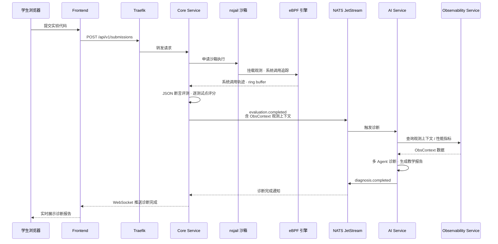
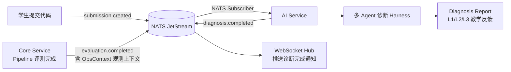
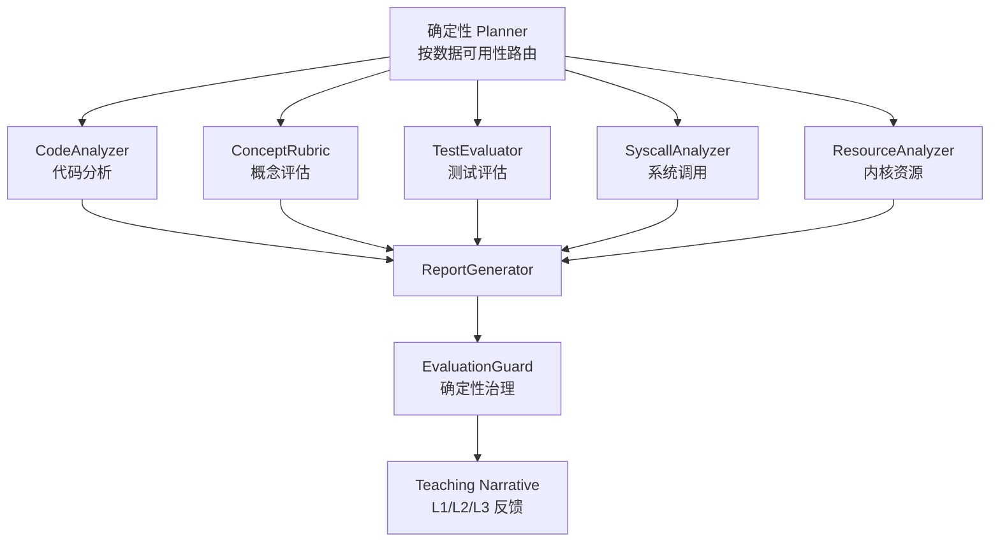

<div align="center">


# TraceOS Lab

**云原生 + eBPF 深度观测 + 多智能体 AI 诊断的 OS 在线实验平台**


< **TraceOS · 核心能力** >
> 🛠️ eBPF 系统调用追踪 ｜ 🤖 多 Agent 诊断 Harness ｜ ✅ JSON 断言评测 ｜ 💡 启发式教学引导

<sub>🏆 2026 年全国大学生计算机系统能力大赛 · OS 功能挑战赛道 参赛项目</sub>

</div>

---

## 👥 团队成员

<div align="center">

**SyncGenesis** · 三人成行，各展所长，共同铸就 TraceOS Lab ✨

| 🚀 马宝宝 | 🌲 李睿 | 🌊 吴浚泽 |
|:---:|:---:|:---:|

<sub>从内核观测到智能诊断，从沙箱隔离到教学叙事——每一行代码，都凝聚着我们对操作系统最纯粹的热爱与坚持 💻</sub>

</div>

---


## 🎯 概览

**TraceOS Lab** 是一个面向操作系统实验教学的云原生在线评测与 AI 辅助诊断平台。针对传统 OS 实验教学中 **环境不可复现**、**评测仅看输出**、**AI 辅导缺乏引导** 三大痛点，我们构建了从代码提交、容器化沙箱运行、eBPF 系统调用采集、JSON 断言自动化评测到多智能体启发式 AI 反馈的完整教学链路。

> **设计理念**：不只告诉学生「对」或「错」，而是通过系统轨迹分析和 AI 协同，引导他们理解 **错误根因** 与 **排查思路**。

### 解决的三大教学痛点

| 痛点                | 传统方案                          | TraceOS Lab 方案                                 |
| ------------------- | --------------------------------- | ------------------------------------------------ |
| 🔧 实验环境难以统一  | 本地配置 / 虚拟机，差异大、复现差 | nsjail 三级隔离沙箱（docker/local 可选后端），环境一致、即开即用 |
| 📊 传统评测仅重结果  | 只比对 stdout，看不到系统行为     | strace 降级 + eBPF 主引擎双链路采集系统调用，观测运行全过程 |
| 🤖 AI 反馈与教学脱节 | 通用问答，不结合实验逻辑          | 测试判定 + 轨迹分析 + AI 协同 → 三层级启发式提示 |

---
### 📦 项目附件资料

**SyncGenesis 队伍** 的项目展示材料已打包上传，包含以下内容：

| 资料类型                  | 内容说明                                                  |
| ------------------------- | --------------------------------------------------------- |
| 🎞️ **项目演示视频**        | 系统功能全景展示，覆盖核心操作流程与实际运行效果          |
| 📊 **答辩 PPT**            | 项目背景、技术方案、创新亮点与成果总结                    |
| 📘 **技术文档**            | 系统设计详述、模块接口说明、部署与开发指南                |
| 📖 **源码深度讲解文档**    | 项目源代码详细深度讲解，12 篇专业的系统阐述设计与实现 |
| 🤖 **AI 辅助开发使用说明** | AI 工具使用情况披露、人工贡献对照、典型交互记录与验证流程 |


> 📂 **项目源代码详细深度讲解文档**：[docs/项目专业技术文档/](./docs/项目专业技术文档/)
>
> 📄 关于本项目开发过程中 AI 工具的使用情况、人工贡献对照、典型交互记录及验证流程，详见 **[AI 辅助开发使用说明](./docs/AI辅助开发使用说明.md)**
>
> 🔗 **百度网盘下载**
>
> 内容包含：技术文档、演示视频、答辩 PPT
>
> 链接：[https://pan.baidu.com/s/1ce396zknxi5EILrmEnlf1g?pwd=3a6c](https://pan.baidu.com/s/11TeP-AMxhTwayaHT2H58ew)
>
> 提取码：`3a6c`


---

## 🏗️ 系统架构

### 分层架构总览

```
┌─────────────────────────────────────────────────────────────────────────┐
│                              👥 用户层                                  │
│                                                                         │
│         🧑‍🎓 学生端 ──────────────── 🧑‍🏫 教师端（仪表盘 · 答疑管理）         │
└────────────────────────────────────┬────────────────────────────────────┘
                                     │ HTTP / SSE / WebSocket
┌────────────────────────────────────▼────────────────────────────────────┐
│                     📱 前端 · Next.js 14 (App Router)                   │
│                                                                         │
│   Monaco Editor · xterm.js · ECharts 5 · R3F 3D 内存可视化               │
│   Zustand 全局状态 · 可拖拽面板 · SSE / WebSocket 实时订阅                │
└────────────────────────────────────┬────────────────────────────────────┘
                                     │
┌────────────────────────────────────▼────────────────────────────────────┐
│                  🚪 Traefik API 网关 · PathPrefix 前缀路由               │
│                                                                         │
│   /        → 前端             /api/ai/  → AI Service                    │
│   /api/v1/ → Core Service     /api/obs/ → Observability Service         │
│   /ws/     → WebSocket                                                  │
└───────┬──────────────────────────────┬───────────────────────┬─────────┘
        │                              │                       │
┌───────▼─────────────┐  ┌─────────────▼──────────┐  ┌─────────▼─────────┐
│   Core Service      │  │   AI Service           │  │  Observability    │
│   Go 1.22 · Gin     │  │   Python 3.11 · FastAPI│  │  Service          │
│                     │  │                        │  │  Go · Gin         │
│ • JWT 认证          │  │ • 确定性 Planner        │  │                   │
│ • 评测 Pipeline     │  │ • 5 类诊断 Agent        │  │ • 系统调用轨迹查询 │
│ • JSON 断言评分     │  │ • Report Generator      │  │ • 性能指标聚合     │
│ • 沙箱池管理        │  │ • Evaluation Guard      │  │ • 内存布局分析     │
│ • eBPF 加载器       │  │ • 4 级记忆 L0-L3        │  │ • 死锁与竞态检测   │
│ • Elo 自适应难度    │  │ • RAG 混合检索           │  │ • 火焰图/内存趋势  │
│ • 成就系统          │  │                         │  │ • 泄漏检测         │
└───────┬─────────────┘  └────────────┬────────────┘  └─────────┬─────────┘
        │                            │                          │
┌───────▼────────────────────────────▼──────────────────────────▼─────────┐
│                             🏭 沙箱执行层                                │
│                                                                         │
│   nsjail 三级隔离 · docker · local 三后端切换                            │
│   cgroup CPU/内存限制（level1 100%/256MB → level3 50%/64MB）             │
│   eBPF CO-RE 主追踪链路 + strace 自动降级                                │
└────────────────────────────────────┬────────────────────────────────────┘
                                     │
   Core ──evaluation.completed──▶ NATS ──订阅──▶ AI ──diagnosis.completed─▶ WebSocket 推送前端
                                     │
┌────────────────────────────────────▼────────────────────────────────────┐
│                               🗄️ 数据层                                 │
│                                                                         │
│  ┌───────────────┐ ┌───────────┐ ┌───────────┐ ┌────────────────────┐   │
│  │ PostgreSQL 16 │ │ Redis 7   │ │ MinIO     │ │ NATS 2 JetStream   │   │
│  │ + TimescaleDB │ │ 缓存/会话 │  │ 对象存储  │ │ 事件总线            │   │
│  │ + pgvector    │ │ 限流      │ │           │ │ submission.        │   │
│  │ + Apache AGE  │ │           │ │           │ │ evaluation.        │   │
│  │               │ │           │ │           │ │ diagnosis. 三主题  │    │
│  └───────────────┘ └───────────┘ └───────────┘ └────────────────────┘   │
└────────────────────────────────────┬────────────────────────────────────┘
                                     │
   Core / AI / Observability ──▶ Prometheus · Loki · Jaeger ──▶ Grafana 统一可视化
                                     │
┌────────────────────────────────────▼────────────────────────────────────┐
│                            📊 可观测性栈                                 │
│                                                                         │
│  ┌────────────┐   ┌────────────┐   ┌─────────┐   ┌──────────────────┐   │
│  │ Prometheus │──▶│ Grafana    │   │ Loki    │   │ Jaeger          │   │
│  │ 指标采集   │   │ 仪表盘     │   │ 日志聚合│   │ 分布式追踪          │   │
│  └────────────┘   └────────────┘   └─────────┘   └──────────────────┘   │
└─────────────────────────────────────────────────────────────────────────┘
```

> 全部 13 个容器由 docker-compose 编排，应用服务不直接暴露宿主机端口，统一经 Traefik 前缀路由访问。

### 请求与事件全链路



### 评测与诊断流水线

```
学生提交代码
    │
    ▼
┌──────────────┐    ┌─────────────────┐    ┌──────────────────┐
│  nsjail 沙箱  │───▶│  eBPF 系统调用   │───▶│  JSON 断言评测    │
│  容器化运行    │    │  深度追踪采集     │    │  逐测试点评分     │
└──────────────┘    └─────────────────┘    └──────┬───────────┘
                                                  │
                    ┌─────────────────────────────┘
                    ▼
┌──────────────────────────────────────────────────────────────┐
│                    🤖 多 Agent 诊断 Harness                    │
│                                                              │
│  ┌──────────┐ ┌──────────┐ ┌──────────┐ ┌──────────┐ ┌──────────┐ │
│  │Code      │ │Test      │ │Syscall   │ │Resource  │ │Concept   │ │
│  │Analyzer  │ │Evaluator │ │Analyzer  │ │Analyzer  │ │Rubric    │ │
│  └────┬─────┘ └────┬─────┘ └────┬─────┘ └────┬─────┘ └────┬─────┘ │
│       └─────────────┴────────────┴────────────┴────────────┘       │
│                          │                                    │
│                          ▼                                    │
│              ┌─────────────────────┐                         │
│              │  Report Generator   │  ← 聚合教学建议           │
│              └─────────┬───────────┘                         │
│                        ▼                                      │
│              ┌─────────────────────┐                         │
│              │  Evaluation Guard   │  ← 质量闸门              │
│              └─────────┬───────────┘                         │
│                        ▼                                      │
│              ┌─────────────────────┐                         │
│              │  Teaching Narrative │  ← 三层级启发式反馈       │
│              └─────────────────────┘                         │
└──────────────────────────────────────────────────────────────┘
```

### 事件驱动评测链路

NATS JetStream 上的三个核心主题驱动异步协作：`submission.created`（提交进入评测）→ `evaluation.completed`（评测完成，携带 ObsContext）→ `diagnosis.completed`（诊断完成，WebSocket 通知前端刷新）。



---

## ⚡ 核心能力

### 🔬 eBPF 运行时深度观测

**eBPF 作为主追踪链路，strace 自动降级**。全局单套 BPF 程序常驻内核，通过 `HASH_OF_MAPS` 实现多沙箱任务隔离，避免 tracepoint 重复挂载。

```
┌───────────────────────────────────────────────────────────┐
│                   BPF Program Suite (CO-RE)                │
│                                                           │
│  tracepoint: raw_syscalls/sys_enter, sys_exit             │
│  tracepoint: sched/sched_process_fork, exec, exit        │
│  tracepoint: syscalls/sys_enter_futex (死锁检测)          │
│  tracepoint: syscalls/sys_enter_brk, mmap, munmap (内存)  │
│                                                           │
│  Ring Buffer ──▶ syscall_events (带 sandbox_id 标签)      │
│  HASH_OF_MAPS: sandbox_pids (TID→start_time 复合 key)     │
└───────────────────────────────────────────────────────────┘
```

| 对比维度 | strace (旧) | eBPF (新) |
|---------|-----------|----------|
| 单次 syscall 开销 | ~1–5 μs (ptrace 暂停-恢复) | ~100–500 ns (内核态 hook) |
| 数据格式 | 文本行，需正则解析 | 结构化二进制 ring buffer |
| 时间精度 | 受 ptrace 上下文切换影响 | `ktime_get_ns()` 纳秒级 |
| 参数捕获 | 文本格式化，有截断 | 直接读寄存器，完整 6 参数 |
| 线程支持 | `-f` follow forks，额外开销 | 内核态 TGID/TID 区分 |
| 信号干扰 | 改变进程 SIGSTOP/SIGCONT | **无信号副作用** |

### 🧪 JSON 断言评测引擎

**每个测试用例携带结构化 JSON 断言，全部通过则该测试点得分。** 评测结果 100% 可复现，彻底解决「烂代码拿高分」问题。

```json
{
  "exit_code": 0,
  "output_assertions": [
    { "mode": "contains",   "value": "Parent: PID=" },
    { "mode": "regex",      "value": "Child: PID=\\d+, PPID=\\d+" },
    { "mode": "not_contains", "value": "ERROR" }
  ],
  "syscall_assertions": {
    "required":  ["clone", "wait4"],
    "forbidden": ["system"],
    "min_count": { "write": 1 },
    "max_count": { "fork": 10 }
  },
  "behavior_assertions": {
    "no_fd_leak": true,
    "no_zombie": true,
    "max_memory_kb": 131072
  }
}
```

**评分公式（v2 权重累加评分）：**

```
total_score = Σ 通过的测试点权重 (weight)
core_score  = Σ 通过的 core 类型测试点权重
edge_score  = Σ 通过的 edge 类型测试点权重

is_qualified = 所有 core 类型测试点全部通过
```

**关键原则：**
- 测试点分为 `core`（核心考点）与 `edge`（边界/进阶）两类，`normalizeType` 兼容旧版 `normal`/`edge_case` 命名
- `is_qualified` 判定业务是否达标：任一 core 测试点失败即不达标，与总分解耦
- 测试断言即评分，AI 诊断不参与分数计算
- 参考实现仅用于验证断言正确性，不做 diff 比对判分（`/traces/diff` 为独立观测工具）

### 🤖 多 Agent 诊断 Harness

按数据维度分层的多 Agent 架构：**确定性 Planner（非 LLM）** 依据评测产出决定激活哪些专项 Agent——CodeAnalyzer 与 ConceptRubric 始终参与；存在测试数据/编译错误时激活 TestEvaluator；存在系统调用轨迹时激活 SyscallAnalyzer；存在 eBPF 内核观测事实时激活 ResourceAnalyzer。最终由 ReportGenerator 聚合为三层级教学反馈。



**质量保障机制：**
- **Evaluation Guard** — 确定性规则校验，过滤不可靠诊断与幻觉内容
- **Fallback Chain** — 单 Agent 失败时降级到规则模板
- **Context Firewall / Guardrails** — 上下文与输出双侧安全校验（`agents/guardrails.py` + `agents/context_builder.py`）

### 🎓 三层级启发式教学

基于 **Bloom 认知分类学** 和 **Supraptive Method** 教学法，不直接给答案，而是渐进引导。

```
┌─────────────────────────────────────────────────────────┐
│  L1  🔍 启发式引导                                       │
│  ─────────────────────────────────────────────────────  │
│  "你的程序创建了子进程，但父进程似乎在等待时遇到了问题。    │
│   回顾一下 waitpid() 的参数含义，特别是第三个参数。"       │
│                                                         │
│  L2  🎯 具体排查                                         │
│  ─────────────────────────────────────────────────────  │
│  "从系统调用轨迹看，clone() 成功返回了子进程 PID，        │
│   但后续的 wait4() 调用返回了 -1 (ECHILD)。               │
│   这意味着什么？检查你的 waitpid 第一个参数。"             │
│                                                         │
│  L3  💡 示例参考                                         │
│  ─────────────────────────────────────────────────────  │
│  "正确的做法是：fork 后用 waitpid(pid, &status, 0)       │
│   等待特定子进程。理解这个模式后，修改你的代码试试。"       │
└─────────────────────────────────────────────────────────┘
```

**四级记忆架构（L0–L3）**支撑个性化教学：

| 层级 | 存储 | 内容 | 生命周期 |
|------|------|------|--------|
| L0 工作记忆 | 进程内 | 当前上下文窗口、本次评测数据 | 单次请求 |
| L1 短期记忆 | PostgreSQL `conversation_memories` | 会话压缩摘要、关键事实、压缩轮次状态 | 会话级 |
| L2 学生画像 | PostgreSQL `student_profiles` | weak_topics、strong_topics、preferred_hint_level、学习节奏 | 永久 |
| L3 全局记忆 | PostgreSQL `long_term_memories` + `error_statistics` | 跨会话长期记忆、常见错误模式、教学策略 | 永久 |

> Redis 作为会话与热点缓存（LRU 512MB）加速记忆读取；课程知识点与文档语料由 pgvector 知识库独立承载，通过 RAG 检索注入。

### 📊 可观测性全景

```
评测产出数据
    │
    ├── 🧬 eBPF 内核观测 (BPF CO-RE · 全局单套 · HASH_OF_MAPS 多沙箱隔离)
    │   ├── raw_syscalls/sys_enter·exit 系统调用主链路
    │   ├── sched_process_fork/exec/exit 进程生命周期
    │   ├── brk/mmap/munmap 内存事件追踪 (mem_trace)
    │   ├── sys_enter_futex futex 死锁检测 (mutex_trace)
    │   ├── 按 PID 实时观测 (observe/:pid · stream 事件流推送)
    │   └── 三级降级：BPF → bpftrace → strace
    │
    ├── 📈 系统调用轨迹 (TimescaleDB 超表 · 自动分区压缩)
    │   ├── syscall 时序序列
    │   ├── 参数分布统计
    │   ├── 聚合模式分析
    │   ├── 性能指标聚合 (observability /metrics)
    │   └── 轨迹差分对比 (traces-diff)
    │
    ├── 🔍 代码质量分析
    │   ├── 语义事件提取 (semantic_engine)
    │   ├── 系统调用语义分类 (semantic classify)
    │   ├── Span 树构建 (span_builder)
    │   ├── 风险指标计算 (risk_indicator)
    │   ├── 进程间因果链 (event_linker)
    │   └── AI 代码审计 (code-audit)
    │
    ├── 🐛 缺陷检测
    │   ├── fd 泄漏检测 (Valgrind-style)
    │   ├── 竞态条件检测 (TSan-style Happens-Before)
    │   ├── 死锁演化分析 (Coffman 条件)
    │   ├── 内存分配火焰图 (Heaptrack-style)
    │   ├── 内存趋势分析 (Massif-style)
    │   └── 内存布局分析 (memory-layout · 前端 3D 可视化)
    │
    ├── 📚 教学叙事
    │   ├── 时间轴校准 (timeline_calibrator)
    │   ├── 教学提示引擎 (teaching_narrative)
    │   ├── 追问问题生成 (followup-questions)
    │   ├── 复合触发器 (composite_trigger)
    │   ├── 进程间事件关联 (event_correlator)
    │   └── 线程状态追踪 (thread_state_tracker)
    │
    ├── 🧩 观测上下文聚合
    │   ├── 三层 ObsContext 构建 (obs_context_builder)
    │   ├── 沙箱资源指标 (sandbox_metrics)
    │   └── 快速过滤索引 (filter_index)
    │
    └── 🎯 火焰图性能分析
        ├── CPU 火焰图 (Brendan Gregg)
        ├── 差分火焰图 (flamegraph_diff)
        └── 内存分配火焰图 (alloc_flamegraph)
```

---

## 🧪 实验覆盖

TraceOS Lab 预置 **31 个操作系统实验**，覆盖 6 大核心领域（进程 7 · 线程 6 · 内存 5 · 文件 I/O 5 · 调度 5 · 死锁 3），配套 300+ 组 JSON 断言测试用例（`05-seed.sql` 基础用例 + `20/23` 号迁移扩增）。

```
┌──────────────────────────────────────────────────────────────┐
│                                                              │
│   🔀 进程管理          🧵 线程同步           💾 内存管理      │
│   ───────────        ───────────          ───────────       │
│   fork / exec        mutex / condvar       malloc / free     │
│   IPC 通信           读写锁 rwlock         虚拟内存映射       │
│   信号处理           生产者-消费者          共享内存 shm       │
│   进程状态转换       线程池实现            页表管理模拟       │
│   守护进程           屏障同步 barrier      内存泄漏检测       │
│   僵尸进程处理                                            │
│                                                              │
│   📁 文件 I/O         ⏱️ 处理机调度         🔒 死锁检测      │
│   ───────────        ───────────          ───────────       │
│   文件读写操作        FCFS / SJF           死锁必要条件       │
│   目录遍历            优先级调度            银行家算法        │
│   文件权限管理        时间片轮转 RR         资源分配图        │
│   fd 管理            多级队列调度           Wait-For Graph    │
│   缓冲 I/O 对比       实时调度策略                            │
│                                                              │
└──────────────────────────────────────────────────────────────┘
```

### AI 诊断能力矩阵

| 实验类别 | syscall 分析 | perf 分析 | eBPF 分析 | 代码分析 |
|---------|:---:|:---:|:---:|:---:|
| 进程管理 | ✅ | ✅ | ✅ | ✅ |
| 线程同步 | ✅ | ✅ | ✅ | ✅ |
| 内存管理 | ✅ | ✅ | ✅ | ✅ |
| 文件 I/O | ✅ | ✅ | ✅ | ✅ |
| 处理机调度 | ✅ | ✅ | ✅ | ✅ |
| 死锁检测 | ✅ | ✅ | ✅ | ✅ |


### 🏅 成就与激励系统

基于 **28-achievements.sql** 构建的成就系统：学生完成实验、连续打卡、攻克难点时解锁成就徽章，前端实时弹出成就通知（`AchievementToasts` + `CongratulationModal`），与 Elo 能力画像联动形成正向学习激励闭环。

---

## 🛠️ 技术栈

### 后端服务

| 服务 | 语言 | 框架 | 核心职责 |
|------|------|------|---------|
| **Core Service** | Go 1.22 | Gin + pgx + cilium/ebpf | 评测引擎、沙箱池、eBPF 加载、教学叙事 |
| **AI Service** | Python 3.11 | FastAPI + LangChain 生态 | 多 Agent 诊断、RAG 检索、四级记忆 |
| **Observability** | Go 1.22 | Gin + TimescaleDB | syscall 轨迹查询、内存布局分析 |

### 前端

| 技术 | 用途 |
|------|------|
| Next.js 14 (App Router) | SSR + Server Components + Standalone 输出 |
| React 18 + TypeScript 5 | 类型安全 UI |
| Monaco Editor | 代码编辑器 (VS Code 内核) |
| ECharts 5 | 火焰图、热力图、时序图、雷达图 |
| Three.js + React Three Fiber | 3D 内存布局可视化 |
| Tiptap | 实验报告富文本编辑器 |
| AI SDK (@ai-sdk/react) | AI 对话流式交互 |
| Framer Motion 13 | 动画过渡、骨架屏、微交互 |
| xterm.js | Web 终端模拟器 |
| react-resizable-panels + cmdk | 可拖拽面板、命令面板 |
| Zustand 5 | 轻量状态管理 |
| shadcn/ui + TailwindCSS 3 | 组件库与原子化 CSS，5 套主题联动 |
| Vitest | 前端单元测试 |

### 基础设施

| 组件 | 角色 |
|------|------|
| PostgreSQL 16 + TimescaleDB | 主库 + 时序超表 (自动分区压缩) |
| pgvector | 向量检索：BGE-M3 (1024 维) / 外部 API (1536 维)，无外部依赖时降级 TF-IDF 特征哈希 |
| Apache AGE | OS 概念知识图谱 (Cypher) |
| Redis 7 | 会话 + 缓存 (LRU, 512MB) |
| MinIO | 代码与报告对象存储 |
| NATS JetStream | 事件驱动评测与诊断 |
| Traefik | API 网关 (路径路由, 速率限制) |
| nsjail | Google CTF 级进程隔离沙箱 (3 级隔离配置) |

### 可观测性栈

| 组件 | 用途 |
|------|------|
| Prometheus | 指标采集与告警 |
| Grafana | 监控仪表盘 |
| Loki | 结构化日志聚合 |
| Jaeger | 分布式链路追踪 (OTLP) |

---

## 🚀 快速开始

### 前置要求

| 依赖 | 最低版本 |
|------|---------|
| Docker | ≥ 24.0 |
| Docker Compose | v2 (plugin) |
| 内存 | ≥ 4 GB |
| 磁盘 | ≥ 20 GB |
| 内核 | ≥ 5.4 (eBPF 需 ≥ 5.8, CO-RE 需 BTF) |

### 一键部署

```bash
git clone <your-repo-url>
cd traceos-lab

# 配置环境变量（至少填入 LLM_API_KEY）
cp .env.example .env

# 完整部署
make deploy
```

### 分步启动

```bash
# 仅基础设施 (PG + Redis + NATS + MinIO + Traefik)
docker compose up -d

# 应用服务
docker compose --profile app up -d

# 监控栈 (可选)
docker compose --profile monitoring up -d

# 全部启动
docker compose --profile app --profile monitoring up -d
```

### 访问地址

| 服务 | 地址 | 备注 |
|------|------|------|
| 🌐 前端界面 | `http://localhost` | Traefik 网关 (端口 80) |
| 🔧 Core API | `http://localhost/api/v1/` | 经 Traefik 路由至 core-service:8080 |
| 🤖 AI Service | `http://localhost/api/ai/` | 经 Traefik 路由至 ai-service:8000 |
| 📡 Observability | `http://localhost/api/obs/` | 经 Traefik 路由至 observability:9091 |
| 📊 Traefik Dashboard | `http://127.0.0.1:8080` | 网关面板 |
| 🗄️ PostgreSQL | `127.0.0.1:5432` | 默认仅本机可访问 |
| ⚡ Redis | `127.0.0.1:6379` | 默认仅本机可访问 |
| 🗂️ MinIO Console | `http://127.0.0.1:9001` | 对象存储控制台 |
| 📈 Prometheus | `http://127.0.0.1:9090` | 指标采集 (monitoring profile) |
| 📊 Grafana | `http://127.0.0.1:3001` | `admin/admin` (monitoring profile) |
| 🔍 Jaeger | `http://127.0.0.1:16686` | 链路追踪 (monitoring profile) |
| 📜 Loki | `http://localhost:3100` | 日志聚合 (monitoring profile) |

---

## 📁 项目结构

```
traceos-lab/
├── services/
│   ├── core-service/             # Go 核心服务
│   │   ├── cmd/server/           # 入口 (main.go · 509 行 · 36 个 handler 注册)
│   │   ├── internal/
│   │   │   ├── handler/          # 37 个 HTTP handler 源文件
│   │   │   ├── handler/teacher/  # 教师仪表盘 handler (dashboard/stats/ai-analysis)
│   │   │   ├── evaluator/        # 评测引擎 (编译/运行/断言/v2 评分/轨迹 diff)
│   │   │   ├── ebpf/             # BPF 加载器 (CO-RE + 非 CO-RE)
│   │   │   ├── sandbox/          # nsjail/docker/local 三后端沙箱 + 连接池
│   │   │   ├── services/         # 17 个观测服务 (语义/泄漏/竞态/死锁/叙事/...)
│   │   │   ├── ast/              # C 代码 AST 解析 + CFG 构建
│   │   │   ├── adaptive/         # Elo 自适应难度系统 (K=32 评分模型)
│   │   │   ├── achievement/      # 成就系统 (定义/仓储/服务)
│   │   │   ├── kg/               # Apache AGE 知识图谱客户端
│   │   │   ├── repository/       # DB 仓储 (submission/experiment/user/...)
│   │   │   ├── model/            # 共享数据模型 (TestPointData 等)
│   │   │   ├── types/            # 观测上下文类型定义
│   │   │   ├── nats/             # JetStream 事件总线 (3 类事件)
│   │   │   ├── ws/               # WebSocket Hub
│   │   │   ├── middleware/       # JWT + Rate Limit
│   │   │   └── config/           # 环境变量 + 安全验证
│   │   └── Dockerfile
│   │
│   ├── ai-service/               # Python AI 诊断服务
│   │   ├── app/
│   │   │   ├── main.py           # FastAPI 入口 + NATS 订阅者
│   │   │   ├── agents/           # 对话 Agent 与工具
│   │   │   │   ├── teaching_assistant.py   # 教学助手
│   │   │   │   ├── diagnosis_tutor.py      # 教学提示生成
│   │   │   │   ├── harness_adapter.py      # Diagnosis Harness 适配
│   │   │   │   ├── memory.py               # 4 级记忆管理 (L0-L3)
│   │   │   │   ├── rag_agent.py            # RAG 检索 Agent
│   │   │   │   ├── mcp_client.py           # MCP 协议客户端
│   │   │   │   ├── code_auditor.py         # 代码质量审查
│   │   │   │   ├── guardrails.py           # 输出安全校验
│   │   │   │   ├── context_builder.py      # 上下文构建
│   │   │   │   ├── tool_sandbox.py         # 工具沙箱
│   │   │   │   ├── observability.py        # 可观测性集成
│   │   │   │   ├── tools.py                # 工具集合
│   │   │   │   ├── prompts/                # Prompt 模板库
│   │   │   │   └── skills/                 # Agent 技能定义
│   │   │   ├── diagnosis/        # 诊断 Harness
│   │   │   │   ├── orchestrator.py       # 诊断编排器 (确定性 Planner)
│   │   │   │   ├── agents/              # 5 类诊断模块: code/test/syscall/resource + rubric
│   │   │   │   ├── context_package.py   # 上下文数据包
│   │   │   │   ├── deterministic.py     # 确定性规则引擎
│   │   │   │   ├── evaluation_guard.py  # 幻觉检测
│   │   │   │   ├── fallback.py          # 降级策略
│   │   │   │   ├── governance.py        # 诊断治理
│   │   │   │   ├── error_kb.py          # 错误知识库
│   │   │   │   ├── obs_context_injector.py  # 观测上下文注入
│   │   │   │   └── prompts.py           # 诊断 Prompt
│   │   │   ├── services/         # LLM 客户端 (多 Provider) + RAG 管道
│   │   │   │   ├── rag/          # 混合嵌入 + 混合检索 (BM25 + 向量)
│   │   │   │   ├── retrieval/    # 检索服务
│   │   │   │   ├── ingestion/    # 文档摄取
│   │   │   │   └── importer/     # 文档导入
│   │   │   ├── routers/          # 18 个 API 路由模块
│   │   │   ├── middleware/       # 中间件
│   │   │   ├── db/               # 数据库连接 + 仓储
│   │   │   └── mock/             # 离线 Mock 模式
│   │   ├── tests/                # 16 个 Python 测试
│   │   ├── migrations/           # 数据库迁移
│   │   ├── reindex.py            # 知识库向量重建脚本
│   │   └── Dockerfile
│   │
│   └── observability/            # Go 可观测性服务
│       ├── cmd/server/           # 入口 (Gin + TimescaleDB)
│       └── internal/
│           ├── handler/          # trace + memory + analysis handler
│           ├── repository/       # TimescaleDB 仓储 + 内存布局查询
│           ├── collector/        # 特征提取 + syscall 解析
│           ├── model/            # 内存布局模型
│           └── config/           # 配置
│
├── frontend/                     # Next.js 14 前端
│   ├── app/                      # App Router 路由
│   │   ├── (dashboard)/          # 19 个仪表盘页面
│   │   │   ├── experiments/      # 实验列表 / 详情 / 工作区
│   │   │   ├── teacher/          # 教师面板 (仪表盘/学生/知识审查/课程管理)
│   │   │   ├── submissions/      # 提交历史
│   │   │   ├── admin/            # 管理面板 (用户/日志)
│   │   │   ├── knowledge/        # 知识库浏览
│   │   │   ├── rag/              # RAG 知识管理
│   │   │   ├── progress/         # 学习进度
│   │   │   ├── student/          # 学生课程视图
│   │   │   └── settings/         # 设置
│   │   ├── login/register/       # 认证页面
│   │   └── api/                  # Next.js API 路由 (host-metrics/images/upload)
│   ├── components/
│   │   ├── ui/                   # 36 个 shadcn/ui 基础组件
│   │   ├── workspace/            # 63 个实验工作区组件 (编辑器/面板/时间轴/3D)
│   │   │   ├── panels/           # 观测面板 (eBPF 轨迹/火焰图/因果链/泄漏报告)
│   │   │   └── evaluation/       # 评测结果组件
│   │   ├── ebpf/                 # 14 个 eBPF 可视化组件 (tabs/shared)
│   │   ├── panels/               # 可拖拽面板系统 (Tier 分层面板)
│   │   ├── ai-assistant/         # AI 聊天界面 (6 个组件)
│   │   ├── knowledge/            # 知识库组件
│   │   ├── rag/                  # RAG 管理组件
│   │   ├── admin/                # 管理端组件
│   │   ├── layout/               # 布局组件
│   │   └── settings/             # 设置组件 (16 个)
│   ├── lib/                      # API 客户端 / RAG API / 流式聊天 / 主题
│   ├── stores/                   # 6 个 Zustand store (workspace/ebpf/theme/...)
│   ├── hooks/                    # 8 个 hooks (WebSocket/eBPF/Theme/Perf)
│   └── __tests__/                # Vitest 测试
│
├── ebpf/                         # eBPF 跟踪程序
│   ├── bpf/                      # CO-RE BPF 程序 (v1 + v2)
│   │   ├── syscall_trace_v2.bpf.c      # CO-RE syscall 跟踪 (ring buffer)
│   │   ├── syscall_trace_v2_nocore.bpf.c  # 非 CO-RE 兼容
│   │   ├── futex_deadlock_v2.bpf.c     # futex 死锁检测
│   │   ├── mem_trace_v2.bpf.c          # brk/mmap/munmap 跟踪
│   │   ├── trace_common_v2.h           # 共享事件结构
│   │   └── vmlinux.h                   # BTF 类型定义
│   ├── scripts/                  # bpftrace 脚本 + Python 分析器 + 火焰图服务
│   └── tools/FlameGraph/         # Brendan Gregg FlameGraph
│
├── sandbox/                      # 沙箱配置
│   ├── lab-images/               # base + process-lab 实验镜像
│   ├── nsjail-configs/           # nsjail 隔离配置 (3 级: standard/secure/hardened)
│   └── seccomp-profiles/         # 6 类实验 seccomp 白名单
│
├── nsjail/                       # nsjail 上游源码 (定制构建)
│
├── deploy/
│   ├── init-db/                  # 29 个 SQL 迁移文件
│   ├── monitoring/               # Prometheus + Loki 配置
│   └── traefik-dynamic.yml       # Traefik 动态路由
│
├── proto/                        # Protobuf 接口定义 (buf 管理)
│   ├── core/v1/                  # experiment / evaluation / sandbox / user
│   ├── ai/v1/                    # agent / diagnosis / knowledge
│   └── observability/v1/         # stream / trace
│
├── scripts/                      # 部署 + 多语言种子脚本
├── docs/                         # 开发/排障/参考文档
│   ├── 项目专业技术文档/         # 12 篇专业技术文档
│   ├── plan/                     # 18 个升级方案文档
│   └── reference/                # API/数据库/nsjail/竞赛参考
├── e2e_test_round.sh             # 全链路打分端到端测试
├── seed_rag.py / seed_rag_knowledge.py  # RAG 知识库种子脚本
└── docker-compose.yml            # 统一编排 (profiles: infra/app/monitoring)
```

---

## 🔌 API 概览

### Core Service (`/api/v1`)

| 分类 | 端点 | 方法 | 说明 |
|------|------|------|------|
| **认证** | `/auth/register` | POST | 用户注册 |
| | `/auth/login` | POST | 登录获取 JWT |
| | `/auth/refresh` | POST | 刷新令牌 |
| | `/auth/logout` | POST | 注销 |
| | `/auth/me` | GET | 当前用户信息 |
| **课程** | `/courses` | GET | 我的课程列表 |
| | `/courses` | POST | 创建课程 (教师) |
| | `/courses/join` | POST | 邀请码加入课程 |
| | `/courses/:id/experiments` | GET | 课程实验列表 |
| | `/courses/:id/students` | GET | 课程学生列表 (教师) |
| | `/courses/:id/invite-codes` | GET/POST | 邀请码管理 (教师) |
| | `/courses/invite-codes/:codeId/disable` | PUT | 禁用邀请码 (教师) |
| **实验** | `/experiments` | GET/POST | 实验列表 / 创建 (教师) |
| | `/experiments/:id` | GET/PUT/DELETE | 实验详情 / 编辑 / 删除 |
| | `/experiments/:id/submissions` | GET | 实验提交历史 |
| | `/experiments/:id/ai-chat` | POST | 带代码上下文的 AI 对话 |
| | `/experiments/:id/draft` | GET/PUT/DELETE | 工作区草稿 |
| | `/experiments/:id/dock-state` | PUT | 面板布局状态 |
| | `/experiments/:id/cache` | GET/POST/DELETE | 实验缓存 |
| | `/test-cases` | POST | 创建测试用例 (教师) |
| | `/test-cases/:id` | PUT/DELETE | 编辑 / 删除测试用例 (教师) |
| **提交** | `/submissions` | POST | 提交代码评测 |
| | `/submissions` | GET | 提交列表 |
| | `/submissions/:id` | GET | 评测结果详情 |
| | `/submissions/:id/traces` | GET | 系统调用轨迹 |
| **会话** | `/conversations` | GET/POST | 会话列表 / 创建 |
| | `/conversations/:id` | PATCH/DELETE | 更新 / 删除会话 |
| | `/conversations/:id/messages` | GET/POST | 会话消息 |
| | `/conversations/:id/monitoring` | GET | 会话监控 |
| **评论** | `/experiments/:id/comments` | GET/POST | 实验评论 |
| | `/experiments/:id/comments/ai-ask` | POST | AI 回复评论 |
| | `/comments/:id` | PUT/DELETE | 编辑 / 删除评论 |
| | `/comments/:id/pin` | PUT | 置顶评论 (教师) |
| **进度/成就** | `/progress` | GET | 我的学习进度 |
| | `/progress/:experiment_id` | GET | 实验进度 |
| | `/achievements` | GET | 成就列表 |
| | `/achievements/evaluate` | POST | 触发成就评估 |
| **报告** | `/submissions/:id/report` | POST/GET | 提交 / 获取实验报告 |
| | `/reports/:id/grade` | PUT | 报告评分 (教师) |
| **火焰图** | `/submissions/:id/flamegraph` | POST/GET | 生成 / 获取火焰图 |
| | `/submissions/:id/flamegraph/diff` | GET | 差分火焰图对比 |
| **观测** | `/submissions/:id/obs-context` | GET | 统一观测上下文聚合 (三层 ObsContext) |
| | `/submissions/:id/semantic/analyze` | GET | 系统调用语义分析 |
| | `/submissions/:id/semantic/classify` | GET | 系统调用模式分类 |
| | `/submissions/:id/span-tree` | GET | 系统调用 Span 树 |
| | `/submissions/:id/risk-indicators` | GET | 风险指标计算 |
| | `/submissions/:id/sandbox-metrics` | GET | 沙箱资源指标 |
| | `/submissions/:id/leak-report` | GET | 泄漏检测报告 |
| | `/submissions/:id/alloc-flamegraph` | GET | 内存分配火焰图 |
| | `/submissions/:id/memory-trend` | GET | 内存趋势分析 |
| | `/submissions/:id/race-report` | GET | 竞态条件报告 |
| | `/submissions/:id/deadlock-evolution` | GET | 死锁演化分析 |
| | `/traces/diff` | POST | 轨迹 diff 对比 |
| **教学** | `/submissions/:id/teaching-narrative` | POST | 构建教学叙事 |
| | `/submissions/:id/followup-questions` | POST | 生成追问 |
| | `/submissions/:id/diagnosis` | GET/POST | 诊断结果持久化 |
| **eBPF** | `/ebpf/observe` | POST | 启动观测 |
| | `/ebpf/observe/:pid` | GET/DELETE | 获取 / 停止观测 |
| | `/ebpf/stream/:pid` | GET | 流式 eBPF 事件 (SSE) |
| | `/ebpf/deadlock/:submission_id` | GET | 提交级死锁检测 |
| **自适应** | `/adaptive/profile` | GET | 学生 Elo 能力画像 |
| | `/adaptive/recommend` | GET | 实验推荐 (最近发展区) |
| | `/experiments/:id/variant` | GET | 难度变体 |
| **代码审计** | `/code-audit` | POST | 提交代码审计 |
| | `/code-audit/:submission_id` | GET | 审计结果 |
| **教师** | `/teacher/dashboard` | GET | 教师仪表盘总览 |
| | `/teacher/stats/overview` | GET | 统计概览 |
| | `/teacher/stats/errors` | GET | Top10 高频错误 |
| | `/teacher/stats/heatmap` | GET | 错误热力图 |
| | `/teacher/stats/common-issues` | GET | 常见问题 |
| | `/teacher/students` | GET | 学生列表 |
| | `/teacher/students/:id` | GET | 学生详情与进度 |
| | `/teacher/export` | GET | 数据导出 |
| | `/teacher/ai-analysis` | GET | AI 班级分析 |
| **管理** | `/admin/db/overview` | GET | 数据库概况 |
| | `/admin/submissions/queue` | GET | 评测队列 |
| | `/admin/submissions/reset` | POST | 批量重置提交 |
| | `/admin/submissions/ai-adjust-score` | POST | AI 辅助分数调整 |
| | `/admin/experiments/config` | GET | 实验配置 |
| | `/admin/users` | GET/POST | 用户管理 |
| | `/admin/logs` | GET | 审计日志 |

### AI Service (`/api/ai` + 代理)

| 端点 | 方法 | 说明 |
|------|------|------|
| `/api/ai/diagnose` | POST | 触发 AI 诊断 |
| `/api/ai/diagnose` | GET | 查询诊断结果 |
| `/api/ai/diagnose/reports` | GET | 诊断报告列表 |
| `/api/ai/diagnose/:id/stream` | GET | 诊断进度流式推送 |
| `/api/ai/diagnose/insights/*` | GET/POST | 学生进度 / 班级统计 / 排名 / 错误模式 / 追踪 Span |
| `/api/ai/hints/:diagnosis_id/:level` | GET | 按层级获取提示 (L1/L2/L3) |
| `/api/ai/chat` | POST | AI 对话 (SSE 流式) |
| `/api/ai/ask` | POST | 随时 AI 提问 |
| `/api/ai/experiments/:id/chat/stream` | POST | 实验上下文流式对话 |
| `/api/ai/memory/compress` | POST | 会话记忆压缩 |
| `/api/ai/memory/extract-ltm` | POST | 提取长期记忆 |
| `/api/ai/analyze-class` | POST | 班级学情 AI 分析 |
| `/api/ai/adaptive/*` | GET/POST | 自适应难度分析 |
| `/api/ai/code-audit/deep` / `quick` | POST | 代码质量审查 |
| `/api/ai/report/evaluate` | POST | 实验报告 AI 评估 |
| `/api/ai/flamegraph/analyze` | POST | 火焰图 AI 分析 |
| `/api/ai/ebpf/analyze` | POST | eBPF 事件分析 |
| `/api/ai/trace/analyze` | POST | 系统调用轨迹分析 |
| `/api/ai/deadlock/analyze` | POST | 死锁模式分析 |
| `/api/ai/comment-reply` | POST | 评论智能回复 |
| `/api/v1/courses/:id/rag/*` | GET/POST | RAG 问答 / 检索 / 设置 (代理) |
| `/api/v1/courses/:id/knowledge/*` | GET/POST/PUT/DELETE | 知识库管理：上传 / 解析 / 审核 / 版本回滚 (代理) |
| `/api/v1/courses/:id/ask` / `chat` | POST | 课程级 AI 问答 / 对话 (代理) |
| `/api/v1/courses/:id/import/git` | POST | Git 仓库知识导入 |

### Observability Service (`/api/obs`)

| 端点 | 方法 | 说明 |
|------|------|------|
| `/api/obs/traces/:submission_id` | GET | 系统调用轨迹查询 (TimescaleDB) |
| `/api/obs/metrics/:submission_id` | GET | 性能指标聚合 |
| `/api/obs/resources/:submission_id` | GET | 资源使用查询 |
| `/api/obs/analysis/memory-layout/:submission_id` | GET | 内存布局分析 |

### WebSocket

| 端点 | 推送内容 |
|------|---------|
| `/ws/experiments/:id` | 评测进度、AI 诊断完成通知、实时观测事件 |

---

## 🔧 开发指南

### 本地开发

```bash
# 初始化开发环境 (Go 1.22 + Python 3.11 + Node 20)
chmod +x scripts/setup-dev.sh && ./scripts/setup-dev.sh

# 启动基础设施
docker compose up -d postgres redis nats minio

# 生成 Proto 代码
make gen-proto

# 各服务独立启动 (热重载)
# Terminal 1: Core Service
cd services/core-service && air

# Terminal 2: AI Service
cd services/ai-service && uvicorn app.main:app --reload --port 8000

# Terminal 3: Observability
cd services/observability && air

# Terminal 4: Frontend
cd frontend && pnpm dev
```

### LLM Provider 切换

| Provider | base_url | 默认模型 | 说明 |
|---------|----------|---------|------|
| `deepseek-v4` (默认) | api.deepseek.com | `deepseek-v4-pro` | DeepSeek V4 Pro |
| `deepseek` | api.deepseek.com | `deepseek-chat` | DeepSeek V3/V4 |
| `mimo` | token-plan-cn.xiaomimimo.com | `mimo-v2.5` | MiMo AI (小米) |
| `openai` | api.openai.com | `gpt-4o` | OpenAI |
| `custom` | 自定义 | 自定义 | 任意 OpenAI 兼容接口 |

> 💡 通过 `custom` 模式可接入大部分主流大模型，只需配置 OpenAI 兼容的 `LLM_API_BASE_URL` 与 `LLM_MODEL`，例如：
> 通义千问 (`dashscope.aliyuncs.com/compatible-mode/v1`)、智谱 GLM (`open.bigmodel.cn/api/paas/v4`)、
> Moonshot Kimi (`api.moonshot.cn/v1`)、豆包/火山方舟 (`ark.cn-beijing.volces.com/api/v3`) 等。

```bash
# 内置预设：DeepSeek V4 (默认)
LLM_PROVIDER=deepseek-v4
LLM_API_KEY=sk-your-key

# 自定义：接入任意主流大模型 (以通义千问为例)
LLM_PROVIDER=custom
LLM_API_BASE_URL=https://dashscope.aliyuncs.com/compatible-mode/v1
LLM_API_KEY=sk-your-key
LLM_MODEL=qwen-plus
```

### RAG 知识库初始化

```bash
# 方式一：通过 HTTP API 导入内置知识文档（部署完成后在宿主机执行）
python3 seed_rag_knowledge.py

# 方式二：重建知识库向量嵌入（外部 API → sentence-transformers → ONNX → TF-IDF 自动降级）
docker compose exec ai-service python reindex.py

# 方式三：容器内种子导入（需先将脚本拷入容器）
docker cp seed_rag.py traceos-ai:/app/ && docker compose exec ai-service python seed_rag.py
```

### 数据库迁移

29 个 SQL 文件位于 `deploy/init-db/`，按文件名顺序自动执行。核心表包括：

| 文件 | 内容 |
|------|------|
| `01-extensions.sql` | pgvector + TimescaleDB + AGE + pg_trgm |
| `02-schema.sql` | users, courses, experiments, submissions, progress |
| `03-hypertables.sql` | TimescaleDB 超表 + 连续聚合 + 自动压缩 |
| `04-rag.sql` / `08-rag.sql` | RAG 向量表 |
| `05-seed.sql` | 31 个实验 + 基础测试用例种子数据 |
| `11-adaptive.sql` | 自适应学习画像表 |
| `12-memory-layout.sql` | 内存布局观测表 |
| `13-multilang-templates.sql` | 多语言代码模板表 (C/C++/Python/Rust/Go) |
| `15-deadlock-reports.sql` | 死锁检测报告表 |
| `17-diagnosis-harness.sql` | 多 Agent 诊断结果表 |
| `18-conversation-memory.sql` | L1/L3 会话与长期记忆表 |
| `18-rubric-seed.sql` | 概念评估评分标准 |
| `19/20/23-test-*.sql` | 测试用例增强与 JSON 断言迁移 |
| `21/24-reference-solutions-c.sql` | 参考实现 (仅用于断言验证) |
| `22-v2-scoring-migration.sql` | v2 JSON 断言评分迁移 |
| `26-test-points.sql` | 测试点拆分 |
| `27-rag-metadata.sql` | RAG 元数据表 |
| `28-achievements.sql` | 成就系统表 |
| `29-competition-checklist.sql` | 竞赛检查清单 |

---

## 🚢 部署运维

### 部署模式

```bash
make deploy           # 完整：基础设施 + 应用 + 监控
make deploy-infra     # 仅基础设施
make deploy-app       # 基础设施 + 应用服务
make deploy-monitor   # 基础设施 + 监控栈
make dev              # 开发模式 (基础设施 + 应用)
make up / down        # 启停全部服务
```

### 运维命令

```bash
make status           # 查看所有服务状态
make logs             # 实时日志汇总
make down             # 停止所有服务
make destroy          # 停止并删除数据卷
make build            # 重新构建所有镜像

# 沙箱镜像构建
make sandbox-base     # 构建基础实验镜像 (traceos-lab/base)
make sandbox-process  # 构建进程实验镜像 (traceos-lab/process-lab)
make sandbox          # 构建全部沙箱镜像

# Proto 代码生成
make gen-proto

# 端到端全链路打分测试 (注册 → 提交 → 轮询 → 断言分数)
./e2e_test_round.sh
```

### 核心环境变量

| 变量 | 说明 | 默认值 |
|------|------|--------|
| `LLM_PROVIDER` | AI Provider，内置 deepseek/mimo/openai 预设，`custom` 可接入任意 OpenAI 兼容接口（Qwen / GLM / Kimi / 豆包等主流大模型） | `deepseek-v4` |
| `LLM_API_KEY` | LLM API 密钥 | **必填** |
| `LLM_MODEL` | 模型名称 (留空使用 Provider 预设) | 空 |
| `PG_PASSWORD` | 数据库密码 | `traceos_dev` |
| `JWT_SECRET` | JWT 签名密钥 | 生产环境请更换 |
| `SANDBOX_MODE` | 沙箱后端 (nsjail/docker/local) | `nsjail` |
| `RAG_ENABLED` | 启用 RAG 增强 | `true` |
| `NATS_URL` | NATS 连接地址 | `nats://nats:4222` |
| `AI_SERVICE_URL` | AI 服务地址 | `http://ai-service:8000` |

### 沙箱隔离级别

| 级别 | seccomp | 资源限制 (cgroup) | 适用场景 |
|------|---------|---------|---------|
| Standard (level1) | 实验专属白名单 | CPU 100% / 256MB 内存 / 64 进程 | 常规实验 |
| Secure (level2) | 最小化白名单 | CPU 80% / 128MB 内存 / 32 进程 | 安全敏感实验 |
| Hardened (level3) | 极简白名单 + 网络隔离 | CPU 50% / 64MB 内存 / 16 进程 | 高风险代码 |

---

## 📚 技术文档导航

12 篇专业技术文档系统阐述设计与实现，位于 `docs/项目专业技术文档/`：

| # | 文档 | 主题 |
|---|------|------|
| 01 | [项目总览与竞赛方案论证](docs/项目专业技术文档/01-项目总览与竞赛方案论证.md) | 痛点分析、总体方案、创新点 |
| 02 | [云原生总体架构与全链路数据流](docs/项目专业技术文档/02-云原生总体架构与全链路数据流.md) | 微服务架构、数据流、事件驱动 |
| 03 | [实验沙箱安全隔离与资源治理](docs/项目专业技术文档/03-实验沙箱安全隔离与资源治理.md) | nsjail 三级隔离、seccomp、资源治理 |
| 04 | [eBPF 主观测引擎设计](docs/项目专业技术文档/04-eBPF主观测引擎设计.md) | CO-RE、ring buffer、多沙箱隔离 |
| 05 | [strace 降级观测与兼容性策略](docs/项目专业技术文档/05-strace降级观测与兼容性策略.md) | 降级链路、兼容性设计 |
| 06 | [多维断言评测与公平评分系统](docs/项目专业技术文档/06-多维断言评测与公平评分系统.md) | JSON 断言、v2 评分、公平性 |
| 07 | [OS 行为语义建模与三层 ObsContext](docs/项目专业技术文档/07-OS行为语义建模与三层ObsContext.md) | 语义事件、Span 树、观测上下文 |
| 08 | [内核观测可视化与交互式诊断工作台](docs/项目专业技术文档/08-内核观测可视化与交互式诊断工作台.md) | 轨迹视图、3D 内存、诊断工作台 |
| 09 | [AI 智能 Agent 上下文工程与 Harness 工程](docs/项目专业技术文档/09-AI智能Agent上下文工程与Harness工程.md) | 多 Agent、确定性治理、上下文工程 |
| 10 | [RAG 私有知识库与操作系统问答平台](docs/项目专业技术文档/10-RAG私有知识库与操作系统问答平台.md) | 向量检索、知识管理、问答 |
| 11 | [测试样例体系实验策略与多语言支持](docs/项目专业技术文档/11-测试样例体系实验策略与多语言支持.md) | 测试体系、多语言、教学策略 |
| 12 | [运行时可视化中枢与 RAG 智能问答系统](docs/项目专业技术文档/12-运行时可视化中枢与RAG智能问答系统.md) | 可视化中枢、智能问答 |

其余参考文档：

| 文档 | 说明 |
|------|------|
| [DEPLOYMENT.md](./DEPLOYMENT.md) | 详细部署指南 |
| [DEV_GUIDE.md](./DEV_GUIDE.md) | 开发者快速指南 |
| [docs/reference/API.md](docs/reference/API.md) | API 参考 |
| [docs/reference/DATABASE.md](docs/reference/DATABASE.md) | 数据库设计参考 |
| [docs/reference/NSJAIL.md](docs/reference/NSJAIL.md) | nsjail 沙箱说明 |
| [docs/troubleshooting/dev-issues-and-solutions.md](docs/troubleshooting/dev-issues-and-solutions.md) | 常见问题排查 |
| [AI 辅助开发使用说明](./docs/AI辅助开发使用说明.md) | AI 工具使用披露与人工贡献对照 |

---

## 🧪 端到端测试

`e2e_test_round.sh` 提供全链路真实打分测试：注册 → 提交 → 轮询评测 → 断言分数。

- **golden 正确解** (fork + wait)：断言 100 分、qualified、5/5 测试点
- **wrong 错误解** (fork 漏 wait，子进程变僵尸)：断言 80 分、未达标、4/5 测试点

```bash
API=http://127.0.0.1 ./e2e_test_round.sh
```

---

## 📄 许可证

本项目基于 **Apache License 2.0** 开源。详见 [LICENSE](./LICENSE)。

---

## 🙏 致谢

TraceOS Lab 的诞生离不开许多人的帮助与支持，在此谨致以最诚挚的谢意。

### 🏆 竞赛组委会与评审专家

诚挚感谢 **2026 年全国大学生计算机系统能力大赛** 主办方提供的宝贵平台，让我们有机会将课堂所学与工程实践深度融合，在真实的系统能力挑战中淬炼成长。

感谢各位 **专家评委老师** 的辛勤审阅与专业指导——你们的每一条反馈，都是推动我们持续精进的力量。

操作系统是计算机系统的基石，能够在这个领域学习、实践并获得认可，是我们莫大的荣幸。

### 👨‍🏫 指导老师

衷心感谢 **韩强老师** 与 **孙鉴老师** 在项目全过程中的悉心指导与大力支持。

从选题方向的把控、技术方案的论证，到系统架构的打磨、竞赛文档的完善，两位老师在每一个关键节点都给予了我们宝贵的建议和坚定的信任。在遇到技术瓶颈与进度压力时，是老师的鼓励让我们始终保持信心、坚持探索。没有你们的引领，就没有 TraceOS Lab 今天的模样。

💐 **谨以此项目成果，向两位指导老师致以最深的敬意与感恩。**

### 开源项目

| 项目 | 用途 |
|------|------|
| [nsjail](https://github.com/google/nsjail) | Google CTF 安全沙箱 |
| [eBPF](https://ebpf.io/) | 内核可编程观测 |
| [TimescaleDB](https://github.com/timescale/timescaledb) | 时序数据库扩展 |
| [pgvector](https://github.com/pgvector/pgvector) | PostgreSQL 向量检索 |
| [Apache AGE](https://age.apache.org/) | 图数据库扩展 (Cypher) |
| [LangChain](https://github.com/langchain-ai/langchain) | LLM 应用与 RAG 编排框架 |
| [NATS](https://github.com/nats-io/nats-server) | 云原生消息系统 |
| [Traefik](https://github.com/traefik/traefik) | 云原生边缘路由 |
| [FlameGraph](https://github.com/brendangregg/FlameGraph) | Brendan Gregg 火焰图 |
| [Monaco Editor](https://github.com/microsoft/monaco-editor) | 浏览器端代码编辑器 |
| [ECharts](https://github.com/apache/echarts) | 数据可视化图表库 |

---

<p align="center">
  <sub>Built with ❤️ by the TraceOS Lab Team</sub>
  <br>
  <sub>🏆 2026 年全国大学生计算机系统能力大赛 · OS 功能挑战赛道</sub>
</p>