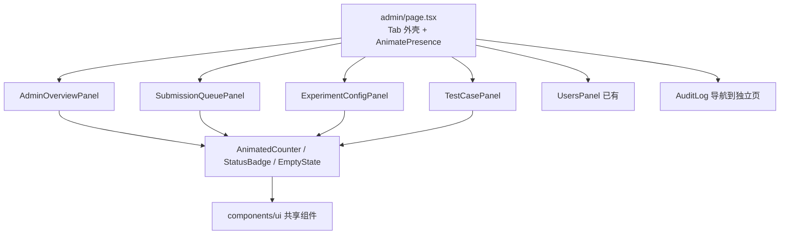

# 系统管理中心（Admin Center）升级方案

> **目标**：修复系统管理中心页面已确认的数据解析 bug 与静默吞错问题，补全实验配置/测试用例 CRUD 与 AI 调分 UI，并按项目已有的 Kernel Terminal 2.0 设计系统重构为模块化、可交互的管理后台。
>
> **原则**：优先复用已有共享组件（`PanelHeader` / `AnimatedCounter` / `StatusBadge` / `EmptyState` / `Skeleton*`），后端能力已具备时不新增接口。

---

## 一、现状调研结论

### 1.1 后端已基本完备

Go core-service 中 admin 路由已全部接线（见 `services/core-service/cmd/server/main.go` 的 `adminGroup`）：

- `GET /admin/db/overview` —— 返回 users / submissions / experiments / diagnoses / recent_errors 完整概览
- `GET /admin/submissions/queue`、`POST /admin/submissions/reset`
- `GET /admin/experiments/config`、`GET /admin/experiments/:id/test-cases`、`PUT /admin/test-cases/:id`
- `POST /admin/submissions/ai-adjust-score`（已实现，前端未接入）
- `GET /admin/logs`、`GET /admin/logs/:id`
- `GET/POST/PUT/DELETE /admin/users*` 完整用户管理

关键结论：实验/测试用例 CRUD 挂在 `teacherGroup`（`RequireRole("teacher", "admin")`），管理员可直接复用 `frontend/lib/api.ts` 中已存在的 `createExperiment` / `updateExperiment` / `deleteExperiment` / `createTestCase` / `updateTestCase` / `deleteTestCase`。

> **因此「未实现功能」几乎全部是前端 UI 未接线，而非缺后端接口。** 唯一需要后端补充的是配置列表的 `test_case_count` 字段。

### 1.2 已确认 Bug

| # | 位置 | 问题 | 修复 |
|---|------|------|------|
| 1 | `admin/page.tsx` `loadQueue` | `const d = res.data \|\| res; setQueue(d.data \|\| [])` 双重解包，队列恒为空、summary 恒为 `{}` | `setQueue(res.data \|\| [])`、`setQSummary(res.summary \|\| {})` |
| 2 | `admin/page.tsx` 内联日志 Tab | `setLogs((res.data \|\| res).data \|\| ...)` 双重解包恒为空 | `setLogs(res.data \|\| [])` |
| 3 | `admin/page.tsx` 配置列表 | 渲染 `cfg.test_case_count`，后端未返回该字段 → 显示 `undefined` | 后端补字段 + 前端改渲染 `submission_count` / `pass_rate` |
| 4 | 全页面 | `.catch(() => {})` 静默吞错，500/403 无反馈 | 捕获并 `setError(msg)` + `EmptyState variant="error"` |
| 5 | `api.ts` | `updateTestCase` 与 `updateAdminTestCase` 重复指向同一端点 | 删除其一 |
| 6 | 路由结构 | 内联日志 Tab 与独立 `/admin/logs` 页重复且行为不一致 | 内联 Tab 改为导航到独立页 |

### 1.3 未实现功能

- 实验配置 Tab 只读：无法编辑配置、发布/下架、删除实验。
- 测试用例 Tab：仅能内联改 `expected_output`，无法新建/删除用例、无法编辑 `is_public` / `score_weight` / `order_index`，保存无反馈。
- AI 调分（`ai-adjust-score`）后端已就绪但无 UI。

### 1.4 设计问题

- 顶部 `sparkles` 漂浮圆点背景 + 硬编码色（`#0A84FF` 等）与项目设计语言脱节。
- 手写 `StatCard` / `statusIcon` / `AnimatedNumber`，未复用已有 `AnimatedCounter` / `StatusBadge` / `PanelHeader` / `EmptyState` / `Skeleton*`。
- Tab 切换无过渡动画（未用 Framer Motion `AnimatePresence`）。
- 单文件 `admin/page.tsx` 近 200 行高密度代码，违反「职责分明的模块架构」。

---

## 二、优秀案例调研（联网）

- **shadcn/ui dashboard blocks（官方）**：`SectionCards`（KPI 卡）+ `ChartAreaInteractive` + `DataTable` + `SiteHeader`，是管理后台规范范式；本项目已基于 shadcn/ui，直接对标。
- **TailAdmin**：Tailwind 管理后台，强调 DataTable + 行内操作 + 明暗主题。
- **react-admin `List`/`DataTable`**：统一「工具栏（筛选/搜索/刷新）→ 数据表 → 分页」三段式列表结构。
- **Grafana 12 / Datadog**：统一 PanelHeader chrome、主题联动、骨架屏与空状态（本仓库 `docs/plan/frontend-beautification-upgrade-plan.md` 已对标并落地共享组件）。

核心可落地结论：管理后台 = **统一面板头部 + 可筛选工具栏 + DataTable（含行内操作）+ 分页 + 空状态/骨架屏 + 动效**；admin 页应复用现有 Kernel Terminal 2.0 组件而非再造。

---

## 三、目标架构（模块化重构）

- `admin/page.tsx` 收敛为薄壳：鉴权 + Tab 状态 + 面板装配。
- 每个 Tab 拆为独立组件（位于 `frontend/components/admin/`），复用 `PanelHeader`、`AnimatedCounter`、`StatusBadge`、`EmptyState`、`Skeleton*`、shadcn `Tabs`/`Table`/`Dialog`。
- 数据获取抽为各面板内聚 hook，消除重复的 `res.data || res` 手工解包，统一错误 → `EmptyState variant="error"` + Toast。

---

## 四、实施阶段

### 阶段一：修复 Bug（先行，低风险）

1. 修正 `loadQueue`：`setQueue(res.data || [])`、`setQSummary(res.summary || {})`。
2. 内联日志 Tab 改为导航到独立 `/admin/logs` 页（消除重复与破损）。
3. 后端 `GetExperimentConfigs` 补充 `test_case_count` 字段（SQL 子查询），前端配置卡片改渲染 `submission_count` / `pass_rate`。
4. 全页面 `.catch(() => {})` 改为捕获并 `setError(msg)`，用 `EmptyState variant="error"` 展示。
5. 删除 `api.ts` 重复的 `updateAdminTestCase`。

### 阶段二：补全功能（复用现有 API）

1. 实验配置 Tab：每行增加「编辑 / 发布-下架 / 删除」行内操作；编辑走 Dialog + `updateExperiment`，发布走 `updateExperiment({ is_published })`，删除走 `deleteExperiment`（带确认）。
2. 测试用例 Tab：增加「新建用例」Dialog（`createTestCase`）、行内「删除」（`deleteTestCase`）、编辑 `is_public` / `score_weight` / `expected_output`（`updateTestCase`），保存后显示成功/失败 Toast。
3. AI 调分：在提交队列处接入 `ai-adjust-score`（P2 增强，可选）。

### 阶段三：设计升级（对齐 Kernel Terminal 2.0）

1. 移除 `sparkles` 背景与全部硬编码色，改用主题 token（`--primary`/`--muted`/`--destructive` 及 Tailwind 语义类）。
2. 概览 KPI 用 `AnimatedCounter` + `StatChange`；状态用 `StatusBadge`；面板标题用 `PanelHeader`；空态用 `EmptyState`；加载用 `SkeletonKpiCard`/`SkeletonTable`。
3. Tab 切换包裹 `AnimatePresence` 方向感知过渡；列表入场 stagger。
4. 统一三段式列表结构（工具栏 → DataTable → 分页），对齐 shadcn DataTable 范式。
5. 尊重 `prefers-reduced-motion` 与已有 `--kt-anim-speed`。

---

## 五、文件变更清单

- 修改：`frontend/app/(dashboard)/admin/page.tsx`（薄壳化）
- 新增：`frontend/components/admin/AdminOverviewPanel.tsx`
- 新增：`frontend/components/admin/SubmissionQueuePanel.tsx`
- 新增：`frontend/components/admin/ExperimentConfigPanel.tsx`
- 新增：`frontend/components/admin/TestCasePanel.tsx`
- 修改：`frontend/components/admin/UsersPanel.tsx`（接入 PanelHeader/EmptyState）
- 修改：`frontend/lib/api.ts`（删重复方法、补类型）
- 修改：`services/core-service/internal/handler/admin.go`（`GetExperimentConfigs` 返回 `test_case_count`）

---

## 六、验收标准

1. 队列、日志 Tab 正确显示数据；配置列表不再出现 `undefined`。
2. 任何接口失败均有可见错误态（非静默）。
3. 管理员可完成：编辑/发布/删除实验、新建/编辑/删除测试用例，均有反馈。
4. 视觉与教师仪表盘、知识库等页面风格一致；Tab 切换有过渡动画；明暗主题下色彩正常。
5. `cd frontend && npm run build`、`npm run lint`、`npm test` 通过；`go test ./...`（core-service）通过。

---

## 七、实施完成记录（2026-03-14）

除计划内项外，实施中发现并修复了以下计划外问题：

| 位置 | 问题 | 处理 |
|------|------|------|
| `UsersPanel.tsx` `load` | `res.data || res` 后再取 `.data` 双重解包，用户列表恒空、分页恒 0 | 改为 `setList(res.data)` / `setTotal(res.total)` |
| `UsersPanel.tsx` | `<DropdownMenuTrigger asChild>` 使用 Radix 语义，本项目为 base-ui，应为 `render` 属性 | 改为 `render={<Button/>}` |
| `UsersPanel.tsx` | 角色筛选 `onValueChange` 未处理 base-ui 的 `null`；`teaching_classes` 未收窄；`ResetPasswordDialog` 传了未声明 `onDone` | 全部修正 |
| `logs/page.tsx` | `catch { /* silent */ }` 静默吞错；切换操作类型筛选不触发重新请求（`setPage(1)` 对同值 no-op） | 加错误态 `EmptyState`；`fetchLogs` 以 `useCallback` 依赖 `actionFilter` 触发 |
| `logs/page.tsx` | 硬编码色 `#0A84FF` 等 | 改为 Tailwind 语义色（`text-blue-500` 等） |
| `api.ts` | `DBOverview` 类型与 `/admin/db/overview` 实际返回不符 | 重命名为 `AdminOverview` 并补齐真实结构 |

后端 `GetDBOverview` / `GetSubmissionQueue` / `GetExperimentConfigs`（含 `test_case_count`）/ `ListTestCases`（含 `compare_mode`）经 `go build ./...` 验证通过；前端 admin 相关文件经 `tsc --noEmit` 过滤后无新增类型错误。

---

*文档版本 v1.1 | 更新日期 2026-03-14*
*关联：`docs/plan/frontend-beautification-upgrade-plan.md`（Kernel Terminal 2.0 设计系统）*