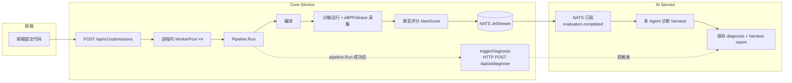
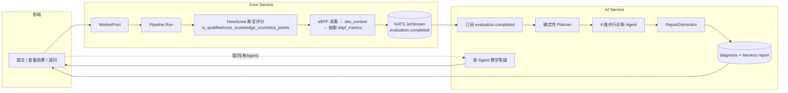
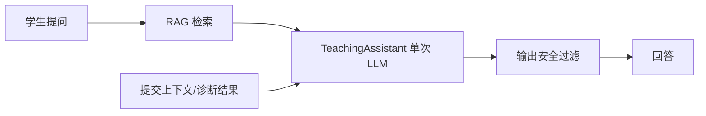
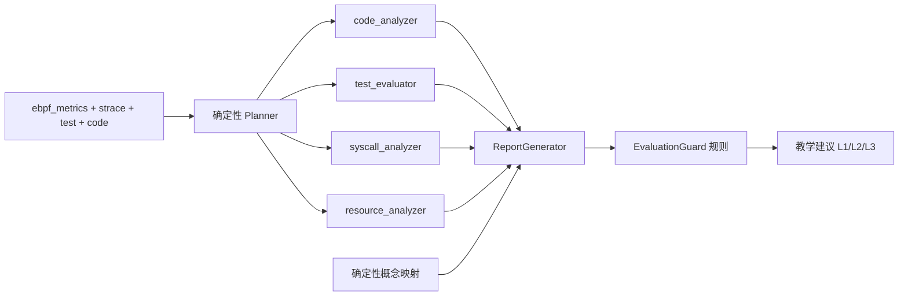

# AI 诊断全链路整改方案（唯一生效版）

> 状态：**当前唯一生效的务实改造方案**
> 范围：提交 → 评测 → AI 诊断 → 展示 全链路
> 立场：多 Agent 是手段不是目的；AI 永不碰评分；核心价值是把 eBPF 底层数据翻译成学生能理解的教学建议。

## 与旧文档的关系

`agent-diagnosis-upgrade-plan.md` 与 `agent-harness-upgrade-plan.md` 是当前"过度设计"的源头：
ETCLOVG 七层、Supervisor Blueprint、WhileLoop Engine、六维评分、LLM-as-Judge 等概念大量存在，但多数从未接线或与真实运行链路脱节。
本方案把这两份文档标记为**设计演进历史（已收敛）**，不再作为实施依据。

`scoring-system-overhaul-plan.md` 单独覆盖评分体系重构，本方案只守住一条与它对齐的红线：**AI 不碰评分**。

---

## 0. 问题诊断与红线

### 0.1 现状全链路（真实运行）



**三条真实链路与断点：**

1. **评测主链路（通）**：提交 → WorkerPool（进程内 4 worker）→ `Pipeline.Run` → 编译 / 沙箱运行 / eBPF 或 strace 采集 / `NewScore` 断言评分 → `publishCompletedV2` 发布 `evaluation.completed`。
2. **诊断触发（双路径）**：`evaluation.completed` NATS 事件（AI service 订阅）**和** Core `evaluate()` 里的 `triggerDiagnosis` HTTP POST，两条路径都会触发诊断，靠 DB 幂等去重兜底，但存在竞态。
3. **死事件（断）**：`submission.created` 事件在 `nats/client.go` 中定义、`evaluator/worker.go` 中订阅，但生产代码从不 `PublishSubmissionCreated`（仅测试调用）——那个订阅 Worker 从未实例化，是死代码。

### 0.2 问题清单（分三类）

**致命（必须 Phase 0 处理）**

| # | 问题 | 证据 |
|---|---|---|
| F1 | **AI 调分**：诊断完成后 `evaluate_ai_adjustment → core_client.ai_adjust_score` 回写 Core 分数 | `app/main.py` 诊断完成后调用，`app/services/scoring_evaluator.py`、`app/core_client.py:ai_adjust_score` |
| F2 | **诊断双触发**：NATS + HTTP 两条入口 | Core `handler/submission.go:evaluate → triggerDiagnosis` 与 NATS `evaluation.completed` 并存 |

**结构（Phase 1 处理）**

| # | 问题 | 证据 |
|---|---|---|
| S1 | **两套多 Agent 并存且职责重叠**：交互问答走 `app/agents`（LangGraph），诊断走 `app/diagnosis` | 两个 orchestrator，两个 orchestrator 都自称"多 Agent" |
| S2 | **交互侧"假专家"**：LangGraph 图的 4 个"专家"节点（diagnosis/knowledge_qa/code_review/general_chat）全部调用同一个 `DiagnosisTutorAgent.analyze()`，仅 intent 参数不同 | `app/agents/graph.py` 各节点 |
| S3 | **eBPF 数据脱节**：Core 已有 `obs_context` 三层观测上下文，但 AI 侧 `context_package.py` 的 `ebpf_events/perf_data/flamegraph` 从不从事件里解析，导致 `ebpf_analyzer/perf_analyzer` 永不激活（`enable_phase4=False`，`_plan` 中 `if ctx.ebpf_events` 恒空） | `app/diagnosis/orchestrator.py`、`app/diagnosis/context_package.py` |
| S4 | **AI 自算分数**：诊断 harness 内部 `compute_all_scores` + `EvaluatorAgent` 六维评分产出独立 `total_score`，与 Core 分数并列，造成两套分 | `app/diagnosis/deterministic.py`、`app/diagnosis/agents/evaluator.py` |

**工程（Phase 1 一并处理）**

| # | 问题 | 证据 |
|---|---|---|
| E1 | **假注册表**：`routers/agents.py` 的 `AGENTS`（TraceAnalyzer/ErrorDiagnosis/Pedagogical）与实际运行的 Agent 完全不符 | `app/routers/agents.py` |
| E2 | **死代码**：顶层 `app/diagnosis.py`（遗留单路径）、`app/code_audit.py`/`app/code_audit_service.py`/`app/code_auditor.py` 三份重复遮蔽、`app/agents/supervisor_blueprint.py`（SupervisorBlueprint/WhileLoopEngine 未接线） | 顶层 `app/` 目录 |
| E3 | **README 夸大**：宣称"6 Agent Harness""基于 LangGraph 的 Planner-Generator-Evaluator 架构，6 个专项 Agent"，与真实链路不符 | `README.md` L89/L230-244/L531 |
| E4 | **Core 死代码**：订阅 `submission.created` 的 `evaluator/worker.go`、`perf_collector` | `core-service/internal/evaluator/worker.go` |

### 0.3 三条红线（不可妥协）

1. **AI 不碰评分**：删除一切 AI 回写分数的路径（F1），AI 不产出任何"分数"字段。
2. **Core 分数是唯一真值**：`is_qualified / core_score / edge_score / test_points` 由 Core 的 `NewScore` 唯一产出，前端只展示这一套分。
3. **诊断触发唯一入口**：只有 `evaluation.completed` NATS 事件触发诊断（删 F2 的 HTTP 路径）。

---

## 1. 目标态全链路



### 1.1 各阶段职责

| 阶段 | 归属 | 职责 | 不做什么 |
|---|---|---|---|
| 评测 | Core | 编译、沙箱运行、eBPF/strace 采集、断言评分 | 不调用 LLM |
| 评分 | Core `NewScore` | 产出唯一分数真值 | AI 不得介入 |
| 事件 | Core → NATS | 发布 `evaluation.completed`（含 v2 评分 + strace + ebpf_metrics） | 不触发 HTTP 诊断 |
| 诊断 | AI | 消费事件，多 Agent 翻译成教学建议 | 不产出分数、不回写分数 |
| 答疑 | AI 单 Agent | RAG + 上下文注入的单次调用 | 不做假专家路由 |
| 展示 | 前端 | 展示 Core 分数 + 四维诊断 + 教学引导 | 不展示 AI 分数 |

### 1.2 数据契约（`evaluation.completed` NATS v2）

```json
{
  "submission_id": "string",
  "experiment_id": "string",
  "student_id": "string",
  "score": 0,
  "total_score": 100,
  "passed_cases": 0,
  "total_cases": 0,
  "status": "completed",
  "compile_error": null,
  "runtime_error": null,
  "execution_time": null,
  "is_qualified": false,
  "core_score": 0,
  "edge_score": 0,
  "test_points": [],
  "strace_summary": { "human_readable": "", "patterns": [], "fd_balance": null, "memory_balance": null },
  "test_results": [],
  "obs_context": { },
  "ebpf_metrics": {
    "resource": { "fd_leak": null, "memory_imbalance": null, "deadlock": null, "zombie": null },
    "syscall": { "stats": {}, "errors": [] },
    "process_thread": { "graph": {}, "thread_count": 0 }
  }
}
```

> `ebpf_metrics` 是 Phase 2 新增的**AI 友好精简摘要**，由 Core 从 `obs_context` 确定性抽取；`obs_context` 保持完整（面向前端），不塞给 LLM。

---

## 2. Phase 0 紧急止血

目标：先砍掉会"改分数"和"重复诊断"的两个致命问题，一天内可完成、可验证。

### 2.1 删除 AI 调分（F1）

改动：
- `services/ai-service/app/main.py`：删除诊断完成后 `evaluate_ai_adjustment → ai_adjust_score` 整个代码块。
- `services/ai-service/app/services/scoring_evaluator.py`：删除 `evaluate_ai_adjustment`（若模块只此用途则删模块）。
- `services/ai-service/app/core_client.py`：删除 `ai_adjust_score` 方法。
- 废弃 `ai_adjusted_score` 字段（前端若引用，改为不展示/不读取）。

验收：一次提交评测，Core 分数不回写、日志无 `AI score adjusted`。

### 2.2 统一诊断触发为 NATS 单路径（F2）

改动：
- `services/core-service/internal/handler/submission.go`：删除 `evaluate()` 里的 `triggerDiagnosis(...)` 调用及整个 `triggerDiagnosis` 函数。
- 保留 `app/main.py` 的 NATS 订阅与 `submission_id` 幂等去重（completed/in_progress 判重）作为唯一触发与去重机制。

验收：一次提交只产生一条 `in_progress → completed` 诊断记录；不再出现 HTTP 触发的并发诊断。

### 2.3 修正 README 夸大表述（E3，可延后但建议同批）

- 删除"6 Agent Harness""基于 LangGraph 的 Planner-Generator-Evaluator"。
- 改为"按数据维度分层的多 Agent 诊断（代码 / 测试 / 系统调用 / 内核资源）"。
- 目录注释 `agents/ # 6 个专项 Agent` 同步修正。

---

## 3. Phase 1 链路收敛

目标：把两套 Agent 收敛为"**提问单 Agent + 诊断多 Agent**"，清掉死代码与假注册表。

### 3.1 提问侧：收敛为单 Agent

删除 LangGraph 图结构与 4 个假专家节点，收敛为 `TeachingAssistant` 单次调用：

改动：
- `app/agents/graph.py`：删除 `create_agent_graph` / `run_agent_pipeline` / 各 intent 节点。
- `app/agents/orchestrator.py`：删除（意图分类不再需要；若需轻量路由，用规则而非 LLM）。
- `app/agents/diagnosis_tutor.py`：保留为唯一教学 Agent，输入统一为「学生问题 + 提交上下文 + RAG 检索片段」。
- `app/agents/{context_firewall.py, supervisor_blueprint.py, evaluator.py}`：删除（上下文防火墙、LLM-as-Judge、Supervisor Blueprint 均未产生真实价值）。
- `app/agents/guardrails.py`：保留但简化为「输入/输出安全过滤」，去掉多层 cost-cascade。
- `app/agents/observability.py`：保留 OTel token/延迟埋点（单 Agent 复用）。

新的提问链路：



验收：`/api/ai/chat` 正常流式返回；代码里不再引用 `langgraph` 图；token 开销显著下降。

### 3.2 诊断侧：保留真并行多 Agent

保留 `app/diagnosis/orchestrator.py` 的真并行结构，收敛维度：

- 四维必选（各自独立输入 / Prompt / LLM 调用，`asyncio.gather` 并行）：
  1. `code_analyzer` — 代码 + 编译/运行时错误
  2. `test_evaluator` — `test_results` / `test_points`
  3. `syscall_analyzer` — `strace_summary` / 系统调用统计与异常
  4. `concept_rubric` — 概念掌握度（Phase 2 降级为确定性规则，见 4.2）
- Planner 用**确定性规则**（`_plan` 现有逻辑），不用 LLM。
- 删除 `evaluator` 的 LLM-as-Judge 六维评分（S4）：改用确定性 `EvaluationGuard` 规则 + 置信度校准做治理，不再产出"AI 分数"。

验收：诊断结果只有诊断结论 + 教学建议 + 置信度，无独立 `total_score`；前端不再展示两套分。

### 3.3 死代码清理清单（E1/E2/E4）

删除（或确认无引用后删除）：

| 路径 | 说明 |
|---|---|
| `app/diagnosis.py` | 顶层遗留单路径诊断，遮蔽 `app/diagnosis/` 包 |
| `app/code_audit.py` / `app/code_audit_service.py` / `app/code_auditor.py` | 顶层三份重复，遮蔽 `app/services`、`app/agents` 下的同名模块 |
| `app/agents/supervisor_blueprint.py` | SupervisorBlueprint / WhileLoopEngine 未接线 |
| `app/routers/agents.py` | 假 AGENTS 注册表 |
| `core-service/internal/evaluator/worker.go` | 订阅 `submission.created` 的 Worker（生产从未发布该事件） |
| `core-service` `perf_collector` | 无数据源死代码 |

验收：`grep` 确认无残留引用；AI service 启动无 import 报错；删除后单测通过。

---

## 4. Phase 2 亮点闭环（eBPF → AI）

目标：把"内核级观测 → 学生可理解建议"这条真正有差异化的链路做实。

### 4.1 Core 新增 `ebpf_metrics` 结构化字段

Core 在发布 `evaluation.completed` 时，从 `obs_context`（`ObsContextBuilder` 产物）确定性抽取 AI 友好摘要 `ebpf_metrics`：

- **resource 类**：fd 泄漏、内存不平衡、死锁、僵尸进程（对齐 `fd_balance/memory_balance/lock_events/process_graph`）。
- **syscall 类**：系统调用统计（总量/错误量/高频）与异常清单。
- **process_thread 类**：进程-线程结构（fork 关系、线程数）。

改动：
- `core-service/internal/nats/events.go`：`EvaluationCompletedEvent` 增加 `EBPFMetrics *EBPFMetricsData`。
- `core-service/internal/evaluator/pipeline.go`：`publishCompletedV2` 填充 `ebpf_metrics`。
- 抽取逻辑放进新的确定性 extractor（不引入 LLM）。

### 4.2 AI 侧激活 resource_analyzer，砍 perf_analyzer

- `app/diagnosis/agents/ebpf_analyzer.py` → 改名 `resource_analyzer.py`，消费 `ebpf_metrics` 而非 strace 文本。
- 删除 `app/diagnosis/agents/perf_analyzer.py`（无数据支撑）。
- `app/diagnosis/context_package.py`：从事件解析 `ebpf_metrics` 填充 context；删除 `ebpf_events/perf_data/flamegraph` 三个未接线字段。
- `app/diagnosis/orchestrator.py`：`enable_phase4` 置 True；`_plan` 依据 `ebpf_metrics` 激活 `resource_analyzer`。
- `concept_rubric` 从"独立 LLM"降级为**确定性概念映射**（实验 category → 概念库），产出 `related_concepts / concept_radar`，不再跑 LLM。

最终诊断架构：



验收：内存/死锁实验的泄漏、死锁发现能从前端"内核级观测发现"高亮看到，且由 `resource_analyzer` 产出教学建议而非仅 strace 文本推测。

### 4.3 答辩话术

> 我们不满足于"比对 stdout 判对错"。学生代码在内核态的真实行为（fd 是否关闭、内存是否平衡、锁是否成环、进程是否回收）被 eBPF 采集，经确定性抽取成 `ebpf_metrics`，再由 `resource_analyzer` 翻译成"你漏了 close()，导致 fd 泄漏"这类学生能动手改的建议——这是把内核观测转化为教学价值的完整闭环。

---

## 5. Phase 3 工程化与包装

### 5.1 观测与成本

- 每个诊断 Agent 上报 token / 延迟 / 置信度（复用 `base.py` 已有 `tokens_used/execution_ms/confidence`）。
- 诊断成本与迭代上限要么真正落地（`max_iterations` 目前是摆设），要么删除未用抽象。

### 5.2 前端

- 四维诊断结果**分区展示**：代码 / 测试 / 系统调用 / 内核观测。
- eBPF 发现的泄漏/死锁/僵尸**高亮标注"内核级观测发现"**。
- 统一为**单套 chat**（提问侧单 Agent），删除多专家切换入口。
- 修复 `DiagnosisReport` 字段与前端类型定义不一致（如 `six_dim_scores` / `harness_report` 字段名）。
- 只展示 Core 的 `is_qualified/core_score/edge_score/test_points`，移除任何 AI 分数 UI。

### 5.3 主动讲清设计取舍

- Planner 用规则不用 LLM（确定性、可控、零成本）。
- 提问用单 Agent 不用多 Agent（对话场景无需并行专家）。
- 诊断用多 Agent（四个独立数据维度天然并行、证据可溯源）。
- AI 不评分（评分是确定性断言引擎的职责，AI 只做教学翻译）。

---

## 6. 分阶段实施清单与验收标准

### Phase 0（止血，1 天）

| 步骤 | 文件 | 验收 |
|---|---|---|
| 删 AI 调分 | `ai-service/app/main.py`、`services/scoring_evaluator.py`、`core_client.py` | 分数不回写，日志无 `AI score adjusted` |
| 删 HTTP 双触发 | `core-service/internal/handler/submission.go` | 单次提交单条诊断，无 HTTP 触发日志 |
| 修 README | `README.md` | 无"6 Agent"夸大表述 |

### Phase 1（收敛，2-3 天）

| 步骤 | 文件 | 验收 |
|---|---|---|
| 提问单 Agent | `agents/graph.py`、`orchestrator.py`、`diagnosis_tutor.py` 等 | `/api/ai/chat` 正常；无 langgraph 引用 |
| 诊断四维收敛 | `diagnosis/orchestrator.py`、`agents/evaluator.py`、`deterministic.py` | 无 AI 独立分数输出 |
| 清死代码 | 见 3.3 清单 | 无残留引用，启动无报错，单测通过 |

### Phase 2（eBPF 闭环，3-4 天）

| 步骤 | 文件 | 验收 |
|---|---|---|
| 新增 ebpf_metrics | `core-service/internal/nats/events.go`、`evaluator/pipeline.go` | 事件含结构化 `ebpf_metrics` |
| 激活 resource_analyzer | `diagnosis/agents/ebpf_analyzer.py→resource_analyzer.py`、`context_package.py`、`orchestrator.py` | 内存/死锁实验产出内核级发现 |
| 砍 perf、降级 rubric | 同上 | `perf_analyzer.py` 删除；概念由规则产出 |

### Phase 3（工程化，2 天）

| 步骤 | 文件 | 验收 |
|---|---|---|
| 观测/成本 | `diagnosis/agents/base.py`、`orchestrator.py` | 每 Agent token/延迟/置信度可查 |
| 前端四维展示 + 单 chat | `frontend/components/*` | 分区展示、内核发现高亮、无 AI 分数 UI |

---

## 附：最终目录形态（收敛后）

```
services/ai-service/app/
├── agents/                  # 提问侧：单 Agent
│   ├── diagnosis_tutor.py   # TeachingAssistant（唯一教学 Agent）
│   ├── rag_agent.py         # RAG 检索
│   ├── guardrails.py        # 输入/输出安全过滤（简化）
│   └── observability.py     # OTel 埋点
├── diagnosis/               # 诊断侧：真多 Agent
│   ├── orchestrator.py      # 确定性 Planner + 并行编排
│   ├── context_package.py   # 数据契约（消费 ebpf_metrics）
│   ├── deterministic.py     # 概念映射（降级后的 rubric）
│   ├── evaluation_guard.py  # 确定性治理
│   └── agents/
│       ├── base.py
│       ├── code_analyzer.py
│       ├── test_evaluator.py
│       ├── syscall_analyzer.py
│       ├── resource_analyzer.py   # 原 ebpf_analyzer
│       └── report_generator.py
└── routers/
    ├── diagnosis.py         # 诊断结果读取
    └── chat.py              # 提问侧单 Agent 入口
```