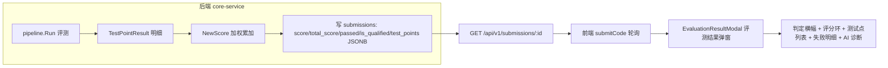

# 评测结果窗口重构方案

> 版本: v1.0 | 日期: 2026-08-13 | 范围: 后端评分链路 + 前端评测结果弹窗

---

## 目录

1. [目标](#1-目标)
2. [根因与现状](#2-根因与现状)
3. [改造后数据流](#3-改造后数据流)
4. [阶段 A：后端打通评测结果](#4-阶段-a后端打通评测结果)
5. [阶段 B：前端评测结果弹窗重构](#5-阶段-b前端评测结果弹窗重构)
6. [设计规范](#6-设计规范)
7. [关键决策](#7-关键决策)
8. [实施清单](#8-实施清单)
9. [验证计划](#9-验证计划)

---

## 1. 目标

1. 修复提交后编辑器下方白条得分框恒为 0 的问题（根因在后端，非前端没接）。
2. 把提交后自动弹出的「T1 全景总览」（实为观测面板，与得分无关）替换为专门的「评测结果」弹窗，展示：判定、总分、核心/附加分、逐测试点通过/失败明细、失败原因、AI 诊断入口。
3. 借鉴 LeetCode / Codeforces / OJ / Gradescope 的结果页设计，色彩鲜艳、结构清晰、内容齐全。

## 2. 根因与现状

### 2.1 得分恒为 0 的根因链

- 后端 `NewScore` 已接入真实评测管道（`internal/evaluator/pipeline.go:396`），但 `test_cases.expected_output` 仍为旧纯文本（JSON 断言迁移 `20/23-*.sql` 在既有库未生效），旧文本 fallback 有损 → 全部测试点判失败 → `NewScore` 累加得 0。
- 三个确定性后端 bug：
  - `pipeline.go:414` 把 `total_score` 硬编码 100、把 `passed_test_cases` 写成「测试点总数」而非「通过数」。
  - `internal/repository/submission.go:47` 的 `GetByID` 未 SELECT `is_qualified`，接口永远不返回它。
  - `TestPointResult` 只在内存算完即丢，不落库、`GET /submissions/:id` 不返回，前端拿不到明细。

### 2.2 前端现状

- `stores/workspace.ts:664` 提交后 `isTierPanelOpen: true` 自动打开观测 tier 面板（`SlideUpPanel` + `TierOverview`），标题「T1 全景总览」，读的是 `obsContext` 健康/RED/USE 指标，与得分零关联。
- 前端全仓库没有任何组件渲染 `test_points`（仅 `types/workspace.ts` 有类型定义）。
- 现有 `docs/plan/scoring-system-overhaul-plan.md` 第 6.2 节已画结果展示草图，但标注「handler 返回 is_qualified + 测试点明细 ✅已完成」与代码实际不符。

## 3. 改造后数据流



## 4. 阶段 A：后端打通评测结果

> 前置任务，解除 score=0 并让前端能拿到逐测试点明细。

### 4.1 修复评分写库

`internal/evaluator/pipeline.go` 的 `UpdateResult` 调用处（约 414 行）：

- `total_score` 由硬编码 100 改为该实验全部测试点权重和。
- `passed_test_cases` 由 `len(points)` 改为实际 `passed == true` 的数量。

### 4.2 持久化并返回 test_points

新增迁移 `deploy/init-db/26-test-points.sql`，给 `submissions` 加 `test_points JSONB` 列（沿用现有 `trace_diff` JSONB 模式）：

```sql
ALTER TABLE submissions ADD COLUMN IF NOT EXISTS test_points JSONB;
```

### 4.3 扩展数据模型

`internal/model/model.go` 的 `Submission` 增加字段：

```go
TestPoints []TestPointData `json:"test_points,omitempty"`
CoreScore  *int           `json:"core_score,omitempty"`
EdgeScore  *int           `json:"edge_score,omitempty"`
```

`TestPointData` 结构（在 evaluator 侧复用并扩展 `TestPointResult`，补充前端展示所需字段）：

```go
type TestPointData struct {
    ID              string   `json:"id"`
    Name            string   `json:"name"`
    Type            string   `json:"type"` // "core" | "edge"
    Weight          int      `json:"weight"`
    Passed          bool     `json:"passed"`
    FailReason      string   `json:"fail_reason,omitempty"`
    ExecTimeMs      int64    `json:"exec_time_ms"`
    ActualOutput    string   `json:"actual_output,omitempty"`
    ExpectedOutput  string   `json:"expected_output,omitempty"`
    FailedAssertions []string `json:"failed_assertions,omitempty"`
}
```

### 4.4 读写改造

`internal/repository/submission.go`：

- `GetByID` 的 SELECT 列表补 `is_qualified` 与 `test_points`。
- 新增 `UpdateTestPoints(ctx, submissionID, testPointsJSON []byte)` 写入 JSONB。

### 4.5 数据校验（关键）

确认目标库已执行 `20-new-test-assertions.sql` / `23-remaining-test-assertions.sql`（否则 score 仍为 0）。提供一次性校验 SQL 与重跑指引：

```sql
-- 校验：期望值是否已为 JSON 断言
SELECT id, name, left(expected_output, 80)
FROM test_cases
WHERE expected_output NOT LIKE '{%'
LIMIT 10;
```

## 5. 阶段 B：前端评测结果弹窗重构

### 5.1 类型扩展

`frontend/types/workspace.ts` 的 `EvalResult`/`Submission` 的 `test_points` 由稀疏 `TestPoint` 扩展为含 `fail_reason/exec_time_ms/actual_output/expected_output/failed_assertions` 的完整类型。

### 5.2 新建评测结果弹窗

`frontend/components/workspace/EvaluationResultModal.tsx`（基于 shadcn `Dialog`，可控 `open/onOpenChange`）：

- 顶部判定横幅：通过(绿)/部分通过(黄)/未通过(红)/编译错误(红)，渐变大字判定词。
- 评分环：总分 `score/total_score` + 核心分/附加分拆分 + `is_qualified` 徽章。
- 测试点列表：每点 ✓/✗ + 名称 + 类型(core/edge) + 权重 + 得分 + 耗时；用图标 + 文本双通道表达状态（不靠颜色单独表意）。
- 失败点可展开：期望输出 vs 实际输出、失败断言明细（output/syscall/behavior）、`fail_reason`。
- 统计栏：通过 x/y、总耗时、内存；底部「查看提交详情 / AI 诊断 / 继续下一关」按钮。

子组件拆分：`VerdictBanner`、`ScoreRing`、`TestPointItem`、`TestPointList`。

### 5.3 改造提交流程

`frontend/stores/workspace.ts` 的 `submitCode`：

- 把 `isTierPanelOpen: true` 改为新增的 `showEvaluationResult: true`。
- 新增 `showEvaluationResult` state 与 `setShowEvaluationResult` setter。

### 5.4 组装与挂载

`frontend/components/workspace/ExperimentWorkspace.tsx`：

- 挂载 `EvaluationResultModal`。
- 移除提交后自动打开 tier 面板的行为（观测面板仍通过 dock/TierNavBar 手动打开）。

### 5.5 白条得分框修正

`frontend/components/workspace/ResultPanel.tsx` 保持精简汇总，改为展示后端返回的真实 `score/total_score/passed_test_cases/is_qualified`。

### 5.6 合并恭喜弹窗

`frontend/components/workspace/CongratulationModal.tsx` 的 confetti 与「继续下一关」导航并入新结果弹窗的合格分支（`is_qualified` 时触发彩带 + 下一关入口），避免双弹窗。

### 5.7 历史记录页同步

`frontend/components/workspace/panels/SubmissionDetail.tsx` 与 `RecordsContent.tsx` 补充逐测试点明细列表（复用同一测试点列表子组件）。

## 6. 设计规范

应用 8 个 Cursor Rules：

| 规范 | 落地要点 |
|------|---------|
| toss-style | 语义状态色（绿/黄/红）用于判定横幅与测试点状态；主强调色用于主按钮/链接/选中态；禁用/次要态走灰度 |
| tailwind | 颜色走 `globals.css` CSS 变量 + tailwind theme 语义 token，禁止裸 `bg-green-500` |
| shadcn/ui | 弹窗用 `Dialog`（焦点陷阱、Escape 关闭、受控 open） |
| accessibility | `aria-live="polite"` 播报判定结果；图标+文本双通道状态；失败点 `aria-expanded` |
| react | 函数式组件、单文件单组件、props 接口 `EvaluationResultModalProps`、子组件拆分 |
| next.js | `"use client"` 边界降到最低，仅新弹窗与 store 侧 |
| react-components-creation | 复用 `components/ui` 基础组件，不直接 import Radix |
| landing-page-image-quality | 无图片需求，不涉及 |

## 7. 关键决策

- 结果窗口默认用居中 `Dialog`；若更想沿用底部滑出面板，可改挂到 `SlideUpPanel` 的一个新 dock tool。
- `total_score` 语义：默认取该实验全部测试点权重和；`is_qualified` 沿用「核心点全过」的教学模式判定（竞赛模式另算）。

## 8. 实施清单

- [ ] be-fix-scoring-write：修复 `pipeline.go` 的 `UpdateResult`（total_score 改权重和、passed_test_cases 改实际通过数）
- [ ] be-test-points-schema：新增 `26-test-points.sql`（submissions 增加 `test_points JSONB` 列）
- [ ] be-model-test-points：`model.go` Submission 增加 `TestPoints/CoreScore/EdgeScore` 字段
- [ ] be-repo-return：`submission.go` 的 `GetByID` 补 SELECT `is_qualified`+`test_points`，新增 `UpdateTestPoints` 写入
- [ ] be-data-verify：校验/重跑 `20/23` JSON 断言迁移，确认 `expected_output` 已为 JSON
- [ ] fe-types：`types/workspace.ts` 扩展 `test_points` 完整类型
- [ ] fe-result-modal：新建 `EvaluationResultModal`（判定横幅 + 评分环 + 测试点列表 + 失败明细 + 统计栏）
- [ ] fe-store-flow：`submitCode` 改为打开 `showEvaluationResult`，新增对应 state/setter
- [ ] fe-mount：`ExperimentWorkspace` 挂载新弹窗，移除提交后自动打开 tier 面板
- [ ] fe-result-panel：`ResultPanel` 白条改为展示真实 score/total_score/passed/is_qualified
- [ ] fe-merge-congrat：`CongratulationModal` 的 confetti + 下一关导航并入新弹窗合格分支
- [ ] fe-history-sync：`SubmissionDetail`/`RecordsContent` 补充逐测试点明细列表

## 9. 验证计划

- 后端：`make test`（core-service），确认 `UpdateResult` 参数与 `GetByID` 返回含 `test_points/is_qualified`。
- 前端：`pnpm test`（vitest）+ 手工提交一次，验证：
  - 白条显示真实分数；
  - 弹窗显示逐测试点通过/失败；
  - 失败点可展开看期望/实际输出；
  - 合格时触发彩带；
  - tier 观测面板不再自动弹出。
- 数据库：执行 4.5 校验 SQL 确认 `expected_output` 已为 JSON 断言，否则 score 仍为 0。