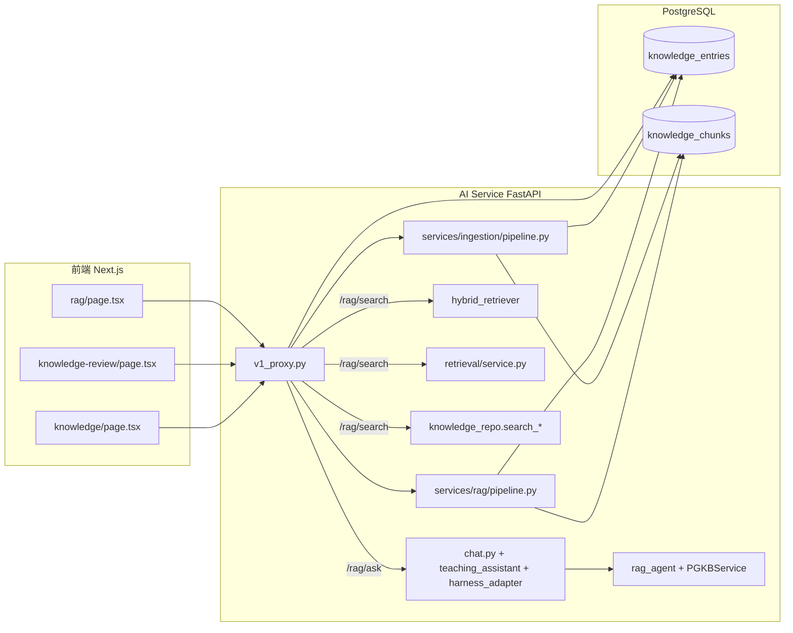

# RAG 知识库模块全面改造方案

> 版本：v3（完整工程规格） | 日期：2026-03-14 | 范围：数据模型 + 摄入/检索/审核/溯源后端 + 三个前端页面
> 立场：把「通用 RAG」升级为「操作系统实验教学专用的可溯源 RAG」，核心差异化 = 实验强绑定检索 + 引用溯源 + 分块可视化审核。
> 前端设计遵循 `.cursor/rules/` 下的 8 个 skill：`toss-style-design` / `shadcn-ui` / `tailwind-css` / `react` / `nextjs` / `accessibility` / `react-components-creation` / `landing-page-image-quality`。

---

## 0. 结论先行

当前 RAG 模块**表面齐全、实际断裂**。三个页面的"简陋"只是表象，根因在后端，且前端也缺少统一设计基线。本方案分三层解决：

1. **后端止血 + 收敛**：修复 `/rag/search` 500、向量维度错配、相似度阈值作用在 RRF 分数上、引用溯源永不产出 4 个致命问题；把「4 套检索、2 套摄入」收敛为各 1 套。
2. **数据模型补齐**：新增 `knowledge_type` / `tags` / `experiment_id` / `version` / chunk `offset` / `rag_settings` 检索参数，修正 `source_type` 与 `status` 约束。
3. **前端重做**：三个页面按统一的 Toss-style 设计基线重建，复用现有 `GlowCard` / `SectionHeader` / `ParticleBackground` / `AnimatedCounter` 装饰基建 + shadcn 组件，交付「安静、高信任、可溯源」的产品级界面。

**已确认决策**（v2 保留）：Embedding 走外部 OpenAI 兼容 API；后端优先；教师/管理员上传直接通过；实验上下文 RAG 本轮暂缓（数据模型已预留字段）。

---

## 1. 现状与问题诊断

### 1.1 真实调用链



### 1.2 问题清单

**致命（Phase 0 必须先修）**

| # | 问题 | 证据 |
|---|---|---|
| F1 | `/rag/search` 端点 500：`rag_chain.py` 缺失 | `app/services/rag/__init__.py:_get_rag_chain` 导入不存在的 `rag_chain.RAGChain` |
| F2 | 向量维度不一致（1024 vs 512） | `app/config.py` `rag_embedding_dimension=1024` + `08-rag.sql` `embedding VECTOR(512)` |
| F3 | 相似度阈值作用在 RRF 分数上，永远不通过 → 全退化 ILIKE | `hybrid_retriever.py:search` 用 threshold=0.5 过滤 RRF 分数（≈0.016） |
| F4 | 引用溯源 `sources` 永远为空 | `harness_adapter.py:to_rag_answer` 硬编码 `sources=[]` |

**结构（Phase 1 处理）**

| # | 问题 | 证据 |
|---|---|---|
| S1 | 4 套检索实现并存，行为不一致 | `hybrid_retriever` / `knowledge_repo.search_*` / `retrieval/service.py` / `rag_agent→PGKBService` |
| S2 | 2 套摄入管线并存，`source_type` 语义冲突 | `rag/pipeline.py` 写 `doc.source_type` 违反 CHECK；`ingestion/pipeline.py` 写传入 `source_type` |
| S3 | `source_type` 混用「上传方式」与「知识类型」 | CHECK 仅 `file/paste/url/git`；无 `knowledge_type` 字段 |
| S4 | `knowledge_entries` 缺 `tag/knowledge_type/experiment_id/version` | `08-rag.sql` 全表定义 |
| S5 | `unpublish` 状态不在 CHECK 约束内 | `knowledge_repo.py:unpublish_entry` 写 `'unpublished'`，CHECK 只有 3 态 |
| S6 | 无实验绑定 → 无法做「实验上下文 RAG」 | 检索接口无 `experiment_id/submission_id` 参数 |

**工程（Phase 1 一并处理）**

| # | 问题 | 证据 |
|---|---|---|
| E1 | 旧 `rag_knowledge` 表(1536维) + 旧 `knowledge.proto` 死代码 | `04-rag.sql`、`proto/ai/v1/knowledge.proto` |
| E2 | `search_vector` tsvector + GIN 索引，实际检索走 Python 内存 BM25，死索引 | `08-rag.sql` vs `hybrid_retriever._get_bm25` |
| E3 | BM25 全量载入内存 + dict 缓存：多课程内存膨胀 | `hybrid_retriever._bm25_cache` |
| E4 | reranker 分数未归一化（logit 当 0-1 相似度） | `reranker.py:rerank` |
| E5 | `rag_history` 表不存在，Go `rag.go` SaveHistory 死功能 | `deploy/init-db` 无 `rag_history` |
| E6 | chunk 无 `offset` 字段，无法「引用定位原文」 | `knowledge_chunks` 定义 |
| E7 | 前端三页硬编码 `DEFAULT_COURSE_ID` | 三个 page.tsx |
| E8 | 审核页「驳回」调 DELETE，未接 `/reject` 端点、无理由字段 | `knowledge-review/page.tsx:handleReject` |

---

## 2. 设计系统基线（前端遵循的 skill + token）

本节是三个页面设计的**唯一视觉基准**。实现阶段所有组件必须引用本节 token，禁止硬编码颜色/圆角/间距。

### 2.1 遵循的 skill 约束映射

| Skill（`.cursor/rules/`） | 对本次改造的约束 |
|---|---|
| `toss-style-design` | 安静高信任；单一主色 `#0071e3`；灰阶分层；克制阴影；状态色只用于语义（成功/警告/错误/信息）；指标数字视觉主导 |
| `shadcn-ui` | 一律从 `@/components/ui/` 导入；不改 ui/ 源文件，业务封装放 `components/`；表单用 react-hook-form + zod |
| `tailwind-css` | utility-first；移动优先 `sm:/md:/lg:`；语义色 token，不用 `bg-blue-500`；`cn()` 合并条件类；动态类名防 purge |
| `react` | 函数组件、单文件单组件、<150 行、`{Xxx}Props` 接口、拆 hook 与子组件；loading/error/empty 三态 |
| `nextjs` | App Router；`"use client"` 边界尽量低；服务端数据用 Server Component 拉取，交互页最小化 client 树 |
| `accessibility` | 语义 HTML（`nav/main/article/aside`）；`<button>` 不 `<div onClick>`；label 关联 input；图标按钮 `aria-label`；`aria-live` 提示动态内容；`focus-visible` 焦点态；键盘可达 |
| `react-components-creation` | 复用现有 `components/ui/` 与 `components/knowledge/`；不重复造轮子 |
| `landing-page-image-quality` | 不引入占位图服务；本模块无图片依赖，统计图用 echarts 矢量渲染 |

### 2.2 视觉 token（引用 `frontend/app/globals.css`，已存在）

```css
/* 主色（唯一强调色） */
--accent: #0071e3;            --accent-hover: #0077ed;
--accent-light: rgba(0,113,227,0.08);
--accent-purple: #8b5cf6;     --accent-teal: #14b8a6;

/* 语义状态（仅用于状态表达，不用于装饰） */
--success: #30d158;  --warning: #ff9f0a;  --error: #ff453a;  --info: #5ac8fa;

/* 灰阶分层 */
--bg-root: #f5f5f7;  --bg-card: #ffffff;  --bg-card-hover: #fafafa;
--text-primary: rgba(0,0,0,0.88);  --text-secondary: rgba(0,0,0,0.56);
--text-tertiary: rgba(0,0,0,0.32);  --border-default: rgba(0,0,0,0.06);
--border-strong: rgba(0,0,0,0.1);

/* 圆角 / 阴影 / 动效 */
--radius-md: 10px;  --radius-lg: 14px;  --radius-xl: 18px;  --radius-2xl: 24px;
--shadow-card: 0 1px 3px rgba(0,0,0,0.04), 0 1px 2px rgba(0,0,0,0.06);
--shadow-card-hover: 0 4px 16px rgba(0,0,0,0.08), 0 2px 4px rgba(0,0,0,0.04);
--transition-base: 250ms cubic-bezier(0.4,0,0.2,1);

/* 可复用特效类（globals.css 已定义，直接引用） */
.animate-fade-in-up   /* 400ms 上浮入场 */
.animate-fade-in-scale /* 250ms 缩放入场 */
.glass-panel          /* 毛玻璃侧栏 */
.gradient-border      /* hover 渐变描边 */
.card-accent-glow     /* hover 顶部渐变色条 */
.gradient-mesh        /* 多色径向网格背景 */
.data-stream-bg       /* 数据流网格背景 */
```

### 2.3 现有可复用组件（避免重复造轮子）

| 组件 | 路径 | 用途 |
|---|---|---|
| `GlowCard` | `components/knowledge/GlowCard.tsx` | 渐变描边卡片，`glow: blue/purple/teal/rainbow` |
| `SectionHeader` | `components/knowledge/SectionHeader.tsx` | 渐变图标 + 页面标题 + 副标题 |
| `StatPill` | 同上 | 指标卡（数字视觉主导 + 状态点） |
| `AnimatedCounter` | `components/knowledge/AnimatedCounter.tsx` | 数字滚动动画 |
| `ParticleBackground` | `components/knowledge/ParticleBackground.tsx` | 粒子连线背景 |
| `KnowledgePreviewPanel` | `components/KnowledgePreviewPanel.tsx` | 现有文档预览，审核/搜索复用 |

### 2.4 通用交互规范

- **三态**：每个数据组件必须有 loading（`Skeleton`）/ empty（`empty-state`）/ error（错误横幅）三态，缺一不可。
- **动效克制**：入场用 `.animate-fade-in-up` 或 `.stagger-children`；hover 用 `hover:-translate-y-0.5` + `--shadow-card-hover`；不堆砌 `pulse/glow`。
- **焦点态**：所有可交互元素保留 `focus-visible:ring-2` 可见焦点环。
- **响应式**：桌面三栏/双栏 → `lg:` 以下堆叠为单列；移动端优先设计，不用 `max-width` 媒体查询。
- **状态不只用颜色**：审核状态徽章同时用「图标 + 文字 + 颜色」表达。

---

## 3. 目标态架构

```mermaid
flowchart LR
    subgraph FE[前端]
        RAG_PAGE[RAG 双栏：问答 + 召回面板]
        UP_PAGE[上传：批量 + 元数据 + 分块预览]
        RV_PAGE[审核：统计 + 分块编辑 + 批量]
    end
    subgraph AI[AI Service]
        INGEST[services/ingestion 单一管线]
        RETRIEVER[hybrid_retriever 单一检索]
        CHAIN[rag_chain 编排]
        REFS[reference[] 溯源构造]
    end
    subgraph PG[PostgreSQL]
        KE[(knowledge_entries + metadata)]
        KV[(knowledge_entry_versions)]
        KC[(knowledge_chunks + offset)]
        RS[(rag_settings)]
    end

    UP_PAGE --> INGEST --> KE & KV & KC
    RV_PAGE --> KE & KC
    RAG_PAGE --> CHAIN --> RETRIEVER --> KC
    CHAIN --> REFS --> RAG_PAGE
```

三条收敛原则：

- **摄入单一**：只保留 `services/ingestion/`，删除 `services/rag/pipeline.py` 的 `IngestionPipeline`。
- **检索单一**：只保留 `services/rag/hybrid_retriever.py`（修复），新建 `rag_chain.py` 高层编排；删除 `services/retrieval/service.py`、`agents/rag_agent.py` 的 PGKBService 检索路径。
- **数据层单一**：`knowledge_repo` 只做 CRUD + 审核 + 统计 + 版本，删除 `search_by_embedding/search_by_text`。

---

## 4. 数据模型重构

新迁移 `deploy/init-db/27-rag-metadata.sql`（紧随现有 `26-test-points.sql`）。

### 4.1 `knowledge_entries` 增强

```sql
ALTER TABLE knowledge_entries
  ADD COLUMN IF NOT EXISTS knowledge_type VARCHAR(30) NOT NULL DEFAULT 'course_notes',
  ADD COLUMN IF NOT EXISTS tags TEXT[] NOT NULL DEFAULT '{}',
  ADD COLUMN IF NOT EXISTS experiment_id UUID,
  ADD COLUMN IF NOT EXISTS version INT NOT NULL DEFAULT 1,
  ADD COLUMN IF NOT EXISTS current_version_id UUID;

-- 修 S5：纳入 unpublished
ALTER TABLE knowledge_entries DROP CONSTRAINT IF EXISTS knowledge_entries_status_check;
ALTER TABLE knowledge_entries ADD CONSTRAINT knowledge_entries_status_check
  CHECK (status IN ('pending_review','approved','rejected','unpublished'));

-- 修 S3：source_type 收窄为「上传方式」，与 knowledge_type 解耦
ALTER TABLE knowledge_entries DROP CONSTRAINT IF EXISTS knowledge_entries_source_type_check;
ALTER TABLE knowledge_entries ADD CONSTRAINT knowledge_entries_source_type_check
  CHECK (source_type IN ('file','paste','url','git'));

CREATE INDEX IF NOT EXISTS idx_ke_experiment ON knowledge_entries(experiment_id) WHERE deleted_at IS NULL;
CREATE INDEX IF NOT EXISTS idx_ke_tags ON knowledge_entries USING gin(tags);
CREATE INDEX IF NOT EXISTS idx_ke_type ON knowledge_entries(knowledge_type) WHERE deleted_at IS NULL;
```

### 4.2 枚举约定（前端 + 后端共用常量，落到 `lib/knowledge-constants.ts`）

```ts
export const KNOWLEDGE_TYPES = {
  course_notes:     { label: "课程讲义",     color: "#0071e3" },
  experiment_docs:  { label: "实验文档",     color: "#14b8a6" },
  kernel_papers:    { label: "内核论文",     color: "#8b5cf6" },
  error_cases:      { label: "错误案例库",   color: "#ff9f0a" },
  contest_materials:{ label: "赛题材料",     color: "#ef4444" },
} as const;

export const CHUNKING_TEMPLATES = {
  general:      { label: "通用讲义" },
  kernel_paper: { label: "内核论文" },
  os_doc:       { label: "OS 文档" },
  code:         { label: "代码" },
} as const;
```

`tags` 建议种子：死锁、进程管理、eBPF、xv6、pintos、同步互斥、内存管理、文件系统、调度、中断（可扩展）。

### 4.3 版本管理（新表）

```sql
CREATE TABLE IF NOT EXISTS knowledge_entry_versions (
  id UUID PRIMARY KEY DEFAULT gen_random_uuid(),
  entry_id UUID NOT NULL REFERENCES knowledge_entries(id) ON DELETE CASCADE,
  version_no INT NOT NULL,
  content_raw TEXT NOT NULL,
  chunk_count INT NOT NULL DEFAULT 0,
  change_note TEXT,
  created_by UUID,
  created_at TIMESTAMPTZ NOT NULL DEFAULT NOW(),
  UNIQUE(entry_id, version_no)
);
```

- 同 `title + knowledge_type` 重传 → 生成新 `version_no`，`current_version_id` 指向最新版。
- 回滚 = `current_version_id` 指回历史版本，并重新渲染该版本 chunks。

### 4.4 chunk 增加偏移（引用定位原文）

```sql
ALTER TABLE knowledge_chunks
  ADD COLUMN IF NOT EXISTS start_offset INT,
  ADD COLUMN IF NOT EXISTS end_offset INT;
```

### 4.5 检索参数可配置（新表 `rag_settings`）

```sql
CREATE TABLE IF NOT EXISTS rag_settings (
  course_id UUID PRIMARY KEY,
  top_k INT NOT NULL DEFAULT 8,
  similarity_threshold REAL NOT NULL DEFAULT 0.5,
  hybrid_weight_vector REAL NOT NULL DEFAULT 0.7,
  hybrid_weight_bm25 REAL NOT NULL DEFAULT 0.3,
  rerank_enabled BOOLEAN NOT NULL DEFAULT true,
  rerank_top_k INT NOT NULL DEFAULT 5,
  chunk_size INT NOT NULL DEFAULT 512,
  chunk_overlap INT NOT NULL DEFAULT 64,
  chunking_template VARCHAR(30) NOT NULL DEFAULT 'general',
  updated_at TIMESTAMPTZ NOT NULL DEFAULT NOW()
);
```

### 4.6 向量维度对齐（修 F2）

采用外部 OpenAI 兼容 Embedding API（默认 `text-embedding-3-small` = 1536 维），维度由 `RAG_EMBEDDING_DIM` 可配，DB 列随之迁移：

```sql
-- 依据实际选择的 embedding 模型维度执行，默认 1536
ALTER TABLE knowledge_chunks ALTER COLUMN embedding TYPE VECTOR(1536);
```

---

## 5. 后端实现规格

### 5.1 Phase 0 止血

| 步骤 | 文件 | 内容 |
|---|---|---|
| 修 F2 | `embedding_service.py` + `config.py` | 新增 `external_api` 后端（复用 `llm_client.py` 的 OpenAI 兼容 `base_url/key`）；`RAG_EMBEDDING_DIM` 统一维度 |
| 修 F3 | `hybrid_retriever.py` | 阈值过滤后置到 rerank 之后，分数统一 0-1（见 5.2） |
| 修 F4 | `reranker.py` | 新增 `_sigmoid`，cross-encoder logit 归一化到 0-1 |
| 修 F1 | 新建 `rag_chain.py` | `search_only()` 最小可用，先接 `hybrid_retriever` |
| 修 F4 | `harness_adapter.py` + `teaching_assistant.py` | `rag_context` 保存结构化 sources，`to_rag_answer` 返回真实 references |

**验收**：`GET /rag/search?q=死锁` 返回 200 + 带 0-1 `similarity` 的结果；`/rag/ask` 返回非空 `references`。

### 5.2 检索重构（`hybrid_retriever.py` 单一检索）

统一分数语义为 **0-1 相似度**：

1. **向量召回**：`similarity = 1 - cosine_distance`（天然 0-1）。
2. **BM25 召回**：`rank_bm25` 分数对召回集做 min-max 归一化到 0-1。
3. **RRF 融合**：保留排名融合，但融合后 `score` 只用于排序，不作相似度。
4. **Rerank**：cross-encoder 输出 sigmoid 归一化 → 最终 `similarity`（0-1）。
5. **阈值过滤**：在最终 `similarity` 上应用 `rag_settings.similarity_threshold`；低于阈值 → 返回空 + `retrieval_meta.threshold_hit=false`。
6. **无 rerank 时**：用加权相似度 `w_v*sim_v + w_bm25*sim_bm25` 作为 `similarity`。

BM25 缓存优化：按 `course_id` 分片 + 有界 LRU，入库时精准失效（保留 `_invalidate_bm25_cache` 入口）。

### 5.3 引用溯源（`reference[]` 数据契约）

`RAGChain.answer()` 返回结构（前端 `CitationMarkdown` 依赖此契约）：

```json
{
  "answer": "死锁的四个必要条件……[1]……可通过破坏循环等待解决[2]。",
  "references": [
    {
      "id": "chunk-uuid",
      "entry_id": "entry-uuid",
      "title": "操作系统核心学习笔记",
      "knowledge_type": "course_notes",
      "tags": ["死锁", "同步互斥"],
      "chunk_index": 3,
      "content": "命中片段原文……",
      "similarity": 0.873,
      "start_offset": 1234,
      "end_offset": 1780,
      "matched_keywords": ["死锁", "mutex"]
    }
  ],
  "retrieval_meta": {
    "mode": "hybrid",
    "recalled": 40,
    "reranked": 12,
    "passed_threshold": 6,
    "threshold": 0.5,
    "elapsed_ms": 128
  }
}
```

- LLM prompt 要求回答内用 `[1][2]` 上角标标注引用；后端按 `references` 顺序编号。
- `answer` 内 `[n]` 与 `references[n-1]` 一一对应；前端渲染为可点击 `<sup>`。
- 纯语义检索模式直接返回 `references`（不带 answer）。

### 5.3.1 RAG 问答编排（对齐实验 AI 对话体验，但更通用）

RAG 页面的 AI 问答**不复用** `teaching_assistant` 的 `DiagnosisTutorAgent`（那是实验诊断教学模板），而是由 `rag_chain.py` 走独立的「检索 + 溯源 + 生成」链。前端体验对齐实验 AI 对话板块（`ChatPanel` + SSE 流式），但可见层从「agent 阶段」换成「检索阶段」。

**SSE 流式协议**（对齐实验对话流，复用前端 `stream-chat.ts` 解析）：

```
data: {"type":"stage","data":["retrieve","rerank"]}        # 检索/重排阶段（○/◎/✓ 可视化）
data: {"type":"stage","data":["generate"]}                 # 生成阶段
data: {"choices":[{"delta":{"content":"... "}}]}           # 打字机正文
data: {"type":"harness","data":{...}}                      # retrieval_meta + references
data: [DONE]
```

**RAG 专用 stage**（替代实验对话的 guard→intent→rag→agent→outguard）：

| stage | 含义 |
|---|---|
| `guard` | 输入守卫（复用 `get_input_guard`） |
| `retrieve` | hybrid_retriever 检索（向量+BM25+RRF） |
| `rerank` | cross-encoder 重排 + sigmoid 归一化 |
| `generate` | LLM 生成（带 `[n]` 标注 prompt） |
| `cite` | 构造 reference[] 溯源 |

**harness 载荷换成检索元信息**：`retrieval_meta`（recalled / reranked / passed_threshold / threshold / elapsed_ms）+ `references`（`ReferencePanel` 消费）。

**`rag_chain.py` 结构**：

```python
class RAGChain:
    async def search_only(course_id, query, top_k) -> SearchResult      # 纯检索，返回 references
    async def answer(course_id, question, history) -> RagAnswer         # 检索 + 溯源 + LLM 生成
    async def answer_stream(course_id, question, history) -> AsyncIterator[str]  # SSE 流式
    async def export(conversation_id) -> str                             # 导出 markdown
```

**与 `teaching_assistant` 的边界**：`rag_chain` 只处理「知识问答」，依赖 `course_id`（全局课程级，不绑定 experiment_id）；`teaching_assistant` 继续处理「实验诊断/代码审查」，依赖 experiment 上下文。两者共享 `hybrid_retriever` 与 `get_input_guard`，互不复用对方的 agent 模板。

### 5.4 摄入收敛（`services/ingestion/` 单一管线）

- 文件解析：`.pdf/.md/.txt/.docx` + 现有代码格式（`parser.py` 扩展）。
- 元数据入参：`title / knowledge_type / tags / experiment_id / chunking_template / chunk_size / chunk_overlap`。
- 分块：按 `chunking_template` 套模板（`general/kernel_paper/os_doc/code`），写入 `start_offset/end_offset`。
- 版本：同 `title + knowledge_type` 重传 → `version_no+1`，写 `knowledge_entry_versions`，更新 `current_version_id`。
- 教师/管理员 `submitted_by` 角色 = 教师 → 状态直接 `approved`，否则 `pending_review`。

### 5.5 审核/统计/导出接口（`v1_proxy.py` 扩展）

| 端点 | 说明 |
|---|---|
| `POST /knowledge/{id}/reject` 增加 `reason` body | 驳回填理由，写 `review_comment`，状态 `rejected`（修 E8） |
| `POST /knowledge/{id}/unpublish` | 下架，状态 `unpublished`（修 S5） |
| `POST /knowledge/batch-review` | 批量 `{entry_ids, action, reason}` |
| `GET /knowledge/stats` | 总文档/chunk 总数、各 `knowledge_type` 数量、tags 分布、状态分布 |
| `PUT /knowledge/{id}/chunks/{chunk_id}` | 编辑 chunk 文本 + 重新向量化该 chunk |
| `POST /knowledge/{id}/rechunk` | 换 `chunking_template` 重新分块 |
| `POST /knowledge/{id}/rollback` | 回滚到指定 `version_no` |
| `GET /rag/settings` / `PUT /rag/settings` | 检索参数读写 |
| `GET /rag/export?conversation_id=` | 导出问答 + references（markdown） |

### 5.6 删除清单（收敛）

- `services/rag/pipeline.py` 的 `IngestionPipeline`
- `services/retrieval/service.py`
- `agents/rag_agent.py` 的 PGKBService 检索路径
- `db/knowledge_repo.py` 的 `search_by_embedding/search_by_text`
- `deploy/init-db/04-rag.sql` 的 `rag_knowledge` 表 + `proto/ai/v1/knowledge.proto`（标记废弃）
- `core-service/internal/handler/rag.go`（`rag_history` 表不存在；历史改由前端 localStorage + 后端 conversation 承接）

---

## 6. 前端设计规格（三页面，组件级）

### 6.1 通用约定

- 新建 `lib/knowledge-constants.ts`（枚举 + 中文映射 + 颜色）、`lib/knowledge-types.ts`（`KnowledgeEntry` / `Chunk` / `Reference` / `RetrievalMeta` / `RagSettings` 类型）。
- 扩展 `lib/rag-api.ts`：新增 `search/searchOnly/ask/export/stats/batchReview/reject/rechunk/rollback/getSettings/updateSettings`。
- 统一从 store 读 `active_course_id`，删除三页 `DEFAULT_COURSE_ID` 硬编码。
- 三页共享一个页面骨架：`<ParticleBackground/>` 铺底 + `SectionHeader` 标题 + 内容区，实现统一视觉入口。

---

### 6.2 页面 1 · RAG 智能检索（`app/(dashboard)/rag/page.tsx`）

**布局**：`react-resizable-panels` 双栏，默认 70/30，右栏最小 280px。语义结构：左侧 `<main>`（问答/搜索区）+ 右侧 `<aside>`（召回面板）。

```
┌─────────────────────────────────────────────────────────────────────────────┐
│ [渐变图标] RAG 智能检索                       [清空对话] [导出对话]            │
│ 基于知识库的溯源式问答 · 回答内 [n] 可点击定位原文                              │
├─────────────────────────────────────────────────────────────────────────────┤
│  [ AI 问答 ]  [ 语义搜索 ]  [ 实验上下文 · 禁用 ]        ← Tabs（shadcn）      │
├────────────────────────────────┬────────────────────────────────────────────┤
│ 左栏 70%（可拖拽）              │ 右栏 30%（固定召回面板，aside）              │
│                                │  ┌ 召回元信息条 ──────────────────────────┐  │
│  ┌ 对话滚动区 ───────────────┐  │  │ 召回40 · 重排12 · 通过6 · 128ms 阈值0.5│  │
│  │          ┌─────────────┐  │  │  ├──────────────────────────────────────┤  │
│  │          │ 用户问题气泡 │  │  │  │ ① 操作系统核心学习笔记               │  │
│  │          └─────────────┘  │  │  │   [讲义][死锁][同步互斥]              │  │
│  │  ┌ AI 回答卡片 ─────────┐ │  │  │   ▓▓▓▓▓▓▓▓▓░░ 87.3%                 │  │
│  │  │ markdown 表格/代码块  │ │  │  │   "死锁的四个必要条件是互斥…"        │  │
│  │  │ 内嵌 [1][2] 上角标    │ │  │  │   [查看原文]      [引用到回答]       │  │
│  │  └───────────────────────┘ │  │  ├──────────────────────────────────────┤  │
│  │  [脚注引用条] [1] 学习笔记  │  │  │ ② 死锁与同步互斥讲义  72.1%         │  │
│  └────────────────────────────┘  │  └──────────────────────────────────────┘  │
│  ┌ 输入框（多行）─────────────┐  │  无召回时显示「未召回知识库内容」空态      │
│  │ [引用片段缩略条] [发送]    │  │                                            │
│  └────────────────────────────┘  │                                            │
└────────────────────────────────┴────────────────────────────────────────────┘
```

**组件树与职责**

| 组件 | 职责 | 关键 props |
|---|---|---|
| `RagChatPanel` | 对话流 + 输入框 + 模式切换 | `mode`, `messages`, `onSend`, `onClear` |
| `ChatMessageItem` | 单条气泡（用户右 / AI 左） | `item: ChatItem` |
| `CitationMarkdown` | `react-markdown + remark-gfm` 渲染，解析 `[n]` → `<sup>` | `content`, `references`, `onCite` |
| `ReferencePanel` | 右侧召回面板 + 元信息条 | `references`, `meta`, `onCiteToInput`, `onViewSource` |
| `ReferenceCard` | 单条来源卡片 | `ref`, `index`, `active`, `onCite`, `onView` |
| `RetrievalMetaBar` | 召回/重排/通过/阈值/耗时 | `meta: RetrievalMeta` |
| `ExportDialog` | 导出对话 + references（markdown） | `open`, `messages`, `onClose` |

**三种模式语义**

| 模式 | 左栏 | 右栏 |
|---|---|---|
| AI 问答（默认） | 对话流 | 固定召回面板 |
| 语义搜索 | 结果卡片列表（复用 `ReferenceCard`） | 收起/隐藏 |
| 实验上下文 | 禁用 + Tooltip「尚未启用」 | — |

**关键交互**

1. **脚标联动**：`CitationMarkdown` 把 `[n]` 解析为 `<button>` 包裹的 `<sup>`；点击 → 右侧 `ReferenceCard` 高亮（`--border-accent` 描边）+ `scrollIntoView`；同时高亮原文 `start_offset~end_offset` 片段。
2. **引用到回答**：右侧卡片「引用到回答」把片段原文插入输入框作为提问上下文，非塞进答案。
3. **检索元信息条**：右栏顶部常驻 `retrieval_meta`，是「RAG 非黑盒」的直观证据。
4. **导出**：`ExportDialog` 产出 markdown（问答 + references 编号列表）。

**状态设计**：AI 回答 loading 用 `Skeleton` + `AI 正在思考…`；无召回右栏显示 empty-state（图标 + 「本次未召回知识库内容，回答来自大模型通用知识」）；错误用错误横幅 + `aria-live="polite"`。

**视觉**：AI 回答卡片用 `GlowCard glow="blue"`；用户气泡用 `--accent-light` 底 + `--accent/20` 边框；脚注引用条用 `--border-default` 分隔；相似度进度条用 `--accent`（≥80% 用 `--success`，≥60% `--warning`，否则 `--error`，配合数字百分比，避免只靠颜色）。

---

### 6.3 页面 2 · 知识库上传（`app/(dashboard)/knowledge/page.tsx`）

**布局**：两阶段流程，顶部步骤条，左表单（固定 ~420px）+ 右预览（自适应）。

```
┌─────────────────────────────────────────────────────────────────────────────┐
│ [渐变图标] 知识库上传                                        [历史版本]        │
│ 上传讲义/论文/代码，自动分块并建立检索索引（教师提交直接通过）                │
├─────────────────────────────────────────────────────────────────────────────┤
│  ① 上传与元数据  ──▶  ② 分块预览  ──▶  ③ 提交                               │
├──────────────────────────────┬──────────────────────────────────────────────┤
│ 左列 表单                     │ 右列 预览/结果                                │
│  ┌ 拖拽上传区 ──────────────┐ │  阶段①：文件列表 + 逐文件进度                 │
│  │ 点击或拖拽到此处          │ │  📄 死锁笔记.md   2.3KB  [解析中▮▮]         │
│  │ .pdf .md .txt .docx       │ │  📄 xv6-lock.c    14KB   ✓ 已解析           │
│  └───────────────────────────┘ │                                              │
│  标题        [input]          │  阶段②：分块列表（可编辑）                    │
│  知识类型    [select 5选1]    │  chunk 1  128字 [编辑][合并↑][拆分]           │
│  标签        [多选 chips]     │  "死锁是并发编程中的经典问题…"                │
│  关联实验    [select]         │  chunk 2  96字  [编辑][合并][拆分]           │
│  分块策略    [select + 高级▾] │                                              │
│    └ 高级: chunk_size/overlap │  阶段③：提交结果 + 版本历史 + 回滚            │
│  [② 解析预览]  [③ 提交审核]    │                                              │
└──────────────────────────────┴──────────────────────────────────────────────┘
```

**组件树与职责**

| 组件 | 职责 | 关键 props |
|---|---|---|
| `UploadStepper` | 三步骤指示器 | `step`, `onStep` |
| `UploadDropzone` | 拖拽 + 多选 + 大小/类型校验 | `files`, `onFiles`, `maxSize` |
| `MetadataForm` | react-hook-form + zod 表单 | `initial`, `onSubmit` |
| `ChunkingConfig` | `chunking_template` + 高级参数折叠 | `value`, `onChange` |
| `ChunkPreviewEditor` | 分块列表容器（编辑/合并/拆分/删除） | `chunks`, `onChange` |
| `ChunkItem` | 单条分块卡片（字符数 + 内联编辑） | `chunk`, `onEdit/Merge/Split/Delete` |
| `UploadProgressList` | 逐文件进度条 | `items` |
| `VersionHistory` | 历史版本列表 + 回滚入口 | `entryId`, `versions`, `onRollback` |

**两阶段提交**：`解析预览` 只调解析（不落库）返回 chunk 列表；编辑满意后 `提交审核` 落库。教师按钮文案「直接通过」，学生「提交审核」。

**状态设计**：解析 loading 用逐文件 `Progress`；空态（未选文件）用 `UploadDropzone` 占位；提交成功/失败逐条展示（`--success-bg` / `--error-bg`）。

**视觉**：拖拽区激活态用 `.drop-zone-active`（globals.css 已定义脉冲）；分块卡片用 `--bg-card` + `--border-default`，编辑态用 `--border-accent` 描边；`AnimatedCounter` 显示 chunk 总数。

---

### 6.4 页面 3 · 知识审核（`app/(dashboard)/teacher/knowledge-review/page.tsx`）

**布局**：统计看板 + 筛选/批量栏 + 审核表格；chunk 编辑用右侧 `Sheet`（避免 Dialog 嵌套）。

```
┌─────────────────────────────────────────────────────────────────────────────┐
│ [渐变图标] 知识审核                                               [刷新]      │
│ 审核用户上传的知识条目，通过后纳入检索索引                                     │
├─────────────────────────────────────────────────────────────────────────────┤
│  统计看板（StatPill × 4 + echarts 环形图 + 柱状图）                           │
│  总文档 128 │ chunk 2048 │ 待审核 12 │ 已通过 89 │  [type环形] [tags柱状]      │
├─────────────────────────────────────────────────────────────────────────────┤
│  筛选：[类型▾] [标签▾] [状态▾] [提交人▾]                                     │
│  批量：☑ 全选 · 已选 3 项    [批量通过] [批量驳回]                           │
├─────────────────────────────────────────────────────────────────────────────┤
│  审核表格（shadcn Table + @tanstack/react-table 行选择）                      │
│  ☑ │ 标题          │ 类型 │ 标签     │ 状态 │ 提交人 │ 时间  │ 操作          │
│  ☑ │ 死锁核心笔记  │ 讲义 │ 死锁,同步│ 待审 │ 张三   │ 08-13 │ 预览 通过 驳回 │
└─────────────────────────────────────────────────────────────────────────────┘
```

**组件树与职责**

| 组件 | 职责 | 关键 props |
|---|---|---|
| `ReviewStatsPanel` | 指标卡 + echarts 环形图/柱状图 | `stats` |
| `ReviewFilterBar` | 多条件筛选 + 搜索 | `filters`, `onChange` |
| `ReviewTable` | 表格 + 行选择 + 批量栏 | `rows`, `selected`, `onSelect`, `onAction` |
| `ChunkEditorSheet` | 右滑 Sheet：完整文档 + chunk 内联编辑 + 向量状态 | `entryId`, `open`, `onClose` |
| `RejectDialog` | 驳回填理由（写 `review_comment`） | `open`, `onSubmit`, `onClose` |
| `BatchActionBar` | 批量通过/驳回 | `selectedCount`, `onBatch` |

**关键交互**

1. **驳回 = 软删除**：`RejectDialog` 填理由 → `POST /reject {reason}`，状态 `rejected`（不再消失，修 E8）。
2. **chunk 编辑**：`ChunkEditorSheet` 内联改文本 → `PUT /chunks/{id}` 重新向量化，显示向量状态（维度/已生成/待重算）。
3. **批量操作**：行选择 → `BatchActionBar` → `POST /batch-review`。
4. **下架**：已通过条目「下架」→ `POST /unpublish`，状态 `unpublished`。

**状态设计**：加载用表格 `Skeleton`；空态用 `empty-state`；驳回中按钮 `Loader2` + `aria-live`。

**视觉**：状态徽章用 `status-badge`（图标 + 文字 + 颜色，不只靠色）；指标卡用 `StatPill`（数字视觉主导）；`AnimatedCounter` 渲染统计数字滚动。

---

## 7. 分阶段实施清单

### Phase 0 — 止血（1-2 天，让语义搜索可用 + 打通 sources）

- [ ] `embedding_service.py` 新增外部 API 后端 + `config.py` 统一维度（F2）
- [ ] `hybrid_retriever.py` 分数归一化 + 阈值后置（F3）
- [ ] `reranker.py` `_sigmoid` 归一化（E4）
- [ ] 新建 `rag_chain.py`：`search_only` 最小可用（F1）
- [ ] `harness_adapter.py` + `teaching_assistant.py` 返回真实 references（F4）

**验收**：`/rag/search?q=死锁` 200 + 0-1 `similarity`；`/rag/ask` 非空 `references`。

### Phase 1 — 数据模型 + 收敛（2-3 天）

- [ ] `27-rag-metadata.sql`（tags/type/experiment/version + versions 表 + chunk offset + rag_settings + 约束修正）
- [ ] `knowledge_repo.py` 改造：CRUD + 审核 + 统计 + 版本；删 search 方法
- [ ] 摄入收敛到 `services/ingestion/`（元数据入参 + offset + 版本 + 角色分流）
- [ ] 删除清单 5.6 全量执行
- [ ] `v1_proxy.py` 扩展：reject(reason)/unpublish/batch-review/stats/rollback/rechunk/chunk 编辑

**验收**：上传带 tag/type/experiment 落库；`/knowledge/stats` 正确；旧检索入口 `grep` 无残留。

### Phase 2 — 检索增强 + 溯源（3-4 天）

- [ ] `rag_chain.answer()` 完整实现（reference[] + LLM 引用 prompt）
- [ ] `hybrid_retriever` BM25 LRU 优化
- [ ] `rag_settings` 读写接入检索
- [ ] `/rag/export` 导出接口

**验收**：回答含 `[1][2]` 且 references 对齐；调高阈值后低于阈值返回「未召回」提示。

### Phase 3 — 前端三页面重构（3-4 天）

- [ ] `lib/knowledge-constants.ts` + `lib/knowledge-types.ts` + `rag-api.ts` 扩展
- [ ] RAG 双栏页面（6.2，7 个子组件）
- [ ] 上传页面（6.3，8 个子组件）
- [ ] 审核页面（6.4，6 个子组件）

**验收**：三页移动/桌面正常；markdown 表格/代码块正常；脚标点击定位；批量审核；chunk 编辑重新向量化；`pnpm test` + `pnpm build` 通过；axe 无障碍扫描无关键项。

---

## 8. 已确认决策与待讨论

**已确认：**

1. **Embedding**：外部 OpenAI 兼容 API（默认 `text-embedding-3-small` = 1536 维，`RAG_EMBEDDING_DIM` 可配；`embedding_service` 新增 `external_api` 后端）。
2. **优先级**：后端优先（Phase 0 → 1 → 2），再 Phase 3 前端。
3. **教师上传**：教师/管理员上传直接通过，仅学生上传走审核。
4. **前端设计基线**：遵循 `.cursor/rules/` 8 个 skill + `globals.css` token，复用 `GlowCard/SectionHeader/ParticleBackground/AnimatedCounter`。
5. **实验上下文 RAG**：本轮暂不触发，数据模型预留 `experiment_id` 字段。

**待讨论（下一轮单独对齐）：**

- 实验上下文 RAG 完整闭环：评测 trace/报错 → 实验绑定检索 → 诊断反馈，及触发入口（评测结果弹窗 vs 独立入口）。

---

## 9. 变更记录

- v1（2026-08-13）：初版，代码侦察 + 联网调研，覆盖数据模型/检索/溯源/三页面。
- v2（2026-08-13）：确认 4 项决策；`VECTOR` 维度改为随 API 可配。
- v3（2026-03-14）：重写为完整工程规格——新增第 2 节设计系统基线（skill 约束 + token 映射 + 可复用组件）；第 6 节前端升级为组件级设计规格（组件树/props/状态/交互/视觉/动画）；第 5 节后端补齐审核/统计/导出/版本/设置全量接口；第 7 节每 Phase 附验收标准。