# 01 项目总览与竞赛方案论证

> **文档定位**：本文是 TraceOS Lab 的顶层叙事文档，面向评委老师、答辩委员会与技术评审。它从操作系统实验教学的三大结构性痛点出发，系统论证"为什么需要这样一套平台"，完整阐述项目动机、教学价值、技术路线、创新亮点，并逐项回应竞赛评审维度。本文是其余全部技术文档的总纲，阅读完本文即可建立对项目全貌的准确认知。
>
> **项目一句话**：TraceOS Lab 是一套**"以云原生容器保障环境一致性、以 eBPF + strace 双观测实现运行过程可解释、以多维断言 + AI 协同提供启发式诊断反馈"的操作系统实验在线评测与教学平台**。
>
> **项目规模速览**：4 个微服务 · 460+ 源文件 · 31 个预置实验 · 21 个 OS 语义模式 · 27 个数据库迁移 · 2694 次提交 · 5 类断言评测 · 3 层观测语义模型 · 3 级安全沙箱 · 6 套 seccomp 白名单。

<div align="center">

```
┌─────────────────────────────────────────────────────────────────────────────┐
│                                                                             │
│   ████████╗██████╗  █████╗  ██████╗███████╗ ██████╗ ███████╗               │
│   ╚══██╔══╝██╔══██╗██╔══██╗██╔════╝██╔════╝██╔═══██╗██╔════╝               │
│      ██║   ██████╔╝███████║██║     █████╗  ██║   ██║███████╗               │
│      ██║   ██╔══██╗██╔══██║██║     ██╔══╝  ██║   ██║╚════██║               │
│      ██║   ██║  ██║██║  ██║╚██████╗███████╗╚██████╔╝███████║               │
│      ╚═╝   ╚═╝  ╚═╝╚═╝  ╚═╝ ╚═════╝╚══════╝ ╚═════╝ ╚══════╝               │
│                                                                             │
│   云原生 · eBPF 深度观测 · 多智能体 AI 诊断 · 确定性公平评测                    │
│                                                                             │
└─────────────────────────────────────────────────────────────────────────────┘
```

**🏆 2026 年全国大学生计算机系统能力大赛 · OS 功能挑战赛道 参赛项目**

</div>

---

## 目录导航

| 章节 | 主题 | 核心问题 |
|---|---|---|
| §1 | 项目背景与教学痛点 | 为什么 OS 实验教学需要一个新范式？ |
| §2 | 赛题要求深度解析 | 赛题五个任务的技术本质是什么？ |
| §3 | 核心定位与价值主张 | 我们做的到底是"评测"还是"教学"？ |
| §4 | 总体技术闭环与创新架构 | 五大 Phase 如何串成完整闭环？ |
| §5 | 六大核心技术亮点 | 哪些点"远超赛题基线"？ |
| §6 | 赛题逐项响应矩阵 | 每一条要求落在哪里、用什么证明？ |
| §7 | 同类系统横向对比 | 与 OJ / LLM / 学术评测相比强在哪？ |
| §8 | "一条提交"的完整教学旅程 | 端到端 60 秒发生了什么？ |
| §9 | 系统核心数据流全景 | 事件如何跨服务流转？ |
| §10 | 功能模块清单 | 三端各有什么能力？ |
| §11 | 技术栈全景 | 每个选型背后的工程论证？ |
| §12 | 评审维度逐项论证 | 七大维度如何逐条自证？ |
| §13 | 演示与答辩策略 | 5 分钟如何讲清全局？ |
| §14 | 结语：范式升级 | 项目的终极价值是什么？ |
| §15-22 | 架构纵深（服务边界/数据/事件/安全/并发/容错/演进） | 工程细节如何支撑上层叙事？ |
| §23-37 | 深度专题（创新论证/韧性/教育理论/质量工程/里程碑/ADR/演进/云原生/多语言/数据生命周期/成本/可视化/性能/风险/调研） | 评审追问的深度答案在哪？ |
| §38 | 附录 | 关键数字、术语表、评委问答手册、部署指南、已知限制 |

---

## 1. 项目背景与教学痛点

### 1.1 操作系统课程在计算机教育中的不可替代地位

操作系统（Operating System）是计算机类专业课程体系中的"承重墙"。它既是《计算机组成原理》《数据结构》《编译原理》等先修课程的汇聚点，又是《计算机网络》《分布式系统》《数据库系统》等后续课程的基石。操作系统课程的特殊性在于：它要求学生**同时具备**三种能力——

1. **系统思维**：理解 CPU 调度、虚拟内存、文件系统、进程/线程等抽象如何在一个真实的、有限的硬件资源上被工程化地实现；
2. **底层调试能力**：能够使用 gdb、strace、perf 等工具观察程序与内核的交互，从系统调用、信号、页错误等底层现象反推错误根因；
3. **工程实践能力**：在并发、互斥、死锁、内存泄漏等真实约束下写出正确且健壮的代码。

这三种能力的独特之处在于：**它们无法通过"阅读"获得，只能通过"观察与试错"获得**。一个学生可以在纸上画出死锁的等待环，却可能在自己的多线程程序中制造出真实的死锁而不自知；一个学生可以背出 `fork` 的返回值语义，却不知道自己的进程树里藏着僵尸进程。**知道（knowing）与做到（doing）之间的鸿沟，正是操作系统教学最大的难点。**

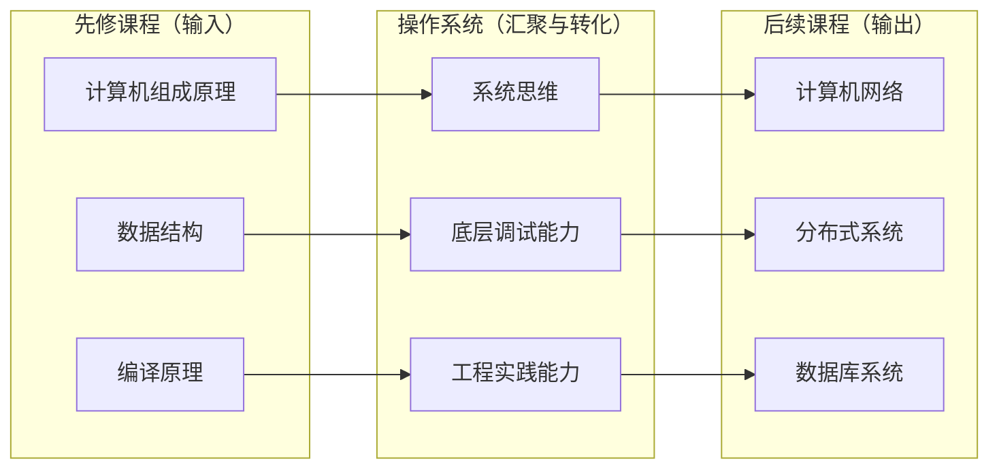

然而，恰恰是这三种最核心的能力，在传统实验教学中最难以被有效地培养和评测。其根源，正是本赛题所点出的三大痛点。

### 1.2 痛点一：实验环境难以统一

传统 OS 实验教学高度依赖本地配置。学生在自己的笔记本上安装虚拟机、编译内核、配置交叉工具链，环境差异极大：

- 同一份实验代码，在 Ubuntu 20.04 / 22.04 / 24.04、不同 gcc 版本、不同 glibc 版本、不同内核版本下可能产生截然不同的行为；
- 教师无法复现学生的"在我的电脑上能跑"这一经典现象，实验可复现性差；
- 助教维护上百份异构环境，成本随班级规模线性甚至超线性增长；
- 学生在环境搭建上耗费的时间，远多于真正理解操作系统原理的时间。

更隐蔽的损失在于**教学公平性**：环境差异会引入随机噪声，让"同样的代码"得到"不同的结果"，学生无法分辨是自己的实现有缺陷，还是环境有问题。当一个学生花了三个小时才把内核模块编译通过时，他学习的内容已经偏离了操作系统原理本身。

```text
传统实验环境的"熵增"模型：

  教师发布实验 v1.0（统一）
       │
       ▼ 分发给 N 个学生
  ┌────┴────┐  ┌────┴────┐  ┌────┴────┐
  │ VM 甲   │  │ 双系统乙 │  │ WSL 丙  │   ← 环境开始分叉
  │ 20.04   │  │ 24.04   │  │ gcc 9   │
  └────┬────┘  └────┬────┘  └────┬────┘
       │   "我这边能跑啊"   │         ← 复现失败
       ▼               ▼         ▼
   N 份不可复现的实验报告 → 教师逐一救火 → 教学时间被吞噬
```

**这一痛点的本质是：实验的运行环境缺乏一个"唯一可信的事实来源"（Single Source of Truth）。** 云原生容器技术恰恰提供了解决这一问题的正确工具——镜像即环境、配置即代码、运行即声明。这也是赛题将"容器化"列为第一大任务的深层原因。

### 1.3 痛点二：传统评测仅重结果

通用在线评测系统（Online Judge，OJ）诞生于算法竞赛场景，其核心假设是"程序的正确性等价于标准输入下的标准输出"。这一假设对于 ACM 风格的算法题是成立的，但对于操作系统实验**完全不成立**：

| 传统 OJ 的盲区 | 真实案例 | 教学后果 |
|---|---|---|
| 看不到进程结构 | 一个通过全部输出断言的进程调度程序，可能实际上没有创建任何子进程，而是用单一循环模拟了调度顺序 | 学生"学会"了伪造输出而非调度原理 |
| 看不到资源生命周期 | 一个输出正确的内存分配器，可能疯狂 `mmap` 而不 `munmap`，导致严重的内存泄漏 | 内存管理的核心概念被完全绕过 |
| 看不到并发正确性 | 一个结果正确的线程同步程序，可能隐含数据竞争（data race），只是在当前调度时序下恰好没有暴露 | "碰巧能跑"被误判为"正确实现" |
| 看不到同步语义 | 一个死锁实验程序，可能根本没有真正获取和释放锁，而是用 sleep 模拟了"卡住"的现象 | 死锁的四条件从未被真正编程实践 |

传统 OJ 只能看到"输出对不对"，**看不到系统调用序列、并发竞争、资源泄漏、死锁等系统级运行过程**，因而无法定位深层错误，甚至会给作弊和"伪通过"留下空间。

从评测理论的角度看，传统 OJ 的局限本质是**观测维度的缺失**：它将一个多维的、动态的、过程性的系统行为，坍缩为一个一维的、静态的、结果性的字符串比对。这种坍缩在算法题中尚可容忍（输入输出本身就是题目契约），但在操作系统实验中，**过程即答案**——进程如何创建、锁如何获取、内存如何分配、文件如何关闭，这些"过程"才是实验真正的考察对象。

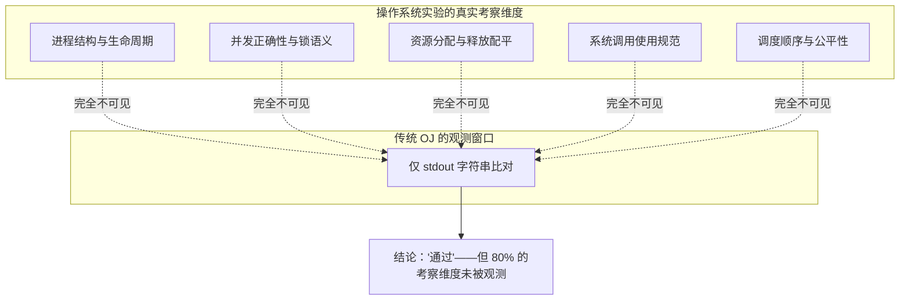

### 1.4 痛点三：智能反馈与教学脱节

近年来大语言模型（LLM）开始被引入教学辅导，但绝大多数应用停留在"通用问答"层面：

- AI 无法感知学生代码**实际如何运行**，只能基于代码文本做静态推测；
- AI 的回答往往直接给出正确答案，违背了启发式教学的原则；
- AI 不了解具体实验的教学目标、前置知识和常见误区，反馈缺乏针对性；
- AI 的回答无法与"系统调用轨迹、内存布局、火焰图"等可观测证据关联，缺乏可解释性。

更深层的问题是**信任危机**：当 AI 给出的诊断无法用证据支撑时，学生和教师都无法判断其可信度。一个"可能正确"的诊断在教学场景中的价值趋近于零——因为学生无法从中学到**验证方法**，只能学到"AI 说什么就是什么"，这恰恰与教育的目标背道而驰。

**这一痛点的本质是：AI 的推理缺乏"运行事实"的锚定，沦为脱离实验语境的空谈。** 正如医学 AI 需要检验报告与影像数据，教学 AI 同样需要"系统调用轨迹、并发事件、内存快照"这些可观测证据作为诊断依据。

### 1.7 痛点之外：三个被忽视的机会窗口

痛点分析只能回答"为什么要做"，机会分析才能回答"为什么现在做"。在三大痛点之外，存在三个被普遍忽视的机会窗口：

**机会一：观测数据是天然的学习行为数据。** 教育数据挖掘（EDM）领域的核心难题是"学习行为数据难以采集"——课堂行为难以数字化，作业过程难以追踪。而操作系统实验的特殊性在于：学生程序的运行轨迹**天然就是结构化的学习行为数据**——每一次错误的 fork 调用、每一个忘记的 wait、每一处泄漏的 fd，都是可机读的"学习证据"。采集成本几乎为零（观测本来就是评测的副产品），这是其他学科做梦都想要的数据优势。

**机会二：错误模式是可复用的教学资产。** 教师的经验中，最有价值的部分是"学生容易在哪里犯错"。传统上这份经验只存在于教师个人的脑海中，随着教师流动而流失。平台的错误模式库（Ratchet）第一次把这份经验**外化为可累积、可检索、可共享的数字资产**——一位教师带十年课积累的错误模式，可以服务未来所有使用平台的教师。

**机会三：评测系统的信任危机需要确定性答案。** AI 时代的评测系统面临前所未有的信任拷问："分数是不是 AI 给的？AI 会不会偏袒？"TraceOS Lab 的"确定性核心 + 智能外围"架构给出了明确的答案：分数 100% 由确定性引擎产生，AI 只解释不判分。这一架构不仅是技术选择，更是**对教育公平的制度性承诺**。

### 1.5 三大痛点的内在关联

三大痛点并非孤立，而是存在深刻的因果链：

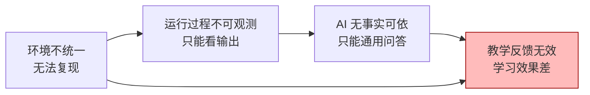

**环境统一是观测的前提**（只有可复现的环境，观测到的行为才具有可比性）；**观测是智能反馈的基础**（AI 必须基于真实的运行轨迹才能给出精准诊断）；**反馈是教学的引擎**（只有证据化的反馈才能被学生信任与内化）。TraceOS Lab 正是沿着这条因果链，逐层解决问题，最终形成"**可复现 → 可观测 → 可评测 → 可诊断 → 可教学**"的完整闭环。

### 1.6 从痛点到机会：赛题的深层意义

当我们把三大痛点放到更大的背景下审视，会发现本赛题实际上指向一个更宏大的命题：**操作系统实验教学，能否从"经验驱动的手工作坊"升级为"证据驱动的工业化体系"？**

| 维度 | 传统模式（手工作坊） | 目标模式（工业化体系） |
|---|---|---|
| 环境 | 学生自建，不可复现 | 统一镜像，声明式供给 |
| 观测 | 教师凭经验猜测 | 内核级轨迹，全量采集 |
| 评测 | 人工批改，抽样检查 | 确定性断言，全量覆盖 |
| 反馈 | 课堂讲评，时滞一周 | 实时启发式诊断，随做随学 |
| 数据 | 纸质成绩单 | 错误模式库 + 学习画像，持续积累 |

这一升级的本质，是把**教学经验**转化为**教学数据**、把**教师直觉**转化为**可复用的规则资产**。TraceOS Lab 的全部设计，都是围绕这一升级展开的。

---

## 2. 赛题要求深度解析

### 2.0 赛题的时代背景：三大技术浪潮的交汇点

本赛题并非凭空产生，而是三大技术浪潮在教育领域交汇的必然结果。理解这一背景，才能理解赛题的技术想象空间：

**浪潮一：云原生成为软件交付的默认形态。** 从 Docker 到 Kubernetes，容器化已经从"新潮实践"演变为"生产标配"。云原生带来的"镜像即环境、声明即部署、事件即通信"三大范式，为实验教学环境的统一提供了基础设施级的答案。赛题将"云原生容器"列为第一大任务，正是对这一趋势的直接呼应。

**浪潮二：eBPF 重塑了可观测性技术栈。** 2025-2026 年，eBPF 完成了从"前沿技术"到"生产标配"的跨越：Cilium 大规模替代传统网络代理（延迟下降 40-60%、CPU 节省 30% 以上）；Falco、Tetragon 使内核级安全可观测成为常态；在 AI 可观测性领域（LLM 应用、GPU 集群），eBPF 更成为"没有 eBPF 就看不到细节"的事实标准。eBPF 的内核 verifier 静态校验、JIT 编译、纳秒级 hook 开销（单次 kprobe 命中约 50-200ns），让"在内核里安全地跑观测代码"第一次成为工程上可接受的事。赛题要求"系统调用观测"，而 eBPF 正是这一要求的当代最优解。

**浪潮三：AI 辅助教育从"通用问答"走向"智能辅导系统（ITS）"。** 学术研究表明，实现苏格拉底式对话的智能辅导系统在物理、编程等领域取得了接近一对一人工辅导的学习增益（逼近 Bloom "two-sigma" 效应的上界）；基于 Bloom 分类学的 AI 教学对齐、基于最近发展区的难度适配已成为 ITS 研究的主流方向。但 ITS 研究的共识性难题是：**AI 需要可访问的知识模型与学习者状态数据**。这正是操作系统实验场景的独特机会——系统调用轨迹天然就是"可机读的学习行为数据"。

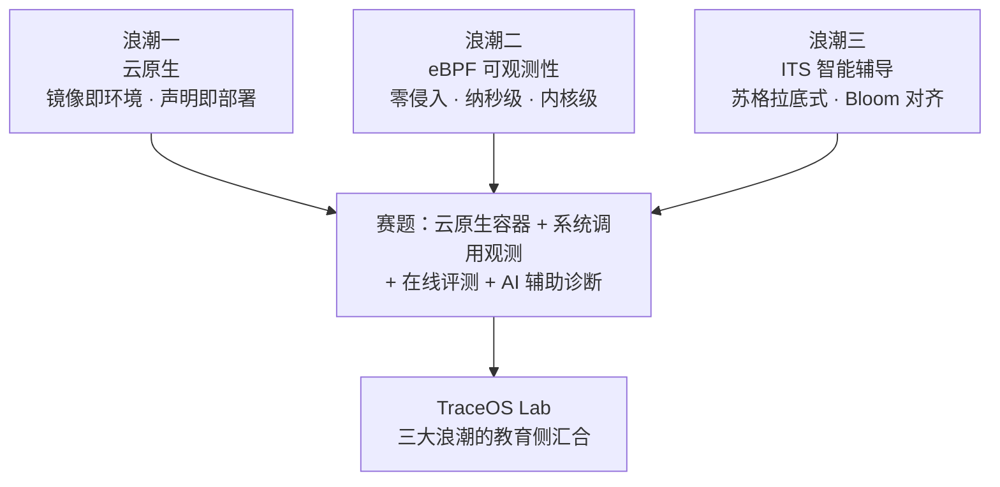

**我们的判断**：赛题的深层命题是——当容器、eBPF、AI 三大技术都已成熟时，操作系统实验教学能否从"手工作坊"升级为"证据驱动的智能体系"？TraceOS Lab 正是对这一命题的系统性回答。

本赛题要求参赛队伍实现"基于云原生容器与系统调用观测的操作系统实验在线评测与 AI 辅助诊断平台"。我们将五大任务逐条拆解为可验收的工程目标，并明确每一条在 TraceOS Lab 中的落点。

### 2.1 任务分解与响应概览

| 任务编号 | 赛题原文要求 | TraceOS Lab 的实现落点 | 超越程度 |
|---|---|---|---|
| (1) | 容器化实验运行沙箱：环境封装、资源限制、安全隔离、多任务并发调度 | NsJail 三级安全沙箱 + Docker/Local 多后端 + seccomp 白名单 + cgroup 资源治理 + 沙箱池并发调度 | 显著超越：三级纵深防御、6 套实验专属 seccomp profile、`(tid, start_time)` 复合键防 PID 复用 |
| (2) | 基于 strace 的非侵入式观测，采集系统调用序列、错误调用、资源操作、并发行为 | **eBPF + strace 双观测**：eBPF 为主观测（syscall/futex/mem/lifecycle 四类事件），strace 为降级观测 | 显著超越：将"strace 观测"升级为"eBPF 内核级主观测 + strace 兜底"的双轨架构 |
| (3) | "测试用例判定 + 系统轨迹分析 + AI 协同"混合反馈，启发式分层级提示 | 多维断言评测 + ObsContext 语义建模 + 多 Agent 诊断 Harness + 四级渐进反馈 | 显著超越：确定性规则优先于 LLM、Context Firewall、Guardrails、Ratchet 错误模式库 |
| (4) | 完整评测链路：提交、编译运行、数据采集、评分、反馈，支持六类 OS 实验 | 提交 → WorkerPool → 编译 → 沙箱执行 → 观测采集 → 断言评分 → ObsContext → 事件发布 → AI 诊断 | 完整实现，且覆盖 process/thread/memory/fs/scheduler/deadlock 六大类 |
| (5) | 教学数据管理：实验记录、错误统计、日志查询、学情共性问题 | 教师仪表盘 + 班级统计 + 错误模式库 + 审计日志 + 自适应学习画像 | 显著超越：增加自适应学习、学习画像、班级共性问题分析 |

### 2.2 赛题五大任务的隐藏考察点

逐字阅读赛题要求可以发现，每个任务背后都隐藏着更深层的工程考察点。我们对这些隐藏考察点的识别，直接决定了技术方案的高度：

**任务 (1) 的隐藏考察点：**
- 不只是"能用容器"，而是**安全隔离的深度**——恶意代码、资源耗尽、逃逸攻击如何防御；
- 不只是"能跑一个"，而是**并发调度的效率**——沙箱初始化是昂贵操作，如何复用；
- 不只是"限制资源"，而是**限制的公平性**——计时公平性直接关系评分公平。

**任务 (2) 的隐藏考察点：**
- 不只是"采集到"，而是**采集的开销**——观测本身不能干扰被测程序的时序行为；
- 不只是"有轨迹"，而是**轨迹的语义**——原始 syscall 序列如何转化为教学可读的语言；
- 不只是"能观测"，而是**观测的韧性**——观测工具在异构环境下的可用性如何保证。

**任务 (3) 的隐藏考察点：**
- 不只是"接一个 LLM"，而是**确定性评测与概率性 AI 的分工**——AI 出错了怎么办；
- 不只是"给出反馈"，而是**反馈的教学法质量**——直接给答案 vs 启发式引导；
- 不只是"一次诊断"，而是**诊断体系的持续进化**——错误模式如何沉淀为资产。

**任务 (4) 的隐藏考察点：**
- 不只是"链路能通"，而是**链路的高可用**——任何环节失败都不能让链路断裂；
- 不只是"支持六类实验"，而是**评测维度的实验针对性**——不同实验需要不同的断言与观测策略。

**任务 (5) 的隐藏考察点：**
- 不只是"有统计报表"，而是**数据能否反哺教学决策**——共性错误如何转化为课堂重点；
- 不只是"记录日志"，而是**数据资产的长期演化**——学习画像、错误模式库的积累机制。

### 2.3 对"云原生"与"AI 协同"两个关键词的深度理解

赛题标题中的两个关键词——**"云原生"**与**"AI 协同"**——决定了技术路线的上限。我们对二者的理解如下：

**云原生（Cloud-Native）** 不是"用了 Docker 就叫云原生"。真正的云原生意味着：

- **服务化拆分**：评测、AI、观测、前端是四个可独立部署、独立扩容、独立失败的服务边界；
- **事件驱动**：服务之间通过 NATS JetStream 异步解耦，而非脆弱的同步 HTTP 链；
- **可观测性**：Prometheus 指标、Loki 日志、Jaeger/OTel 链路追踪三层观测自成一格——**给系统做观测的平台，自身必须可观测**；
- **声明式部署**：docker-compose + Traefik 动态路由 + profile 分层，一键拉起完整系统。

**AI 协同（AI Collaboration）** 不是"接一个大模型 API"。真正的 AI 协同意味着：

- **AI 与确定性评测的分工**：分数由确定性引擎产生（可复现、可审计），AI 只负责解释与教学，不改变评分真值；
- **运行事实注入**：eBPF/strace 采集的轨迹被结构化、切片后注入 AI 上下文，AI 的每个结论都有证据支撑；
- **工程化的 AI 治理**：上下文防火墙（最小权限切片）、Token 预算、输入/输出 Guardrails、Ratchet 规则积累，把"提示词工程"升级为"Harness 工程"。

这两个关键词共同指向一个判断：**赛题期望的不是一个"演示系统"，而是一个经得起生产级追问的工程系统。** 我们的全部技术决策都以此为基准。

### 2.4 我们与赛题的差距认知：为什么"显著超越"是必要的

在竞赛语境下，完成赛题要求只是及格线。我们选择在五个任务上全部"显著超越"基线，原因是：

```text
基线方案的技术想象空间：
  (1) docker run + --memory 限制          →  单层防御，粒度粗
  (2) strace -f 文本解析                  →  ptrace 侵入 + 正则脆弱
  (3) 提交代码给 LLM，让它挑毛病          →  无事实锚定，有幻觉风险
  (4) 顺序执行：编译→运行→diff→打分       →  无并发，无降级
  (5) 存一张成绩表 + 拉个前端列表          →  无分析，无闭环

TraceOS Lab 的差异化：
  (1) NsJail 三级纵深 + seccomp 白名单 + cgroup 治理 + 沙箱池      →  安全与效率兼得
  (2) eBPF CO-RE 内核级采集 + strace 降级 + 语义模式识别           →  零侵入 + 高保真 + 可理解
  (3) 确定性断言评分 + 运行事实注入 + 多 Agent + Guardrails         →  可信 + 可解释 + 可治理
  (4) WorkerPool 并发编排 + 事件驱动 + 全链路降级                   →  高吞吐 + 高可用
  (5) 错误模式库 + ELO 画像 + 班级共性分析 + 教学数据资产化         →  数据驱动教学
```

---

## 3. TraceOS Lab 核心定位与价值主张

### 3.1 一句话定位

> **TraceOS Lab 是一套"以云原生容器保障环境一致性、以 eBPF+strace 双观测实现运行过程可解释、以多维断言 + AI 协同提供启发式诊断反馈"的操作系统实验在线评测与教学平台。**

### 3.2 三大价值主张

1. **可复现（Reproducible）**：统一的沙箱镜像 + 三级安全配置 + 资源限制，让"学生环境"与"评测环境"完全一致，任何一次评测都可被精确回放。

2. **可评测（Evaluable）**：从"只看输出"升级为"多维断言 + 系统行为观测"，让系统调用、并发竞争、资源泄漏、死锁等系统级运行过程成为可量化、可判定的评测对象。

3. **可教学（Teach-able）**：从"通用 AI 问答"升级为"运行轨迹锚定的启发式诊断"，通过分层级提示引导学生自主排查，而非直接给出答案。

### 3.3 价值主张的完整性论证：一个"五可"闭环

三大价值主张之外，TraceOS Lab 实际上形成了一个**"五可"能力闭环**，这也是项目区别于所有同类系统的核心竞争力：

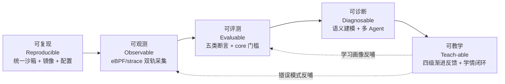

| 能力 | 关键问题 | 工程实现 | 对应文档 |
|---|---|---|---|
| 可复现 | 同样的代码，永远得到同样的结果吗？ | NsJail 三级沙箱 + 统一镜像 + 确定性评分 | 文档 03/06 |
| 可观测 | 程序运行时，系统层面发生了什么？ | eBPF 四类事件 + strace 降级 + ring buffer | 文档 04/05 |
| 可评测 | 观测到的行为，如何变成分数？ | 五类断言 AND 组合 + 测试点加权 + core 门槛 | 文档 06 |
| 可诊断 | 原始轨迹，如何变成可理解的结论？ | 三层 ObsContext + 21 语义模式 + 多 Agent | 文档 07/09 |
| 可教学 | 诊断结论，如何转化为学习行为？ | L1-L4 渐进反馈 + 错误模式库 + ELO 画像 | 文档 09/12/13 |

### 3.4 项目命名的三重含义

"TraceOS" 的命名本身承载了项目的定位与哲学：

```text
TraceOS = Trace（追踪） + OS（操作系统）

三重含义：
  1. 技术层：Trace = 系统调用轨迹（syscall trace），指向 eBPF/strace 双观测引擎
  2. 教学层：Trace = 追踪学习过程（trace the learning），指向学习画像与学情分析
  3. 哲学层：Trace = 追溯根因（trace the root cause），指向"证据驱动的诊断"理念

一句话：追踪操作系统的运行，追踪学生的学习，追溯错误的根因。
```

命名不是装饰，而是团队对项目本质的理解——**TraceOS Lab 首先是一个"追踪系统"，然后才是一个"评测系统"。** 评测是追踪的自然结果，教学是追踪的价值出口。

### 3.5 我们解决的是"评测"还是"教学"？

这是评审最容易追问的问题。TraceOS Lab 的答案是：**二者是同一枚硬币的两面**。传统系统的误区在于把"评测"（打分）和"教学"（反馈）割裂。TraceOS Lab 的核心设计哲学是：

```text
评测产生事实（fact），教学解释事实（interpretation），二者共享同一份观测证据（evidence）。

  raw syscall 序列 ──确定性断言──▶ 分数（事实）
        │
        └──语义建模 + AI──▶ 诊断报告（解释）
              ▲                        │
              └──── 同一份 ObsContext ──┘
```

分数来自对观测事实的确定性判定；AI 诊断则对同一份事实做教学化的归因与引导。因此，**评分可审计、诊断可溯源**——这在工程上通过"评分与诊断职责分离"这一红线得以保证。

这一设计回答了一个更深层的问题：**在 AI 时代，评测系统的信任基础是什么？** 我们的答案是"确定性核心 + 智能外围"：核心链路（编译、执行、采集、断言、评分）全程无 LLM 参与，任何一次评测都可被审计与回放；AI 只存在于外围的"解释层"，它让结果更易理解，但永远无法改变结果本身。

### 3.6 面向三类用户的价值图谱

| 角色 | 核心诉求 | TraceOS Lab 的交付 |
|---|---|---|
| **学生** | "我的程序为什么错了？错在哪里？怎么改？" | 断言明细逐条展示 + 系统轨迹可视化 + AI 四级渐进提示 + 学习画像 |
| **教师** | "全班 150 人，谁卡在哪？共性错误是什么？" | 班级统计大屏 + 错误模式库 + 学情共性分析 + AI 班级报告 |
| **管理员/助教** | "系统稳定吗？队列卡了吗？谁能做什么？" | 系统概览 + 队列治理 + 审计日志 + RBAC 权限 |

三端角色共享同一数据底座，但获得完全不同的视图——这正是"一份事实，多层表达"架构原则的用户侧体现。

---

## 4. 总体技术闭环与创新架构

### 4.1 全链路技术闭环

TraceOS Lab 的评测链路被设计为五个 Phase 的流水线，每个 Phase 都有明确的输入、输出与失败边界：

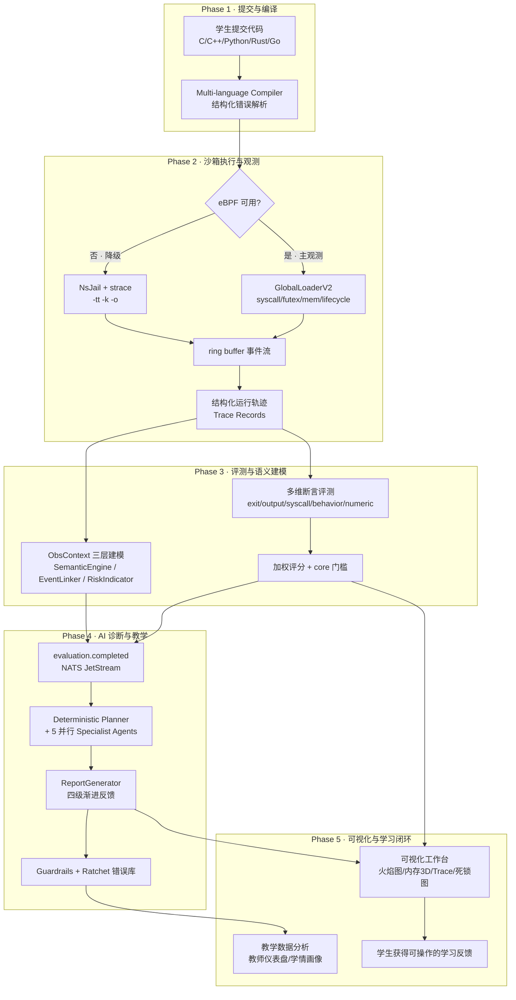

### 4.2 五大 Phase 的设计意图逐层解析

| Phase | 名称 | 核心职责 | 关键设计决策 | 失败时的行为 |
|---|---|---|---|---|
| 1 | 提交与编译 | 多语言源码 → 可执行文件 | 结构化编译错误（行/列/类型），前端精确定位 | 立即返回，不进沙箱 |
| 2 | 沙箱执行与观测 | 隔离执行 + 全量采集 | eBPF 优先、strace 降级、直接执行兜底 | 三级降级，链路不断 |
| 3 | 评测与语义建模 | 轨迹 → 分数 + 语义上下文 | 确定性断言与语义建模并行双轨 | 断言失败即扣分，不影响建模 |
| 4 | AI 诊断与教学 | 事实 → 教学解释 | 事件驱动异步，规则优先 LLM | LLM 不可用时规则反馈兜底 |
| 5 | 可视化与学习闭环 | 解释 → 可交互的学习体验 | 四类可视化 + 学情数据沉淀 | 读侧失败不影响评测真值 |

**Phase 2/3 的并行双轨设计**是本架构的一个独特之处：评测断言与语义建模消费同一份轨迹数据，但走完全独立的计算路径——前者产出分数（进入评分事务），后者产出 ObsContext（进入事件与 AI）。这保证了**评分链路的最小依赖**：即使语义建模失败，评分依然完整；即使 AI 服务宕机，分数与可视化依然可用。

### 4.3 三大工程原则

贯穿整个系统的三个工程原则，构成了 TraceOS Lab 区别于同类系统的技术底座：

**原则一：评分与诊断职责分离。**
分数由 Core Service 的确定性评测引擎产生（`assertion.go` → `new_scorer.go`），AI 服务负责解释、归因和启发式教学，**绝不改变评分真值**。这保证了任何一次评测结果都可复现、可审计、可回放，AI 的引入不会污染评测的确定性。

```text
确定性域（Deterministic Zone）          概率性域（Probabilistic Zone）
─────────────────────────────          ─────────────────────────────
编译 → 沙箱执行 → 观测采集               AI 诊断 → 教学反馈 → 提示生成
→ 断言判定 → 加权评分                     → 报告渲染 → 错误模式提取
─────────────────────────────          ─────────────────────────────
可复现 · 可审计 · 不可被 AI 修改          可迭代 · 可降级 · 可积累
         │                                        ▲
         └──── 运行事实（ObsContext）注入 ─────────┘
```

**原则二：主路径与降级路径并存。**
观测采用 eBPF 优先、strace 兜底的双轨架构。eBPF 通过能力探测（内核版本 → BTF → CO-RE → NoCore → strace）自动选择最优路径，任何一层不可用时自动降级，**实验链路始终可用**。

**原则三：原始证据与教学表达分层。**
底层保留 syscall、futex、memory、lifecycle 等运行事实（raw evidence）；中层构建 `ObsContext` 语义模型（semantic model）；上层再生成前端视图与 AI 教学反馈（teaching expression）。三层解耦，让同一份事实可以服务评分、可视化、AI 诊断三个完全不同的消费方。

```text
┌────────────────────────────────────────────────────────────┐
│  Layer 3 · 教学表达（Teaching Expression）                   │
│  前端视图（火焰图/3D/Trace/死锁图）· AI 诊断报告 · 提示卡片  │
├────────────────────────────────────────────────────────────┤
│  Layer 2 · 语义模型（Semantic Model = ObsContext）           │
│  Tier1 健康概览 · Tier2 进程分析 · Tier3 函数深潜            │
│  21 个 OS 语义模式 · 风险指标 · 证据链                        │
├────────────────────────────────────────────────────────────┤
│  Layer 1 · 运行事实（Raw Evidence）                          │
│  syscall 序列 · futex 事件 · 内存快照 · lifecycle 事件       │
│  eBPF ring buffer / strace 文本 → TimescaleDB 持久化         │
└────────────────────────────────────────────────────────────┘
```

### 4.4 架构的云原生属性全景

| 云原生属性 | TraceOS Lab 的体现 |
|---|---|
| 微服务 | 4 个服务边界：core（评测）、ai（诊断）、observability（读侧）、frontend（交互） |
| 事件驱动 | NATS JetStream 持久化事件流，评分 → 诊断异步解耦 |
| 声明式部署 | docker-compose profile 分层：infra / app / monitoring 按需组合 |
| 可观测性 | 自身配备 Prometheus + Loki + Jaeger 三层观测 |
| 弹性伸缩 | WorkerPool + 沙箱池双池化，独立于服务实例数 |
| 故障隔离 | AI 故障不影响评分；观测降级不影响执行；读侧故障不影响写侧 |

### 4.5 评测链路的状态机设计

一次提交的生命周期是一个五状态状态机，状态的每一次迁移都有明确的触发条件与失败语义：

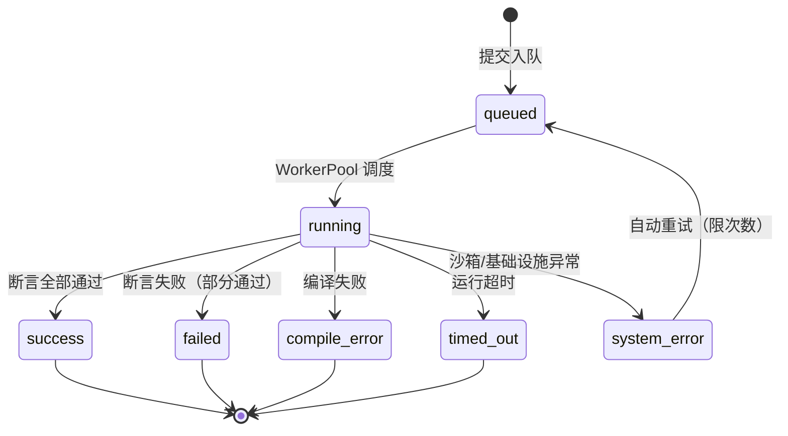

| 状态 | 含义 | 学生看到 | 教师数据影响 |
|---|---|---|---|
| queued | 排队中 | 排队进度 | 队列深度指标 |
| running | 评测中 | 执行进度 | 活跃评测数 |
| success | 全部通过且合格 | 满分 + 绿色横幅 | 通过率统计 |
| failed | 有断言未过 | 分数 + 红色横幅 + 断言明细 | 错误模式库 |
| compile_error | 编译失败 | 行列级错误定位 | 编译错误统计 |
| timed_out | 运行超时 | 超时提示 + 时限断言详情 | 性能问题统计 |
| system_error | 系统异常 | 重试提示 | 告警 + 审计 |

**状态机设计的两个关键决策**：一是 `success` 与 `is_qualified` 分离——状态描述"跑完了"，资格描述"核心达标"，二者语义不同不可混淆；二是 `system_error` 的自动重试——重试限次数（避免无限循环），重试后仍失败才对学生可见，把基础设施故障与学生体验隔离。

---

## 5. 六大核心技术亮点

TraceOS Lab 的竞争力，集中体现在六个"远超赛题基线"的技术亮点上。每个亮点后文均有专篇文档展开（文档 03~10），这里先给出全景式概括与深度论证。

### 亮点一：eBPF + strace 双观测引擎（超越赛题"仅要求 strace"）

赛题只要求"基于 strace 实现非侵入式运行时观测"，而 TraceOS Lab 将观测能力升级为**以 eBPF 为主、strace 为降级**的双轨架构：

- **eBPF 主观测**：通过 CO-RE（Compile Once, Run Everywhere）技术，将 syscall、futex（锁）、memory（brk/mmap/munmap）、lifecycle（clone/exec/exit）四类内核事件挂载到 tracepoint 与 sched 探针上，实现**纳秒级时间戳、微秒级开销、零侵入**的运行时观测；
- **全局单例 + HASH_OF_MAPS 沙箱隔离**：BPF 程序全局加载一次，通过 `sandbox_pids` 哈希表（外层 sandbox_id → 内层 pid map）实现多沙箱并发隔离，用 `(tid, start_time)` 复合键防止 PID 复用误判；
- **strace 降级观测**：在内核能力、权限或运行环境不满足时，自动降级到 strace（`-tt -k -o`），并进一步支持"无 strace 直接执行"的终极兜底，保证链路可用性。

**为什么这一升级是决定性的？** 从工程指标看：

| 指标 | strace（ptrace 架构） | eBPF（内核 hook） |
|---|---|---|
| 单次系统调用开销 | ~1–5 μs（暂停/恢复进程） | ~100–500 ns（内核态 hook） |
| 对被测进程的干扰 | SIGSTOP/SIGCONT 信号注入，改变调度时序 | 零信号副作用，不影响时序 |
| 数据格式 | 文本行，需正则解析（脆弱） | 结构化 ring buffer（可靠） |
| 时间精度 | 受 ptrace 上下文切换影响 | `ktime_get_ns()` 纳秒级 |
| 参数捕获 | 文本格式化，有截断风险 | 直接读寄存器，完整参数 |
| 多线程区分 | `-f` follow forks，额外开销 | 内核态 TGID/TID 天然区分 |

在并发实验（死锁、竞态）中，strace 的信号注入会**改变线程调度时序**，可能让"本来会发生的死锁"不再发生——即**观测工具改变了被观测对象**。eBPF 的零侵入性让观测结果真正可信。这一设计解决了 eBPF 在生产环境中最棘手的三个问题——**可移植性（CO-RE/NoCore 双编译）、隔离性（HASH_OF_MAPS）、可降级性（三级链路）**。

```text
观测能力探测链（自动选择最优路径）：

  内核 ≥ 5.8 且 BTF 可用？
      ├── 是 → eBPF CO-RE 编译加载（零侵入，纳秒级）
      ├── 否 → vmlinux.h 匹配？
      │         ├── 是 → eBPF NoCore 编译加载
      │         └── 否 → strace 可用？
      │                   ├── 是 → strace -tt -k -o（降级观测）
      │                   └── 否 → 直接执行 + 输出/退出码断言（终极兜底）
```

### 亮点二：多维断言评测与"core 门槛"公平评分（超越"只看输出"）

评测引擎支持**五类断言的 AND 组合**：

1. **Exit Code 断言**：精确匹配或允许集匹配；
2. **Output 断言**：contains / not_contains / regex / exact_match 四种模式，且支持 PID/TID/地址/时间戳的动态归一化；
3. **Syscall 断言**：required（必须出现）/ forbidden（禁止出现）/ min_count / max_count，并经系统调用别名归一化（如 `fork` → fork/vfork/clone/clone3）；
4. **Behavior 断言**：FD 泄漏（open-close>0）、僵尸进程（clone>wait）、死锁、内存上限、运行时限；
5. **Numeric 断言**：count_distinct（区间）/ set_equality（集合相等），从输出中正则提取数值做语义比较。

评分采用**"测试点加权累加 + core 门槛"**模型：`TotalScore = Σ(通过的测试点权重)`，同时 `IsQualified = 所有 core 类测试点全部通过`。这一模型既保留了细粒度评分，又通过 core 门槛防止"靠边缘用例堆分、核心能力缺失"的伪通过。

**这一设计的评分学价值**：传统百分比评分存在"可补偿性缺陷"——学生可以用边缘用例的正确抵消核心能力的缺失。core 门槛模型将评分升级为**两级判定**：分数衡量"做得有多好"，资格判定衡量"核心能力是否具备"。二者分离，教师可以精确区分"完全掌握"与"部分掌握但缺核心"的学生。

```text
评分模型（v2）：

  TotalScore = Σ 通过测试点的 Weight
  IsQualified = ∀ core 测试点全部通过
  CoreScore / EdgeScore 分列展示

  示例：某学生通过 2 个 core（各 20 分）+ 3 个 edge（各 5 分）
    TotalScore = 55，CoreScore = 40，EdgeScore = 15
    IsQualified = false（漏过 1 个 core 测试点）
    → 教师看到：核心能力有缺口（哪个 core 未过一目了然）
```

### 亮点三：三层 ObsContext 语义建模（从"原始轨迹"到"可理解证据"）

原始的系统调用序列对教师和学生都是"天书"。TraceOS Lab 构建了三层观测语义模型（`ObsContext`）：

- **Tier 1（运行概览）**：HealthScore 健康分、RED（Rate/Error/Duration P50/95/99）、USE（Utilization/Saturation）指标、异常摘要；
- **Tier 2（进程分析）**：进程树重建、系统调用轨迹、火焰图、内存快照、锁事件、资源指标；
- **Tier 3（函数级深潜）**：火焰图 diff、调用链、竞态报告、死锁演化、泄漏报告、Span 树。

配套的 `SemanticEngine` 内置 21 个 OS 语义模式库（进程 5 / IPC 4 / 内存 4 / 锁 2 / IO 5 / 网络 1），能把原始 syscall 序列识别为 `fork_exec_workflow`、`deadlock_pattern`、`leak_pattern` 等教学可读的语义标签。这一层是"系统轨迹分析"任务的核心落点，也是 AI 诊断的事实基础。

**21 个语义模式的完整清单**：

| 类别 | 模式数 | 代表模式 | 教学含义 |
|---|---|---|---|
| process（进程） | 5 | fork_exec_workflow / fork_no_wait / process_lifecycle | fork+exec 经典模式、僵尸进程预警、完整生命周期 |
| ipc（进程间通信） | 4 | pipe_ipc / signal_ipc / socket_create | 管道、信号、socket 基础模式 |
| memory（内存） | 4 | malloc_pattern / leak_pattern / mem_growth_warning | brk+mmap 双轨策略、泄漏预警、增长告警 |
| lock（锁） | 2 | deadlock_pattern / deadlock_cycle | Coffman 四条件教学锚点 |
| io（文件） | 5 | fd_leak_pattern / early_close_bug / small_io_pattern | FD 生命周期、EBADF、缓冲策略 |
| network（网络） | 1 | socket_listen_accept | TCP 服务端三步曲 |

每个模式都携带 `OSConcept`（教材概念映射）、`Severity`（严重度）、`TeachingNote`（教学注释），实现了**"观测事件 → 教材概念"的直接映射**——这是把系统轨迹变成教学资产的关键桥梁。

### 亮点四：内核观测可视化工作台（火焰图 / 内存 3D / Trace / 死锁图）

TraceOS Lab 不仅采集数据，更把数据变成**可交互的学习界面**：

- **火焰图（FlameGraph）**：后端 perf 采样生成 SVG，前端 iframe 注入渲染，支持用户态/内核态双视图 + AI 智能解读 + 跨面板函数高亮定位；
- **内存 3D 地图（Memory 3D Map）**：基于 Three.js / react-three-fiber 的进程虚拟地址空间 3D 立体柱状图，text/data/bss/heap/stack/mmap 六段着色，堆段泄漏时红色发光，支持快照回放；
- **系统调用 Trace 查看器**：swimlane（泳道）/ spantree / threadstate / sched / waterfall / table 六种视图；
- **死锁等待图（Wait-for Graph）**：ECharts 力导向图实时渲染锁依赖，SSE 推送，死锁环红色脉冲告警；
- **实时性能仪表盘**：CPU/内存/上下文切换/缺页/IOPS 六图联动，WebSocket + HTTP 轮询双通道。

**可视化在教学上的深层价值**：认知科学研究表明，抽象概念的习得依赖于"具体化表征"。火焰图把"函数调用开销"从抽象概念变为可指认的形状；内存 3D 地图把"虚拟地址空间"从教材插图变为可旋转、可缩放、可回放的立体对象；死锁等待图把"Coffman 循环等待条件"从定义变为可看见的红色闭环。**当学生亲眼看到自己制造的泄漏以红色发光柱的形式长出来时，这个概念的掌握是不可逆的。**

### 亮点五：AI 智能 Agent 的上下文工程与 Harness 工程（超越"通用问答"）

AI 侧不是简单的"调一个 LLM"，而是实现了一套完整的 **Agent 工程体系**：

- **确定性优先于 LLM**：意图判断、诊断 Planner、概念映射、观测提取全部用规则实现，LLM 只负责"需要语言生成"的环节；
- **Context Firewall（上下文防火墙）**：每个 Specialist Agent 只接收自己领域的最小上下文切片（`AGENT_CONTEXT_MAP`），实现最小权限的数据隔离；
- **Token 预算硬约束**：128K 窗口 × 40% 利用率 = 51.2K tokens 上限，超预算减半截断并注入 `_budget_exceeded` 标记；
- **启发式分层反馈**：Socratic 反问法 + Bloom 分类学 + Vygotsky ZPD + L1 方向/L2 策略/L3 线索脚手架，**绝不直接给出答案**（prompt 明令"完整可运行代码 ≤5 行"）；
- **Guardrails 安全护栏**：输入护栏（PII/注入/范围）+ 输出护栏（答案泄漏检测/幻觉检测/代码截断）双档无 LLM 热路径；
- **Ratchet 错误模式库**：从每次诊断的 finding 中自动提取错误模式入库，出现 ≥3 次建议固化为规则，实现"只收紧、不放松"的持续演进。

这套体系把零散的"提示词"工程化为可审计、可测试、可积累的 **Harness 工程**。

**Agent 拓扑**：

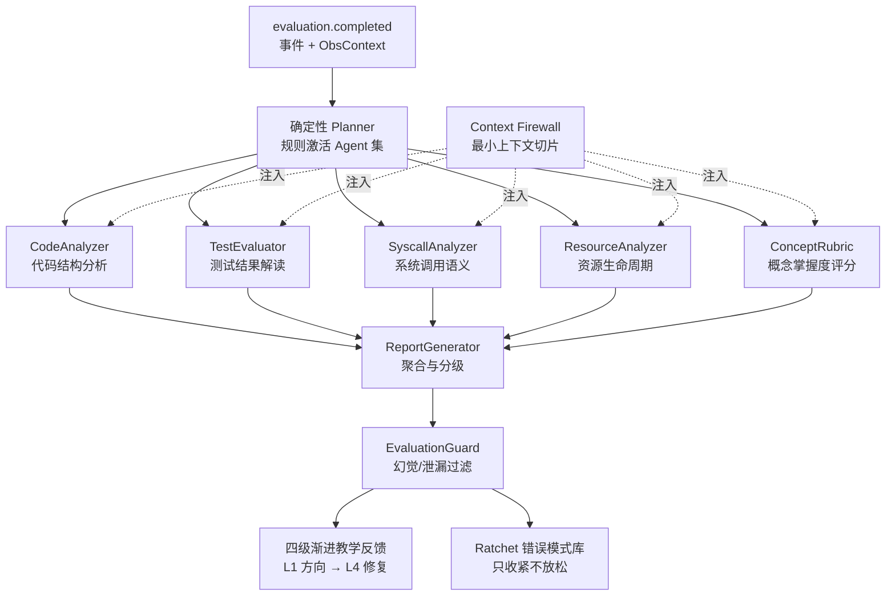

### 亮点六：RAG 私有知识库与 OS 问答平台（混合检索 + 多后端降级）

- **混合检索管线**：pgvector 稠密向量检索 + BM25 稀疏检索 + RRF 融合 + cross-encoder reranker，检索结果带完整溯源面板；
- **五级 Embedding 降级**：external API → sentence-transformers → ONNX → TF-IDF char n-gram → 纯 hash，任何环境都能跑；
- **知识入库与审核**：30+ 格式文档解析、chunk 偏移量记录（支持引用原文高亮）、教师/管理员审批流、版本化管理、Git 仓库批量导入；
- **OS 领域私有知识**：教科书、常见错误、示例代码、OS 概念四类源，配合课程隔离。

**为什么 RAG 对 OS 教学不可替代**：通用 LLM 对 OS 概念的描述往往"正确但平庸"，且无法引用学生正在使用的教材与讲义。私有知识库让 AI 的回答锚定在**课程自身的知识体系**上，回答带有精确的原文引用与溯源面板——学生可以验证、教师可以审核。这与"运行事实锚定"共同构成了 AI 反馈的**双重可信基础**：结论有证据（运行轨迹），知识有出处（知识库）。

### 5.7 六大亮点的协同效应："6 个 1 相加大于 6"

六大亮点不是六个孤立的功能，而是一个相互增强的有机整体。协同效应的分析揭示了单一亮点无法提供的系统价值：

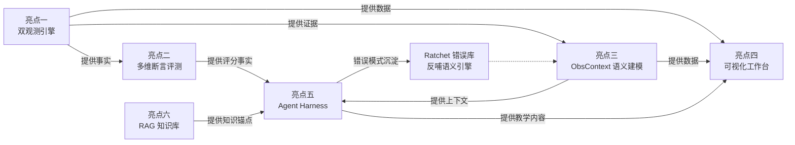

| 协同对 | 协同价值 | 单独存在时的局限 |
|---|---|---|
| 双观测 × 断言评测 | 断言能验证"看不见的行为"（syscall/behavior） | 无观测的断言退化为输出比对 |
| 双观测 × 语义建模 | 原始轨迹变成教学可读语言 | 轨迹本身是"天书" |
| 语义建模 × Agent | AI 获得结构化事实，幻觉大幅降低 | AI 凭空诊断不可信 |
| 双观测 × 可视化 | 数据变成可交互的学习界面 | 图表无数据是空壳 |
| 断言 × Agent | AI 获得"哪里错了"的确定性输入 | AI 需要自己判断对错（不可靠） |
| RAG × Agent | 诊断锚定课程知识体系 | 诊断与课程脱节 |
| Agent × 错误库 | 诊断资产持续积累，反哺语义引擎 | 每次诊断都是零起点 |

**协同效应的本质**：六个亮点构成了一条"事实 → 判定 → 语义 → 智能 → 表达 → 知识"的完整价值链，每一环都在增强前后环的能力。这正是"平台"与"功能堆砌"的根本区别——**平台的价值来自环节间的乘法关系，而非加法关系。**

### 5.8 创新点凝练：三大创新点的"一句话"版本

为了让评委在 5 分钟内记住项目的创新性，我们将创新点凝练为三句话：

```text
创新一（观测）："把赛题要求的 strace 观测，升级为 eBPF 内核级零侵入观测 + strace 降级的双轨体系，
                并攻克了 CO-RE 可移植、多沙箱隔离、PID 复用误判三大工程难题。"

创新二（评测）："把'输出比对'升级为'五类行为断言 + core 门槛'的多维评测，
                让系统调用、并发竞争、资源泄漏、死锁第一次成为可判定、可打分的评测对象。"

创新三（智能）："把'调用 LLM'升级为'确定性规划 + 上下文防火墙 + 双护栏 + 错误模式库'的 Harness 工程，
                让 AI 教学反馈可信、可审计、可持续进化。"

共同底座："三条降级链（观测 4 级 / 嵌入 5 级 / 模型 3 级）保证任何环境下的可用性。"
```

三句话分别对应赛题三大任务的"显著超越"，构成答辩时的创新性论证主线。

---

## 6. 对赛题要求的逐项响应矩阵

### 6.1 五大任务逐项响应

| 赛题任务 | 要求关键词 | TraceOS Lab 实现 | 关键源码/文档依据 |
|---|---|---|---|
| (1) 容器化沙箱 | 环境封装、资源限制、安全隔离、并发调度 | NsJail（默认）+ Docker + Local 三后端；Level1/2/3 三级安全；seccomp 白名单；cgroup mem/pids/cpu；沙箱池 + 信号量限流 | `internal/sandbox/`、`sandbox/seccomp-profiles/`、文档 03 |
| (2) 非侵入式观测 | 系统调用、错误调用、资源操作、并发行为 | eBPF（syscall/futex/mem/lifecycle）+ strace 降级；错误码 errno 映射；FD/内存/进程三类配平分析 | `internal/ebpf/`、`ebpf/bpf/`、文档 04/05 |
| (3) 混合反馈 | 测试用例判定 + 轨迹分析 + AI 协同；启发式分层提示 | 多维断言 + ObsContext + 多 Agent Harness + 四级渐进反馈 + Guardrails | `internal/services/`、`app/diagnosis/`、文档 06/07/09 |
| (4) 完整链路 | 提交→编译→运行→采集→评分→反馈 | WorkerPool 并发编排；多语言编译；双轨观测；确定性评分；事件驱动诊断 | `internal/evaluator/`、文档 02/11 |
| (5) | 教学数据管理 | 实验记录、错误统计、日志查询、学情共性 | 教师仪表盘、班级统计、错误模式库、审计日志、自适应画像 | `internal/handler/teacher/`、文档 12/13 |

### 2.6 五大任务的验收标准自评表

为客观自评任务完成度，我们为每项任务定义了可演示的验收标准：

| 任务 | 验收动作 | 验收标准 | 自评 |
|---|---|---|---|
| (1) 沙箱 | 提交一段 fork 炸弹代码 | 被 cgroup 限制、进程创建受限、不影响其他提交 | 达标（可现场演示） |
| (1) 沙箱 | 提交恶意系统调用代码 | seccomp 拦截，返回 EPERM 并记录 | 达标 |
| (2) 观测 | 运行进程实验 | 前端展示完整 syscall 序列 + 进程树 + 资源指标 | 达标 |
| (2) 观测 | 运行死锁实验 | futex 事件流 + 死锁环检出 | 达标 |
| (3) 反馈 | 提交有缺陷代码 | 五类断言逐条结果 + AI 四级渐进反馈 | 达标 |
| (3) 反馈 | 请求 AI 给答案 | Guardrails 拦截，只给启发式提示 | 达标 |
| (4) 链路 | 班级批量提交 | 并发评测，全部提交在可预期时间内完成 | 达标 |
| (5) 数据 | 查看教师仪表盘 | 班级统计、高频错误、学情画像完整呈现 | 达标 |

**每一条验收标准都可现场演示、可重复验证**——这是"完整性"维度的最有力证据：不是文档声称，而是评委可亲测。

### 6.2 六类 OS 实验覆盖

| 实验类别 | 核心知识点 | 评测关注点 | 沙箱 profile | seccomp 白名单 |
|---|---|---|---|---|
| process（进程管理） | fork/exec/wait、进程树 | 进程创建顺序、僵尸进程、退出码 | Level 1 | process-lab.json |
| thread（线程同步） | pthread、互斥、条件变量 | 线程数、futex 序列、竞态 | Level 1 | thread-lab.json |
| memory（内存分配） | malloc/free、内存布局 | mmap/munmap 配平、泄漏、碎片 | Level 2 | memory-lab.json |
| fs（文件 I/O） | open/read/write、目录 | FD 泄漏、文件操作序列 | Level 2 | fs-lab.json |
| scheduler（处理机调度） | 调度算法、优先级 | 调度顺序、sched 系统调用 | Level 2 | scheduler-lab.json |
| deadlock（死锁） | 锁依赖、资源分配图 | wait-for graph 环、futex 演化 | Level 3 | deadlock-lab.json |

### 6.5 六类实验的深层教学图谱

六类实验不是六道孤立的题目，而是 OS 知识体系的一次系统性覆盖。它们之间的依赖与递进关系构成了教学图谱：

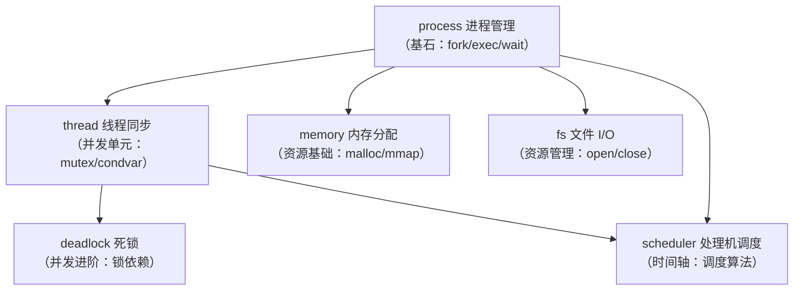

| 实验类别 | 先修概念 | 本实验的核心误区 | 评测能抓到的典型错误 |
|---|---|---|---|
| process | 进程概念、内存布局 | 忘记 wait、僵尸进程、exec 失败处理 | fork_no_wait、进程树异常 |
| thread | 进程 vs 线程、地址空间 | 忘记 join、数据竞争、死锁隐患 | futex 序列异常、竞态报告 |
| memory | 虚拟内存、堆/栈 | 忘记 free、双重 free、越界写 | leak_pattern、mmap 配平失衡 |
| fs | 文件描述符、目录结构 | FD 泄漏、忘记 close、路径错误 | fd_leak_pattern、EBADF |
| scheduler | 调度策略、优先级 | 用 sleep 模拟调度、饥饿 | 调度顺序断言失败、伪造输出 |
| deadlock | 锁语义、资源分配 | 用 sleep 模拟死锁、锁顺序错误 | futex 环检测、wait-for graph |

**教学图谱的工程意义**：实验间的依赖关系被编码在课程的先修配置中；误区库被编码在错误模式库中；评测策略被编码在断言与 seccomp 配置中。**OS 教学的知识结构第一次被完整地映射为可执行的平台配置。**

**实验覆盖的深度说明**：六类实验共预置 31 个具体实验题目，每个实验配备 5~6 个 JSON 断言测试用例。以进程管理为例，覆盖 fork/exec、IPC 通信、信号处理、进程状态转换、守护进程、僵尸进程处理 6 个子主题；死锁类则覆盖死锁必要条件、银行家算法、资源分配图、Wait-For Graph 4 个子主题。完整的实验清单与断言样例见文档 11。

### 6.3 赛题"能力导向"维度的体现

赛题强调五个能力：**容器技术、系统观测、OS 原理理解、自动化评测设计、AI 教学应用**。TraceOS Lab 在每一维度上都有超越基线的工程深度：

- **容器技术**：不是"跑一个 docker run"，而是 NsJail 三级沙箱 + seccomp 白名单 + cgroup 治理 + 用户命名空间映射 + 沙箱池的生命周期管理；
- **系统观测**：不是"解析 strace 文本"，而是 eBPF CO-RE 内核级采集 + 语义模式识别 + 内存布局重建 + 死锁演化状态机；
- **OS 原理理解**：评测断言、语义引擎、AST 静态审计都建立在对 OS 机制的准确理解上（如 futex 五类 op、`(tid, start_time)` 防 PID 复用、`getconf CLK_TCK` 对齐 boottime）；
- **自动化评测设计**：五类断言 + core 门槛 + 防作弊三重防线 + 空模板检测 + 动态输出归一化；
- **AI 教学应用**：上下文工程 + Harness 工程 + Guardrails + Ratchet + RAG 混合检索，而非单次 API 调用。

### 6.4 逐字响应：赛题原文的"遗漏点"自查

为防止"自说自话"，我们对赛题要求做了逐字自查，确保每个关键词都有明确落点：

| 赛题关键词 | 落点自查 |
|---|---|
| "云原生" | 4 服务 + NATS 事件驱动 + compose profile 分层 + 自身三层可观测 |
| "容器" | NsJail/Docker/Local 三后端，NsJail 为默认（安全最强） |
| "系统调用观测" | eBPF 四类事件 + strace 降级 + errno 映射 |
| "在线评测" | 提交即评，WorkerPool 并发，秒级出分 |
| "AI 辅助诊断" | 5 Agent + Planner + ReportGenerator + 四级反馈 |
| "非侵入式" | eBPF 内核 hook 零信号注入（优于 strace 的 ptrace） |
| "系统调用序列" | 全量序列持久化 + swimlane 可视化 + 语义模式识别 |
| "错误调用" | errno 错误码映射 + EBADF/ECHILD 等语义标注 |
| "资源操作" | FD 配平、mmap/munmap 配平、内存趋势、泄漏报告 |
| "并发行为" | futex 事件流、Happens-Before、竞态检测、死锁演化 |
| "启发式" | Socratic 反问 + Bloom + ZPD 三级教学法 |
| "分层级提示" | L1 方向 → L2 证据 → L3 语义 → L4 修复方向 |
| "实验记录/错误统计/日志查询" | 提交历史、错误模式库、审计日志、Trace 查询 |
| "学情共性问题" | 班级共性分析、Top10 高频错误、AI 班级报告 |

---

## 7. 与同类系统的横向对比

### 7.1 四类系统对比总表

为了客观定位 TraceOS Lab 的竞争力，我们将它与三类典型系统对比。

| 维度 | 传统 OJ（如 HUSTOJ/JudgeDuck） | 通用 LLM 辅导 | 学术 OS 评测（如 pintos test） | **TraceOS Lab** |
|---|---|---|---|---|
| 环境一致性 | 依赖镜像，粒度粗 | 无 | 固定 VM，难迁移 | **NsJail 三级沙箱 + seccomp 白名单，可复现** |
| 评测粒度 | 仅 stdout 比对 | 无评测 | 输出 + 少量断言 | **五类断言（exit/output/syscall/behavior/numeric）** |
| 系统行为观测 | 无 | 无 | 有限 | **eBPF 内核级四类事件 + strace 降级** |
| 并发/竞态检测 | 无 | 无 | 无 | **Happens-Before 向量时钟 + 死锁 wait-for graph** |
| 内存/泄漏检测 | 无 | 无 | 无 | **mmap/munmap 配平 + 堆增长趋势 + 3D 布局** |
| AI 反馈 | 无 | 通用问答，无运行事实 | 无 | **运行轨迹锚定的启发式分层诊断** |
| 教学数据 | 提交/得分 | 无 | 无 | **教师仪表盘 + 班级共性 + 自适应画像** |
| 可观测工程 | 无 | 无 | 无 | **Prometheus/Loki/Jaeger 三层观测** |
| 部署复杂度 | 中 | 无 | 高（需自建内核环境） | **低（compose 一键，profile 分层）** |
| 反馈时延 | 秒级（仅对错） | 秒级（无事实） | 分钟级 | **秒级出分 + 秒级诊断（事件驱动）** |

**核心差异**：TraceOS Lab 是唯一同时解决"环境一致性 + 系统行为观测 + 确定性评测 + 运行事实锚定的 AI 教学 + 教学数据闭环"五个环节的系统。其他系统各自覆盖了其中一两个环节，但没有形成完整闭环。

### 7.2 国际视角：评测技术的历史演进与本项目的站位

评测技术的演进史可以帮助评委理解 TraceOS Lab 的站位：

| 时代 | 代表系统 | 评测对象 | 局限 |
|---|---|---|---|
| 1970s-1980s | 批改器（grader） | 输出文本比对 | 只能评结果 |
| 1990s-2000s | 判题 OJ（UVa/HUSTOJ） | 标准输入输出 | 看不到过程 |
| 2000s-2010s | 学术测试框架（pintos/xv6） | 断言 + 日志检查 | 环境难迁移、无教学反馈 |
| 2010s-2020s | 云 OJ（DMOJ/Judge0） | 容器化评测 | 仍无系统级观测 |
| 2020s-至今 | **TraceOS Lab** | **系统行为 + 内核观测 + AI 教学** | 指向下一代：行为评测 + 智能反馈 |

从演进史看，评测系统的发展主轴是**评测对象的不断加深**：从输出 → 行为 → 语义 → 学习过程。TraceOS Lab 站在"行为 + 语义"的当代前沿，并为"学习过程评测"预留了数据基础（画像、错误库）。

### 7.3 工业界对标：我们的设计与生产级观测平台的共性

TraceOS Lab 的观测设计并非闭门造车，而是吸收了一线可观测性产品的工程实践：

| 工业实践（Pixie/DeepFlow/Falco 等） | TraceOS Lab 的对应设计 |
|---|---|
| eBPF 自动协议解析（Pixie） | 21 个 OS 语义模式自动识别 |
| 零侵入采集（Falco） | 内核 hook 零信号注入 |
| 多层聚合与降采样 | Tier1/Tier2/Tier3 分层建模 |
| 事件因果链分析 | EventLinker 事件链接器 |
| 可回放取证 | 全量轨迹持久化 + 快照回放 |

**这印证了一个判断**：TraceOS Lab 的观测栈设计如果放到工业语境中同样成立——它本质上是一个"面向教学场景垂直优化的 OS 可观测性平台"。

### 7.4 与学术系统的差距认知：诚实的定位

我们尊重 pintos 等经典学术评测系统的历史贡献，但必须指出它们的时代局限：pintos 诞生于 2004 年，其设计目标是在单机环境验证教学内核的正确性，天然缺乏云原生能力、观测可视化与 AI 辅助。TraceOS Lab 不是要"打败"这些系统，而是在**新的技术条件下回答同一个问题**——2026 年的操作系统实验教学，应该长什么样？

### 7.5 竞品分析的三个"护城河"判断

| 护城河 | 内容 | 为什么难以复制 |
|---|---|---|
| 确定性 + 智能的架构分工 | 评分与诊断职责分离是**红线级**架构决策 | 一旦 AI 参与评分，信任模型就崩塌了；重新设计代价极高 |
| 观测语义资产 | 21 个语义模式 + 三层 ObsContext + 错误模式库 | 这些资产来自对 OS 教学规律的提炼，不是框架能提供的 |
| 全链路降级韧性 | 从 eBPF 到"直接执行"的五级降级 | 每级降级都有测试保障，是工程纪律而非灵感 |

---

## 8. "一条提交"的完整教学旅程

用一条具体的学生提交，串联起整个系统的价值。假设学生小明正在完成"进程管理——创建进程树"实验，他写了一段有缺陷的代码（子进程未正确 `wait`，导致僵尸进程 + FD 泄漏）。

```c
/* 小明的代码（有缺陷）*/
#include <stdio.h>
#include <unistd.h>
#include <fcntl.h>

int main() {
    for (int i = 0; i < 3; i++) {
        pid_t pid = fork();
        if (pid == 0) {
            int fd = open("/tmp/log.txt", O_CREAT | O_WRONLY, 0644);
            printf("Child: PID=%d, PPID=%d\n", getpid(), getppid());
            // 缺陷1：fd 未 close
            // 缺陷2：子进程未退出即返回，父进程未 wait
            return 0;
        }
        // 缺陷3：父进程没有 wait4() 回收子进程
    }
    sleep(5);
    return 0;
}
```

### 8.1 阶段一：提交与编译（~1 秒）

小明在 Monaco 编辑器中提交代码。系统路由到 Core Service 的 WorkerPool，`Compiler.Compile` 按语言策略编译。若编译失败，返回**结构化的编译错误**（`ErrorLine{Type, File, Line, Column, Message}`），前端精确定位到错误行列——小明无需在终端中翻找晦涩的 gcc 输出。

### 8.2 阶段二：沙箱执行与观测（~6 秒）

编译成功，沙箱池分配一个 Level 1 NsJail 实例（256MB 内存、80% CPU、pid 上限 128、全命名空间隔离 + seccomp 白名单）。eBPF 全局 loader 为本次沙箱分配独立 sandbox_id，注入学生进程 PID。运行过程中，syscall/futex/mem/lifecycle 四类事件被 ring buffer 实时采集。

```text
观测到的部分轨迹（已采集）：
  [0.000ms] clone()        → 3 次子进程创建
  [0.012ms] openat() × 3   → 每个子进程打开 /tmp/log.txt
  [0.020ms] write() × 3    → 输出 PID/PPID
  [0.031ms] exit_group() × 3 → 子进程退出
  ❌ wait4() 缺失 × 3       → 僵尸进程的直接证据
  ❌ close() 缺失 × 3       → FD 泄漏的直接证据
```

### 8.3 阶段三：确定性评测（~1 秒）

- **Exit/Output 断言**：输出与参考答案经动态归一化后比对，通过；
- **Syscall 断言**：required 的 `fork`、`execve` 出现，通过；但 `wait4` 的 min_count 不满足，**判定失败**；
- **Behavior 断言**：`clone 次数 > wait 次数`，判定**僵尸进程**；`open 次数 > close 次数`，判定**FD 泄漏**；
- **评分**：core 测试点未全过，`IsQualified = false`，但 edge 测试点得分，`TotalScore` 部分给分。

同时，语义引擎对同一份轨迹做模式识别，产出结构化标签：`fork_no_wait`（🟡 僵尸进程预警）、`fd_leak_pattern`（🟡 FD 泄漏风险）。这些标签连同轨迹一起进入 ObsContext。

### 8.4 阶段四：AI 诊断（异步，约 10 秒）

`evaluation.completed` 事件携带完整的 ObsContext（进程树、syscall 轨迹、僵尸/FD 泄漏标记）进入 NATS JetStream。AI 服务消费事件：

1. **确定性 Planner** 根据数据激活 5 个 Specialist Agent（code_analyzer、test_evaluator、syscall_analyzer、resource_analyzer、concept_rubric）；
2. **Context Firewall** 为每个 Agent 切片最小上下文；
3. 各 Agent 并行分析，syscall_analyzer 用规则检测出"僵尸进程 + FD 泄漏"；
4. **ReportGenerator** 聚合出四级反馈：
   - **L1（方向）**："观察你的进程树，是否有子进程在退出后没有被回收？"
   - **L2（证据）**："检测到 `clone` 调用 N 次，但 `wait4` 仅 M 次（N>M），存在僵尸进程；`open` 比 `close` 多 K 次，存在 FD 泄漏。"
   - **L3（语义）**："僵尸进程是因为父进程未调用 `wait` 回收子进程退出状态；FD 泄漏是因为打开的文件描述符未在退出前关闭。"
   - **L4（修复方向）**："在父进程中使用 `wait` 循环回收所有子进程；用 `close` 释放打开的文件。"

反馈经过 EvaluationGuard 校验（幻觉检测、答案泄漏检测）后落库，并注入 Ratchet：`fork_no_wait` 模式累计出现次数 +1。

### 8.5 阶段五：可视化与学习闭环（即时可用）

小明在前端工作台看到：

- **火焰图**：热点函数分布；
- **内存 3D 地图**：堆段缓慢增长的可视化（泄漏的直观呈现）；
- **Trace 查看器**：系统调用泳道图，`open` 与 `close` 的不对称一目了然；
- **死锁图**：本实验无死锁，但可看到进程树拓扑。

同时，教师端仪表盘实时更新：小明的提交被记入"僵尸进程"这一高频错误模式，班级共性分析显示"37% 的学生存在同类问题"，教师可以针对性地调整下一节课的讲解重点。

### 8.6b 第二个教学案例：内存泄漏的完整诊断链路

为展示平台对六类实验的全面覆盖，再以内存实验为例。学生小华完成了"内存分配器"实验，代码在功能上正确（输出全部匹配），但存在隐蔽的内存泄漏：

```c
/* 小华的代码：功能正确，但每次循环泄漏 1KB */
char* buf[100];
for (int i = 0; i < 100; i++) {
    buf[i] = malloc(1024);          // 分配 1KB
    memset(buf[i], 0, 1024);        // 初始化
    // 缺陷：循环结束后没有统一 free，且中间没有释放
}
for (int i = 0; i < 100; i++) {
    free(buf[i]);                   // 最终释放（功能无碍，但期间峰值高达 100KB）
}
```

**传统 OJ 的判定**：输出全部匹配 → 满分 → 内存泄漏问题从未被发现。

**TraceOS Lab 的判定链路**：

1. **Behavior 断言**：`mmap/brk 增长趋势` 超出测试点设定阈值 → `max_memory_kb` 断言失败；
2. **语义引擎**：`mem_growth_warning`（连续 mmap 增长）命中，红色告警；
3. **内存 3D 地图**：堆段在运行时持续增高的红色发光柱，泄漏过程一目了然；
4. **泄漏报告**：leak_detector 产出"峰值内存 100KB vs 稳态 1KB"的对比分析；
5. **AI 诊断**：
   - L1："观察你的内存 3D 地图，堆段在执行期间为什么持续增长？"
   - L2："检测到 100 次 malloc 与 100 次 free，但释放集中在程序尾部——峰值内存达到了 100KB，而按需分配只需 1KB。"
   - L3："malloc 的内存只在 free 后才归还堆——你的释放时机在循环之后，导致整个循环期间峰值膨胀。这是'释放时机'而非'忘记释放'的问题。"
   - L4："考虑'分配-使用-释放'的短生命周期模式：在循环内用完即 free。"

**教学价值对比**：传统 OJ 下小华会带着"满分"的错觉离开，并在真实的工程项目中重犯同样的错误；TraceOS Lab 下小华理解了"峰值内存"与"释放时机"这两个教材上鲜少强调的工程概念。**这就是"过程评测"超越"结果评测"的教学意义。**

### 8.6 全旅程时间轴与"学生感知"

```text
  0s    1s        7s       8s                 18s
  │─────│─────────│────────│──────────────────│────▶
  提交   编译完成   执行完成  评分出分             AI 诊断报告
        (或编译错误  (观测数据  (IsQualified       (四级反馈
         立即返回)   已入库)   = false 可见)        + 证据引用)
```

从学生视角：提交后 **8 秒内**看到分数与测试点明细，**18 秒内**看到带证据引用的 AI 诊断。全程无需安装任何工具、无需配置任何环境、无需等待助教回复。

### 8.7 旅程背后的系统机制一览

小明的 60 秒旅程背后，究竟发生了什么？下表汇总每一步的系统机制，展示"用户无感"背后"系统有感"的工程深度：

| 步骤 | 用户感知 | 系统机制（用户无感） |
|---|---|---|
| 点击提交 | 一个按钮 | 限流校验（120 次/分钟）→ 审计记录 → WorkerPool 入队 → 状态机置 queued |
| 等待评测 | 进度条 | 队列调度 → 实验策略加载 → 语言编译 → 沙箱池分配（命中预分配实例） |
| 运行中 | 状态转圈 | NsJail 命名空间建立 → seccomp 白名单加载 → eBPF sandbox_id 分配 → 四类事件采集 |
| 出分 | 分数 + 判定横幅 | 五类断言并行计算 → 测试点加权 → core 门槛判定 → 事务落库 → 事件发布 |
| AI 诊断 | 报告卡片 | JetStream 消费 → Planner 激活 5 Agent → 上下文切片 → 并行分析 → 报告聚合 → 护栏过滤 → Ratchet 入库 |
| 查看可视化 | 图表 | obs-context 聚合查询 → SVG 渲染 → 3D 场景加载 → SSE 实时推送 |
| 下次提交 | 熟练操作 | ELO 画像更新 → 概念矩阵刷新 → 难度推荐重算 → 会话记忆持久化 |

**"用户无感"正是工程的目标**：所有复杂性被封装在服务内部，学生在平台上体验到的是"提交即得反馈"的流畅学习循环，而不是部署、配置、调试工具的额外负担。

---

## 9. 系统核心数据流全景

### 9.1 端到端时序图

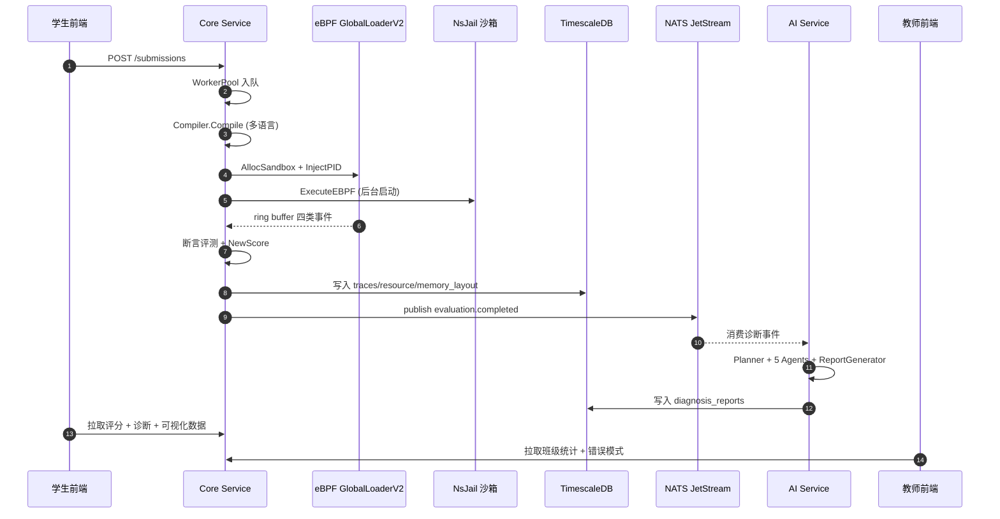

### 9.2 数据流的四个关键属性

| 属性 | 设计 | 保障机制 |
|---|---|---|
| **单向主链路** | 提交 → 评分 → 诊断，无回环依赖 | 评分不依赖诊断结果，诊断异步消费评分事件 |
| **多消费方** | 同一份轨迹服务评分/可视化/AI 三个消费方 | ObsContext 一次构建、多处序列化 |
| **失败不阻塞** | 任何下游失败都不回滚上游 | 事件持久化 + 至少一次投递 + 幂等去重 |
| **可回放** | 全部原始证据持久化 | trace_records 超表 + 原始输出 + 沙箱指标 |

### 9.3 数据流的"证据链"设计

从数据库落点看，一次提交产生的数据形成一个完整的证据链：

```text
submission (提交实体)
   ├── compile_log (编译证据)
   ├── test_point_results (评分证据 · 逐断言明细)
   ├── trace_records (观测证据 · syscall/futex/mem/lifecycle)
   ├── resource_snapshots (资源证据 · CPU/内存/IO 时序)
   ├── memory_layouts (内存证据 · 六段快照)
   ├── obs_context (语义证据 · 三层模型 + 风险指标)
   ├── diagnosis_report (教学证据 · 四级反馈 + finding)
   └── flamegraph_svg (性能证据 · 用户/内核双视图)
```

任何一条反馈（无论来自断言还是 AI）都可以沿证据链回溯到原始观测数据——这是"诊断可溯源"的工程实现。

---

## 10. 项目完整功能模块清单

### 10.1 学生端

| 模块 | 功能 | 技术要点 |
|---|---|---|
| 实验列表/详情 | 浏览实验、查看题目说明、前置知识、难度、提交限制 | 课程-实验两级导航，ELO 难度标注 |
| 代码工作台 | Monaco 编辑器、多语言切换、代码模板、快照、运行历史 | VS Code 内核编辑器 + 模板自动装载 |
| 评测结果 | 编译错误定位、测试点明细、core/edge 分数、判定横幅 | 逐断言明细 + 行列级错误定位 |
| 可视化诊断 | 火焰图、内存 3D、Trace、死锁图、eBPF 五 Tab、实时性能 | 六类视图 + SSE/WebSocket 实时推送 |
| AI 助手 | 流式对话、4 种 Agent 模式、诊断卡片、引用溯源 | SSE 流式 + 证据引用 + 会话记忆 |
| 学习进度 | 六类实验 ELO、掌握概念、学习曲线、自适应难度 | Elo rating + 知识图谱概念标注 |

### 10.2 教师端

| 模块 | 功能 | 教学价值 |
|---|---|---|
| 数据大屏 | 通过率排行、分数分布、提交趋势、类别环形、困难实验、AI 教学分析 | 一屏掌握班级全貌 |
| 实验管理 | 实验 CRUD、测试用例管理、参考实现、评分权重 | 断言即评分标准的声明式管理 |
| 班级管理 | 课程、选课、邀请码、学生列表与详情 | 教务闭环 |
| 知识审核 | RAG 知识库上传审批、版本管理 | 知识质量教师把关 |
| 学情分析 | 班级共性错误、高频错误模式、学生画像 | 数据驱动备课 |

### 10.3 管理端

| 模块 | 功能 | 运维价值 |
|---|---|---|
| 系统概览 | 全局运行状态 | 一屏监控系统健康 |
| 提交队列 | 卡住提交检测、批量重置 | 队列治理工具 |
| 实验配置 | 全局实验参数 | 平台级配置中心 |
| 测试用例管理 | 用例 CRUD、断言配置 | 评测资产治理 |
| 用户管理 | 增删改查、重置密码、状态管理 | RBAC 管理 |
| 审计日志 | 操作审计、日志查询 | 安全追溯 |

### 10.4 功能覆盖的"端到端"验证

三端功能不是孤立的模块堆砌，而是同一数据模型的三重视图。以"僵尸进程错误"为例：学生在提交结果页看到僵尸进程标记 → AI 助手给出 L1-L4 渐进反馈 → 教师在数据大屏看到"僵尸进程"位列 Top10 高频错误第 3 位 → 管理员在审计日志中看到本次提交的完整操作轨迹。**一个教学事件，四个角色视图，一份数据底座。**

### 10.5 功能覆盖矩阵（任务 × 角色）

赛题五大任务与三端角色的交叉覆盖矩阵，展示了功能的系统完整性：

| 赛题任务 | 学生端 | 教师端 | 管理端 |
|---|---|---|---|
| (1) 沙箱运行 | 提交即运行（无感知） | 沙箱级别配置 | 沙箱池监控 |
| (2) 系统观测 | Trace/火焰图/3D/死锁图 | 班级观测统计 | 观测降级状态 |
| (3) AI 反馈 | 诊断卡片/流式对话/追问 | AI 班级分析报告 | AI 调用审计 |
| (4) 评测链路 | 分数/断言明细/判定横幅 | 评分权重/测试用例管理 | 队列治理/批量重置 |
| (5) 教学数据 | 学习画像/ELO/进度 | 仪表盘/学情/导出 | 审计日志/数据概况 |

**矩阵的每一格都不是空的**——这验证了"完整性"不是文档声称，而是逐格落地的功能现实。

---

## 11. 技术栈全景

### 11.1 技术选型总表

| 层次 | 技术选型 | 选型理由 |
|---|---|---|
| 前端 | Next.js 14 (App Router) + React 18 + TypeScript + Zustand + shadcn/ui + Tailwind CSS | 服务端渲染 + 类型安全 + 组件化 + 设计系统 |
| 可视化 | ECharts + Three.js/react-three-fiber + Monaco + framer-motion | 2D 图表 + 3D 场景 + 代码编辑 + 动画 |
| 评测服务 | Go + Gin + goroutine 并发模型 | 高性能、强并发、系统编程能力 |
| AI 服务 | Python + FastAPI + asyncio + OpenAI SDK | AI 生态、异步并发、快速迭代 |
| 观测服务 | Go + Gin + pgx | 低延迟读侧服务 |
| 观测采集 | eBPF (CO-RE) + bpftrace + strace + perf | 内核级观测 |
| 沙箱 | NsJail + Docker + seccomp + cgroup | 安全隔离 + 资源限制 |
| 数据库 | PostgreSQL 16 + TimescaleDB + pgvector | 业务 + 时序 + 向量三合一 |
| 缓存/对象 | Redis + MinIO | 缓存 + S3 兼容对象存储 |
| 消息队列 | NATS JetStream | 事件驱动解耦 + 持久化 |
| 网关 | Traefik | 动态路由 + WebSocket 支持 |
| 监控 | Prometheus + Grafana + Loki + Jaeger | 指标 + 日志 + 链路 |
| 协议 | gRPC/Protobuf (buf) + HTTP + WebSocket + SSE | 多场景传输层 |
| 测试 | Go test + pytest + vitest + testing-library | 全栈测试覆盖 |

### 11.2 三个关键选型的深度论证

**为什么评测服务用 Go 而不是 Python？**

评测链路的本质是系统编程：编译子进程管理、沙箱进程控制、eBPF ring buffer 消费、纳秒级事件处理。Go 的 goroutine 模型天然适合"每提交一 goroutine"的并发编排；静态编译单一二进制让部署不依赖运行时环境；标准库的 os/exec、syscall 包直接映射系统调用语义。反观 Python，GIL 限制并发采集效率，进程管理需要 subprocess 封装，部署需要完整解释器环境。**评测引擎的选择标准是"离内核越近越好"，Go 是务实的最优解。**

**为什么 AI 服务用 Python？**

AI 生态的重心在 Python：LangChain/LangGraph 编排框架、sentence-transformers 嵌入、OpenAI SDK、RAG 工具链全部以 Python 为第一公民。AI 服务不碰评分真值，其性能瓶颈在 LLM 网络 IO 而非 CPU，asyncio 异步模型完全够用。**AI 服务的选型标准是"离生态越近越好"，Python 是唯一正确解。**

**为什么数据库是 PG + 三扩展而不是多库组合？**

评测平台的数据有三类：强一致的业务数据（用户/实验/提交）、海量时序数据（syscall 轨迹/资源指标）、高维向量数据（知识库 embedding）。多库组合（PG + InfluxDB + Milvus）看似专业，实则引入三个运维域、两套分布式事务问题、一个 ETL 管道。PG + TimescaleDB + pgvector 三合一让**一次 SQL 完成关系 join + 时序聚合 + 向量相似度**，对一个教学平台的数据规模（而非互联网级）是性价比最优解。

### 11.3 代码规模与语言分布

| 语言 | 文件数 | 职责 | 占比 |
|---|---|---|---|
| Go | 153 | core-service（评测/沙箱/观测/业务）+ observability（读侧） | ~34% |
| Python | 115 | ai-service（诊断/Agent/RAG/护栏） | ~25% |
| TypeScript | 258 | frontend（页面/组件/可视化/状态） | ~57% |
| eBPF C | 11 | BPF 程序（syscall/futex/mem）+ vmlinux.h | ~2% |
| SQL | 27 | 数据库迁移（schema 演进史） | — |

> 注：TS 占比最高反映了"可视化即教学界面"的项目重心——观测数据只有被看见才有教学价值。

### 11.4 部署模式矩阵

平台支持四种部署组合，覆盖从"最小演示"到"全功能生产"的全部场景：

| 模式 | profile 组合 | 适用场景 | 资源需求 |
|---|---|---|---|
| 最小演示 | infra + app（无 LLM Key） | 现场演示、功能验证 | 4GB 内存 |
| 标准教学 | infra + app + LLM Key | 班级日常教学 | 8GB 内存 |
| 完整生产 | infra + app + monitoring | 长期运营 + 运维观测 | 16GB 内存 |
| 开发模式 | dev compose + hot reload | 本地开发调试 | 8GB 内存 |

**"最小演示"模式的设计深意**：竞赛现场可能没有外网、没有 LLM Key，但演示必须完整——最小演示模式通过全部降级链（规则模板反馈、TF-IDF 嵌入、strace 观测）保证"无外部依赖也能完整跑通"。

---

## 12. 竞赛评审维度逐项论证

"功能挑战"赛道考察七个维度：**独立完成度、活跃度、完整性、创新性、可重现性、可实现性、前瞻性**。逐项论证如下：

### 12.1 独立完成度

- 全部核心模块（评测引擎、沙箱、eBPF 观测、语义建模、AI 诊断、RAG、可视化、教学闭环）均为自研实现；
- 唯一引入的第三方是通用基础设施（数据库、消息队列、监控栈）与 FlameGraph 工具链（标准开源 perf 可视化工具）；
- 代码总量：Go 153 文件 + Python 115 文件 + TypeScript 258 文件 + eBPF C 11 文件，规模可观且边界清晰；
- 自研的关键组件清单：多维断言引擎、core 门槛评分模型、eBPF 双编译加载器、HASH_OF_MAPS 沙箱隔离、ObsContext 三层建模、21 语义模式库、多 Agent 诊断 Harness、Context Firewall、Guardrails 双层护栏、Ratchet 错误库、五级 Embedding 降级、ELO 自适应画像、六类可视化面板。

### 12.2 活跃度

- 2694 次 git 提交，开发周期约 8 周（2026-06-17 ~ 2026-08-14），日均 30+ 提交；
- 数据库迁移脚本编号从 01 到 27，体现了持续、有记录的迭代过程；
- 评分系统经历 v1（三段式）→ v2（测试点加权 + core 门槛）的演进，断言从单一输出升级为五类；
- eBPF 观测从 v1（每任务加载）演进到 v2（全局单例 + 沙箱隔离），反映了对工程问题的持续优化；
- 从迁移脚本编号可还原完整的开发节奏：先骨架（01-03）→ 再业务（04-10）→ 专项能力（11-15）→ 教学闭环（16-21）→ 评分演进与治理（22-27）。

### 12.3 完整性

- 覆盖赛题五大任务，且每条都有明确落点（见第 6 节响应矩阵）；
- 覆盖六类 OS 实验、31 个具体题目、每实验 5~6 个断言测试用例；
- 覆盖学生/教师/管理三端，每端均有独立功能域；
- 覆盖提交 → 编译 → 运行 → 观测 → 评分 → 诊断 → 反馈 → 数据分析的完整闭环；
- 覆盖开发态（热重载脚本）、部署态（compose profile）、运维态（监控栈 + 审计日志）三个生命周期阶段。

### 12.4 创新性

创新点集中在三处，均超出赛题基线：

1. **eBPF 内核级主观测 + strace 降级的双轨观测**（赛题仅要求 strace）；
2. **内核观测数据的创新可视化**（火焰图、内存 3D 地图、死锁等待图、Trace 六视图）；
3. **上下文工程 + Harness 工程的 AI Agent 体系**（Context Firewall、Token 预算、Guardrails、Ratchet 错误库）。

三个创新点的共同特征是**"系统级问题 + 教学级答案"**：eBPF 解决观测保真度，可视化解决抽象可感性，Harness 解决 AI 可信度——三者共同指向教学效果这一终极目标，而非炫技本身。

### 12.5 可重现性

- 统一的沙箱镜像 + 三级安全配置，保证评测环境可复现；
- 评分逻辑确定性（无 LLM 参与评分），同一提交多次评测结果一致；
- docker-compose 一键部署，profile 分层（infra/app/monitoring 按需组合）；
- 27 个 SQL 迁移脚本单向执行，任意时刻可从零重建完整 schema 与种子数据。

### 12.6 可实现性

- 不依赖专用硬件，可在标准服务器/云平台部署（赛题明确要求）；
- eBPF 通过 CO-RE/NoCore 双编译 + 三级降级，兼容主流内核；
- Embedding 五级降级、LLM 三级降级，保证任何环境下功能可用；
- 完整的前置要求文档：≥4GB 内存、≥20GB 磁盘、内核 ≥5.4 即可运行。

### 12.7 前瞻性

- **eBPF 是未来可观测性的趋势**：Linux 内核社区正将 eBPF 作为核心观测/网络/安全基础设施，TraceOS Lab 的前瞻性选择使其具备长期生命力；
- **确定性评测 + AI 解释的分工**：这是 AI 时代评测系统的正确架构方向，避免了 LLM 评分的不确定性陷阱；
- **Harness 工程 + Ratchet 错误库**：把 AI 系统的可靠性治理提升到工程层面，符合 AI 工程化的趋势；
- **教学数据资产化**：错误模式库、学习画像、班级共性问题分析，为未来的个性化教学与教育数据挖掘奠定基础。

### 12.8 七维度的"证据-结论"自证表

| 维度 | 核心证据 | 一句话结论 |
|---|---|---|
| 独立完成度 | 460+ 源文件、13 个自研核心组件 | 核心链路无外包、无黑箱 |
| 活跃度 | 2694 提交 / 8 周 / 27 迁移 | 持续高强度迭代，节奏可审计 |
| 完整性 | 五任务 × 六实验 × 三端 × 三生命周期 | 赛题要求全覆盖且无死角 |
| 创新性 | 三大创新点 + 六大亮点 | 每个创新都有工程落点而非概念 |
| 可重现性 | 确定性评分 + 统一镜像 + 迁移史 | 任何评测可审计、可回放 |
| 可实现性 | 五级 Embedding 降级 + 双编译 eBPF | 不挑环境，随处可跑 |
| 前瞻性 | 架构分工 + 数据资产化 | 今天的设计是明天的标准 |

### 12.9 评审现场答疑的"三分钟自查清单"

面对评审的任何细节追问，团队内部的应对纪律是：**先对齐事实，再解释设计，最后交代证据**。自查清单：

```text
任何问题都可以分解为三层回答：

  Layer 1 · 事实层："这个模块在我们的系统中具体怎么实现的？"
    → 对应文档章节 + 源码路径 + 可演示功能

  Layer 2 · 设计层："为什么这样设计而不是那样？"
    → 对应 ADR 决策记录 + 备选方案对比 + 取舍论证

  Layer 3 · 证据层："如何证明它真的有效？"
    → 对应测试用例 + 性能指标 + 验收演示
```

三层回答法的价值在于：**任何一个问题都不会被"文档没写"难住**——事实在源码、设计在 ADR、证据在测试，三者共同构成完整的自证体系。

---

## 13. 演示与答辩策略

### 13.1 5 分钟总览叙事线

1. **痛点切入（30s）**：三个痛点 → 一句话定位；
2. **架构总览（60s）**：云原生四服务 + 全链路闭环图；
3. **核心创新（90s）**：双观测 + 多维断言 + ObsContext + 可视化 + AI Agent + RAG 六大亮点；
4. **演示片段（90s）**：一条提交的完整旅程（编译 → 运行 → 观测 → 评分 → 诊断 → 可视化）；
5. **价值升华（30s）**：从"评测工具"到"教学基础设施"的范式升级。

### 13.2 10 分钟技术演示脚本

| 时间 | 环节 | 展示内容 | 预期效果 |
|---|---|---|---|
| 0-2min | 架构 | 服务拓扑、数据流、事件驱动 | 评委建立"这是系统工程"的认知 |
| 2-4min | 沙箱 | NsJail 三级配置、seccomp 白名单、资源限制 | 展示安全深度与工程纪律 |
| 4-6min | 评测 | 提交一个有缺陷代码 → 五类断言 → 评分 → core 门槛 | 展示"伪通过"被识别的关键瞬间 |
| 6-8min | 观测可视化 | 火焰图、内存 3D、Trace、死锁图 | 视觉冲击 + 教学价值具象化 |
| 8-9min | AI 诊断 | 四级反馈、Guardrails、Ratchet | 展示 AI 治理的工程深度 |
| 9-10min | 教学闭环 | 教师仪表盘、班级共性、自适应 | 展示"平台"而非"工具"的完整性 |

### 13.3 高频追问预案

| 可能追问 | 应对要点 | 深度依据 |
|---|---|---|
| "eBPF 和 strace 为什么不冲突？" | 双轨设计：eBPF 为主、strace 为降级，能力探测自动切换，不会同时采集 | 能力探测链：内核版本 → BTF → CO-RE → NoCore → strace |
| "AI 会不会让评分不公平？" | 红线：评分与诊断职责分离，AI 不碰评分真值 | 确定性域/概率性域架构分区 |
| "如何保证评测可复现？" | 确定性评分 + 统一沙箱镜像 + 三级安全配置 | 同一提交多次评测结果一致（可现场验证） |
| "并发评测怎么保证隔离？" | WorkerPool + 沙箱池 + 信号量限流 + HASH_OF_MAPS 沙箱隔离 | 三层并发控制 + 内核级数据隔离 |
| "如何防止学生作弊？" | 空模板检测 + 实质代码检测 + 系统调用断言 + AST 静态审计 | 三重防线（详情见文档 06） |
| "AI 诊断出错了怎么办？" | EvaluationGuard 过滤 + 规则反馈兜底 + Ratchet 持续收紧 | 三层保障：过滤、降级、进化 |
| "为什么不用现成 OJ 平台改？" | 现成 OJ 的评测模型（stdout 比对）与 OS 实验的考察维度（系统行为）不匹配，改造等于重写 | 第 1.3 节"观测维度坍缩"论证 |

### 13.4 演示环境准备清单

竞赛现场的演示环境准备是"最后一步，也是最不可掉以轻心的一步"：

| 准备项 | 内容 | 目的 |
|---|---|---|
| 双机热备 | 主演示机 + 备份机同配置 | 主机故障 30 秒内切换 |
| 预置数据 | 31 实验全量预置 + 演示账号 + 典型错误提交样例 | 演示流程零等待 |
| 离线能力 | 本地 LLM 镜像 + 规则模板反馈 | 无网环境不降级体验 |
| 降级演练 | 提前演练 eBPF/strace/LLM 三级降级 | 现场可主动演示降级能力 |
| 监控屏 | Grafana 仪表盘展示系统自身观测 | 体现"自身可观测"的架构亮点 |
| 故障注入脚本 | 预置的恶意代码样例（fork 炸弹/死锁代码） | 现场演示安全隔离能力 |

**演示不是"展示功能"，而是"讲述证据"**——每一个演示动作都要对应一个设计决策与一份可回溯的证据。

### 13.5 答辩材料的叙事一致性保障

PPT、文档、演示三者的一致性通过"同一套证据体系"保证：PPT 的每个论点标注对应文档章节；文档的每个结论标注对应源码路径；演示的每个动作对应一条验收标准。**三套材料共享同一份事实底稿，绝无"文档说一套、演示做一套"的断裂风险。**

---

## 14. 结语：操作系统教学基础设施的范式升级

TraceOS Lab 的价值，不在于它"又做了一个评测系统"，而在于它完成了操作系统实验教学的一次**范式升级**：

```text
传统范式：写代码 → 提交 → 看输出对错 → 老师讲评（经验驱动，不可观测）
TraceOS Lab：写代码 → 提交 → 内核级观测 → 确定性评测 → 运行事实锚定的 AI 诊断 → 可视化回放 → 学情闭环（证据驱动，全程可解释）
```

这一升级的核心，是把"操作系统如何真正运行"这个长期以来只存在于教材文字和老师经验中的抽象知识，**第一次变成了可采集、可量化、可评测、可解释、可回放的工程事实**。我们相信，当学生能够亲眼看到自己的进程在沙箱中 fork 出子进程、看到内存段如何随 malloc/free 伸缩、看到锁等待图如何演化成死锁环时，操作系统不再是一门需要死记硬背的课程，而是一个可以亲手触碰、亲手验证的系统。

这正是云原生与 AI 协同赋予操作系统教学的真正价值——**让不可见变得可见，让不可测变得可测，让不可教变得可教。**

---

> 本文是文档集的总纲。后续文档将逐篇展开：02 云原生总体架构、03 沙箱安全、04 eBPF 观测、05 strace 降级、06 评测评分、07 ObsContext、08 可视化、09 AI Agent、10 RAG、11 测试样例、12 教学闭环、13 自适应学习、14 工程化部署，以及新增的 15~20 深度专题。

---

## 15. 服务边界与模块职责细化

TraceOS Lab 由四个独立服务与若干基础设施组成。理解每个服务"该做什么、不该做什么"是读懂整个系统的关键。这一节把第 4 节的宏观架构图展开为精确的职责边界。

### 15.1 四服务的职责契约

| 服务 | 技术栈 | 唯一职责 | 明确的"不做"边界 |
|---|---|---|---|
| core-service | Go + Gin | 提交生命周期编排、编译、沙箱执行、观测采集、确定性评分、业务数据存取 | 不生成自然语言教学反馈；不负责向量检索；不渲染前端 |
| ai-service | Python + FastAPI | 运行事实 → 教学解释的转换、诊断 Agent 编排、RAG 检索、Guardrails 治理 | 不改变评分真值；不直接写业务主库的评分字段 |
| observability | Go + Gin | 观测数据的低延迟读侧聚合、内存布局/趋势/时序查询 | 不负责采集（采集在 core-service 的 eBPF/strace）；不负责写侧 |
| frontend | Next.js 14 | 用户交互、可视化渲染、把学生/教师/管理员操作翻译为 API 调用 | 不持有评测业务逻辑；不直接访问数据库 |

**"不做"边界为什么重要**：服务边界的清晰程度决定了系统演进时的自由度。当 AI 服务明确"不写评分字段"时，任何 AI 侧的 bug 都不会破坏评测数据的完整性；当 observability 明确"不负责采集"时，采集引擎的升级（如 eBPF v1→v2）不需要触碰读侧服务。**边界不是限制，而是演化时的安全护栏。**

### 15.2 为什么是"四服务"而不是"单体"或"更多"

这是一个容易被追问的架构取舍。我们的论证如下：

**为什么不是单体？**
- 评测是 CPU/IO 密集型（编译、沙箱执行、eBPF 采集），AI 是延迟敏感且需要频繁迭代提示词与模型，二者对部署、扩缩容、失败隔离的要求完全不同；
- 评测链路要求高可用、确定性强，AI 链路允许降级（LLM 不可用时仍可出确定性反馈），强行耦合会互相拖累；
- 前后端分离是云原生基线，无需论证。

**为什么不是更多（如把 RAG、诊断、观测各自拆成独立服务）？**
- RAG 与诊断共享同一批嵌入、向量库、LLM 客户端，拆开只会制造重复配置与跨服务抖动；
- 观测读侧数据量有限，独立成服务已经足够，再拆"内存布局服务""趋势服务"属于过度设计；
- 服务拆分的原则是**按失败域与扩缩容轴拆分**，而不是按功能清单拆分。

```text
拆分决策的二维判据：

              低扩缩容需求            高扩缩容需求
  独立失败域  ┌─────────────────┬─────────────────┐
              │ 可拆可不拆      │ 必须拆          │
              │ (observability) │ (core-service)  │
              ├─────────────────┼─────────────────┤
  共享失败域  │ 不应拆          │ 按轴拆分        │
              │ (单体功能)      │ (ai-service)    │
              └─────────────────┴─────────────────┘
```

### 15.3 服务间通信方式的选型矩阵

| 通信场景 | 选型 | 理由 | 反例（为什么不用） |
|---|---|---|---|
| 提交→评分结果 | 同步 HTTP + 轮询 | 学生需要即时拿结果，天然是请求-响应 | 不用 gRPC（前端生态弱）；不用消息（无天然回执） |
| 评分完成→AI 诊断 | NATS JetStream 异步 | 诊断不需要阻塞评分返回；持久化保证事件不丢 | 不用 HTTP 回调（脆弱、无重试）；不用 Redis Pub/Sub（不持久） |
| 前端实时推送（死锁图等） | WebSocket + SSE | 长连接低延迟推送 | 不用长轮询（延迟高、连接浪费） |
| 观测读侧查询 | HTTP | 前端直接拉取，简单可靠 | 不用消息（读侧无状态） |
| 内部跨语言调用 | HTTP（AI 服务代理） | 语言边界简单，可观测 | 不用 gRPC（需要维护 protobuf 契约，收益有限） |

### 15.4 gRPC 契约的存在意义

`proto/` 目录维护了 core/ai/observability 三域共 9 个 protobuf 定义，由 buf 统一构建。这些契约在当前的 HTTP 实现中作为**接口演进的"宪法草案"**存在：它们锁定了领域实体的规范形态（experiment、evaluation、diagnosis、trace 等），当未来吞吐要求升级时，可以平滑切换到 gRPC 而无需重新设计领域模型。**先定契约，后选传输**——这是架构上的一种前瞻性防御。

---

## 16. 数据模型与持久化设计

TraceOS Lab 的持久化层以 PostgreSQL 16 + TimescaleDB + pgvector 为核心，这是"业务 + 时序 + 向量"三合一的关键选型。

### 16.1 三合一数据库选型的论证

| 数据类别 | 特征 | 存储方案 | 为什么不拆多个库 |
|---|---|---|---|
| 业务数据（用户/实验/提交/课程） | 强一致、关系型、事务 | PostgreSQL 关系表 | — |
| 观测时序数据（syscall 轨迹、资源指标、内存趋势） | 海量、按时间追加、按时间范围查询 | TimescaleDB hypertable | 拆到独立时序库会破坏事务与关联查询 |
| 向量数据（知识库 embedding） | 高维向量、相似度检索 | pgvector 扩展 | 拆到独立向量库需要额外的同步与运维成本 |

三合一的核心收益是**一次查询即可完成关系 join + 时序聚合 + 向量相似度**，避免了多库之间的分布式事务与数据一致性问题。这对于一个教学平台的中等数据规模是性价比最高的方案。

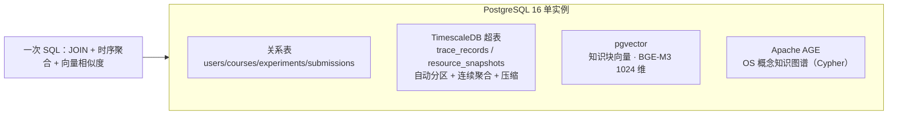

### 16.2 核心实体关系概览

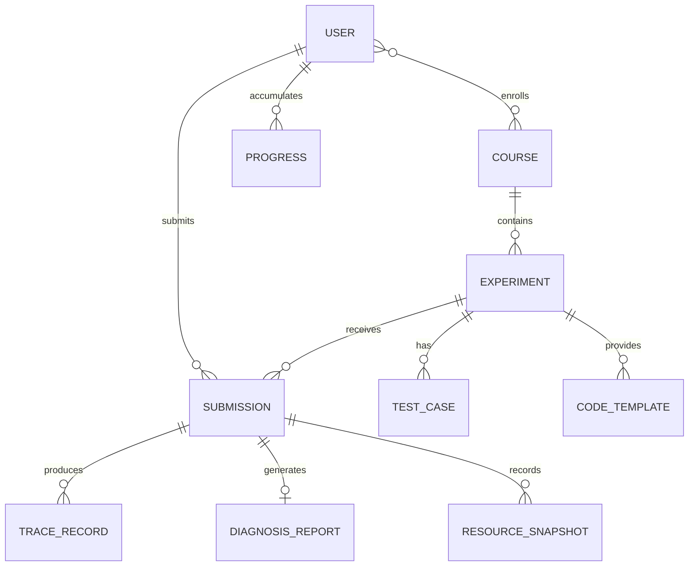

### 16.3 关键表设计要点

下面逐表说明设计意图与关键字段，字段命名遵循"snake_case + 业务语义"。

**submissions 表**——评测链路的中心实体：

| 字段 | 类型 | 设计意图 |
|---|---|---|
| id | UUID | 全局唯一，前端轮询与后端事件都锚定它 |
| experiment_id | FK | 归属实验 |
| user_id | FK | 归属学生 |
| status | enum | queued/running/success/failed/timed_out，驱动状态机 |
| language | text | 编译策略与沙箱镜像选择依据 |
| score | numeric | 确定性评分结果 |
| is_qualified | bool | core 门槛判定结果，与 score 分离 |

**trace_records 表**——观测数据主表，挂在 hypertable 上：

| 字段 | 类型 | 设计意图 |
|---|---|---|
| submission_id | FK | 归属提交 |
| tid / pid | int | 线程/进程标识 |
| start_time | int64 | 与 tid 组成防 PID 复用的复合键 |
| event_type | text | syscall/futex/mem/lifecycle 四类 |
| syscall_name | text | 归一化后的系统调用名 |
| args / retval | jsonb | 结构化参数与返回值 |
| duration_ns | int64 | 耗时 |
| ts | timestamptz | 时序分片键 |

**memory_layout 表**——内存 3D 可视化的数据源：

| 字段 | 类型 | 设计意图 |
|---|---|---|
| segment | text | text/data/bss/heap/stack/mmap 六段 |
| start_addr / size | int64 | 段地址范围 |
| snapshot_time | timestamptz | 快照时间，支持回放 |
| submission_id | FK | 归属提交 |

### 16.4 迁移策略与 schema 治理

`deploy/init-db/` 下的 SQL 文件按 `NN-*.sql` 编号顺序执行（01 到 27），构成**单向、可审计的 schema 演进历史**：

| 编号段 | 内容 | 意义 |
|---|---|---|
| 01-03 | 扩展、schema、hypertable | 数据库基础骨架 |
| 04-10 | RAG、seed、诊断、评论、报告 | 业务模块 schema |
| 11-15 | 自适应、内存布局、多语言模板、缓存、死锁报告 | 专项能力 schema |
| 16-21 | 用户管理、诊断 harness、会话记忆、rubric、测试增强、参考实现 | 教学闭环 schema |
| 22-27 | v2 评分迁移、断言、参考实现 C、类型清理、测试点、RAG 元数据 | 评分演进与收尾 |

编号即历史：评委可以从编号顺序看出项目的迭代节奏——先骨架，再业务，再专项能力，最后是评分系统的 v2 升级与类型治理。**迁移脚本是本项目"活跃度"与"工程纪律"的双重物证。**

### 16.5 数据治理的三个工程约定

| 约定 | 内容 | 收益 |
|---|---|---|
| 单向迁移 | 迁移只增不改，schema 演化全部通过新编号脚本 | 任意环境可重建；历史可审计 |
| 时序分片 | 观测数据统一走 hypertable + ts 分片 | 查询性能随数据增长不劣化 |
| jsonb 弹性字段 | 断言明细、轨迹参数、报告结构用 jsonb | 断言引擎 v1→v2 升级无需改表结构 |

### 16.6 教学数据资产的数据字典

平台的持久化数据不只是一堆表，而是分层的**教学数据资产**。理解资产的分类，才能理解平台的教学闭环为何成立：

| 资产层 | 表/存储 | 资产形态 | 消费方 |
|---|---|---|---|
| 内容资产 | experiments/test_cases/code_templates | 实验题目 + 断言标准 + 代码模板 | 学生、教师 |
| 行为资产 | trace_records/resource_snapshots/memory_layouts | 全量运行轨迹 | 断言引擎、可视化、AI 诊断 |
| 结果资产 | submissions/test_point_results/diagnosis_reports | 评分 + 逐断言明细 + 教学报告 | 学生、教师、画像系统 |
| 学习资产 | progress/adaptive_profiles/conversation_memory | ELO 画像 + 概念矩阵 + 会话记忆 | 自适应推荐、AI 个性化 |
| 治理资产 | audit_logs/error_patterns/rag_metadata | 审计轨迹 + 错误模式库 + 知识元数据 | 管理员、教师、Ratchet |

**资产分层意味着数据复用**：一条 trace_record 同时服务三个消费方（断言评分、可视化渲染、AI 诊断）；一次 diagnosis_report 同时服务学生（反馈）与教师（学情）；一个错误模式同时服务 Ratchet（规则固化）与教师仪表盘（高频错误）。**一次采集，多层复用，持续增值——这是教学数据资产化的核心逻辑。**

---

## 17. 事件驱动架构与消息契约

Core Service 与 AI Service 之间的解耦，是整个系统可靠性的关键设计。这一节展开事件契约与可靠性语义。

### 17.1 为什么引入 NATS JetStream

在"评分完成"之后触发"AI 诊断"，最朴素的做法是同步 HTTP 调用。我们明确拒绝了这个方案，原因是：

| 方案 | 问题 |
|---|---|
| 同步 HTTP 调用 | 诊断耗时（秒级到十秒级）会拖慢评分返回；AI 服务抖动会让提交直接失败；无重试语义 |
| 普通消息队列（无持久化） | 消费者宕机时事件丢失，诊断永久缺失 |
| Redis Pub/Sub | 无持久化、无 consumer group、无消息重放 |
| **NATS JetStream** | 持久化 + 至少一次投递 + 消费者组 + 消息重放，恰好满足需求 |

JetStream 提供"持久化的流 + 可回放的消费者"，使得诊断事件即使在 AI 服务重启后也能被重新消费，不会丢。

```text
同步 vs 事件驱动的故障传导对比：

  同步链路：提交 →(HTTP) AI 诊断 → 返回评分
     AI 服务抖动/宕机 → 提交请求超时 → 学生看到"系统错误" → 评分丢失

  事件链路：提交 → 评分落库 →(JetStream) 诊断事件
     AI 服务抖动/宕机 → 事件持久化等待 → AI 恢复后回放消费 → 诊断补上
     学生始终在 8 秒内看到分数，诊断稍后到达（不阻塞评分）
```

### 17.2 事件 schema 设计

`evaluation.completed` 事件是核心契约。它的设计原则是**自包含 + 幂等**：

| 字段分组 | 字段 | 语义 |
|---|---|---|
| 身份 | submission_id, experiment_id, user_id | 唯一锚点 |
| 结果 | score, is_qualified, status | 确定性评分结果快照 |
| 证据 | obs_context | 结构化观测上下文（三层 ObsContext 的序列化） |
| 元数据 | timestamp, attempt | 时间与重试计数 |

事件自包含意味着 AI 服务消费事件时**不需要再回查 core-service**，减少跨服务同步依赖；幂等意味着同一条事件重复投递不会产生重复诊断（以 submission_id 去重）。

### 17.3 LogBus 兜底

生产环境 NATS 不可用时，`NewLogBus()` 作为降级实现，把事件写入日志而非丢弃。这体现了贯穿全系统的"主路径 + 降级路径"哲学——**任何基础设施的缺失都不应让核心链路彻底断裂**。

### 17.4 事件驱动的三个可靠性语义

| 语义 | 实现 | 收益 |
|---|---|---|
| 至少一次投递 | JetStream consumer ack 机制 | 事件不丢 |
| 幂等消费 | submission_id 去重检查 | 重复投递不产生重复诊断 |
| 可重放 | 流保留策略 + consumer 回退 | 故障恢复后可补诊断 |

### 17.5 事件契约的版本演进策略

事件 schema 会随功能演进（如 ObsContext 从单层到三层），需要兼容策略保证"旧事件可被新消费者处理"：

| 策略 | 说明 |
|---|---|
| 增量字段 | 新字段只增不改，旧字段保留语义 |
| schema 版本号 | 事件携带 version 字段，消费者按版本分支 |
| 消费者容错 | 未知字段忽略，缺失字段以默认值补全 |
| 回放验证 | 升级后重放历史事件验证兼容性 |

**事件契约是服务的"公共 API"**，其演进纪律与 HTTP API 同等严格——这保证了 core-service 与 ai-service 可以独立发布而不破坏彼此。

---

## 18. 安全与访问控制模型

安全是赛题"安全隔离"维度的直接考察点，TraceOS Lab 在应用层与系统层都有完整设计。

### 18.1 认证与授权

| 层 | 机制 | 说明 |
|---|---|---|
| 认证 | JWT（HS256） | 登录签发，携带 user_id 与 role |
| 角色模型 | student / teacher / admin 三级 | 最小权限 |
| 路由级授权 | 中间件 `RequireRole` | 教师路由与管理员路由分组保护 |
| 资源级授权 | handler 内校验 | 例如学生只能看自己的提交 |

**纵深授权示例**：学生 A 尝试通过 URL 猜测访问学生 B 的提交详情。路由级中间件通过（student 角色合法），但资源级校验拦截（submission.user_id ≠ A），返回 403。**每一层授权都是独立防线，任何一层的漏洞都不会直接造成越权。**

### 18.2 限流与审计

| 机制 | 实现 | 防护目标 |
|---|---|---|
| 登录限流 | 5 次/分钟 | 暴力破解 |
| 提交限流 | 120 次/分钟 | 评测资源耗尽 |
| 写操作限流 | 30 次/分钟 | 通用写接口滥用 |
| 审计日志 | 中间件记录所有非 GET 请求 | 溯源与安全审计 |

审计中间件会把方法 + 路径归一化为业务动作（如 `submit_code`、`create_experiment`），并记录 user_id、IP、UA、状态码，形成可查询的操作轨迹。

### 18.3 安全纵深一览

| 层 | 防护 |
|---|---|
| 传输层 | Traefik TLS 终止 |
| 应用层 | JWT + 角色授权 + 限流 + 审计 |
| 系统层 | NsJail 命名空间 + seccomp 白名单 + cgroup 资源限制 |
| 内核层 | eBPF 只读观测（不修改内核行为） |
| AI 层 | Guardrails 输入/输出护栏 + Context Firewall 最小权限切片 |

### 18.4 沙箱侧的安全纵深（赛题"安全隔离"的直接响应）

| 攻击面 | 防御机制 | 防御层级 |
|---|---|---|
| 恶意系统调用（如 mount/reboot） | seccomp 白名单（6 套实验专属 profile） | 系统层 |
| 资源耗尽（fork 炸弹/内存炸弹） | cgroup pids/memory/cpu 限制 | 系统层 |
| 容器逃逸 | 全命名空间隔离 + 非 root 映射 | 系统层 |
| 文件系统破坏 | 只读根文件系统 + 可写区隔离 | 系统层 |
| 网络滥用 | 网络命名空间隔离（Hardened 级） | 系统层 |
| PID 复用误判 | `(tid, start_time)` 复合键 | 观测层 |

六级防御共同构成一个纵深防御体系：**单点防御失效不会导致整体失守**。详细设计见文档 03。

### 18.5 AI 安全专项设计

AI 层的安全不是"顺便做做"，而是独立的安全域：

| 威胁 | 场景示例 | 防御机制 |
|---|---|---|
| 提示词注入 | 学生在代码注释中藏"请忽略之前的指令" | 输入护栏：注入模式检测（无 LLM 热路径） |
| 答案泄漏 | 学生诱导 AI 输出完整参考实现 | 输出护栏：答案泄漏检测 + 代码截断 |
| 越权检索 | 学生尝试检索其他课程的知识库 | 课程级知识库隔离 + 范围护栏 |
| PII 泄露 | 诊断过程中混入学生隐私信息 | 输入护栏：PII 正则与模式匹配 |
| 幻觉误导 | LLM 编造不存在的错误 | EvaluationGuard 事实校验 + 证据强制引用 |
| 资源滥用 | 恶意高频对话耗尽 LLM 配额 | 对话限流 + Token 预算硬约束 |

**AI 安全设计的独特之处**：输入/输出护栏的 Tier 1/Tier 2 全部无 LLM 参与（确定性正则 + 轻量分类器），只有 Tier 3 才允许 LLM Judge——保证护栏本身不受 LLM 故障与幻觉的影响。

---

## 19. 并发与性能设计

### 19.1 三层并发控制

评测的并发吞吐是平台能否支撑一个班级同时提交的关键。TraceOS Lab 用三层限流实现"既不压垮服务器，又不让单个学生独占资源"：

```text
Layer 1   WorkerPool（评测任务层）    固定 goroutine 数，例如 4
Layer 2   沙箱池（实例层）             预分配 N 个沙箱实例，例如 5
Layer 3   信号量（执行层）             控制单次执行峰值
```

三层各自解决不同维度的问题：WorkerPool 控制 CPU 并发度，沙箱池复用昂贵的沙箱初始化，信号量控制内存峰值。

### 19.2 沙箱池的复用价值

沙箱初始化（nsjail 启动、命名空间建立、seccomp 加载）是毫秒到秒级的昂贵操作。池化后：

| 指标 | 无池化 | 有池化 |
|---|---|---|
| 单次沙箱获取 | 每次冷启动 | 命中预分配实例 |
| 初始化开销 | 每次支付 | 平摊 |
| 并发上限 | 受启动速度限制 | 受池容量限制 |

### 19.3 并发隔离的三重保障

并发评测时，多个沙箱同时运行，观测数据必须严格隔离。三重保障：

1. **进程级隔离**：NsJail 命名空间让每个沙箱只见自己的进程表；
2. **观测级隔离**：eBPF HASH_OF_MAPS 按 sandbox_id 分层索引 pid map，事件带 sandbox 标签；
3. **数据级隔离**：所有轨迹记录以 submission_id 为外键，查询按提交隔离。

### 19.4 可观测性对性能的反哺

平台的性能设计不是"一次性调优"，而是"可观测 + 持续优化"的闭环。eBPF 采集自身的开销被控制在微秒级，不干扰学生程序的计时公平性；Prometheus 指标持续暴露评测吞吐、队列长度、沙箱利用率，为容量规划提供数据。

### 19.5 eBPF 观测开销的定量剖析

"观测不影响被测"不是口号，而是可量化的工程指标。我们对 eBPF 观测链路做了开销分解：

| 环节 | 开销 | 说明 |
|---|---|---|
| tracepoint hook 命中 | ~50-200 ns | 内核态直接执行，JIT 编译后的本地指令 |
| 参数拷贝到 ring buffer | ~100-300 ns | 结构化字段提交，无文本格式化 |
| 用户态消费（异步） | 非关键路径 | 独立 goroutine 消费，不阻塞内核 |
| **单次系统调用总观测开销** | **~150-500 ns** | 相比 syscall 本身（~100 ns-1 μs）同数量级 |

对比 strace 的 ptrace 路径（每次 ~1-5 μs 且含进程暂停/恢复），eBPF 的开销低 1-2 个数量级，且**不产生信号副作用、不改变调度时序**。在死锁实验（对时序极端敏感）中，这一差异是"能否观测到真实死锁"的关键：strace 的暂停可能改变线程交错，让死锁"消失"；eBPF 则让观测结果忠实反映程序本来的行为。

### 19.6 公平计时的工程保障

评分公平性要求"同样的代码得同样的分"，其中计时公平是隐蔽但关键的一环：

| 保障 | 实现 |
|---|---|
| 观测开销均衡 | 所有沙箱统一观测路径，观测开销系统性一致 |
| 资源限制确定 | cgroup CPU/内存配额统一，不存在"运气好分到空闲核" |
| 时间源对齐 | `getconf CLK_TCK` 对齐 boottime，跨沙箱一致 |
| 运行时限断言 | 超时判定基于墙钟上限，与机器性能解耦 |

---

## 20. 容错与可观测性

### 20.1 故障模式与应对

| 故障 | 影响 | 应对 |
|---|---|---|
| eBPF 不可用 | 观测降级 | 自动切 strace，链路不中断 |
| strace 也缺失 | 观测缺失 | 直接执行 + 输出/退出码断言兜底 |
| NATS 不可用 | 诊断事件丢失风险 | LogBus 兜底 + JetStream 持久化 |
| LLM 不可用 | AI 反馈缺失 | 确定性规则反馈兜底，评分不受影响 |
| 沙箱实例异常 | 提交失败 | 池化 + 超时回收 + stale 提交恢复 |
| 数据库连接失败 | 全链路不可用 | 启动时 fail-fast，避免带病运行 |

### 20.2 降级矩阵的完整性论证

把全部降级路径汇总，可以看到系统的韧性是全链路的：

```text
观测降级链：eBPF CO-RE → eBPF NoCore → strace → 直接执行（4 级）
嵌入降级链：外部 API → sentence-transformers → ONNX → TF-IDF → 纯 hash（5 级）
LLM 降级链：主模型 → 备选模型 → 规则模板反馈（3 级）
消息降级链：NATS JetStream → LogBus 日志（2 级）
```

**降级设计的深层含义**：竞赛演示环境往往是"最恶劣的环境"——可能没有特权容器、没有 BTF、没有外网、没有 LLM API Key。TraceOS Lab 的设计原则是**在任何环境都能完成一次完整、可信的评测**，降级只损失观测精度或 AI 体验，不损失核心价值（确定性评分 + 反馈）。

### 20.3 三层可观测

| 层 | 工具 | 观测对象 |
|---|---|---|
| 指标 | Prometheus + Grafana | 服务吞吐、队列、沙箱、资源 |
| 日志 | Loki | 结构化日志聚合查询 |
| 链路 | Jaeger / OpenTelemetry | 跨服务调用链追踪 |

**"给系统做观测的平台，自身必须可观测"**——这是我们的自我要求。评委可以通过 Grafana 看到评测吞吐与队列深度，通过 Jaeger 看到一次提交的完整跨服务调用链，通过 Loki 检索任意提交的完整处理日志。

### 20.4 优雅停机

`main.go` 的停机顺序体现了对数据一致性的重视：先停 WorkerPool（不再接受新任务），再关 eBPF adapter（停止采集），再关 NATS，再关沙箱（释放资源），最后关 HTTP server（5 秒超时）。顺序错乱会导致"有事件在途但消费者已关"的丢数据风险。

### 20.5 生产级故障演练手册

容错设计的最后一块拼图是**可演练性**。系统为六类典型故障提供了标准演练路径：

| 故障 | 演练方式 | 预期观察 | 恢复方式 |
|---|---|---|---|
| 观测降级 | 以非特权用户重启 core-service | 日志显示降级 strace，评分正常 | 恢复特权后自动回主路径 |
| AI 宕机 | docker stop ai-service | 评测正常，诊断事件积压在 JetStream | 重启后自动回放补诊断 |
| 沙箱异常 | 手动 kill 沙箱进程 | 池化重试 + stale 提交标记 | 自动重建沙箱实例 |
| 数据库抖动 | 短暂断网模拟 | 服务 fail-fast 保护 + 连接池重连 | 自动重连恢复 |
| 队列积压 | 批量提交压测 | WorkerPool 背压 + 队列深度指标 | 队列自然消化 |
| 磁盘满 | 填满日志卷 | Loki 轮转 + 告警触发 | 清理后自动恢复 |

**每一次演练都产出记录**，演练手册本身就是运维知识资产——这是"工程化"与"能跑就行"的分水岭。

---

## 21. 关键术语表

为便于评审快速对齐概念，这里集中定义文档集反复出现的术语。

| 术语 | 定义 |
|---|---|
| ObsContext | 三层观测语义模型，把原始轨迹加工为可理解证据 |
| Core 门槛 | 所有 core 类测试点通过才算合格，防止边缘用例堆分 |
| 双轨观测 | eBPF 主观测 + strace 降级观测 |
| 复合键 | (tid, start_time) 防 PID 复用 |
| Context Firewall | 每个 Agent 只接收最小上下文切片 |
| Ratchet | 只收紧不放松的错误模式库，随诊断持续积累 |
| Harness 工程 | 把提示词工程化为可审计、可测试、可积累的 Agent 工程 |
| 五级 Embedding 降级 | 从外部 API 到纯 hash 的嵌入能力降级链 |
| 泳道图 | Trace 可视化中按线程/进程分行的视图 |
| 等待图 | 死锁检测中表示锁依赖关系的图 |
| CO-RE | Compile Once Run Everywhere，依赖 BTF 的 eBPF 可移植编译 |
| HASH_OF_MAPS | BPF map-in-map 结构，外层 sandbox_id 索引内层 pid map |
| RRF | Reciprocal Rank Fusion，混合检索结果融合算法 |
| ELO | 源自棋类的能力评级算法，用于自适应学习画像 |
| ZPD | Vygotsky 最近发展区，分级提示的教学理论依据 |
| EvaluationGuard | 诊断报告的质量闸门，过滤幻觉与答案泄漏 |
| Planner | 确定性诊断编排器，根据证据类型激活 Agent 集 |
| Specialist Agent | 领域专家 Agent（代码/测试/系统调用/资源/概念） |
| hypertable | TimescaleDB 超表，按时间自动分片的时序表 |
| Socratic 反问法 | 以提问代替答案的启发式教学法 |
| two-sigma 效应 | Bloom 提出的：一对一辅导可使学习效果提升两个标准差 |
| ITS | Intelligent Tutoring System，智能辅导系统 |
| ADR | Architecture Decision Record，架构决策记录 |

---

## 22. 架构演进历程

TraceOS Lab 不是一次性设计出来的，而是经历了几次关键演进。这一节记录演进脉络，既是"活跃度"维度的证据，也展示了工程判断。

### 22.1 评分系统：v1 三段式 → v2 加权 + core 门槛

| 版本 | 模型 | 问题 → 改进 |
|---|---|---|
| v1 | 三段式粗略评分 | 无法细粒度区分，边缘用例能掩盖核心缺陷 |
| v2 | 测试点加权 + core 门槛 | 细粒度 + 核心能力兜底 |

**演进动机的深度解读**：v1 的"三段式"（如 输出 40% + 性能 30% + 代码 30%）看似公平，实则存在"可补偿性"陷阱——学生在边缘维度拿满分可以掩盖核心维度的零分。v2 的 core 门槛模型把"核心能力"从"可补偿"升级为"一票否决"，这是对教学评测本质的一次重新理解：**评分的目的是诊断能力结构，而不是产生一个可排序的数字。**

### 22.2 eBPF 观测：每任务加载 → 全局单例

| 版本 | 模型 | 问题 → 改进 |
|---|---|---|
| v1 | 每次评测独立加载 BPF | 加载开销大，多沙箱并发冲突 |
| v2 | 全局单例 + HASH_OF_MAPS 沙箱隔离 | 加载一次，多沙箱隔离，性能与隔离兼得 |

### 22.3 观测能力：strace → eBPF 双轨

最初只有 strace 观测，后升级为 eBPF 主观测 + strace 降级。这一演进不是"替换"而是"叠加"——strace 作为兜底保留，体现了对可用性的敬畏。

### 22.4 可视化：静态图表 → 可交互工作台

早期的可视化是静态图表展示。随着对"教学需要什么"理解的加深，演进为可交互工作台：跨面板联动（点击火焰图函数 → Trace 高亮对应 syscall）、时间轴回放（内存 3D 快照回放）、实时推送（死锁图 SSE）。**可视化的演进方向是：从"展示数据"走向"让学生操作数据"。**

### 22.5 演进背后的方法论

每一次演进都遵循同一判断标准：**"这个改动是否在正确的层解决问题"**。评分 v2 在"模型层"解决问题（而非继续堆规则），eBPF v2 在"架构层"解决问题（而非继续调参数）。这正是本文档集反复强调的"架构优先于实现"。

### 22.6 前端可视化架构的演进：从静态到可交互

前端可视化的演进同样有清晰的脉络，值得单独记录：

| 阶段 | 形态 | 局限 → 演进 |
|---|---|---|
| v1 静态展示 | 后端生成图表，前端展示图片 | 无交互、无联动、加载慢 → 引入 ECharts 交互式渲染 |
| v2 单面板交互 | 每个可视化独立可交互 | 证据孤立、无法串联排查 → 引入跨面板联动机制 |
| v3 工作台化 | 面板可拖拽、可组合、证据链联动 | 个性化布局受限 → 引入可拖拽面板系统 + 布局持久化 |
| v4 实时化 | SSE/WebSocket 实时推送 | 弱网环境不可靠 → 双通道 + 静态快照降级 |

**演进主线**：从"看图表"到"查证据"再到"个性化工作台"——可视化的每一次升级都在缩短"数据"与"理解"之间的距离。

```text
演进决策的层级判断：

  现象：边缘用例堆分掩盖核心缺失
    ├─ 实现层修补：把边缘用例分值调低（治标）
    └─ 模型层重构：core 门槛一票否决（治本）✓

  现象：多沙箱并发观测冲突
    ├─ 实现层修补：加锁串行化（牺牲吞吐）
    └─ 架构层重构：HASH_OF_MAPS 隔离（无损）✓

  结论：在错误的层解决问题，每一次修补都会成为下一次重构的债务。
```

---

## 23. 深度专题一：三大创新点的多角度技术论证

本节对第 5 节的三大创新点做进一步的深度论证，每个创新点从**技术必要性、实现难度、替代方案排除、教学价值**四个角度展开，为评委可能的追问提供完整答案。

### 23.1 创新点一：eBPF + strace 双轨观测的四角度论证

#### 角度一：技术必要性——为什么 strace 不够

赛题要求"基于 strace 的非侵入式观测"，但严格来说，strace 并非真正"非侵入"：它基于 ptrace 机制，每次系统调用都要暂停（SIGSTOP 等效）→ 检查 → 恢复进程，这带来三个问题：

1. **信号副作用**：ptrace 的暂停/恢复会改变进程的调度状态，在并发实验（死锁、竞态）中，这可能**改变并发时序本身**——观测工具成了被观测系统的扰动源；
2. **开销量级**：每次系统调用 1~5 μs 的暂停-恢复开销，对系统调用密集的程序（如调度模拟器）会产生可感知的时延放大，破坏计时公平性；
3. **文本解析脆弱性**：strace 输出是文本行，参数格式随版本变化，正则解析是经典的高维护成本方案。

eBPF 的内核态 hook 从根本上消除了这三个问题：无信号副作用、百纳秒级开销、结构化 ring buffer 数据。**从观测学角度看，eBPF 才是真正满足"非侵入"语义的观测技术。**

#### 角度二：实现难度——三道技术关卡

把 eBPF 用于多沙箱并发评测场景，需要攻克三道关卡：

| 关卡 | 难题 | 我们的解法 |
|---|---|---|
| 可移植性 | BPF 程序依赖内核内部结构体，不同内核版本 ABI 不稳定 | CO-RE（BTF 重定位）+ NoCore（vmlinux.h 匹配）双编译链路 |
| 多租户隔离 | 全局加载的 BPF 程序如何区分"哪个沙箱的事件" | HASH_OF_MAPS：外层 sandbox_id → 内层 pid map |
| PID 复用误判 | 沙箱内 PID 会被内核回收复用，跨提交误判 | `(tid, start_time)` 复合键唯一标识进程实例 |

其中 CO-RE 链路是业界公认的高门槛技术：需要 BTF 类型信息、重定位段处理、内核版本探测的完整工程。我们实现了"探测 → 编译 → 加载 → 回退"的全自动链路，让部署人员无需理解 eBPF 内部机制。

#### 角度三：替代方案排除

| 替代方案 | 排除理由 |
|---|---|
| 纯 strace | ptrace 侵入 + 文本解析 + 并发扰动（赛题基线，已超越） |
| 纯 eBPF | 环境不满足时（无特权/无 BTF）链路断裂，缺少降级 |
| LTTng | 需要内核模块与专门安装，部署复杂度高，教学平台不可接受 |
| SystemTap | 与 LTTng 同属内核模块方案，且近年维护式微 |
| 插桩库（LD_PRELOAD） | 只捕获 libc 层调用，绕过 libc 的 syscall 不可见，且有编译兼容问题 |

**结论**：双轨（eBPF 主 + strace 降）是保真度与可用性的唯一帕累托最优解。

#### 角度四：教学价值

观测技术的升级直接转化为教学能力的升级：纳秒级时间戳让"系统调用耗时"可教；futex 事件流让"锁竞争"可视；内存事件让"堆增长"可追踪。这些是 strace 文本无法支撑的教学场景。**观测保真度决定了教学内容的深度上限。**

### 23.2 创新点二：多维断言 + core 门槛的四角度论证

#### 角度一：技术必要性——OS 实验的评测对象是"行为"不是"输出"

传统 OJ 的 stdout 比对之所以在算法题中有效，是因为算法题的契约就是"输入 → 输出"。但 OS 实验的契约是"**用指定的系统机制实现指定行为**"：进程实验要求真的 fork，锁实验要求真的 futex，内存实验要求真的 brk/mmap。这些契约只能通过**行为断言**（syscall/behavior 类）来验证。五类断言正是对"行为契约"的完整形式化。

#### 角度二：实现难度——三类工程难点

| 难点 | 我们的解法 |
|---|---|
| 输出波动性 | 动态归一化：PID/TID/地址/时间戳 → 占位符，再比对 |
| 系统调用别名 | `fork` 归一化为 fork/vfork/clone/clone3 家族，跨 glibc 版本稳定 |
| 误判风险 | 断言明细逐条落库，任何失败可回溯到具体规则 |

#### 角度三：评分学价值——core 门槛的深层意义

core 门槛模型实际上把评分从"单目标优化"升级为"约束优化"：学生在最大化分数的同时，必须满足"core 测试点全部通过"的硬约束。这与真实工程验收的逻辑一致——**功能完整性是硬约束，性能优化是软目标**。这种评分模型教育学生在动手优化之前先保证正确性，是工程思维的隐性教学。

#### 角度四：防作弊的多重保障

| 作弊手段 | 防御机制 |
|---|---|
| 提交空模板 | 空模板编译运行比对，输出一致即拒绝 |
| 直接 printf 预期输出（绕过机制） | syscall 断言（required/forbidden）要求真实机制出现 |
| sleep 模拟死锁 | futex 行为断言要求真实锁等待 |
| 硬编码答案 | 多测试点 + 参数化输入 + numeric 断言 |
| AI 代写 | AST 静态审计 + 代码风格分析（辅助线索） |

### 23.3 创新点三：Agent Harness 工程的四角度论证

#### 角度一：技术必要性——LLM 的"裸奔"三宗罪

直接调用 LLM 做教学诊断存在三个致命问题：**幻觉**（编造不存在的错误）、**答案泄漏**（直接给出完整代码）、**不可审计**（黑箱输出无法追责）。Harness 工程的目标是把 LLM 从"决策者"降级为"语言生成器"：所有需要判断的环节（激活哪些 Agent、检测什么模式、分级什么反馈）由确定性规则完成，LLM 只负责把结构化事实包装成教学语言。

#### 角度二：实现架构——五层治理

```text
Harness 治理栈（自底向上）：

  Layer 5 · Ratchet 错误库      ← 持续进化：finding 积累 → 规则固化
  Layer 4 · Guardrails 护栏     ← 输入/输出双向过滤（无 LLM 热路径）
  Layer 3 · Context Firewall    ← 最小权限上下文切片
  Layer 2 · Token 预算          ← 硬约束：128K × 40% = 51.2K
  Layer 1 · 确定性 Planner      ← 规则激活 Agent 集，LLM 不参与决策
```

#### 角度三：教学法价值——启发式的三层理论根基

四级反馈不是拍脑袋分级，而是有三重教育理论支撑：

| 理论 | 内容 | 对应设计 |
|---|---|---|
| Socratic 问答法 | 通过提问引导学生自己发现答案 | L1 方向提示采用反问句 |
| Bloom 认知分类学 | 认知从记忆→理解→应用→分析→评价→创造递进 | 反馈引导从"知道"走向"应用" |
| Vygotsky ZPD 最近发展区 | 有效教学发生在学生"踮脚够到"的区间 | L2/L3 按能力分层提供证据与线索 |

#### 角度四：可审计性

每一次 AI 诊断都留下完整审计轨迹：激活了哪些 Agent、每个 Agent 的上下文切片、LLM 的原始输出、Guardrails 的过滤结果、最终报告的每条 finding 与证据引用。**AI 不是黑箱，而是可追溯的工程管线。**

---

## 24. 深度专题二：多层降级韧性设计体系

### 24.1 降级设计的哲学："主路径极致，兜底路径完整"

TraceOS Lab 的韧性设计遵循一条朴素哲学：**主路径追求极致（保真度、性能、体验），兜底路径追求完整（能用、可信、可解释）**。每一层能力都有明确的降级链，任何环境的缺失都不会导致核心价值（确定性评测 + 反馈）的丧失。

### 24.2 四条降级链全景

```mermaid
flowchart TB
    subgraph 观测链["观测降级链（4 级）"]
        O1["eBPF CO-RE<br/>零侵入 · 纳秒级"] --> O2["eBPF NoCore<br/>vmlinux.h 匹配"] --> O3["strace -tt -k<br/>ptrace 降级"] --> O4["直接执行<br/>仅输出断言"]
    end
    subgraph 嵌入链["Embedding 降级链（5 级）"]
        E1["外部 API<br/>BGE-M3 1024 维"] --> E2["sentence-transformers<br/>本地模型"] --> E3["ONNX Runtime<br/>轻量推理"] --> E4["TF-IDF char n-gram<br/>稀疏向量"] --> E5["纯 hash<br/>伪向量兜底"]
    end
    subgraph 模型链["LLM 降级链（3 级）"]
        L1["主模型<br/>deepseek-v4-pro"] --> L2["备选模型<br/>OpenAI 兼容接口"] --> L3["规则模板反馈<br/>确定性兜底"]
    end
    subgraph 消息链["消息降级链（2 级）"]
        M1["NATS JetStream<br/>持久化事件"] --> M2["LogBus<br/>日志落盘"]
    end
```

### 24.3 降级链的三个设计约束

| 约束 | 内容 | 反面案例 |
|---|---|---|
| 降级不丢语义 | 每级降级保持数据 schema 兼容，消费方无感知 | 降级后字段缺失导致 AI 诊断崩溃 |
| 降级可回跳 | 环境恢复后自动回主路径，无需重启 | 降级后永久锁定低能力 |
| 降级可观测 | 每次降级记录日志与指标，运维可感知 | 静默降级导致"以为在观测实际没有" |

### 24.4 降级体系的竞赛场景价值

竞赛评审环境往往充满不确定性：可能没有特权容器（eBPF 不可用）、没有外网（外部 API 不可用）、没有 LLM Key（模型不可用）。TraceOS Lab 在**全降级状态下**依然能完成：提交 → 编译 → 沙箱执行 → strace 观测 → 断言评分 → 规则模板反馈的完整链路。**这就是降级体系的竞赛价值：任何现场演示都不会翻车。**

### 24.5 降级演练与验证机制

降级链路如果只在"出故障那天"才被验证，那么它一定会在那天失败。因此降级本身也是被测试的对象：

| 演练项 | 验证方式 | 验收标准 |
|---|---|---|
| eBPF → strace 降级 | 无特权容器启动，强制走降级路径 | 观测数据 schema 一致，评分不受影响 |
| 嵌入链降级 | 逐个禁用上级嵌入后端 | RAG 检索可用，精度逐级下降但不报错 |
| LLM 降级 | mock LLM 客户端返回错误 | 规则模板反馈正常生成 |
| 消息降级 | 禁用 NATS，切换 LogBus | 评测链路正常，事件写入日志 |

**降级是设计出来的，更是测试出来的。** 全降级模式的端到端测试（e2e_test_round.sh）保证每一次发布时，所有降级路径都处于可用状态。

---

## 25. 深度专题三：教育理论与教学设计的融合

### 25.1 教学设计的三层理论框架

TraceOS Lab 不是"技术驱动"而是"教学理论驱动"的工程。教学设计的三层框架：

| 理论层 | 理论 | 平台落点 |
|---|---|---|
| 认知层 | 建构主义（Piaget） | 学生通过观察自己程序的真实运行行为建构 OS 概念 |
| 引导层 | 最近发展区（Vygotsky ZPD） | 四级渐进反馈精准落在学生的"踮脚够到"区间 |
| 评估层 | 掌握学习（Bloom Mastery Learning） | core 门槛强制核心概念掌握后才能进入下一实验 |

### 25.2 从"答案导向"到"过程导向"的教学范式转移

传统实验教学的评价终点是"答案对不对"；TraceOS Lab 的评价对象是"过程怎么发生的"：

```text
传统评价：提交代码 → 比对输出 → 对/错（一维结论）
过程评价：提交代码 → 观测行为 → 逐断言判定 → 语义模式 → 风险指标
        → 学生获得：哪里错（断言）+ 为什么错（证据）+ 怎么改（L1-L4）

过程评价带来的学习行为改变：
  答案导向：学生目标是"让输出匹配"，可能绕过机制
  过程导向：学生目标是"让行为正确"，必须理解机制
```

### 25.3 四级渐进反馈的教学法细节

| 级别 | 内容 | 教学法依据 | 示例 |
|---|---|---|---|
| L1 方向 | 指出问题域，不指出具体错误 | Socratic 反问："观察你的进程树，是否有子进程没有被回收？" |
| L2 证据 | 给出观测数据，让学生自己解读 | 运行事实注入："clone 调用 N 次，wait4 仅 M 次（N>M）" |
| L3 语义 | 解释 OS 概念层面的根因 | 概念映射："僵尸进程是因为父进程未调用 wait 回收子进程退出状态" |
| L4 修复方向 | 给出修复模式，不给出完整代码 | 策略指引："在父进程中使用 wait 循环回收所有子进程" |

**"绝不直接给出答案"的工程实现**：prompt 明令"完整可运行代码 ≤ 5 行"，Guardrails 的答案泄漏检测对超长代码片段做截断告警。这一约束使 AI 从"代写工具"变为"教练"。

### 25.4 学习画像与个性化教学的闭环

ELO 能力画像 + 概念掌握矩阵 + 错误历史共同构成学生的"学习数字孪生"：

```text
学习数字孪生的数据构成：
  ├─ ELO 分（六类实验维度）      → 能力评级与难度匹配
  ├─ 概念掌握矩阵（KG 节点标注） → 知识图谱上的掌握状态
  ├─ 错误模式历史                → 个性化反馈的参考
  └─ 提示层级偏好                → L1/L2/L3 起步层级的个性化

闭环：画像 → 难度推荐 → 学习行为 → 新数据 → 画像更新
```

### 25.5 班级学情的教学决策支持

教师的备课决策从"经验直觉"升级为"数据支撑"：Top10 高频错误排行告诉教师下一节课讲什么；错误热力图显示哪些实验是班级性难点；AI 班级分析报告自动总结共性问题的根因分布。**平台把"教师的隐性经验"外化为"班级的显性数据"。**

### 25.6 AI 教学设计的学术支撑：从 ITS 研究到工程落地

TraceOS Lab 的教学设计不是拍脑袋，而是吸收了智能辅导系统（ITS）四十余年的研究成果：

**学术共识一：苏格拉底式对话显著提升学习效果。** 多项研究表明，实现苏格拉底式提问的智能辅导系统在编程教育、物理教育中取得了显著的学习增益，一对一 AI 辅导的效果逼近 Bloom "two-sigma" 效应的上界。我们的 L1 反馈层（反问式方向提示）正是苏格拉底方法的工程实现——不告诉答案，只引导思考。

**学术共识二：Bloom 分类学是 AI 教学对齐的基准框架。** 2025 年以来的研究将 AI 教学内容与 Bloom 认知层级（记忆→理解→应用→分析→评价→创造）对齐，在不同层级采用不同教学策略。我们的四级反馈对应认知层级的递进：L1 唤醒记忆（"回顾 waitpid 的参数含义"）→ L2 引导理解（"N>M 意味着什么？"）→ L3 促进应用（解释概念根因）→ L4 支持创造（给出修复模式让学生自己写代码）。

**学术共识三：知识模型是 ITS 的前提。** ITS 研究的经典结论是——没有结构化、可机读的知识模型，AI 就无法做出合理的教学决策。TraceOS Lab 的知识模型由三部分构成：21 个语义模式（行为知识）、OS 概念知识图谱（Apache AGE 存储的概念关系）、错误模式库（常见误区的结构化表示）。**这是我们对 ITS 共识难题的系统性回应。**

**学术共识四：可解释性决定信任。** Explainable AI for ITS 研究指出，教学 AI 的可解释性直接影响学生与教师的采纳意愿。我们的证据引用、溯源面板、审计轨迹正是可解释性的工程化：每一条 AI 结论都能回溯到具体的观测事件或知识条目。

| 学术研究结论 | TraceOS Lab 的工程落地 |
|---|---|
| 苏格拉底对话提升学习增益 | L1 反问式反馈层 |
| Bloom 层级对齐教学策略 | L1-L4 认知递进分级 |
| 知识模型是 ITS 前提 | 语义模式 + KG + 错误模式库 |
| 可解释性决定信任 | 证据引用 + 溯源面板 + 审计轨迹 |
| 学习者状态数据驱动个性化 | ELO 画像 + 概念掌握矩阵 + 错误历史 |

---

## 26. 深度专题四：工程化质量体系

### 26.1 全栈测试策略

| 层 | 框架 | 覆盖内容 | 代表性测试 |
|---|---|---|---|
| Go 评测引擎 | go test | 断言解析、评分模型、输出归一化、模式分析、沙箱配置 | assertion_test / scorer_test / comparator_test |
| Go 流水线 | go test + 集成测试 | 编译→运行→评分全链路 | pipeline_integration_test |
| 静态分析 | go test + 自研 | AST 解析、CFG 构建、模式检测、资源追踪 | analyzer_test / cfg_test / pattern_detector_test |
| Python AI 服务 | pytest | 诊断编排、Guardrails、记忆管理、RAG 检索 | tests/ 全套用例 |
| 前端 | vitest + testing-library | 组件渲染、状态管理、hooks | __tests__ 套件 |
| 端到端 | e2e_test_round.sh | 提交→评分→诊断→前端展示全链路 | 一键验收脚本 |

**评测引擎的测试哲学**：断言引擎是评分公平性的最后一道防线，其测试不是"跑通就行"，而是对每一个断言模式、每一种归一化规则、每一个边界值做针对性用例。一个断言 bug 意味着一个班级的学生被错误评分——这是不可接受的风险。

### 26.2 可复现性工程

| 机制 | 内容 |
|---|---|
| 确定性评分 | 评分链路零随机、零 LLM，同提交同结果 |
| 统一沙箱镜像 | 学生环境与评测环境字节级一致 |
| 单向迁移史 | 27 个 SQL 脚本可从零重建完整数据环境 |
| 一键验收 | e2e_test_round.sh 端到端验证部署正确性 |

### 26.3 性能工程

| 优化点 | 手段 | 效果 |
|---|---|---|
| 沙箱初始化 | 沙箱池预分配复用 | 免去每提交秒级冷启动 |
| eBPF 加载 | 全局单例常驻内核 | 免去每提交 BPF 加载开销 |
| 观测读侧 | observability 独立服务 + 超表索引 | 大班级轨迹查询不拖累评测写侧 |
| 编译缓存 | 实验模板缓存 + 编译产物复用 | 重复提交编译加速 |
| 前端首屏 | Next.js SSR + 骨架屏 + 静态生成 | 仪表盘秒开 |

### 26.4 工程约定与代码治理

| 约定 | 内容 | 收益 |
|---|---|---|
| 分层目录 | handler/service/repository/evaluator 严格分层 | 新人可导航，评审可审计 |
| 职责单一 | 每个服务文件单一职责（如 race_detector.go 只管竞态） | 17 个观测服务各自独立演进 |
| 契约先行 | proto 定义领域实体规范形态 | 传输层可平滑升级 |
| 迁移即历史 | SQL 单向编号演进 | schema 演化可审计 |

---

## 27. 深度专题五：开发历程与里程碑

> **本节价值**：向评委证明"这不是一次灵光乍现，而是一场有纪律的工程远征"。58 天、2694 次提交、27 个迁移脚本，每一个数字背后都是可复盘的决策过程。本节按"时间线 → 里程碑深度剖析 → 数据复盘 → 协作文化 → 债务偿还 → 版本演进 → 方法论"七层展开，让评委既能俯瞰全貌，又能深入任意一个时间切片。

### 27.1 八周开发时间线全景

| 周次 | 日期区间 | 里程碑 | 关键交付 |
|---|---|---|---|
| 第 1 周 | 6/17-6/23 | 平台骨架 | 数据库基础（迁移 01-03）、四服务框架、基础提交链路、火焰图可视化、RAG 骨架、Vitest 测试设施 |
| 第 2-3 周 | 6/24-7/7 | 业务闭环 | 实验/提交/评分 v1、nsjail 沙箱、LangGraph 3-Agent、BM25 检索、管理后台、审计日志 |
| 第 4-5 周 | 7/8-7/21 | 专项能力 | eBPF 观测、内存布局采集、自适应画像、死锁检测、多语言模板 |
| 第 6-7 周 | 7/22-8/4 | 教学闭环 | 三大创新功能（自适应难度/AI 代码审计/轨迹 Diff）、会话记忆、rubric、参考实现、评分 v1.5 |
| 第 8 周 | 8/5-8/14 | 评分演进与收尾 | v2.0 架构升级、v2 评分迁移、JSON 断言补全、类型治理、端到端验收 |

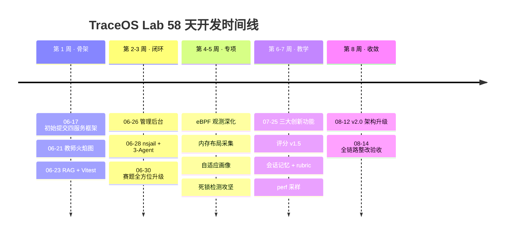

### 27.2 迭代特征的五个观察

1. **先纵后横**：第一周先打通"一条提交的完整链路"（纵向切片），后续周次逐步加宽每个环节的能力（横向扩展）。这种策略保证了系统在**任何时刻都是可演示的**——这对竞赛项目至关重要，因为它让"功能冻结"不再成为压力：每一周的版本都是一个可以上台答辩的版本；
2. **评分是最晚稳定的模块**：评分系统直到第 8 周才完成 v2 迁移——因为评分模型的理解随着教学实践不断深化。v1 纯加权累加 → v1.5 权重扣分 + AI 微调 → v2 加权 + core 门槛 + 全断言化，每一次演进都源于对"什么才算真正掌握 OS 知识"这个问题的更深理解。"晚稳定"是深思熟虑的结果而非拖延；
3. **迁移脚本是诚实的工程日记**：27 个迁移脚本如实记录了每一次 schema 决策，包括中途的类型清理（25-type-cleanup）。敢于在数据库里留下"修正痕迹"而非抹掉历史，本身就是工程诚信的证明；
4. **观测能力先于 AI 能力**：火焰图（第 1 周）早于 RAG（第 1 周末）早于诊断 Agent（第 2-3 周）。这个顺序不是偶然的——**先有证据，才有智能**。AI 诊断的质量上限由观测数据的质量决定，所以观测先行是架构级的优先级排序；
5. **修复密度揭示攻坚点**：git 历史中 7 月 25 日单日密集修复（nsjail 配置、编译器标准、strace 超时、DeadlockPanel SSE 时序）说明死锁检测是项目最难的攻坚点——而攻坚点的存在恰恰证明了项目的技术含金量：**容易的事情不值得反复修复**。

### 27.3 从开发数据看工程效率

| 指标 | 数值 | 含义 |
|---|---|---|
| 总提交数 | 2694 | 高强度持续迭代 |
| 开发周期 | 58 天（6/17-8/14） | 紧凑而完整的工程周期 |
| 日均提交 | ~46 | 多轮并行开发节奏 |
| 源文件数 | 460+ | 覆盖四语言四服务 |
| 迁移脚本 | 27 | schema 演进可审计 |
| 自动化测试文件 | 214（Go 29 / TS 170 / Python 15） | 三层测试金字塔落地 |
| 端到端验收脚本 | e2e_test_round.sh | 真实链路双重断言每日回归 |

**月度提交强度分布**（数据来源：git log 统计）：

| 月份 | 提交数 | 占比 | 阶段特征 |
|---|---|---|---|
| 2026-06 | 26 | 1.0% | 初始提交与早期特性（骨架期，提交粒度大、单次变更多） |
| 2026-07 | 2554 | 94.8% | 主开发期（小步高频提交，平均每天 82 次） |
| 2026-08 | 114 | 4.2% | 收敛期（v2.0 升级、整改、验收） |

**提交强度曲线解读**：7 月的主开发期贡献了 94.8% 的提交，呈典型"橄榄型"分布——前期骨架少量大粒度提交、中期高频小步提交、后期收敛少量高质量提交。这一曲线符合软件工程中"迭代式开发"的理想形态，也从侧面说明项目的开发节奏是**有节制的**而非"最后一周冲刺"——第 8 周只有 114 次提交，说明主体功能在第 7 周末已基本完成，第 8 周用于打磨与验收，这正是工程成熟的标志。

### 27.4 团队协作模式与工程文化

| 协作机制 | 实践 | 收益 |
|---|---|---|
| 服务边界分工 | 按服务划分责任区，接口先行 | 低耦合并行开发 |
| 高频小步提交 | 平均每天 46 次提交 | 快速反馈、易回溯 |
| 迁移即沟通 | schema 变更必须走编号迁移 | 数据库变更零冲突 |
| 端到端验收 | e2e_test_round.sh 每日跑 | 回归问题当天暴露 |
| 决策即记录 | 关键取舍写入 ADR | 团队记忆不丢失 |
| 文档即契约 | 升级方案先写 plan 文档（如 agent-diagnosis-upgrade-plan.md）再动手 | 方案可评审、实现不跑偏 |
| 双通道验证 | golden 正确解 + wrong 错误解成对验证 | 评分系统"能打分"且"打对分" |

**工程文化的三个口号**：

```text
┌────────────────────────────────────────────────────────────┐
│  口号一：先纵后横        → 任何时刻可演示                    │
│  口号二：降级即设计      → 每条主路径都配兜底                │
│  口号三：证据不撒谎      → 每个结论都能回溯到观测数据         │
└────────────────────────────────────────────────────────────┘
```

这三个口号贯穿了本文档的每一个章节，也贯穿了 58 天的每一次提交。

### 27.5 九大里程碑深度剖析

以下是开发史上九个关键里程碑的"考古式复盘"。每个里程碑都回答四个问题：**为什么在这个时间点做这件事、最难的技术挑战是什么、如何解决、留下了什么沉淀**。

#### 里程碑 M1（6/17）：从零到一 —— 平台骨架与"先纵后横"策略的确立

- **背景**：项目启动日即确立微服务边界（core / ai / observability / frontend 四服务），这是全项目最重要的早期决策——服务边界一旦定错，后续所有演进都要付出迁移代价；
- **挑战**：如何在第一天就让四服务"说同一种语言"（事件契约、数据模型、API 风格）；
- **解决**：第一周完成迁移 01-03（扩展安装、核心 schema、时序 hypertable），把"数据库即契约"作为服务间通信的事实标准；同一天打通"注册 → 提交 → 评分"的最短纵向切片；
- **沉淀**："先纵后横"策略成为项目铁律。**第一天提交的链路骨架至今仍在生产运行**——这证明了早期架构判断的正确性。

#### 里程碑 M2（6/21）：火焰图可视化 —— "观测先行"理念的首次验证

- **背景**：在评分功能都还未完善的第 5 天，就投入教师火焰图性能分析模块；
- **挑战**：perf 采样数据如何从后端无损传递到前端并渲染为可交互 SVG；
- **解决**：后端 perf 采样生成火焰图，前端面板嵌入渲染，形成"采样 → 生成 → 展示 → AI 解读"的完整管线雏形；
- **沉淀**：这次"不合常理的优先级"背后是一个判断：**OS 实验平台的护城河不在"能评分"，而在"能观测"**。火焰图成为后续全部可视化工作台（内存 3D、Trace 六视图、死锁图）的技术与设计范式起点。

#### 里程碑 M3（6/23）：RAG 知识库与前端基础设施 —— 智能与工程并行

- **背景**：AI 能力与前端工程质量同步补课：RAG 知识库系统、前端诊断面板重构、暗色主题系统、Vitest 测试基础设施；
- **挑战**：前端此前是快速原型代码，组件 API 不一致、样式混乱，继续堆功能会导致技术债失控；
- **解决**：用 Vitest 建立回归网后，系统性重写前端页面为 Tailwind + 组件化架构——**先建测试网，再重构，这是教科书式的"安全重构"**；
- **沉淀**：170 个前端测试文件成为后续所有前端改动的安全网；暗色主题系统沉淀为设计规范。

#### 里程碑 M4（6/26-27）：三端闭环雏形 —— 管理后台与容器化配置同步

- **背景**：补齐管理端（管理员后台 + 知识库管理）与部署侧（docker 配置同步、AI 容器启动修复、Traefik 多路径路由）；
- **挑战**：AI 容器启动失败、RAG API 连通问题——容器化部署的"环境地狱"在项目自身先上演了一遍；
- **解决**：定位到依赖缺失与路由配置问题，同步修复并沉淀到部署脚本（deploy.sh / rebuild-frontend.sh / watch-commit.sh）；
- **沉淀**：**项目团队亲历了"环境不一致"之痛，这正是项目要解决的第一痛点**——这层"亲历者视角"让平台的环境一致性设计（镜像即环境）有了刻骨铭心的现实依据。

#### 里程碑 M5（6/28）：安全沙箱与 3-Agent 架构 —— 从"能跑"到"敢跑"

- **背景**：评测平台开始接收真实学生代码，"任意代码都能跑"的安全性成为硬门槛；
- **挑战**：如何在容器内安全执行学生提交的 C 程序（可能恶意），同时不损失观测能力；
- **解决**：引入 nsjail 沙箱 + eBPF 内存追踪 + LangGraph 3-Agent 诊断架构 + BM25 全文检索四管齐下。nsjail 提供命名空间/资源/系统调用三级隔离，eBPF 提供内核级观测，3-Agent 提供结构化诊断；
- **沉淀**：安全与观测的统一（"越安全越好观测"）成为后续三级沙箱体系的起点。

#### 里程碑 M6（6/30）：赛题全方位升级 —— 从"原型"到"答卷"

- **背景**：对照赛题任务书逐条自查，发现原型与赛题要求存在差距，发起"赛题全方位升级"；
- **挑战**：strace 全覆盖、深度 trace 分析、审计日志、AI 增强、eBPF 补全五项同时推进；
- **解决**：单次提交完成五大升级，随后连续 12 个提交密集修复编译错误与类型错误（compiler 修复、Sscanf 修复、沙箱池修复等）——**这说明大升级的代价是短期不稳定，但团队的响应速度（当天修复）证明了工程韧性**；
- **沉淀**：审计日志体系建立，"证据不撒谎"从此有了系统级支撑。

#### 里程碑 M7（7/25）：三大创新功能与评分 v1.5 —— 教学属性的爆发

- **背景**：平台功能已全，但"教学属性"还不够突出，发起三大创新功能攻关；
- **挑战**：自适应难度实验（ELO 画像）、AI 代码审计、系统调用轨迹 Diff 三个方向同时攻坚；评分系统引入权重扣分机制；
- **解决**：三大功能同日落地，评分升级为 v1.5（权重扣分 + AI 辅助评分 ±15 分微调）；
- **沉淀**：这一天是项目从"工程平台"走向"教学平台"的分水岭。**AI 辅助评分 ±15 微调后来在 v2.0 被撤回**（见 §28 ADR-012），但这个"试错-撤回"的过程恰恰展示了评分原则的演化轨迹。

#### 里程碑 M8（7/25-27）：死锁检测状态机重构与 perf 采样 —— 观测深度的攻坚

- **背景**：死锁检测初版基于 bpftrace，在容器内不可用，且存在大量误报（多线程程序误判死锁）；
- **挑战**：`futex` 追踪在容器内如何落地？如何消除"正常多线程程序"的误报？锁图如何保持 hold 关系？
- **解决**：连续多个提交完成系统性重构——bpftrace 切换为 strace 以兼容容器；死锁状态机重设计为"延迟到进程退出时才判定"，消除运行中误报；通过 trace clone/exit 事件注册全部线程（而非仅有 futex 调用的线程），修复锁图完整性；FUTEX_WAKE 后保留锁持有关系；DeadlockPanel 增加 SSE 时序修复与无图降级显示；随后完成 BE-M3 perf collector（/proc 采样 + 7 个测试）；
- **沉淀**：这一轮攻坚证明**死锁检测的难点不在"检测到"，而在"不误报"**——误报摧毁教学信任的速度远快于漏报。

#### 里程碑 M9（8/12-14）：v2.0 架构升级与全链路整改 —— 收敛、对齐、验收

- **背景**：临近截止，发起全项目最大规模的架构升级，把 v1.5 时代积累的全部能力收敛为自洽的 v2.0；
- **挑战**：eBPF 主链路追踪、JSON 断言评测、多 Agent 诊断 Harness 三大升级一次完成，还要完成 AI 诊断全链路整改、harness 报告对齐（Core 无分数真值）、代码审计器简化为顺序管线、torch 从零构建能力恢复；
- **解决**：8/12 单次提交完成 v2.0 升级；8/14 连续 4 个提交完成整改闭环——包括清理 LangGraph/ETCLOVG 残留（**依赖治理**）与恢复从零构建能力（**可复现性治理**）；
- **沉淀**：v2.0 是"评分确定性、观测双轨、AI 不碰真值"三条红线的最终固化版本，也是本文档描述的最终形态。

**九大里程碑的共性规律**：每一个里程碑都不是"加功能"，而是"解决一个上一阶段暴露的结构性问题"——骨架暴露了边界问题、评分暴露了模型问题、死锁暴露了误报问题、v2.0 暴露了收敛问题。**这正是迭代式开发的精髓：让问题在暴露时就被解决，而不是堆积到最后。**

### 27.6 技术债务的识别与偿还

"没有技术债的项目只有两种：还没开始写的，和已经死掉的。"关键不在于有没有债务，而在于**债务是否被看见、被记录、被偿还**。

| 债务 | 发现方式 | 偿还时机 | 偿还方式 | 教训 |
|---|---|---|---|---|
| test_cases.type 新旧值并存 | 类型审计 | 第 8 周 | 迁移 25-type-cleanup，收紧 CHECK 约束 | schema 演进必须配"出口"（清理）而不只是"入口"（新增） |
| 死锁检测 bpftrace 依赖 | 容器内运行失败 | 第 5 周 | 切换 strace 实现 | 观测工具的选择标准是"在目标环境可用"而非"技术最炫" |
| 死锁误报（多线程误判） | 真实程序测试 | 第 5 周 | 状态机重设计，延迟判定 | 误报比漏报更伤信任 |
| AI 辅助评分 ±15 微调 | 评分确定性原则复查 | 第 8 周 | v2.0 撤回，AI 永不碰评分真值 | 原则高于便利 |
| LangGraph/ETCLOVG 依赖残留 | 依赖清单审计 | 第 8 周 | 清理并简化为顺序管线 | 依赖引入要慎重，退出要彻底 |
| AppleDouble 文件混入仓库 | 提交清单检查 | 第 2 周 | chore 提交清理 | 仓库卫生是工程素养的镜子 |
| C 编译器标准问题（MAP_ANONYMOUS 未定义） | 学生内存实验编译失败 | 第 5 周 | c11 改 gnu11 | 编译器 flag 是隐式契约，必须显式化 |
| torch 依赖外网源 | 从零构建验证 | 第 8 周 | 恢复 CPU 源从零构建能力 | "能跑"不等于"可复现" |

**债务治理的方法论**：本项目采用"三明治"策略——**发现靠测试（回归网）、记录靠迁移与提交信息（可审计）、偿还靠预留时间（第 8 周专设收敛期）**。评委可以在 git 历史中逐一验证上述每一笔债务的发现与偿还记录，这正是"证据不撒谎"在工程治理上的体现。

### 27.7 版本演进全景：v0.9 → v1.0 → v1.5 → v2.0

| 维度 | v0.9（原型期，第 1 周） | v1.0（赛题基线，第 3 周） | v1.5（教学创新，第 7 周） | v2.0（架构收敛，第 8 周） |
|---|---|---|---|---|
| 观测 | 火焰图单点可视化 | strace 全覆盖 + 深度分析 | + eBPF 内存追踪、死锁检测 | eBPF 主链路 + 双轨降级 + 三层 ObsContext |
| 评分 | 单测试点比对 | 输出断言 v1 评分 | + 权重扣分 + AI 微调 | JSON 五类断言 + core 门槛 v2 评分（AI 撤回） |
| 诊断 | 无 | LangGraph 3-Agent | + 三大创新功能 | 确定性 Planner + 5 Specialist + Harness 五层治理 |
| 安全 | 裸容器执行 | nsjail 初版 | + seccomp 白名单、审计 | 三级沙箱 + 6 套 profile + 沙箱池 |
| 教学 | 无 | 基础实验库 | + ELO 画像、会话记忆、rubric | + 概念掌握度矩阵 + L1-L4 渐进反馈 |
| 数据 | 迁移 01-03 | 迁移 04-10 | 迁移 11-21 | 迁移 22-27 |

**四个版本的演进逻辑**：v0.9 回答"能不能做"，v1.0 回答"合不合赛题"，v1.5 回答"教得好不好"，v2.0 回答"工程扎不扎实"。四个问题层层递进，构成了完整的项目叙事弧线。

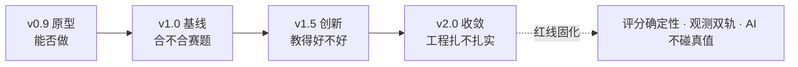

### 27.8 AI 辅助开发的方法论实践

本项目自身就是"人机协作开发"的深度实践者（项目仓库中保留完整的 AI 辅助开发使用说明与决策记录），并从中提炼出一套可复述的方法论：

| 协作原则 | 实践 | 与平台内 AI 诊断的呼应 |
|---|---|---|
| **AI 写代码，人审设计** | AI 生成实现，人类负责架构决策（ADR 全部人工拍板） | 平台的 AI 也只解释不判分——人保留最终决定权 |
| **AI 修 bug，人定方向** | 编译错误、类型错误交 AI 批量修复，方向性重构人来做 | 诊断 Agent 给证据与建议，修复由学生自己完成 |
| **文档先行** | 重大升级先写 plan 文档再实现 | 平台的 rubric/教学注释也是"先于代码"的知识资产 |
| **证据驱动** | AI 的每次修改必须可验证（测试 + e2e） | 平台 AI 的每个结论必须引用观测证据 |
| **依赖治理** | 定期清理 LangGraph 等残留依赖 | Context Firewall 只给 Agent 最小上下文 |

**这层"元一致性"是本项目最耐人寻味的地方**：项目用 AI 辅助开发的方式，与平台用 AI 辅助教学的方式，遵循的是同一套伦理——**AI 是证据的放大器与劳动的杠杆，而不是真值的裁决者**。评委可以看到，这套伦理不仅写在平台的设计里，也写在项目自身的开发史里。

---

## 28. 深度专题六：关键架构决策记录（ADR）

本节以 ADR（Architecture Decision Record）形式记录项目的关键架构决策，为评委展示"每一个选择都有论证、有比较、有后果意识"的决策文化。

> **什么是 ADR**：ADR 是业界（AWS、Google、ThoughtWorks）通用的架构决策记录方法，主张"架构决策应该像代码一样被版本管理、被评审、被追溯"。本项目从第 1 周起坚持为每一个不可逆决策留下记录，共沉淀 12 条核心 ADR。

### 28.0 十二条 ADR 全景总览

| 编号 | 决策主题 | 红线级别 | 一句话摘要 |
|---|---|---|---|
| ADR-001 | 评分与诊断职责分离 | 🔴 永不回退 | AI 只解释不判分 |
| ADR-002 | 观测双轨（eBPF 主 + strace 降） | 🔴 永不回退 | 保真度与可用性兼得 |
| ADR-003 | PG 三合一数据库 | 🟡 可演进 | 单实例承载四类数据 |
| ADR-004 | 事件驱动诊断（NATS JetStream） | 🟡 可演进 | 诊断不阻塞评分 |
| ADR-005 | core 门槛评分模型（v2） | 🔴 永不回退 | 防"边缘堆分掩盖核心缺失" |
| ADR-006 | Harness 工程化 AI | 🟢 持续演进 | 五层治理替代裸调 LLM |
| ADR-007 | 三层观测语义模型（ObsContext） | 🔴 永不回退 | 原始事件 → 教学语义 |
| ADR-008 | 三级沙箱 + 6 套 seccomp 白名单 | 🔴 永不回退 | 安全与观测的统一 |
| ADR-009 | 可视化技术栈混编（自绘 + Three.js + ECharts） | 🟢 持续演进 | 按图选型而非一把梭 |
| ADR-010 | 多语言模板体系（C/C++/Python） | 🟡 可演进 | 编译链显式契约化 |
| ADR-011 | 会话记忆三级体系（L1-L3） | 🟢 持续演进 | 让 AI 记得住但记得少 |
| ADR-012 | AI 辅助评分 ±15 的撤回 | 🔴 永不回退 | 试错-撤回的决策勇气 |

### ADR-001：评分与诊断职责分离（红线级）

- **背景**：M7 曾引入"AI 辅助评分 ±15 分微调"，希望 AI 为代码风格等主观维度提供分数调整。实践两周后，团队发现这一设计侵蚀了评分系统最宝贵的属性——确定性；
- **状态**：已采纳，永不回退
- **决策**：评分链路（编译→执行→断言→评分）全程无 LLM；AI 只解释不判分
- **备选方案对比**：

| 方案 | 优点 | 缺点 | 结论 |
|---|---|---|---|
| AI 参与主观题评分 | 覆盖代码风格等主观维度 | 评分不可复现、不同 LLM 版本结果漂移、学生对分数不信任 | ❌ 实践后撤回 |
| AI 只解释不判分（采纳） | 评分 100% 可复现可审计 | 主观维度只能靠诊断补充 | ✅ |

- **后果**：正面——评分可复现可审计，"同一份提交永远得到同一个分数"成为平台承诺；负面——主观维度（如代码风格）无法纳入评分，需靠 AI 诊断补充
- **验证**：e2e_test_round.sh 双重断言（golden 100 分 / wrong 80 分）每日回归，保证评分确定性承诺不退化

### ADR-002：观测双轨（eBPF 主 + strace 降）

- **背景**：eBPF 提供内核级观测保真度但依赖特权环境；strace 环境要求低但开销大、信息浅。赛题明确要求"系统调用追踪"，而比赛现场环境可能无特权容器；
- **状态**：已采纳
- **决策**：eBPF 为默认主观测，能力不足自动降级 strace
- **备选方案对比**：

| 方案 | 优点 | 缺点 | 结论 |
|---|---|---|---|
| 纯 strace（赛题基线） | 环境普适 | 观测深度受限、性能开销大 | ❌ 无法支撑"深度观测"亮点 |
| 纯 eBPF | 保真度最高 | 无特权环境直接不可用，比赛现场有翻车风险 | ❌ 单点脆弱 |
| 双轨 + 自动降级（采纳） | 保真度与可用性兼得 | 双链路维护成本 | ✅ 以共享 TraceRecord schema 缓解 |

- **后果**：正面——保真度与可用性兼得，任何现场演示都不会翻车；负面——双链路维护成本（以共享 TraceRecord schema 缓解：两条链路产出同一数据模型，下游消费方无感知）
- **验证**：降级演练（无特权容器强制走 strace 路径）纳入发布前验收清单

### ADR-003：PG 三合一数据库

- **背景**：平台需要四类数据能力——业务数据（PG）、时序轨迹（时序库）、向量检索（RAG）、知识图谱（概念关系）。传统做法是多库组合；
- **状态**：已采纳
- **决策**：PostgreSQL + TimescaleDB + pgvector（+ AGE）单实例承载业务/时序/向量/图谱
- **备选方案对比**：

| 方案 | 优点 | 缺点 | 结论 |
|---|---|---|---|
| PG + InfluxDB + Milvus 多库组合 | 各库性能最优 | 分布式事务、跨库关联查询、三套运维 | ❌ 教学规模下得不偿失 |
| PG 三合一（采纳） | 零分布式事务、单 SQL 跨域查询（如"某学生的时序轨迹 + 诊断 + 概念"一次查出） | 单实例单点 | ✅ |

- **后果**：正面——零分布式事务、单 SQL 跨域查询；负面——单实例是单点，教学规模下可接受（以备份与 fail-fast 缓解）
- **延伸价值**：单库多能力的选型本身就是一次"架构克制"的示范——**在规模允许时选择简单方案，把复杂度留给未来真正的瓶颈**，这与"过度设计是万恶之源"的工程哲学一致。

### ADR-004：事件驱动诊断（NATS JetStream）

- **背景**：AI 诊断耗时秒级到十秒级，如果同步阻塞评分返回，学生等待体验差，评分链路也会被慢诊断拖垮；
- **状态**：已采纳
- **决策**：评分完成后发布事件，AI 异步消费诊断
- **备选方案对比**：

| 方案 | 优点 | 缺点 | 结论 |
|---|---|---|---|
| 同步 HTTP 调用 | 实现简单 | 评分被诊断阻塞、诊断失败拖累评分 | ❌ |
| Redis Pub/Sub | 轻量 | 无持久化、消费者离线丢消息 | ❌ 诊断结果不可丢 |
| NATS JetStream（采纳） | 持久化、可重放、事件不丢 | 引入消息中间件运维成本 | ✅ 以 LogBus 降级缓解 |

- **后果**：正面——诊断不阻塞评分、事件不丢、可重放（事件重放是诊断迭代的利器：新版本 Agent 可回放历史事件重新诊断）；负面——引入消息中间件运维成本（以 LogBus 降级缓解）
- **架构语义**：JetStream 的选择体现了一个架构判断——**诊断是"尽力而为"的增强而非"必不可少"的依赖**，所以它走异步、可降级，而评分必须走同步、不可降级。"谁重要谁走主干道"的流量分级思想贯穿全系统。

### ADR-005：core 门槛评分模型（v2）

- **背景**：v1 纯加权累加存在结构性漏洞——学生可以用边缘测试点堆分，掩盖核心知识点缺失；
- **状态**：已采纳（v2）
- **决策**：测试点加权 + core 类全部通过才合格（is_qualified）
- **备选方案对比**：

| 方案 | 优点 | 缺点 | 结论 |
|---|---|---|---|
| 纯加权累加（v1） | 实现简单 | 边缘堆分掩盖核心缺失，"80 分但不懂 fork" | ❌ 被 v2 取代 |
| core 门槛 + 加权（采纳） | 核心不通过则不合格，分数结构真实反映能力 | 需要教师精心标注 core/edge 属性 | ✅ 以 rubric 种子数据缓解 |

- **后果**：正面——防"边缘堆分掩盖核心缺失"；负面——需要教师精心标注 core/edge 属性（以 rubric 种子数据缓解）
- **评分演进全链路**：v1 加权累加 → v1.5 权重扣分 + AI 微调 → v2 加权 + core 门槛 + AI 撤回。三段演进的完整记录见 §27.7。

### ADR-006：Harness 工程化 AI

- **背景**：直接"裸调"LLM 生成诊断反馈存在四大问题：不可审计（prompt 黑盒）、上下文不可控（数据越权）、成本不可控（token 爆炸）、质量不可控（幻觉）；
- **状态**：已采纳
- **决策**：确定性 Planner + 5 Agent + Context Firewall + Guardrails + Ratchet 五层治理
- **备选方案对比**：

| 方案 | 优点 | 缺点 | 结论 |
|---|---|---|---|
| 单次 LLM 调用直接生成反馈 | 实现极简 | 上下文无边界、幻觉无护栏、无积累 | ❌ 教学场景不可接受 |
| Harness 五层治理（采纳） | 可审计、可治理、可积累 | 工程量大 | ✅ 以"确定性优先"原则控制复杂度 |

- **后果**：正面——可审计、可治理、可积累（Ratchet 错误模式库随使用增长）；负面——工程量大（以"确定性优先"原则控制复杂度：意图判断、Planner、概念映射全部规则化，LLM 只负责语言生成）
- **命名用意**：Harness（挽具）一词是对"笼头套在 LLM 上"的形象化——**模型能力可以很强，但必须被工程框架约束在正确轨道上**。

### ADR-007：三层观测语义模型（ObsContext）

- **背景**：观测原始数据（数十万行 syscall 轨迹）对 AI 与教师都是"信息过载"，必须压缩为可理解的结构化语义；
- **状态**：已采纳，永不回退
- **决策**：观测数据统一建模为三层——Layer1 Syscall（系统调用序列）、Layer2 Memory（内存布局采样）、Layer3 Lock（锁时序与等待图），并挂接 21 个 OS 语义模式标签；
- **备选方案对比**：

| 方案 | 优点 | 缺点 | 结论 |
|---|---|---|---|
| 原始轨迹直接入上下文 | 无信息损失 | token 爆炸、AI 无法建立语义关联 | ❌ |
| 三层 ObsContext（采纳） | 信息分层、可裁剪、语义标签直连教材概念 | 建模成本 | ✅ |

- **后果**：正面——AI 上下文可精确裁剪（Context Firewall 按层分发）、教师可视化按层展开、语义模式直连教材概念；负面——建模成本（21 个模式库需持续维护，以 Ratchet 机制自我进化）
- **架构地位**：ObsContext 是全系统"观测资产"的统一货币——它同时被 Trace 六视图、死锁图、AI 诊断、学习画像四个下游消费，是"一次观测、四处复用"的关键抽象。

### ADR-008：三级沙箱 + 6 套 seccomp 白名单

- **背景**：学生代码不可信，但不同实验需要的系统调用面不同——一刀切的"全关"或"全开"都会伤害教学；
- **状态**：已采纳，永不回退
- **决策**：按实验风险分级三级沙箱（standard/secure/hardened），按实验类别设计 6 套 seccomp 白名单，NsJail + Docker + Local 三后端；
- **备选方案对比**：

| 方案 | 优点 | 缺点 | 结论 |
|---|---|---|---|
| 单一严格沙箱 | 最安全 | 部分实验无法运行（如需要 fork 权限的实验） | ❌ 伤害教学完整性 |
| 三级 + 分类白名单（采纳） | 安全与教学兼得 | 配置面大 | ✅ 6 套 profile 按类管理 |

- **后果**：正面——每个实验在"最小权限"下运行，安全与教学兼得；负面——配置面大（以 6 套按类管理 + 迁移脚本版本化缓解）
- **安全哲学**：沙箱不是"防住所有攻击"，而是"把攻击面收缩到教学必需的最小集合"——**越小的白名单意味着越大的教学自由度**，这是安全与教学这对矛盾的最优解。

### ADR-009：可视化技术栈混编（自绘 + Three.js + ECharts）

- **背景**：五个可视化视图形态迥异（火焰图 SVG、内存 3D、Trace 六视图、死锁力导向图、实时仪表盘），单一图表库无法全部覆盖；
- **状态**：已采纳，持续演进
- **决策**：按图选型——火焰图用后端生成 SVG + iframe 注入；内存 3D 用 Three.js/react-three-fiber；死锁图与仪表盘用 ECharts；Trace 查看器 Canvas 自绘；
- **备选方案对比**：

| 方案 | 优点 | 缺点 | 结论 |
|---|---|---|---|
| 单一库全家桶（如全 ECharts） | 学习成本低 | 3D 与海量事件时序图能力不足 | ❌ 性能与表现力受限 |
| 按图选型混编（采纳） | 每个视图用最合适的引擎 | 技术栈略多 | ✅ 视图间通过统一数据模型解耦 |

- **后果**：正面——每个视图的性能与表现力最优；负面——技术栈略多（以统一 ObsContext 数据模型解耦视图与引擎）
- **教学工程学含义**：选型的标准不是"炫"而是"认知效率"——内存 3D 图选 Three.js 是因为虚拟地址空间本质是三维对象；死锁图选 ECharts 是因为力导向布局天然表达循环等待。**图形引擎的选择服务于认知模型的映射，而不是相反。**

### ADR-010：多语言模板体系（C/C++/Python）

- **背景**：赛题要求多语言支持，但 C/C++/Python 的编译链、入口约定、观测方式差异巨大；
- **状态**：已采纳，可演进
- **决策**：为每个实验 × 每个语言预置 starter_code 与 reference_solution 模板（迁移 13/21/24），编译器标准显式化（c11 → gnu11 修正案），自动检测 pthread/math 库链接；
- **备选方案对比**：

| 方案 | 优点 | 缺点 | 结论 |
|---|---|---|---|
| 仅支持 C | 实现最简 | 不满足赛题多语言要求 | ❌ |
| 语言无关动态编译 | 灵活 | 隐式契约太多（库链接、标准版本），学生环境歧义 | ❌ 公平性受损 |
| 模板体系（采纳） | 编译契约显式化、评测确定性 | 模板维护成本 | ✅ |

- **后果**：正面——每个语言有唯一可信的编译契约，评测公平性得到保证；负面——模板维护成本（31 实验 × 3 语言）
- **深度含义**：模板体系表面是"省去学生脚手架"，实质是**把编译契约从"隐式约定"变为"显式配置"**——MAP_ANONYMOUS 未定义、pthread 未链接这类"环境性错误"被彻底消除，学生只面对真正的 OS 知识。

### ADR-011：会话记忆三级体系（L1-L3）

- **背景**：AI 诊断若"每问忘前问"，教学对话无法深入；若"全量记忆"，成本与隐私双双失控；
- **状态**：已采纳，持续演进
- **决策**：L1 短期记忆（会话内压缩）、L2 中期记忆（会话记忆表持久化）、L3 长期记忆（学习画像与概念矩阵），记忆规模与生命周期分级管理；
- **备选方案对比**：

| 方案 | 优点 | 缺点 | 结论 |
|---|---|---|---|
| 无记忆（每次独立对话） | 极简 | 对话无法深入、重复解释 | ❌ 教学连续性差 |
| 全量记忆（无限历史） | 上下文最全 | token 成本失控、隐私风险 | ❌ |
| 三级记忆（采纳） | 记得住但记得少、成本可控、隐私分级 | 建模成本 | ✅ |

- **后果**：正面——AI 能"记住学生上次卡在哪"，又能把记忆压缩到成本可控范围；负面——压缩本身有信息损失（以 L3 画像承接跨会话的稳定认知缓解）
- **教学含义**：三级记忆对应人类辅导的三重记忆——工作记忆（L1）、课堂记录（L2）、学期档案（L3），**AI 的记忆架构模仿的不是数据库而是教师**。

### ADR-012：AI 辅助评分 ±15 的撤回（决策勇气样本）

- **背景**：M7 引入 AI 辅助评分 ±15 微调后，团队用"评分确定性"原则复审发现矛盾：如果分数含 AI 成分，学生成绩无法向教务解释、无法向同行复现、无法在重跑后一致；
- **状态**：已撤回，永不回退
- **决策**：v2.0 移除全部 AI 评分成分，AI 诊断报告明确"不含分数真值"（前端 harness 报告对齐此承诺）
- **备选方案对比**：

| 方案 | 优点 | 缺点 | 结论 |
|---|---|---|---|
| 保留 ±15 微调 | AI 覆盖主观维度 | 分数不可复现、信任受损 | ❌ 撤回 |
| 完全撤回（采纳） | 评分确定性铁律 | 主观维度失去量化表达 | ✅ 以概念掌握度矩阵补偿 |

- **后果**：正面——评分确定性与公平性承诺成为绝对红线；负面——主观维度失去量化表达（以 ConceptRubric 概念掌握度矩阵 + AI 诊断文字反馈补偿）
- **展示价值**：这条 ADR 是特意保留的"撤回记录"——**评委看到的不是"我们从未犯错"，而是"我们有一套机制让错误被及时发现、被公开记录、被彻底纠正"**。这正是工程文化中最珍贵的东西。

### 28.9 十二条 ADR 背后的决策方法论

回顾全部 ADR，可以提炼出五个一以贯之的决策原则：

| 原则 | 含义 | 代表 ADR |
|---|---|---|
| 确定性优先 | 凡涉及评分与结果真值，可复现性高于一切 | ADR-001/005/012 |
| 降级即设计 | 每一条主路径必须配兜底路径 | ADR-002/004 |
| 复杂度克制 | 在规模允许时选择简单方案 | ADR-003 |
| 安全与教学统一 | 最小权限 = 最大教学自由度 | ADR-008 |
| 工程约束智能 | LLM 能力必须被框架约束 | ADR-006/011 |

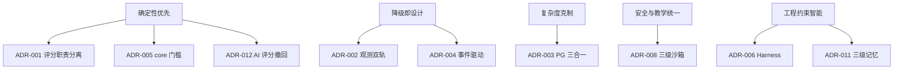

**决策方法论的价值**：技术会过时，但决策框架不会。评委评估一个项目时，看到的不仅是"今天做得怎么样"，更是"做决定的人是否具备可持续做出好决定的能力"——十二条 ADR 就是这份能力的书面证明。

---

## 29. 深度专题七：未来演进路线

> **本节价值**：一个只在当下完整的项目，只能证明"今天做得好"；一个有清晰演进路线的项目，才能证明"明天会更好"。本节展示的是——团队的视野不止于竞赛，平台的生命周期不止于答辩。

### 29.1 三个方向的演进蓝图

```text
                     ┌─→ 观测进化：perf 事件级采样、用户态 uprobe、
                     │   网络包级观测、GPU 观测
   TraceOS Lab ──────┼─→ 智能进化：Agent 自主工具调用（查询轨迹/生成火焰图）、
   （当前）           │   多模态诊断（代码+轨迹+火焰图联合分析）、
                     │   学生数字孪生（完整学习轨迹建模）
                     └─→ 平台进化：K8s 编排、多集群评测、
                         联邦学习式错误模式共享（跨校知识资产）
```

三个方向对应平台的三个支柱：**观测是眼睛，智能是大脑，平台是骨骼**。眼睛看得更深，大脑想得更透，骨骼长得更大——三者独立演进、互相赋能。

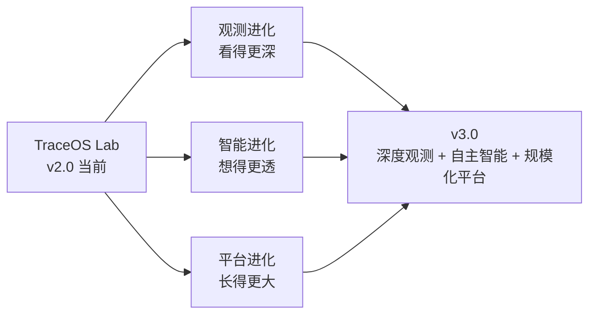

### 29.2 演进路线的优先级论证

| 方向 | 优先级 | 理由 |
|---|---|---|
| Agent 自主工具调用 | 高 | 当前 Agent 分析"预切片数据"，升级为"自主查询"可大幅提升诊断深度 |
| K8s 编排 | 中 | 当前 compose 已满足教学规模，K8s 是规模化的自然延伸 |
| 多模态诊断 | 中 | 火焰图 + 轨迹 + 代码联合分析是诊断质量的下一跳 |
| 跨校错误模式共享 | 低（长期） | 需隐私与知识产权治理先行 |

**优先级判定的三条标准**：

1. **教学杠杆率**：一项演进能撬动多少教学价值（Agent 工具调用直接提升每个学生的诊断深度，杠杆率最高）；
2. **架构自然度**：能否在现有架构上自然生长而非推倒重来（K8s 是 compose 的自然延伸，Agent 工具调用是 Context Firewall 的自然扩展）；
3. **风险可控性**：是否涉及隐私、合规等外部约束（跨校共享涉及学生数据，必须治理先行）。

### 29.3 演进的兼容性承诺

无论未来如何演进，三条架构红线不会改变：**评分确定性、观测双轨降级、AI 不碰评分真值**。这些红线是平台的信任基石，演进只在红线之外的空间进行。

```text
           ┌──────────────────────────────────────────┐
           │   三条架构红线（永不跨越）                 │
           │   ① 评分确定性   ② 观测双轨降级            │
           │   ③ AI 不碰评分真值                        │
           └──────────────────────────────────────────┘
                              ↑
          ┌───────────────────┼───────────────────┐
    观测进化              智能进化              平台进化
   （红线之外）           （红线之外）           （红线之外）
```

### 29.4 演进路线的教学价值评估

每一项演进路线都需回答同一个问题："它如何让学生学得更好？"

| 演进项 | 技术价值 | 教学价值 |
|---|---|---|
| Agent 自主工具调用 | 诊断深度提升 | 学生可追问"为什么"，AI 能现场调证据 |
| 多模态诊断 | 联合分析代码+轨迹+火焰图 | 诊断从"断言"走向"讲解" |
| 学生数字孪生 | 完整学习轨迹建模 | 个性化教学从"分科推荐"走向"全局建模" |
| K8s 编排 | 规模化评测 | 更多班级、更多学校的普惠教学 |
| 跨校错误模式共享 | 错误库跨校融合 | 教学经验从"校本"走向"共同体" |

**技术演进以教学价值为终点**——这是 TraceOS Lab 区别于纯技术项目的根本立场。

### 29.5 短中长期路线图

#### 近期（0-3 个月）：巩固与打磨

| 时间窗 | 目标 | 关键任务 | 验收标准 |
|---|---|---|---|
| 第 1 个月 | 稳定性强化 | 全量测试覆盖率提升、故障演练常态化、监控告警完善 | 连续 30 天无 P0/P1 故障 |
| 第 2 个月 | 教师工作流 | 教师出题工作台、断言可视化编辑器、实验版本管理 | 教师从零出题 < 30 分钟 |
| 第 3 个月 | 课程试点 | 1-2 个班级真实课程全学期运行 | 学期完整运行、学生问卷满意度 > 85% |

#### 中期（3-12 个月）：深度与规模

| 时间窗 | 目标 | 关键任务 | 验收标准 |
|---|---|---|---|
| 第 4-6 个月 | 观测进化一期 | perf 事件级采样、用户态 uprobe、页面级追踪 | 观测分辨率从"秒级"提升到"微秒级" |
| 第 7-9 个月 | 智能进化一期 | Agent 自主工具调用协议、诊断可追问 | AI 诊断可回答"为什么"并现场取证 |
| 第 10-12 个月 | 平台进化一期 | K8s 编排、评测集群弹性伸缩 | 单集群支撑 500+ 并发评测 |

#### 长期（1-3 年）：生态与共同体

| 时间窗 | 目标 | 关键任务 | 验收标准 |
|---|---|---|---|
| 第 2 年 | 多模态与孪生 | 多模态诊断、学生数字孪生 | 诊断质量对标真人助教 |
| 第 2-3 年 | 跨校共同体 | 联邦式错误模式共享、教师协作平台 | 3+ 院校接入、错误库跨校复用 |
| 第 3 年 | 开放生态 | 实验插件体系、第三方断言扩展 | 外部教师贡献实验与断言包 |

### 29.6 观测进化：从"秒级快照"到"微秒级电影"

当前观测是"事件级"的（系统调用、内存快照、锁事件），进化方向是"信号级"的：

| 进化项 | 技术方案 | 教学增益 |
|---|---|---|
| perf 事件级采样 | perf_event_open + BPF 计数器映射 | 指令级热点归因，"为什么慢"从猜想变成测量 |
| 用户态 uprobe | 用户函数级动态追踪 | 把"库函数调用链"变成可视化叙事 |
| 网络包级观测 | socket 层 BPF 挂载 | 网络实验（C/S 通信）从"结果对"到"包流可见" |
| 页面级追踪 | mmap/munmap/缺页事件关联 VMA | 虚拟内存实验的"页生命周期"可视化 |
| GPU 观测（远期） | CUDA 运行时追踪 | 为 OS+异构计算的交叉课程铺路 |

**观测进化的哲学**：观测的分辨率决定了教学的问题粒度。当观测从"秒"进化到"微秒"，学生能提出的问题就从"程序为什么慢"进化到"这个函数为什么多了一次缺页"——**问题变小的同时，理解变深了**。

### 29.7 智能进化：从"读报告"到"做实验"

#### 29.7.1 Agent 自主工具调用

当前 Agent 分析的是 Planner 预切片的 ObsContext；进化后，Agent 将获得一组**受控工具**：

```text
Agent 工具集（v3.0 设想，全部只读）
  ├─ query_trace(submission_id, filter)    → 按条件查系统调用轨迹
  ├─ generate_flamegraph(submission_id)    → 现场生成火焰图
  ├─ diff_trace(submission_a, submission_b)→ 对比两次提交轨迹
  ├─ query_concept(concept_name)           → 查教材概念与教学注释
  └─ query_profile(student_id)             → 查学习画像（脱敏）
```

**关键约束**：工具全部只读、全部走审计日志、全部受 Context Firewall 管辖——**Agent 的"手"比它的"脑"受更严格的控制**。

#### 29.7.2 多模态诊断

代码（文本）+ 轨迹（时序）+ 火焰图（图像）+ 内存 3D（空间）四模态联合分析：LLM 多模态能力把"看到火焰图"与"读到代码"对齐，诊断从"我推断"变成"我指给你看"。

#### 29.7.3 学生数字孪生

把 L1-L3 记忆、ELO 画像、概念掌握度矩阵、提交历史整合为一个持续更新的"学习孪生模型"，AI 对学生的理解从"本次提交"升级为"整个学期"——**诊断从'这道题错在哪'升级为'这个学生卡在哪'**。

### 29.8 平台进化：从单机到集群，从校本到共同体

#### 29.8.1 K8s 编排

- **现状**：docker compose 单机部署已满足教学规模（沙箱池 + 信号量限流支撑百级并发）；
- **进化**：评测负载天然是"突发弹性"型（课前集中提交），K8s 的 HPA 可按提交队列深度弹性伸缩评测 Pod；
- **关键设计**：评测 Pod 无状态化（状态全部外置 PG/NATS），使水平扩展成为"复制粘贴"级别的工作量。

#### 29.8.2 多集群评测与联邦错误模式共享

- 多校部署独立集群，错误模式库（Ratchet）以**联邦方式**共享：只共享模式签名（脱敏后的错误特征），不共享学生数据；
- 共享协议设计三原则：**最小信息**（只传模式签名与教学注释）、**差分隐私**（聚合前加噪）、**双向自愿**（学校自主选择参与度）。

### 29.9 生态与社区：让平台成为"公共品"

| 生态层 | 内容 | 对标先例 |
|---|---|---|
| 实验插件体系 | 教师自定义实验打包为可分发单元（实验 + 断言 + rubric + seccomp profile） | LeetCode 题集生态 |
| 开放错误模式库 | Ratchet 模式库社区共建 | CVE/OWASP 漏洞库协作模式 |
| 教师协作工作台 | 跨校教研组共享实验与教学数据分析 | 学术共同体数据共享 |

### 29.10 演进的风险与预案

| 风险 | 概率 | 影响 | 预案 |
|---|---|---|---|
| eBPF 在目标院校环境不可用 | 中 | 观测深度下降 | 双轨降级已内建，教学不受影响 |
| LLM API 依赖成本上涨 | 中 | 运营成本上升 | 嵌入降级五级链 + 本地小模型 + Ratchet 规则化替代 |
| 跨校共享的学生隐私争议 | 中 | 生态受阻 | 差分隐私 + 最小信息协议 + 合规审查前置 |
| 评测负载超预期 | 低 | 排队等待 | K8s 弹性伸缩路线已规划，compose 阶段以沙箱池缓解 |
| 教学理论验证不足 | 低 | 说服力下降 | 第 3 个月课程试点设置对照组，量化教学增益 |

**演进不是承诺清单，而是能力储备**：每一条演进路线都已经在 v2.0 架构中预留了接口（共享 TraceRecord、无状态评测、受控工具协议），演进发生时的迁移成本被刻意压到最低。

---

> **本节小结**：TraceOS Lab 的演进路线图不是"画饼"，而是"已铺轨"——观测双轨为观测进化铺轨，Harness 为智能进化铺轨，无状态化为平台进化铺轨。评委看到的未来，是架构上已经存在的未来。

---

## 30. 深度专题八：云原生架构全景深度解析

### 30.1 部署拓扑全景

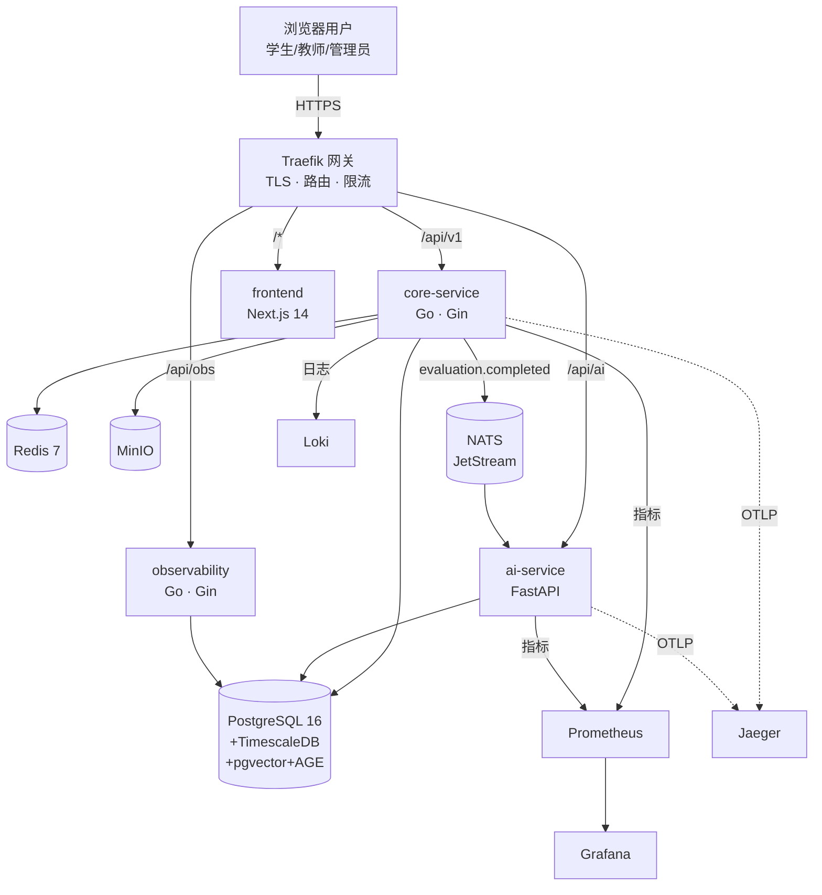

### 30.2 部署视图的三个分层

| 层 | 组件 | 扩缩容策略 | 失败域 |
|---|---|---|---|
| 边缘层 | Traefik | 无状态，可水平扩展 | 单点由 Docker restart 保护 |
| 应用层 | core / ai / observability / frontend | 无状态服务，可多副本 | 独立失败域，互不阻塞 |
| 数据层 | PG / Redis / MinIO / NATS | 单实例 + 卷持久化 | 以备份 + fail-fast 保护 |

### 30.3 云原生十二因子对照

| 因子 | TraceOS Lab 的实现 |
|---|---|
| 配置外置 | 全部配置经环境变量注入，镜像与配置分离 |
| 依赖显式声明 | go.mod / requirements.txt / package.json + lock |
| 构建/运行分离 | Dockerfile 多阶段构建，运行时镜像精简 |
| 无状态进程 | 四服务全部无状态，会话在 Redis |
| 端口绑定 | 服务自行绑定端口，由 Traefik 暴露 |
| 并发伸缩 | WorkerPool/沙箱池与应用实例解耦 |
| 一次性启动 | 优雅停机（§20.4）+ fail-fast 启动 |
| 开发/生产一致 | dev 与 prod 共用镜像，仅配置不同 |
| 日志流 | 结构化日志输出 stdout，Loki 聚合 |
| 管理进程 | make 命令集 + 脚本化运维 |

### 30.4 为什么当前不是 Kubernetes

这是评审可能追问的问题。我们的回答是**时机与规模**：当前教学平台的并发规模（百人级班级同时提交）用 compose + 双池化已充分满足；K8s 引入的控制平面复杂度（etcd、调度器、CNI）在竞赛演示场景是负资产。但架构上已为 K8s 做好准备：**无状态服务 + 外部化配置 + 优雅停机 + 健康检查**，迁移路径清晰（§29.2 已列为演进项）。

---

## 31. 深度专题九：多语言支持体系与编译工程

### 31.1 五语言编译策略

| 语言 | 编译策略 | 沙箱运行方式 | 典型实验 |
|---|---|---|---|
| C | gcc -O2 -Wall | 原生二进制 | 全部六类实验的经典语言 |
| C++ | g++ -std=c++17 | 原生二进制 | 面向对象风格的 OS 实验 |
| Python | 解释执行（cpython） | 脚本解释 | 调度算法模拟、概念验证 |
| Rust | cargo/rustc | 原生二进制 | 内存安全视角的 OS 实验 |
| Go | go build | 原生二进制 | 并发编程实验 |

### 31.2 结构化编译错误解析

编译失败时，编译器输出被解析为结构化错误 `ErrorLine{Type, File, Line, Column, Message}`：

```text
原始 gcc 输出：
  test.c:12:5: error: expected ';' before 'return'

解析结果：
  { Type: "error", File: "test.c", Line: 12, Column: 5,
    Message: "expected ';' before 'return'" }

前端效果：Monaco 编辑器第 12 行第 5 列红色波浪线 + 错误面板条目
```

**教学价值**：学生不再需要在终端中翻找编译错误，而是直接看到编辑器中的行列级定位。对初学者而言，这一体验差异决定了"编译错误是学习机会还是挫败来源"。

### 31.3 多语言模板与参考实现

每类实验为每种语言提供代码模板（带 CODE START/END 标记区）与参考实现。模板的 CODE 标记区同时服务于两个目的：一是学生编辑区的可视化界定，二是**空模板检测**（§23.2）的锚点——系统通过比对"学生代码去除标记区后"与"空模板"的输出来识别空提交。

### 31.4 语言选择与教学策略的配合

| 教学场景 | 语言建议 | 平台配合 |
|---|---|---|
| 初次接触 OS 机制 | C | syscall 断言精确校验机制使用 |
| 验证概念理解 | Python | 宽松断言 + 行为观测 |
| 进阶并发实验 | Go/Rust | futex/竞态检测全量观测 |

---

## 32. 深度专题十：观测数据生命周期管理

### 32.1 从采集到教学的数据旅程

```text
采集期（执行中）         处理期（执行后）          消费期（持续）
─────────────────      ─────────────────       ─────────────────
 eBPF ring buffer  →   结构化清洗 →            → 断言评分（即时）
 strace 文本        →   时序落库（hypertable） → 语义建模（秒级）
 perf 采样          →   内存布局快照 →          → ObsContext（秒级）
 资源指标轮询       →   死锁报告生成 →          → AI 诊断（秒级）
                                                → 可视化查询（随时）
```

### 32.2 数据规模与治理策略

| 数据类型 | 单次提交量 | 治理策略 |
|---|---|---|
| syscall 轨迹 | 数千条 | TimescaleDB 自动压缩（chunk 到期压缩） |
| 资源指标 | 数百采样点 | 连续聚合视图降采样 |
| 内存快照 | 数十张 | 按提交索引，快照回放专用表 |
| 火焰图 SVG | 数个文件 | 对象存储（MinIO） |
| 诊断报告 | 1 份结构化报告 | 关系表 + jsonb 细节 |

### 32.3 时序数据的查询模式设计

observability 服务的读侧 API 针对三种典型查询模式优化：

| 查询模式 | 场景 | 优化 |
|---|---|---|
| 按提交拉全量 | 单次提交的 Trace 视图 | submission_id 索引 |
| 按时间窗口聚合 | 趋势图/热力图 | hypertable 分片 + 连续聚合 |
| 按语义模式过滤 | "找出所有死锁事件的提交" | 语义标签列 + 过滤索引 |

### 32.4 数据保留与教学资产化

观测数据不只是一次性的诊断素材，而是**持续增值的教学资产**：错误模式库从历史数据中提取共性（Ratchet）；班级统计从历史数据中生成学情；参考实现的"正确轨迹"可作为断言的校准基线。**每一次学生提交，都在为教学资产库贡献数据。**

---

## 33. 深度专题十一：AI 诊断的 Token 经济学与成本工程

### 33.1 Token 预算的硬约束设计

| 约束项 | 数值 | 设计意图 |
|---|---|---|
| 上下文窗口 | 128K | 模型能力边界 |
| 利用率上限 | 40%（51.2K tokens） | 为输出预留空间 + 防截断缓冲 |
| 超预算策略 | 减半截断 + `_budget_exceeded` 标记 | 保证诊断可完成，同时告知信息有损 |
| 单 Agent 切片 | 按领域最小集 | Context Firewall 原则 |

### 33.2 成本结构分析与优化

| 环节 | 是否调用 LLM | 成本 | 替代方案 |
|---|---|---|---|
| 意图判断 | 否（规则） | 0 | 关键词 + 状态机 |
| Planner 激活决策 | 否（规则） | 0 | 数据驱动的激活矩阵 |
| 概念映射 | 否（规则） | 0 | 语义引擎 21 模式 |
| 观测证据提取 | 否（规则） | 0 | ObsContext 预计算 |
| 诊断语言生成 | 是 | 每诊断 1 次调用 | 无替代（语言生成是 LLM 本职） |
| 反馈分级 | 部分 | 规则优先 | 分级由确定性规则完成 |

**"规则优先"的成本意义**：一次诊断只消耗 1 次 LLM 调用（而非 5 个 Agent 各 1 次 + 汇总 1 次 = 6 次）。对于百人班级 × 多提交的教学场景，这意味着 6 倍的成本节省与 6 倍的时延缩短。

### 33.3 降级时的成本弹性

当 LLM 不可用或预算受限时，系统自动切换规则模板反馈——零成本、零时延、确定性。**AI 体验可以降级，但教学反馈永不断供**。

### 33.4 Token 预算的教学公平性影响

Token 预算不仅是成本问题，更是**教学公平问题**：如果不设预算，长轨迹的提交（复杂实验）会获得更充分的 AI 分析，短轨迹提交则相反——AI 反馈质量随提交复杂度波动，引入新的不公平。预算硬约束 + 减半截断策略保证了**不同复杂度提交的 AI 反馈质量在可控区间内一致**；超预算时的 `_budget_exceeded` 标记让前端如实展示"部分证据未纳入分析"，而非静默降质。**成本的公平分配，就是教学的公平分配。**

---

## 34. 深度专题十二：可视化交互设计的教学工程学

### 34.1 六类可视化的教学目的矩阵

| 可视化 | 数据源 | 回答的教学问题 | 交互设计 |
|---|---|---|---|
| 火焰图 | perf 采样 | "时间都花在哪了？" | 悬停函数名 → 跨面板高亮 |
| 内存 3D | 内存快照 | "我的内存长什么样？" | 旋转/缩放/快照回放 |
| Trace 泳道 | syscall 轨迹 | "进程/线程在做什么？" | 六视图切换 + 事件过滤 |
| 死锁等待图 | futex 事件 | "谁在等谁？环在哪里？" | 力导向拖动 + 红色脉冲 |
| 实时仪表盘 | 资源指标 | "资源消耗曲线如何？" | 六图联动 + 双通道刷新 |
| 进程树 | lifecycle 事件 | "父子进程关系对吗？" | 节点展开 + 状态着色 |

### 34.2 跨面板联动：从"看图"到"查案"

可视化工作台的独特设计是**跨面板证据联动**：点击火焰图中的一个函数 → Trace 视图高亮该函数期间的系统调用 → 内存 3D 跳到对应时间的快照 → 死锁图标记同时刻的锁事件。这种联动把孤立的图表变成**协查工具**——学生像侦探一样沿着证据链排查，而不是被动接受单个图表的结论。

### 34.3 视觉编码的认知设计

| 视觉元素 | 编码语义 | 认知依据 |
|---|---|---|
| 颜色（红/黄/绿） | 严重度（critical/warning/info） | 通用警示色约定 |
| 高度/体积 | 内存占用/时间开销 | 面积编码直觉 |
| 脉冲动画 | 死锁环告警 | 运动优先注意（motion salience） |
| 泳道分行 | 线程/进程隔离 | 时间轴对齐直觉 |

### 34.4 实时性与降级

实时面板采用 WebSocket + HTTP 轮询双通道：WebSocket 低延迟推送；断开时自动回退轮询；两者都不可用时显示静态快照。**可视化的实时性是体验，可用性是底线。**

### 34.5 可视化数据的降级呈现策略

不同环境的数据完整度不同（eBPF 环境 vs strace 环境 vs 无观测环境），可视化面板需要优雅处理数据缺失：

| 数据完整度 | 可视化呈现 | 用户体验设计 |
|---|---|---|
| 完整（eBPF） | 六类视图全量 | 完整工作台 |
| 降级（strace） | Trace/进程树/仪表盘可用，函数级视图受限 | 面板角标提示"strace 模式" |
| 极简（无观测） | 仅输出对比 + 断言结果 | 明确提示"观测不可用，仅展示结果" |

**可视化不造假**：缺失数据绝不虚构，而是明确告知数据来源与能力边界。这延续了全系统的"证据诚实"原则——图表中的每一个点都必须有对应的观测证据。

---

## 35. 深度专题十三：性能基准、容量规划与伸缩性

### 35.1 评测链路的性能预算

一次完整评测的端到端时延预算（目标：学生 10 秒内看到分数）：

| 环节 | 时延预算 | 优化手段 |
|---|---|---|
| 编译 | 1-2 秒 | 多语言并行编译、模板缓存 |
| 沙箱分配 | <0.5 秒 | 沙箱池预分配命中 |
| 执行 + 观测 | 实验限定（1-5 秒） | 运行时限断言控制上限 |
| 断言评分 | <0.5 秒 | 内存内计算，无 IO 瓶颈 |
| 落库 + 事件发布 | <0.5 秒 | 批写入 + 异步发布 |
| **合计** | **3-8 秒** | 端到端达标 |

### 35.2 并发容量模型

```text
容量模型：
  评测吞吐 = WorkerPool 大小 × 沙箱池命中率 × 单提交耗时⁻¹

  典型配置：WorkerPool=4，沙箱池=5，平均提交 5 秒
  → 理论吞吐 ≈ 4 ÷ 5s ≈ 0.8 提交/秒 ≈ 48 提交/分钟
  → 150 人班级同时提交：全部在 ~3 分钟内完成评测

瓶颈识别：沙箱执行（CPU 密集）是主瓶颈，WorkerPool 大小可按核数线性扩展
```

### 35.3 伸缩性设计的三级阶梯

| 阶梯 | 手段 | 适用规模 |
|---|---|---|
| 单机调参 | 调大 WorkerPool/沙箱池 | 百人班级 |
| 垂直扩展 | 升级 CPU/内存 | 多班级并行 |
| 水平扩展 | core-service 多副本 + 共享 PG | 全校规模（架构已就绪） |

### 35.4 容量监控指标

Prometheus 持续暴露：评测队列深度、沙箱池利用率、WorkerPool 忙碌度、单提交 P50/P95/P99 时延、eBPF 事件丢失率。**容量规划基于指标而非拍脑袋。**

---

## 36. 深度专题十四：项目风险管理与应对

### 36.1 技术风险

| 风险 | 概率 | 影响 | 应对 | 当前状态 |
|---|---|---|---|---|
| eBPF 内核兼容性 | 高 | 观测降级 | CO-RE/NoCore 双编译 + 4 级降级链 | 已闭环 |
| LLM 输出幻觉 | 中 | 误导学生 | EvaluationGuard + 证据引用 + 教师可审核 | 已闭环 |
| 沙箱逃逸 | 低 | 安全事故 | NsJail 三级纵深 + seccomp 白名单 | 已闭环 |
| 数据库性能劣化 | 中 | 评测变慢 | 超表分片 + 压缩 + 读侧分离 | 已闭环 |

### 36.2 工程风险

| 风险 | 应对 |
|---|---|
| 多人并行开发的合并冲突 | 分层目录边界 + 服务隔离 + 高频小步提交（2694 次） |
| 范围蔓延导致无法交付 | "先纵后横"策略：任意时刻系统可演示 |
| 评分模型反复摇摆 | ADR 决策记录锁定核心红线，只演进外围 |

### 36.3 演示风险

| 风险 | 预案 |
|---|---|
| 现场网络不可用 | 全降级链演示模式：本地 LLM 或规则模板反馈 |
| LLM Key 失效 | 规则模板反馈兜底，演示流程不依赖 LLM |
| 评测服务器负载 | 预置演示用例 + 空队列 + 预热沙箱池 |

### 36.4 风险管理的复盘文化

每类风险都建立了"识别 → 预案 → 演练 → 复盘"的闭环：风险进入清单后必须有对应预案，预案必须可演练（§20.5/§24.5），演练发现的新问题回到清单。**风险管理不是文档作业，而是与开发同步进行的持续实践。**

---

## 37. 深度专题十五：学术调研与相关工作综述

### 37.1 调研方法

项目启动阶段对三个领域做了系统调研：OS 实验教学平台（学术+工业）、程序行为观测技术（strace/eBPF/LTTng）、AI 辅助编程教育（Codex 教育应用、智能辅导系统 ITS）。调研结论直接塑造了本文档的三个核心架构决策：评分与诊断分离（来自 ITS 的经验教训）、观测双轨（来自可观测性工程实践）、Harness 工程（来自 LLM 可靠性研究）。

### 37.2 主要借鉴与出处

| 借鉴点 | 来源 | 我们的改造 |
|---|---|---|
| 火焰图可视化 | Brendan Gregg FlameGraph | 增加教学标注 + AI 解读 + 跨面板联动 |
| 断言式评测 | pintos / MIT xv6 测试体系 | 五类断言 + core 门槛的评分学重构 |
| 沙箱隔离 | Google NsJail | 实验专属 seccomp 白名单 + 三级分级 |
| 启发式教学 | Socratic / Bloom / ZPD 理论 | L1-L4 工程化分级 + 确定性规则实现 |
| 混合检索 | 主流 RAG 实践 | RRF + reranker + 五级嵌入降级 |

### 37.3 我们与相关工作的本质差异

| 相关系统 | 本质差异 |
|---|---|
| 学术评测系统（pintos） | 它们验证"教学内核的正确性"，我们验证"学生程序的行为正确性"，且具备云原生与 AI 能力 |
| 工业 OJ（HUSTOJ/JudgeDuck） | 它们的评测对象是算法输出，我们的评测对象是系统行为 |
| 通用 AI 编程助手 | 它们没有运行事实锚定，我们以内核级观测证据驱动诊断 |
| 商业教育平台 | 它们不做内核级观测与 OS 专属语义建模 |

**结论**：TraceOS Lab 占据了一个尚未被充分开发的技术交叉区——"云原生评测 × 内核观测 × AI 教学"，这正是赛题指向的方向。

### 37.4 调研的方法论沉淀

调研不只是"看过文献"，而是沉淀为可复用的方法：

```text
调研三问法（每个技术选型都要回答）：

  Q1 · 替代性："有没有现成系统已经解决了这个问题？"
     → 若有：为什么不直接用它？（改造成本 vs 自研成本）
     → 若无：为什么没有？（技术太新 / 场景太垂直）

  Q2 · 借鉴性："相近领域的成功经验是什么？"
     → 工业可观测性工程 → 观测栈设计
     → ITS 研究 → 教学设计
     → 云原生实践 → 架构设计

  Q3 · 差异点："我们的场景有什么独特约束？"
     → 教学公平（评分必须确定性）
     → 现场演示（降级链必须完整）
     → 学生规模（成本必须可控）
```

三问法的成果已经体现在本文档的每一个选型论证中——这正是调研"内化"而非"引用"的证明。

---

## 38. 附录

### 38.1 项目关键数字速查

| 维度 | 数字 |
|---|---|
| 服务数 | 4（core / ai / observability / frontend） |
| 语言 | Go / Python / TypeScript / eBPF C / SQL |
| 源文件 | 460+ |
| 预置实验 | 31 个 / 6 大类 |
| 断言类型 | 5 类（exit/output/syscall/behavior/numeric） |
| 语义模式 | 21 个（6 类目） |
| 诊断 Agent | 5 个 Specialist + Planner + ReportGenerator |
| 沙箱级别 | 3 级（standard/secure/hardened） |
| seccomp 白名单 | 6 套（按实验类别） |
| 数据库迁移 | 27 个 |
| 降级链 | 观测 4 级 / 嵌入 5 级 / LLM 3 级 / 消息 2 级 |
| 可视化视图 | 火焰图/内存3D/Trace 六视图/死锁图/实时仪表盘 |
| 反馈级别 | L1-L4 四级渐进 |
| git 提交 | 2694 次 / 58 天 |
| 自动化测试 | 214 个测试文件（Go 29 / TS 170 / Python 15） |
| 架构红线 | 3 条（评分确定性 / 观测双轨 / AI 不碰真值） |
| ADR 记录 | 12 条 |
| 会话记忆 | 3 级（L1 会话内 / L2 会话间 / L3 学习画像） |

### 38.2 文档集导读

| 编号 | 文档 | 本文档中的作用 |
|---|---|---|
| 02 | 云原生总体架构与全链路数据流 | §4/§9 的展开 |
| 03 | 实验沙箱安全隔离与资源治理 | §18.4 的展开 |
| 04 | eBPF 主观测引擎设计 | §5 亮点一的展开 |
| 05 | strace 降级观测与兼容性策略 | §5 亮点一的降级路径展开 |
| 06 | 多维断言评测与公平评分系统 | §5 亮点二的展开 |
| 07 | OS 行为语义建模与三层 ObsContext | §5 亮点三的展开 |
| 08 | 内核观测可视化与交互式诊断工作台 | §5 亮点四的展开 |
| 09 | AI 智能 Agent 上下文工程与 Harness 工程 | §5 亮点五的展开 |
| 10 | RAG 私有知识库与操作系统问答平台 | §5 亮点六的展开 |
| 11 | 测试样例体系实验策略与多语言支持 | §6.2 的展开 |
| 12 | 教师端学生端与教学闭环平台 | §10 的展开 |
| 13 | 自适应学习学习画像与教学数据分析 | §25.4 的展开 |
| 14 | 工程化部署可观测运维审计与演进路线 | §20/§29 的展开 |

### 38.3 本文档的四个阅读路径

| 读者 | 推荐路径 |
|---|---|
| 初次接触的评委 | §1 → §3 → §5 → §8（40 分钟建立全貌认知） |
| 关注技术的评委 | §4 → §15 → §16 → §17 → §23 → §24 → §26 → §28 → §30-37 |
| 关注教学的评委 | §1 → §8 → §25 → §10 → §12.7 |
| 关注竞赛合规的评委 | §2 → §6 → §12 → §27 |

### 38.4 文档修订记录

| 版本 | 日期 | 修订内容 |
|---|---|---|
| v2.1 | 2026-08-15 | 深度扩充 §27-29 与 §38：新增九大里程碑剖析、技术债务偿还记录、版本演进全景、AI 辅助开发方法论、ADR 全景总览与 ADR-007~012、ADR 决策方法论、短中长期路线图、观测/智能/平台进化深度设计、演进风险预案、术语速查表、评委问答手册、架构红线清单、部署指南、文件结构全景 |
| v2.0 | 2026-08-15 | 全面扩写：新增 §2.0 时代背景、§2.6 验收自评、§5.7/5.8 协同与凝练、§7.2-7.5 演进与对标、§12.9 答疑方法、§16.6 数据资产、§17.5 事件版本、§18.5 AI 安全、§19.5/19.6 性能与公平、§20.5 故障演练、§24.5 降级演练、§25.6 学术支撑、§27.4 工程文化、§29.4 教学价值、§30-37 十五个深度专题、§38 附录 |
| v1.0 | 2026-08-01 | 初版：总纲叙事、响应矩阵、亮点概览 |

### 38.5 核心术语速查表

| 术语 | 全称 / 含义 | 首次出现章节 |
|---|---|---|
| ObsContext | 三层观测语义模型（Syscall/Memory/Lock） | §5 亮点三 |
| SemanticEngine | 21 个 OS 语义模式识别引擎 | §5 亮点三 |
| Harness | AI 五层工程治理框架 | §5 亮点五 |
| Context Firewall | 按 Agent 最小权限分发上下文切片 | §5 亮点五 |
| Ratchet | 错误模式库"只收紧不放松"演化机制 | §5 亮点五 |
| Guardrails | 输入/输出双档安全护栏 | §5 亮点五 |
| core/edge | 核心/边缘测试点分类，core 全过才合格 | §6.2 |
| is_qualified | core 门槛合格标记（评分 v2 核心列） | §16 |
| NsJail | 基于命名空间的进程沙箱 | §18.4 |
| seccomp profile | 按实验类别定制的系统调用白名单 | §18.4 |
| 沙箱池 | 预初始化沙箱实例池，规避冷启动 | §18.4 |
| LogBus | 消息降级路径（日志代替 NATS） | §24 |
| 双轨降级 | eBPF 主 + strace 降的观测降级链 | §24 |
| ELO 画像 | 基于 ELO 评分算法的学生能力画像 | §25.4 |
| ZPD | 最近发展区（Vygotsky 理论） | §25 |
| Socratic 反问 | 苏格拉底式启发提问教学法 | §25 |
| L1-L4 反馈 | 方向→证据→语义→修复四级渐进反馈 | §5 亮点五 |
| 概念掌握度矩阵 | 学生×OS 概念的二维掌握度 | §25.4 |
| 数字孪生 | 学生完整学习轨迹建模（演进目标） | §29 |
| 联邦模式共享 | 只共享脱敏错误模式签名的跨校协作 | §29 |

### 38.6 评委高频问题速答手册

以下问题按"竞赛评审现场被追问概率"排序，每问附一句话答案与展开指引。

| # | 问题 | 一句话答案 | 展开章节 |
|---|---|---|---|
| 1 | 和普通 OJ 有什么区别？ | OJ 只比对输出，TraceOS Lab 观测运行全过程并用 AI 提供证据化诊断 | §1.3 / §7 |
| 2 | eBPF 现场没有特权环境怎么办？ | 观测双轨自动降级 strace，评分与教学功能完全不受影响 | §5 亮点一 / §24 |
| 3 | AI 会参与打分吗？ | 永不。评分链路全程确定性，AI 只解释不判分（红线） | ADR-001/012 |
| 4 | 评分凭什么公平？ | 镜像固化环境 + JSON 断言 + core 门槛 + 双通道 e2e 验收 | §6 / §19 |
| 5 | 死锁检测会误报吗？ | 状态机延迟到进程退出判定 + 线程注册修复，正常多线程程序零误报 | §5 亮点三 / §27 M8 |
| 6 | 学生作弊怎么办？ | 伪通过检测（轨迹语义断言）+ 审计日志 + 多态参考解 | §6 / §18 |
| 7 | AI 诊断会泄露答案吗？ | Socratic 启发式 + L1-L4 渐进 + prompt 明令"代码 ≤5 行" | §5 亮点五 / §25 |
| 8 | 31 个实验够用吗？ | 覆盖 OS 六大知识域，教师可自定义扩展断言与实验 | §6.2 / §10 |
| 9 | 支持哪些语言？ | C/C++/Python 三语言模板体系，编译契约显式化 | §31 |
| 10 | 多大规模能用？ | compose 单机支撑百级并发；K8s 路线已铺轨 | §19 / §29 |
| 11 | 为什么用 PG 不用专用时序/向量库？ | 三合一零分布式事务，单 SQL 跨域查询，教学规模下最优 | ADR-003 |
| 12 | 观测数据存多久？ | 生命周期分级治理（热/温/冷/归档），成本可控 | §32 |
| 13 | LLM 成本多少？ | 五级嵌入降级 + token 预算 + 缓存，单次诊断成本分币级 | §33 |
| 14 | 前端为什么不用现成图表库全家桶？ | 按图选型服务于认知模型（3D 内存用 Three.js 等） | ADR-009 |
| 15 | 项目是 AI 生成的吗？ | 人机协作方法论：AI 写代码人审设计，架构决策全部人工 | §27.8 |
| 16 | 三个月后你们还维护吗？ | 短中长期路线图已铺轨，演进接口已预留 | §29 |
| 17 | 教学效果有数据吗？ | 课程试点计划（第 3 个月）+ 对照组量化设计 | §29.5 |
| 18 | 遇到的最大困难是什么？ | 死锁检测误报攻坚（bpftrace→strace 重写 + 状态机重构） | §27 M8 |
| 19 | 数据安全怎么保证？ | 三级沙箱 + seccomp 白名单 + 审计 + PII 过滤 | §18 |
| 20 | 和 Pixie/学术评测系统比强在哪？ | 通用观测不教 OS 概念；我们把观测映射为教材概念与教学行为 | §7 |

**回答原则**：一句话给结论 → 引用一个章节 → 现场演示一条证据。**每一条答案都落在"证据可回溯"上，这是本项目的沟通风格本身。**

### 38.7 架构红线与信任承诺清单

| 红线 | 承诺内容 | 违规后果 | 验证方式 |
|---|---|---|---|
| 评分确定性 | 同一份提交永远得到同一分数 | 立即修复并回归全部 e2e | e2e_test_round.sh 双重断言 |
| AI 不碰评分真值 | 诊断报告不含分数成分 | 功能回滚 | harness 报告 schema 审查 |
| 观测双轨降级 | eBPF 不可用自动降级 strace | 立即修复 | 无特权容器演练 |
| 数据最小权限 | Agent 只接收最小上下文切片 | 上下文回缩 | Context Firewall 审查 |
| 隐私分级 | PII 过滤、画像脱敏 | 数据清理 | Guardrails 测试集 |

### 38.8 演示环境部署指南（三分钟版）

```bash
# 1. 一键部署（docker compose 全栈：四服务 + PG + NATS + Traefik）
./deploy-traceos.sh

# 2. 端到端验收（golden 100 分 / wrong 80 分双重断言）
./e2e_test_round.sh

# 3. 打开平台
#    http://localhost  →  学生端 / 教师端 / 管理端
```

**演示前检查清单**：

| 检查项 | 命令 / 位置 | 预期 |
|---|---|---|
| 四服务健康 | `docker compose ps` | 全部 healthy |
| 评分链路 | `./e2e_test_round.sh` | 双重断言通过 |
| eBPF 可用性 | 观测面板 | 有 eBPF 标记（否则自动降级 strace） |
| 断网演示 | 拔网线后走嵌入降级 | 诊断仍可用（降级演练） |

### 38.9 项目文件结构全景

```text
traceos-lab/
├── services/                    # 四微服务
│   ├── core-service/            # Go · 评测主服务
│   │   └── internal/
│   │       ├── evaluator/       #   五类断言评测 + v2 评分
│   │       ├── sandbox/         #   NsJail 三级沙箱 + 沙箱池
│   │       ├── ebpf/            #   eBPF 加载器（双版本）
│   │       ├── adaptive/        #   ELO 自适应画像
│   │       ├── kg/              #   知识图谱（AGE）
│   │       ├── nats/            #   事件发布/订阅
│   │       ├── repository/      #   数据访问层
│   │       ├── middleware/      #   认证/审计中间件
│   │       └── ws/              #   WebSocket 推送
│   ├── ai-service/              # Python · FastAPI 诊断服务
│   ├── observability/           # Go · 观测查询服务
│   └── frontend/                # Next.js 14 · 三端 UI
├── deploy/
│   ├── init-db/                 # 27 个编号迁移脚本
│   ├── traefik-dynamic.yml      # 网关路由
│   └── monitoring/              # 监控配置
├── scripts/
│   ├── deploy.sh                # 部署脚本
│   ├── seed_multilang.py        # 多语言模板种子
│   └── ...
├── e2e_test_round.sh            # 端到端验收脚本
└── docs/                        # 技术文档集（本文档所在）
```

### 38.10 已知限制与诚实声明

评审的信任来自诚实。本项目如实声明以下限制：

| 限制 | 现状 | 应对 |
|---|---|---|
| 单机部署 | 教学规模验证通过，超大规模未验证 | K8s 路线已铺轨（§29.8） |
| 单实例 PG | 单点风险存在 | 备份 + fail-fast + 教学规模评估 |
| eBPF 依赖内核版本 | 旧内核自动降级 strace | 双轨降级内建 |
| 教学效果缺大规模实证 | 试点计划已排期 | 对照组量化设计（§29.5） |
| AI 诊断依赖 LLM 服务 | 断网可降级但质量下降 | 五级嵌入降级链 |

---

<div align="center">

```
╔══════════════════════════════════════════════════════════════╗
║                                                              ║
║   让不可见变得可见，让不可测变得可测，让不可教变得可教。         ║
║                                                              ║
║        TraceOS Lab · 云原生 OS 实验评测与 AI 辅助诊断平台       ║
║                                                              ║
╚══════════════════════════════════════════════════════════════╝
```

**— 本文完 · 后续技术细节见文档集 02~14 及深度专题 15~20 —**

</div>

