# 02 云原生总体架构与全链路数据流

> **文档定位**：本文阐述 TraceOS Lab 的云原生总体架构。面向架构评审与系统设计讲解，重点说明"服务如何协作、一条提交如何变成一份诊断报告、评测与诊断如何解耦、数据如何分层存储"。这是理解全部后续文档的架构基础，也是整个技术叙事体系的"总纲"。

---

## 摘要

TraceOS Lab 采用以服务边界为中心的云原生架构，将在线交互、评测执行、AI 诊断、观测查询、数据持久化和运维监控进行彻底解耦。系统以 `Core Service` 为评测事实中心，以 `AI Service` 为教学智能中心，以 `Observability Service` 为观测读侧服务，以 `Frontend` 为双端交互入口，通过 `Traefik` 统一路由，通过 `NATS JetStream` 传递评测完成事件，通过 PostgreSQL、TimescaleDB、pgvector、Redis 和 MinIO 共同承载结构化数据、时序数据、向量知识和对象资源，通过 Prometheus、Loki、Jaeger 构成三层可观测体系。

核心架构决策可以概括为一句话：**评测是确定性的、事件驱动的、可审计的；AI 是异步的、证据锚定的、可治理的。**

本文将从八个维度展开论证这条主线：

| 维度 | 核心问题 | 架构回答 |
|---|---|---|
| 架构哲学 | 为什么这样拆分服务 | 服务边界即安全边界、扩容边界、故障边界 |
| 服务职责 | 每个服务做什么、不做什么 | 单职责 + 明确契约 + 显式依赖 |
| 数据链路 | 提交如何变成报告 | 编译 → 沙箱执行 → 双轨观测 → 断言评分 → 事件发布 → AI 诊断 |
| 事件解耦 | AI 失败是否影响评分 | JetStream 持久化事件 + 异步消费 + LogBus 兜底 |
| 存储分层 | 五类数据如何各得其所 | 关系 / 时序 / 向量 / 内存 / 对象 各司其职 |
| 并发可靠 | 高并发下如何稳定 | 三层并发控制 + 七级降级链 + panic 隔离 |
| 协议演进 | 多端交互如何组织 | REST / WebSocket / SSE / gRPC 四协议矩阵 |
| 部署运维 | 如何一键起、可监控、可审计 | 三 profile Compose + 健康检查 + 三层可观测 |

---

## 1. 架构设计哲学与约束

### 1.1 设计目标：四个"必须"

在动手设计架构之前，TraceOS Lab 首先明确了自己的设计目标。这些目标来自真实的教学场景约束，而不是教科书式的架构教条：

| 编号 | 设计目标 | 背后的场景约束 |
|---|---|---|
| G1 | **评测必须确定性** | 同一份代码在任何时刻提交，分数必须完全一致——这是教学评测的公平底线，也是竞赛验收的可复现要求 |
| G2 | **评分必须与 AI 解耦** | 大模型有随机性、提示词敏感性和不可解释性，评分不能依赖它；AI 只能解释评分，不能决定评分 |
| G3 | **观测必须双轨可用** | eBPF 是理想路径，但内核版本、权限、容器环境千差万别；strace 降级必须与 eBPF 同等可靠 |
| G4 | **平台必须抗故障** | 教学平台的关键时刻（考试、验收）不容有失；任何一个子系统的故障都不能拖垮评分主链路 |

这四条目标直接推导出了后文的所有架构决策——它们不是"顺便这样设计了"，而是"为了满足这四个必须，只能这样设计"。

### 1.2 架构风格选型：模块化单体 vs 微服务 vs 服务化

架构评审中最常见的问题是"你为什么不用单体"。TraceOS Lab 的回答是：**我们选择的既不是教科书式的微服务，也不是大单体，而是"以服务边界为中心的适度服务化"**。

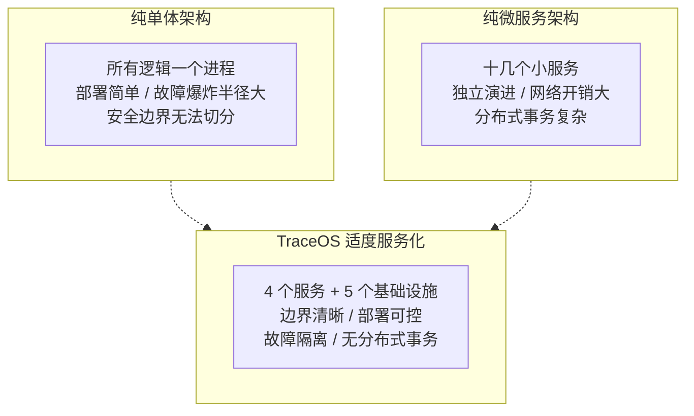

为什么是 4 个服务而不是 10 个，也不是 1 个？决策依据如下表：

| 考量维度 | 1 个单体 | 4 个服务（本方案） | 10+ 微服务 |
|---|---|---|---|
| 安全边界 | 无法切分——eBPF 需要特权，AI 服务也被迫特权运行 | ✅ 特权隔离到 Core 与 Observability，AI 零特权 | 边界更细，但治理成本陡增 |
| 技术栈匹配 | Go 与 Python 无法并存 | ✅ Go 写评测引擎，Python 写 AI，各自最佳 | 每个服务独立技术栈，团队负担大 |
| 故障爆炸半径 | 一个 bug 全站宕机 | ✅ AI 挂不影响评分，观测挂不影响评测 | 更小，但网络故障点更多 |
| 部署复杂度 | 最简单 | ✅ 单个 compose 文件搞定 | 需要 K8s 级别的编排 |
| 分布式事务 | 无 | ✅ 无——事件驱动避免了事务 | 大量跨服务事务 |
| 团队规模适配 | — | ✅ 适合 3~5 人团队 | 需要更大团队 |

**结论**：以"安全边界、故障边界、扩容边界、技术栈边界"四重标准去切分，得到的最优解恰好是四个服务。这是"边界驱动的服务拆分"，而不是"为了微服务而微服务"。

### 1.3 五条核心架构原则

整个系统贯穿五条架构原则，它们可以被视为 TraceOS Lab 的"架构宪法"：

| 原则 | 表述 | 在系统中的落点 |
|---|---|---|
| P1 事实与解释分离 | 评分是事实（deterministic fact），诊断是解释（evidence-anchored explanation） | Core 产出唯一评分真值；AI 只基于事实做教学解释 |
| P2 写读分离 | 评测主链路是写侧，可视化查询是读侧 | Observability Service 独立为读侧服务 |
| P3 事件优先 | 服务间协作优先走事件，而非同步调用 | `evaluation.completed` 事件驱动 AI 诊断 |
| P4 降级链完备 | 每条主路径都有明确的降级路径 | eBPF→strace→直执行；LLM→规则→模板；NATS→LogBus |
| P5 可审计性内建 | 所有关键动作都有留痕 | audit_logs、事件持久化、提交全生命周期状态机 |

这五条原则在后续每一章都会被反复引用——评审老师可以看到，架构不是拍脑袋的结果，而是原则的一致展开。

### 1.4 五层架构总览

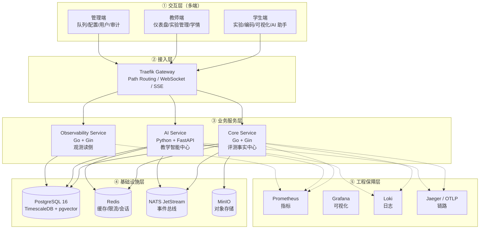

### 1.5 分层职责与设计理由

| 层 | 职责 | 关键设计约束 |
|---|---|---|
| 交互层 | 学生/教师/管理三端 UI | 不直接访问基础设施，全部经 Traefik 路由到服务 |
| 接入层 | 统一路由、WebSocket 升级、负载均衡 | 单一入口，动态路由（Docker labels + file provider） |
| 业务服务层 | 评测、AI、观测三个独立服务 | 服务边界即安全边界、扩容边界、故障边界 |
| 基础设施层 | 数据持久化、事件、缓存、对象 | 各司其职，避免"一个数据库打天下" |
| 工程保障层 | 指标/日志/链路 | 与应用解耦，可独立启停 |

五层之间的依赖是**单向向下的**：上层依赖下层，下层不感知上层。这一约束带来的最大好处是：任何一层的替换（比如把 Traefik 换成 Nginx、把 MinIO 换成 S3）都不会波及上层业务代码。

### 1.6 架构即代码：三 profile 声明式部署

架构文档描述得再好，不能一键部署就只是"PPT 架构"。TraceOS Lab 的全部架构都编码在单个 `docker-compose.yml` 中，通过 **Compose Profile** 机制实现分层启停：

```yaml
# docker-compose.yml 的 profile 设计（节选语义）
#   无 profile        → 基础设施：PostgreSQL, Redis, MinIO, NATS, Traefik
#   app               → 应用服务：Core, AI, Observability, Frontend
#   monitoring        → 监控栈：Prometheus, Grafana, Loki, Jaeger
```

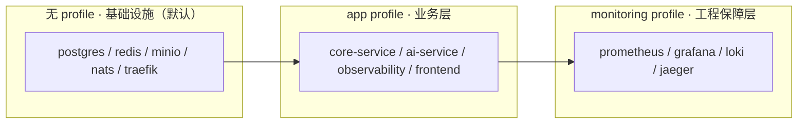

三种典型启动方式与适用场景：

| 命令 | 启动内容 | 适用场景 |
|---|---|---|
| `docker compose up -d` | 仅基础设施 | 只跑后端开发、测试数据层 |
| `docker compose --profile app up -d` | 基础设施 + 应用 | 日常教学使用（默认生产形态） |
| `docker compose --profile app --profile monitoring up -d` | 全栈 | 演示、验收、排障场景 |

**评审视角**：三 profile 的本质是把"架构分层"落实为"部署分层"——评审老师可以分阶段启动系统，亲眼验证每一层独立可用，这正是"云原生"在工程上的直接体现。

---

## 2. 服务职责与边界

### 2.1 Core Service（评测事实中心）

Core Service 使用 Go 实现，是评测主链路的事实产生者。它的定位是**确定性、可审计、高性能**。主要职责：

- **身份与教学域**：用户、课程、实验、提交、报告、班级、进度接口；
- **评测主链路**：多语言编译、沙箱调度、双轨观测、断言评测、确定性评分；
- **观测语义建模**：`ObsContext` 三层构建、事件关联、风险识别、教学叙事；
- **事件发布**：`submission.created` / `evaluation.completed` / `diagnosis.completed`；
- **静态审计**：AST 解析、CFG 构建、CWE 模式检测、资源配平审计。

内部模块结构：

```text
services/core-service/
├── cmd/server/            # 服务入口
├── internal/
│   ├── config/            # 配置加载
│   ├── evaluator/         # 评测流水线（编译/运行/断言/评分/并发）
│   ├── sandbox/           # 沙箱抽象（NsJail/Docker/Local）
│   ├── ebpf/              # eBPF loader + 适配器
│   ├── services/          # ObsContext/语义引擎/事件关联/风险/叙事
│   ├── ast/               # C 语言静态审计（AST/CFG/CWE）
│   ├── adaptive/          # 自适应学习
│   ├── handler/           # HTTP 处理器（含 teacher 子模块）
│   ├── repository/        # 数据访问层
│   ├── nats/              # 事件总线客户端
│   ├── middleware/        # 认证/中间件
│   ├── model/             # 数据模型
│   └── ws/                # WebSocket 推送
```

Core Service 内部每个模块的职责与关键技术点：

| 模块 | 职责 | 关键技术点 |
|---|---|---|
| `evaluator` | 评测流水线编排（约 30 个文件） | WorkerPool、策略模式、并发测试用例、内存布局采集、trace 解析 |
| `sandbox` | 沙箱抽象与三后端实现 | SandboxManager 接口、沙箱池、NsJail/Docker/Local |
| `ebpf` | eBPF 加载器与评测适配 | GlobalLoaderV2、HASH_OF_MAPS、PID 注入 |
| `services` | 观测语义建模 | ObsContext 三层、事件关联、风险识别、教学叙事 |
| `ast` | C 静态审计 | AST 解析、CFG 构建、CWE 检测 |
| `nats` | 事件总线 | NatsBus/LogBus 双实现、JetStream 持久化 |
| `ws` | WebSocket | 提交状态实时推送、性能指标流 |

**为什么 Core 用 Go？** 评测引擎需要：毫秒级沙箱调度、高并发 goroutine 池、与 Linux 内核交互（eBPF、/proc、ptrace）、单一静态二进制部署。Go 的并发原语（channel、goroutine、context）与系统编程能力（syscall、os/exec）恰好覆盖全部需求，同时静态编译避免了 Python 解释器的启动开销。

### 2.2 AI Service（教学智能中心）

AI Service 使用 Python FastAPI 实现，职责集中在教学智能能力，定位是**异步、证据锚定、可治理**：

- **诊断消费**：订阅 `evaluation.completed`，执行多 Agent 诊断 Harness；
- **专项 Agent**：CodeAnalyzer / TestEvaluator / SyscallAnalyzer / ResourceAnalyzer / ConceptRubric；
- **报告聚合**：ReportGenerator 四级渐进反馈 + EvaluationGuard 治理；
- **学生问答**：Teaching Assistant 单 Agent + 输入/输出 Guardrails；
- **RAG 检索**：pgvector + BM25 + RRF + reranker 混合检索；
- **知识入库**：30+ 格式解析、chunk、embedding、审批流、版本化；
- **记忆系统**：L0 工作 / L1 短期 / L2 学生画像 / L3 长期记忆。

AI Service 的模块结构：

```text
services/ai-service/app/
├── main.py                 # FastAPI 入口 + NATS 订阅器
├── agents/                 # 智能体层
│   ├── teaching_assistant.py   # 教学助手主 Agent
│   ├── rag_agent.py            # RAG 检索 Agent
│   ├── diagnosis_tutor.py      # 诊断讲解 Agent
│   ├── code_auditor.py         # 代码审计 Agent
│   ├── guardrails.py           # 输入/输出护栏
│   ├── context_builder.py      # 上下文工程
│   ├── memory.py               # 四级记忆系统
│   ├── observability.py        # 观测数据接入
│   └── tool_sandbox.py         # 工具沙箱
├── diagnosis/              # 诊断 Harness
│   ├── orchestrator.py         # 多 Agent 编排
│   ├── context_package.py      # ContextPackage 组装
│   ├── agents/                 # 5 个专项 Agent
│   ├── deterministic.py        # 确定性诊断（非 LLM）
│   ├── evaluation_guard.py     # 评测护栏
│   ├── governance.py           # 治理层
│   ├── fallback.py             # 降级链
│   └── error_kb.py             # 错误知识库
└── routers/                # 21+ 路由模块
    ├── diagnosis.py            # 诊断报告
    ├── chat.py                 # 对话
    ├── ask_router.py           # 问答
    ├── adaptive.py             # 自适应学习
    └── ...                     # 更多专项路由
```

**为什么 AI 用 Python？** 大模型生态（transformers、sentence-transformers、langchain 生态、nats-py）几乎全部以 Python 为第一语言。AI Service 不接触内核与沙箱，不需要 Go 的系统编程能力，而 Python 的生态厚度可以让团队在数周内完成多 Agent、RAG、记忆系统等能力建设。**技术栈的边界选择本身就是架构决策的一部分**。

### 2.3 Observability Service（观测读侧）

Observability Service 是独立的读侧服务，从 TimescaleDB 读取运行轨迹与资源数据，对外暴露 REST API：

- `GET /api/obs/traces/:submission_id`：系统调用轨迹查询；
- `GET /api/obs/metrics/:submission_id`：性能指标查询；
- `GET /api/obs/resources/:submission_id`：资源用量查询；
- `GET /api/obs/analysis/memory-layout/:submission_id`：内存布局分析。

其内部结构：

```text
services/observability/
├── cmd/server/main.go         # Gin 服务入口（含 CORS、健康检查）
└── internal/
    ├── config/                # 配置
    ├── handler/               # trace / memory / analysis 三个 handler
    ├── repository/            # TimescaleRepo（pgx 连接池）
    ├── collector/             # 特征提取与解析
    └── model/                 # 数据模型
```

**读侧服务独立的好处**：评测主链路（写侧）不被前端大量查询拖慢；观测查询可独立扩容、独立限流。详见第 11 章 ADR-004。

### 2.4 Frontend（双端交互入口）

Frontend 使用 Next.js 14 App Router + TypeScript，提供学生端、教师端、管理员端和观测工作台。它不是一个单纯的 CRUD 页面，而是将评分、trace、事件、资源和 AI 反馈组织为多层视图（详见文档 08）。

```text
frontend/
├── app/
│   ├── (dashboard)/           # 教师仪表盘（courses 等）
│   ├── student/               # 学生实验区
│   ├── teacher/               # 教师管理区
│   ├── admin/                 # 管理端
│   ├── experiments/           # 实验与可视化工作台
│   ├── knowledge/             # 知识库
│   ├── rag/                   # RAG 资源
│   ├── progress/              # 学习进度
│   ├── submissions/           # 提交历史
│   └── settings/              # 设置
├── components/                # 组件库（workspace 等）
├── hooks/                     # useEChart 等可视化 hooks
└── lib/                       # setup-echarts 等基础设施
```

### 2.5 服务依赖全景图

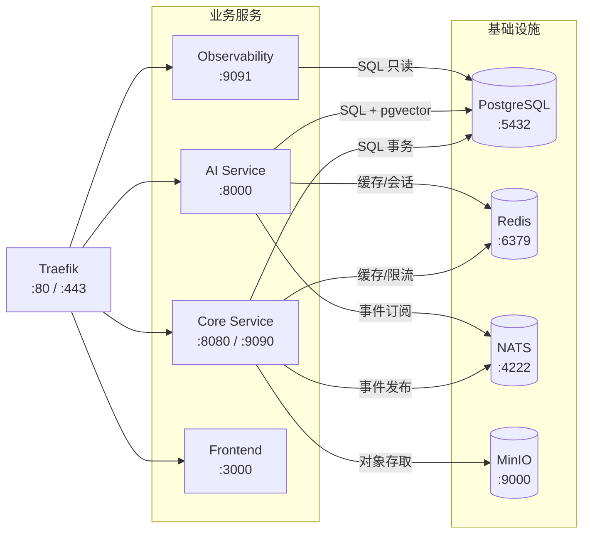

### 2.6 服务间契约矩阵

| 交互对 | 通道 | 契约 | 方向 |
|---|---|---|---|
| Frontend → Core | HTTP REST / WebSocket | OpenAPI 路由 + JWT | 同步请求/推送 |
| Frontend → AI | HTTP REST / SSE | FastAPI 路由 | 同步/流式 |
| Frontend → Observability | HTTP REST | `/api/obs/*` | 同步查询 |
| Core → AI | NATS JetStream | `evaluation.completed` 事件结构 | 异步事件 |
| Core → Observability | PostgreSQL（共享写入） | TimescaleDB schema | 数据落库 |
| AI → Core | HTTP（`core_client`） | v1 proxy 接口 | 回查事实 |
| 全部服务 → Prometheus | `/metrics` 拉取 | Prometheus 数据模型 | 指标暴露 |

这张矩阵是本架构“契约清晰”的直接证据：**任何两个组件之间的交互，都能在代码里找到对应的契约定义**——要么是事件结构体，要么是路由表，要么是 schema。

### 2.7 AI 诊断 Harness 的架构视图

AI 服务订阅 `evaluation.completed` 之后的处理管线（详细设计见文档 09，此处给出架构级视图）：

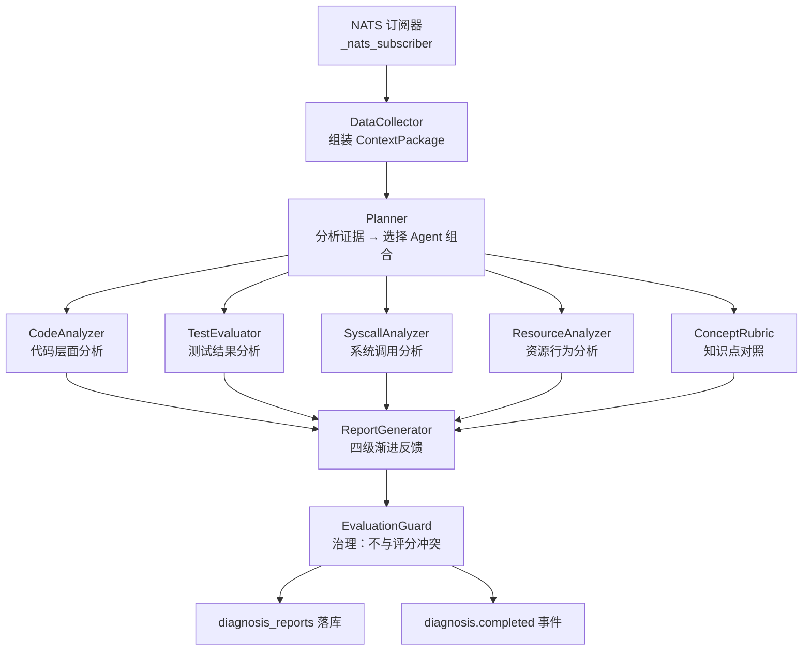

Harness 的关键架构约束（与评测主链路的红线关系）：

| 约束 | 实现 | 架构意义 |
|---|---|---|
| 诊断不能改评分 | EvaluationGuard 拦截一切“改分”输出 | 评分唯一真值在 Core |
| 诊断必须引用证据 | Agent 输出必须锚定事件载荷中的事实 | 可解释、可验证 |
| 诊断必须可降级 | LLM → 规则引擎 → 模板三级降级 | AI 故障不损失基本反馈 |
| 诊断必须幂等 | 按 submission_id 更新而非插入 | 事件重投安全 |

### 2.8 前端的数据获取架构

前端（Next.js 14）与三个后端服务的协作方式：

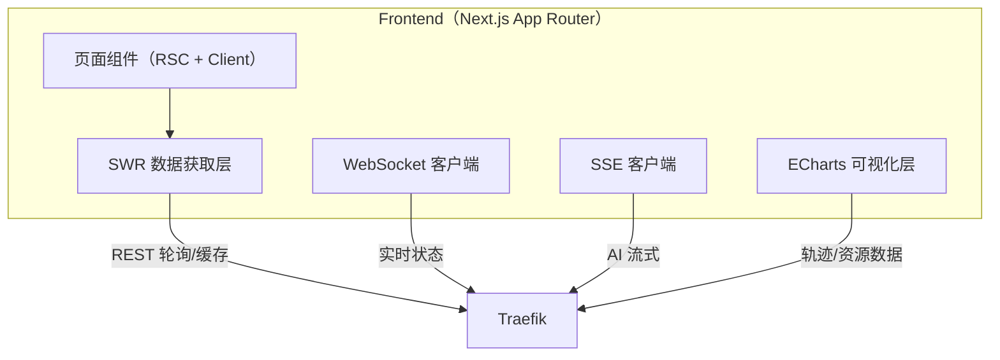

| 数据 | 获取方式 | 刷新策略 |
|---|---|---|
| 提交评分 | REST + SWR 缓存 | 状态变化时重验证 |
| 提交状态流转 | WebSocket 推送 | 事件驱动，零轮询 |
| AI 诊断 | REST + 状态轮询 | 诊断完成事件触发刷新 |
| AI 对话 | SSE 流式 | token 级增量渲染 |
| 轨迹/资源/内存布局 | REST（Observability） | 交互时按需拉取 |
| 实时性能指标 | WebSocket | 高频推送（限流） |

**架构判断**：前端从不直连基础设施（数据库、NATS），所有数据通过三个服务的公开 API 获得——这与第 1.5 节的分层约束完全一致，也让前端可以在不感知任何后端实现细节的情况下独立演进。

---

## 3. 评测全链路：一条提交的生命周期

### 3.1 主流程总览

```mermaid
flowchart LR
    A["POST Submission"] --> B["WorkerPool 入队<br/>4 worker + 100 队列"]
    B --> C["Get Experiment"]
    C --> D["Get Strategy<br/>按实验类别差异化"]
    D --> E["Compile<br/>多语言"]
    E -->|"失败"| F["compile_error<br/>结构化错误"]
    E -->|"成功"| G["Acquire Sandbox<br/>沙箱池"]
    G --> H{"eBPF available?"}
    H -->|"yes"| I["RunWithEBPF<br/>内核级观测"]
    H -->|"no"| J["Nsjail + strace<br/>降级观测"]
    I --> K["Trace Records<br/>四类事件"]
    J --> K
    K --> L["Behavior Metrics<br/>FD/僵尸/死锁"]
    L --> M["Evaluate Assertions<br/>五类断言 AND"]
    M --> N["NewScore<br/>加权 + core 门槛"]
    N --> O["Update Submission<br/>落库"]
    O --> P["Build ObsContext<br/>三层语义"]
    P --> Q["publish evaluation.completed"]
    Q --> R["AI Diagnosis<br/>异步消费"]
    R --> S["Frontend Report<br/>评分+诊断+可视化"]
```

### 3.2 提交状态的完整状态机

学生提交之后，一条 submission 会经历严格定义的状态迁移。每个状态都是可查询、可审计的：

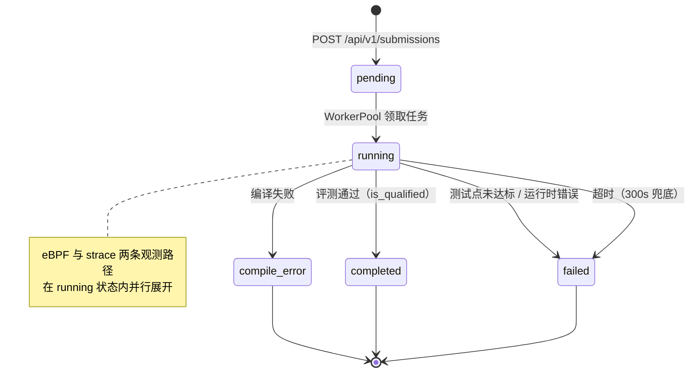

| 状态 | 含义 | 触发条件 | 可恢复 |
|---|---|---|---|
| `pending` | 已入队，等待 worker | 提交成功 | — |
| `running` | 评测进行中 | Worker 领取 | — |
| `completed` | 通过评测 | `is_qualified = true` | 重新提交 |
| `failed` | 未通过评测 | 断言未过 / 运行时错误 / 超时 | 重新提交 |
| `compile_error` | 编译失败 | 编译器返回非零 | 修改代码 |

**审计视角**：状态机让"学生的每次提交发生了什么"完全可追溯。教师在仪表盘上看到的不是孤立的分数，而是完整的状态轨迹——这正是 P5（可审计性内建）在评测域的实现。

### 3.3 Pipeline.Run 的核心编排

`Pipeline.Run(ctx, submissionID, experimentID, studentID)` 将整个过程编排在一个可追踪的执行单元中。核心编排逻辑（基于源码 `internal/evaluator/pipeline.go` 归纳）：

```go
func (p *Pipeline) Run(ctx context.Context, submissionID, experimentID, studentID string) error {
    // 1. 取实验与提交，按类别选择策略
    experiment := p.expRepo.Get(experimentID)
    submission := p.subRepo.Get(submissionID)
    strategy := p.GetStrategy(experiment.Category)

    // 2. 无测试用例时走仅编译评估
    if len(testCases) == 0 {
        return p.evaluateWithoutTests(ctx, ...)
    }

    // 3. 状态置 running
    p.updateStatus(submissionID, "running")

    // 4. 编译
    compileResult := p.compiler.Compile(ctx, code, lang, strategy.ExtraFlags())
    if compileResult.Error != nil {
        return p.fail(submissionID, "compile_error", compileResult.Error)
    }

    // 5. 并发：空模板检测（后台）+ 测试用例执行
    go func() { emptyCh <- p.runBinaryForOutput(emptyTemplate) }()  // 隐藏延迟
    var results []TestResult
    if p.ebpfAdapter != nil && p.ebpfAdapter.IsAvailable() {
        results = p.runTestCasesEBPF(...)   // eBPF 主观测
    } else {
        results = p.runner.RunAll(...)       // strace 降级
    }

    // 6. 空模板比对防作弊
    if p.isEmptyTemplateMatch(results, <-emptyCh) {
        return p.markAllFailed(submissionID)
    }

    // 7. 采集内存布局 + 轨迹 + 资源用量
    p.collectAndStoreMemoryLayouts(...)
    p.collectAndStoreTraces(...)
    p.collectAndStoreResourceUsage(...)

    // 8. 语义摘要 + ObsContext
    summary := p.analyzeTraces(...)
    obsCtx := p.obsContextBuilder.Build(...)

    // 9. 断言评测 + 评分
    for _, tc := range testCases {
        doc := ParseAssertions(tc.ExpectedOutput)
        eval := EvaluateAssertions(doc, ...)
        results = append(results, eval)
    }
    score := NewScore(results)

    // 10. 落库 + 发事件
    p.UpdateResultV2(...)
    p.publishCompletedV2(...)   // 携带 ObsContext + StraceSummary + EBPFMetrics

    return nil
}
```

### 3.4 编译阶段：多语言工具链

编译是多语言评测的第一道闸门。`Compiler.Compile` 依据语言与实验策略选择工具链：

| 语言 | 工具链 | 策略注入的编译参数示例 |
|---|---|---|
| C | gcc | 默认（可加 `-g` 保留调试符号供 addr2line） |
| C++ | g++ | 默认 |
| Python | 无需编译（解释执行） | — |
| 其他 | 按模板配置 | 策略模式可扩展 |

`gFlagStrategy` 装饰器是编译阶段的一个精巧设计：它保证所有策略的编译参数中**必然包含 `-g`**。为什么？因为评测后续的 `addr2line`（源码行定位）依赖调试符号把指令地址映射回源代码行——这是"系统调用 → 源代码行"教学诊断的技术前提。

```go
// ensureGFlag 保证 -g 存在（strategy.go 节选）
func ensureGFlag(flags []string) []string {
    for _, f := range flags {
        if f == "-g" {
            return flags
        }
    }
    return append(flags, "-g")
}
```

### 3.5 执行阶段：策略驱动的差异化

`GetStrategy(experiment.Category)` 为六类实验（process/thread/memory/fs/scheduler/deadlock）选择专属策略。策略接口的完整契约：

```go
type ExperimentStrategy interface {
    SeccompProfile() string      // seccomp 白名单选择
    SandboxLevel() int           // 1/2/3 安全等级
    SandboxBackend() string      // nsjail / docker
    MemoryLimit() int64          // 内存上限
    TimeLimit() int              // 执行时限
    CompileFlags() []string      // 编译参数
    OutputWeight() float64       // 输出分权重
    StructureWeight() float64    // 结构分权重
    BehaviorWeight() float64     // 行为分权重
    CompareMode() string         // 输出比较模式
    RerunCount() int             // 重跑次数
    DisableTrace() bool          // 是否关闭观测
    ExitCodeRequired() int       // 要求的退出码
    ExpectedSyscalls() []string  // 必须出现的系统调用
    ForbiddenSyscalls() []string // 禁止出现的系统调用
}
```

六类实验的策略差异全景表：

| 实验类别 | 沙箱等级 | seccomp | 内存 | 时限 | 期望系统调用 | 禁止系统调用 | 备注 |
|---|---|---|---|---|---|---|---|
| process | 1 | process-lab | 256MB | 30s | clone, wait4, write | system | 进程族实验 |
| thread | 2 | thread-lab | 128MB | 30s | clone, futex, write | — | 线程同步实验 |
| memory | 2 | memory-lab | 512MB | 120s | brk, munmap, write | — | 内存实验时间最长 |
| fs | 1 | fs-lab | 256MB | 60s | openat, read, write, close | — | 文件实验走 Docker 后端 |
| scheduler | 3 | scheduler-lab | 64MB | 60s | write | system, execve | 调度实验最严格 |
| deadlock | 3 | deadlock-lab | 64MB | 60s | clone, futex, write | — | 死锁实验 |

**策略模式的价值**：新增一类实验（比如"网络协议实验"）时，只需要新增一个 Strategy 实现类 + 一份 seccomp profile + 一批测试用例，评测主链路一行代码都不用改。这是"开闭原则"在评测引擎中的直接体现。

### 3.6 关键工程细节一：空模板检测的并发隐藏

学生可能提交"原封不动的空模板"来骗取分数。检测方法是：**把学生代码中 `CODE START / CODE END` 标记之间的内容全部清空，得到"空模板代码"，编译运行它，与学生实际输出比对**。

但空模板的编译+运行有秒级延迟，如果串行执行会拖慢评测。Pipeline 的做法是**并发隐藏**：

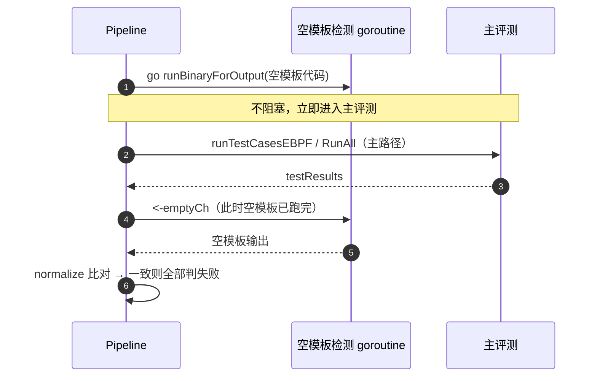

```go
// 空模板检测与主评测并发（pipeline.go 节选）
emptyTemplateSource := generateEmptyTemplateCode(sub.Code)
if emptyTemplateSource != sub.Code {   // 只有代码确实有填充才需要检测
    emptyCh = make(chan emptyTemplateOutcome, 1)
    go func() {
        out, e := p.runBinaryForOutput(ctx, emptyTemplateSource, sub.Language, strategy)
        emptyCh <- emptyTemplateOutcome{output: out, err: e}
    }()
}
// ... 主评测照常执行 ...
if emptyCh != nil {
    et := <-emptyCh
    if normalizeOutputForComparison(studentOutput) == normalizeOutputForComparison(et.output) {
        for i := range testResults { testResults[i].Passed = false }  // 防作弊兜底
    }
}
```

`normalizeOutputForComparison` 把空格、制表符、换行全部去除后比较，防止学生用"输出里加几个空格"绕过比对。

### 3.7 关键工程细节二：eBPF 优先 + strace 降级的运行时选择

```go
if p.ebpfAdapter != nil && p.ebpfAdapter.IsAvailable() {
    traceRecords, testResults, err = p.runTestCasesEBPF(...)  // eBPF 主观测
} else {
    testResults, err = p.runner.RunAll(...)                    // strace 降级
}
```

`IsAvailable()` 的判断链路：

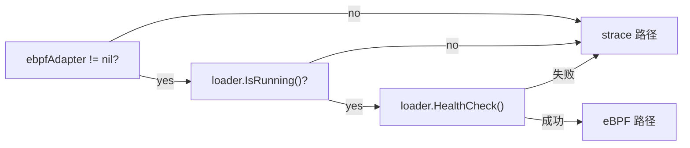

健康检查是**运行时能力探测**，而非部署时一次性判断——即使服务启动时 eBPF 正常，运行中途内核态加载器异常（如 map 损坏），系统也会自动切回 strace，保证评测不中断。

### 3.8 关键工程细节三：detached context 防状态丢失

评测主 goroutine 可能因为超时被 context 取消。如果此时 DB 写入也使用同一个 context，就会发生"评分算完了，但状态没落库"的灾难。TraceOS Lab 的解法是 **detached context**：

```go
func (p *Pipeline) updateStatus(ctx context.Context, submissionID, status string, compileErr, runtimeErr *string) {
    // detached context：脱离父 context 的生命周期，独立 30s 超时
    detachedCtx, cancel := context.WithTimeout(context.Background(), 30*time.Second)
    defer cancel()
    if err := p.subRepo.UpdateResult(detachedCtx, submissionID, status, ...); err != nil {
        log.Printf("[Pipeline] failed to update submission %s: %v", submissionID, err)
    }
}
```

同样的模式用于 trace 落库（`context.WithTimeout(context.Background(), 30*time.Second)`）和评分落库（15s）。**状态持久化永远不受执行超时影响**——这是"可审计性"在极端情况下的最后保障。

### 3.9 采集阶段：三类数据的来源与去向

| 数据 | 来源 | 采集方式 | 存储 |
|---|---|---|---|
| 系统调用轨迹 | eBPF ring buffer / strace 日志 | 解析 → 结构化 → 批量插入 | `syscall_traces`（TimescaleDB） |
| 内存布局快照 | strace 内存事件（brk/mmap/munmap/mprotect） | 增量推导六段布局 | `memory_layouts`（JSONB） |
| 资源用量 | 测试结果 + trace 分析 | FD/线程/IO/CPU/内存推导 | `resource_usage`（TimescaleDB） |
| 行为指标 | trace 统计 | FD 泄漏、僵尸进程、内存配平 | 事件载荷 + 评分输入 |

内存布局采集是其中一个有代表性的工程细节——**沙箱内的进程 PID 对宿主机不可见**（PID 命名空间），所以无法直接读 `/proc/<pid>/maps`。工程解法是：从 strace 的 mmap/brk 事件**增量重放**内存布局演化，在用户态重建出 text/data/bss/heap/stack 六段的内存布局快照（详见文档 08 的可视化部分）。

### 3.10 评分阶段：确定性的最后防线

评分采用 v2 断言模型（详见文档 06）：每个测试点是一个断言文档，五类断言（输出、退出码、系统调用、行为指标、结构模式）**逻辑与（AND）** 关系全部满足才通过；评分由 `NewScore` 加权合成，并区分 `CoreScore`（核心要求）与 `EdgeScore`（边界加分），`is_qualified` 由 core 门槛决定。

**评分全程不经过任何大模型**。评分输入是：测试点结果、系统调用 map、行为指标——全部是确定性数据；评分输出是：分数、通过数、断言明细——全部可复算。

### 3.11 事件载荷：一次评测的全部证据

评测完成后发布的 `evaluation.completed` 事件，是整个系统最重的数据契约。它携带：

```go
type EvaluationCompletedEvent struct {
    SubmissionID  string            // 提交 ID
    Score         int               // 总分
    CoreScore     int               // 核心分
    EdgeScore     int               // 边界分
    IsQualified   bool              // 是否通过门槛
    TestPoints    []TestPointData   // 每个测试点的断言明细
    StraceSummary *StraceSummaryData // 语义摘要（syscall 统计 + 模式）
    ObsContextJSON json.RawMessage  // 三层观测上下文
    EBPFMetrics   *EBPFMetricsData  // 内核观测事实（FD 泄漏/内存配平/僵尸/死锁）
    TestResults   []TestResultData  // 逐用例结果
}
```

**事件载荷设计哲学**：AI 诊断所需的一切证据都在事件里，AI 不需要回查 Core 的任何中间状态——这保证了两点：其一，诊断可以完全离线重放（拿历史事件就能复现诊断）；其二，Core 与 AI 之间没有第二个隐性耦合点。

### 3.12 全链路时序全景

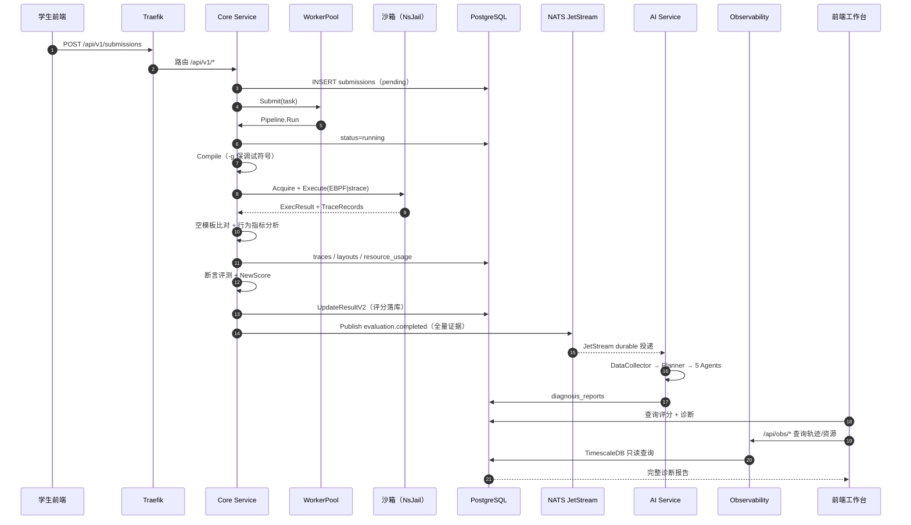

**时间账**：学生点击提交 → 1 秒内看到评分（确定性评测同步完成）→ 数十秒后看到 AI 诊断报告（异步追加）。两个时间点之间用户可以做任何事，无需等待。

### 3.13 strace 轨迹解析管线：从文本到结构化证据

strace 路径下，原始输出是一行行文本。把它变成可评分、可入库、可喂给 AI 的结构化记录，经历了三层解析：

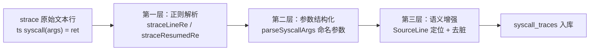

**第一层：两套正则覆盖正常行与续行**

strace 输出有两个难点：阻塞调用（wait4、futex、read）会拆成“开始行 + `<... resumed>` 续行”，不带续行正则的话，这些最关键的阻塞系统调用会**完全消失**在评分视野里。

```go
// pipeline.go —— 两条正则各管一种行形态
var straceLineRe = regexp.MustCompile(
    `^(?:(\d+)\s+)?\d{2}:\d{2}:\d{2}\.\d+\s+(\w+)\(([^)]*)\)\s*=\s*(-?\d+|\?)\s*(?:<([\d.]+)>)?\s*(E\w+)?`)

var straceResumedRe = regexp.MustCompile(
    `^(?:(\d+)\s+)?\d{2}:\d{2}:\d{2}\.\d+\s+<\.\.\.\s+(\w+)\s+resumed>(.*)$`)
```

**第二层：参数命名**。`syscallArgNames` 表为 40+ 个常用系统调用定义了参数名（如 `mmap → {addr, len, prot, flags, fd, offset}`），解析后参数从“位置串”变成“命名键值对”，供断言评测（“mmap 的 prot 包含 PROT_WRITE 吗？”）与 AI 分析使用。

**第三层：两个去脏动作**：

1. **跳过 harness 自己的 execve**：strace 记录的第一条系统调用永远是启动学生二进制的那次 `execve`——它是评测框架的动作，不是学生程序的系统调用。若不算清楚，syscall 断言（“必须出现 clone 至少一次”）会被污染；
2. **SourceLine 定位**：借助 `strace -k` 的调用栈与 `-g` 编译保留的调试符号，通过 `addr2line` 把系统调用映射回**源代码行号**，让“第 17 行的 mmap 调用”成为可教学的证据（详见文档 08）。

### 3.14 eBPF 采集管线的架构位置

eBPF 路径在架构上的差异（内核实现详见文档 04）：

| 维度 | strace 路径 | eBPF 路径 |
|---|---|---|
| 观测位置 | 用户态 ptrace 拦截 | 内核态 tracepoint/kprobe |
| 采集结构 | 事后解析文本 | 事件即结构（ring buffer） |
| 沙箱包装 | strace 包装执行 | 裸二进制执行 + PID 注入 |
| 时序精度 | 微秒级（文本解析） | 纳秒级（内核时间戳） |
| 附加数据 | 调用栈（-k） | 调用栈 + CPU/进程信息 |
| 适用条件 | 全环境可用 | 需内核支持 + 特权 |

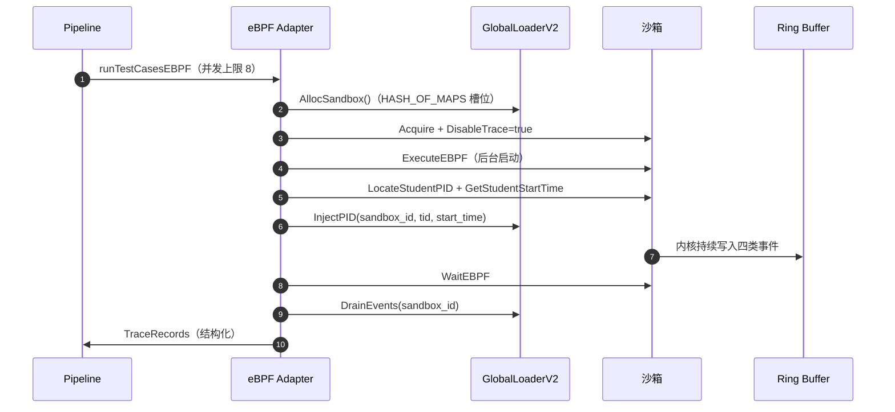

### 3.15 评测链路的公平性设计（架构视角）

| 公平性维度 | 机制 | 架构位置 |
|---|---|---|
| 环境公平 | 统一沙箱镜像 + 统一资源上限 | sandbox 层 |
| 时间公平 | 统一时间片（策略 TimeLimit） | strategy 层 |
| 评判公平 | 确定性断言，无人工介入 | evaluator 层 |
| 信息公平 | 公开/隐藏测试用例分离 | test_cases 设计 |
| 防作弊 | 空模板检测 + 禁止 syscall 检测 | pipeline 层 |

“防作弊”在架构上的实现是**双保险**：空模板比对（输出维度）+ `ForbiddenSyscalls`（行为维度，如 process 实验禁止 `system()`，scheduler 实验禁止 `execve`）。学生既不能交空壳代码，也不能用“作弊函数”绕过实验目标。

---

## 4. 事件驱动架构深入

### 4.1 为什么事件驱动而不是同步调用

评测完成后的 AI 诊断，如果同步调用会有三个问题：

| 问题 | 同步调用的后果 | 事件驱动的解法 |
|---|---|---|
| 延迟耦合 | 学生要等 AI 推理 30~60s 才看到分数 | 评分先行返回，诊断异步追加 |
| 故障耦合 | AI 服务宕机 → 评测主链路全部阻塞 | AI 故障只影响诊断，不影响评分 |
| 弹性耦合 | 评测流量洪峰直接冲击 AI 服务 | JetStream 队列削峰，AI 按自身能力消费 |

NATS JetStream 是事件总线的技术底座。JetStream 相比普通 NATS 核心的差异：

| 能力 | 普通 NATS | JetStream | 对 TraceOS 的意义 |
|---|---|---|---|
| 持久化 | 无（内存消息） | 文件持久化 | 事件不因重启丢失 |
| 重放 | 无 | 按序列重放 | 诊断可离线补跑 |
| 队列语义 | 发布订阅 | WorkQueue | 多实例 AI 服务自动负载均衡 |
| 保留策略 | — | MaxAge/策略 | 24 小时保留，演示与排障够用 |

### 4.2 JetStream 流配置与客户端实现

```go
// nats/client.go —— NatsBus 连接的完整语义
nc, err := natstype.Connect(url,
    natstype.RetryOnFailedConnect(true),   // 连接失败持续重试
    natstype.MaxReconnects(-1),            // 无限重连
    natstype.ReconnectWait(2*time.Second), // 重连间隔
    natstype.DisconnectErrHandler(...),    // 断连回调
    natstype.ReconnectHandler(...),        // 重连回调
)

// 创建/更新流（幂等）
_, err = js.UpdateStream(&natstype.StreamConfig{
    Name:      "TRACEOS",
    Subjects:  []string{"submission.created", "evaluation.completed", "diagnosis.completed"},
    Retention: natstype.WorkQueuePolicy,   // 工作队列：消费即删除
    Storage:   natstype.FileStorage,       // 文件持久化
    MaxAge:    24 * time.Hour,             // 24 小时保留
})
```

订阅端使用 **Durable + ManualAck**：

```go
_, err := b.js.Subscribe(subject, func(msg *natstype.Msg) {
    handler(msg.Data)
    msg.Ack()          // 手动 ACK：处理成功才确认
}, natstype.Durable("core-service"), natstype.ManualAck())
```

**ManualAck 的含义**：诊断消费者只有在一份诊断完整处理成功后才 ACK。如果处理中途崩溃，消息不会被确认，JetStream 会在重连后重新投递——这是 **at-least-once 投递语义** 的标准实现。

### 4.3 投递语义与幂等性设计

| 语义层 | 机制 | 保障 |
|---|---|---|
| 生产侧 | `js.Publish`（同步确认） | 事件一定进入流，或返回错误 |
| 传输侧 | JetStream 文件持久化 | 事件不因进程/节点重启丢失 |
| 消费侧 | Durable + ManualAck | 未 ACK 的消息会被重投 |
| 业务侧 | 诊断表按 submission_id 幂等更新 | 重复消费不产生重复诊断 |

消费侧的业务幂等是补全 at-least-once 语义闭环的关键一环：AI 服务消费事件后按 `submission_id` 写入诊断报告表（更新而非插入），即使同一事件被投递两次，最终也只保留一份诊断。

### 4.4 事件结构与版本演进

```go
// Subject 常量（nats/client.go）
const (
    SubjectSubmissionCreated   = "submission.created"
    SubjectEvaluationCompleted = "evaluation.completed"
    SubjectDiagnosisCompleted  = "diagnosis.completed"
)
```

三个主题的演进路径：

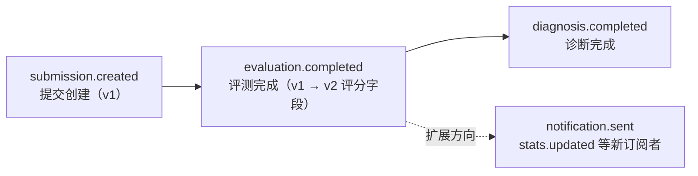

事件结构采用 **向后兼容的加法演进**：v2 评分上线时，事件结构新增 `IsQualified`、`CoreScore`、`EdgeScore`、`TestPoints`、`ObsContextJSON`、`EBPFMetrics` 等字段，而 v1 的旧字段全部保留。旧消费者（如果存在）完全不受影响。

### 4.4.1 EvaluationCompletedEvent 完整字段解析（源码级）

```go
// internal/nats/events.go —— v2 完整事件结构
// EvaluationCompletedEvent is published when evaluation finishes.
type EvaluationCompletedEvent struct {
    SubmissionID  string  `json:"submission_id"`
    ExperimentID  string  `json:"experiment_id"`
    StudentID     string  `json:"student_id"`
    Score         int     `json:"score"`
    TotalScore    int     `json:"total_score"`
    PassedCases   int     `json:"passed_cases"`
    TotalCases    int     `json:"total_cases"`
    Status        string  `json:"status"`
    CompileError  *string `json:"compile_error,omitempty"`
    RuntimeError  *string `json:"runtime_error,omitempty"`
    ExecutionTime *int    `json:"execution_time,omitempty"`

    // v2 评分字段
    IsQualified   bool                `json:"is_qualified"`
    CoreScore     int                 `json:"core_score"`
    EdgeScore     int                 `json:"edge_score"`
    TestPoints    []TestPointData     `json:"test_points,omitempty"`

    // strace 分析结果 — 供 AI 诊断
    StraceSummary *StraceSummaryData `json:"strace_summary,omitempty"`
    TestResults   []TestResultData   `json:"test_results,omitempty"`

    // 评分拆解 — 供 AI 辅助评分解释
    OutputScore    int              `json:"output_score"`
    StructureScore int              `json:"structure_score"`
    BehaviorScore  int              `json:"behavior_score"`

    // ObsContext：三层观测上下文（AI/前端消费）
    ObsContextJSON json.RawMessage `json:"obs_context,omitempty"`
    Deductions     []DeductionData  `json:"deductions,omitempty"`

    // EBPFMetrics：AI 友好的确定性观测事实（非 LLM 生成、不参与评分）
    EBPFMetrics *EBPFMetricsData `json:"ebpf_metrics,omitempty"`
}
```

事件结构的四组字段分别对应四类消费者：

| 字段组 | 消费方 | 用途 |
|---|---|---|
| 基础评分字段 | 前端 | 展示分数、状态、通过用例 |
| v2 评分字段 | 前端 + 统计 | 门槛通过、核心/边界分、断言明细 |
| 观测证据字段（StraceSummary/ObsContext/EBPFMetrics） | AI 诊断 Harness | 证据锚定分析 |
| 评分拆解字段（Output/Structure/Behavior） | AI 教学解释 | “为什么得这个分”的拆解 |

**EBPFMetrics 的特别约束**（源码注释原文语义）：*“AI-friendly deterministic summary of kernel-level observation facts, extracted from strace analysis + obs_context, never produced by AI and never used for scoring.”*——观测事实由确定性代码提炼，AI 只读不改，评分只用原始数据不用这个摘要。三层红线在此交汇。

### 4.4.2 证据子结构的语义

`StraceSummaryData` 携带五类语义证据，全部来自确定性分析而非 LLM：

```go
type StraceSummaryData struct {
    TotalSyscalls  int                `json:"total_syscalls"`   // 总调用数
    ErrorSyscalls  int                `json:"error_syscalls"`   // 出错调用数
    UniqueSyscalls int                `json:"unique_syscalls"`  // 不同调用种数
    TopSyscalls    []SyscallCountData `json:"top_syscalls"`     // 高频调用排行
    TopErrors      []SyscallErrorData `json:"top_errors"`       // 高频错误排行
    Patterns       []PatternData      `json:"patterns"`         // 行为模式（含严重度与证据）
    HumanReadable  string             `json:"human_readable"`   // 人可读摘要
    FDOpenClose    *BalanceData       `json:"fd_balance,omitempty"`    // FD 配平
    MemoryOps      *BalanceData       `json:"memory_balance,omitempty"` // 内存配平
    ProcessOps     *BalanceData       `json:"process_balance,omitempty"` // 进程配平
}
```

三个 `BalanceData`（配平数据）是这个结构的灵魂：`FDOpenClose` 记录 open/close 配平（泄漏几个 FD）、`MemoryOps` 记录分配/释放配平、`ProcessOps` 记录 fork/wait 配平（留下几个僵尸）。这些“配平”正是操作系统教学的核心概念——资源守恒。事件载荷直接以“配平与否”组织证据，AI 诊断可以零推理成本地定位“FD 泄漏”“内存泄漏”“僵尸进程”三类经典错误。

### 4.5 LogBus：NATS 不可用时的降级兜底

`EventBus` 接口有两个实现：`NatsBus`（真实总线）与 `LogBus`（日志兜底）：

```go
type EventBus interface {
    Publish(subject string, data interface{}) error
    Subscribe(subject string, handler func(data []byte)) error
    Close()
}

// LogBus：NATS 不可用时，事件退化为结构化日志
func (b *LogBus) Publish(subject string, data interface{}) error {
    jsonData, _ := json.Marshal(data)
    log.Printf("[NATS/Publish] subject=%s data=%s", subject, string(jsonData))
    return nil
}
```

**降级哲学**：事件总线的本质价值是"解耦"与"持久化"，但当它不可用时，**评测主链路绝不能停**。LogBus 让系统退化为"日志即事件"——评分照常、落库照常，只有 AI 诊断暂时不可用（可通过日志重放补救）。这是 P4（降级链完备）在事件域的落点。

### 4.6 事件驱动架构的工程收益全景

| 收益 | 说明 | 评审可验证点 |
|---|---|---|
| 独立扩容 | 评测与诊断独立扩展实例数 | 起两个 ai-service 实例，JetStream 自动负载均衡 |
| 故障隔离 | AI 诊断失败不阻塞 Core 评分 | 停掉 ai-service，评分照常 |
| 持久化重放 | JetStream 支持持久化和重新消费 | 消费失败重投、诊断补跑 |
| 开放扩展 | 新订阅者不改评测主链路 | 加一个通知订阅者，Core 零改动 |
| 降级兜底 | NatsBus → LogBus | 停掉 NATS，评分照常 |

---

## 5. 存储架构与数据分层

### 5.1 为什么“一个数据库打天下”行不通

TraceOS Lab 的数据可以按“访问模式”分成五类。它们的读写特征截然不同，强行塞进同一种存储引擎必然出现顾此失彼：

| 数据类别 | 写入特征 | 读取特征 | 若用普通关系库的代价 |
|---|---|---|---|
| 业务实体 | 低频事务写 | 点查 + 列表 | 无代价（本就应该用关系库） |
| 运行轨迹 | 单次提交上万行批量写 | 时间范围扫 + 聚合 | 表膨胀到千万行，聚合查询秒级变分钟级 |
| 观测快照 | 低频写 JSONB | 按 ID 取整块 | 无代价（JSONB 原生支持） |
| 向量知识 | 批量写入 embedding | 相似度检索（Top-K） | 关系库无向量索引，只能全表扫描 |
| 临时状态 | 极高频读写 | 微秒级延迟要求 | 关系库连接开销与锁竞争不可接受 |

**结论**：五类数据 → 五种存储引擎，各司其职。这是存储分层的根本动机。

### 5.2 存储分层全景

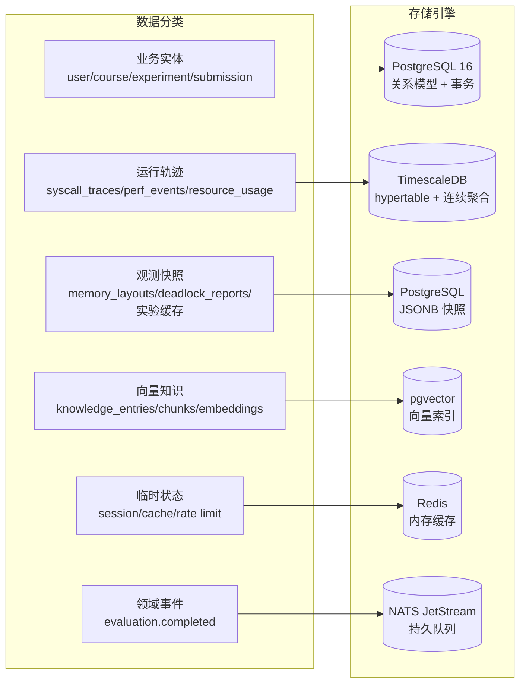

### 5.3 全部业务表清单与归属

系统共定义 40 余张表，按领域归类如下（基于 `deploy/init-db/` 全部 SQL 汇总）：

| 领域 | 表 | 数量 | 说明 |
|---|---|---|---|
| 身份与课程 | users, courses, course_enrollments, invite_codes | 4 | 教学组织域 |
| 实验域 | experiments, test_cases, experiment_rubrics, experiment_code_templates, experiment_reports, experiment_cache, experiment_variants | 7 | 实验与变体（自适应） |
| 提交与评测 | submissions, test_results, test_points（v2） | 3 | 评测主链路 |
| 运行轨迹 | syscall_traces, perf_events, resource_usage | 3 | TimescaleDB 时序 |
| 观测快照 | memory_layouts, deadlock_reports, code_audits | 3 | JSONB 快照 |
| AI 诊断 | diagnoses, diagnosis_reports, agent_results, agent_interactions, error_patterns, error_statistics, conversation_memories, long_term_memories | 8 | 诊断与记忆 |
| RAG 知识 | rag_knowledge, knowledge_entries, knowledge_chunks, knowledge_entry_versions, code_embeddings, rag_settings | 6 | 向量知识域 |
| 学习分析 | student_profiles, student_progress, adaptation_log, comments, user_preferences | 5 | 自适应与画像 |
| 审计 | audit_logs | 1 | 可审计性 |

**评审视角**：表结构本身就是“架构的证据”。每一个领域都有独立的表群、独立的演进脚本（01~27 号迁移脚本）、独立的索引策略——数据层的治理纪律与代码层一致。

### 5.4 TimescaleDB：时序数据的正确姿势

`syscall_traces` 表的数据量级：一次评测约产生 3000~10000 条系统调用记录，100 名学生各做 10 次实验即 300~1000 万行。直接建普通表，教师的学情聚合查询（“本周学生调用 clone 的次数分布”）将不可用。

TimescaleDB 的三件套解法：

| 机制 | SQL | 作用 |
|---|---|---|
| hypertable 分区 | `create_hypertable('syscall_traces', 'time')` | 按时间自动分片，写入与范围查询都走分区剪枝 |
| 连续聚合 | `CREATE MATERIALIZED VIEW ... WITH (timescaledb.continuous)` | 预计算小时级统计，聚合查询从扫全表变为查预聚合 |
| 保留策略 | `add_retention_policy(..., INTERVAL '90 days')` | 过期数据自动清理，控制磁盘增长 |

连续聚合的完整定义（`deploy/init-db/03-hypertables.sql`）：

```sql
-- 系统调用统计的每小时连续聚合
CREATE MATERIALIZED VIEW syscall_stats_1h
WITH (timescaledb.continuous) AS
SELECT time_bucket('1 hour', time) AS bucket,
       submission_id, syscall_name,
       count(*) AS call_count,
       avg(duration_ns) AS avg_duration_ns,
       sum(duration_ns) AS total_duration_ns,
       count(CASE WHEN error_code != 0 THEN 1 END) AS error_count
FROM syscall_traces
GROUP BY bucket, submission_id, syscall_name;

-- 自动刷新策略：每小时刷新，留 1 分钟缓冲
SELECT add_continuous_aggregate_policy('syscall_stats_1h',
    start_offset => INTERVAL '3 hours',
    end_offset => INTERVAL '1 minute',
    schedule_interval => INTERVAL '1 hour');

-- 90 天保留策略
SELECT add_retention_policy('syscall_traces', INTERVAL '90 days');
```

调度延迟也有独立的连续聚合（`sched_latency_stats_1m`，1 分钟粒度，针对 `sched_switch` 事件统计 avg/max/min 延迟与上下文切换次数）——这意味着**调度实验的学情分析（“谁的进程切换最频繁”）直接查询预聚合视图，毫秒级返回**。

### 5.5 索引策略：为查询模式定制

`syscall_traces` 的四类索引体现了“按查询模式反推索引”的纪律：

| 索引 | 覆盖的查询模式 |
|---|---|
| `(submission_id, time DESC)` | 工作台查看某次提交的完整轨迹时间线 |
| `(submission_id, pid, time)` | 按进程过滤某次提交内的多进程轨迹 |
| `(submission_id, syscall_name, time)` | “该提交调用了多少次 mmap”类断言查询 |
| `(submission_id, error_code) WHERE error_code != 0` | 部分索引：只查出错调用 |

最后一个是**部分索引**（partial index）的典型用法：错误调用只占全部调用的 5% 不到，为其建独立小索引，让“错误诊断”类查询走小索引而非大索引，空间与速度双赢。

### 5.6 pgvector：向量知识的存储与检索

RAG 知识库的 embedding 存储在 pgvector 扩展中（详见文档 10）：

| 表 | 内容 | 关键列 |
|---|---|---|
| `knowledge_entries` | 知识条目（文档级） | 标题、正文、版本、审批状态 |
| `knowledge_chunks` | 切块后的文本块 | chunk 文本、embedding vector |
| `code_embeddings` | 代码片段向量 | 代码、向量、语言 |
| `knowledge_entry_versions` | 版本历史 | 版本号、diff、审批流 |

选择 pgvector 而非独立向量库（Milvus/Weaviate）的理由：**教学场景的向量规模（万级条目）远未到需要专用向量库的量级**，而 pgvector 与业务数据同库，避免了“同步两套数据”的分布式一致性难题，还天然获得事务与权限治理能力。


### 5.7 Redis 的使用场景矩阵

| 场景 | 键模式 | 过期策略 | 理由 |
|---|---|---|---|
| 会话缓存 | `session:{token}` | TTL | 高频鉴权免查库 |
| 评测状态缓存 | `submission:{id}:status` | TTL | 前端轮询不压库 |
| 限流计数 | `ratelimit:{user}:{api}` | 窗口过期 | 防刷防滥用 |
| 热点实验详情 | 缓存失效后回源 |

### 5.7.1 Redis 数据结构的实际用途

Redis 不只是“缓存”，不同数据结构匹配不同场景：

| 数据结构 | 场景 | 示例 |
|---|---|---|
| String + TTL | 会话、限流计数 | `INCR ratelimit:u12:submit` + `EXPIRE 60` |
| Hash | 在线状态、评分实时表 | `HSET eval:sub123 status running` |
| List | 评测进度事件流 | 前端拉取增量进度 |
| Sorted Set | 排行榜 | 班级提交次数排行 |

**限流的 Redis 实现**（语义化示例）：

```lua
-- 提交限流：每学生每分钟最多 5 次
local n = redis.call('INCR', KEYS[1])
if n == 1 then redis.call('EXPIRE', KEYS[1], 60) end
if n > 5 then return 0 end
return 1
```

---

## 6. 可靠性与并发设计

Redis 配置本身也是经过权衡的：`maxmemory 512mb + allkeys-lru + appendonly yes`——内存上限防止 OOM，LRU 淘汰保证热数据常驻，AOF 持久化保证重启不丢会话。

### 5.8 MinIO：对象存储的角色

MinIO 承载实验附件、报告导出、知识库原始文档等对象数据。选择 MinIO 而非直接存数据库的原因：对象数据动辄 MB 级，存数据库会膨胀并拖慢备份；而 MinIO 提供 S3 兼容 API——未来上云可以直接切换到任意 S3 对象存储，**零代码改动**。

### 5.9 数据一致性总览

| 一致性场景 | 机制 | 说明 |
|---|---|---|
| 评分与轨迹 | 同库事务 | 同一 PostgreSQL，天然原子 |
| 评分与诊断 | 事件驱动 + 最终一致 | 诊断晚于评分数秒出现，UI 轮询/SSE 感知 |
| 知识条目与向量 | 同库（pgvector 扩展） | 无需跨库同步 |
| 缓存与库 | Cache-Aside + TTL | 缓存失效后回源 |

整个系统的分布式一致性设计被刻意压到最低——**只有“评分 → 诊断”一处真正的跨服务一致性**，且用事件驱动 + 幂等消费优雅化解。这是“适度服务化”的直接红利：没有分布式事务，就没有分布式事务的坑。

### 5.10 数据库迁移治理：27 个脚本的纪律

`deploy/init-db/` 目录下 27 个编号迁移脚本，按顺序执行，记录了 schema 的完整演进史：

```text
deploy/init-db/
├── 01-extensions.sql           # 扩展：timescaledb / pgvector
├── 02-schema.sql               # 核心业务表（13 张主表）
├── 03-hypertables.sql          # 时序表 + 连续聚合 + 保留策略
├── 04~08-rag.sql               # RAG 知识域
├── 10-reports.sql              # 报告域
├── 11-adaptive.sql             # 自适应域
├── 12-memory-layout.sql        # 内存布局快照
├── 12-source-line.sql          # 源代码行映射
├── 13-multilang-templates.sql  # 多语言模板
├── 14-experiment-cache.sql     # 实验缓存
├── 15-deadlock-reports.sql     # 死锁报告
├── 16-user-mgmt.sql            # 用户管理
├── 17-diagnosis-harness.sql    # 诊断 Harness
├── 18-conversation-memory.sql  # 对话记忆
├── 19-test-enrichment.sql      # 测试丰富化
├── 20-new-test-assertions.sql  # 新断言模型
├── 21/24-reference-solutions   # 参考解答
├── 22-v2-scoring-migration.sql # v2 评分迁移
├── 26-test-points.sql          # 测试点模型
└── 27-rag-metadata.sql         # RAG 元数据
```

**迁移纪律的意义**：任何一个评审老师都可以在全新环境从零重建完整数据库——schema 的全部演进过程即代码，即文档，即审计。这不是“数据库开发完了才想起来导出一份 schema”，而是**从一开始就按工程纪律管理 schema 演进**。

### 5.11 存储层的性能特性总结

| 查询场景 | 存储路径 | 预期延迟 | 关键机制 |
|---|---|---|---|
| 单次提交轨迹时间线 | syscall_traces 范围扫（分区剪枝） | < 100ms | hypertable 分区 |
| 学情聚合（小时粒度） | syscall_stats_1h 连续聚合 | < 20ms | 预计算 |
| 内存布局演变 | memory_layouts JSONB 点查 | < 50ms | 主键索引 |
| 向量相似检索（万级） | pgvector ivfflat | < 50ms | 近似最近邻 |
| 会话鉴权 | Redis 点查 | < 1ms | 内存 |
| 事件发布确认 | JetStream 同步确认 | < 10ms | 文件持久化 |

---

## 6. 可靠性与并发设计

### 6.1 三层并发控制

| 层 | 机制 | 参数 | 作用 |
|---|---|---|---|
| 评测任务层 | WorkerPool | 4 worker + 100 队列 | 控制同时评测的提交数，防资源耗尽 |
| 测试用例层 | 信号量 goroutine 池 | 并发上限 8 | 单个提交内多个测试用例并发执行 |
| 沙箱执行层 | semaphore | NsJail 上限 5（最大 20） | 控制真正占用系统资源的沙箱实例数 |

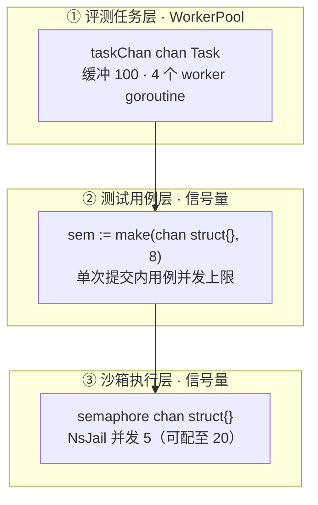

三层限流各管一种资源：

1. **WorkerPool 管 CPU 并发度**：一个评测任务 = 一次编译 + N 次沙箱执行 + 若干 DB 写。同时跑 100 个任务会把宿主机 CPU 打满，4 worker 是“吞吐与稳定”的平衡点；
2. **用例信号量管单任务内的扇出**：一个提交可能有 10 个测试用例，若全部并发会瞬间创建 10 个沙箱。信号量 8 封顶，避免单次提交“独占”全部沙箱资源；
3. **沙箱信号量管内核资源**：每个 nsjail 实例占用独立 cgroup + PID 命名空间 + 内存配额，这是最昂贵的内核级资源，必须最严格限量（5 个，可调至 20）。

### 6.2 WorkerPool 的工程细节

```go
// worker_pool.go —— 任务领取与 panic 隔离
func (wp *WorkerPool) processTask(workerID int, task Task) {
    ctx, cancel := context.WithTimeout(wp.ctx, PerTaskTimeout)  // 单任务 300s
    defer cancel()

    done := make(chan struct{})
    go func() {
        defer close(done)
        defer func() {
            if r := recover(); r != nil {
                // PANIC 也不影响状态落库
                log.Printf("[Worker-%d] PANIC: %v\nstack: %s", workerID, r, debug.Stack())
                errMsg := fmt.Sprintf("internal evaluation panic: %v", r)
                _ = wp.subRepo.UpdateResult(context.Background(), task.SubmissionID,
                    "failed", 0, 0, 0, 0, &errMsg, nil, nil, nil)
            }
        }()
        _ = wp.pipeline.Run(ctx, task.SubmissionID, task.ExperimentID, task.StudentID)
    }()

    select {
    case <-done:
        // 正常完成
    case <-ctx.Done():
        // 超时兜底：状态置 failed
        errMsg := "evaluation timeout (60s)"
        _ = wp.subRepo.UpdateResult(context.Background(), task.SubmissionID,
            "failed", 0, 0, 0, 0, &errMsg, nil, nil, nil)
    }
}
```

四个值得评审注意的细节：

1. **panic 隔离**：`defer recover()` + `debug.Stack()` 保证单个提交的崩溃只影响它自己，栈信息进日志供事后分析；
2. **超时兜底**：即使 Pipeline 内部卡死（例如某个 syscall 挂起），`ctx.Done()` 分支也会把提交置为 `failed`，学生永远不会看到“永远 running”的提交；
3. **队满拒收**：`Submit` 用非阻塞 select，队列满时**拒绝新任务并记录日志**——宁可拒绝也不要无限堆积（背压的朴素而有效的实现）；
4. **优雅停机**：`Shutdown` 先 cancel 再 `wg.Wait()`，所有在途任务完成后才退出。

### 6.3 容错设计清单（完整版）

| 故障场景 | 应对策略 | 用户可见表现 |
|---|---|---|
| Worker panic | `defer recover()` + `debug.Stack()`，标记 submission failed | 该提交失败，其余不受影响 |
| 沙箱超时 | ctx.Done() 时 `kill(-pgid, SIGKILL)` 杀整个进程组 | 提交置 timeout/failed |
| 数据库连接失败 | detached context + 重试 | 状态最终一致 |
| NATS 不可用 | LogBus 日志兜底 | 评分照常，诊断暂缺 |
| eBPF 不可用 | 能力探测 → strace → 直接执行三级降级 | 观测降级，评测照常 |
| LLM 调用失败 | FallbackChain：LLM → 规则引擎 → 模板 | 诊断降级为确定性规则诊断 |
| Embedding 服务失败 | 五级降级（API → sentence-transformers → ONNX → TF-IDF → hash） | RAG 检索降级但不中断 |
| 编译工具链缺失 | 编译错误结构化返回 | 学生看到明确的编译诊断 |
| 磁盘写满 | trace 文件清理 + 保留策略 | 轨迹数据自动过期 |

### 6.3.1 测试用例并发执行模型

单次提交的多个测试用例并发执行（上限 8）的完整模型：

```go
// pipeline.go —— runTestCasesEBPF 的并发骨架（strace 路径同理）
func (p *Pipeline) runTestCasesEBPF(ctx context.Context, submissionID, binaryPath string,
    testCases []model.TestCase, strategy ExperimentStrategy) ([]repository.SyscallTraceRecord, []TestResult, error) {
    results := make([]TestResult, len(testCases))
    tracesByIndex := make([][]repository.SyscallTraceRecord, len(testCases))

    sem := make(chan struct{}, maxParallelTests)  // 信号量：并发上限 8
    var wg sync.WaitGroup

    for i, tc := range testCases {
        wg.Add(1)
        go func(i int, tc model.TestCase) {
            defer wg.Done()
            sem <- struct{}{}        // 获取信号量
            defer func() { <-sem }() // 归还信号量

            result, err := p.ebpfAdapter.RunWithEBPF(ctx, binaryPath, ...)
            // ... 结果按索引写回，避免共享写竞争 ...
            results[i] = ...
            tracesByIndex[i] = result.TraceRecords
        }(i, tc)
    }
    wg.Wait()
    // 汇总（按序）
}
```

三个并发工程细节：

1. **按索引写回**：每个 goroutine 写 `results[i]`（自己的下标），而不是 append 到共享 slice——**零锁并发**，天然无数据竞争；
2. **信号量 + WaitGroup 双保险**：信号量限并发度，WaitGroup 保证全部完成后才汇总；
3. **ctx 透传**：取消信号贯穿到每个沙箱执行，超时后所有在途用例统一终止。

### 6.3.2 时间预算的分层设计

| 层 | 预算 | 机制 | 超出后 |
|---|---|---|---|
| 单任务（Worker） | 300s | PerTaskTimeout | 状态置 failed |
| 单用例执行 | strategy.TimeLimit（30~120s） | 沙箱 time_limit | Killed 标记 |
| 沙箱启动缓冲 | +3s（nsjail timeExtra） | 额外时间片 | 防止启动开销误杀 |
| DB 写入 | 15~30s detached | 独立 context | 日志记录，不影响主流程 |

三段时间预算彼此独立、层层包含：**内层（沙箱）最严格，外层（Worker）兜底**。即使沙箱层被绕过（理论上的 bug），Worker 层的 300s 仍能保证评测最终收敛到终态。

### 6.4 降级链：可靠性的纵深防御

可靠性不是“每个组件都可靠”，而是“每个组件的失效都有预案”。TraceOS Lab 的四条降级链：

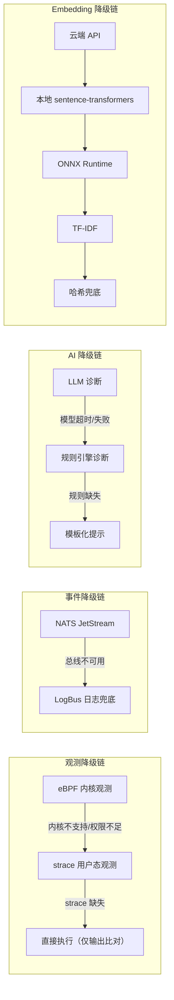

每条链的设计原则一致：**降级可以损失能力精度，但不能损失主链路可用性**。观测降级损失内核级精度，但评分照常；AI 降级损失教学深度，但学生仍能获得规则化的反馈。

---

## 7. API 与协议层

### 7.1 四协议矩阵：不同交互用不同协议

项目同时保留 HTTP、WebSocket、SSE 和 gRPC/Protobuf，形成面向不同交互场景的传输层：

| 协议 | 交互特征 | 使用场景 | 典型端点 |
|---|---|---|---|
| HTTP/REST | 请求-响应 | 提交、查询、管理、报告、RAG 资源 | `/api/v1/submissions`、`/api/v1/knowledge/*` |
| WebSocket | 双向长连 | 提交状态、实时性能指标 | `/ws/experiments/:id?token=jwt` |
| SSE | 服务端单向流 | AI 流式对话、eBPF 死锁图、诊断进度 | `/api/v1/conversations/:id/messages`、`/api/v1/ebpf/stream/:pid` |
| gRPC/Protobuf | 强类型 RPC | 服务间长期协议演进 | `core.v1.EvaluationService`、`ai.v1.DiagnosisService` |

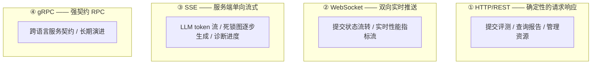

四协议并存不是“技术炫技”，而是各自匹配一种真实交互模式：**REST 匹配请求-响应、WebSocket 匹配双向推送、SSE 匹配单向流式、gRPC 匹配强契约演进**。

### 7.2 协议演进的 buf 管理

```yaml
# proto/buf.gen.yaml（节选）
version: v1
plugins:
  - name: go                 # core-service + observability
    out: gen
  - name: grpc-gateway       # REST 网关
    out: gen
  - name: python             # ai-service
    out: gen
```

Protobuf 定义三个域：

| 域 | 内容 | 服务定义示例 |
|---|---|---|
| `core.v1` | Experiment / Evaluation / Sandbox / User | `EvaluationService.SubmitEvaluation` / `StreamEvaluationProgress` |
| `ai.v1` | Agent / Diagnosis / Knowledge | 诊断、知识服务 |
| `observability.v1` | Stream / Trace | 轨迹流 |

`core.v1.EvaluationService` 的完整契约（`proto/core/v1/evaluation.proto`）：

```protobuf
service EvaluationService {
  rpc SubmitEvaluation(SubmitEvaluationRequest) returns (SubmitEvaluationResponse);
  rpc GetEvaluationResult(GetEvaluationResultRequest) returns (GetEvaluationResultResponse);
  rpc StreamEvaluationProgress(StreamEvaluationProgressRequest) returns (stream EvaluationProgress);
  rpc ListSubmissions(ListSubmissionsRequest) returns (ListSubmissionsResponse);
  rpc GetTestResults(GetTestResultsRequest) returns (GetTestResultsResponse);
}
```

**Protobuf 的战略定位**：它不是当前的默认调用路径（当前走 REST + 事件），而是**为服务间契约的长期演进预留的类型系统**。当未来服务规模增长、需要强类型约束与版本协商时，契约已经就位——这是“为演进而设计”的典型实践。

### 7.3 Traefik 路由规则全景

Traefik 的 Docker provider 通过容器 labels 声明路由，实现“服务自描述路由”：

| 路由 | 规则 | 优先级 | 目标 |
|---|---|---|---|
| core | `PathPrefix(\`/api/v1/\`)` | 默认 | core-service:8080 |
| core-ws | `PathPrefix(\`/ws/\`)` | 50 | core-service:8080 |
| ai | `PathPrefix(\`/api/ai/\`)` | 默认 | ai-service:8000 |
| ai-courses | `PathRegexp(\`^/api/v1/courses/[^/]+/(rag|knowledge|chat|ask)(/.*)?$\`)` | 200 | ai-service:8000 |
| obs | `PathPrefix(\`/api/obs/\`)` | 默认 | observability:9091 |
| frontend | `PathPrefix(\`/\`)` | 1 | frontend:3000 |

值得注意的细节：

1. **正则路由的优先级覆盖**：`ai-courses` 用 `PathRegexp` + 优先级 200，把课程下的 rag/knowledge/chat/ask 子路径**从 Core 的 `/api/v1/` 前缀路由中“截胡”**到 AI 服务——同一 URL 前缀下的精细分流，无需前端感知服务边界；
2. **前端最低优先级兜底**：`PathPrefix(\`/\`)` 优先级 1，所有未命中业务路由的请求落入前端（Next.js 页面路由），这是 SPA 路由的天然收口；
3. **WebSocket 与 HTTP 共用同一端口**：Traefik 自动处理协议升级，无需独立网关配置。

### 7.4 WebSocket 实时推送机制

评测是异步的，学生不可能一直盯着轮询。WebSocket 承担“状态流转的实时性”：

| 推送事件 | 触发时机 | 前端响应 |
|---|---|---|
| `status:running` | Worker 领取任务 | 界面进入“评测中”态 |
| `status:completed` | 评分落库 | 刷新评分卡片 |
| `status:compile_error` | 编译失败 | 展示编译错误诊断 |
| `status:failed` | 断言未过 | 展示失败明细 |
| 性能指标流 | 沙箱执行中 | 实时性能曲线 |

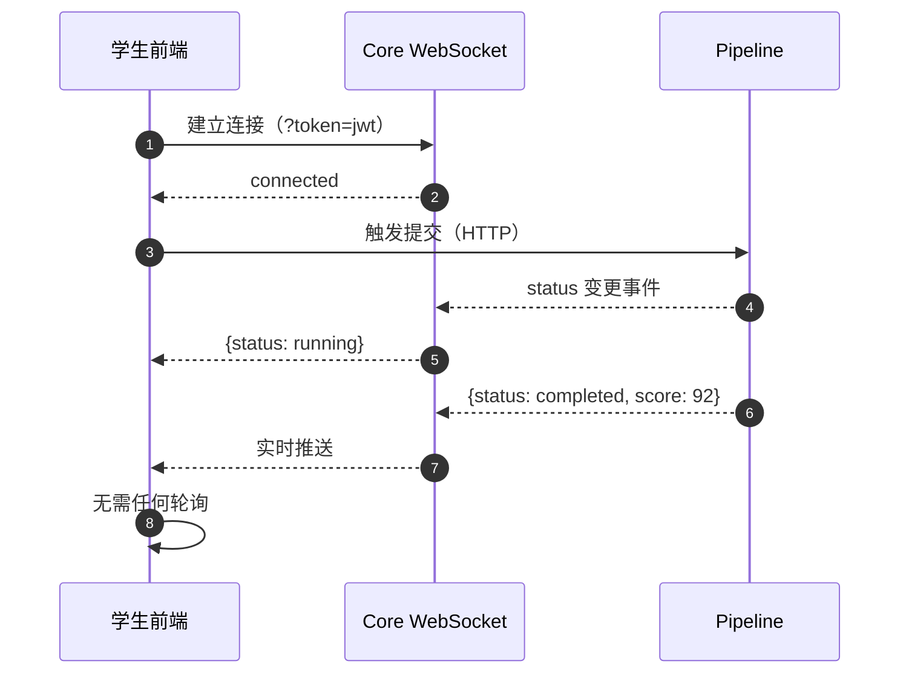

**协议选择判断**：状态流转用 WebSocket（双向、低频、事件型），AI 输出用 SSE（单向、流式、token 型）——两种长连接协议各匹配一种语义，避免“一种协议包打天下”的滥用。

### 7.5 SSE 流式协议的使用场景

SSE 用于三类单向流式场景：

| 场景 | 数据粒度 | 用户体验 |
|---|---|---|
| AI 对话回答 | token 级 | 打字机效果，首 token 延迟 < 1s |
| 死锁图逐步生成 | 节点/边级 | 图渐进出现，无白屏等待 |
| 诊断进度 | 阶段级 | “分析中 → 生成中 → 完成”可见进度 |

SSE 相比 WebSocket 的工程优势：基于 HTTP，自动支持断线重连（`Last-Event-ID`）、代理友好、无需自定义心跳协议。**协议选择的每一处都服务于具体的用户体验目标**。

---

## 8. 云原生部署模型

### 8.1 服务拓扑表（完整版）

| 服务 | 镜像 | 端口 | 关键配置 | 健康检查 |
|---|---|---|---|---|
| postgres | timescale/timescaledb:latest-pg16 | 127.0.0.1:5432 | init-db 自动挂载 | `pg_isready` 5s 间隔 |
| redis | redis:7-alpine | 127.0.0.1:6379 | maxmemory 512mb allkeys-lru + AOF | `redis-cli ping` |
| minio | minio/minio:latest | 9000/9001 | 对象存储 | `mc ready local` |
| nats | nats:2-alpine | 4222/8222 | `--jetstream` 持久化 | `/healthz` HTTP |
| traefik | traefik:latest | 80/443/8080 | Docker labels + file provider | `/api/overview` |
| core-service | traceos-lab-core-service | 8080/9090 | **privileged** + SYS_PTRACE/SYS_ADMIN/BPF/PERFMON | `/healthz` |
| ai-service | traceos-lab-ai-service | 8000 | uvicorn + LLM_PROVIDER | `/healthz` |
| observability | traceos-lab-observability | 9091 | 读侧服务 | `/healthz` |
| frontend | traceos-lab-frontend | 3000 | Next.js standalone | HTTP 200 探测 |
| prometheus | prom/prometheus | 9090 | 15d 保留 | `/-/healthy` |
| grafana | grafana/grafana | 3001 | 禁止自助注册 | `/api/health` |
| loki | grafana/loki | 3100 | 日志聚合 | — |
| jaeger | jaegertracing/all-in-one | 16686/4317/4318 | OTLP 开启 | — |

### 8.2 启动依赖编排：健康检查驱动的启动顺序

```mermaid
sequenceDiagram
    autonumber
    participant U as 用户执行 compose up
    participant D as Docker Compose
    participant PG as PostgreSQL
    participant RD as Redis
    participant NS as NATS
    participant C as Core Service
    participant A as AI Service

    U->>D: up -d
    D->>PG: 启动
    D->>RD: 启动（并行）
    D->>NS: 启动（并行）
    PG-->>D: pg_isready → healthy
    RD-->>D: ping → healthy
    NS-->>D: /healthz → healthy
    D->>C: depends_on 满足 → 启动
    D->>A: depends_on 满足 → 启动
    C-->>D: /healthz → healthy
    A-->>D: /healthz → healthy
    D-->>U: 全栈就绪
```

`depends_on: condition: service_healthy` 保证应用服务只在基础设施**真正可用**（而非“容器已启动”）后才启动。这与“容器起来了但数据库还没准备好”的经典坑直接告别。

### 8.3 Core Service 的特权配置：云原生与系统观测的结合点

```yaml
# docker-compose.yml 中 core-service 的关键权限
services:
  core-service:
    privileged: true
    cap_add:
      - SYS_PTRACE      # strace / ptrace 观测
      - SYS_ADMIN       # perf / eBPF
      - BPF             # BPF 程序加载
      - PERFMON         # 性能监控
    ulimits:
      memlock: -1       # BPF map 需要锁定内存
    volumes:
      - ./ebpf/scripts:/ebpf
      - /sys/kernel/debug:/sys/kernel/debug
```

这些权限是 eBPF 主观测与 strace 采集的技术前提。值得评审注意的工程判断：**特权被限制在最小服务范围内**——只有需要内核观测的 core-service（与 observability）获得特权，ai-service 与 frontend 零特权运行。这就是第 2 章“安全边界驱动拆分”的部署级验证：如果做成单体，全站都必须特权运行。

### 8.4 权限矩阵：最小特权原则

| 服务 | privileged | capabilities | 挂载 | 理由 |
|---|---|---|---|---|
| core-service | 是 | SYS_PTRACE, SYS_ADMIN, BPF, PERFMON | /sys/kernel/debug（只读） | eBPF + strace + perf |
| observability | 否 | SYS_ADMIN, SYS_PTRACE, BPF, PERFMON, NET_ADMIN, DAC_READ_SEARCH | docker.sock（只读） | 宿主指标采集 |
| ai-service | 否 | 无 | HF 模型缓存 | 纯应用层，零特权 |
| frontend | 否 | 无 | 无 | 纯 HTTP 服务 |
| 其他基础设施 | 否 | 各自最小 | 数据卷 | 标准配置 |

### 8.5 网络拓扑与安全暴露面

```mermaid
flowchart LR
    subgraph Host["宿主机"]
        T["Traefik :80/:443（对外）"]
        PG["PostgreSQL 127.0.0.1:5432"]
        RD["Redis 127.0.0.1:6379"]
        NS["NATS 127.0.0.1:4222"]
        MN["MinIO 127.0.0.1:9000"]
        PM["Prometheus 127.0.0.1:9090"]
    end
    Internet["外部网络"] --> T
```

**安全暴露面只有一个**：Traefik 的 80/443 端口。数据库、缓存、消息总线、对象存储、监控面板全部绑定回环地址——外部攻击者要到达数据层，必须先攻破应用层。

### 8.6 持久化卷规划

| 卷 | 承载数据 | 备份策略 |
|---|---|---|
| pgdata | 全部业务 + 时序 + 向量 | `pg_dump` 定时备份 |
| nats_data | JetStream 事件流 | 24h 自动过期，无需备份 |
| minio_data | 对象资源 | 低频同步 |
| prometheus_data | 15 天指标 | 自动滚动 |
| grafana_data / loki_data | 面板/日志 | 随监控栈重建 |

### 8.7 一键部署与验证

项目提供 `deploy-traceos.sh` 与 Makefile 双入口，评审现场可完整复现：

```bash
# 全栈部署（基础设施 + 应用 + 监控）
docker compose --profile app --profile monitoring up -d

# 验证清单
docker compose ps                      # 全部 healthy
curl http://localhost/healthz          # Core 健康检查
curl http://localhost:8000/healthz     # AI 健康检查
curl http://localhost:9091/healthz     # Observability 健康检查
```

部署验证矩阵：

| 验证项 | 命令/方法 | 通过标准 |
|---|---|---|
| 基础设施健康 | `docker compose ps` | 全 healthy |
| 路由生效 | 访问前端 + `/api/v1/*` + `/api/ai/*` + `/api/obs/*` | 各自返回正确响应 |
| 评测可用 | 提交一份示例代码 | 秒级返回评分 |
| 事件可用 | 查看 AI 诊断产生 | 数十秒后出现诊断报告 |
| 观测可用 | 打开观测工作台 | 轨迹/资源图正常渲染 |
| 监控可用 | 打开 Grafana | 面板有数据 |

---

## 9. 可观测性工程

### 9.1 三层可观测体系

| 层 | 工具 | 采集内容 | 用途 |
|---|---|---|---|
| Metrics（指标） | Prometheus + Grafana | 服务指标、容器指标、数据库指标、宿主指标 | 容量规划、告警 |
| Logs（日志） | Loki | 全服务结构化日志 | 排障、审计回溯 |
| Traces（链路） | Jaeger / OTLP | 跨服务调用链 | 慢请求定位 |

```mermaid
flowchart TB
    subgraph Apps["应用"]
        C["core-service"]
        A["ai-service"]
        O["observability"]
    end
    C -->|"/metrics 拉取"| P["Prometheus"]
    A --> P
    O --> P
    C -->|"日志推送"| L["Loki"]
    A --> L
    C -->|"OTLP spans"| J["Jaeger"]
    A --> J
    P --> G["Grafana 统一看板"]
    L --> G
    J --> G
    P -->|alert_rules.yml| AL["告警"]
```

### 9.2 Prometheus 抓取矩阵

| Job | 目标 | 内容 |
|---|---|---|
| core-service / ai-service / observability | 应用 `/metrics` | 请求量、延迟、评测吞吐 |
| postgres-exporter | 9187 | 连接数、慢查询 |
| redis-exporter | 9121 | 命中率、内存 |
| node-exporter | 9100 | 宿主 CPU/内存/磁盘 |
| docker-exporter | 9323 | 容器资源 |
| cadvisor | 8080 | 容器级 cgroup 指标 |

### 9.3 告警规则示例

```yaml
# deploy/monitoring/alert_rules.yml（语义化示例）
groups:
  - name: traceos-alerts
    rules:
      - alert: EvaluationQueueBacklog
        expr: evaluation_queue_depth > 80
        for: 5m
        annotations:
          summary: "评测队列积压超过 80"
      - alert: ServiceDown
        expr: up == 0
        for: 1m
```

**评审视角**：可观测体系不是“装了监控软件”，而是“关键业务指标都有监控定义”。评测队列深度、沙箱池水位、AI 诊断延迟这些**业务指标**与系统指标同台监控，才称得上“面向业务的可靠性工程”。

---

## 10. 安全架构

### 10.1 全链路安全纵深

| 层次 | 机制 | 对应文档 |
|---|---|---|
| 入口层 | Traefik 唯一暴露面 + JWT 认证中间件 | 本文 |
| 应用层 | 学生/教师/管理员三级角色权限 | 文档 12 |
| 评测层 | 沙箱五道防线（命名空间/seccomp/cgroup/文件系统/时间） | 文档 03 |
| 数据层 | 参数化查询、连接池、审计日志 | 本文 + 文档 14 |
| 容器层 | 最小特权矩阵、只读挂载 | 本文 8.4 |
| AI 层 | 输入/输出 Guardrails、工具沙箱 | 文档 09 |

### 10.2 审计日志

`audit_logs` 表记录关键操作：登录、提交、实验修改、权限变更。审计的工程原则：**审计写入与业务主链路解耦**（异步写），审计记录只增不改（append-only）。

### 10.3 数据安全

| 数据 | 保护措施 |
|---|---|
| 学生代码 | 仅评测沙箱可见，评测完成后清空工作目录 |
| 提交结果 | 学生只能查询自己的提交 |
| 教师数据 | 教师只能访问自己班级/课程的数据 |
| 知识库 | 审批流 + 版本化，未经审批的知识不进检索 |

---

## 11. 架构决策记录（ADR）

架构评审的本质是“决策的合理性检验”。本节以 ADR 形式记录全部关键决策及其推理过程。

### ADR-001 为什么不做一个单体服务

| 考量维度 | 拆分收益 |
|---|---|
| 安全边界 | 评测需要高权限（SYS_ADMIN/BPF），AI 不需要；拆分后 AI 服务无特权 |
| 扩容边界 | 评测是 CPU 密集，AI 是 GPU/API 依赖，观测是 IO 密集，独立扩容 |
| 故障边界 | AI 挂掉不影响评分；观测挂掉不影响评测 |
| 技术栈边界 | Go 适合评测引擎，Python 适合 AI 生态，互不牵制 |

### ADR-002 为什么评分放在 Core

评分必须**可复现、可审计、可回放**。将评分放入大模型会引入：

- 随机性（temperature 导致的评分抖动）；
- 提示词敏感性（换提示词分数就变）；
- 不可解释的判定差异（黑盒打分）。

因此 Core 负责唯一评分真值，AI 只对事实做教学解释。这是“评分与诊断职责分离”红线的架构保证。

### ADR-003 为什么使用事件而不是同步调用 AI

AI 推理耗时（数十秒）和模型服务状态不可控，不应阻塞学生提交后的确定性评测。事件驱动让“先返回分数，再异步生成诊断”成为稳定的用户体验。学生提交后 1 秒内看到分数，数十秒后看到诊断报告。

### ADR-004 为什么观测服务独立成读侧

评测主链路是写侧，前端可视化是读侧。二者速率特征完全不同：写侧是低频高权重（一次提交一次评测），读侧是高频低延迟（学生反复拖动火焰图、切换视图）。拆分成独立读侧服务，避免了读放大拖垮写链路。

### ADR-005 为什么选 NATS 而不是 Kafka/RabbitMQ

| 选项 | 优势 | 劣势 | 结论 |
|---|---|---|---|
| Kafka | 生态大、吞吐极高 | 部署重（ZK/KRaft）、单机资源开销大 | 对教学平台过重 |
| RabbitMQ | 成熟稳定 | 无原生流式语义、部署运维重 | 功能过载 |
| NATS JetStream | 单二进制、资源占用极小、原生 WorkQueue + 持久化 | 生态较小 | ✅ 吞吐与部署成本的平衡点 |

**决策依据**：教学平台的峰值吞吐（每秒几十次提交）远未到需要 Kafka 的量级，而 NATS 的部署成本（单容器、几十 MB 内存）与运维成本（零配置集群）与项目的“一键部署”目标完美契合。**合适的技术，而不是最热门的技术。**

### ADR-006 为什么选 TimescaleDB 而不是 InfluxDB/Prometheus 存轨迹

| 选项 | 问题 |
|---|---|
| InfluxDB | 强绑定自己的查询语言，与业务 SQL 割裂，多一套运维 |
| Prometheus | 面向指标（数值型），不适合存系统调用轨迹（高基数、多维度字符串） |
| TimescaleDB | PostgreSQL 扩展：复用现有 SQL 生态、JOIN 业务表、事务、权限治理，且原生支持连续聚合与保留策略 |

**决策依据**：轨迹数据需要与提交、实验、学生等业务表频繁 JOIN（例如“某学生某实验的 clone 调用次数”），TimescaleDB 是唯一能同时满足“时序性能 + 关系 JOIN + 单一运维面”的选择。

### ADR-007 为什么选 Traefik 而不是 Nginx

| 选项 | 问题 |
|---|---|
| Nginx | 静态配置为主，容器动态上下线需要额外工具（nginx-proxy 等）同步 |
| Traefik | 原生 Docker provider，容器 labels 即路由配置，服务自描述、零中心配置 |

**决策依据**：“路由配置跟随服务声明”是云原生理念的直接实践——加一个新服务只需在 compose 里写 labels，不需要修改任何中心网关配置。

### ADR-008 为什么用 pgvector 而不是独立向量库

教学场景向量规模万级，pgvector 足够；与业务数据同库避免双库同步；事务与权限治理开箱即得。详见第 5.6 节。

### ADR 决策地图

```mermaid
flowchart TB
    G1["评测必须确定性"] --> D1["ADR-002 评分在 Core"]
    G2["评分与 AI 解耦"] --> D2["ADR-003 事件驱动"]
    G2 --> D1
    G3["观测双轨可用"] --> D3["ADR-004 读侧独立"]
    G3 --> D4["观测降级链"]
    G4["平台抗故障"] --> D5["ADR-001 服务拆分"]
    G4 --> D6["ADR-005/006/007/008 基础设施选型"]
```

**这张图是本章的总结**：每一个架构决策都能回溯到第 1.1 节的四个设计目标——架构是目标与约束的必然推论，而不是技术偏好的随意堆砌。

---

## 12. 性能设计与容量分析

### 12.1 评测吞吐模型

| 参数 | 值 | 说明 |
|---|---|---|
| Worker 数 | 4 | 并发评测任务 |
| 沙箱并发 | 5（最大 20） | 并发沙箱实例 |
| 单次评测耗时 | 5~30s（视实验） | 编译 + 执行 + 评分 |
| 稳态吞吐 | ≈ 0.1~0.8 提交/秒 | 4 worker / 平均耗时 |
| 队列缓冲 | 100 | 峰值缓冲能力 |

对于教学场景（一个班级 40 人同时提交），峰值 40 个任务进入 100 容量队列，4 worker 依次消化——**队列是洪峰的缓冲带，worker 是稳定的消费速率**，这是最朴素的流量整形。

### 12.2 延迟预算

学生从点击提交到看到结果的延迟预算分解：

| 阶段 | 预算 | 说明 |
|---|---|---|
| 网络 + 网关 | < 50ms | Traefik 直转 |
| 入队等待 | 0~数秒 | 取决于队列深度 |
| 编译 | < 1s | gcc 小代码 |
| 沙箱执行 | 1~30s | 实验本身耗时 |
| 评分 + 落库 | < 500ms | 确定性计算 |
| 事件发布 | < 50ms | JetStream 同步确认 |
| **分数可见** | **执行耗时 + 1~2s** | 主要受实验本身决定 |
| AI 诊断追加 | +20~60s | 异步，不阻塞 |

### 12.3 扩容策略

| 服务 | 扩容方式 | 约束 |
|---|---|---|
| core-service | 水平扩展（多实例） | 沙箱信号量在实例内，总并发 = 实例数 × 5 |
| ai-service | 水平扩展 | JetStream WorkQueue 自动负载均衡 |
| observability | 水平扩展 | 只读服务，无状态 |
| frontend | 水平扩展 | 无状态 |
| 基础设施 | 垂直扩展优先 | 单机教学场景 |

### 12.4 热点优化点

| 优化 | 手段 | 效果 |
|---|---|---|
| 空模板检测延迟 | goroutine 并发隐藏 | 主链路少 1~2s |
| 沙箱冷启动 | 沙箱池预热（StartPrealloc） | 首批提交无冷启动税 |
| 轨迹写入 | 批量插入 + detached context | 万行轨迹秒级入库 |
| 学情聚合 | 连续聚合预计算 | 分钟级 → 毫秒级 |
| AI 诊断 | 异步 + 队列削峰 | 评测不受 AI 延迟影响 |

### 12.5 沙箱资源预算模型

单机部署下的沙箱资源预算（Level 1 为例）：

| 资源 | 单沙箱预算 | 5 并发峰值 | 预留判断 |
|---|---|---|---|
| 内存 | 256MB | 1.25GB | 4GB 宿主机可承载，留足系统与业务内存 |
| PID | 128 | 640 | 远低于内核默认上限 |
| CPU | 80% | 4 核打满风险 | 用 worker 数（4）与用例并发（8）双层控制 |
| 磁盘（strace 日志） | 数百 KB~MB | 数 MB | 评测后即清理，无累积 |

**预算模型的工程意义**：并发上限（5~20）不是拍脑袋的数字，而是“资源预算 ÷ 单实例配额”的推导结果。当宿主配置变化时，只需调整 `NSJAIL_MAX_CONCURRENT` 环境变量即可重新配平。

### 12.6 性能可观测的闭环

```mermaid
flowchart LR
    M["Prometheus 指标采集"] --> A["吞吐/队列深度/延迟趋势"]
    A --> D["识别瓶颈（如沙箱信号量饱和）"]
    D --> T["调参（并发数/队列容量）"]
    T --> M
```

性能调优不是玄学而是闭环：指标 → 瓶颈 → 调参 → 再观测。`NSJAIL_MAX_CONCURRENT`、`DefaultWorkers`、`DefaultQueueSize` 全部可环境变量化，调参无需重新编译。

---

## 13. 故障演练与恢复

### 13.1 故障注入矩阵（可实际演练）

| 演练 | 操作 | 预期结果 |
|---|---|---|
| AI 服务宕机 | `docker stop traceos-ai` | 评分照常，诊断暂缺；重启后事件重投补诊断 |
| NATS 宕机 | `docker stop traceos-nats` | LogBus 兜底，评分照常 |
| 数据库短暂不可用 | 停 30s 重启 | 状态更新重试成功，无脏数据 |
| eBPF 环境缺失 | 移除特权 | 自动切 strace，观测降级不中断 |
| 沙箱资源耗尽 | 20 并发提交洪峰 | 队满拒收 + 背压，无 OOM |
| 学生恶意代码 | fork bomb / 死循环 / 内存炸弹 | 沙箱五道防线全部拦下 |
| 前端服务宕机 | `docker stop traceos-frontend` | 后端评测照常，恢复后 UI 回归 |
| Redis 不可用 | 停 redis | 会话短暂失效，评测主链路降级继续 |

### 13.2 恢复流程

```mermaid
flowchart LR
    F["故障发生"] --> D["健康检查发现（≤15s）"]
    D --> A["告警触发"]
    A --> R["按故障矩阵定位"]
    R --> C["重启/扩容对应服务"]
    C --> V["事件重投 + 状态补录"]
    V --> OK["恢复确认"]
```

### 13.3 容灾设计的三个层次

| 层次 | 目标 | 机制 | 恢复时间目标 |
|---|---|---|---|
| 进程级 | 单次评测失败不扩散 | panic 隔离 + 状态兜底 | 即时 |
| 服务级 | 单服务故障不拖垮全局 | 服务拆分 + 降级链 | 秒~分钟（重启） |
| 数据级 | 数据不丢 | 卷持久化 + 事件持久化 + AOF | 持久保障 |

**评审视角**：容灾的三个层次分别对应“进程、服务、数据”三个粒度——没有“一揽子”的容灾方案，而是每个粒度各有一套经过演练的预案。

---

## 14. 架构演进路线

| 阶段 | 演进方向 | 触发条件 |
|---|---|---|
| 近期 | 沙箱后端扩展（gVisor / Firecracker） | 需要更强隔离（详见文档 03） |
| 中期 | 评测引擎插件化（新语言/新实验类型零改动接入） | 课程扩展 |
| 中期 | 事件订阅者扩展（通知、统计、错误模式入库） | 已有接口，加订阅即可 |
| 远期 | K8s 迁移（Compose → Helm） | 多机部署需求 |
| 远期 | gRPC 全面接管服务间调用 | 服务间交互复杂化 |

**演进与现状的关系**：本文所述架构的所有预留点（事件总线、沙箱接口、Protobuf 契约、Traefik 路由）正是为这张路线图铺路——**架构评审不仅看现在，也看“改动的代价”**。

---

## 15. 架构创新点提炼

### 15.1 五个“不同寻常”的架构创新

| # | 创新点 | 常规做法 | TraceOS 的做法 | 价值 |
|---|---|---|---|---|
| 1 | **评分与诊断的硬隔离** | LLM 直接判题 | 确定性评分 + 证据锚定诊断 | 公平性 + 可解释性双保障 |
| 2 | **观测双轨 + 运行时能力探测** | 单一观测手段 | eBPF/strace 自动切换 + 三级降级 | 任意环境可用 |
| 3 | **观测读侧服务化** | 前端直查评测库 | 独立 Observability Service | 读写隔离，互不拖累 |
| 4 | **证据完备的事件载荷** | 事件只带 ID | 事件携带全量观测证据 | 诊断可离线重放 |
| 5 | **按实验类别的差异化策略** | 所有实验同一套评测 | 六类实验专属策略 + seccomp + 权重 | 教学精度最大化 |

### 15.2 架构视角的工程亮点清单

1. **边界驱动拆分**：以安全/故障/扩容/技术栈四重边界确定服务切分，而非追逐微服务潮流；
2. **契约完备**：事件结构、protobuf、路由表、schema 四类契约全部代码化；
3. **降级链完备**：观测、事件、AI、Embedding 四条降级链覆盖全部软依赖；
4. **可审计内建**：状态机、audit_logs、事件持久化构成完整追溯链；
5. **架构即代码**：单 compose 文件三 profile，评审可现场验证。

---

## 16. 评审价值

该架构体现了从“功能堆叠”到“系统工程”的转变：

1. **服务职责明确**：评测、AI、观测、前端四个服务边界清晰，各司其职；
2. **数据契约清晰**：事件结构、protobuf 定义、数据分层都有明确的契约；
3. **核心评测不依赖外部模型**：AI 服务完全故障时，评分仍可正常完成；
4. **观测与诊断可独立演进**：新增观测维度或诊断 Agent 都不影响评测主链路；
5. **基础设施可部署、可监控、可审计**：三层观测体系 + 审计日志 + 一键部署。

这些不是“用了哪些框架”的堆砌，而是“如何让一个需要高权限、高并发、高可靠的系统保持可维护、可扩展”的工程回答。

### 16.1 架构评审常见问题预答

| 评审问题 | 一句话回答 | 详见 |
|---|---|---|
| “为什么不用 K8s？” | 单机教学场景 Compose 成本更低；架构已预留容器化边界，迁 K8s 只需换编排层 | 第 14 章 |
| “为什么不用 Kafka？” | 吞吐需求（每秒几十次提交）远未到 Kafka 量级，NATS 部署成本一个量级更低 | ADR-005 |
| “AI 会不会改分？” | 不会——评分在 Core 确定性完成，AI 诊断受 EvaluationGuard 治理且无写分权限 | ADR-002 |
| “学生恶意代码怎么办？” | 沙箱五道防线（命名空间/seccomp/cgroup/文件系统/时间）+ eBPF 双层观测 | 文档 03 |
| “数据量大了怎么办？” | TimescaleDB 分区 + 连续聚合 + 保留策略，学情查询毫秒级 | 第 5.4 节 |
| “eBPF 环境不支持怎么办？” | 运行时能力探测，自动降级 strace，再降级直接执行，评测永不停 | 第 3.7 节 |

---

## 17. 面向教学场景的架构适配

### 17.1 教学场景与生产场景的架构差异

TraceOS Lab 不是“把生产系统搬进课堂”，而是针对教学场景做了专门的架构适配：

| 维度 | 生产评测系统（如 LeetCode 判题机） | TraceOS Lab 教学架构 |
|---|---|---|
| 核心目标 | 快速判定对错 | 让学生理解“为什么错” |
| 观测深度 | 输出 diff 即可 | 系统调用级全链路证据 |
| 反馈通道 | 单一评分 | 评分 + 诊断 + 可视化 + AI 对话四通道 |
| 安全需求 | 隔离恶意代码 | 隔离 + 教学观察窗口（eBPF 观测本身就是教学内容） |
| 数据留存 | 短期 | 长期（学习画像、错误模式库、学情分析） |
| 故障容忍 | 可短时不可用 | 课堂关键时刻必须可靠（降级链） |

### 17.2 架构如何服务教学闭环

```mermaid
flowchart TB
    SUB["学生提交代码"] --> EVAL["确定性评测（秒级）"]
    EVAL --> SCORE["多维评分"]
    EVAL --> OBS["全链路观测证据"]
    OBS --> AI["AI 诊断（证据锚定）"]
    SCORE --> REPORT["教学报告"]
    AI --> REPORT
    REPORT --> LEARN["学生修正 → 重新提交"]
    LEARN --> SUB
    OBS --> PROFILE["学习画像 + 自适应路径"]
    PROFILE --> NEXT["推荐下一步实验"]
```

每一个架构组件都在教学闭环中承担明确角色：**评测引擎是“判”，观测系统是“看”，AI 诊断是“讲”，自适应是“引”**。四者缺一不可，而这正是“为什么需要四服务架构”的教学侧答案。

### 17.3 课堂高并发场景的架构韧性

上课时间 40 名学生同时提交的峰值分析：

```mermaid
flowchart LR
    P["峰值：40 提交同时到达"] --> Q["WorkerPool 队列（容量 100）"]
    Q --> W["4 worker 稳定消化"]
    W --> S["沙箱信号量（5~20）限制内核资源占用"]
    S --> R["评分逐一返回（先到先评）"]
```

| 峰值场景 | 架构应对 | 学生体验 |
|---|---|---|
| 40 人同时提交 | 队列缓冲 + 4 worker 消化 | 前 4 人秒回，后续排队（队列可见） |
| 1 人提交 10 个测试用例 | 用例并发 8 上限 | 10~20 秒完成全部用例 |
| 观测工作台 40 人同时打开 | Observability 读侧独立扩容 | 不拖慢评测 |
| AI 诊断 40 份排队 | JetStream WorkQueue 削峰 | 诊断按序追加，评分不受影响 |

---

## 18. 术语速查与文档导引

### 18.1 关键术语速查表

| 术语 | 含义 | 详细文档 |
|---|---|---|
| Core Service | 评测事实中心（Go + Gin） | 本文 + 文档 06 |
| AI Service | 教学智能中心（Python + FastAPI） | 本文 + 文档 09/10 |
| Observability Service | 观测读侧服务 | 本文 + 文档 08 |
| NsJail | 轻量命名空间沙箱 | 文档 03 |
| seccomp | 系统调用级过滤 | 文档 03 |
| cgroup | 资源配额治理 | 文档 03 |
| eBPF | 内核态安全观测 | 文档 04 |
| strace | 用户态降级观测 | 文档 05 |
| ObsContext | 三层观测语义上下文 | 文档 07 |
| Harness | 多 Agent 诊断编排 | 文档 09 |
| RAG | 检索增强生成 | 文档 10 |
| JetStream | NATS 持久化流 | 本文 |
| TimescaleDB | 时序数据库（PG 扩展） | 本文 |
| pgvector | 向量检索（PG 扩展） | 本文 + 文档 10 |

### 18.2 本文与全文档体系的关系

```mermaid
flowchart LR
    T2["本文：总体架构"] --> T3["文档 03 沙箱安全"]
    T2 --> T4["文档 04 eBPF 引擎"]
    T2 --> T5["文档 05 strace 降级"]
    T2 --> T6["文档 06 断言评分"]
    T2 --> T7["文档 07 ObsContext"]
    T2 --> T8["文档 08 可视化工作台"]
    T2 --> T9["文档 09 AI Agent"]
    T2 --> T10["文档 10 RAG 知识库"]
    T2 --> T11["文档 11 测试与多语言"]
    T2 --> T12["文档 12 教学闭环"]
    T2 --> T13["文档 13 自适应学习"]
    T2 --> T14["文档 14 部署运维"]
```

本文的定位是“总纲”：后续每一篇文档展开的子系统，都在本文的架构图中有一个明确的位置与边界。评审老师可以按“总纲 → 各子系统”的顺序阅读，任何一篇子文档都能回溯到本文的架构决策。

---

> 下一篇：03 实验沙箱、安全隔离与资源治理——深入 NsJail 三级沙箱、seccomp 白名单与 cgroup 资源治理的工程实现。
