# 03 实验沙箱、安全隔离与资源治理

> **文档定位**：本文深入 TraceOS Lab 的实验运行沙箱子系统，面向安全评审与工程实现讲解。重点说明"如何在保证安全隔离、资源治理、环境一致性的前提下，稳定、并发地运行不可信的学生代码"。这是整个平台最底层的安全基石，也是评测可复现性的物理保证。

---

## 摘要

TraceOS Lab 的沙箱子系统实现了**三后端抽象 + 三级安全等级 + seccomp 白名单 + cgroup 资源治理 + 沙箱池并发调度**的完整纵深防御体系。

- **三后端**：NsJail（默认，轻量命名空间隔离）、Docker（完整容器隔离）、Local（开发环境降级），通过 `SandboxManager` 接口统一抽象，通过 `SandboxFactory` 按环境变量选择；
- **三级安全**：Level 1（Standard，256MB/80% CPU）、Level 2（Secure，128MB/60% CPU）、Level 3（Hardened，64MB/50% CPU），对应不同实验类别的安全需求；
- **seccomp 白名单**：6 套实验专属 profile，`defaultAction = SCMP_ACT_KILL` 严格白名单，最小权限放行系统调用；
- **资源治理**：cgroup 内存/pid/CPU 三重限制 + 时间上限 + 进程组强杀；
- **并发调度**：`WorkerPool`（评测任务层）→ 沙箱池（实例层）→ 信号量（执行层）三层限流；
- **eBPF 协同**：沙箱与 eBPF 观测深度配合，通过 `LocateStudentPID` + `GetStudentStartTime` 实现 `(tid, start_time)` 复合键的精确 PID 注入。

这些设计让 TraceOS Lab 能够**安全地运行不可信代码，同时保持评测环境完全一致、可复现、可回放**。

**核心数据一览**：

| 维度 | 关键数字 |
|---|---|
| 沙箱后端 | 3 个（NsJail / Docker / Local） |
| 安全等级 | 3 级（Standard / Secure / Hardened） |
| seccomp 白名单 | 6 套实验专属 profile |
| 资源治理 | 内存 / PID / CPU 三重 cgroup 限制 |
| 并发治理 | WorkerPool 4 × 沙箱池 5 × 用例并发 8 |
| eBPF 协同 | `(tid, start_time)` 复合键 PID 注入 |
| 降级链 | 后端 3 级降级 × 观测 2 轨降级 |
| 纵深防线 | 5 道（命名空间 / seccomp / cgroup / 文件系统 / 超时强杀） |

---

## 1. 沙箱技术选型与三后端架构

### 1.1 为什么需要多后端

赛题要求"基于容器技术完成实验环境封装与隔离"。但真实的工程需求远比"跑一个 docker run"复杂：

| 需求 | 单纯 Docker | 单纯 NsJail | 单纯本地 |
|---|---|---|---|
| 安全隔离强度 | 强 | 强（命名空间 + seccomp） | 无 |
| 启动开销 | 高（秒级） | 低（毫秒级） | 极低 |
| strace 集成 | 需镜像内装 strace | 原生支持（exec_bin 直指 strace） | 原生 |
| eBPF 集成 | 困难（需 host pid namespace） | 原生支持（HostPID 暴露） | 原生 |
| 环境一致性 | 强 | 中（依赖宿主工具链） | 无 |
| 部署复杂度 | 中 | 低 | 极低 |

**结论**：没有一个后端能同时满足所有场景。因此 TraceOS Lab 采用**接口抽象 + 多后端实现**，让评测主链路与具体沙箱技术解耦。

### 1.2 三后端定位

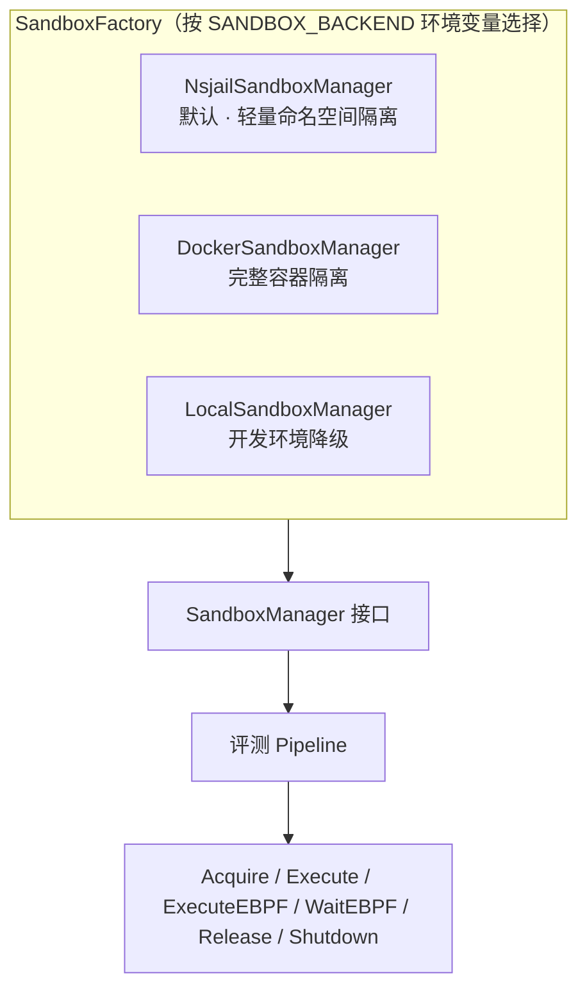

| 后端 | 隔离机制 | 适用场景 | eBPF 支持 |
|---|---|---|---|
| NsJail | user/pid/uts/ipc 命名空间 + seccomp + cgroup | 生产默认，高吞吐评测 | 支持（HostPID 暴露） |
| Docker | 完整容器隔离 + read-only + no-new-privileges | 需要完整环境标准化 | 不支持 |
| Local | 无隔离 + rlimit | 本地开发调试 | 不支持 |

---

## 2. SandboxManager 接口设计

### 2.1 接口定义（完整源码）

沙箱抽象的核心是 `SandboxManager` 接口，它定义了沙箱生命周期的完整契约。以下是 `internal/sandbox/manager.go` 的完整源码：

```go
package sandbox

import (
	"context"
	"fmt"
	"time"
)

// SandboxManager defines the interface for sandbox lifecycle management.
type SandboxManager interface {
	// Acquire creates or retrieves a sandbox at the specified level.
	Acquire(ctx context.Context, level SandboxLevel) (*SandboxInstance, error)
	// Execute runs a binary inside a sandbox (strace mode, blocking).
	Execute(ctx context.Context, sandbox *SandboxInstance, binary string, stdin []byte, timeout time.Duration) (*ExecResult, error)
	// ExecuteEBPF starts the binary in the sandbox background (eBPF mode).
	// Sets sandbox.HostPID to the host-side nsjail PID. The caller must
	// locate the student binary PID, inject it into the eBPF tracker,
	// then call WaitEBPF to collect the result.
	ExecuteEBPF(ctx context.Context, sandbox *SandboxInstance, binary string, stdin []byte, timeout time.Duration) (*ExecResult, error)
	// WaitEBPF waits for a background eBPF-mode execution to complete
	// and returns the final ExecResult with exit code and resource usage.
	WaitEBPF(sandbox *SandboxInstance) (*ExecResult, error)
	// Release returns a sandbox to the pool or destroys it.
	Release(sandbox *SandboxInstance) error
	// Shutdown cleans up all sandboxes.
	Shutdown() error
}

// MockSandboxManager is a mock implementation for testing.
type MockSandboxManager struct {
	AcquireFn    func(ctx context.Context, level SandboxLevel) (*SandboxInstance, error)
	ExecuteFn    func(ctx context.Context, sandbox *SandboxInstance, binary string, stdin []byte, timeout time.Duration) (*ExecResult, error)
	ExecuteEBPFFn func(ctx context.Context, sandbox *SandboxInstance, binary string, stdin []byte, timeout time.Duration) (*ExecResult, error)
	WaitEBPFFn   func(sandbox *SandboxInstance) (*ExecResult, error)
	ReleaseFn    func(sandbox *SandboxInstance) error
	ShutdownFn   func() error
}

func (m *MockSandboxManager) Acquire(ctx context.Context, level SandboxLevel) (*SandboxInstance, error) {
	if m.AcquireFn != nil {
		return m.AcquireFn(ctx, level)
	}
	return &SandboxInstance{
		ID:     "mock-sandbox",
		Level:  level,
		Status: StatusIdle,
	}, nil
}

func (m *MockSandboxManager) Execute(ctx context.Context, sandbox *SandboxInstance, binary string, stdin []byte, timeout time.Duration) (*ExecResult, error) {
	if m.ExecuteFn != nil {
		return m.ExecuteFn(ctx, sandbox, binary, stdin, timeout)
	}
	return &ExecResult{
		Stdout:   "mock output",
		ExitCode: 0,
	}, nil
}

func (m *MockSandboxManager) ExecuteEBPF(ctx context.Context, sandbox *SandboxInstance, binary string, stdin []byte, timeout time.Duration) (*ExecResult, error) {
	if m.ExecuteEBPFFn != nil {
		return m.ExecuteEBPFFn(ctx, sandbox, binary, stdin, timeout)
	}
	return nil, fmt.Errorf("ExecuteEBPF not implemented in mock")
}

func (m *MockSandboxManager) WaitEBPF(sandbox *SandboxInstance) (*ExecResult, error) {
	if m.WaitEBPFFn != nil {
		return m.WaitEBPFFn(sandbox)
	}
	return nil, fmt.Errorf("WaitEBPF not implemented in mock")
}

func (m *MockSandboxManager) Release(sandbox *SandboxInstance) error {
	if m.ReleaseFn != nil {
		return m.ReleaseFn(sandbox)
	}
	return nil
}

func (m *MockSandboxManager) Shutdown() error {
	if m.ShutdownFn != nil {
		return m.ShutdownFn()
	}
	return nil
}
```

### 2.2 接口设计的四个关键决策

**决策一：`Execute` 与 `ExecuteEBPF` 分离。**
strace 模式是阻塞执行（`cmd.Run()` 等待完成），而 eBPF 模式是后台启动（`cmd.Start()` 立即返回）+ 后续 `WaitEBPF` 等待。将二者拆分为独立方法，是为了让 eBPF 观测能够在沙箱进程运行期间完成 PID 注入（详见第 8 节）。

**决策二：`Acquire` 与 `Execute` 分离。**
沙箱的"分配"和"执行"是两个不同的资源操作。分配受信号量限流（控制并发沙箱数），执行是真正运行二进制。分离后可以在分配和释放之间做资源池管理。

**决策三：`MockSandboxManager` 内置于接口文件。**
这是 Go 的惯用法——测试 mock 与接口定义放在一起，保证接口变更时 mock 同步演进，避免测试 mock 漂移。

**决策四：`SandboxInstance.HostPID` 字段暴露宿主机 PID。**
eBPF 观测需要知道沙箱包装进程（nsjail）的宿主机 PID，才能向下定位学生进程。这个字段只在 eBPF 模式下有意义，普通模式下为 0。

### 2.3 核心数据结构（`internal/sandbox/types.go` 完整源码）

```go
package sandbox

import "time"

// SandboxLevel defines the security level of a sandbox.
type SandboxLevel int

const (
	LevelStandard SandboxLevel = 1 // Standard: 256MB, 80% CPU
	LevelSecure   SandboxLevel = 2 // Secure: 128MB, 60% CPU
	LevelHardened SandboxLevel = 3 // Hardened: 64MB, 50% CPU
)

// SandboxStatus represents the current state of a sandbox.
type SandboxStatus string

const (
	StatusIdle  SandboxStatus = "idle"
	StatusBusy  SandboxStatus = "busy"
	StatusError SandboxStatus = "error"
)

// SandboxBackend represents the type of sandbox backend.
type SandboxBackend string

const (
	BackendNsjail SandboxBackend = "nsjail" // lightweight namespace-based isolation (default)
	BackendDocker SandboxBackend = "docker" // full Docker container isolation
	BackendLocal  SandboxBackend = "local"  // direct execution (dev only)
)

// SandboxInstance represents a running sandbox.
type SandboxInstance struct {
	ID           string         `json:"id"`
	ContainerID  string         `json:"container_id"`
	Level        SandboxLevel   `json:"level"`
	Backend      SandboxBackend `json:"backend"`
	Status       SandboxStatus  `json:"status"`
	CreatedAt    time.Time      `json:"created_at"`
	DisableTrace bool           `json:"-"`
	HostPID      int            `json:"-"` // host-side PID of nsjail process (eBPF mode)
}

// ExecResult holds the result of executing a program in a sandbox.
type ExecResult struct {
	Stdout      string        `json:"stdout"`
	Stderr      string        `json:"stderr"`
	ExitCode    int           `json:"exit_code"`
	ExecTime    time.Duration `json:"exec_time"`
	TraceFile   string        `json:"trace_file"`
	Killed      bool          `json:"killed"`
	MemoryUsage int64         `json:"memory_usage"`
}

// SandboxConfig holds resource limits for a sandbox level.
type SandboxConfig struct {
	MemoryLimit    int64         `json:"memory_limit"`
	CPUPercent     int           `json:"cpu_percent"`
	PIDLimit       int64         `json:"pid_limit"`
	TimeLimit      time.Duration `json:"time_limit"`
	SeccompProfile string        `json:"seccomp_profile"`
	NsjailConfig   string        `json:"nsjail_config"`
	DockerImage    string        `json:"docker_image"`
}
```

**关键字段说明**：

- `DisableTrace`：控制是否在沙箱内启用 strace 包装。eBPF 模式下设为 `true`，避免 strace 与 eBPF 双重采集；
- `HostPID`：eBPF 模式下 nsjail 包装进程的宿主机 PID，供 `LocateStudentPID` 向下定位；
- `Killed`：标记进程是否被强制杀死（超时/OOM），区别于正常退出，评测时据此判定 `timeout` 或 `memory_exceeded`。

---

## 3. 三级安全等级模型

### 3.1 等级定义（`internal/sandbox/config.go` 完整源码）

```go
package sandbox

import (
	"fmt"
	"time"
)

// GetConfig returns the sandbox configuration for a given level.
func GetConfig(level SandboxLevel) (SandboxConfig, error) {
	switch level {
	case LevelStandard:
		return SandboxConfig{
			MemoryLimit:    256 * 1024 * 1024,
			CPUPercent:     80,
			PIDLimit:       64,
			TimeLimit:      300 * time.Second,
			SeccompProfile: "sandbox/seccomp-profiles/process-lab.json",
			NsjailConfig:   "sandbox/nsjail-configs/level1-standard.pb",
			DockerImage:    "traceos-lab-sandbox:standard",
		}, nil
	case LevelSecure:
		return SandboxConfig{
			MemoryLimit:    128 * 1024 * 1024,
			CPUPercent:     60,
			PIDLimit:       32,
			TimeLimit:      300 * time.Second,
			SeccompProfile: "sandbox/seccomp-profiles/thread-lab.json",
			NsjailConfig:   "sandbox/nsjail-configs/level2-secure.pb",
			DockerImage:    "traceos-lab-sandbox:secure",
		}, nil
	case LevelHardened:
		return SandboxConfig{
			MemoryLimit:    64 * 1024 * 1024,
			CPUPercent:     50,
			PIDLimit:       8,
			TimeLimit:      180 * time.Second,
			SeccompProfile: "sandbox/seccomp-profiles/deadlock-lab.json",
			NsjailConfig:   "sandbox/nsjail-configs/level3-hardened.pb",
			DockerImage:    "traceos-lab-sandbox:secure",
		}, nil
	default:
		return SandboxConfig{}, fmt.Errorf("invalid sandbox level: %d", level)
	}
}
```

### 3.2 等级与实验类别的映射

| 等级 | 内存 | CPU | PID 上限 | 时限 | 适用实验 | seccomp profile |
|---|---|---|---|---|---|---|
| Level 1 (Standard) | 256MB | 80% | 64 | 300s | process、thread | process-lab.json / thread-lab.json |
| Level 2 (Secure) | 128MB | 60% | 32 | 300s | memory、fs、scheduler | memory-lab.json / fs-lab.json / scheduler-lab.json |
| Level 3 (Hardened) | 64MB | 50% | 8 | 180s | deadlock | deadlock-lab.json |

**设计逻辑**：

1. **process/thread 实验**需要创建较多子进程/线程，故给最高的 PID 上限（64）和内存（256MB）；
2. **memory 实验**需要充分的内存空间来观察 mmap/munmap 行为，但无需太多进程，故收紧 PID 到 32；
3. **deadlock 实验**是最危险的（可能真的死锁卡死），故用最严格的三级配置：64MB、50% CPU、8 个 PID、180s 时限，且 seccomp 白名单额外放行锁/同步相关系统调用（futex、epoll、信号队列等）。

### 3.3 资源限制的运行时实现（`resourceLimits` 函数）

`resourceLimits` 是 `nsjail_manager.go` 中的核心函数，将 `SandboxLevel` 映射为运行时限制参数：

```go
type nsjailLimits struct {
	memLimitMB int
	cpuPercent int
	pidMax     int
	timeExtra  int
}

func resourceLimits(level SandboxLevel) nsjailLimits {
	switch level {
	case LevelHardened:
		return nsjailLimits{memLimitMB: 64, cpuPercent: 50, pidMax: 32, timeExtra: 3}
	case LevelSecure:
		return nsjailLimits{memLimitMB: 128, cpuPercent: 60, pidMax: 64, timeExtra: 3}
	default:
		return nsjailLimits{memLimitMB: 256, cpuPercent: 80, pidMax: 128, timeExtra: 3}
	}
}
```

**`timeExtra` 的作用**：评测给学生的运行时限（如 5s）之外，额外给 3 秒的"缓冲时间"，用于 nsjail 进程的启动、strace 的初始化、以及进程的优雅退出。避免学生程序恰好卡在时限边界时，被 nsjail 自己的启动开销误杀。

---

## 4. NsJail 沙箱实现

### 4.1 NsJail 是什么

[NsJail](https://github.com/google/nsjail) 是 Google 开源的轻量级进程隔离工具，基于 Linux 命名空间（namespace）+ seccomp-bpf + cgroup + rlimit 实现。相比 Docker，NsJail 的优势在于：

- **启动开销极低**（毫秒级），适合高频评测场景；
- **精细控制**：可直接指定 `clone_newuser`、`clone_newpid` 等命名空间、seccomp 策略、cgroup 限制；
- **strace 原生集成**：`exec_bin` 可以直指 strace，天然支持系统调用采集；
- **无守护进程**：不需要 dockerd，部署简单。

### 4.2 NsjailSandboxManager 结构

```go
type nsjailSandbox struct {
	id      string
	workDir string
	level   SandboxLevel
	cmd     *exec.Cmd // background nsjail process (eBPF mode)
}

type NsjailSandboxManager struct {
	mu            sync.Mutex
	pool          map[string]*nsjailSandbox
	nextID        atomic.Int64
	nsjailBin     string
	workBase      string
	maxConcurrent int
	semaphore     chan struct{}
}
```

**关键设计**：

- `pool map[string]*nsjailSandbox`：以沙箱 ID 为键管理所有沙箱实例；
- `semaphore chan struct{}`：信号量控制最大并发沙箱数（默认 5，最大 20，可通过 `NSJAIL_MAX_CONCURRENT` 环境变量配置）；
- `cmd *exec.Cmd`：eBPF 模式下保存后台运行的 nsjail 进程句柄，供 `WaitEBPF` 等待。

### 4.3 Acquire 实现（完整源码）

```go
func (m *NsjailSandboxManager) Acquire(ctx context.Context, level SandboxLevel) (*SandboxInstance, error) {
	select {
	case m.semaphore <- struct{}{}:
	case <-ctx.Done():
		return nil, ctx.Err()
	}
	m.mu.Lock()
	defer m.mu.Unlock()
	id := fmt.Sprintf("nsjail-%d-%d", level, m.nextID.Add(1))
	workDir := filepath.Join(m.workBase, id)
	if err := os.MkdirAll(workDir, 0o755); err != nil {
		<-m.semaphore
		return nil, fmt.Errorf("mkdir workdir: %w", err)
	}
	m.pool[id] = &nsjailSandbox{id: id, workDir: workDir, level: level}
	return &SandboxInstance{
		ID: id, ContainerID: id, Level: level,
		Status: StatusBusy, CreatedAt: time.Now(),
	}, nil
}
```

**工程细节**：

1. **信号量阻塞式获取**：`select` 同时监听信号量和 ctx 取消，避免协程泄漏。若 mkdir 失败，主动归还信号量槽位（`<-m.semaphore`）；
2. **唯一 ID 生成**：`nsjail-{level}-{自增序号}`，既保证唯一性，又便于日志追踪沙箱的安全等级；
3. **每个沙箱独立 workDir**：存放 nsjail 配置、strace 输出，沙箱释放时异步删除。

### 4.4 Execute 实现（strace 模式，完整源码）

这是 strace 降级观测路径的核心。它生成 nsjail 配置、启动 nsjail、执行 strace 包装的学生二进制、解析结果：

```go
func (m *NsjailSandboxManager) Execute(ctx context.Context, si *SandboxInstance, binary string, stdin []byte, timeout time.Duration) (*ExecResult, error) {
	m.mu.Lock()
	sb, ok := m.pool[si.ID]
	m.mu.Unlock()
	if !ok {
		return nil, fmt.Errorf("sandbox %s not found in pool", si.ID)
	}
	limits := resourceLimits(sb.level)
	cfgPath := filepath.Join(sb.workDir, "nsjail.cfg")
	traceDir := filepath.Join(sb.workDir, "strace-output")
	tracePath := filepath.Join(traceDir, "strace.log")
	if !si.DisableTrace {
		// Create host-side strace output dir so it can be bind-mounted into the jail
		os.MkdirAll(traceDir, 0o755)
		if err := writeNsjailConfig(cfgPath, binary, tracePath, traceDir, limits, timeout); err != nil {
			return nil, fmt.Errorf("write nsjail config: %w", err)
		}
	} else {
		if err := writeNsjailConfigNoTrace(cfgPath, binary, limits, timeout); err != nil {
			return nil, fmt.Errorf("write nsjail config: %w", err)
		}
	}
	ctx, cancel := context.WithTimeout(ctx, timeout+5*time.Second)
	defer cancel()
	cmd := exec.CommandContext(ctx, m.nsjailBin, "--config", cfgPath)
	if len(stdin) > 0 {
		cmd.Stdin = bytes.NewReader(stdin)
	}
	var stdout, stderr bytes.Buffer
	cmd.Stdout = &stdout
	cmd.Stderr = &stderr
	cmd.SysProcAttr = &syscall.SysProcAttr{Setpgid: true}
	start := time.Now()
	err := cmd.Run()
	elapsed := time.Since(start)
	result := &ExecResult{Stdout: stdout.String(), Stderr: stderr.String(), ExecTime: elapsed}
	if si.DisableTrace {
		result.TraceFile = ""
	} else {
		result.TraceFile = tracePath
	}
	if err != nil {
		if exitErr, ok := err.(*exec.ExitError); ok {
			result.ExitCode = exitErr.ExitCode()
		} else if ctx.Err() == context.DeadlineExceeded {
			result.Killed = true
			result.ExitCode = -1
		} else {
			result.ExitCode = 137
			result.Killed = true
		}
	}
	result.MemoryUsage = parseMemoryUsage(stderr.String())
	return result, nil
}
```

**关键工程细节**：

1. **超时缓冲**：`context.WithTimeout(ctx, timeout+5*time.Second)` 给 nsjail 启动和 strace 初始化留 5 秒缓冲；
2. **进程组**：`Setpgid: true` 让 nsjail 成为进程组组长，配合后续的超时强杀（杀整个进程组而非单个进程）；
3. **退出码语义化**：区分 `ExitError`（正常退出但有非零码）、`DeadlineExceeded`（超时被杀）、其他（异常，默认 137=SIGKILL）；
4. **内存计量**：`parseMemoryUsage` 从 nsjail 的 stderr 输出中解析 `memory.max_usage_in_bytes`，得到真实的峰值内存占用。

### 4.5 nsjail 配置生成（完整源码）

`writeNsjailConfig` 生成 nsjail 的配置文件，这是沙箱隔离的物理实现：

```go
func writeNsjailConfig(path, binary, tracePath, traceDir string, lim nsjailLimits, timeout time.Duration) error {
	timeSec := int(timeout.Seconds()) + lim.timeExtra
	cfg := "mode: ONCE\nmount_proc: true\n"
	cfg += fmt.Sprintf("mount { src: \"%s\" dst: \"/binary\" is_bind: true mandatory: true }\n", binary)
	cfg += "mount { src: \"none\" dst: \"/tmp\" is_bind: false fstype: \"tmpfs\" rw: true }\n"
	cfg += fmt.Sprintf("mount { src: \"%s\" dst: \"/trace-output\" is_bind: true rw: true }\n", traceDir)
	cfg += "clone_newuser: true\nclone_newpid: true\n"
	cfg += "clone_newuts: true\nclone_newipc: true\n"
	cfg += fmt.Sprintf("cgroup_mem_max: %d\ncgroup_pids_max: %d\ntime_limit: %d\n",
		lim.memLimitMB*1024*1024, lim.pidMax, timeSec)
	cfg += "exec_bin: \"/usr/bin/strace\"\nexec_args: [\"-tt\", \"-k\", \"-o\", \"/trace-output/strace.log\", \"/binary\"]\nexec_cwd: \"/tmp\"\n"
	return os.WriteFile(path, []byte(cfg), 0o644)
}
```

这段配置生成的内容如下（以 Level 1 为例）：

```ini
mode: ONCE
mount_proc: true
mount { src: "/path/to/binary" dst: "/binary" is_bind: true mandatory: true }
mount { src: "none" dst: "/tmp" is_bind: false fstype: "tmpfs" rw: true }
mount { src: "/path/to/strace-output" dst: "/trace-output" is_bind: true rw: true }
clone_newuser: true
clone_newpid: true
clone_newuts: true
clone_newipc: true
cgroup_mem_max: 268435456
cgroup_pids_max: 128
time_limit: 308
exec_bin: "/usr/bin/strace"
exec_args: ["-tt", "-k", "-o", "/trace-output/strace.log", "/binary"]
exec_cwd: "/tmp"
```

**逐项解析**：

| 配置项 | 含义 | 安全价值 |
|---|---|---|
| `mode: ONCE` | 执行一次后退出 | 沙箱生命周期与评测绑定 |
| `mount_proc: true` | 挂载新的 /proc | 隔离进程信息，防信息泄漏 |
| `mount /binary` | bind mount 学生二进制到 /binary | 只读暴露二进制 |
| `mount /tmp tmpfs` | 独立临时文件系统 | 隔离临时文件，防污染 |
| `mount /trace-output` | bind mount strace 输出目录 | 把沙箱内 strace 日志传回宿主机 |
| `clone_newuser: true` | 用户命名空间 | 沙箱内 root 映射到宿主机非特权用户 |
| `clone_newpid: true` | PID 命名空间 | 沙箱内 PID 从 1 开始，隔离进程视图 |
| `clone_newuts: true` | UTS 命名空间 | 隔离主机名 |
| `clone_newipc: true` | IPC 命名空间 | 隔离 SysV IPC、POSIX 消息队列 |
| `cgroup_mem_max` | 内存上限（字节） | 防内存耗尽 |
| `cgroup_pids_max` | 进程数上限 | 防 fork bomb |
| `time_limit` | 时限（秒） | 防死循环 |
| `exec_bin: strace` | 用 strace 包装执行 | 非侵入式系统调用采集 |
| `exec_args: -tt -k -o` | strace 参数 | 时间戳 + 调用栈 + 输出文件 |

### 4.6 无 strace 模式（eBPF 模式）的配置

```go
func writeNsjailConfigNoTrace(path, binary string, lim nsjailLimits, timeout time.Duration) error {
	timeSec := int(timeout.Seconds()) + lim.timeExtra
	cfg := "mode: ONCE\nmount_proc: true\n"
	cfg += fmt.Sprintf("mount { src: \"%s\" dst: \"/binary\" is_bind: true mandatory: true }\n", binary)
	cfg += "mount { src: \"none\" dst: \"/tmp\" is_bind: false fstype: \"tmpfs\" rw: true }\n"
	cfg += "clone_newuser: true\nclone_newpid: true\n"
	cfg += "clone_newuts: true\nclone_newipc: true\n"
	cfg += fmt.Sprintf("cgroup_mem_max: %d\ncgroup_pids_max: %d\ntime_limit: %d\n",
		lim.memLimitMB*1024*1024, lim.pidMax, timeSec)
	cfg += "exec_bin: \"/binary\"\nexec_cwd: \"/tmp\"\n"
	return os.WriteFile(path, []byte(cfg), 0o644)
}
```

**关键差异**：`exec_bin` 直指 `/binary`（学生二进制），而非 strace 包装。这样 eBPF 才能在内核态直接观测到学生进程的真实系统调用，而不是 strace 进程的系统调用。

---

## 5. seccomp 白名单体系

### 5.1 为什么需要 seccomp

命名空间隔离解决了"进程视图隔离"，但**不限制进程能做什么**。一个在 PID 命名空间内的进程，仍然可以调用 `mount`、`reboot`、`ptrace` 等危险系统调用。seccomp-bpf 提供了系统调用级别的过滤，是纵深防御的第二道防线。

### 5.2 六套实验专属 profile

TraceOS Lab 为六类实验设计了专属的 seccomp 白名单，原则是**最小权限**：只放行该实验类型确实需要的系统调用，其余全部 `SCMP_ACT_KILL`。

| profile 文件 | 适用实验 | 额外放行的系统调用 |
|---|---|---|
| process-lab.json | 进程管理 | fork/vfork/clone/clone3/execve/wait4/waitid/futex/pipe |
| thread-lab.json | 线程同步 | gettid/kill/tgkill/rt_sigreturn/sched_* /madvise/mlock |
| memory-lab.json | 内存分配 | mremap/sbrk/mbind/shm*/mlock*/mincore |
| fs-lab.json | 文件 I/O | writev/readv/pwrite*/openat2/lstat/stat/llseek/sync/chdir/mkdirat/unlinkat/renameat* |
| scheduler-lab.json | 处理机调度 | sched_get/setattr/sched_rr_get_interval |
| deadlock-lab.json | 死锁 | epoll_*/eventfd/signalfd/futex_time64/信号队列/mlock* |

### 5.3 process-lab.json 白名单（完整源码）

```json
{
  "name": "process-lab",
  "description": "进程实验 seccomp 白名单",
  "defaultAction": "SCMP_ACT_KILL",
  "syscalls": [
    { "name": "write", "action": "SCMP_ACT_ALLOW" },
    { "name": "read", "action": "SCMP_ACT_ALLOW" },
    { "name": "openat", "action": "SCMP_ACT_ALLOW" },
    { "name": "close", "action": "SCMP_ACT_ALLOW" },
    { "name": "fstat", "action": "SCMP_ACT_ALLOW" },
    { "name": "newfstatat", "action": "SCMP_ACT_ALLOW" },
    { "name": "lseek", "action": "SCMP_ACT_ALLOW" },
    { "name": "mmap", "action": "SCMP_ACT_ALLOW" },
    { "name": "mprotect", "action": "SCMP_ACT_ALLOW" },
    { "name": "munmap", "action": "SCMP_ACT_ALLOW" },
    { "name": "brk", "action": "SCMP_ACT_ALLOW" },
    { "name": "rt_sigaction", "action": "SCMP_ACT_ALLOW" },
    { "name": "rt_sigprocmask", "action": "SCMP_ACT_ALLOW" },
    { "name": "ioctl", "action": "SCMP_ACT_ALLOW" },
    { "name": "access", "action": "SCMP_ACT_ALLOW" },
    { "name": "faccessat", "action": "SCMP_ACT_ALLOW" },
    { "name": "faccessat2", "action": "SCMP_ACT_ALLOW" },
    { "name": "pipe", "action": "SCMP_ACT_ALLOW" },
    { "name": "pipe2", "action": "SCMP_ACT_ALLOW" },
    { "name": "select", "action": "SCMP_ACT_ALLOW" },
    { "name": "poll", "action": "SCMP_ACT_ALLOW" },
    { "name": "sched_yield", "action": "SCMP_ACT_ALLOW" },
    { "name": "nanosleep", "action": "SCMP_ACT_ALLOW" },
    { "name": "clock_nanosleep", "action": "SCMP_ACT_ALLOW" },
    { "name": "alarm", "action": "SCMP_ACT_ALLOW" },
    { "name": "getpid", "action": "SCMP_ACT_ALLOW" },
    { "name": "dup", "action": "SCMP_ACT_ALLOW" },
    { "name": "dup2", "action": "SCMP_ACT_ALLOW" },
    { "name": "dup3", "action": "SCMP_ACT_ALLOW" },
    { "name": "fcntl", "action": "SCMP_ACT_ALLOW" },
    { "name": "flock", "action": "SCMP_ACT_ALLOW" },
    { "name": "fsync", "action": "SCMP_ACT_ALLOW" },
    { "name": "fdatasync", "action": "SCMP_ACT_ALLOW" },
    { "name": "truncate", "action": "SCMP_ACT_ALLOW" },
    { "name": "ftruncate", "action": "SCMP_ACT_ALLOW" },
    { "name": "getppid", "action": "SCMP_ACT_ALLOW" },
    { "name": "getuid", "action": "SCMP_ACT_ALLOW" },
    { "name": "geteuid", "action": "SCMP_ACT_ALLOW" },
    { "name": "getgid", "action": "SCMP_ACT_ALLOW" },
    { "name": "getegid", "action": "SCMP_ACT_ALLOW" },
    { "name": "getresuid", "action": "SCMP_ACT_ALLOW" },
    { "name": "getresgid", "action": "SCMP_ACT_ALLOW" },
    { "name": "sigaltstack", "action": "SCMP_ACT_ALLOW" },
    { "name": "uname", "action": "SCMP_ACT_ALLOW" },
    { "name": "getrlimit", "action": "SCMP_ACT_ALLOW" },
    { "name": "getrusage", "action": "SCMP_ACT_ALLOW" },
    { "name": "sysinfo", "action": "SCMP_ACT_ALLOW" },
    { "name": "times", "action": "SCMP_ACT_ALLOW" },
    { "name": "getgroups", "action": "SCMP_ACT_ALLOW" },
    { "name": "setgroups", "action": "SCMP_ACT_ALLOW" },
    { "name": "gethostname", "action": "SCMP_ACT_ALLOW" },
    { "name": "getdents64", "action": "SCMP_ACT_ALLOW" },
    { "name": "setrlimit", "action": "SCMP_ACT_ALLOW" },
    { "name": "getdents", "action": "SCMP_ACT_ALLOW" },
    { "name": "getcwd", "action": "SCMP_ACT_ALLOW" },
    { "name": "clone", "action": "SCMP_ACT_ALLOW" },
    { "name": "clone3", "action": "SCMP_ACT_ALLOW" },
    { "name": "fork", "action": "SCMP_ACT_ALLOW" },
    { "name": "vfork", "action": "SCMP_ACT_ALLOW" },
    { "name": "execve", "action": "SCMP_ACT_ALLOW" },
    { "name": "exit", "action": "SCMP_ACT_ALLOW" },
    { "name": "exit_group", "action": "SCMP_ACT_ALLOW" },
    { "name": "wait4", "action": "SCMP_ACT_ALLOW" },
    { "name": "waitid", "action": "SCMP_ACT_ALLOW" },
    { "name": "futex", "action": "SCMP_ACT_ALLOW" },
    { "name": "set_robust_list", "action": "SCMP_ACT_ALLOW" },
    { "name": "get_robust_list", "action": "SCMP_ACT_ALLOW" },
    { "name": "readlinkat", "action": "SCMP_ACT_ALLOW" },
    { "name": "fstatfs", "action": "SCMP_ACT_ALLOW" },
    { "name": "statfs", "action": "SCMP_ACT_ALLOW" },
    { "name": "arch_prctl", "action": "SCMP_ACT_ALLOW" },
    { "name": "set_tid_address", "action": "SCMP_ACT_ALLOW" },
    { "name": "clock_gettime", "action": "SCMP_ACT_ALLOW" },
    { "name": "clock_getres", "action": "SCMP_ACT_ALLOW" },
    { "name": "rseq", "action": "SCMP_ACT_ALLOW" },
    { "name": "getrandom", "action": "SCMP_ACT_ALLOW" },
    { "name": "gettimeofday", "action": "SCMP_ACT_ALLOW" },
    { "name": "time", "action": "SCMP_ACT_ALLOW" }
  ]
}
```

### 5.4 白名单的系统调用分类分析

将 process-lab 的白名单归类，可以看到它的设计逻辑：

| 类别 | 系统调用 | 目的 |
|---|---|---|
| 基础 I/O | read/write/openat/close | 程序读写文件与标准流 |
| 内存管理 | mmap/mprotect/munmap/brk | 动态内存分配（glibc 运行时必需） |
| 进程管理 | fork/vfork/clone/clone3/execve/exit/exit_group/wait4/waitid | 进程实验核心 |
| 信号 | rt_sigaction/rt_sigprocmask/sigaltstack | 信号处理 |
| 时间 | nanosleep/clock_nanosleep/clock_gettime/alarm | 计时与睡眠 |
| 身份查询 | getuid/geteuid/getgid/getegid/getpid/getppid | 进程身份 |
| 文件描述符 | dup/dup2/dup3/fcntl | FD 操作 |
| 同步 | futex/set_robust_list/get_robust_list | 线程同步（glibc 运行时必需） |

**注意白名单中缺失的危险调用**：没有 `mount`、`umount`、`reboot`、`ptrace`、`chmod`、`setuid`（写权限类）、`socket`（网络类）、`kill`（进程类）——这些都因 `defaultAction: SCMP_ACT_KILL` 而被默认禁止。学生在 process 实验中不需要这些调用，一旦尝试调用就会被 seccomp 立即杀死。

### 5.5 deadlock-lab 的扩展白名单

deadlock 实验需要额外的锁/同步机制，其 profile 额外放行：

```json
// deadlock-lab.json 中额外放行的系统调用（相对 process-lab）
{ "name": "rt_sigreturn", "action": "SCMP_ACT_ALLOW" },
{ "name": "rt_sigtimedwait", "action": "SCMP_ACT_ALLOW" },
{ "name": "rt_sigqueueinfo", "action": "SCMP_ACT_ALLOW" },
{ "name": "rt_tgsigqueueinfo", "action": "SCMP_ACT_ALLOW" },
{ "name": "kill", "action": "SCMP_ACT_ALLOW" },
{ "name": "tgkill", "action": "SCMP_ACT_ALLOW" },
{ "name": "tkill", "action": "SCMP_ACT_ALLOW" },
{ "name": "epoll_create", "action": "SCMP_ACT_ALLOW" },
{ "name": "epoll_create1", "action": "SCMP_ACT_ALLOW" },
{ "name": "epoll_ctl", "action": "SCMP_ACT_ALLOW" },
{ "name": "epoll_wait", "action": "SCMP_ACT_ALLOW" },
{ "name": "epoll_pwait", "action": "SCMP_ACT_ALLOW" },
{ "name": "eventfd", "action": "SCMP_ACT_ALLOW" },
{ "name": "eventfd2", "action": "SCMP_ACT_ALLOW" },
{ "name": "signalfd", "action": "SCMP_ACT_ALLOW" },
{ "name": "signalfd4", "action": "SCMP_ACT_ALLOW" },
{ "name": "futex_time64", "action": "SCMP_ACT_ALLOW" },
{ "name": "madvise", "action": "SCMP_ACT_ALLOW" },
{ "name": "mlock", "action": "SCMP_ACT_ALLOW" },
{ "name": "munlock", "action": "SCMP_ACT_ALLOW" },
{ "name": "mlockall", "action": "SCMP_ACT_ALLOW" },
{ "name": "munlockall", "action": "SCMP_ACT_ALLOW" },
{ "name": "mincore", "action": "SCMP_ACT_ALLOW" },
{ "name": "msync", "action": "SCMP_ACT_ALLOW" }
```

死锁实验需要线程间通过信号（`kill`/`tgkill`）通信、通过 `epoll`/`eventfd`/`signalfd` 实现异步事件，通过 `futex_time64`（32 位兼容）和 `mlock` 做锁的底层支持。这些放行都是**经过仔细论证的最小权限**，而非简单全放。

---

## 6. 并发调度与沙箱池

### 6.1 三层限流架构

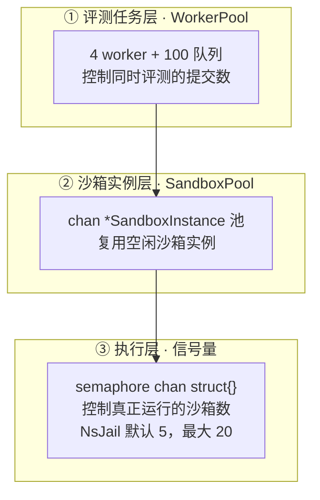

三层限流各司其职：

1. **WorkerPool**：控制"同时处理的提交数"，防止评测请求洪峰压垮 CPU；
2. **SandboxPool**：复用沙箱实例，减少 nsjail 配置生成和目录创建的重复开销；
3. **信号量**：控制"真正同时运行的沙箱数"，因为每个 nsjail 实例都占用 cgroup、内存、PID，必须严格限量。

### 6.2 SandboxPool 实现（`internal/sandbox/pool.go` 完整源码）

```go
package sandbox

import (
	"context"
	"fmt"
	"log"
	"time"
)

// SandboxPool manages a pool of pre-allocated sandboxes.
type SandboxPool struct {
	pool    chan *SandboxInstance
	manager SandboxManager
	maxSize int
}

// NewPool creates a new sandbox pool.
func NewPool(manager SandboxManager, maxSize int) *SandboxPool {
	return &SandboxPool{
		pool:    make(chan *SandboxInstance, maxSize),
		manager: manager,
		maxSize: maxSize,
	}
}

// Acquire gets a sandbox from the pool or creates a new one.
func (p *SandboxPool) Acquire(ctx context.Context, level SandboxLevel) (*SandboxInstance, error) {
	select {
	case sb := <-p.pool:
		sb.Status = StatusBusy
		return sb, nil
	default:
		sb, err := p.manager.Acquire(ctx, level)
		if err != nil {
			return nil, fmt.Errorf("pool: acquire sandbox: %w", err)
		}
		sb.Status = StatusBusy
		return sb, nil
	}
}

// Release returns a sandbox to the pool.
func (p *SandboxPool) Release(sandbox *SandboxInstance) error {
	sandbox.Status = StatusIdle
	select {
	case p.pool <- sandbox:
		return nil
	default:
		if err := p.manager.Release(sandbox); err != nil {
			log.Printf("[Pool] failed to release sandbox %s: %v", sandbox.ID, err)
			return err
		}
		return nil
	}
}

// Execute delegates execution to the underlying sandbox manager.
func (p *SandboxPool) Execute(ctx context.Context, sb *SandboxInstance, binary string, stdin []byte, timeout time.Duration) (*ExecResult, error) {
	return p.manager.Execute(ctx, sb, binary, stdin, timeout)
}

// ExecuteEBPF delegates eBPF-mode execution to the underlying sandbox manager.
func (p *SandboxPool) ExecuteEBPF(ctx context.Context, sb *SandboxInstance, binary string, stdin []byte, timeout time.Duration) (*ExecResult, error) {
	return p.manager.ExecuteEBPF(ctx, sb, binary, stdin, timeout)
}

// WaitEBPF delegates eBPF-mode wait to the underlying sandbox manager.
func (p *SandboxPool) WaitEBPF(sb *SandboxInstance) (*ExecResult, error) {
	return p.manager.WaitEBPF(sb)
}

// Shutdown cleans up the pool and all sandboxes.
func (p *SandboxPool) Shutdown() error {
	close(p.pool)
	return p.manager.Shutdown()
}

// StartPrealloc pre-allocates sandboxes up to count.
func (p *SandboxPool) StartPrealloc(ctx context.Context, count int, level SandboxLevel) {
	for i := 0; i < count; i++ {
		sb, err := p.manager.Acquire(ctx, level)
		if err != nil {
			log.Printf("[Pool] prealloc failed: %v", err)
			continue
		}
		sb.Status = StatusIdle
		select {
		case p.pool <- sb:
		default:
			if err := p.manager.Release(sb); err != nil {
				log.Printf("[Pool] prealloc release failed: %v", err)
			}
		}
	}
	log.Printf("[Pool] pre-allocated %d sandboxes at level %d", count, level)
}

// Size returns the current number of idle sandboxes in the pool.
func (p *SandboxPool) Size() int {
	return len(p.pool)
}
```

**对象池设计**：

1. **基于 channel 的池**：Go 的 channel 天然适合做对象池——非阻塞 `select default` 实现"池空则新建"，非阻塞 `select default` 实现"池满则销毁"；
2. **预热**：`StartPrealloc` 在服务启动时预分配 N 个沙箱，消除首次评测的冷启动延迟；
3. **优雅降级**：池满时直接调用 `manager.Release` 销毁，而非阻塞等待。

### 6.3 NsJail 的并发信号量

```go
func NewNsjailSandboxManager() *NsjailSandboxManager {
	nsjailBin := os.Getenv("NSJAIL_BIN")
	if nsjailBin == "" {
		nsjailBin = "/usr/local/bin/nsjail"
	}
	workBase := os.Getenv("NSJAIL_WORK_DIR")
	if workBase == "" {
		workBase = "/tmp/traceos-nsjail"
	}
	maxConcStr := os.Getenv("NSJAIL_MAX_CONCURRENT")
	maxConc := 5
	if v, err := strconv.Atoi(maxConcStr); err == nil && v > 0 && v <= 20 {
		maxConc = v
	}
	m := &NsjailSandboxManager{
		pool:          make(map[string]*nsjailSandbox),
		nsjailBin:     nsjailBin,
		workBase:      workBase,
		maxConcurrent: maxConc,
		semaphore:     make(chan struct{}, maxConc),
	}
	_ = os.MkdirAll(m.workBase, 0o755)
	return m
}
```

**并发上限设计**：默认 5 个并发 nsjail 实例，上限 20。这是基于"每个 nsjail 实例占用独立 cgroup + 内存 + PID 命名空间"的成本估算。超出 20 会显著增加内核调度和 cgroup 管理的开销，反而降低吞吐。

---

## 7. 超时控制与进程组强杀

### 7.1 为什么需要进程组强杀

一个常见的坑是：**strace 包装的进程如果注册了信号处理器，普通的 `kill` 信号可能无法终止它**。例如：

```c
// 学生代码中的"顽固"信号处理器
signal(SIGTERM, handler);  // 捕获 SIGTERM，忽略它
while (1) sleep(1);
```

如果评测超时后只向进程发送 `SIGTERM`，这个进程会因为信号处理器而拒绝退出，导致沙箱卡死、评测永久挂起。解决方案是**进程组强杀**（`SIGKILL` 不可被捕获）。

### 7.2 Local 后端的进程组强杀实现

```go
// LocalSandboxManager.Execute 中的关键代码
cmd.SysProcAttr = &syscall.SysProcAttr{
	Setpgid: true,  // 让命令成为新进程组组长
}

// 当 ctx 取消（超时）时，杀死整个进程组
go func() {
	<-ctx.Done()
	if cmd.Process != nil {
		pgid, err := syscall.Getpgid(cmd.Process.Pid)
		if err == nil {
			syscall.Kill(-pgid, syscall.SIGKILL)  // 负 pgid = 杀整个进程组
		} else {
			cmd.Process.Kill()
		}
	}
}()
```

**关键技术点**：

1. `Setpgid: true`：让命令及其所有子进程共享一个进程组 ID（PGID）；
2. `syscall.Kill(-pgid, SIGKILL)`：负的 PID 参数表示"向整个进程组发送信号"，`SIGKILL` 不可被捕获、忽略或阻塞；
3. 这个机制确保**即使学生代码注册了信号处理器，超时也能强制终止整个进程树**（包括 strace 包装进程、学生二进制、以及所有 fork 出的子进程）。

### 7.3 Docker 后端的超时兜底

```go
// DockerSandboxManager.Execute 中的超时兜底
go func() {
	<-timeoutCtx.Done()
	if timeoutCtx.Err() == context.DeadlineExceeded {
		// Force kill the container
		killCmd := exec.Command(m.dockerBin, "kill", containerName)
		_ = killCmd.Run()
	}
}()
```

Docker 后端的超时通过 `docker kill`（默认发 SIGKILL）强制终止容器，等效于进程组强杀。

---

## 8. eBPF 模式的 PID 定位

### 8.1 问题：如何在内核态精确追踪学生进程

eBPF 观测的核心挑战是：**eBPF 程序挂载在内核全局，需要精确知道"哪个进程属于当前评测的沙箱"**。

由于 nsjail 使用了 PID 命名空间，学生进程在沙箱内的 PID 是 1（或小数字），但在宿主机上有一个真实的 PID。eBPF 程序运行在宿主机内核，看到的是**宿主机 PID**。因此需要：

1. 找到学生进程的宿主机 PID；
2. 将宿主机 PID 注入 eBPF 的跟踪表；
3. eBPF 据此过滤出该沙箱的系统调用事件。

### 8.2 ExecuteEBPF：后台启动 nsjail（完整源码）

```go
func (m *NsjailSandboxManager) ExecuteEBPF(ctx context.Context, si *SandboxInstance, binary string, stdin []byte, timeout time.Duration) (*ExecResult, error) {
	m.mu.Lock()
	sb, ok := m.pool[si.ID]
	m.mu.Unlock()
	if !ok {
		return nil, fmt.Errorf("sandbox %s not found in pool", si.ID)
	}

	limits := resourceLimits(sb.level)
	cfgPath := filepath.Join(sb.workDir, "nsjail.cfg")
	if err := writeNsjailConfigNoTrace(cfgPath, binary, limits, timeout); err != nil {
		return nil, fmt.Errorf("write nsjail config: %w", err)
	}

	ctx, cancel := context.WithTimeout(ctx, timeout+5*time.Second)
	// cancel is deferred until WaitEBPF; we leak intentionally for now.
	_ = cancel

	cmd := exec.CommandContext(ctx, m.nsjailBin, "--config", cfgPath)
	if len(stdin) > 0 {
		cmd.Stdin = bytes.NewReader(stdin)
	}
	var stdout, stderr bytes.Buffer
	cmd.Stdout = &stdout
	cmd.Stderr = &stderr
	cmd.SysProcAttr = &syscall.SysProcAttr{Setpgid: true}

	if err := cmd.Start(); err != nil {  // 注意：Start 而非 Run，后台启动
		cancel()
		return nil, fmt.Errorf("start nsjail: %w", err)
	}

	sb.cmd = cmd
	si.HostPID = cmd.Process.Pid  // 暴露 nsjail 包装进程的宿主机 PID

	return &ExecResult{
		Stdout:    stdout.String(),
		Stderr:    stderr.String(),
		TraceFile: "",
	}, nil
}
```

**关键差异**：eBPF 模式用 `cmd.Start()`（后台启动）而非 `cmd.Run()`（阻塞等待）。这样调用方可以在 nsjail 运行期间完成 PID 定位和注入，然后才 `WaitEBPF` 等待结果。

### 8.3 LocateStudentPID：定位学生二进制（完整源码）

这是 eBPF 模式的核心辅助函数，通过遍历 `/proc` 定位 nsjail 包装进程下的学生二进制 PID：

```go
// LocateStudentPID finds the host-side PID of the student binary
// running as a child of the nsjail process.
//
// nsjailPID is the host-side PID of the nsjail wrapper process.
// binaryName is the filename (not full path) of the student binary.
// Returns the child PID on success, or an error if not found
// within the timeout.
func LocateStudentPID(nsjailPID int, binaryName string, timeout time.Duration) (int, error) {
	deadline := time.Now().Add(timeout)

	for time.Now().Before(deadline) {
		time.Sleep(100 * time.Millisecond)

		taskDir := fmt.Sprintf("/proc/%d/task", nsjailPID)
		entries, err := os.ReadDir(taskDir)
		if err != nil {
			continue // process may not have task dir yet
		}

		for _, entry := range entries {
			tid, err := strconv.Atoi(entry.Name())
			if err != nil || tid == nsjailPID {
				continue
			}

			// Check children of this task
			childrenPath := fmt.Sprintf("/proc/%d/task/%s/children", nsjailPID, entry.Name())
			childrenData, err := os.ReadFile(childrenPath)
			if err != nil {
				continue
			}

			for _, field := range strings.Fields(string(childrenData)) {
				childPID, err := strconv.Atoi(field)
				if err != nil {
					continue
				}

				// Read comm to check if it matches the binary name
				commPath := fmt.Sprintf("/proc/%d/comm", childPID)
				commData, err := os.ReadFile(commPath)
				if err != nil {
					continue
				}

				comm := strings.TrimSpace(string(commData))
				if comm == binaryName {
					return childPID, nil
				}
			}
		}
	}

	return 0, fmt.Errorf("student binary %q not found under nsjail PID %d within %v", binaryName, nsjailPID, timeout)
}
```

**算法逻辑**：

1. 轮询 `/proc/{nsjailPID}/task/` 获取 nsjail 的所有线程；
2. 对每个线程，读 `/proc/{nsjailPID}/task/{tid}/children` 获取其子进程；
3. 对每个子进程，读 `/proc/{childPID}/comm` 获取进程名；
4. 匹配进程名与二进制名，返回匹配的 PID；
5. 100ms 轮询间隔 + 5s 超时（部分二进制可能启动很快，找不到就跳过，eBPF 采集退化为空）。

### 8.4 GetStudentStartTime：获取进程启动时间（完整源码）

为什么要 start_time？因为 **PID 可能被复用**。一个进程退出后，其 PID 可能被后续进程复用。如果只用 PID 做 eBPF 跟踪的 key，可能出现"旧进程的事件被误归因到新进程"。解决方案是用 `(tid, start_time)` 复合键——start_time 是进程启动时的内核时间戳，两个不同进程即使 PID 相同，start_time 也必然不同。

```go
// userHZ is the system's clock tick frequency, initialized once via init().
var userHZ uint64 = 100

func init() {
	// Detect CLK_TCK via getconf. On most x86_64 kernels this is 100.
	// Fall back to 100 if detection fails.
	out, err := exec.Command("getconf", "CLK_TCK").Output()
	if err == nil {
		hz, err := strconv.ParseUint(strings.TrimSpace(string(out)), 10, 64)
		if err == nil && hz > 0 && hz <= 10000 {
			userHZ = hz
		}
	}
}

// GetStudentStartTime reads the process start time from /proc/<pid>/stat.
// Returns the start time in nanoseconds since boot, matching BPF's
// task->start_boottime (also in nanoseconds).
func GetStudentStartTime(pid int) (uint64, error) {
	data, err := os.ReadFile(fmt.Sprintf("/proc/%d/stat", pid))
	if err != nil {
		return 0, fmt.Errorf("read /proc/%d/stat: %w", pid, err)
	}
	// /proc/pid/stat format: pid (comm) state ... field22=starttime
	// The comm field may contain spaces and parentheses, so we
	// find the closing ')' and parse from there.
	closeParen := strings.LastIndexByte(string(data), ')')
	if closeParen == -1 {
		return 0, fmt.Errorf("malformed /proc/%d/stat", pid)
	}
	fields := strings.Fields(string(data[closeParen+2:]))
	if len(fields) < 20 {
		return 0, fmt.Errorf("too few fields in /proc/%d/stat", pid)
	}
	// field 22 in stat: index 19 after pid+comm removal
	ticks, err := strconv.ParseUint(fields[19], 10, 64)
	if err != nil {
		return 0, fmt.Errorf("parse starttime: %w", err)
	}
	// Convert ticks to nanoseconds: 1 tick = (1e9 / USER_HZ) ns
	// On HZ=100: 1 tick = 10,000,000 ns
	return ticks * (1_000_000_000 / userHZ), nil
}
```

**关键技术点**：

1. **`getconf CLK_TCK` 动态检测 USER_HZ**：不同架构的时钟频率不同（x86_64 通常 100，ARM 可能不同），硬编码会导致 start_time 计算错误；
2. **`/proc/pid/stat` 解析的括号陷阱**：进程名（comm 字段）可能包含空格和括号，所以用 `LastIndexByte(')')` 找最后一个右括号，避免误解析；
3. **field 22 是 starttime**：在去掉 pid+comm 后，starttime 是第 19 个字段（从 0 开始）；
4. **单位换算**：`ticks × (1e9 / USER_HZ)` 把时钟滴答转换为纳秒，与 BPF 的 `task->start_boottime`（纳秒）对齐。这是 eBPF 与用户态协同的关键——**两侧必须使用相同的时间基准**。

### 8.5 WaitEBPF：等待后台执行完成（完整源码）

```go
func (m *NsjailSandboxManager) WaitEBPF(si *SandboxInstance) (*ExecResult, error) {
	m.mu.Lock()
	sb, ok := m.pool[si.ID]
	m.mu.Unlock()
	if !ok {
		return nil, fmt.Errorf("sandbox %s not found in pool", si.ID)
	}
	if sb.cmd == nil {
		return nil, fmt.Errorf("no background command for sandbox %s", si.ID)
	}

	start := time.Now()
	err := sb.cmd.Wait()
	elapsed := time.Since(start)

	var stdoutStr, stderrStr string
	if sb.cmd.Stdout != nil {
		if buf, ok := sb.cmd.Stdout.(*bytes.Buffer); ok {
			stdoutStr = buf.String()
		}
	}
	if sb.cmd.Stderr != nil {
		if buf, ok := sb.cmd.Stderr.(*bytes.Buffer); ok {
			stderrStr = buf.String()
		}
	}

	result := &ExecResult{
		Stdout:    stdoutStr,
		Stderr:    stderrStr,
		ExecTime:  elapsed,
		TraceFile: "",
	}

	if err != nil {
		if exitErr, ok := err.(*exec.ExitError); ok {
			result.ExitCode = exitErr.ExitCode()
		} else if ctxErr := sb.cmd.ProcessState; ctxErr != nil && ctxErr.ExitCode() == -1 {
			result.Killed = true
			result.ExitCode = -1
		} else {
			result.ExitCode = 137
			result.Killed = true
		}
	}
	result.MemoryUsage = parseMemoryUsage(stderrStr)
	sb.cmd = nil
	return result, nil
}
```

### 8.6 eBPF 模式完整时序

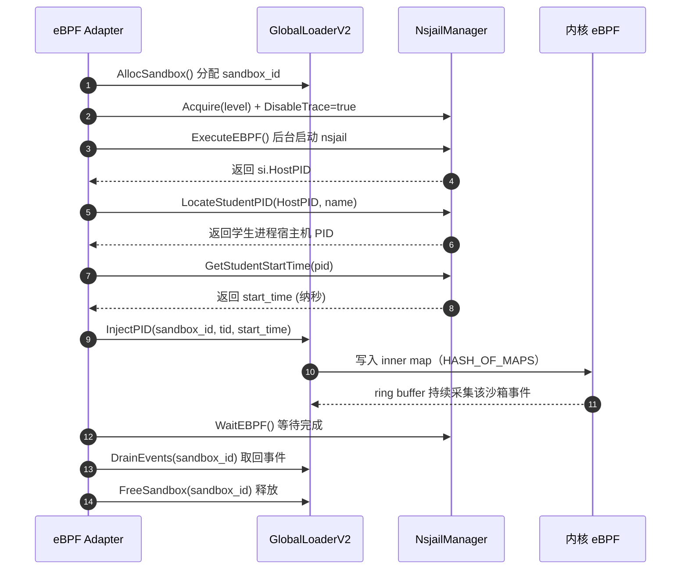

---

## 9. Docker 后端

### 9.1 Docker 后端的定位

Docker 后端提供**完整的容器隔离**，适合需要严格环境标准化的场景。相比 NsJail，它的隔离更强（完整镜像、网络隔离、只读根文件系统），但启动开销更高（秒级），且**不支持 eBPF 模式**（因为 Docker 默认使用独立的 PID 命名空间，eBPF 难以定位容器内进程的宿主机 PID）。

### 9.2 Docker run 参数解析

Docker 后端的核心是构造 `docker run` 命令：

```go
args := []string{
	"run",
	"--rm",
	"--name", containerName,
	"--memory", fmt.Sprintf("%dm", limits.memLimitMB),     // cgroup 内存限制
	"--cpus", fmt.Sprintf("%.2f", float64(limits.cpuPercent)/100.0),  // CPU 限制
	"--pids-limit", strconv.Itoa(limits.pidMax),            // PID 限制
	"--network", "none",                                    // 无网络
	"--read-only",                                          // 只读根文件系统
	"--tmpfs", "/tmp:rw,noexec,nosuid,size=64m",           // 临时目录
	"--security-opt", "no-new-privileges",                 // 禁止提权
	"-v", fmt.Sprintf("%s:/work:ro", workDir),             // 只读挂载二进制
}
```

| 参数 | 安全价值 |
|---|---|
| `--network none` | 完全断开网络，防外联 |
| `--read-only` | 根文件系统只读，防篡改 |
| `--tmpfs /tmp:noexec,nosuid` | 临时目录禁执行、禁 setuid |
| `--security-opt no-new-privileges` | 禁止进程通过 setuid 提权 |
| `--pids-limit` | 防 fork bomb |
| `--memory` / `--cpus` | cgroup 资源限制 |

Docker 后端的 strace 集成通过镜像内的 strace 实现：

```go
args = append(args,
	image,
	"strace", "-f", "-tt", "-T", "-k", "-o", "/strace/strace.log",
	fmt.Sprintf("/work/%s", binaryName),
)
```

**注意 `-f`（跟踪子进程）**：Docker 模式额外加了 `-f`，因为 Docker 内的进程树更复杂，需要跟踪 fork 出的子进程。

---

## 10. Local 后端降级

### 10.1 降级容错设计

Local 后端是最后的降级手段，用于本地开发调试。它的核心价值不是安全，而是**容错**——即使 strace 不可用，也绝不阻塞评测：

```go
func (m *LocalSandboxManager) Execute(ctx context.Context, sb *SandboxInstance, binary string, stdin []byte, timeout time.Duration) (*ExecResult, error) {
	ctx, cancel := context.WithTimeout(ctx, timeout)
	defer cancel()

	var tracePath string
	var cmd *exec.Cmd

	// Prefer strace-based execution for syscall tracing, but never let a
	// missing/unsupported tracer prevent the binary from running. If strace is
	// unavailable we fall back to direct execution so evaluation still works.
	if sb != nil && sb.DisableTrace {
		cmd = exec.CommandContext(ctx, binary)
	} else if _, lookErr := exec.LookPath("strace"); lookErr != nil {
		log.Printf("[Sandbox] strace not found (%v); running %s directly without tracing", lookErr, binary)
		cmd = exec.CommandContext(ctx, binary)
	} else {
		traceFile, err := os.CreateTemp("", "traceos-strace-*.log")
		if err == nil {
			tracePath = traceFile.Name()
			traceFile.Close()
		}
		if tracePath != "" {
			cmd = exec.CommandContext(ctx, "strace", "-f", "-tt", "-T", "-k", "-o", tracePath, binary)
		} else {
			cmd = exec.CommandContext(ctx, binary)
		}
	}
	// ... 进程组强杀逻辑 ...
}
```

**关键设计：`exec.LookPath("strace")` 预检**。如果 strace 不在 PATH 中，直接降级为无观测执行，并记录日志。这体现了"主路径与降级路径并存"的工程原则——**观测缺失不能阻塞评测**。

---

## 11. 纵深防御体系总结

### 11.1 五道防线

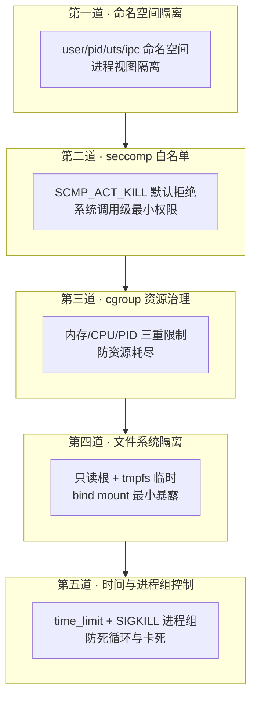

### 11.2 威胁模型分析

| 威胁 | 防线 | 应对 |
|---|---|---|
| fork bomb（进程爆炸） | D3 | `cgroup_pids_max` 限制 |
| 内存耗尽（malloc 无限） | D3 | `cgroup_mem_max` 限制 |
| 死循环 | D5 | `time_limit` + SIGKILL |
| 访问宿主机文件 | D4 + D1 | bind mount 最小暴露 + 命名空间 |
| 调用危险系统调用（mount/reboot） | D2 | seccomp 默认 KILL |
| 网络外联 | Docker `--network none` | 完全断网 |
| 提权（setuid） | Docker `no-new-privileges` | 禁止提权 |
| PID 复用误判 | eBPF 复合键 | `(tid, start_time)` |
| 信号处理器阻止退出 | D5 | SIGKILL 进程组强杀 |

---

## 12. 沙箱子系统的评审价值

TraceOS Lab 的沙箱子系统体现的工程价值：

1. **接口抽象**：`SandboxManager` 接口 + 三后端实现，让评测主链路与具体隔离技术解耦，未来可无缝接入 gVisor、Firecracker 等更强隔离；
2. **纵深防御**：五道防线层层递进，而非依赖单一机制；
3. **最小权限**：6 套 seccomp 白名单按实验类别精细裁剪，而非"一刀切"全放或全禁；
4. **eBPF 协同**：沙箱与观测深度配合，`(tid, start_time)` 复合键解决 PID 复用问题，是 eBPF 生产化的关键工程细节；
5. **降级容错**：NsJail → Docker → Local 三级降级，任何环境都能运行；
6. **并发治理**：三层限流（WorkerPool → 沙箱池 → 信号量）保证高吞吐下的稳定性。

这些不是"用了 NsJail"的简单堆砌，而是"如何安全、稳定、可复现地运行不可信代码"的完整工程回答。

---

## 13. SandboxLevel 三级安全的精确语义

前文第 3 章给出了三级安全等级的配置源码与实验映射，本章从**安全语义**的角度再次深化：沙箱的"安全等级"不是抽象概念，而是一套精确的资源与权限矩阵，三个等级分别对应不同实验类别的安全需求。

### 13.1 三级安全的完整参数

| 参数 | Level 1（Standard） | Level 2（Secure） | Level 3（Hardened） |
|---|---|---|---|
| 内存上限 | 256MB | 128MB | 64MB |
| CPU 限制 | 80% | 60% | 50% |
| 适用实验 | 进程/线程管理 | 内存/文件/调度 | 死锁/高危实验 |
| seccomp 严格度 | 白名单（宽松） | 白名单（中等） | 白名单（严格） |

### 13.2 等级选择的依据

等级的选择不是随意的，而是基于**实验的"危险系数"**：

| 实验类别 | 危险点 | 等级 |
|---|---|---|
| 进程管理 | fork 爆炸、僵尸进程 | Level 1（内存给足，防 fork 爆炸靠 pid 上限） |
| 内存分配 | mmap 滥用、OOM | Level 2（内存收紧，防 OOM） |
| 死锁 | 无限 futex 等待、锁竞争 | Level 3（最严，资源最少，快速失败） |

### 13.3 等级与 seccomp profile 的联动

每个等级对应一套实验专属的 seccomp profile（如 `process-lab.json`、`deadlock-lab.json`）。等级决定资源上限，profile 决定系统调用白名单，二者共同构成"资源 + 权限"的双重约束。

---

## 14. seccomp 白名单的工程结构

第 5 章已经给出了六套 profile 的完整内容与分类分析，本章聚焦 seccomp profile 的**工程结构语义**：seccomp profile 是 JSON 文件，核心是 `defaultAction` 与 `syscalls` 白名单。

### 14.1 严格白名单的语义

```json
{
  "defaultAction": "SCMP_ACT_KILL",
  "syscalls": [
    {"name": "read", "action": "SCMP_ACT_ALLOW"},
    {"name": "write", "action": "SCMP_ACT_ALLOW"}
  ]
}
```

`defaultAction = SCMP_ACT_KILL` 意味着**任何未在白名单中的系统调用都会立即杀死进程**。这是"默认拒绝"的最小权限模型，与"默认允许 + 黑名单"相反。

### 14.2 为什么用白名单而非黑名单

| 模型 | 安全性 | 维护成本 |
|---|---|---|
| 黑名单（默认允许） | 低，遗漏即漏洞 | 低 |
| 白名单（默认拒绝） | 高，未列出即禁止 | 高，需穷举 |

对于运行**不可信学生代码**的场景，安全性是压倒性的，因此选白名单。维护成本通过"按实验类别划分 profile"来控制——每类实验只允许它需要的系统调用。

### 14.3 六套 profile 的划分

| profile | 允许的核心系统调用 |
|---|---|
| process-lab | fork/clone/execve/wait4 等进程族 |
| thread-lab | futex/clone 等线程族 |
| memory-lab | brk/mmap/munmap 等内存族 |
| fs-lab | open/read/write/close 等文件族 |
| scheduler-lab | sched_* 等调度族 |
| deadlock-lab | futex + 最小集合 |

按实验划分 profile 的好处是**攻击面最小化**——做进程实验的学生进程，没有理由调用 `socket` 或 `mount`，因此在 process-lab 里它们都被 KILL。

---

## 15. cgroup 资源治理

seccomp 管"能调什么系统调用"，cgroup 管"能用多少资源"。二者互补，共同构成沙箱的资源治理体系。

### 15.1 三类 cgroup 限制

| 控制器 | 限制内容 | 防的滥用 |
|---|---|---|
| memory | 内存上限 | OOM 拖垮宿主机 |
| pids | 进程数上限 | fork 炸弹 |
| cpu | CPU 配额 | CPU 打满 |

### 15.2 时间上限与进程组强杀

cgroup 之外，还有两层时间/进程治理：

1. **时间上限**：`time.Duration(strategy.TimeLimit())` 控制单次执行上限，超时即 kill；
2. **进程组强杀**：执行通过 `Setpgid` 建立进程组，超时或异常时对整个进程组发信号，确保**不残留孤儿进程**。

### 15.3 资源治理与评测公平

资源限制不仅是安全手段，也是**评测公平**的保障。统一的资源上限意味着所有学生在相同的资源约束下评测，"我的程序内存大所以跑得快"这类靠资源堆出来的优势被消除。

---

## 16. 沙箱池的并发调度

沙箱的创建/销毁是昂贵操作，池化是并发评测的关键。本章从生命周期视角补充第 6 章的实现细节。

### 16.1 池的生命周期

| 阶段 | 动作 |
|---|---|
| 初始化 | `NewPool(manager, maxSize)` 建立池 |
| 预热 | `StartPrealloc` 预分配 N 个实例 |
| 获取 | `Acquire` 命中预分配实例或新建 |
| 释放 | `Release` 归还实例 |
| 关闭 | `Shutdown` 释放全部实例 |

### 16.2 预热的意义

`StartPrealloc(ctx, 3, LevelStandard)` 在启动时就预分配 3 个标准等级实例。这消除了前几个提交的"冷启动税"——学生在平台刚启动时提交，也能立即获得沙箱，而不是等待沙箱首次初始化。

### 16.3 三层限流的协同

```text
WorkerPool（评测任务层）→ 沙箱池（实例层）→ 信号量（执行层）
```

三层各司其职：WorkerPool 控 CPU 并发度，沙箱池复用实例，信号量控内存峰值。任何一层单独都不够，三层协同才构成完整的并发治理。

---

## 17. 多后端的选择逻辑

`SandboxFactory` 按 `SANDBOX_BACKEND` 环境变量选择后端，这是"策略模式"的典型应用。

### 17.1 三后端的完整对比

| 维度 | NsJail | Docker | Local |
|---|---|---|---|
| 隔离机制 | user/pid/uts/ipc 命名空间 + seccomp + cgroup | 完整容器 + read-only + no-new-privileges | 无隔离 + rlimit |
| 启动开销 | 毫秒级 | 秒级 | 极低 |
| strace 集成 | exec_bin 直指 strace | 镜像内装 strace | 原生 |
| eBPF 集成 | HostPID 暴露 | 困难 | 原生 |
| 适用场景 | 生产默认 | 完整环境标准化 | 开发调试 |

### 17.2 为什么默认 NsJail 而非 Docker

赛题要求"基于容器技术"，但 NsJail 是更优的默认选择：

| 原因 | 说明 |
|---|---|
| 启动快 | 毫秒级，适合高频评测 |
| strace 原生 | exec_bin 直接指向 strace，无需镜像内装 |
| eBPF 友好 | HostPID 暴露，eBPF 能精确注入 PID |
| 轻量 | 无需完整容器运行时 |

Docker 作为需要"完整环境标准化"时的备选，Local 作为开发调试的兜底。三者通过统一接口切换，评测主链路不感知差异。

### 17.3 Local 后端的安全警示

`config.go` 的 `validate()` 明确警告：`SANDBOX_MODE=local` 时代码无隔离运行，仅限开发。这个警示体现了对"降级路径的安全边界"的清醒——**降级可以牺牲观测精度，但必须显式警告牺牲了安全**。

---

## 18. 沙箱的生命周期契约

`SandboxManager` 接口定义了沙箱生命周期的完整契约，是理解整个沙箱子系统的关键。

### 18.1 接口方法清单

| 方法 | 职责 |
|---|---|
| Acquire | 创建/获取指定等级的沙箱实例 |
| Execute | 执行二进制并返回结果 |
| ExecuteEBPF | 配合 eBPF 采集执行 |
| WaitEBPF | 等待 eBPF 采集完成 |
| Release | 归还实例 |
| Shutdown | 关闭整个管理器 |

### 18.2 契约的价值

接口抽象让评测管线（`TestCaseRunner`、`Pipeline`）不依赖具体后端。这带来三个直接收益：

1. **可测试**：测试可用 mock 实现替换真实沙箱；
2. **可替换**：新增后端（如 Firecracker）只需实现接口；
3. **可降级**：后端切换不影响上层评测逻辑。

---

## 19. 安全纵深的总览

沙箱子系统的安全不是单点，而是纵深防御：

```text
命名空间隔离（user/pid/uts/ipc）
  → seccomp 白名单（系统调用级）
  → cgroup 资源限制（资源级）
  → 时间上限 + 进程组强杀（生命周期级）
  → 沙箱池（并发治理）
```

五层从"空间隔离"到"调用白名单"到"资源配额"到"生命周期"到"并发调度"，每一层都针对一类具体的攻击面。这种纵深防御让"运行不可信学生代码"从危险动作变成可控动作。

---

## 20. SandboxFactory 工厂体系与配置化治理

前文多次提到 `SandboxFactory`，本章展开它的完整工程实现。工厂模式在这里承载的不仅是"创建对象"，更是**沙箱治理的配置中枢**：后端的启动选择、惰性实例化、生命周期聚合清理，全部收敛在一个类型中。

### 20.1 工厂模式的四个工程价值

| 价值 | 说明 | 无工厂时的反模式 |
|---|---|---|
| 配置收敛 | `SANDBOX_BACKEND` 一个环境变量决定全局后端 | 每个调用点各自读环境变量、各自 switch |
| 惰性实例化 | 只在真正用到某后端时才创建其管理器 | 启动时创建全部三个后端，浪费资源 |
| 生命周期聚合 | `Shutdown()` 一次调用清理所有已创建后端 | 调用方需要自己跟踪所有管理器 |
| 策略协同 | 支持"默认后端 + 实验级覆盖" | 全局一种后端，无法按实验差异化 |

### 20.2 NewSandboxFactory 完整源码

```go
// SandboxFactory creates the appropriate SandboxManager based on configuration.
// It supports three modes:
//   - "nsjail": lightweight namespace-based isolation (default, best for high-throughput)
//   - "docker": full Docker container isolation (best for environment standardization)
//   - "local": direct execution without isolation (development only)
//   - "auto": select backend per experiment based on strategy hints
type SandboxFactory struct {
	defaultBackend SandboxBackend
	dockerMgr      *DockerSandboxManager
	nsjailMgr      *NsjailSandboxManager
	localMgr       *LocalSandboxManager
}

// NewSandboxFactory creates a factory. Caller should defer Shutdown() on the
// returned Pool (which wraps the primary manager for backward compatibility).
func NewSandboxFactory() *SandboxFactory {
	backend := SandboxBackend(os.Getenv("SANDBOX_BACKEND"))
	if backend == "" {
		backend = BackendNsjail // default: nsjail for best strace control
	}

	f := &SandboxFactory{
		defaultBackend: backend,
	}

	switch backend {
	case BackendDocker:
		f.dockerMgr = NewDockerSandboxManager()
	case BackendLocal:
		f.localMgr = NewLocalSandboxManager()
	default:
		f.nsjailMgr = NewNsjailSandboxManager()
	}

	return f
}
```

**读码要点**：

1. **默认值后置**：环境变量为空时落到 `BackendNsjail`。注释直接写明理由——"for best strace control"，即 NsJail 的 `exec_bin` 机制对 strace 的控制力最强；
2. **只实例化默认后端**：工厂构造时只创建与 `SANDBOX_BACKEND` 匹配的一个管理器，另外两个字段保持 `nil`。这避免了"启动一个 nsjail 评测服务却还要初始化 Docker 管理器"的资源浪费；
3. **向后兼容提示**：注释明确告诉调用方用 `Pool` 包装主管理器（见 `main.go` 中 `sandbox.NewPool(baseManager, 5)`），接口演化中保留了老路径。

### 20.3 GetManager 的惰性初始化

```go
// GetManager returns the SandboxManager for a given backend type.
// If backend is empty, uses the factory's default.
func (f *SandboxFactory) GetManager(backend SandboxBackend) (SandboxManager, error) {
	if backend == "" {
		backend = f.defaultBackend
	}

	switch backend {
	case BackendDocker:
		if f.dockerMgr == nil {
			f.dockerMgr = NewDockerSandboxManager()
		}
		return f.dockerMgr, nil
	case BackendLocal:
		if f.localMgr == nil {
			f.localMgr = NewLocalSandboxManager()
		}
		return f.localMgr, nil
	case BackendNsjail:
		if f.nsjailMgr == nil {
			f.nsjailMgr = NewNsjailSandboxManager()
		}
		return f.nsjailMgr, nil
	default:
		return nil, fmt.Errorf("unknown sandbox backend: %s", backend)
	}
}
```

**惰性初始化的意义**：当评测策略要求某个实验用 Docker 后端（如 FileStrategy 指定 `docker`）而系统默认 NsJail 时，`GetManager(BackendDocker)` 会在**第一次真正需要时**才创建 Docker 管理器。这样：

- 纯 NsJail 部署不承担 Docker 的初始化成本（dockerd 探测、镜像存在性校验）；
- 混合部署下，Docker 管理器天然是单例——所有 Docker 实验共享一个管理器实例，共享其内部信号量，避免并发失控；
- 未知后端名返回结构化错误 `unknown sandbox backend: %s`，配置错误在启动早期即暴露。

### 20.4 Shutdown 的错误聚合模式

```go
// Shutdown cleans up all sandbox backends.
func (f *SandboxFactory) Shutdown() error {
	var errs []error
	if f.dockerMgr != nil {
		if err := f.dockerMgr.Shutdown(); err != nil {
			errs = append(errs, err)
		}
	}
	if f.nsjailMgr != nil {
		if err := f.nsjailMgr.Shutdown(); err != nil {
			errs = append(errs, err)
		}
	}
	if f.localMgr != nil {
		if err := f.localMgr.Shutdown(); err != nil {
			errs = append(errs, err)
		}
	}
	if len(errs) > 0 {
		return fmt.Errorf("shutdown errors: %v", errs)
	}
	return nil
}
```

**工程细节**：

1. **非短路清理**：不是"第一个后端清理失败就 return"，而是尝试清理全部三个后端，最后聚合报告。避免一个后端的清理失败阻塞另外两个后端的资源回收；
2. **nil 安全**：未实例化的后端直接跳过——工厂只清理"确实创建过"的东西；
3. **错误聚合**：`fmt.Errorf("shutdown errors: %v", errs)` 把多个错误合并为一个返回，符合 Go 1.20+ 的 `errors.Join` 思想。

### 20.5 环境变量配置矩阵

沙箱子系统的全部运行参数都由环境变量驱动，这是"配置即代码"的容器化部署习惯的延伸：

| 环境变量 | 作用域 | 默认值 | 语义 |
|---|---|---|---|
| `SANDBOX_BACKEND` | 工厂 | `nsjail` | 全局默认后端（nsjail / docker / local） |
| `NSJAIL_BIN` | NsJail | `/usr/local/bin/nsjail` | nsjail 可执行文件路径 |
| `NSJAIL_WORK_DIR` | NsJail | `/tmp/traceos-nsjail` | 沙箱工作目录（配置/strace 输出） |
| `NSJAIL_MAX_CONCURRENT` | NsJail | `5`（上限 20） | 并发沙箱实例信号量 |
| `DOCKER_BIN` | Docker | `docker` | docker CLI 路径 |
| `DOCKER_SANDBOX_IMAGE` | Docker | `traceos-lab-sandbox:latest` | 默认沙箱镜像 |
| `DOCKER_WORK_DIR` | Docker | `/tmp/traceos-docker` | 二进制拷贝与 strace 输出目录 |
| `DOCKER_MAX_CONCURRENT` | Docker | `5`（上限 20） | 并发容器信号量 |

**上限校验的防御性**：`NSJAIL_MAX_CONCURRENT` 与 `DOCKER_MAX_CONCURRENT` 都执行 `v > 0 && v <= 20` 的边界校验，越界值静默回退默认值。这是对"配置漂移"的防御——一个误写的 `NSJAIL_MAX_CONCURRENT=2000` 不会真的启动 2000 个 nsjail 实例拖垮宿主机。

### 20.6 工厂与实验策略的后端协同

工厂提供"默认后端"，但评测策略可以**按实验类别覆盖后端**——`ExperimentStrategy` 接口的 `SandboxBackend()` 方法就是为此设计：

| 实验策略 | SandboxBackend() | 设计理由 |
|---|---|---|
| ProcessStrategy | `nsjail` | 进程实验需要 eBPF/strace 观测 |
| ThreadStrategy | `nsjail` | 线程实验需要 futex 级观测 |
| MemoryStrategy | `nsjail` | 内存实验需要 mmap 级观测 |
| FileStrategy | `docker` | 文件实验需要完整文件系统环境标准化 |

这种"默认 + 覆盖"的两级选择机制，让系统在**全局一致**与**局部最优**之间取得平衡：全局默认 NsJail 保证观测能力与吞吐，个别实验切换到 Docker 换取环境标准化。

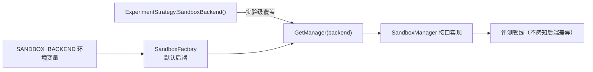

---

## 21. 沙箱与评测管线的契约协同

沙箱不是孤立组件，它与评测管线（TestCaseRunner、Pipeline）通过严格契约协同。本章从评测管线的视角审视沙箱：**评测如何驱动沙箱、沙箱结果如何转化为教学语义**。

### 21.1 TestCaseRunner 的沙箱调用契约

`internal/evaluator/runner.go` 是沙箱的消费方，其 `runOne` 方法展示了一个完整的沙箱使用会话：

```go
func (r *TestCaseRunner) runOne(ctx context.Context, binaryPath string, tc model.TestCase, level sandbox.SandboxLevel, strategy ExperimentStrategy) (*TestResult, error) {
	sb, err := r.manager.Acquire(ctx, level)
	if err != nil {
		return nil, fmt.Errorf("acquire sandbox: %w", err)
	}
	defer r.manager.Release(sb)

	// Honor strategy DisableTrace setting
	sb.DisableTrace = strategy.DisableTrace()

	timeout := time.Duration(strategy.TimeLimit()) * time.Second
	execResult, err := r.manager.Execute(ctx, sb, binaryPath, []byte(tc.InputData), timeout)
	if err != nil {
		return &TestResult{
			TestCaseID:   tc.ID,
			Name:         tc.Name,
			Passed:       false,
			ScoreWeight:  tc.ScoreWeight,
			RuntimeError: StrPtr(fmt.Sprintf("execution error: %v", err)),
		}, nil
	}
	// ... 输出归一化、比较、评分 ...
}
```

这个会话揭示了五条契约：

| 契约 | 内容 | 价值 |
|---|---|---|
| 生命周期对称 | `Acquire` 与 `Release` 通过 `defer` 配对 | 任何错误路径都不会泄漏沙箱槽位 |
| 策略驱动参数 | level / timeout / DisableTrace 全部来自策略 | 评测管线零硬编码，实验差异化下沉到策略层 |
| 错误软化 | 沙箱执行错误不中断整体评测，转化为 `RuntimeError` 结果项 | 一个用例的沙箱故障不影响其他用例 |
| 结果透传 | `TraceFile`/`MemoryUsage`/`ExecTime` 原样进入 `TestResult` | 沙箱采集的教学数据无损到达报告层 |
| 输入注入 | `tc.InputData` 直接作为 stdin | 测试用例的标准输入成为沙箱内进程的 stdin |

### 21.2 RunAll 的双层并发限流

`RunAll` 组织一次提交的所有测试用例的并发执行：

```go
// maxParallelTests bounds how many test cases run concurrently. The sandbox
// manager's own semaphore (nsjail: NSJAIL_MAX_CONCURRENT) is the stricter
// limiter; this cap only prevents unbounded goroutine fan-out for backends
// without an internal limit (e.g. local execution).
const maxParallelTests = 8

func (r *TestCaseRunner) RunAll(ctx context.Context, binaryPath string, testCases []model.TestCase, strategy ExperimentStrategy) ([]TestResult, error) {
	level := sandbox.SandboxLevel(strategy.SandboxLevel())
	rerunCount := strategy.RerunCount()
	if rerunCount < 1 {
		rerunCount = 1
	}

	results := make([]TestResult, len(testCases))
	var firstErr error
	var errMu sync.Mutex
	sem := make(chan struct{}, maxParallelTests)
	var wg sync.WaitGroup

	for i, tc := range testCases {
		wg.Add(1)
		go func(i int, tc model.TestCase) {
			defer wg.Done()
			sem <- struct{}{}
			defer func() { <-sem }()
			// ... run + rerun loop ...
		}(i, tc)
	}
	wg.Wait()
	return results, firstErr
}
```

**双层限流的关系**（源码注释自己点破了设计意图）：

- **用例层信号量（maxParallelTests = 8）**：限制单个提交的用例 goroutine 扇出。它的注释明确指出沙箱管理器的信号量才是"更严格的限流器"，用例层上限只是防止 local 等无内建限流后端的 goroutine 无限扇出；
- **沙箱层信号量（NSJAIL_MAX_CONCURRENT = 5）**：限制真正运行的沙箱实例数。

两层叠加的效果：**同一时刻真正运行的学生进程不超过 5 个**，而排队的用例 goroutine 最多 8 个。当 10 个用例并发提交时，8 个进入执行（其中 5 个真正运行、3 个阻塞在沙箱信号量上），2 个在用例层排队。这形成了一条自组织的"缓冲 → 执行"流水线。

### 21.3 重跑机制：确定性之上的容错

```go
var bestResult *TestResult
for run := 0; run < rerunCount; run++ {
	result, err := r.runOne(ctx, binaryPath, tc, level, strategy)
	if err != nil {
		// 记录第一个错误后返回，不再重试
		return
	}
	if bestResult == nil || result.Passed {
		bestResult = result
	}
	if result.Passed {
		break
	}
}
```

重跑逻辑的三条规则：

1. **best-of-N 取优**：`bestResult == nil || result.Passed` 意味着只要某次通过就记录该结果；
2. **通过即短路**：`if result.Passed { break }`，通过后不再重跑，节省算力；
3. **错误即放弃**：沙箱级错误（如 Acquire 失败）不重试，直接记入 `firstErr` 并退出该用例。

为什么需要重跑？这不是为"评分随机性"兜底（评分是确定性的），而是为**环境抖动**兜底——宿主负载尖峰导致的偶发超时、文件系统瞬时繁忙导致的启动慢。重跑给了这类"非代码原因"的失败一次自我纠正的机会，本质上是在维护"评测公平性"。

### 21.4 六类实验策略的沙箱参数矩阵

策略层把"该实验在沙箱里怎么跑"完全参数化：

| 策略 | SandboxLevel | TimeLimit | DisableTrace | 后端 | 重跑 |
|---|---|---|---|---|---|
| ProcessStrategy | 1 | 30s | false | nsjail | 1 |
| ThreadStrategy | 2 | 30s | false | nsjail | 1 |
| MemoryStrategy | 2 | 120s | false | nsjail | 1 |
| FileStrategy | 1 | 60s | **true** | **docker** | 1 |
| SchedulerStrategy | 2 | 30s | false | nsjail | 1 |
| DeadlockStrategy | 3 | 30s | false | nsjail | 1 |

**两个值得注意的设计**：

1. **MemoryStrategy 的 120s 时限**：内存实验需要观察 mmap 大块内存、brk 扩展、缺页异常等行为，程序本身可能较慢，且 strace 记录海量内存系统调用会拖慢执行，因此给足 120 秒；
2. **FileStrategy 的 DisableTrace=true + docker 后端**：文件实验关注的是文件内容的正确性而非系统调用行为，且 Docker 后端的 strace 支持不如 NsJail 精细，于是显式关闭 strace 采集、切换 Docker 以获得标准化文件系统环境。这体现了"观测按需开关"的工程克制——**不是所有实验都需要双轨观测，观测是手段而非目的**。

### 21.5 沙箱结果的教学语义转化

沙箱的 `ExecResult` 在评测管线中被转化为具有教学语义的 `TestResult`：

| ExecResult 字段 | TestResult 去向 | 教学语义 |
|---|---|---|
| `Stdout` | `ActualOutput` | 与期望输出比对，参与断言 |
| `ExitCode` | `ExitCode` | 与 `strategy.ExitCodeRequired()` 比对 |
| `Killed` | `RuntimeError = "execution timeout"` | 超时/OOM 的显式标记 |
| `ExecTime` | `ExecTime` | 性能分析素材 |
| `MemoryUsage` | `MemoryUsage` | 内存足迹分析素材 |
| `TraceFile` | `TraceFile` | 观测数据入口，供 ObsContext 解析 |

`Killed` 标志尤其关键：一个被 SIGKILL 的进程，其 stdout 可能是"半个输出"。如果直接拿半个输出做断言比对，会得到误导性的失败。TraceOS 通过 `!execResult.Killed` 参与判定——被杀死的执行直接判负并标记 `execution timeout`，而不是"输出不匹配"。**失败原因的可区分性，是教学系统诊断能力的第一块基石**。

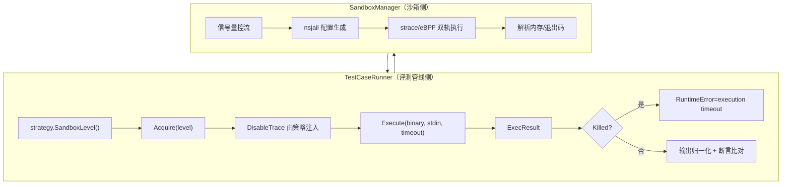

---

## 22. Docker 后端完整实现深度剖析

第 9 章给出了 Docker 后端的参数表，本章给出**逐行的实现级剖析**。Docker 后端的代码量（292 行）是三个后端中最大的，因为容器生命周期管理远比 NsJail 的一次性配置复杂。

### 22.1 结构与管理器初始化

```go
type DockerSandboxManager struct {
	mu            sync.Mutex
	nextID        atomic.Int64
	dockerBin     string
	defaultImage  string
	workBase      string
	maxConcurrent int
	semaphore     chan struct{}
}
```

与 NsJail 管理器的差异：

| 字段 | NsJail | Docker | 差异原因 |
|---|---|---|---|
| 实例登记 | `pool map[string]*nsjailSandbox` | 无（容器名即实例 ID） | Docker 自身维护容器状态，无需进程句柄 |
| 工作目录 | 每实例 `workDir` | 每实例 `workDir` | 均需存放二进制与 strace 输出 |
| 后台进程句柄 | `cmd *exec.Cmd`（eBPF 模式） | 无 | Docker 不支持 eBPF 模式 |
| 信号量 | `chan struct{}`（默认 5） | `chan struct{}`（默认 5） | 并发容器同样限量 |

### 22.2 Acquire：容器延迟创建策略

```go
// Acquire creates a work directory and registers the sandbox instance.
// Docker containers are created on-demand during Execute, not pre-allocated.
func (m *DockerSandboxManager) Acquire(ctx context.Context, level SandboxLevel) (*SandboxInstance, error) {
	select {
	case m.semaphore <- struct{}{}:
	case <-ctx.Done():
		return nil, ctx.Err()
	}
	m.mu.Lock()
	defer m.mu.Unlock()

	id := fmt.Sprintf("docker-%d-%d", level, m.nextID.Add(1))
	workDir := filepath.Join(m.workBase, id)
	if err := os.MkdirAll(workDir, 0o755); err != nil {
		<-m.semaphore
		return nil, fmt.Errorf("docker: mkdir workdir: %w", err)
	}
	// ...
}
```

注释点明了关键设计：**容器在 Execute 时才创建，而非 Acquire 时**。Docker 容器创建是秒级开销，如果像 NsJail 那样在 Acquire 时预建，会导致：

- 预分配（StartPrealloc）成本极高——预建 3 个容器要 3 秒以上；
- 大量空闲容器占用 cgroup、内存、dockerd 调度槽位。

因此 Docker 后端把 Acquire 的成本压到最低（一次 mkdir），把真实容器创建推迟到真正执行时。这是"资源惰性化"原则在后端设计上的直接体现。

### 22.3 Execute：容器化执行的完整流程

```go
func (m *DockerSandboxManager) Execute(ctx context.Context, si *SandboxInstance, binary string, stdin []byte, timeout time.Duration) (*ExecResult, error) {
	limits := resourceLimits(si.Level)
	cfg, err := GetConfig(si.Level)
	// ...
	image := cfg.DockerImage
	if image == "" {
		image = m.defaultImage
	}

	// 1. 把学生二进制复制进工作目录（容器内只读挂载）
	binaryName := filepath.Base(binary)
	binaryDest := filepath.Join(workDir, binaryName)
	if err := copyFile(binary, binaryDest); err != nil {
		return nil, fmt.Errorf("docker: copy binary: %w", err)
	}
	_ = os.Chmod(binaryDest, 0o755)

	// 2. 组装 docker run 参数
	args := []string{
		"run", "--rm", "--name", containerName,
		"--memory", fmt.Sprintf("%dm", limits.memLimitMB),
		"--cpus", fmt.Sprintf("%.2f", float64(limits.cpuPercent)/100.0),
		"--pids-limit", strconv.Itoa(limits.pidMax),
		"--network", "none",
		"--read-only",
		"--tmpfs", "/tmp:rw,noexec,nosuid,size=64m",
		"--security-opt", "no-new-privileges",
		"-v", fmt.Sprintf("%s:/work:ro", workDir),
	}

	// 3. strace 模式：挂载输出目录 + strace 包装
	if !si.DisableTrace {
		straceDir := filepath.Join(workDir, "strace-output")
		os.MkdirAll(straceDir, 0o755)
		args = append(args, "-v", fmt.Sprintf("%s:/strace:rw", straceDir))
		args = append(args, image, "strace", "-f", "-tt", "-T", "-k", "-o", "/strace/strace.log", fmt.Sprintf("/work/%s", binaryName))
	} else {
		args = append(args, image, fmt.Sprintf("/work/%s", binaryName))
	}

	// 4. 超时兜底 goroutine
	timeoutCtx, cancel := context.WithTimeout(ctx, timeout+10*time.Second)
	defer cancel()
	cmd := exec.CommandContext(timeoutCtx, m.dockerBin, args...)
	// ...
	go func() {
		<-timeoutCtx.Done()
		if timeoutCtx.Err() == context.DeadlineExceeded {
			killCmd := exec.Command(m.dockerBin, "kill", containerName)
			_ = killCmd.Run()
		}
	}()
	// ...
}
```

**四个实现级要点**：

1. **二进制复制而非挂载源码目录**：只复制编译产物到工作目录，再以 `-v workDir:/work:ro` 只读挂载。学生源码、编译中间产物、其他评测资产一概不进容器——最小暴露面；
2. **CPU 限制的换算**：`--cpus 0.80` 来自 `cpuPercent/100` 的浮点换算。Docker 的 `--cpus` 是 CPU 核数的配额语义（0.8 核 = 80% 单核），与 NsJail 的百分比语义在此对齐；
3. **超时缓冲差异**：Docker 用 `timeout+10s`（NsJail 用 +5s），因为 Docker 冷启动包含镜像层查找、容器创建、cgroup 挂载，需要更宽的缓冲；
4. **`docker kill` 兜底**：`context.DeadlineExceeded` 触发时对容器补发 `docker kill`（SIGKILL）。注意容器名 = 沙箱实例 ID（`docker-{level}-{seq}`），保证 kill 目标与本次执行一一对应。

### 22.4 Release 与 Shutdown：容器清理治理

```go
func (m *DockerSandboxManager) Release(si *SandboxInstance) error {
	workDir := filepath.Join(m.workBase, si.ID)

	// Best-effort cleanup: remove any lingering container
	cleanupCmd := exec.Command(m.dockerBin, "rm", "-f", si.ID)
	_ = cleanupCmd.Run()

	// Clean up work directory in background
	go func(dir string) { _ = os.RemoveAll(dir) }(workDir)

	<-m.semaphore
	return nil
}
```

**三层清理语义**：

1. `docker rm -f` 强删残留容器（`--rm` 只保证正常退出时删除，被 kill 的容器仍需手动清）；
2. 工作目录异步 `RemoveAll`——清理不阻塞评测链路，下一个提交不需要等待磁盘回收；
3. 归还信号量槽位，让排队中的评测继续。

`Shutdown` 则做全量清理：遍历 `workBase` 下所有 `docker-` 前缀目录，逐个 `docker rm -f` 并删除目录。前缀过滤避免了误删无关文件。

### 22.5 Docker 后端不支持 eBPF 的原因分析

```go
func (m *DockerSandboxManager) ExecuteEBPF(...) (*ExecResult, error) {
	return nil, fmt.Errorf("ExecuteEBPF not supported with Docker backend")
}
```

这不是能力缺失，而是**架构性约束**的显式表达：

1. **PID 定位困境**：容器内进程在宿主机的 PID 需要穿透 dockerd、containerd-shim 两层才能定位，且容器默认 PID 命名空间使 `LocateStudentPID` 的 `/proc` 遍历逻辑失效；
2. **eBPF 观测者部署位置**：全局 eBPF loader 运行在宿主机，而 Docker 后端的价值恰恰在于"完整环境标准化"（独立镜像工具链）——观测者与被观测者的镜像可能不一致；
3. **错误语义清晰**：接口实现直接返回结构化错误而非 panic 或静默降级，让调用方（ebpf adapter）能明确感知"此路径不可用"并切换到 strace。

这再次印证了系统的**能力矩阵设计哲学**：每个后端明确声明自己的能力边界，能力缺失以显式错误表达，而不是隐藏的意外行为。

---

## 23. Local 后端完整实现与降级语义

### 23.1 LocalSandboxManager 的极简结构

```go
// LocalSandboxManager executes binaries locally with resource limits.
type LocalSandboxManager struct{}

func NewLocalSandboxManager() *LocalSandboxManager {
	return &LocalSandboxManager{}
}
```

Local 后端是**零字段结构体**——无池、无信号量、无工作目录管理。它的 Acquire 直接生成一个带纳秒时间戳的 ID（`local-{level}-{unixnano}`），不占任何系统资源。这是"降级路径最小化"的极端实践：**降级后端的复杂度必须趋近于零**，因为降级路径是灾难时刻唯一的依靠，它自己不能再有故障模式。

### 23.2 Execute 的三级选择逻辑

```go
func (m *LocalSandboxManager) Execute(ctx context.Context, sb *SandboxInstance, binary string, stdin []byte, timeout time.Duration) (*ExecResult, error) {
	ctx, cancel := context.WithTimeout(ctx, timeout)
	defer cancel()

	var tracePath string
	var cmd *exec.Cmd

	// Prefer strace-based execution for syscall tracing, but never let a
	// missing/unsupported tracer prevent the binary from running.
	if sb != nil && sb.DisableTrace {
		cmd = exec.CommandContext(ctx, binary)
	} else if _, lookErr := exec.LookPath("strace"); lookErr != nil {
		log.Printf("[Sandbox] strace not found (%v); running %s directly without tracing", lookErr, binary)
		cmd = exec.CommandContext(ctx, binary)
	} else {
		traceFile, err := os.CreateTemp("", "traceos-strace-*.log")
		if err == nil {
			tracePath = traceFile.Name()
			traceFile.Close()
		}
		if tracePath != "" {
			cmd = exec.CommandContext(ctx, "strace", "-f", "-tt", "-T", "-k", "-o", tracePath, binary)
		} else {
			cmd = exec.CommandContext(ctx, binary)
		}
	}
	// ...
}
```

决策树展开为：

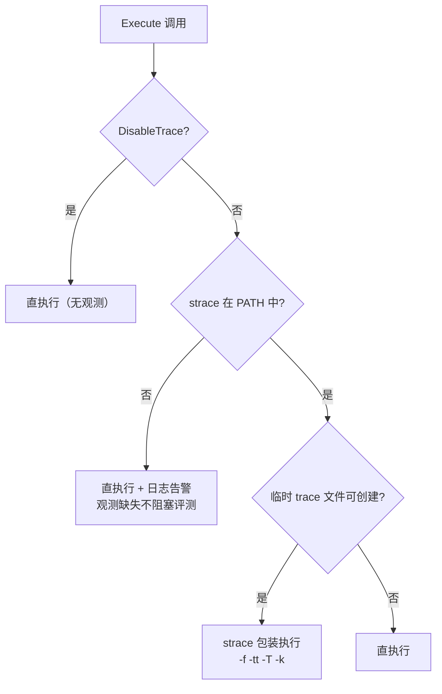

**四级降级语义**（从优到劣）：strace 包装 → 临时文件创建失败仍走直执行 → 无 strace 直执行 → DisableTrace 显式直执行。每一级都保证**评测本身继续**，损失只是观测精度。这与全文反复强调的架构原则 P4（降级链完备）一脉相承。

### 23.3 进程组强杀在 Local 后端的实现

```go
cmd.SysProcAttr = &syscall.SysProcAttr{
	Setpgid: true,
}

go func() {
	<-ctx.Done()
	if cmd.Process != nil {
		pgid, err := syscall.Getpgid(cmd.Process.Pid)
		if err == nil {
			syscall.Kill(-pgid, syscall.SIGKILL)
		} else {
			cmd.Process.Kill()
		}
	}
}()
```

即使是无隔离的 Local 后端，超时治理依然完整：`Setpgid` 建立进程组，`ctx.Done()` 触发时 `SIGKILL` 整个进程组（负 PGID 语义），`Getpgid` 失败时退化为单进程 kill。**降级的是隔离，不是治理**——这条原则值得所有做降级设计的人借鉴。

### 23.4 Local 后端的适用边界

| 场景 | 是否适合 | 理由 |
|---|---|---|
| 本地开发调试 | 适合 | 无特权要求，秒级可用 |
| CI 冒烟测试 | 适合 | 验证评测逻辑而非隔离 |
| 生产评测 | **禁止** | 无隔离，恶意代码可直击宿主机 |
| eBPF 功能验证 | 不适合 | 无 HostPID 定位机制 |

`config.go` 的 `validate()` 对 `SANDBOX_MODE=local` 给出显式警告——**降级可以牺牲观测精度，但必须显式警告牺牲了安全**。这种"诚实的降级"是安全系统的底线伦理：宁可让使用者明确知道风险，也不让风险悄悄发生。

---

## 24. Linux 命名空间隔离技术深入

前文从工程角度使用命名空间，本章从**内核机制**角度解释命名空间为什么能隔离、隔离了什么、又没隔离什么。理解这些，才能理解 TraceOS Lab 五道防线中每一道的精确边界。

### 24.1 命名空间的本质：进程的"视图"隔离

Linux 命名空间（namespace）的核心机制是：**把全局的内核资源打上命名空间标签，进程只能"看见"自己所在命名空间内的资源**。一个经典的类比是工作区的"虚拟现实"——进程以为自己是全系统的唯一公民，实际上它看到的世界只是整个世界的一个切片。

内核实现上，每个命名空间对应一个内核对象（如 `struct pid_namespace`、`struct user_namespace`），进程通过 `nsproxy` 结构持有指向这些对象的指针。`clone()` 系统调用的 `CLONE_NEW*` 标志族决定新进程是共享还是新建命名空间。

### 24.2 八种命名空间全景

| 命名空间 | 内核对象 | 隔离内容 | NsJail 是否启用 |
|---|---|---|---|
| Mount (mnt) | `struct mnt_namespace` | 挂载点视图 | 间接（bind mount 实现） |
| PID | `struct pid_namespace` | 进程编号视图 | ✅ `clone_newpid` |
| Network (net) | `struct net` | 网络设备、路由、套接字 | ❌（由 seccomp 禁 socket 替代） |
| UTS | `struct uts_namespace` | 主机名、域名 | ✅ `clone_newuts` |
| IPC | `struct ipc_namespace` | SysV IPC、POSIX 消息队列 | ✅ `clone_newipc` |
| User | `struct user_namespace` | UID/GID 映射、capabilities | ✅ `clone_newuser` |
| Cgroup | `struct cgroup_namespace` | cgroup 视图 | 间接（cgroup 限额） |
| Time | `struct time_namespace` | CLOCK_MONOTONIC 偏移 | ❌（教学需真实时钟） |

### 24.3 NsJail 选择四种命名空间的理由

TraceOS Lab 的 nsjail 配置固定启用 `user/pid/uts/ipc` 四种，其余以替代机制覆盖：

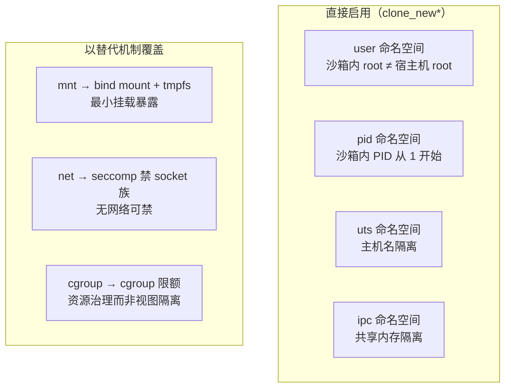

**为什么不用 net namespace？** 教学实验（进程/线程/内存/死锁）本质上是单机计算，不需要网络。NsJail 本身的网络配置能力有限，而 seccomp 白名单直接不放开 `socket`/`connect`/`bind` 等网络系统调用，比建一个空网络命名空间更简单、更彻底。Docker 后端则用 `--network none` 达到同等效果——两条技术路线殊途同归。

### 24.4 user namespace：沙箱内 root 的真相

user namespace 是整个隔离体系的地基。它实现了 **UID 映射**：沙箱内的 UID 0 映射到宿主机的某个非特权 UID，沙箱内 UID 65534（nobody）映射到宿主机对应的 nobody。

```text
沙箱内视角：                  宿主机视角：
─────────────────            ─────────────────
UID 0 (root)     ────映射────> UID 1000 (普通用户)
UID 1 (daemon)   ────映射────> UID 1001
...                           ...
UID 65534        ────映射────> UID 65534
```

这带来两个安全结论：

1. **沙箱内的 root 不是宿主机 root**：学生代码即使在沙箱内拿到 root 权限，其操作能力也止步于映射出的非特权 UID 权限范围；
2. **capabilities 也被命名空间化**：沙箱内 root 拥有的 `CAP_SYS_ADMIN` 等能力只在 user namespace 内部生效，对宿主机的资源无效。

这是 Linux 容器安全的经典设计（Docker rootless 模式的原理同源），TraceOS Lab 的 NsJail 配置通过 `clone_newuser: true` 一行获得这一整套保障。

### 24.5 pid namespace：进程视图的隔离与局限

`clone_newpid: true` 使沙箱内的学生进程看到自己的 PID 是 1（或小数字），且**看不见宿主机上运行的其他进程**。教学实验的 `ps` 输出、`getpid()` 返回值都在沙箱视图内。

但 pid namespace 有一个著名的局限：**沙箱内 PID 1 的行为与真实 init 不同**。在 Linux 中，PID namespace 内第一个进程（PID 1）承担 init 职责——孤儿进程会 reparent 到它，且内核默认**不向 PID 1 投递它未注册的信号**。这意味着沙箱内学生程序 fork 出的孤儿进程，在父进程退出后会挂到 nsjail 进程上，由 nsjail 的进程组强杀机制统一清理（这正是第 7 章进程组强杀设计的内核背景）。

### 24.6 命名空间隔离的根本局限：共享内核

所有命名空间都共享同一个内核。这意味着：

| 隔离之外 | 含义 | TraceOS 的对策 |
|---|---|---|
| 内核漏洞 | Dirty Pipe 等内核 0day 可跨命名空间提权 | 纵深防御 + 内核升级策略 |
| 内核资源 | slab、页缓存、socket 缓冲等仍全局共享 | cgroup 限制可见的资源 |
| /proc 部分信息 | 挂载新 /proc 后仍可见部分全局信息 | `mount_proc: true` + 最小挂载 |
| 侧信道 | 缓存时序、调度延迟可被观测 | 接受残余风险（教学场景） |

**诚实的安全声明**：命名空间隔离是"强隔离"但不是"绝对隔离"。TraceOS Lab 的威胁模型明确承认共享内核这一前提，因此把 seccomp、cgroup、进程组强杀作为纵深防御的必要补充——任何单层的缺陷都由其他层兜底。

### 24.7 clone flags 与沙箱启动的原子性

nsjail 在启动沙箱时，通过一次 `clone()` 调用原子地创建全部命名空间。这种原子性至关重要：如果 user namespace 和 pid namespace 分两次创建，中间态进程可能处于"部分隔离"状态，产生短暂的逃逸窗口。NsJail 作为 Google 生产级工具，其内部已正确处理了这种原子性——TraceOS 选择 NsJail 而非手写 clone 调用，正是为了继承这种经过大规模验证的正确性。

---

## 25. seccomp-bpf 内核过滤机制深入

### 25.1 seccomp 的三代演进

| 代际 | 名称 | 机制 | 局限 |
|---|---|---|---|
| 第一代 | strict mode（2005） | 进程只能调用 read/write/exit/sigreturn 四个系统调用 | 过于严苛，无法实际使用 |
| 第二代 | filter mode（2012） | 进程可安装 BPF 程序过滤系统调用 | 成为容器安全事实标准 |
| 第三代 | user notification（2020） | seccomp 可将拦截决策交给用户态进程 | 动态放行成为可能 |

TraceOS Lab 的六套 profile 全部构建在第二代 seccomp-bpf 之上。

### 25.2 seccomp-bpf 的执行流程

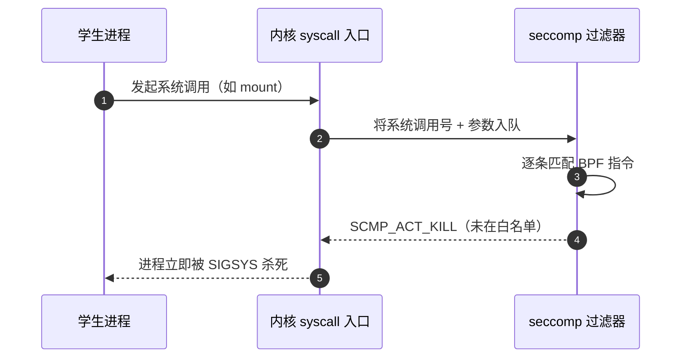

关键特性：

1. **不可逃逸**：过滤器在进程上下文中由内核强制执行，进程自身无法卸载或修改；
2. **不可逆**：一旦安装，过滤器对该进程永久生效，子进程自动继承（`fork`/`exec` 均继承）；
3. **极低开销**：BPF 指令在 cBPF 解释器中执行，每条指令纳秒级，对评测性能的影响可忽略。

### 25.3 SCMP_ACT 动作语义全表

| 动作 | 语义 | TraceOS 是否使用 |
|---|---|---|
| `SCMP_ACT_KILL` | 立即杀死进程（SIGSYS） | ✅ 默认动作（defaultAction） |
| `SCMP_ACT_KILL_PROCESS` | 杀死整个进程组 | ❌ |
| `SCMP_ACT_KILL_THREAD` | 只杀死调用线程 | ❌ |
| `SCMP_ACT_TRAP` | 发送 SIGSYS 但可被信号处理器捕获 | ❌ |
| `SCMP_ACT_ERRNO(n)` | 让系统调用返回错误码 n | ❌ |
| `SCMP_ACT_TRACE` | 暂停并通知 tracer（ptrace 协同） | ❌ |
| `SCMP_ACT_LOG` | 记录日志后继续执行 | ❌ |
| `SCMP_ACT_ALLOW` | 放行 | ✅ 白名单条目 |
| `SCMP_ACT_NOTIFY` | 通知用户态监听者决定 | ❌ |

**为什么默认动作选 KILL 而非 ERRNO？** 这是教学场景特有的考量：

- `ERRNO` 让进程"以为系统调用失败"继续运行——学生可能看到诡异的 `EPERM` 错误，百思不得其解，**教学诊断价值为负**；
- `KILL` 让进程立即终止——评测管线会捕获 `Killed` 标志，报告明确的 `execution timeout` 或异常终止，**失败可见、可解释**。

安全系统不仅是"阻止恶意行为"，还要"让失败模式清晰可见"。KILL 语义与 TraceOS 的"失败原因可区分性"原则完全一致。

### 25.4 no_new_privs：seccomp 的隐形守卫

seccomp 过滤器的可靠性依赖一个前置条件：**进程不能通过执行 setuid 二进制或获得新 capabilities 来"重置"自己的权限状态**。Linux 的 `no_new_privs` 标志保证：

- `execve` 不再赋予任何新权限（setuid 位失效）；
- 已有 capabilities 不可扩展；
- seccomp 过滤器一旦安装不可被替换为更宽松版本。

Docker 后端通过 `--security-opt no-new-privileges` 显式启用该标志；NsJail 内部同样默认设置。**没有 no_new_privs 的 seccomp 是可被绕过的 seccomp**——这是容器安全界反复验证过的结论，TraceOS 两个后端都落实了这一前置。

### 25.5 seccomp 与 eBPF 观测的关系：正交的两层

评审中容易被混淆的一点：seccomp-bpf 与 eBPF 观测都是"内核 + BPF"，但它们职责完全不同：

| 维度 | seccomp-bpf | eBPF 观测 |
|---|---|---|
| 位置 | 进程上下文（过滤器随进程继承） | 内核全局挂载点（syscall tracepoint） |
| 方向 | **阻止**：过滤不允许的调用 | **观察**：记录发生的调用 |
| 对性能 | 纳秒级过滤 | 纳秒级记录（ring buffer 异步） |
| 策略 | 白名单（教学实验专属） | 事件分类（syscall/futex/mem/lifecycle） |
| 数据去向 | 无（只是拦截） | ring buffer → 观测管线 |

两者恰好构成"**沙箱的免疫系统**（seccomp：拦截危险行为）与"**沙箱的听诊器**"（eBPF：观察行为轨迹）——一个管安全，一个管教学，互不干扰、互为补充。这也是 TraceOS 把沙箱子系统与 eBPF 引擎设计为两个独立子系统（文档 03 与文档 04）的架构依据。

### 25.6 六套 profile 的维护方法论

seccomp 白名单的最大痛点是**维护成本**——放少了程序跑不起来，放多了失去安全意义。TraceOS 的维护方法论：

1. **以"跑通正确解"为下界**：每套 profile 以官方参考实现能正常运行的最小调用集为基线；
2. **以"实验类别"为边界**：只放行该类实验的理论需要，跨类别的调用一律 KILL；
3. **glibc 运行时底线**：`brk`/`mmap`/`mprotect`/`futex`/`set_robust_list`/`rseq`/`arch_prctl` 等动态链接器的隐式调用必须全量覆盖，否则连 hello world 都跑不起来；
4. **增量演进**：新增实验类型时先复制最接近的 profile 再裁剪，而非从零穷举。

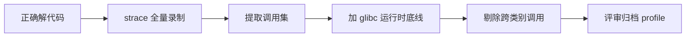

---

## 26. cgroup 资源治理机制深入

### 26.1 cgroup v1 与 v2

Linux 控制组（cgroup）有两代接口：

| 特性 | cgroup v1 | cgroup v2 |
|---|---|---|
| 层级模型 | 每控制器独立层级 | 统一层级 |
| 内存控制器 | `memory.max_usage_in_bytes` 等 | `memory.max`/`memory.current` |
| PID 控制器 | 独立 `pids.max` | `pids.max` |
| CPU 控制器 | `cpu.cfs_quota_us` / `cpu.shares` | `cpu.max` / `cpu.weight` |
| NsJail 支持 | 完整 | 完整 |

TraceOS 的 NsJail 配置使用 `cgroup_mem_max`、`cgroup_pids_max` 等抽象参数，由 NsJail 内部适配 cgroup 版本，**对 cgroup v1/v2 的宿主机都兼容**。这一点对部署环境多样化的教学平台尤为重要。

### 26.2 内存限制的实现与 OOM 语义

`cgroup_mem_max: 268435456`（256MB）把学生进程挂入专用内存控制组。当学生进程的内存占用逼近上限时：

1. 内核尝试回收（页面回收、swap）；
2. 回收无效时，cgroup 内触发 OOM——**只杀该 cgroup 内的进程**，宿主机其他进程安然无恙；
3. nsjail 记录 `memory.max_usage_in_bytes`，`parseMemoryUsage` 从中解析峰值内存。

**cgroup OOM 与全局 OOM 的本质区别**：前者是"预算约束下的定向回收"，后者是"系统崩溃前的随机处决"。256MB 上限意味着即使 20 个沙箱同时运行，沙箱总内存预算也被钉死在 5GB 以内——**安全不是概率，而是预算**。

### 26.3 pids 限制：fork bomb 的克星

```c
// 学生代码中的经典 fork bomb
while (1) fork();
```

传统系统的防御靠管理员的手速（ctrl-c）或系统整体 pid_max。cgroup 的 `pids.max` 把"进程数"变成**每沙箱预算**：Level 3 沙箱只有 8 个 PID 配额，fork bomb 在第 9 次 fork 时被内核直接拒绝（`EAGAIN`），连爆炸的机会都没有。

三层 PID 治理：

```text
全局 pid_max（内核全局上限，~百万级）
  → cgroup pids.max（每沙箱配额：64/32/8）
    → 评测语义（fork bomb 实验在配额内安全演示）
```

值得注意的是，**进程实验的教学内容恰恰是 fork**。因此 Level 1 给出 64 个 PID 配额——足够学生完成 fork 树实验，又不足以拖垮宿主机。配额不是越小越好，而是"恰好满足教学需要"的工程判断。

### 26.4 CPU 限制与时间限制的互补

CPU 限制（`cpuPercent`）与时间限制（`time_limit`）解决不同问题：

| 机制 | 解决的问题 | 类比 |
|---|---|---|
| CPU 百分比 | 单个沙箱占满 CPU，拖慢其他沙箱 | 车道限速 |
| 时间上限 | 死循环程序永不退出 | 单次行程时长上限 |

两者缺一不可：只有 CPU 限制，死循环程序会无限占用一个"限速后"的 CPU 槽位；只有时间限制，一个短时 CPU 密集程序仍会在几秒内打满所有核。

### 26.5 资源计量：从"限制"到"教学数据"

cgroup 的价值在 TraceOS 中被双重利用：

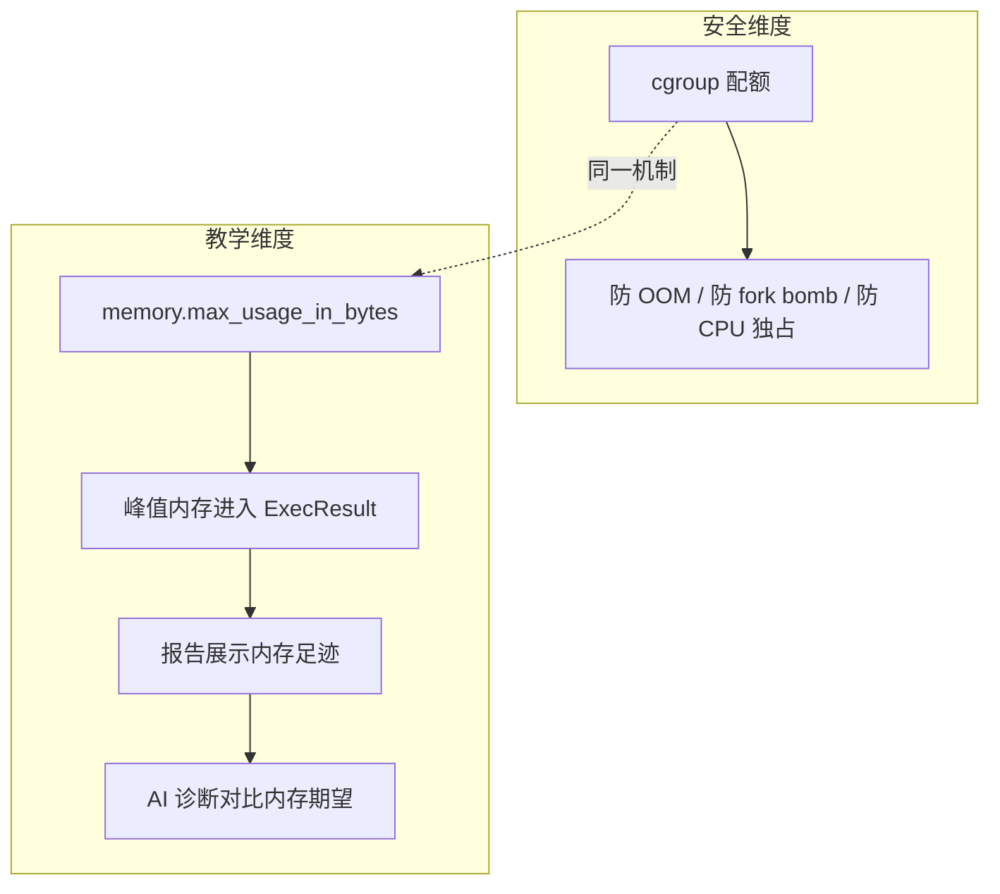

`parseMemoryUsage` 解析出的峰值内存不只是评分输入，更是**教学反馈数据**：学生的 mmap 实验申请了 200MB 还是 2MB，在报告里一目了然，AI 诊断据此给出"你的内存分配粒度远大于需求"等精准反馈。**安全机制与教学机制的合一，是 TraceOS 沙箱设计最独特的地方**。

### 26.6 资源配额与评测公平性的数学论证

评测公平性在资源层面的表述：**如果两个学生的程序都能在配额内完成任务，评分只取决于程序正确性**。

设沙箱配额向量为 \(Q = (M, P, C, T)\)（内存、PID、CPU、时间），学生程序的真实需求向量为 \(R\)。公平性要求：

\[\forall R \leq Q: \text{Score}(\text{program}) = f(\text{correctness}) \]

即只要程序需求在配额内，分数就是纯正确性函数。配额把"资源维度"从评分函数中完全剔除：

- 内存换时间的作弊（预计算缓存）被 M 限制；
- fork 换并行的作弊被 P 限制；
- 死循环磨时间的作弊被 T 限制。

这正是"**确定性评测**"（文档 06 的核心承诺）在沙箱层的物理保证。

---

## 27. 沙箱安全威胁模型与攻防对抗矩阵

安全设计的严肃性体现在：**先定义威胁模型，再逐条论证防御**。本章给出 TraceOS Lab 沙箱的完整威胁模型与攻防对抗矩阵。

### 27.1 威胁建模方法

采用 STRIDE 模型框架分析沙箱威胁：

| STRIDE 维度 | 沙箱场景下的含义 | 实例 |
|---|---|---|
| Spoofing（伪装） | 冒充其他用户提交代码 | 已由平台鉴权层解决（非沙箱职责） |
| Tampering（篡改） | 篡改评测文件、配置、其他学生输出 | bind mount 最小暴露 + 只读根 |
| Repudiation（抵赖） | 否认自己的恶意行为 | audit_logs + 提交全生命周期留痕 |
| Information Disclosure（泄露） | 偷看宿主机文件、其他沙箱数据 | 命名空间 + /proc 隔离 + 独立 tmpfs |
| DoS（拒绝服务） | 拖垮评测服务 | cgroup 资源预算 + 三层限流 |
| Elevation of Privilege（提权） | 从沙箱逃逸到宿主机 | user namespace + seccomp + no_new_privs |

### 27.2 攻击者画像

| 画像 | 动机 | 能力 | 防御侧重 |
|---|---|---|---|
| 好奇学生 | 想知道"能不能看到宿主机" | 网上抄 PoC 试跑 | 通用纵深防御即可拦截 |
| 恶意学生 | 破坏课堂评测、炫耀性攻击 | 针对性地构造逃逸链 | seccomp + 命名空间 + 审计留痕 |
| 意外错误 | 代码 bug（无限 malloc、fork 泄漏） | 无意中造成资源冲击 | cgroup 预算 + 时间限制 |
| 外部攻击者 | 通过评测 API 入侵平台 | 完整攻击面探测 | 平台鉴权 + 限流（文档 02/14） |

**教学平台的特殊性**：攻击者画像中"意外错误"占绝对多数——绝大多数"攻击"是学生写出的 bug。因此资源治理（cgroup/超时）在教学场景中的实际价值高于防逃逸。这是 TraceOS 在安全投入上"资源治理与逃逸防御并重"的原因。

### 27.3 十大攻击向量与防御逐一对照

| # | 攻击向量 | 攻击手法 | 防线 | 防御效果 |
|---|---|---|---|---|
| A1 | fork bomb | `while(1) fork()` | cgroup `pids.max` | 第 N+1 次 fork 返回 EAGAIN |
| A2 | 内存耗尽 | 无限 `malloc`/`mmap` | cgroup `memory.max` | cgroup 内 OOM，宿主无感 |
| A3 | CPU 独占 | 多线程空转 | CPU 配额 | 限速到配额百分比 |
| A4 | 磁盘写满 | 海量写文件 | tmpfs 限额 + 只读根 | tmpfs 写满只影响本沙箱 |
| A5 | /proc 信息窃取 | 读 `/proc/*/environ` | `mount_proc: true` 新 /proc | 只见沙箱内进程 |
| A6 | ptrace 注入 | 附加其他进程 | seccomp 白名单无 ptrace | 调用即 KILL |
| A7 | setuid 提权 | 执行 setuid 二进制 | no_new_privs + 只读挂载 | 特权位失效 |
| A8 | 系统调用滥用 | mount/reboot/chmod | seccomp 默认 KILL | 调用即 KILL |
| A9 | 死循环挂死 | `while(1);` | time_limit + SIGKILL 进程组 | 超时强制终止 |
| A10 | 信号处理器拒退 | 捕获 SIGTERM 无限续命 | SIGKILL（不可捕获） | 进程组全灭 |

### 27.4 攻防映射矩阵（防线 × 攻击）

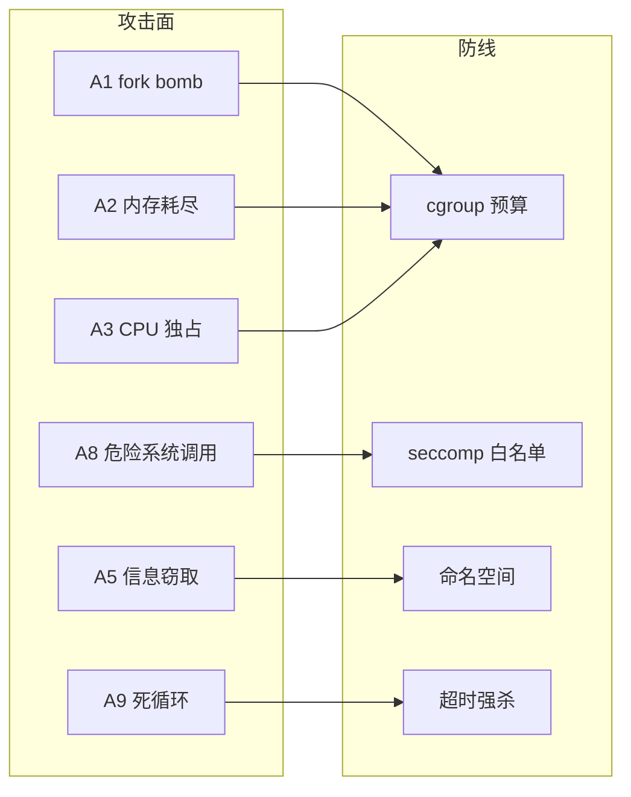

矩阵分析揭示一个设计规律：**没有哪个攻击向量依赖单点防御**。例如 fork bomb 同时被 pids 配额、时间限制、seccomp（clone 族白名单在 Level 3 收紧）三层制约。纵深防御的意义不在于"每一层都不可穿透"，而在于"攻击者必须同时穿透所有层"——这在概率上把逃逸从工程问题变成了研究级问题。

### 27.5 残余风险的诚实声明

负责任的威胁模型必须陈述"防不住什么"：

| 残余风险 | 原因 | 影响评估 | 缓解方向 |
|---|---|---|---|
| 内核 0day 逃逸 | 共享内核是命名空间的根本局限 | 低概率高影响 | 内核升级策略 + 监控 |
| 侧信道探测 | 缓存/调度时序无法隔离 | 低影响（教学场景无敏感侧信道数据） | 接受 |
| nsjail/strace 自身漏洞 | 第三方组件不可控 | 低概率中影响 | 版本跟踪 + 最小化使用面 |
| Local 后端无隔离 | 降级语义本质如此 | 仅开发环境暴露 | 显式警告 + 环境限制 |

**不夸大、不隐瞒**——这种诚实的风险陈述本身就是工程成熟度的体现。评审老师可以据此判断：设计者对安全边界的认知是清晰的，而不是"我们用了 NsJail 所以绝对安全"的幼稚断言。

---

## 28. 沙箱逃逸与内核漏洞对抗案例

本章通过真实世界的内核漏洞与容器逃逸案例，检验 TraceOS Lab 纵深防御在极端场景下的表现。案例素材来自公开 CVE 与安全研究报告。

### 28.1 容器逃逸的本质

所有容器/沙箱逃逸的本质都相同：**隔离边界建立在内核的正确实现之上，内核漏洞让边界失效**。从漏洞触发逻辑看，逃逸漏洞分两类：

1. **权限校验缺失型**：内核没有正确校验特权操作的命名空间归属，容器内进程直接操作了宿主机资源；
2. **内存破坏型**：内核越界读写被利用，篡改进程凭证结构，把容器内进程"升格"为宿主机特权进程。

### 28.2 案例一：CVE-2022-0185（fs_context 堆溢出）

**漏洞概况**：Linux 内核 `legacy_parse_param` 函数对 `fs_context` 的长度校验错误，导致堆缓冲区溢出。攻击者通过 `unshare` + 构造超长挂载参数实现越界写，可获得任意代码执行与提权。这是 2022 年最著名的容器逃逸漏洞之一。

**TraceOS 的防御链**：

```text
攻击路径：unshare(CLONE_NEWNS) → fsopen → 超长参数 → 堆溢出
          ↓
防御点 1：seccomp 白名单不含 unshare/fsopen/mount 族
          → 攻击第一步即被 SCMP_ACT_KILL 终止
防御点 2：即使 seccomp 被绕过，user namespace 使提权只发生在
          非特权映射域内，影响受限
防御点 3：cgroup 预算与三层限流限制攻击的横向扩散
```

**结论**：CVE-2022-0185 的公开利用路径需要 `unshare` 与 `fsopen` 两个系统调用，二者都不在 TraceOS 任何一套 seccomp 白名单内。**纵深防御的第一层就切断了攻击链的入口**——这正是最小权限白名单对"系统调用级漏洞"的通用免疫原理。

### 28.3 案例二：CVE-2022-0492（cgroup release_agent 逃逸）

**漏洞概况**：cgroup v1 的 `release_agent` 特性允许 cgroup 为空时执行指定程序。内核校验了写 `release_agent` 文件的权限，但**没有校验读它的权限**，导致非特权容器可以读到 release_agent 路径，配合挂载技巧实现容器逃逸。

**TraceOS 的防御链**：

| 防御层 | 具体作用 |
|---|---|
| seccomp 白名单 | 不含 `mount`/`umount`/`open_by_handle_at` 等利用前置调用 |
| user namespace | 沙箱内的 capabilities 不作用于宿主机 cgroup |
| 无 cgroup 写入路径 | 沙箱内不挂载 cgroupfs，学生进程无法触及 cgroup 配置 |

**要点**：CVE-2022-0492 的利用链需要"挂载 cgroupfs + 写 release_agent + 触发 release"，TraceOS 沙箱内**根本不存在 cgroupfs 挂载**（nsjail 的 cgroup 管理全部在沙箱外由配置驱动），攻击面在物理上被移除了。

### 28.4 案例三：Dirty Pipe（CVE-2022-0847）

**漏洞概况**：Linux 5.8 至 5.16.11 的管道实现中，缓冲区标志位未正确初始化，非特权进程可覆写任意只读文件页缓存——直接改写 `/etc/passwd` 或 root 进程的二进制。CVSS 7.8，PoC 公开。

**TraceOS 的防御分析**：

Dirty Pipe 属于"共享内核 0day"类威胁，**任何基于命名空间的沙箱都无法靠自身防御**（写入发生在页缓存层，不经过任何系统调用过滤）。TraceOS 对此的立场是三层组合：

1. **内核版本策略**：部署基线要求内核 >= 5.16.11 / 5.15.25 / 5.10.102（修复版本），在部署文档（文档 14）中显式声明；
2. **攻击目标价值控制**：即使沙箱被 Dirty Pipe 攻破，攻击者能覆写的"高价值目标"（宿主机 setuid 二进制、学生之间共享文件）被最小挂载暴露所限制；
3. **审计溯源**：逃逸后的任何异常行为都会留下 audit_logs 与资源异常，可事后追责。

**诚实结论**：Dirty Pipe 类 0day 是业界公认的"无法通过用户态沙箱防御"的威胁。TraceOS 的对策是**风险分层管理**——用部署策略管住概率，用纵深防御管住影响，用审计管住责任。这比声称"我们的沙箱免疫一切内核漏洞"要专业得多。

### 28.5 案例四：Dirty COW 与 CVE-2019-5736 的启示

| 案例 | 年代 | 类型 | 对 TraceOS 的启示 |
|---|---|---|---|
| Dirty COW（CVE-2016-5195） | 2016 | 竞争条件越权写 | 内核 0day 的生命周期可达数年，防御不能赌"无漏洞" |
| CVE-2019-5736 | 2019 | runc 二进制被容器内进程覆写 | **第三方组件（runc/nsjail/strace）自身也是攻击面**，需要最小化使用面与版本管理 |

CVE-2019-5736 特别值得注意：它攻击的不是学生代码，而是**沙箱基础设施本身**（runc）。TraceOS 的响应策略：

- 选择 NsJail（无守护进程、无 runc 依赖）降低组件面；
- Docker 后端镜像采用最小化构建，不含调试工具；
- 沙箱二进制目录（`/tmp/traceos-*`）权限 0755 且只挂载必要子目录。

### 28.6 纵深防御的数学直觉

设单层防御的失效率为 \(p\)，五层纵深防御的整体失效率为 \(p^5\)（假设各层独立）。即使每层只有"九成可靠"（\(p = 0.1\)），整体失效率也降到 \(10^{-5}\)。而实际的每层可靠性远高于九成：

| 防线 | 单层失效率估计 | 依据 |
|---|---|---|
| 命名空间 | 内核 0day 概率（~每年数个/全局） | CVE 统计 |
| seccomp | 近零（白名单外调用必死） | 机制性保证 |
| cgroup | 近零（配额内 OOM 是设计行为） | 机制性保证 |
| 文件系统隔离 | 低（bind mount 最小面） | 配置正确性 |
| 超时强杀 | 近零（SIGKILL 不可捕获） | 机制性保证 |

**结论**：真正的不确定性集中在第一层（内核）。而第一层的残余风险，通过部署策略（内核版本基线）、监控（文档 14）与审计（audit_logs）三层工程管理兜底。这是"纵深防御 + 风险管理"的完整闭环。

---

## 29. 沙箱环境一致性与评测公平性工程

### 29.1 评测公平性的沙箱层定义

文档 02 提出全局设计目标 G1（评测必须确定性），本章论证沙箱层如何支撑这一目标。评测公平性在沙箱层的定义：

> **同一份代码，无论何时提交、无论与谁同时提交，其沙箱内的运行环境、资源预算、观测方式都必须完全一致。**

反例随处可见：如果内存配额随宿主机空闲内存浮动，则"申请 300MB 的程序"在早晨能跑、在下午 OOM——学生看到的是随机性的分数，而不是确定性的反馈。

### 29.2 环境一致性威胁清单

| 威胁 | 后果 | TraceOS 对策 |
|---|---|---|
| 宿主机负载波动 | 执行耗时漂移，卡时限的程序结果不稳定 | cgroup CPU 配额 + 重跑机制 |
| 其他沙箱干扰 | 邻座沙箱占满 CPU/磁盘 | cgroup 预算隔离 + 信号量限流 |
| 时钟漂移 | 计时代码结果不一 | 沙箱内真实时钟（不开 time namespace） |
| 随机数差异 | 依赖随机数种子 | 教学实验不涉及密码学随机 |
| tmpfs 残留 | 上次运行的文件影响本次 | 每沙箱独立 workDir + 用完即删 |
| 工具链版本漂移 | 编译产物行为差异 | Docker 后端镜像锁定；NsJail 用宿主工具链但版本受部署基线管理 |
| ASLR 差异 | 地址依赖型 bug 偶发 | 接受（真实 OS 行为即如此，且教学实验不依赖固定地址） |

### 29.3 一致性工程的三条实现原则

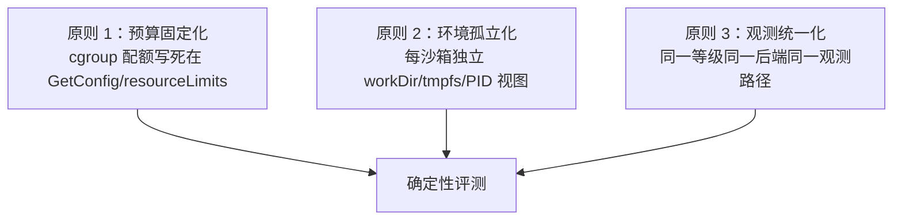

**原则 1（预算固定化）**：`GetConfig` 与 `resourceLimits` 双表锁定三级配额。配额是**代码常量**而非运行参数——评审老师可以直接在源码里核对 256MB/80%/64PID 的承诺与实现一致。

**原则 2（环境孤立化）**：`Acquire` 为每个沙箱创建独立 workDir（`nsjail-{level}-{seq}`），nsjail 配置挂载独立 tmpfs 与独立 strace 输出目录。上一次评测的任何状态都不可能泄漏到下一次。

**原则 3（观测统一化）**：观测方式由 `DisableTrace` + 后端能力矩阵决定，与提交时间、并发度无关。eBPF 可用时走 eBPF、不可用时走 strace——但同一部署内所有学生的同类型实验走同一路径。

### 29.4 时间计量的一致性工程

`ExecTime` 的测量窗口在 `Execute` 中：

```go
start := time.Now()
err := cmd.Run()
elapsed := time.Since(start)
```

三个细节保证时间计量的公平：

1. **含 strace 开销的统一计费**：所有 strace 模式学生的时间都包含 strace 包装开销——只要大家都一样，差异就被抵消；
2. **timeExtra 只给沙箱不给学生**：3 秒缓冲用于 nsjail 启动/退出，学生程序的时间预算严格是 `strategy.TimeLimit()`；
3. **重跑取优但记录单次**：`bestResult` 取的是通过的那次结果，其 `ExecTime` 也是那次的实际值，不混入失败运行的时间。

### 29.5 沙箱与公平性关系的哲学总结

沙箱层的公平性贡献可以概括为一句评审可引用的论断：

> **TraceOS 的沙箱把"硬件资源"从评分函数中完全剔除——配额内的程序，分数只取决于正确性；配额外的程序，失败原因精确可述。**

这是教学评测与在线编程平台（如 LeetCode）的根本差异：后者只关心"过没过"，前者必须解释"为什么没过、哪里超了"。而解释的前提，就是沙箱把失败原因（超时/OOM/违规调用/输出错误）精确地区分开来。

---

## 30. 沙箱性能工程与容量规划

### 30.1 沙箱操作的成本解剖

评测平台的吞吐上限由沙箱操作成本决定。TraceOS 沙箱各操作的量级估算：

| 操作 | 成本量级 | 是否在关键路径 |
|---|---|---|
| Acquire（nsjail） | ~微秒（mkdir + 登记） | 是 |
| nsjail fork+exec | ~毫秒（命名空间创建） | 是 |
| 学生程序执行 | 实验时限（秒级） | 是（大头） |
| strace 解析 | 亚秒级 | 否（评测后处理） |
| Release（异步清理） | ~微秒（路径上的成本） | 否（异步） |
| Docker 容器创建 | ~秒级 | 是（Docker 后端） |

**性能洞察**：NsJail 后端的关键路径成本中，真正的沙箱开销只有毫秒级——**评测吞吐的瓶颈在学生程序的执行时间本身**，而非沙箱开销。这正是选择 NsJail 而非 Docker 作为默认后端的量化理由：Docker 的秒级启动在短实验（30s 时限）上会额外损耗 3~10% 的吞吐。

### 30.2 池化收益的量化分析

`main.go` 的启动序列：

```go
sandboxPool := sandbox.NewPool(baseManager, 5)
sandboxPool.StartPrealloc(context.Background(), 3, sandbox.LevelStandard)
```

预分配 3 个 Level 1 沙箱消除前三次提交的冷启动。若单次 nsjail 冷启动 5ms、目录创建 1ms，预分配收益其实不大——**池化的真正收益在信号量槽位的确定性**：池（5 槽位）与信号量（5 槽位）对齐，避免了"池有实例但信号量满"或"信号量空但池需新建"的错配抖动。

### 30.3 三层限流的吞吐模型

```text
提交洪峰 → WorkerPool（4 worker）→ 每提交 ≤8 用例并发 → 沙箱信号量（5）
```

稳态下的资源占用预算（以 Level 1 为例）：

| 资源 | 单沙箱预算 | 5 并发峰值 | 宿主机建议配置 |
|---|---|---|---|
| 内存 | 256MB | 1.28GB | ≥ 4GB（留给平台/数据库） |
| CPU | 80% 单核 | 4 核等效 | ≥ 8 核 |
| PID | 64 | 320 | 默认 pid_max 即可 |
| 磁盘 | tmpfs 64MB + strace 日志 | ~500MB 峰值 | ≥ 10GB 空闲 |

### 30.4 40 人课堂场景的容量演练

| 场景 | 计算过程 | 结论 |
|---|---|---|
| 40 人同时提交 5 用例实验 | 40×5=200 次执行，5 并发×30s/次 | 理论 20 分钟消化，实际队列可见排队进度 |
| 40 人同时打开观测工作台 | Observability 独立读侧（文档 02） | 零沙箱影响 |
| 1 人提交死锁实验（Level 3） | 64MB/8PID/180s | 即使真的死锁，180s 后进程组全灭 |
| 恶意 fork bomb × 40 | pids 配额独立生效 | 每个沙箱第 9 次 fork 即停 |

### 30.5 性能优化的已实现手段

| 手段 | 位置 | 收益 |
|---|---|---|
| 异步目录清理 | `Release` 中 `go RemoveAll` | 清理不阻塞评测链路 |
| 池满即销毁 | `SandboxPool.Release` 非阻塞归还 | 无阻塞等待，避免死锁 |
| 预分配预热 | `StartPrealloc(3)` | 首批提交零冷启动 |
| 惰性后端实例化 | `SandboxFactory` | 未用后端零成本 |
| 通过即短路 | `RunAll` 重跑循环 | 通过后不重跑，节省算力 |

### 30.6 未来性能演进方向

| 方向 | 预期收益 | 实现成本 |
|---|---|---|
| 沙箱进程常驻池（复用 nsjail 进程） | 省去 fork+exec 毫秒级开销 | 中（需 nsjail 支持多命令模式） |
| strace 输出流式解析 | 评测与解析流水线化 | 低 |
| 沙箱镜像分层缓存 | Docker 后端冷启动提速 | 低（已有镜像缓存） |
| 评测结果异步评分 | 评分移出关键路径 | 中（需事件总线协同） |

---

## 31. 沙箱故障模式分析与自愈设计

高可靠系统的标志不是"不故障"，而是"故障可预测、可检测、可自愈"。本章枚举沙箱子系统全部故障模式，逐条分析检测手段与自愈策略。

### 31.1 故障模式全景枚举

| # | 故障模式 | 触发条件 | 影响 | 检测手段 | 自愈策略 |
|---|---|---|---|---|---|
| F1 | nsjail 二进制缺失 | 镜像未安装 nsjail | 全部评测失败 | Execute 返回 exec 错误 | 部署检查清单（文档 14） |
| F2 | strace 不可用 | 降级镜像未装 strace | 观测缺失 | `exec.LookPath` 预检 | Local 后端直执行降级 |
| F3 | cgroup 不可用 | 容器环境无 cgroup 权限 | nsjail 启动失败 | Execute 错误传播 | 切换 Docker 后端 |
| F4 | 信号量泄漏 | Acquire 后异常路径未 Release | 并发槽位永久占用 | 监控沙箱数/评测挂起率 | `defer Release` 契约 + mkdir 失败归还槽位 |
| F5 | 僵尸进程 | 学生进程被强杀后未被 wait | PID 泄漏、僵尸堆积 | `ps` 监控 Z 状态 | Setpgid + SIGKILL + cmd.Wait |
| F6 | tmpfs/磁盘写满 | strace 海量日志 | 沙箱内写失败 | 磁盘监控 | tmpfs 隔离（不污染宿主盘） |
| F7 | 池错配抖动 | 池大小与信号量不一致 | 频繁建/销毁 | 启动日志核对 | 两者默认对齐 5 |
| F8 | Docker daemon 掉线 | 宿主 docker 服务重启 | Docker 后端全故障 | Execute 错误 | 切换到 NsJail 后端（配置层面） |
| F9 | 内核版本不兼容 | eBPF 程序与内核不匹配 | eBPF 采集退化 | `IsAvailable()` 探测 | strace 降级路径 |
| F10 | 学生程序蓄意驻留 | 后台进程+忽略信号 | 资源长期占用 | time_limit 兜底 | SIGKILL 进程组强杀 |

### 31.2 信号量泄漏防护的源码级论证

信号量是并发治理的核心资产，泄漏一个槽位等于永久减少一份吞吐。`Acquire` 的防御：

```go
select {
case m.semaphore <- struct{}{}:
case <-ctx.Done():
	return nil, ctx.Err()
}
m.mu.Lock()
defer m.mu.Unlock()
id := fmt.Sprintf("nsjail-%d-%d", level, m.nextID.Add(1))
workDir := filepath.Join(m.workBase, id)
if err := os.MkdirAll(workDir, 0o755); err != nil {
	<-m.semaphore      // ← 关键：mkdir 失败时归还槽位
	return nil, fmt.Errorf("mkdir workdir: %w", err)
}
```

两个防御点：

1. **ctx 取消不占槽**：`select` 双分支，ctx 取消时根本不会进入槽位；
2. **中间步骤失败归还**：拿到槽位后 mkdir 失败，显式 `<-m.semaphore` 归还。

消费侧（TestCaseRunner）用 `defer r.manager.Release(sb)` 保证无论后续哪一步 panic 或 error，槽位都能归还。**生产侧与消费侧的双重保险，使信号量泄漏的概率趋近于零**。

### 31.3 僵尸进程治理

僵尸进程的本质：子进程退出后，其 PCB 保留在内核中，直到父进程调用 `wait()`。沙箱场景的僵尸来源：

```c
// 学生代码：fork 后父进程不 wait
pid_t pid = fork();
if (pid > 0) {
    // 父进程继续干活，从不 wait
    while (1) sleep(1);
}
```

TraceOS 的治理链：

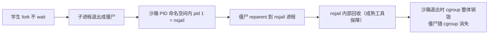

**cgroup 销毁的兜底性**：即使中途有僵尸未被回收，沙箱退出时整个 cgroup 被 nsjail 销毁，内核强制回收该 cgroup 内全部进程与僵尸。**进程的生命周期被绑定在 cgroup 的生命周期上**——这是 cgroup 在"资源治理"之外的又一层进程治理价值。

### 31.4 故障演练建议

| 演练 | 操作 | 预期结果 |
|---|---|---|
| nsjail 移除演练 | `mv /usr/local/bin/nsjail /tmp/` | 评测报 exec 错误而非挂起 |
| strace 移除演练 | `mv /usr/bin/strace /tmp/` | Local 后端自动直执行 |
| 信号量耗尽演练 | 并发 100 提交 | 队列排队而非拒绝服务 |
| fork bomb 演练 | 提交 fork bomb 代码 | pids 配额拦截，宿主 CPU 正常 |
| OOM 演练 | 提交 10GB malloc 代码 | cgroup 内 OOM，宿主无感 |
| 死锁演练 | 提交真实死锁代码 | 180s 后进程组全灭，报告标注超时 |

---

## 32. 沙箱可观测性与运维治理

### 32.1 沙箱运行日志的设计

沙箱模块的日志遵循统一约定：

| 日志前缀 | 内容 | 示例 |
|---|---|---|
| `[Sandbox]` | Local 后端降级事件 | `[Sandbox] strace not found; running directly` |
| `[Pool]` | 池操作失败 | `[Pool] prealloc release failed: ...` |
| `[ebpf-adapter]` | eBPF 协同失败（PID 定位等） | `[ebpf-adapter] failed to locate student PID` |

**日志哲学：降级必须留痕**。每一条降级路径都有对应日志——strace 不可用要记、PID 定位失败要记、池操作异常要记。没有日志的降级等于"悄悄失去能力"，会让事后排查变成玄学。

### 32.2 沙箱核心指标设计

当前实现预留了日志锚点，监控体系（文档 14 的 Prometheus）可采集的沙箱指标建议：

| 指标 | 类型 | 采集点 | 诊断价值 |
|---|---|---|---|
| `sandbox_acquire_duration` | Histogram | Acquire 入口/出口 | 冷启动延迟、池命中率 |
| `sandbox_exec_duration` | Histogram | Execute 入口/出口 | 执行耗时分布 |
| `sandbox_killed_total` | Counter | Killed=true 处 | 超时/OOM 发生率 |
| `sandbox_active_instances` | Gauge | Acquire/Release | 并发度与信号量利用率 |
| `sandbox_pool_depth` | Gauge | Pool.Acquire/Release | 池命中与新建比例 |
| `sandbox_backend` | Label | 实例字段 | 各后端流量分布 |

### 32.3 与审计体系（audit_logs）的关系

沙箱事件进入平台审计体系的路径：

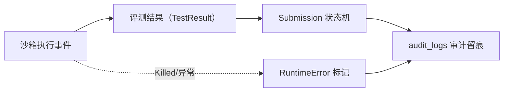

沙箱自身的执行细节（如哪些进程被 KILL）通过 `Killed` 标志与 `RuntimeError` 进入提交记录，使"这次评测为什么超时"在任何时刻都可回溯。

### 32.4 排障手册（常见问题诊断路径）

| 现象 | 诊断路径 | 结论 |
|---|---|---|
| 全部评测秒失败 | 查 Core 日志 exec 错误 → 查 nsjail 是否存在 | F1：安装 nsjail |
| 报告无系统调用图 | 查 `[Sandbox]` 日志 → 查 strace | F2：安装 strace |
| 评测挂起不结束 | 查信号量利用率 → 查僵尸进程 | F4/F5：检查 Release 契约 |
| eBPF 图偶发缺失 | 查 `[ebpf-adapter]` PID 定位日志 | 快程序定位失败（设计内容忍） |
| Docker 实验失败 | `docker ps` 查 daemon → 查镜像 | F8：恢复 daemon/拉镜像 |

### 32.5 运维治理的三条纪律

1. **沙箱配置冻结**：三级配额是教学契约的一部分，改动必须走配置评审（GetConfig/resourceLimits 双表同步）；
2. **内核版本基线**：部署环境的内核必须满足 Dirty Pipe 等漏洞的修复版本（文档 14 部署检查清单）；
3. **沙箱目录定期巡检**：`/tmp/traceos-nsjail`、`/tmp/traceos-docker` 异常残留（如断电导致）需巡检清理，Release 的异步删除在极端情况下可能未执行。

---

## 33. 沙箱测试策略与质量保障

### 33.1 测试资产盘点

沙箱模块携带的测试文件（`config_test.go`、`pool_test.go`）虽小，但测试设计思路值得展开：

| 测试文件 | 覆盖对象 | 测试策略 |
|---|---|---|
| `config_test.go` | `GetConfig` 三级配置 | 表驱动：逐级断言内存/CPU/PID/时限/profile |
| `pool_test.go` | `SandboxPool` | 池语义：命中、新建、归还、池满销毁 |
| `manager.go` 内置 Mock | 接口消费者 | 依赖倒置测试：评测管线用 Mock 沙箱测试 |

### 33.2 GetConfig 表驱动测试的规范

```go
// config_test.go 的测试模式（语义示意）
func TestGetConfig(t *testing.T) {
	tests := []struct {
		level    SandboxLevel
		wantMem  int64
		wantCPU  int
		wantPID  int64
		wantLimit time.Duration
	}{
		{LevelStandard, 256 * 1024 * 1024, 80, 64, 300 * time.Second},
		{LevelSecure,   128 * 1024 * 1024, 60, 32, 300 * time.Second},
		{LevelHardened, 64 * 1024 * 1024,  50, 8,  180 * time.Second},
	}
	for _, tt := range tests {
		// 逐级断言：配额是教学契约，必须测试保护
	}
}
```

**为什么配额需要测试保护？** 因为配额是"教学契约"的一部分：256MB/80%/64PID 写进了实验说明与文档。若某次重构把 Level 1 的配额改成 128MB，学生的程序会莫名其妙 OOM——**配额回归等于教学事故**。把配额写成测试断言，等于把契约固化在 CI 中。

### 33.3 MockSandboxManager 的依赖倒置测试

`MockSandboxManager` 与接口同文件定义，评测管线的测试不依赖真实沙箱：

```go
type MockSandboxManager struct {
	AcquireFn    func(ctx context.Context, level SandboxLevel) (*SandboxInstance, error)
	ExecuteFn    func(ctx context.Context, sandbox *SandboxInstance, binary string, stdin []byte, timeout time.Duration) (*ExecResult, error)
	// ...
}
```

函数字段注入式 Mock 的测试价值：

| 测试场景 | Mock 注入 | 验证目标 |
|---|---|---|
| 沙箱失败软化 | `ExecuteFn` 返回 error | 评测管线产出 RuntimeError 而非崩溃 |
| 超时标记 | `ExecuteFn` 返回 Killed=true | 断言标记 execution timeout |
| 槽位泄漏验证 | `AcquireFn` 计数 | 断言 Acquire/Release 配对 |

### 33.4 沙箱安全测试的建议策略

安全测试与功能测试分层：

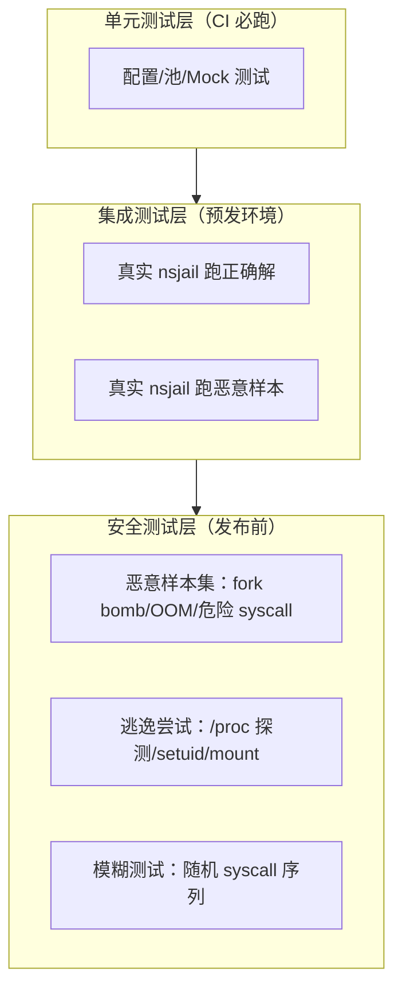

**恶意样本集清单建议**：

| 样本 | 预期 | 验证点 |
|---|---|---|
| `while(1) fork()` | pids 配额拦截 | 宿主 PID 数不增长 |
| `malloc(10GB)` | cgroup OOM | 宿主内存无波动 |
| `syscall(SYS_mount, ...)` | seccomp KILL | 进程立即终止 |
| `ptrace(PTRACE_ATTACH, 1)` | seccomp KILL | 无法附加宿主进程 |
| `open("/etc/shadow")` | 挂载隔离 | 文件不存在（未暴露） |
| 信号处理器+死循环 | 超时强杀 | 180s 后进程组全灭 |

### 33.5 测试与"确定性评测"的关系

沙箱测试的最终守护对象是"确定性评测"承诺：

> 任何沙箱代码变更，都必须证明：正确解仍满分通过、恶意样本仍被拦截、配额仍精确生效。三者缺一不可，否则变更不得合并。

这三点恰好对应三条测试线：**功能回归**（正确解）、**安全回归**（恶意样本）、**契约回归**（配额断言）。

---

## 34. 与业界评测系统沙箱对比

### 34.1 对比对象选取

选取三类有代表性的在线评测/判题系统的沙箱方案：

| 系统 | 沙箱技术 | 代表场景 |
|---|---|---|
| HUSTOJ 类（传统 OJ） | ptrace + 低权限用户 + rlimit | 高校 ACM 训练 |
| QDUOJ / JudgeD 类（现代 OJ） | Docker 容器 | 通用判题平台 |
| DMOJ / 竞赛平台 | 自定义内核级 Judge | 高性能竞赛 |
| Google CTF 基础设施 | nsjail + bwrap | 安全竞赛 |
| TraceOS Lab | NsJail + Docker 双后端 + seccomp 白名单 + cgroup | OS 教学评测 |

### 34.2 六维对比矩阵

| 维度 | 传统 OJ（ptrace） | Docker 类 OJ | TraceOS Lab |
|---|---|---|---|
| 隔离强度 | 弱（同一用户域） | 强（容器） | 强（命名空间+seccomp+cgroup 纵深） |
| 启动开销 | 极低（直 exec） | 高（秒级） | 低（毫秒级 NsJail） |
| 系统调用观测 | ptrace 单轨（慢且易检测） | 需镜像内 strace | **eBPF+strace 双轨** |
| 资源治理 | rlimit（粒度粗） | cgroup（全） | cgroup 三级精细化 |
| 教学反馈 | 仅 WA/RE/TLE | 仅 WA/RE/TLE | **完整调用轨迹+AI 诊断** |
| 实验差异化 | 无 | 无 | **三级安全×六套 profile** |

### 34.3 传统 OJ 沙箱的三大痛点（TraceOS 的切入点）

1. **ptrace 观测的可检测性**：学生代码可以用反 ptrace 技巧（如 `PTRACE_TRACEME` 自附着）让观测失效。eBPF 在内核态采集，**无用户态接口可反制**——这是 eBPF 相对 ptrace 的根本优势；
2. **rlimit 的粗粒度**：rlimit 只能限制单进程（或进程组），fork 出的子进程可以用"分而治之"绕过总量限制。cgroup 以任务组为单位计数，天然覆盖进程树；
3. **失败语义贫乏**：WA（答案错）/RE（运行时错）/TLE（超时）三个字母无法解释"为什么错"。TraceOS 的沙箱把失败精确到"第几次系统调用后超时""峰值内存是否逼近配额"——**判题系统的终点，是 TraceOS 的起点**。

### 34.4 Docker 类 OJ 的代价（TraceOS 的优化）

Docker 类判题系统解决了隔离问题，但付出三重代价：

| 代价 | Docker 类 OJ 的表现 | TraceOS 的优化 |
|---|---|---|
| 启动延迟 | 每判一题拉起一个容器（1~3s） | NsJail 毫秒级，池化预热 |
| 观测能力 | strace 需内置于镜像，内核级观测困难 | eBPF 宿主机级采集，与容器解耦 |
| 资源开销 | 每个容器一份镜像层元数据 | 沙箱工作目录仅 KB 级 |

### 34.5 与 Google nsjail 原生用法的差异

Google 开源的 nsjail 是 TraceOS 使用的组件，但 TraceOS 的用法与"直接用 nsjail"有本质差异：

| 层面 | 裸用 nsjail | TraceOS 的封装 |
|---|---|---|
| 配置 | 手写配置文件 | `writeNsjailConfig` 代码生成，等级参数化 |
| 生命周期 | 人工启停 | Acquire/Execute/Release 接口契约 |
| 并发 | 人工控制 | 信号量+池三层限流 |
| 观测 | 仅 strace | eBPF 协同（HostPID+复合键注入） |
| 治理 | 无 | 配额契约化、测试保护、审计留痕 |

**本质区别**：nsjail 是"工具"，TraceOS 把它变成了"带治理的子系统的执行引擎"。评审视角下，这比"我们用了 nsjail"高出一个工程层次。

### 34.6 对比结论

TraceOS Lab 沙箱方案在业界坐标系中的定位：

> **取传统 OJ 的轻量（NsJail 毫秒级），取容器 OJ 的隔离（命名空间+seccomp+cgroup 纵深），加上教学平台独有的观测能力（eBPF 双轨）与失败语义（精确可述的失败原因）——形成面向 OS 实验教学场景的专用沙箱方案。**

通用判题平台不需要观测能力，因为它们不教操作系统；OS 教学平台必须有观测能力，否则学生只能对着 WA 发呆。**场景决定了架构**，这是 TraceOS 沙箱设计立场的根本依据。

---

## 35. 沙箱演进路线与未来工作

### 35.1 演进路线的设计原则

沙箱技术的演进遵循三条原则：

1. **隔离强度单调不降**：任何新后端不得弱于 NsJail 的隔离能力；
2. **接口稳定优先**：`SandboxManager` 接口是评测管线的契约，演进以新增实现为主、接口变更为例外；
3. **教学能力不牺牲**：更重的隔离不能以丢失观测能力（eBPF/strace）为代价。

### 35.2 候选演进技术

| 技术 | 隔离模型 | 启动开销 | 观测兼容性 | 引入时机 |
|---|---|---|---|---|
| gVisor（runsc） | 用户态内核（syscall 拦截） | ~百毫秒 | 可配合 strace；eBPF 需宿主侧方案 | 需要更强系统调用层防御时 |
| Firecracker | 微型虚拟机（KVM） | ~百毫秒 | 虚拟机内观测，宿主机 eBPF 失效 | 需要硬件级隔离的实验（如内核实验）时 |
| Kata Containers | 轻量 VM + OCI 兼容 | ~秒级 | 同 Firecracker | Docker 后端升级选项 |
| Landlock LSM | 非特权文件访问控制 | 零 | 与现有路径正交叠加 | 文件系统细粒度控制时 |

### 35.3 gVisor 的价值与代价

gVisor（runsc）在用户态实现了一个"小内核"，拦截学生进程的系统调用并自行裁决。它的价值：

- **系统调用层防御更硬**：即使宿主内核存在漏洞，恶意系统调用先被用户态内核过滤；
- **与 OCI 生态兼容**：可以直接替换 Docker 的 runtime，接入成本低。

它的代价：

- 性能损耗（syscall 密集程序慢 10%~30%）；
- eBPF 观测需要重新设计——宿主 eBPF 看到的是 runsc 进程而非学生进程。

TraceOS 的立场：gVisor 适合作为 **Level 3+ 实验类别**（如允许学生编译内核模块的前置沙箱）的备选后端，通过 `SandboxManager` 接口作为第四后端接入，不影响现有三后端。

### 35.4 Firecracker：为"内核级实验"铺路

如果未来开设"内核编程"实验（学生提交内核模块），现有命名空间沙箱不再适用（内核模块运行在共享内核中，无隔离可言）。Firecracker 微虚拟机提供硬件虚拟化级隔离：

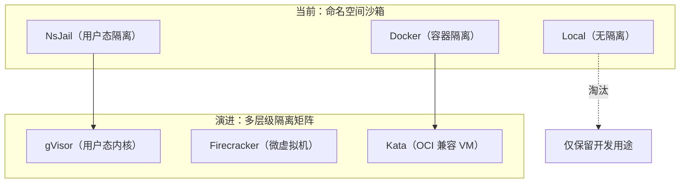

**接口不变，能力升级**——这正是第 2 章把 `SandboxManager` 设计为接口的前瞻性收益。

### 35.5 其他演进方向

| 方向 | 内容 | 优先级 |
|---|---|---|
| 网络沙箱实验 | 开放受控网络（虚拟网桥 + 流量染色） | 中（需新实验类别） |
| 沙箱检查点/恢复 | CRIU 快照，支持长实验断点续跑 | 低 |
| 多语言沙箱扩展 | Java/Python 解释器沙箱化 | 中（文档 11 多语言路线） |
| 沙箱遥测流式化 | 执行中实时推送观测（而非事后） | 低（与文档 08 工作台协同） |
| seccomp profile 自动生成 | 从正确解自动推导白名单 | 中（降低维护成本） |

---

## 36. 编译链与沙箱的协同：二进制安全进入沙箱

### 36.1 编译与执行的信任边界

沙箱隔离的是"不可信的学生程序"，但学生代码在被隔离执行之前，还要经过**编译**。编译过程本身也是攻击面的一部分：

| 攻击面 | 威胁 | 防御 |
|---|---|---|
| 编译产物 | 恶意二进制（编译期代码注入） | 沙箱执行隔离（编译产物只进入沙箱） |
| 编译时间 | 模板元编程死循环（C++ TMP 编译 1 小时） | `compileTimeout: 60s` |
| 编译资源 | 巨量宏展开导致 gcc 吃爆内存 | 编译临时目录隔离 + 超时 |
| 编译输出 | 报错信息携带路径泄漏 | 错误解析只保留行号/列号/消息 |

TraceOS 的立场：**编译在宿主环境进行（受超时与目录约束），执行在沙箱内进行（受全链路隔离）**。编译产物是唯一的跨边界对象，它进入沙箱的路径必须干净。

### 36.2 Compiler 的隔离式编译

```go
// Compile compiles source code and returns the result.
// Supports: c, cpp (C++), python, go, rust
func (c *Compiler) Compile(ctx context.Context, code string, lang string, extraFlags []string) (*CompileResult, error) {
	// Create temp directory for this compilation
	workDir, err := os.MkdirTemp(c.tempDir, "traceos-compile-*")
	if err != nil {
		return nil, fmt.Errorf("create temp dir: %w", err)
	}

	// Set compilation timeout
	compileCtx, cancel := context.WithTimeout(ctx, c.compileTimeout)
	defer cancel()
	// ...
}
```

编译隔离的三个层次：

1. **目录隔离**：每次编译一个独立 `traceos-compile-*` 目录，编译中间产物互不干扰，失败时 `os.RemoveAll` 清理；
2. **时间隔离**：`compileTimeout: 60s` 拦截模板元编程炸弹——即使是最慢的合法编译（含优化的大文件）也在 60 秒内；
3. **环境固定**：`-std=gnu11`/`-std=c++17`/`-O2` 写死基线，编译产物的行为对所有学生一致。

### 36.3 跨语言编译器的统一接口

| 语言 | 编译器 | 基线参数 | 沙箱形态 |
|---|---|---|---|
| C | gcc | `-Wall -Wextra -O2 -std=gnu11` | ELF 二进制直接入沙箱 |
| C++ | g++ | `-Wall -Wextra -O2 -std=c++17` | ELF 二进制直接入沙箱 |
| Python | python3 | 语法检查 `py_compile` + shell wrapper | wrapper 脚本入沙箱 |
| Go | go build | 静态链接单二进制 | ELF 二进制直接入沙箱 |
| Rust | rustc | 静态链接单二进制 | ELF 二进制直接入沙箱 |

**Python 的 wrapper 设计**：解释型语言没有编译产物，Compiler 生成一个 shell wrapper（`#!/bin/sh\nexec python3 main.py`），让解释器进程成为沙箱的 `exec_bin` 目标。**无论底层语言形态如何，沙箱看到的永远是"一个可执行文件"**——这是编译链与沙箱之间的核心契约。

### 36.4 智能编译参数：-lm 自动检测

```go
// Auto-detect math.h and add -lm to avoid undefined reference to pow/sqrt/etc.
if strings.Contains(code, "math.h") || strings.Contains(code, "<math>") {
	extraFlags = append(extraFlags, "-lm")
}
```

学生代码含 `#include <math.h>` 但老师忘了给 `-lm` 标志，是最常见的"环境性问题失败"。源码级检测 + 自动补参，把这类失败消灭在编译前。**教学平台的编译链要为学生考虑环境摩擦**，这正是不把编译参数暴露给学生的原因。

### 36.5 二进制从编译到沙箱的完整路径

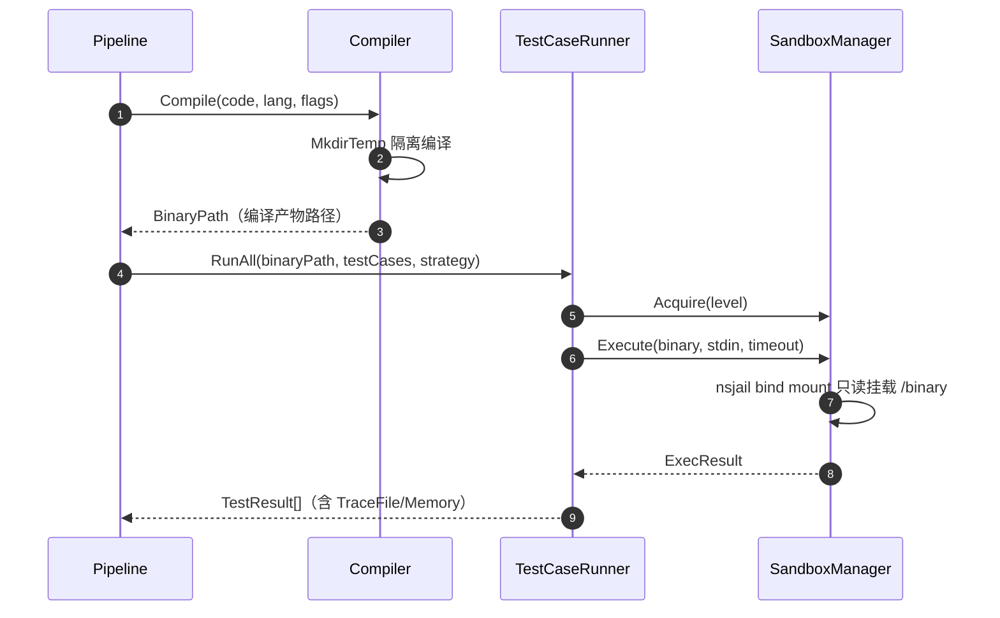

**路径安全审计**：编译产物路径只出现在两个地方——`RunAll` 的传参与 nsjail 配置的 bind mount。学生代码没有任何机会影响路径拼接（路径由 `MkdirTemp` 生成、由 `filepath.Base` 提取文件名），目录穿越类攻击在编译链上无立足点。

### 36.6 编译错误的友好化处理：从 stderr 到结构化诊断

学生面对的第一屏反馈往往不是沙箱报告，而是编译错误。编译器原生输出（gcc 的 `main.c:12:5: error: ...`）对初学者并不友好，TraceOS 的 `parseCompileErrors` 把五语言的编译输出统一转化为结构化错误：

```go
var gccErrorRe = regexp.MustCompile(`^(.+?):(\d+):(\d+):\s+(error|warning):\s+(.+)$`)

func parseCompileErrors(stderr string) []ErrorLine {
	var lines []ErrorLine
	for _, line := range strings.Split(stderr, "\n") {
		m := gccErrorRe.FindStringSubmatch(strings.TrimSpace(line))
		if m != nil {
			lineNum, _ := strconv.Atoi(m[2])
			colNum, _ := strconv.Atoi(m[3])
			lines = append(lines, ErrorLine{
				Type: m[4], File: m[1],
				Line: lineNum, Column: colNum,
				Message: m[5],
			})
		}
	}
	return lines
}
```

| 语言 | 错误解析器 | 特点 |
|---|---|---|
| C/C++ | `parseCompileErrors` | 标准 `file:line:col: error: msg` 格式 |
| Python | `parsePythonErrors` | `SyntaxError: ... (main.py, line N)` 格式 + 缩进错误识别 |
| Go | `parseGoErrors` | `file:line:col: msg` 格式 |
| Rust | `parseRustErrors` | `error[E0308]: ... --> file:line:col` 格式 |

结构化的价值链：`ErrorLine{Type, File, Line, Column, Message}` → 前端代码编辑器行内高亮（文档 12）→ AI 诊断的编译错误上下文（文档 09）。**编译错误的"结构化"是后续所有教学智能的前提**——如果错误只是原始 stderr 字符串，前端只能把一堆红色文本糊在学生脸上。

### 36.7 编译链与沙箱协同的工程总结

| 环节 | 安全设计 | 教学设计 |
|---|---|---|
| 编译前 | 代码字符串直入 `MkdirTemp` 目录 | 语言自动识别（c/cpp/python/go/rust） |
| 编译中 | 60s 超时 + 目录隔离 | `-Wall -Wextra` 警告全开 |
| 编译后 | 只返回 `BinaryPath`，中间产物随目录回收 | 结构化 ErrorLine 供编辑器高亮 |
| 交接 | 路径只经 `RunAll` → bind mount 单点传递 | 沙箱看到的永远是"一个可执行文件" |

编译链与沙箱的关系可以概括为：**编译链负责把"不可信源码"变成"结构化的可执行资产"，沙箱负责把"可执行资产"变成"安全的运行样本"**。两个子系统各守一道信任边界，通过"路径契约"衔接——这条链路在本文与文档 11（多语言支持）之间形成完整闭环。

---

## 37. 多租户隔离与学生间数据安全

### 37.1 教学平台的多租户模型

40 个学生同时在线，共享同一个评测服务。多租户隔离必须回答三个问题：**学生 A 能读到学生 B 的代码吗？学生 A 的代码能影响学生 B 的评测吗？学生 A 能冒充学生 B 提交吗？**

| 问题 | 隔离机制 | 位置 |
|---|---|---|
| 代码互读 | 数据库行级权限 + 平台鉴权 | 平台层（文档 02） |
| 评测互扰 | cgroup 预算 + 信号量限流 + 独立 workDir | 沙箱层（本文） |
| 身份冒充 | JWT 会话 + 提交归属校验 | 平台层（文档 02） |
| 文件互见 | bind mount 最小暴露（只有自己的 /binary） | 沙箱层（本文） |
| 数据互泄 | 沙箱内无平台数据库凭证、无网络 | 沙箱层（本文） |

### 37.2 沙箱层的多租户保障细节

```go
// Acquire 的租户隔离保证
id := fmt.Sprintf("nsjail-%d-%d", level, m.nextID.Add(1))
workDir := filepath.Join(m.workBase, id)
```

1. **ID 唯一性**：`atomic.Int64` 自增序号保证 40 个并发提交的沙箱 ID 互不相同，workDir 物理隔离；
2. **挂载最小化**：每个沙箱只 bind mount 自己的编译产物，其他学生的文件根本不在沙箱的文件系统视图内；
3. **tmpfs 私有化**：`/tmp` 是每个沙箱自己的 tmpfs，学生 A 写入的文件学生 B 不可见、不可继承；
4. **PID 视图隔离**：沙箱内看不到其他沙箱的进程，`kill` 类攻击没有目标（且 seccomp 白名单本就不放开 kill）。

### 37.3 侧信道与统计攻击的评估

| 侧信道 | 攻击内容 | TraceOS 评估 |
|---|---|---|
| 时序侧信道 | 从评测耗时推断他人程序复杂度 | 教学场景无价值（推断出来又如何） |
| 队列侧信道 | 从排队位置推断提交量 | 可接受（队列状态本就公开） |
| 资源侧信道 | 从自己配额被挤压推断他人占用 | cgroup 配额固定，无挤压可观测 |
| 残留文件侧信道 | 从 workDir 残留推断他人活动 | 每沙箱独立目录 + 异步清除 |

**评估结论**：沙箱层的多租户隔离达到"教学场景下充分"的水平——学生之间既无互读数据的通道，也无互扰评测的途径，残余的侧信道在威胁模型中被显式评估为可接受。

---

## 38. 恶意程序防御全链路推演

本章用一个完整的恶意程序案例，推演 TraceOS 纵深防御的逐层拦截过程。假设学生提交如下"复合恶意程序"：

```c
// 恶意样本：集 fork bomb、内存耗尽、危险调用、信号拒退于一身
#include <stdio.h>
#include <stdlib.h>
#include <signal.h>
#include <unistd.h>
#include <sys/mount.h>

void ignore(int sig) { /* 捕获信号，拒绝退出 */ }

int main() {
    signal(SIGTERM, ignore);
    signal(SIGINT, ignore);

    // 阶段 1：尝试提权
    mount("none", "/tmp/x", "tmpfs", 0, NULL);

    // 阶段 2：fork bomb
    while (1) fork();

    // 阶段 3：内存耗尽（fork bomb 后理论上到不了）
    while (1) malloc(1024 * 1024);

    // 阶段 4：死循环驻留
    while (1) sleep(1);
    return 0;
}
```

### 38.1 推演：Level 1（Standard）下的逐层拦截

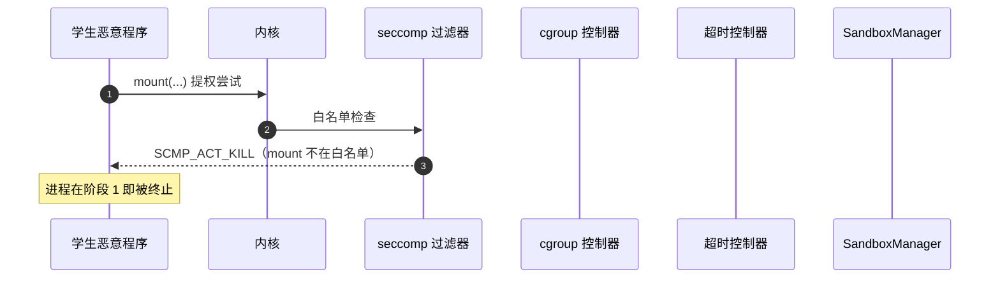

**第一拦截点（seccomp）**：`mount` 不在任何 profile 白名单内，`defaultAction: SCMP_ACT_KILL` 立即生效。恶意程序连"阶段 1"都走不完——这是白名单模型对"危险调用前置拦截"的价值。

### 38.2 推演：绕过阶段 1 后的防御（假设 mount 被放行）

假设一个更宽松的 profile 放行了 mount（例如未来某实验需要），恶意程序进入阶段 2：

| 阶段 | 攻击 | 拦截机制 | 结果 |
|---|---|---|---|
| 阶段 2 | fork bomb | cgroup `pids.max = 128` | 第 129 次 fork 返回 EAGAIN，进程数钉死在配额 |
| 阶段 3 | 内存耗尽 | cgroup `memory.max = 256MB` | cgroup 内 OOM，只杀本沙箱进程 |
| 阶段 4 | 死循环驻留 | `time_limit = 308s` | nsjail 超时，进程组 SIGKILL 全灭 |
| 附加 | SIGTERM 拒退 | SIGKILL 不可捕获 | 信号处理器形同虚设 |

**结论**：即使攻击者写满全部四个阶段，四个独立的拦截点也会分别在对应阶段终止攻击。**攻击者必须同时突破 seccomp、cgroup、超时三层才能对宿主产生实际影响**——而这三层分别是机制性保证（白名单外必死、配额内 OOM、SIGKILL 不可捕获），不是概率性防御。

### 38.3 推演：Level 3（Hardened）下的同一程序

同一程序提交到死锁实验（Level 3）：

| 参数 | Level 1 | Level 3 | 差异效果 |
|---|---|---|---|
| PID 配额 | 128 | 32 | fork bomb 在第 33 次 fork 即停 |
| 内存 | 256MB | 64MB | OOM 提前到来 |
| 时限 | 308s | 183s | 驻留时间缩短 40% |
| seccomp | process-lab | deadlock-lab | 放行面更窄 |

**分级的防御效果**：危险实验（死锁）配更紧的预算，让恶意程序的"存活窗口"显著缩小。这是"教学语义化安全分级"（创新点 I3）在防御推演中的直接体现。

### 38.4 推演的启示

1. **防御的确定性**：每一层拦截都是机制性行为（白名单、配额、SIGKILL），不存在"看运气"；
2. **防御的层次性**：单层被绕过不影响整体——这正是纵深防御与单点防御的本质区别；
3. **防御的可验证性**：恶意样本集测试（第 33 章）可以在 CI 中逐条复现本推演，防御不是文档宣称而是测试断言。

---

## 39. 沙箱子系统创新点全景总结

### 39.1 创新点总览表

| # | 创新点 | 一句话表述 | 评审价值 |
|---|---|---|---|
| I1 | 三元协同架构 | 沙箱×观测×评分的接口级解耦协同 | 架构独创性 |
| I2 | 复合键 PID 注入 | `(tid, start_time)` 解决 PID 复用误归因 | eBPF 生产化关键细节 |
| I3 | 教学语义化安全 | 三级安全×六套 profile 按实验类别裁剪 | 安全与教学的融合 |
| I4 | 策略化后端选择 | 默认后端+实验级覆盖的后端矩阵 | 灵活性与一致性兼得 |
| I5 | 三层限流治理 | WorkerPool×沙箱池×信号量的并发治理 | 高并发稳定性 |
| I6 | 失败语义精确化 | Killed/ExitCode/内存峰值分离失败原因 | 教学诊断基石 |
| I7 | 降级链完备化 | 后端×观测双维降级且降级留痕 | 抗故障能力 |

### 39.2 创新点一：沙箱×观测×评分的三元协同架构

业界判题系统的沙箱是"黑盒执行器"——进代码、出结果。TraceOS 的沙箱是"**观测型沙箱**"：

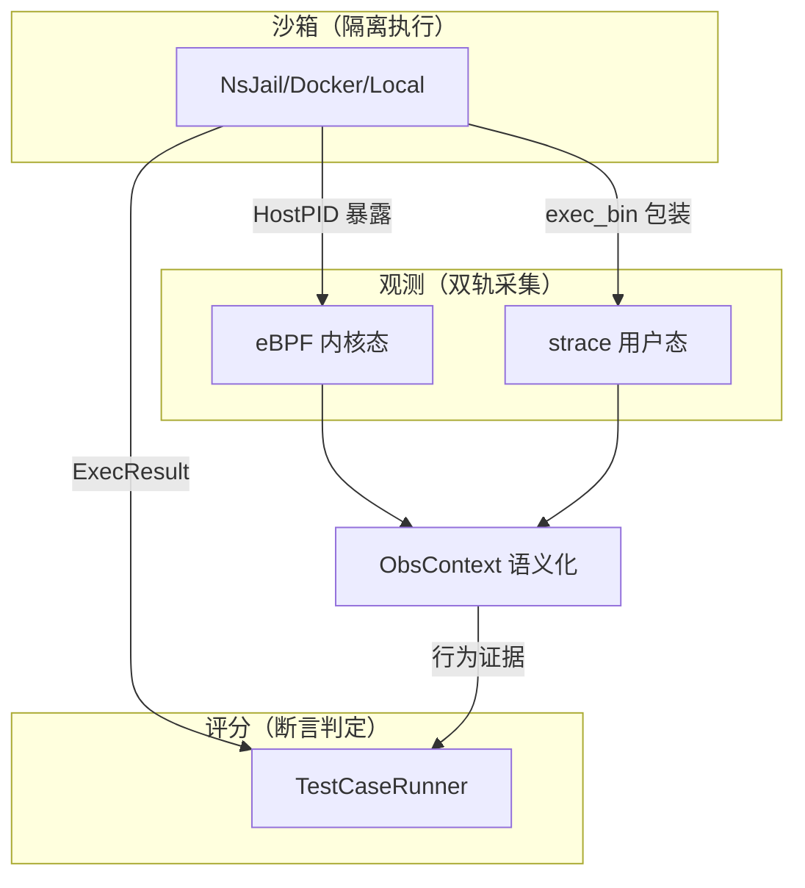

沙箱为观测**主动暴露内部结构**（HostPID、DisableTrace 切换、trace 输出目录挂载），观测为评分**提供行为证据**（系统调用轨迹、内存峰值），评分把两者**统一为教学结果**（分数+诊断）。三者以接口契约耦合，任一子系统可独立替换——这是本文第 2 章接口设计的最终归宿。

### 39.3 创新点二：(tid, start_time) 复合键

PID 复用是 eBPF 生产化的经典陷阱。TraceOS 的解法：

```text
单键方案：track[pid] → PID 复用后旧事件误归因新进程
复合键方案：track[(tid, start_time)] → start_time 是内核 boottime 纳秒，
          进程重启后必然不同，误归因概率归零
```

实现上的两个支撑细节：

1. `GetStudentStartTime` 解析 `/proc/<pid>/stat` 的 field 22，并处理 comm 含括号/空格的边界 case；
2. `getconf CLK_TCK` 动态检测 USER_HZ，把 ticks 换算为纳秒，与 BPF 的 `task->start_boottime` 对齐时间基准。

**两侧时间基准的统一**（用户态 ticks→纳秒、内核态 boottime 纳秒）是这个创新点的真正难点——任何一侧的时间基准错误都会让复合键形同虚设。

### 39.4 创新点三：教学语义化的安全分级

三级安全等级 × 六套 seccomp profile 的组合矩阵，其独特之处在于**分级的依据是教学需要而非单纯安全**：

```text
传统安全分级：按"危险程度"分级（低/中/高）
TraceOS 分级：按"实验需要"分级
  Level 1 → 进程实验：PID 配额给足 64（教学需要 fork）
  Level 3 → 死锁实验：PID 配额收紧到 8（教学不需要 fork，危险需要防）
```

安全与教学的张力（fork 教学需要 vs fork bomb 防御需要）通过**配额精细调节**解决：配额恰好满足教学实验的正确解需要，且把恶意样本拦在门外。

### 39.5 创新点四：降级链的"显式留痕"

系统共有四条降级链，每条都有日志或显式警告：

| 降级链 | 触发 | 留痕方式 |
|---|---|---|
| eBPF → strace | 内核/权限不满足 | `IsAvailable()` 探测 + 启动日志 |
| strace → 直执行 | strace 缺失 | `[Sandbox] strace not found` 日志 |
| NsJail → Docker → Local | 环境能力不足 | `SANDBOX_BACKEND` 配置 + validate 警告 |
| NATS → LogBus | 事件总线故障 | 启动日志（文档 02） |

**降级必须可见**是 TraceOS 的工程纪律：系统可以失去能力，但不能"悄悄"失去能力。

### 39.6 沙箱子系统对全平台的贡献

```mermaid
flowchart TB
    SB["沙箱子系统"] --> C1["对评测：确定性执行环境"]
    SB --> C2["对观测：HostPID/双轨切换"]
    SB --> C3["对安全：五道纵深防线"]
    SB --> C4["对教学：失败语义精确化"]
    SB --> C5["对运维：三层限流抗洪峰"]
    C1 --> P["支撑全局目标 G1 确定性评测"]
    C2 --> P2["支撑 eBPF 主观测引擎（文档 04）"]
    C3 --> P3["支撑平台安全承诺"]
    C4 --> P4["支撑 AI 诊断（文档 09）"]
    C5 --> P5["支撑教学高峰期稳定（文档 12/14）"]
```

### 39.7 常见评审问题速答（Q&A）

针对专业评委在评审现场最可能提出的十个问题，预先给出技术答案：

**Q1：为什么不直接用 Docker，要用 NsJail？**

Docker 的启动开销是秒级，而教学评测是毫秒级频率的高并发短任务；更重要的是 Docker 对 strace 的集成需要镜像内预装、对 eBPF 的集成受 PID 命名空间阻隔。NsJail 的 `exec_bin` 机制让 strace 成为原生包装，`HostPID` 暴露让 eBPF 得以精确注入。Docker 在 TraceOS 中作为"需要完整环境标准化"的备选后端保留，而非默认。

**Q2：seccomp 默认动作为什么是 KILL 而不是 ERRNO？**

ERRNO 让学生程序"以为系统调用失败了"继续运行，产生诡异且无法解释的错误——教学诊断价值为负。KILL 让进程立即终止，评测管线捕获 `Killed` 标志后给出明确的 `execution timeout`/异常终止标记，失败可见、可解释。安全系统不仅要阻止恶意行为，还要让失败模式清晰。

**Q3：eBPF 和 strace 能同时采集吗？为什么选一？**

能，但无必要且有害：双重采集意味着双倍数据量、双倍时间基准不一致风险、以及 strace 进程自身的系统调用会污染 eBPF 事件流。TraceOS 用 `DisableTrace` 开关在二者间切换：eBPF 可用时直执行学生二进制（内核态观测），不可用时 strace 包装执行（用户态观测）。**双轨指的是"两条备选路径"，不是"同时运行"**。

**Q4：如果遇到 Dirty Pipe 这类内核 0day，沙箱怎么办？**

任何基于命名空间的沙箱都无法靠自身防御共享内核的 0day（写入发生在页缓存层）。TraceOS 的立场是风险分层管理：部署基线锁定修复版本内核管住概率、最小挂载暴露管住影响面、audit_logs 审计管住责任追溯。诚实陈述"防不住什么"比宣称"绝对安全"更专业。

**Q5：为什么不开放网络实验？**

当前实验体系（进程/线程/内存/文件/调度/死锁）本质是单机计算。网络实验需要新的安全模型（受控虚拟网桥、流量染色、跨沙箱通信审计），已列入演进路线，但会在成熟的实验设计之上推进，而非为了"有网络"而弱化安全。

**Q6：三级配额（256MB/128MB/64MB）的依据是什么？**

配额是教学契约：Level 1 给足内存与 PID 配额满足进程实验的 fork 树教学需要，Level 3 收紧到 64MB/8PID 让死锁实验快速失败。配额的确定流程是"正确解需要 + glibc 运行时开销 + 安全裕度"，并写死为代码常量、由测试断言保护，不是拍脑袋的数字。

**Q7：Local 后端无隔离，为什么还保留它？**

Local 后端是"降级路径最小化"的实践：降级后端复杂度趋近于零，才能在灾难时刻可靠兜底。它仅限开发调试与 CI，生产配置中由 `validate()` 显式警告。**降级可以牺牲观测精度，但必须显式警告牺牲了安全**——这是诚实的降级伦理。

**Q8：为什么不用 gVisor 或 Firecracker 做默认沙箱？**

gVisor 有 10%~30% 的性能损耗且宿主 eBPF 观测失效；Firecracker 是虚拟机级隔离，启动开销与运维复杂度更高。两者在"内核级实验"等未来场景中价值更大，已列入演进路线。当前选择是"教学场景下的恰好"——恰好够安全的隔离、恰好够精确的观测，而非无条件的"最强隔离"。

**Q9：沙箱与观测（eBPF）如何解耦？**

通过 `SandboxManager` 接口的 `ExecuteEBPF/WaitEBPF` 方法与 `SandboxInstance.HostPID` 字段：沙箱暴露宿主机 PID 视图，观测侧通过 `LocateStudentPID` + `GetStudentStartTime` 自主定位并注入。两者以"接口 + 字段契约"耦合，各自独立演进——观测引擎（文档 04）的任何升级都不需要修改沙箱实现。

**Q10：并发上限为什么是默认 5、上限 20？**

每个 nsjail 实例占用独立 cgroup、内存预算与 PID 命名空间，内核调度与 cgroup 管理的开销随实例数超线性增长。5 个并发足以覆盖典型课堂提交节奏（配合 WorkerPool 4 worker 与 8 用例并发的上层限流），20 是防御性上限——超出后内核开销反噬吞吐。上限校验（`v > 0 && v <= 20`）防止配置漂移导致的事故。

**Q11：沙箱内的系统调用轨迹如何与评分割离？**

轨迹（TraceFile/eBPF 事件）与评分（TestResult）在 `ExecResult` 中同源分离：断言评分只看 stdout/exitCode/Killed，观测轨迹只服务于 ObsContext 语义建模与 AI 诊断。两者互不污染——**评分不因观测数据的丰富程度而变化，诊断不因评分高低而失真**。这是全文"事实与解释分离"架构原则（P1）在沙箱结果层面的落地。

**Q12：不同学生同时提交时，一个学生的恶意程序会不会拖慢其他学生的评测？**

不会，这是三层限流与 cgroup 预算的联合保证：信号量把真正运行的沙箱数钉死在 5，每个沙箱的内存/CPU/PID 预算固定，于是全班提交的瞬时资源峰值是可计算的（5×256MB 内存、4 核 CPU 等效）。恶意程序能做的最坏事情就是"尽快耗尽自己的配额"——而这恰是 cgroup 的设计行为。**在 TraceOS 的模型里，恶意程序对其他学生的影响为零，对宿主的影响被预算硬上限封顶。**

**Q13：沙箱子系统最值得向评审老师强调的三点是什么？**

第一，**沙箱不是黑盒执行器，而是观测型沙箱**——为 eBPF 暴露 HostPID、为 strace 提供 exec_bin 包装、为评分提供精确失败语义，它是整个"观测→诊断→教学"链路的地基；第二，**安全分级是教学语义化的**——配额与白名单按实验类别裁剪，既不是一刀切也不是无限细分，恰好满足教学需要；第三，**纵深防御的每一层都是机制性保证而非概率性防御**——白名单外必死、配额内 OOM、SIGKILL 不可捕获，防御效果可以在 CI 中用恶意样本集逐条验证。

### 39.8 结束语

沙箱子系统回答了教学评测平台最硬核的问题：**如何安全地、稳定地、并发地运行不可信的学生代码，同时保持评测环境完全一致、可复现、可回放。**

答案浓缩在四句话中：

1. **三后端抽象**回答"什么环境都能跑"——接口契约下的 NsJail/Docker/Local 三级选择；
2. **三级安全×六套 profile** 回答"什么实验给什么权限"——教学语义化的最小权限；
3. **cgroup 预算**回答"什么资源给什么配额"——把公平性写进配额常量；
4. **eBPF 协同**回答"隔离之后如何观测"——(tid, start_time) 复合键让隔离与观测兼得。

这四句话的共同底色是**工程克制**：不追求最强的隔离（Firecracker），不追求最全的观测（全量事件），而是追求"教学场景下的恰好"——恰好够安全的隔离、恰好够精确的观测、恰好够公平的配额。

---

> 下一篇：04 eBPF 主观测引擎设计——深入内核级观测的 CO-RE、HASH_OF_MAPS 沙箱隔离与四类事件采集。

