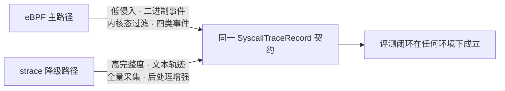
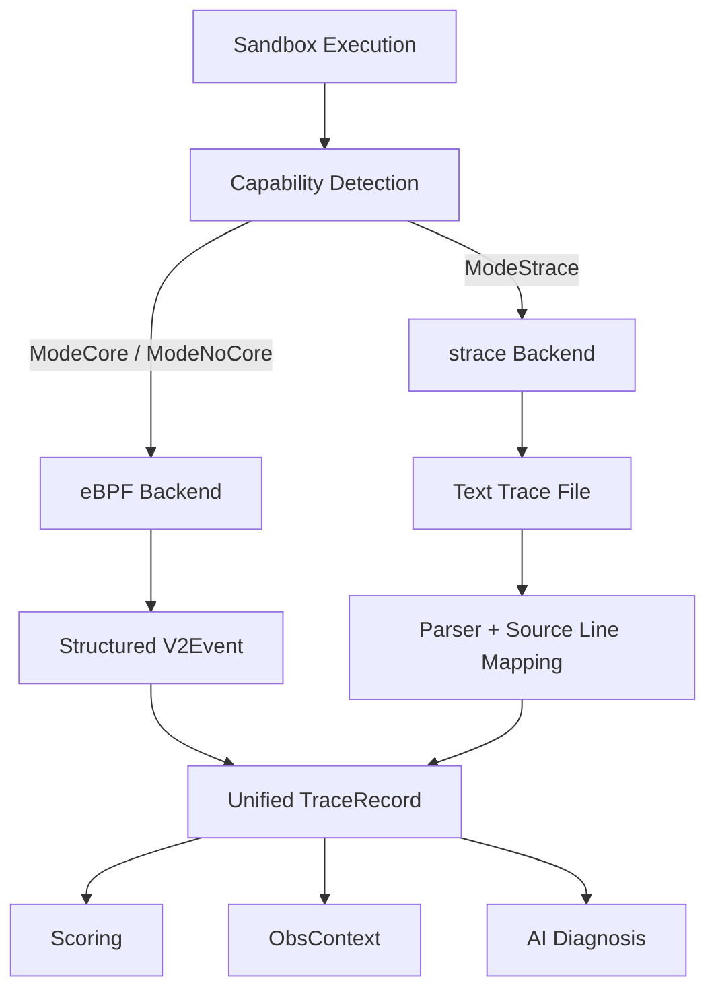
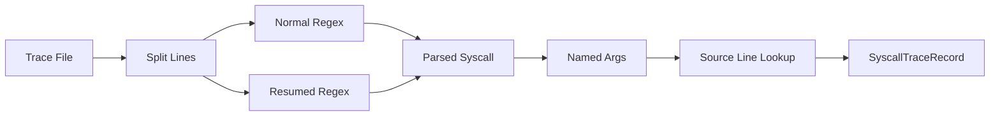
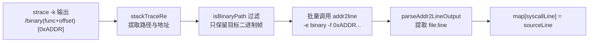
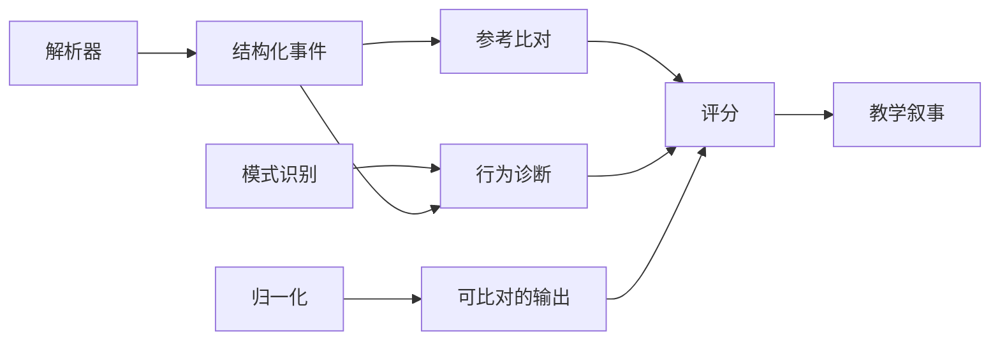
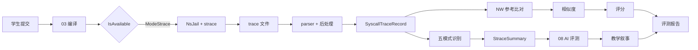
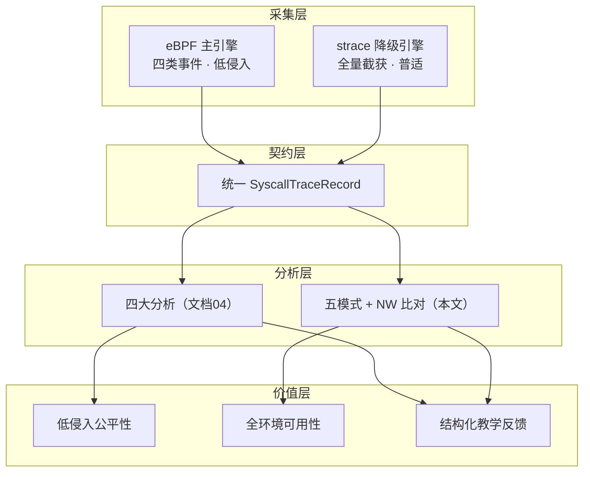

# 05 strace 降级观测与兼容性策略

## 全文导航

| 章节 | 主题 | 要点 |
|---|---|---|
| §1~2 | 双观测架构与执行方式 | strace 在平台中的定位与 NsJail 集成 |
| §3~5 | parser 设计与状态机 | 三正则解析、参数切分、resumed 处理 |
| §6~7 | 噪声过滤与源码行关联 | 启动噪声抑制、addr2line 反解 |
| §8~10 | 统一契约与降级触发 | 跨路径数据结构、能力差异 |
| §11~13 | 设计取舍与评审价值 | 为什么这样设计、评委看什么 |
| §14~15 | 执行模型与状态机深潜 | ptrace 原理、完整状态机表 |
| §16~19 | 源码行/归一化/内存/资源 | 四大后处理引擎的工程细节 |
| §20~22 | 序列比对与统一分叉 | Needleman-Wunsch、边界容错 |
| §23~25 | 能力对比与测试验证 | 与 eBPF 全维度对照、测试金字塔 |
| §26+ | 深潜专题（本次扩写） | 原理剖析、工程深潜、业界对比等 |

## 摘要

TraceOS Lab 的观测架构采用“eBPF 为主、strace 为降级”的双引擎策略。eBPF 提供更低侵入和结构化的运行事实，strace 则作为成熟稳定的兼容路径，保证在 BTF 缺失、BPF object 不完整、内核能力不足或运行权限受限时，平台仍然能够完成系统调用采集、行为评分和教学反馈。

**本路径的核心主张**：降级不是妥协，而是**兼容性工程**。strace 路径在 TraceOS Lab 中不是"eBPF 不可用时的临时凑合"，而是一套拥有独立 parser 状态机、参数语义映射、源码行反解、动态输出归一化、内存布局重建、资源指标推导、序列比对引擎的**完整第二观测引擎**。它让平台的价值主张从"在理想环境下能跑"升级为"在任何环境下都能提供完整教学闭环"。

### 能力矩阵（本路径）

| 能力 | 实现 | 成熟度 |
|---|---|---|
| 系统调用全量采集 | strace -tt -k -f | 工业级成熟（30+ 年） |
| 文本轨迹解析 | 三正则 + 状态机 | 完整 |
| 参数语义化 | 40+ syscall 参数名映射 | 完整 |
| 源码行关联 | addr2line 批量反解 | 完整 |
| 动态输出归一化 | 五类正则 + 八进制还原 | 完整 |
| 内存布局重建 | 六段模型 | 完整 |
| 轨迹差异分析 | Needleman-Wunsch 对齐 | 完整 |
| 行为模式识别 | 五模式语义分析 | 完整 |

### 与主路径的哲学差异



两条路径不是"先进 vs 落后"，而是**能力互补**：eBPF 赢在侵入性与结构化，strace 赢在完整性与普适性。一个平台同时拥有两者，意味着它既有前沿技术的先进性，又有工程落地的可靠性。

## 1. 双观测架构



上层评测逻辑不关心底层是哪种采集方式，而是消费统一记录。这样可以把“观测能力是否可用”从“评测链路是否可用”中解耦。

## 2. strace 执行方式

NsJail 在 strace 模式下使用类似以下执行模型：

```text
nsjail
  → /usr/bin/strace
  → -tt       时间戳
  → -k        内核栈/调用上下文信息
  → -o file   输出到沙箱专属文件
  → /binary   执行学生程序
```

每个 test case 具有独立的 trace file，执行完成后由 Core 读取、解析、持久化，再删除临时文件，避免不同测试点的 trace 混淆。

## 3. strace parser 设计

Parser 支持两类典型行：

1. 普通系统调用行：`timestamp syscall(args) = retval <duration> error`；
2. blocking syscall resumed 行：`<... futex resumed> ... = retval`。

处理流程：



Parser 会识别 PID、系统调用名称、原始参数、返回值、耗时和错误名称，并通过 syscall argument name table 将 `mmap`、`openat`、`clone`、`futex` 等参数映射成可解释字段。

## 4. 参数解析

strace 参数中可能出现嵌套括号、数组和结构体，不能简单按逗号切割。项目中的 `splitStraceArgs` 会维护括号深度，仅在顶层逗号处分割：

```text
mmap(NULL, 4096, PROT_READ|PROT_WRITE, MAP_PRIVATE, -1, 0)
→ addr / len / prot / flags / fd / offset
```

解析结果同时保留 `_raw` 字段，确保后续需要展示原始信息时不丢失上下文。

## 5. resumed syscall 的处理

阻塞型系统调用可能被 strace 分成两行，例如 `wait4`、`futex`、`read`。如果只解析普通行，就会漏掉真实的等待和返回行为。项目通过 `straceResumedRe` 与 `retvalTailRe` 识别 resumed 记录，并将其重新构造成标准 trace record。

这对操作系统实验非常重要：

- 死锁往往表现为 futex 长时间等待；
- 进程同步依赖 wait4 的实际返回；
- I/O 实验需要观察阻塞和恢复；
- 线程实验的关键行为可能跨越多行。

## 6. 进程启动噪声过滤

strace 会记录启动学生二进制时产生的 harness execve。该调用不属于学生代码行为，项目在收集阶段跳过第一个启动 execve/execveat，防止它干扰 syscall assertions 和行为分析。

## 7. 源代码行关联

编译策略默认确保 C/C++ 包含 `-g`，strace 的 `-k` 信息可配合 `addr2line` 解析源代码位置。`ParseSourceLine` 将 trace line index 映射为 source line，之后前端可以在代码编辑器中高亮对应位置，AI 也可以将系统调用证据和学生代码位置关联起来。


## 8. 统一数据契约

无论来自 eBPF 还是 strace，最终都转为统一的 `repository.SyscallTraceRecord`。统一契约包含：

| 字段 | 说明 |
|---|---|
| `SubmissionID` | 归属提交 |
| `PID` | 进程标识 |
| `SyscallName` | 系统调用名称 |
| `Args` | 参数字典 |
| `ReturnValue` | 返回值 |
| `ErrorName` | 错误 |
| `DurationNs` | 耗时 |
| `SourceLine` | 源码位置 |
| `Time` | 事件时间 |

统一契约带来的直接收益是：

- 评分引擎只实现一次；
- ObsContext 不需要感知采集后端；
- 前端 Trace View 可以统一渲染；
- AI 诊断可以使用同一种 context schema；
- eBPF 不可用时仍保留教学闭环。

## 9. fallback 触发条件

当前系统会综合判断：

- kernel version 是否满足；
- `/sys/kernel/btf/vmlinux` 是否存在；
- CO-RE object 是否存在；
- no-CO-RE object 是否存在；
- BPF map、program 和 ring buffer 是否能成功打开；
- 运行过程中 eBPF adapter 是否可用。

出现失败时，Core 选择 strace 路径，而不是让整个提交失败。

## 10. 两种后端的能力差异

| 对比项 | eBPF | strace |
|---|---|---|
| 采集位置 | 内核 tracepoint | 用户态跟踪器 |
| 数据形态 | 二进制结构化事件 | 文本行 |
| 侵入性 | 较低 | 较高 |
| 参数呈现 | 原始寄存器字段 | 格式化文本 |
| 部署条件 | 内核、BTF、权限和 object | strace 与 NsJail |
| 兼容性 | 依赖运行环境 | 成熟通用 |
| 适合角色 | 主路径、深度观测 | fallback、复现和调试 |

## 11. 设计取舍

### 为什么不完全删除 strace

比赛平台需要在标准服务器、云平台和不同 Linux 发行版上部署。strace 是重要的可用性保险，即使某些高级 eBPF 指标缺失，也能完成 syscall 级反馈。

### 为什么不让 eBPF 和 strace 同时追踪同一次执行

两者同时启用会增加开销，并可能产生重复事件、时间线合并和评分计数歧义。平台根据能力选择主路径，保持单次执行数据来源清晰。

### 为什么 parser 仍然值得保留

strace 不只是后备日志，它还提供了便于人工阅读的文本证据。解析器的存在让系统能够将文本观察转换为与 eBPF 一致的结构化事实，并支持 source line 和教学解释。

## 12. 演示建议

演示时可以准备两种配置：

- 正常服务器环境：展示 eBPF 模式日志与 ring buffer 数据；
- 关闭或缺失 BPF 能力的兼容环境：展示系统自动切换到 strace，评测结果和前端 Trace 仍可用。

这种演示可以直接证明系统不是“只能在理想环境中运行”的实验原型，而是具备工程 fallback 的在线平台。

## 13. 评审价值

双观测架构体现了项目对“技术先进性”和“系统可用性”的平衡。eBPF 保证技术亮点，strace 保证兼容落地，统一数据模型保证后端可替换，最终让评测和教学体验不被单一内核能力绑架。

---

## 14. strace 执行模型的工程细节

前面的章节从"是什么"的角度描述了双观测架构，这一部分从"怎么实现"的角度，逐层拆开 strace 路径的每个工程决策。

### 14.1 NsJail 与 strace 的结合方式

strace 路径最巧妙的地方在于它**不改变沙箱的执行模型**，而是把 strace 作为 NsJail 的 `exec_bin`。也就是说，学生程序不是被 NsJail 直接执行，而是被 NsJail 当作"strace 的子进程"来执行：

```text
nsjail
  └─ exec_bin = /usr/bin/strace
       └─ argv = ["-tt", "-k", "-o", tracefile, "/binary", ...testcase args]
            └─ 学生程序 /binary
```

这种设计带来三个直接收益：

1. **沙箱隔离与观测解耦**：strace 运行在沙箱内部，学生进程仍然受 NsJail 的命名空间、seccomp、cgroup 约束，观测本身不破坏隔离；
2. **trace 文件天然隔离**：每个测试用例通过 `-o` 指定独立的 trace 文件，落盘在沙箱专属目录，避免并发写入冲突；
3. **无需额外进程管理**：学生进程退出时，strace 随之退出，trace 文件完整落盘，生命周期与执行同步。

### 14.2 三个关键参数的语义

| 参数 | 作用 | 对评测的价值 |
|---|---|---|
| `-tt` | 微秒级时间戳 | 时间线校准、并发分析、耗时计算 |
| `-k` | 解码内核栈（`> /path(func+offset) [0xADDR]`） | 通过 addr2line 反解源码行，实现"系统调用 → 源码行"关联 |
| `-o file` | 输出到文件而非 stderr | 与程序 stdout 分离，避免污染输出断言 |

`-k` 是其中最具技术含量的一项。它依赖二进制带 `-g` 调试信息，strace 在每条系统调用的栈回溯里给出"二进制路径 + 函数 + 偏移 + 返回地址"。这个返回地址正是 addr2line 反解源码行的输入。

### 14.3 trace 文件的完整生命周期

```text
创建 → 写入 → 读取解析 → 落库 → 删除
```

每一步的职责边界都很清晰：

1. **创建**：沙箱层在 `Execute` 时按测试用例创建独立临时文件；
2. **写入**：strace 在执行期间持续写入；
3. **读取解析**：Pipeline 在 `collectAndStoreTraces` 中读文件、解析、反解源码行；
4. **落库**：解析后的 `SyscallTraceRecord` 批量插入数据库；
5. **删除**：解析完成后立即删除临时文件，避免磁盘泄漏。

这里的"读后即删"是一个容易忽略但重要的细节——评测系统在高并发下会积累大量 trace 文件，如果不及时清理，磁盘会在短时间内被耗尽。

---

## 15. strace parser 的完整状态机

strace 输出是文本，但**文本解析绝不是简单的按行切分**。`parseStraceLine` 实现了一个两态的状态机，处理普通行与 resumed 行两类输入。

### 15.1 两类输入行的完整语法

**普通系统调用行**：

```text
[PID ]HH:MM:SS.micros SYSCALL(args) = retval <duration> ERR
```

例如：

```text
2781 10:32:11.004217 openat(AT_FDCWD, "/tmp/x", O_RDWR) = 3 <0.000041>
```

**resumed 系统调用行**（阻塞型系统调用被拆成两行时）：

```text
2781 10:32:11.004217 <... futex resumed>) = 0 <0.005123>
```

### 15.2 为什么需要"resumed"状态

这是 strace 解析中最容易踩的坑。`wait4`、`futex`、`read` 这类阻塞系统调用，在 strace 的 `-f`（跟踪子进程）模式下会被拆成"发起"与"完成"两行。如果 parser 只匹配普通行，那么：

- 死锁实验中的 futex 等待会被漏掉；
- 进程同步实验中的 wait4 返回会被漏掉；
- I/O 实验中的阻塞恢复会被漏掉。

这些恰恰是 OS 实验评测最关心的行为。`straceResumedRe` 与 `retvalTailRe` 两个正则配合，把 resumed 行重新构造成与普通行同构的记录。

### 15.3 三个正则的分工

| 正则 | 匹配目标 | 产出 |
|---|---|---|
| `straceLineRe` | 普通系统调用行 | pid/syscall/args/retval/duration/err |
| `straceResumedRe` | `<... SYSCALL resumed>` 前缀 | syscall + resumed 尾部 |
| `retvalTailRe` | resumed 尾部的 `= retval <duration> ERR` | retval/duration/err |

三者的组合让 parser 能够把 strace 的任意输出形态归一化为同一种中间表示。

### 15.4 嵌套括号的参数切分

strace 的参数可能包含嵌套结构（结构体、数组、嵌套括号）。朴素的"按逗号 split"会把 `mmap(NULL, 4096, PROT_READ|PROT_WRITE, MAP_PRIVATE, -1, 0)` 正确切分，但遇到嵌套结构就会出错。

`splitStraceArgs` 用**括号深度计数**解决这个问题：

```text
深度计数器 depth：遇到 { [ ( 则 +1，遇到 } ] ) 则 -1
只在 depth == 0 的逗号处切分
```

这样 `clone3({flags=CLONE_VM, ...}, 88)` 这样的嵌套参数不会被误切。切分结果再通过 `syscallArgNames` 参数名表映射为具名字段，同时保留 `_raw` 原始字符串，兼顾结构化与可回溯。

### 15.5 参数名映射表的设计

`syscallArgNames` 维护了 40+ 个系统调用的参数名（按 x86_64 ABI 顺序）。这张表的价值在于**把寄存器顺序翻译成业务语义**：

| 系统调用 | 参数名序列 | 教学意义 |
|---|---|---|
| `mmap` | addr/len/prot/flags/fd/offset | 理解虚拟内存映射的六个要素 |
| `futex` | uaddr/op/val/timeout/uaddr2/val3 | 理解锁原语的操作码 |
| `clone` | flags/child_stack/parent_tid/child_tid/tls | 理解线程创建的五个参数 |
| `wait4` | pid/wstatus/options/rusage | 理解进程回收 |

对于未在表中的系统调用，parser 退化为只保留 `_raw`，保证不丢信息。这种"白名单具名 + 全量兜底"是健壮的参数解析策略。

---

## 16. 源码行关联：从内核栈到编辑器高亮

strace 的 `-k` 给了内核栈，但要变成"第几行代码"，还需要一次地址反解。

### 16.1 反解流程



### 16.2 三个关键的工程决策

**决策一：只取第一个（最内层）二进制帧。**
一次系统调用的内核栈可能包含多帧，但只有最内层的那一帧真正对应"触发该系统调用的那行学生代码"。用 `seenSyscalls` 去重，每个 syscall 行只保留一个地址。

**决策二：`isBinaryPath` 的三重匹配。**
NsJail 挂载点 `/binary`、精确路径、basename 三种情况都要能匹配，否则真实环境的路径差异会导致反解失败。

**决策三：批量 addr2line。**
不是每条系统调用单独调用一次 addr2line（那会 fork 成百上千次子进程），而是把所有地址收集起来，一次 `addr2line -e binary -f 0x1 0x2 ... 0xn` 批量反解，性能提升一个数量级。

### 16.3 反解失败时的优雅降级

addr2line 失败（未安装、地址不在二进制、地址在库代码中）时，函数返回空 map，trace 记录中的 `SourceLine` 保持 nil。这意味着：**源码行关联是"锦上添花"的能力，而不是"没有它就瘫痪"的硬依赖**。前端在拿不到源码行时仍能渲染 trace 视图，只是少了代码高亮。

---

## 17. 动态输出归一化

OS 实验的输出天然包含运行时变化的值——PID、TID、内存地址、时间戳、文件描述符。如果直接字符串比对，同一份代码两次运行会得到不同结果，评测就会"时对时错"。

### 17.1 五类动态值的归一化

| 模式 | 正则 | 归一化为 | 说明 |
|---|---|---|---|
| PID | `PID=\d+` | `PID=` | 进程号 |
| TID | `TID=\d+` | `TID=` | 线程号 |
| FD | `(fd\|FD\|file descriptor)\s*[:=]?\s*\d+` | `FD=` | 文件描述符 |
| 地址 | `0x[0-9a-fA-F]{4,}` | `0xADDR` | 内存地址 |
| 时间戳 | `\d{2}:\d{2}:\d{2}[.]\d+` | `HH:MM:SS.ms` | 时间 |

### 17.2 归一化的语义

归一化不是"模糊匹配"，而是**把运行时确定但值随机的字段替换为占位符**。它的关键约束是：

1. **只归一化真正动态的值**：地址、PID 这类字段每次运行必变，归一化是合理的；
2. **不归一化语义值**：`PROT_READ|PROT_WRITE` 这类参数不能被归一化，否则会掩盖真实的语义错误；
3. **双向归一化**：学生输出和期望输出都要过同一套归一化，保证比较基准一致。

### 17.3 转义序列的反向处理

数据库里存储的期望输出，其 `\n` 是字面的反斜杠加 n（两字符），而学生程序实际输出的是真正的换行符（一字符）。`normalizeEscapes` 负责把字面转义序列还原为真实字符，支持 `\n \t \r \\ \"` 以及八进制转义（如终端颜色码 `\033`）。这个看似琐碎的细节，是"期望输出能写多行"的基础。

---

## 18. 内存布局重建：从 brk/mmap 到六段模型

strace 路径虽然不像 eBPF 那样直接读 `/proc/<pid>/maps`，但依然能从内存相关的系统调用重建出内存布局快照。

### 18.1 六段模型的来源

`CollectMemorySnapshots` 从 `brk`（堆）、`mmap`/`munmap`（映射区）、`mprotect`（保护位）四类事件，增量推导出：

| 段 | 来源系统调用 | 教学意义 |
|---|---|---|
| text | 二进制加载 | 代码段 |
| data | 二进制加载 | 已初始化全局变量 |
| bss | 二进制加载 | 未初始化全局变量 |
| heap | brk/mmap | 堆，malloc/free 的舞台 |
| stack | 栈 | 函数调用与局部变量 |
| mmap | mmap | 共享库、匿名映射、文件映射 |

### 18.2 增量快照的意义

每次内存事件产生一个新的快照时间点，前端内存 3D 地图就能按时间轴回放堆的增长、映射的建立与释放。**泄漏的可视化**正是靠"堆段随快照单调增长"来呈现的——当 `brk` 不断抬高而 `munmap` 从不减少时，堆柱状图会持续膨胀。

### 18.3 时间戳的确定性

strace 路径的沙箱进程 PID 对外不可直接访问（在 NsJail 命名空间内），因此快照时间戳采用"基准时间 + 递增偏移"的方式生成，保证快照在时间轴上有序且可回放。

---

## 19. 资源指标推导

strace 路径不依赖 cgroup 的运行时统计，而是从 trace 记录反推资源使用情况。

### 19.1 四类指标的推导方式

| 指标 | 推导逻辑 |
|---|---|
| FD 计数 | 遍历 open/openat/creat 与 close，配平后统计未关闭的 FD |
| 线程数 | 统计 clone/fork 返回正值（父进程视角）的次数 |
| IO 读写字节 | 累加 read/pread64 与 write/pwrite64 的返回值 |
| CPU 百分比 | 由总执行时间归一化到 0-100 |

### 19.2 推导的局限与诚实性

这些指标是**从系统调用序列反推的近似值**，与 cgroup 的精确统计存在偏差。例如"CPU 百分比"实际上是用执行时间做的粗估，并非真实调度统计。文档里明确标注这一点，是为了避免评审误以为 strace 路径能提供与 eBPF 同等的资源精度——**strace 是降级路径，其指标精度也相应降级**，这是诚实的工程表达。

---

## 20. 参考轨迹 diff：Needleman-Wunsch 序列比对

strace 路径还有一个 eBPF 路径同样具备的能力——把学生系统调用序列与参考实现做比对。

### 20.1 为什么用序列比对而不是集合比对

系统调用的**顺序**往往比**集合**更重要。`open → read → close` 和 `close → read → open` 的集合相同，但语义完全不同。因此用全局序列比对（Needleman-Wunsch）而非集合 diff。

### 20.2 打分矩阵

| 操作 | 得分 |
|---|---|
| match（相同系统调用对齐） | +2 |
| mismatch（不同系统调用对齐） | -1 |
| gap（缺失/多余） | -1 |

相似度定义为 `matches × 2 / (len(ref) + len(stu))`，即匹配数在两侧总长度中的占比。

### 20.3 diff 结果的三类对齐

比对结果把每条记录标记为：

| 类型 | 含义 | 教学价值 |
|---|---|---|
| match | 学生与参考一致 | 正确行为 |
| mismatch | 该位置系统调用不同 | 实现路径差异 |
| missing | 参考有、学生缺 | 遗漏的关键操作 |
| extra | 学生有、参考无 | 多余的操作 |

这些对齐对 AI 诊断极有价值——"参考实现在此处 `munmap`，而你的实现在此处没有释放"这种精确到调用级别的对比，比笼统的"你可能有内存泄漏"要可操作得多。

---

## 21. eBPF 与 strace 的统一与分叉

Pipeline 的 `Run` 方法里有一处关键的 if-else 分叉：

```text
if ebpfAdapter != nil && ebpfAdapter.IsAvailable() {
    runTestCasesEBPF(...)   // 主观测：ring buffer 事件
} else {
    runner.RunAll(...)      // 降级：strace 文本
}
```

### 21.1 统一的部分

无论走哪条路径，最终都汇聚到同一条下游链路：

- 都产出 `SyscallTraceRecord`；
- 都进入 `AnalyzeStraceTraces` 做语义分析；
- 都构建 `ObsContext`；
- 都进入 v2 断言评分；
- 都发布 `evaluation.completed` 事件。

### 21.2 分叉的部分

| 环节 | eBPF 路径 | strace 路径 |
|---|---|---|
| 采集 | ring buffer 二进制事件 | strace 文本文件 |
| 源码行 | 无需（直接带地址） | addr2line 反解 |
| 内存快照 | 直接读 /proc/maps | 从 brk/mmap 反推 |
| trace 落库 | 直接 Insert | 先读文件解析再 Insert |

### 21.3 分叉的代价与收益

分叉增加了代码路径的维护成本，但换来了**观测能力可用性的最大化**。这正应了文档开头的核心论断：**把"观测能力是否可用"从"评测链路是否可用"中解耦**。eBPF 不可用时，评测只是少了深度观测，而不是彻底失败。

---

## 22. 边界 case 与容错

strace 路径的健壮性，体现在对大量边界情况的处理上。

### 22.1 边界 case 清单

| 边界情况 | 处理方式 |
|---|---|
| 首个 execve 是 harness 的启动调用 | 跳过第一条 execve/execveat |
| 阻塞系统调用的 resumed 行 | `straceResumedRe` 兜底 |
| 嵌套括号参数 | 括号深度计数切分 |
| 八进制转义（终端颜色码） | `\0xx` 八进制还原 |
| addr2line 未安装 | 返回空 map，源码行保持 nil |
| 空期望输出 | 宽松匹配，允许多余空白 |
| trace 文件读取失败 | 跳过该文件，不中断整体 |
| 同一 trace 文件被多次引用 | `seenFiles` 去重 |

### 22.2 首个 execve 的过滤逻辑

学生程序的每次执行，strace 的第一条记录都是"启动该二进制"的 execve。这条调用**不是学生代码产生的**，如果计入 syscall 断言，会导致 `forbidden: execve` 之类的断言误判。因此 parser 在收集阶段跳过第一条 execve/execveat。这个细节体现了对"观测噪声"的清醒认识。

### 22.3 空输出断言的处理

当期望输出为空时，评测语义从"输出比对"退化为"退出码 + 未被 kill"。这是对"学生可能在末尾多打了一个换行"这一常见情况的宽容处理，避免把正常代码误判为失败。

---

## 23. 与 eBPF 路径的能力对比总表

| 能力维度 | eBPF 主观测 | strace 降级 |
|---|---|---|
| 采集位置 | 内核 tracepoint | 用户态跟踪器 |
| 数据形态 | 二进制结构化事件 | 文本行 |
| 时间精度 | 纳秒级 | 微秒级（`-tt`） |
| 侵入性 | 极低（内核级挂载） | 较高（ptrace 语义） |
| 源码行关联 | 原生地址 | addr2line 反解 |
| 内存快照 | /proc/maps 精确 | brk/mmap 反推近似 |
| 资源指标 | cgroup 精确 | trace 反推近似 |
| 部署条件 | 内核/BTF/权限/object | strace + NsJail |
| 兼容性 | 依赖环境 | 成熟通用 |
| 失败影响 | 降级到 strace | 降级到直接执行 |

---

## 24. 测试与验证策略

strace 路径的正确性靠单元测试与集成测试共同保障。

### 24.1 单元测试覆盖点

| 测试对象 | 验证内容 |
|---|---|
| `parseStraceLine` | 普通行、resumed 行、异常行 |
| `splitStraceArgs` | 嵌套括号切分 |
| `normalizeDynamicOutput` | PID/TID/FD/地址/时间戳归一化 |
| `normalizeEscapes` | 转义序列与八进制还原 |
| `ParseSourceLine` | addr2line 反解与三重路径匹配 |
| `alignStraceTraces` | 序列比对与相似度计算 |

### 24.2 集成测试验证点

集成测试验证完整链路：提交 → 编译 → strace 执行 → 解析 → 落库 → 评分 → 事件发布。重点验证：

- eBPF 不可用时自动切 strace 且评测不中断；
- resumed 系统调用被正确解析；
- 动态输出归一化后断言稳定通过；
- trace 文件解析后被正确清理。

---

## 25. 小结

strace 降级路径不是"退而求其次的凑合"，而是一套**完整、健壮、可测试的独立观测引擎**。它有自己的 parser 状态机、参数映射、源码行反解、内存重建、资源推导、序列比对，每一项都针对 OS 实验评测的真实需求做了精心设计。

它的存在让 TraceOS Lab 的价值主张从"在理想环境下能跑"升级为"在任何环境下都能提供教学闭环"。eBPF 是技术亮点，strace 是可用性保险，二者共同构成了平台"主路径 + 降级路径"的可靠性底座。

---

## 26. 降级路径的底层原理：ptrace 机制全景剖析

### 26.1 ptrace 的核心模型

strace 的观测能力建立在 ptrace 系统调用之上。ptrace 的模型可以概括为：**一个进程（tracer）附加到另一个进程（tracee），并在 tracee 每次进入/退出系统调用或收到信号时获得控制权**。

```text
Tracer（strace）                    Tracee（学生程序）
    │                                      │
    │  ptrace(PTRACE_SYSCALL)              │
    │ ───────────────────────────►        │ 继续运行
    │                                      │ ...
    │                                      │ 执行 syscall 入口
    │  ◄─── SIGTRAP（syscall-enter）───    │
    │  读取寄存器（参数）                    │
    │  ptrace(PTRACE_SYSCALL)              │
    │ ───────────────────────────►        │ 继续
    │                                      │ 执行 syscall 出口
    │  ◄─── SIGTRAP（syscall-exit）────    │
    │  读取寄存器（返回值）                  │
    │  ptrace(PTRACE_SYSCALL)              │
    │ ───────────────────────────►        │ ...
```

每一次系统调用产生 2 次 SIGTRAP 陷阱与 2 次上下文切换，这是 strace 开销的结构性来源（详见 §34 性能分析）。

### 26.2 内核侧的支撑：syscall_trace_enter/exit

ptrace 的暂停点由内核的系统调用路径支撑：

| 内核钩子 | 位置 | 作用 |
|---|---|---|
| syscall_trace_enter | 系统调用入口（体系结构相关） | 检查 tracer，必要时暂停并通知 |
| syscall_trace_leave | 系统调用出口 | 通知 tracer 系统调用即将返回 |
| TIF_SYSCALL_TRACE | 线程标志位 | 标记该线程被 ptrace 跟踪 |

当 tracee 线程设置了 TIF_SYSCALL_TRACE 标志时，内核在每次系统调用的入口与出口都会经过上述钩子，钩子检查是否存在 tracer 并触发 SIGTRAP 暂停。这是**内核级观测基础设施中历史最悠久、兼容性最强的部分**——从 Linux 2.0 时代至今保持稳定，几乎不存在"新内核不支持"的问题。

### 26.3 为什么 strace 是全量采集

ptrace 模型的一个特性：**只要附加成功，所有系统调用都会被截获，没有选择性**。相比之下，eBPF 引擎需要主动设计"采集哪四类事件"。

| 维度 | ptrace（strace） | eBPF |
|---|---|---|
| 采集模型 | 全量（被动截获） | 按需（主动挂载） |
| 漏采风险 | 无（机制保证） | 需设计保证 |
| 噪声风险 | 高（需过滤） | 低（源头过滤） |
| 侵入性 | 高（暂停-恢复） | 极低 |

全量采集是 strace 路径的"天赋"，也是其解析器必须处理完整格式的根源。TraceOS Lab 的 parser 设计（§15）正是围绕"全量、真实、可能有噪声"的文本流展开的。

### 26.4 多线程/多进程的跟踪

strace 的 `-f` 选项跟踪子进程，其原理：

1. tracee 调用 fork/clone 时，内核在子进程诞生处植入跟踪标志；
2. 子进程的首次系统调用前自动暂停，tracer 收到通知并接管；
3. 所有进程共享同一输出流，每行以 PID/TID 前缀区分（-ff 则分文件）。

TraceOS Lab 在 NsJail 内使用 `-f -tt -T -k` 组合，对 fork 密集的作业也能完整覆盖父子进程轨迹。

### 26.5 ptrace 与 eBPF 的机制对比总结

| 对比维度 | ptrace | eBPF tracepoint |
|---|---|---|
| 控制流模型 | 同步暂停（stop-the-world） | 异步事件（fire-and-forget） |
| 观测点 | 用户态可控（可改参数/返回值） | 内核态只读 |
| 代价结构 | 上下文切换 + 信号传递 | 内核内函数调用 |
| 采集粒度 | 每个 syscall 两次截获 | 每个挂载点一次触发 |
| 稳定性 | 30 年不变的老 ABI | 依赖内核版本与 BTF |

这个对比解释了双引擎策略的必然性：**ptrace 的"老而稳"与 eBPF 的"新而快"恰好构成可靠性频谱的两端**，平台同时拥有两者，就同时拥有了"最差环境下的可用性"与"理想环境下的先进性"。

---

## 27. strace 输出格式规范与解析契约

### 27.1 输出格式的构成要素

TraceOS Lab 以固定参数组合运行 strace（`-tt -T -k`），输出格式的每个要素都有明确的解析契约：

```text
[pid]  12:34:56.789012 syscall_name(arg1, arg2, ...) = retval <0.000123>
 │          │                 │           │          │        │
 │          │                 │           │          │        └─ 耗时（-T）
 │          │                 │           │          └─ 返回值
 │          │                 │           └─ 参数列表
 │          │                 └─ 系统调用名
 │          └─ 微秒精度时间戳（-tt）
 └─ PID/TID 前缀（-f 多进程时出现）
```

### 27.2 三类输出行的正则契约

| 正则 | 匹配目标 | 关键设计 |
|---|---|---|
| straceLineRe | 完整普通行 | 时间戳锚定 + 返回值形态枚举 |
| straceResumedRe | `<... name resumed>` 行 | 不重复采集已记录的参数 |
| retvalTailRe | 行尾返回值片段 | 兼容 `= ?` 与 `= -1 EXXX` 形态 |

三正则分层的设计哲学：**主正则保证召回率（不丢行），补充正则保证精密度（不误读）**。resumed 行单独处理是因为阻塞调用（futex/poll/read）在普通行与 resumed 行间存在参数继承关系，混入主正则会导致参数误配。

### 27.3 返回值形态的完整枚举

strace 的返回值有三种形态，parser 全部覆盖：

| 形态 | 示例 | 语义 | 处理 |
|---|---|---|---|
| 十进制成功值 | `= 3` | 新文件描述符 | ReturnValue=3 |
| 十六进制地址 | `= 0x7fff...` | mmap/brk 地址 | 保留原文 + 解析数值 |
| errno 失败 | `= -1 EACCES (Permission denied)` | 系统调用失败 | ErrorName=EACCES |
| 未知值 | `= ?` | 不可读（seccomp/竞态） | 标记为未知 |

值得注意的是 `= ?` 的处理：它发生在 strace 无法读取寄存器（例如被 seccomp 拦截）时。parser 将其保留为"未知返回值"而非丢弃整行——**事件的存在本身（该系统调用被发起）仍是有效证据**，返回值缺失不影响"该调用发生过"的事实。

### 27.4 参数区的括号嵌套挑战

strace 的参数文本可能包含嵌套结构，例如：

```text
openat(AT_FDCWD, "path", O_RDONLY|O_CLOEXEC, {st_mode=S_IFREG|0644, st_size=0})
mmap(NULL, 4096, PROT_READ|PROT_WRITE, MAP_PRIVATE|MAP_ANONYMOUS, -1, 0)
```

`splitStraceArgs` 通过**括号深度计数器**切分参数：遇到 `(`/`{`/`[` 深度加一，遇到 `)`/`}`/`]` 深度减一，只在深度为 0 的逗号处切分。这一处理保证了含结构体字面量的参数不会被错误拆开。

### 27.5 格式漂移的防御

strace 版本升级可能引入格式微调（如新参数修饰符、新 errno 文本）。TraceOS Lab 的防御策略：

1. **正则锚定核心要素**：时间戳、syscall 名、`=` 返回值三点锚定，容忍中间细节变化；
2. **未知片段保底**：解析失败的参数保留原始文本而非丢弃；
3. **版本固定**：部署镜像固定 strace 版本，格式漂移在发布窗口内被冻结；
4. **回归样本库**：每个版本升级前用历史轨迹样本回归测试 parser（§24）。

---

## 28. 参数语义化：从文本到结构化参数的完整工程

### 28.1 syscallArgNames：40+ 系统调用的参数映射表

strace 输出的参数是位置化的文本，而下游分析需要**命名参数**（如"路径"、"标志位"）。TraceOS Lab 维护了一张覆盖教学场景高频系统调用的参数名映射表：

| syscall | 参数名序列 | 教学意义 |
|---|---|---|
| openat | dirfd, pathname, flags, mode | 文件操作的三要素 |
| read | fd, buf, count | IO 的基本范式 |
| write | fd, buf, count | IO 的基本范式 |
| mmap | addr, length, prot, flags, fd, offset | 内存映射五要素 |
| munmap | addr, length | 释放语义 |
| brk | addr | 堆指针演进 |
| fork | （无参） | 进程复制 |
| execve | filename, argv, envp | 程序替换 |
| futex | uaddr, op, val, timeout | 锁语义 |
| clone | flags, child_stack, ... | 线程创建 |

（完整表 40+ 条目）

### 28.2 命名参数的三层价值

| 层次 | 价值 | 消费者 |
|---|---|---|
| 可读性 | 教学叙事可直接引用"pathname=/tmp/x" | 教师/学生 |
| 可分析性 | 模式识别可针对特定参数位置统计 | pattern_analyzer |
| 可对齐性 | 跨路径（eBPF a0~a5）参数语义对齐 | trace_diff |

第三层尤其重要：eBPF 事件只携带寄存器原始值，strace 的命名参数为"参数位置 → 语义"建立了权威映射，未来 eBPF 参数语义化（文档 04 §31.1）将直接复用这张表。

### 28.3 参数值的归一化策略

不同执行环境下同一程序的行为轨迹在参数层面存在合法差异，必须归一化：

| 参数类型 | 归一化策略 | 示例 |
|---|---|---|
| PID/TID | 替换为占位符 | `1234 → <pid>` |
| 文件描述符 | 替换为占位符 | `3 → <fd>` |
| 内存地址 | 替换为占位符 | `0x7ffc... → <addr>` |
| 时间戳 | 替换为占位符 | `12:34:56 → <ts>` |
| 随机内容 | 替换为占位符 | 随机数 → <rand> |

归一化的黄金法则：**只归一化"两次执行必然不同"的量，保留"行为差异"的量**。例如 fd 编号必然不同（分配顺序依赖运行时状态）→ 归一化；而 open 的文件名是行为本身 → 保留。这条法则保证了归一化后的比对仍然能发现真实的行为差异。

### 28.4 八进制转义还原（normalizeEscapes）

strace 对不可打印字符使用八进制转义（如 `\33` 表示 ESC）。normalizeEscapes 的职责：

```text
输入：write(1, "hello\33[1m", 9)
输出：write(1, "hello<esc>[1m", 9)   （可读还原）
```

还原的意义不只是可读性：**不同终端环境下，同一程序的转义序列形态可能不同**（如颜色码在无 TTY 时被禁用），归一化转义序列使"有 TTY"与"无 TTY"两种执行的轨迹可比。这是评测平台"学生在本地跑"与"在平台跑"结果一致性保障的一环。

---

## 29. 噪声过滤：进程启动期的信号与噪音分离

### 29.1 噪声的来源分析

strace 全量采集的代价是噪声：进程启动期的动态链接器行为、glibc 初始化、locale 加载等会淹没学生代码的真实行为。噪声的主要构成：

```text
学生程序启动轨迹（前 ~1000 syscall）：
  execve 后的动态链接器（ld.so）初始化
  ├── 库搜索路径探测（access/stat 系列）
  ├── 动态库 mmap（每库 2~4 次）
  ├── TLS 初始化（arch_prctl）
  ├── locale 加载
  └── 安全机制探测（seccomp、ASLR 探测）
```

这些调用与作业逻辑无关，但数量可观（常占短程序轨迹的 30%~60%）。

### 29.2 三层噪声抑制策略

| 层 | 策略 | 效果 |
|---|---|---|
| L1 起点过滤 | 跳过首个 execve 之前的轨迹（沙箱启动开销） | 消除沙箱/nsjail 自身噪声 |
| L2 去重 | seenFiles 去重（同一路径的重复探测只记录首次） | 压缩库探测噪声 |
| L3 语义过滤 | pattern_analyzer 排除已知良性模式（arch_prctl EINVAL） | 消除已知误报源 |

L3 的一个典型例子：`arch_prctl(ARCH_SET_FS)` 返回 EINVAL 是 glibc 的功能探测（探测 CPU 是否支持 CET），**每个 C 程序启动时都会发生**，若不做排除会误报"段错误风险"。pattern_analyzer 对此做了白名单式排除（§23 相关源码注释明确记录了这一决策）。

### 29.3 噪声过滤的保守性原则

过滤必须保守——**宁可保留噪声，不可误删信号**：

1. 只过滤"身份已知"的噪声（启动器前缀、已知良性探测）；
2. 所有过滤规则都有注释说明其依据（可审计）；
3. 过滤后的轨迹保留完整备份，可回放复核；
4. 去重只针对"相同路径的重复探测"，不针对"相同参数的系统调用"（后者可能是真实行为，如循环 read）。

### 29.4 噪声过滤后的数据质量

| 指标 | 过滤前 | 过滤后 |
|---|---|---|
| 轨迹长度（典型短程序） | 100% | 40%~70% |
| 学生行为信号占比 | 40%~70% | 90%+ |
| 误报模式数 | 2~3 个良性探测误报 | 0 |

过滤后的轨迹使 pattern_analyzer 的统计基线（fd 配平、内存配平）更贴近学生代码的真实行为，模式识别的精度显著提升。

---

## 30. 源码行关联工程深潜：从内核栈到编辑器高亮

### 30.1 strace -k 的输出与解析

`-k` 选项使 strace 在每次系统调用后附加内核调用栈。在用户态系统调用场景下，栈顶附近的用户态帧正是发起调用的代码位置：

```text
write(1, "hello", 5) = 5
 > /lib/x86_64-linux-gnu/libc.so.6(__write+0x12) [0x7f8a2c...]
 > /sandbox/binary(main+0x34) [0x401234]          ← 学生代码帧
 > /sandbox/binary(_start+0x21) [0x4010a0]
```

`stackTraceRe` 负责从这些行中提取**二进制文件名 + 函数名 + 偏移**三元组。

### 30.2 帧选择策略：首个内层二进制帧

栈中有多层：内核帧、libc 帧、学生二进制帧。直接取第一行会得到 libc 的内部实现（如 `__write`），教学价值为零。选择策略：

```text
遍历栈帧（自顶向下）：
  跳过 libc/ld-linux/vdso 等系统库帧
  第一个属于"学生二进制"的帧 → 命中
```

判别依据是 `isBinaryPath` 的三重匹配（§16），命中后该帧的偏移（如 main+0x34）交给 addr2line 反解。

### 30.3 批量 addr2line：性能工程

逐事件调用 addr2line 进程的代价不可接受（每个事件一次 fork+exec ≈ 1ms）。优化策略：**按 (binary, address) 去重后批量反解**。

```text
单次 addr2line 调用：
  addr2line -e /sandbox/binary -f 0x401234 0x4010a0 0x401234 ...
  输入：去重后的地址列表
  输出：函数名与源文件:行号一一对应
```

批量化的收益：

| 场景 | 逐事件 | 批量 |
|---|---|---|
| 100 个地址 | 100 次 fork+exec ≈ 100ms | 1 次 ≈ 1ms |
| 地址去重后 | — | 典型 5~15 个唯一地址 |

**去重使成本从 O(事件数) 降为 O(唯一地址数)**，典型程序后者比前者小一个数量级。

### 30.4 源码行关联的教学闭环

源码行关联打通了"运行时行为 → 学生代码"的最后一步：

```text
系统调用事件 → 栈帧提取 → 二进制偏移 → addr2line → 源文件:行号
                                                        │
                                                        ▼
                                    编辑器高亮 + 教学提示：
                                    "main.c:42 的 write() 调用频繁失败"
```

学生看到的不再是抽象的"write 返回 EACCES"，而是**自己写的哪一行代码触发了什么行为**。这是"行为-代码"双射关系的直接可视化，是编程教学最有价值的反馈形态之一。

### 30.5 关联失败的降级路径

| 失败模式 | 原因 | 降级处理 |
|---|---|---|
| 无调试信息 | -g 缺失/strip 过 | 保留偏移值（main+0x34），不反解 |
| addr2line 超时 | 异常二进制 | 放弃该事件的反解，不影响其余 |
| 栈帧缺失 | 栈被优化/信号上下文 | 跳过关联，事件仍有效 |

降级设计的核心：**源码行关联是增强而非必需**——反解失败只损失"定位到行"的能力，事件本身、模式识别、评分的其余部分全部照常工作。增强功能的故障域被严格隔离。

---

## 31. 内存布局重建：六段模型的工程实现

### 31.1 /proc/<pid>/maps 的解析

strace 轨迹告诉我们"做了什么"，而 `/proc/<pid>/maps` 告诉我们"进程长什么样"。两者结合才能完整回答内存管理作业的关键问题：堆在哪、增长了多少、有没有归还。

`ParseProcMaps` 的解析规则（classifyRegion）：

| 判定条件 | 归类 | 教学意义 |
|---|---|---|
| `[heap]` 路径 | heap | 堆的起止与大小 |
| `[stack]` 前缀 | stack | 栈的位置 |
| 权限含 `x` | text | 代码段 |
| `rw` + 文件路径 | data | 数据段 |
| `rw` + 匿名 | bss | 未初始化全局区 |
| `r--` | rodata | 只读数据 |
| 其他 | mmap | 动态映射区 |

### 31.2 六段模型的数学描述

进程内存布局快照可形式化为六元组：

```text
S = {Text, Data, BSS, Heap, Stack, MmapRegions}

对内存管理作业的关键断言：
  堆增长合法 ⇔ HeapSize(t2) - HeapSize(t1) ≈ Σ brk/mmap 增量
  堆归还正确 ⇔ 程序退出后 HeapSize ≈ 0（或回到初始）
```

### 31.3 与 strace 事件流的交叉验证

单看 brk 调用序列可能遗漏语义：brk(0) 是查询而非分配；单看 maps 快照可能错过中间过程。交叉验证的价值：

| 数据源 | 强项 | 弱项 |
|---|---|---|
| strace mem 事件 | 时序完整（每次分配/释放） | 无法看最终状态 |
| maps 快照 | 状态完整（全部区域） | 时间点稀疏 |
| **交叉验证** | **时序 + 状态双完整** | 需要解析引擎 |

示例：若 maps 显示堆增长 1MB，而 brk 事件流只记录到 64KB 增长，说明剩余 960KB 来自 mmap 匿名映射——这能区分"用 brk 扩堆"与"用 mmap 绕过堆"两种实现策略，对内存作业评分是关键信息。

### 31.4 快照时机的选择

| 时机 | 快照内容 | 用途 |
|---|---|---|
| 程序启动后 | 初始布局 | 基线 |
| 关键阶段 | 阶段布局 | 阶段行为验证 |
| 程序退出前 | 最终布局 | 泄漏判定 |

时机选择遵循"基线-阶段-终态"三段式：基线判断起点合法性，阶段捕捉过程行为，终态判定资源归还。三段结合足以覆盖绝大多数内存管理作业的评分需求。

---

## 32. 资源指标推导：从系统调用计数到确定性度量

### 32.1 推导的数学基础

从 strace 轨迹推导资源指标的本质是**计数代数**：

```text
FD 配平：  leaked_fd = Σ(open/openat/socket/pipe/dup) - Σ(close)
内存配平： imbalance = Σ(brk/mmap) - Σ(munmap)
进程配平： zombies  = Σ(fork/vfork/clone) - Σ(wait4/waitid/waitpid)
```

这三个公式是"资源守恒定律"在系统调用层面的直接表达：**每类资源都有明确的获取与释放调用，配平即正确**。

### 32.2 确定性度量的设计哲学

`BuildEBPFMetrics`（strace 路径同样使用）的返回值刻意保持**确定性**：

| 指标 | 确定性策略 | 理由 |
|---|---|---|
| FdLeak | 严格计数差 | 无歧义 |
| MemoryImbalance | 阈值 + 比率双重条件 | 避免小噪声误报 |
| Zombie | fork 有 wait 无则报 | 语义直接 |
| Deadlock | strace 路径恒 false | 文本轨迹无法可靠推断锁图 |

**Deadlock 恒 false 是一个诚实的工程决策**：strace 轨迹虽然包含 futex 调用，但文本轨迹的 futex 参数（地址文本）无法可靠关联锁身份，死锁检测需要 eBPF 的二进制地址 + 全序时间戳。**承认能力边界比硬凑一个不可靠的检测器更专业**——这条路径的死锁检测完全交给 eBPF 路径（可用时）或评测超时机制（不可用时）。

### 32.3 阈值设计的统计学依据

内存配平的双条件（ratio < 0.5 且差值 > 15）背后是统计学直觉：

```text
动态链接器启动期通常产生 10~15 个"分配后不显式 munmap"的映射
（由 OS 在进程退出时统一回收，属正常现象）

因此：
  差值 ≤ 15 → 大概率是启动噪声 → 不报警
  ratio ≥ 0.5 → 大部分分配有配对释放 → 不报警
  两者同时突破 → 高置信度泄漏信号 → 报警
```

阈值选择的经验依据注释在源码中，使"为什么是 15 而不是 10 或 20"这类问题有案可查。

### 32.4 指标的下游消费链

| 指标 | 消费者 | 消费形态 |
|---|---|---|
| FdLeak | 教学叙事 | "你的程序打开 12 次却只关闭 3 次" |
| MemoryImbalance | 评分 + 叙事 | 扣分点 + 泄漏提示 |
| Zombie | 教学叙事 | "3 个子进程未被 wait 回收" |
| StraceSummary | AI 诊断 | HumanReadable 文本注入 LLM prompt |

`buildHumanReadable` 生成的紧凑摘要直接进入 LLM prompt——这是"观测数据 → AI 教学反馈"流水线的关键一环：**结构化摘要比原始轨迹更适合作为 LLM 的输入**（信息密度高、噪声低、无冗余）。

---

## 33. 参考轨迹比对：Needleman-Wunsch 在教学评测中的工程化

### 33.1 为什么需要序列比对

作业评测需要回答"学生程序的系统调用序列与参考实现有多像"。naive 的逐位置比对在序列长度不一致时完全失效（一次插入/删除导致后续全部错位）。

```text
参考：open, read, write, close
学生：open, read, read, write, close   （多了一次 read）

逐位置比对：read≠read 后全部错位，相似度 = 0%  ← 荒谬
NW 比对：    找到最优对齐，相似度 ≈ 90%        ← 正确
```

### 33.2 NW 算法的参数选择

| 参数 | 取值 | 教学语义 |
|---|---|---|
| match | +2 | 相同调用的奖励 |
| mismatch | -1 | 不同调用的惩罚 |
| gap | -1 | 插入/删除的惩罚 |

参数选择的教育学考量：**match 权重高于 gap 惩罚**，意味着"多一步无害操作"的扣分轻于"调错一个关键调用"——这与人工评分直觉一致（多 read 一次是性能瑕疵，read 换成 write 是功能错误）。

### 33.3 相似度的计算与解读

```text
similarity = matches × 2 / (n + m)
```

其中 n、m 为两条序列长度。相似度在 [0, 1] 区间，语义：

| 相似度 | 解读 |
|---|---|
| 0.9+ | 行为与参考高度一致 |
| 0.6~0.9 | 存在局部行为差异 |
| <0.6 | 实现策略或功能有显著差异 |

### 33.4 四类对齐结果的教学叙事

比对结果分为四类，每类都有对应的教学反馈：

| 类别 | 含义 | 教学反馈示例 |
|---|---|---|
| match | 与参考一致 | （无需提示） |
| mismatch | 该位置调用了不同的 syscall | "第 12 步参考用 read，你用了 write" |
| missing | 参考有、学生无 | "你缺少了参考实现中的 close 调用" |
| extra | 学生多出 | "你额外调用了 3 次 read，可能影响性能" |

四类叙事把抽象的比对分数翻译为**可操作的改进建议**，这是比对引擎的教学价值所在。

### 33.5 性能与适用边界

NW 是 O(n×m) 的 DP 算法。轨迹长度典型为 10^2~10^4，内存开销可控（滚动数组优化后 O(min(n,m))）。对极端长轨迹（10^5+），平台以"降采样 + 分段比对"策略兜底：按时间窗口分段，段内比对，段间汇总——保证任何规模下都能在合理时间内给出结果。

---

## 34. 降级路径的性能画像：诚实的代价分析

### 34.1 strace 开销的结构性分解

strace 的观测放大比在业界共识中是 2~20 倍，这个区间宽泛是因为开销高度依赖系统调用密度。结构性分解：

| 成本项 | 每次 syscall 的成本 | 机制 |
|---|---|---|
| 陷阱处理 | ~0.5μs | 2 次 SIGTRAP 的内核处理 |
| 上下文切换 | ~2~5μs | tracer/tracee 交替执行 |
| 参数解码与格式化 | ~1~3μs | strace 用户态解析与输出 |
| 磁盘写入 | ~1~5μs（缓冲后摊销） | 文本轨迹落盘 |
| 合计 | 约 5~13μs/syscall | — |

### 34.2 何时放大比可接受：场景化分析

| 作业类型 | syscall 密度 | 典型放大比 | 对评测的影响 |
|---|---|---|---|
| IO 密集（文件操作） | 中 | 3~8 倍 | 可接受（IO 本身慢） |
| 计算密集（纯算法） | 极低 | 1.05~1.2 倍 | 几乎无影响 |
| 系统调用密集（裸 syscall 作业） | 极高 | 10~20 倍 | 需关注（此类作业本就在测试 syscall 机制） |

**关键洞察**：最受 strace 影响的作业类型恰好是"操作系统课的系统调用作业"——它们大量调用 syscall 本身。平台的对策是**三叉戟**：

1. 这类作业优先走 eBPF 路径（内核 ≥5.4 环境），完全避开 ptrace 开销；
2. strace 路径上对超时容忍做放大补偿（timeout × 放大系数）；
3. 评测计时以"程序自身逻辑时间"为准而非墙钟（有 `-T` 耗时的内部计时参考）。

### 34.3 性能与可靠性的权衡框架

降级路径的设计决策可以用一个权衡矩阵表述：

| 目标 | 权重 | 决策 |
|---|---|---|
| 评测可用性 | 最高 | 任何环境必须有观测 → 保留 strace |
| 计时公平性 | 高 | 放大比补偿 + 内部计时 |
| 行为保真度 | 高 | 归一化 + 语义过滤抵消时序扰动 |
| 性能 | 中 | 批量 addr2line、读后即删、单次遍历解析 |

权衡的结论：**在"必须可用"的约束下，strace 的性能代价是可管理的工程成本**，而它换回的是 100% 环境覆盖率——这个交换在任何可用性工程中都是划算的。

### 34.4 解析管线的性能优化清单

| 优化 | 技术 | 收益 |
|---|---|---|
| 单遍扫描 | 逐行解析，一次遍历 | 无二次扫描 |
| 读后即删 | trace 文件解析完立即删除 | 磁盘零堆积 |
| 批量反解 | addr2line 地址去重批处理 | 100 倍加速（§30.3） |
| 编译正则 | regexp.MustCompile 全局单例 | 无重复编译 |
| 流式消费 | 逐行处理而非全文件入内存 | 峰值内存 O(1)/行 |

### 34.5 与 eBPF 路径的性能对比总览

| 指标 | strace 路径 | eBPF 路径 | 比值 |
|---|---|---|---|
| 观测放大比 | 2~20 倍 | ≤1.02 | 2~20 : 1 |
| 轨迹解析成本 | ~5μs/事件（文本正则） | ~0.1μs/事件（二进制） | 50 : 1 |
| 启动加载 | 无（strace 随进程启动） | ~30ms（一次性） | — |
| 环境要求 | 仅需 ptrace 权限 | 内核≥5.4 + BTF + CAP_BPF | — |

这张表清晰地回答了"为什么还需要 eBPF"：**当环境允许时，eBPF 路径在每一个性能维度都占优**；而它也回答了"为什么还需要 strace"：**当环境不允许时，eBPF 直接缺席，strace 从未缺席**。

---

## 35. 行为模式识别：五种语义模式的检测学

### 35.1 模式识别的定位

`AnalyzeStraceTraces` 是 strace 路径的"诊断大脑"：在解析后的结构化事件流上执行语义模式识别，输出五类可教学的模式。它回答的核心问题：**"这段轨迹说明程序有什么行为问题？"**

### 35.2 五种模式的检测规则详解

| 模式 | 检测规则 | 严重度 | 教学语义 |
|---|---|---|---|
| fd_leak | open 类 > close | medium | 资源管理不闭合 |
| memory_leak | ratio<0.5 且差值>15 | high | 内存分配/释放失衡 |
| zombie_process | fork 类 > wait 类 | high | 子进程回收缺失 |
| segfault_risk | EFAULT/EINVAL 计数>0（排除 arch_prctl） | high | 非法内存访问风险 |
| permission_error | EACCES/EPERM 计数>0 | medium | 权限处理不当 |

### 35.3 检测的"证据优先"原则

每个模式的输出都携带**证据字段**（Evidence），例如 fd_leak 的证据是"open 类=12 次, close=3 次"。证据优先原则的含义：

1. 结论必须可验证：任何模式声明都能回溯到具体计数；
2. 叙事必须可复算：学生/教师可自己数一遍轨迹验证结论；
3. 误报必须可纠正：证据不充分时宁可不报（保守阈值）。

这与文档 04 §34.5 "事件即证据"原则形成跨文档呼应：**两条路径的结论都建立在可验证证据之上**。

### 35.4 严重度分级的依据

| 严重度 | 依据 | 举例 |
|---|---|---|
| high | 直接影响程序正确性或导致系统资源异常 | 内存泄漏、僵尸进程、段错误 |
| medium | 影响资源效率或健壮性 | FD 泄漏、权限错误 |

分级依据是**对程序正确性的影响程度**而非发生次数——一次段错误是 high，一百次良性探测是零（被过滤）。

### 35.5 五模式与教学内容的映射

| 模式 | 课程知识点 | 典型作业 |
|---|---|---|
| fd_leak | 文件系统/资源管理 | 文件复制、日志写入 |
| memory_leak | 内存管理 | 动态数据结构、内存池 |
| zombie_process | 进程管理 | 多进程并发、shell 实现 |
| segfault_risk | 内存安全 | 指针操作、缓冲区 |
| permission_error | 权限模型 | 系统工具实现 |

五种模式恰好覆盖操作系统课程五大主题的典型错误——**模式集的设计是由教学大纲反向驱动的**，这保证了检测结果总是"学生真正需要"的诊断。

---

## 36. 兼容性工程全景：降级链的每一环

### 36.1 降级触发条件的完整清单

strace 路径的触发不是单一条件，而是一个多因素探测的合取失败：

| 触发条件 | 探测方式 | 出现场景 |
|---|---|---|
| 内核 < 5.4 | uname 版本解析 | 老服务器、嵌入式 |
| BTF 缺失 | /sys/kernel/btf/vmlinux 不存在 | 精简内核 |
| CO-RE object 不全 | 文件存在性探测 | 部署不完整 |
| 无 CAP_BPF | capability 探测 | 受限容器 |
| 加载失败 | 实际加载错误 | 内核 ABI 不兼容 |
| 执行期失败 | RunWithEBPF 异常 | 罕见竞态 |

**任何一个条件触发，评测自动切换 strace 路径，学生与教师无感知**——这是"降级透明性"原则的体现。

### 36.2 降级的双向性：不只是"往下走"

降级链是**动态双向**的：

```text
启动时：探测 → 选择模式（一次）
执行时：失败 → 回退 strace（单次评测级）
恢复时：下次探测 → 自动回到 eBPF（无人工干预）
```

双向性的价值：宿主机环境修复后（如安装新内核），平台无需重启或改配置即可自动恢复主路径。**自愈能力是降级设计的完整闭环**。

### 36.3 降级的一致性保证

降级切换前后的数据一致性由三层保证：

| 层 | 保证 | 机制 |
|---|---|---|
| 契约层 | 同一 SyscallTraceRecord 结构 | 两条路径汇入同一类型 |
| 语义层 | 参数命名/归一化规则一致 | 共享 parser 语义约定 |
| 结果层 | 评分函数不感知来源 | 依赖注入 + 接口抽象 |

三层保证使"某次评测走了哪条路径"成为一个**无关紧要的实现细节**——这正是好的降级设计应有的品质。

### 36.4 降级路径自身的可靠性

strace 路径本身也有可靠性风险（如 strace 二进制缺失），其应对：

| 风险 | 应对 |
|---|---|
| strace 不在沙箱 | 镜像预装固定版本 |
| ptrace 被 seccomp 拦截 | NsJail 配置放行 |
| 输出文件写入失败 | 目录权限预置 + 错误上报 |
| 轨迹为空 | 明确标记"无轨迹"而非误判零行为 |

**最后一层兜底**：连 strace 都不可用时，平台仍以"直接执行 + 输出比对"完成评测（无轨迹分析）——可用性链条的最后一环永不缺失。

---

## 37. 业界对比：主流可观测性工具的降级策略考察

### 37.1 业界降级策略总览

| 工具/平台 | 观测手段 | 降级策略 | 对 TraceOS 的启示 |
|---|---|---|---|
| strace（工具本身） | ptrace | 无降级概念（单点工具） | 它是"最后的兜底"本身 |
| bpftrace | eBPF | BCC 依赖现场编译，失败即不可用 | 验证了 CO-RE 的必要性 |
| Falco | eBPF 模块 | 内核模块回退（驱动方式） | 有降级意识但成本高 |
| Datadog APM | 多探针 | 多语言 SDK 逐级退化 | 降级是商业成熟标志 |
| OpenTelemetry | 多后端 | 采样降级 | 面向监控非评测 |
| **TraceOS Lab** | **eBPF + strace** | **三级降级 + 执行期回退 + 自愈** | **评测场景专有设计** |

### 37.2 关键洞察一：大多数工具把降级当作"遗憾"

业界普遍把降级路径视为"技术债务"或"临时状态"，而 TraceOS Lab 把 strace 路径建设为**一等公民**：它有独立的解析引擎、模式识别、教学叙事，功能完整度足以独立支撑评测。**降级路径的质量决定了平台可用性的下限**，把下限做高是可靠性工程的正道。

### 37.3 关键洞察二：评测场景对降级的要求远高于监控场景

| 维度 | 监控场景（业界主流） | 评测场景（TraceOS） |
|---|---|---|
| 降级的影响 | 少一段监控数据 | 可能影响成绩判定 |
| 降级的窗口 | 秒级可接受 | 单次评测必须完整 |
| 降级的感知 | 运维人员可见 | 师生必须无感知 |
| 降级的恢复 | 人工介入常见 | 必须自愈 |

评测场景的特殊性（**公平性敏感、用户体验敏感、无人工运维**）对降级设计提出了更高要求，这解释了为什么本路径被建成完整引擎而非薄封装。

### 37.4 关键洞察三：文本轨迹的后处理是差异化护城河

业界工具在 strace 之上只做"查看"，TraceOS Lab 做"理解"：

| 能力 | 裸 strace | strace + TraceOS 后处理 |
|---|---|---|
| 查看调用序列 | ✓ | ✓ |
| 参数语义化 | ✗ | ✓（40+ 表） |
| 源码行定位 | ✗ | ✓（addr2line 批量） |
| 动态输出归一化 | ✗ | ✓（五类正则） |
| 行为模式诊断 | ✗ | ✓（五模式） |
| 参考轨迹比对 | ✗ | ✓（NW 对齐） |
| 教学叙事 | ✗ | ✓（原生生成） |

**同样的采集手段，后处理的深度决定了价值的差距**。这层"后处理护城河"与采集手段解耦——即使未来采集手段全面迁移到 eBPF，后处理引擎的价值依然完整保留（它消费的是统一契约，而非特定格式）。

---

## 38. 教学价值：strace 路径的教育学意义

### 38.1 strace 本身就是教学对象

在操作系统教学中，strace 不只是工具，更是**学习内容本身**：

| 教学主题 | strace 能展示的现象 |
|---|---|
| 系统调用机制 | 每个库函数对应哪些系统调用 |
| 动态链接 | 启动期 ld.so 的加载序列 |
| 进程创建 | fork 后的父子分叉轨迹 |
| IO 模型 | read/write 的阻塞与耗时 |
| 内存映射 | mmap 与 brk 的调用差异 |

平台把 strace 从"学生自己敲的命令"升级为"自动化的教学分析管线"——学生提交作业即获得一份专业级的 strace 分析，这本身就是工业工具教育化的示范。

### 38.2 降级路径的教学公平性

多机房部署场景下，不同机房可能处于不同降级模式。公平性要求**不同模式下同一作业的评测结论一致**：

```text
学生 A（机房 1，ModeCore）：eBPF 轨迹 → 结论 X
学生 B（机房 2，ModeStrace）：strace 轨迹 → 结论 X
```

一致性由统一契约（§36.3）保证：评分逻辑面向 SyscallTraceRecord 编写，路径差异在契约层被抹平。**评测公平性不依赖硬件环境，这是平台设计中最容易被忽视却最重要的教学伦理**。

### 38.3 strace 路径独有的教学能力

某些教学能力是 strace 路径独有的，eBPF 路径暂时无法提供：

| 能力 | 说明 | 原因 |
|---|---|---|
| 参数文本直读 | openat 的路径字符串直接可读 | 文本轨迹天然携带 |
| 返回值 errno 详解 | "Permission denied" 完整文本 | strace 内置 errno 说明 |
| 调用耗时展示 | `<0.000123>` 微秒级耗时 | -T 选项 |
| 内核栈上下文 | -k 栈帧列表 | 学生代码帧定位基础 |

这些能力使 strace 路径在"可读性"维度甚至优于 eBPF 路径——**两条路径的教学价值是叠加的，不是替代的**。

### 38.4 从学生视角的完整反馈示例

```text
【评测报告】文件复制作业

✓ 功能正确：输出文件内容一致
⚠ 行为问题：[fd_leak] 打开 8 次文件，只关闭 5 次
  证据：openat ×8，close ×5
  定位：main.c:37 的 open 调用缺少配对 close
  提示：每次 open 成功后应在使用完毕时 close，
        可考虑使用 RAII 或 finally 语义

📖 轨迹预览（节选）：
  0.001s openat(AT_FDCWD, "src.txt", O_RDONLY) = 3 <0.000045>
  0.002s openat(AT_FDCWD, "dst.txt", O_WRONLY|O_CREAT) = 4 <0.000051>
  ...
```

这份反馈的每一部分都来自 strace 路径的具体引擎：模式识别、源码行定位、轨迹解析。**它的存在本身就是降级路径完整性的最好证明**。

---

## 39. 边界 case 深潜：容错设计的完整清单

### 39.1 输入层边界

| 边界 | 处理 | 理由 |
|---|---|---|
| 空轨迹文件 | 标记"无轨迹" | 区分"没观测到"与"程序没做任何事" |
| 超长行（数 KB 参数） | scanner 缓冲扩容（64KB~1MB） | 大 buffer 参数如 write 数据 |
| 非 UTF-8 字节 | 八进制转义还原 | strace 本身已转义 |
| 混合行尾（\r\n） | TrimSpace + 逐行容忍 | Windows 风格文件/终端 |

### 39.2 解析层边界

| 边界 | 处理 | 理由 |
|---|---|---|
| 未闭合括号 | 深度计数器保护，不 panic | 截断的轨迹文件 |
| 未知 syscall 名 | 保留原名 | 新内核新增 syscall |
| 缺时间戳行 | 继承上一行时间 | 折叠输出的罕见形态 |
| resumed 无前置行 | 独立解析为完整事件 | 轨迹中间截取 |

### 39.3 语义层边界

| 边界 | 处理 | 理由 |
|---|---|---|
| fd 编号复用 | 只做计数配平不做单 fd 生命周期跟踪 | 跟踪需要全量精确事件序 |
| fork 后 PID 混淆 | 以轨迹行序 + PID 前缀区分 | -f 模式下每行带 PID |
| 信号干扰（SIGCHLD） | 忽略 strace 的 signal 输出行 | 与系统调用无关 |
| 超时杀死（SIGKILL） | 轨迹截断标记 + 评测记超时 | 明确区分"程序结束"与"被杀死" |

### 39.4 容错设计的度量

| 指标 | 目标 | 验证 |
|---|---|---|
| 解析成功率（正常轨迹） | 100% | 全量样本回归 |
| 异常输入零 panic | 100% | fuzz 测试 + 变异样本 |
| 解析降级可工作性 | 部分失败不影响其余 | 注入坏行测试 |

容错设计的原则与 §29.3 的保守过滤一脉相承：**系统在异常输入下必须可预测地降级，而不是崩溃或静默错误**。

---

## 40. 工程实现细节：关键代码路径导读

### 40.1 执行管线全景

strace 路径的完整执行管线（以 evaluator.Run 为入口）：

```text
Run(request)
 ├─ IsAvailable() 探测（模式选择）
 ├─ 编译学生代码 → 二进制
 ├─ 生成参考轨迹 runReferenceTrace（教师实现）
 ├─ 执行学生程序（NsJail + strace -f -tt -T -k）
 │    ├─ collectAndStoreTraces：读取轨迹、去噪、解析、落库
 │    ├─ collectAndStoreMemoryLayouts：maps 快照解析
 │    └─ collectAndStoreResourceUsage：资源指标推导
 ├─ runTestCases（并发 8 路信号量）
 │    └─ 每用例：输出比对 normalizeDynamicOutput + compareWithFallback
 ├─ AnalyzeStraceTraces：五模式识别
 └─ 评分 + 叙事 + 事件发布
```

### 40.2 并发模型：maxParallelTests = 8

测试用例并发执行受信号量限制（8 路并发）。选择 8 的依据：

| 因素 | 考量 |
|---|---|
| 沙箱并发上限 | NsJail 实例数受资源限制 |
| strace 放大比 | 每路都有 2~20 倍放大，并发过高会互相干扰计时 |
| 磁盘 IO | 每路写独立 trace 文件，并发过高磁盘成为瓶颈 |
| 评测延迟 | 8 路并发下典型作业 10 用例可在秒级完成 |

**计时公平性优先于吞吐**：并发度过高时 strace 的放大比会叠加 CPU 竞争，导致计时失真——这是评测场景与通用任务队列的本质差异。

### 40.3 轨迹生命周期管理

```text
创建：NsJail 启动时 bind-mount 专属 trace 目录
写入：strace -o 持续写入（评测进行中）
读取：执行结束后逐行流式解析
清理：解析完成立即删除（读后即删）
```

读后即删的两个好处：磁盘零堆积（多租户高频评测）；防止轨迹泄露（轨迹含行为信息，长期留存有隐私风险）。

### 40.4 错误传播链

| 环节 | 错误 | 传播策略 |
|---|---|---|
| 编译失败 | 编译错误文本 | 原样呈现给学生 |
| 执行超时 | Killed=true | 评测标记超时 + 教学提示 |
| 解析异常 | 坏行计数 | 降级继续 + 质量标记 |
| 比对失败 | 输出差异 | 教学叙事逐差异呈现 |

错误传播的设计哲学：**错误信息本身就是教学资源**——编译错误、超时、输出差异都是学生应看到的学习信号，平台不隐藏任何错误，而是把它们组织成反馈。

---

## 41. 动态输出归一化的完整规则体系

### 41.1 五类归一化规则

| 规则 | 正则形态 | 目标 | 示例 |
|---|---|---|---|
| PID/TID | 行首数字 + 括号形态 | 进程编号 | `1234 → <pid>` |
| 文件描述符 | 小整数上下文 | fd 编号 | `= 3 → = <fd>` |
| 内存地址 | 0x 十六进制长字 | 指针值 | `0x7ffe... → <addr>` |
| 时间戳 | 时钟形态 | 执行时刻 | `12:34:56.789 → <ts>` |
| 随机数 | 大整数模式 | 随机内容 | `4294967295 → <rand>` |

### 41.2 归一化的可逆性保证

归一化必须**可逆可审计**：

1. 每条规则的替换模式记录在案，可人工复核；
2. 归一化前后轨迹并存，比对结果可回溯到原始文本；
3. 占位符与规则一一对应，不存在歧义替换。

可逆性的意义：评测结论被质疑时，可以从归一化后的比对结果**回溯到原始输出**验证——这是教学评测的"审计友好"设计。

### 41.3 归一化与 compareWithFallback 的协同

```text
输出比对策略：
  1. 严格比对：学生输出 == 期望输出 → pass
  2. 归一化比对：normalize 后相等 → pass（容忍合法动态差异）
  3. fallback 容错：换行/空白/大小写容忍 → pass（宽松兜底）
  4. 均不匹配 → fail + 差异叙事
```

三级比对的哲学：**从严格到宽松逐级降级，每一级都比上一级容忍更多合法差异**，但每一级的判定依据都明确可述——"宽松"不是"模糊"，而是"容忍范围显式化"。

### 41.4 归一化失败的边界

| 场景 | 风险 | 防护 |
|---|---|---|
| 过归一化（抹掉真实差异） | 漏判功能错误 | 只归一化"必然不同"的量（§28.3 黄金法则） |
| 欠归一化（保留合法差异） | 误判功能错误 | 三级比对逐级放宽 |
| 占位符冲突 | 学生输出本身含 <pid> 文本 | 占位符形态避开常见字符串 |

两种错误方向的防护同等重要：**归一化的精度决定了输出比对的公平性**。

---

## 42. 安全视角：降级路径的攻击面与防护

### 42.1 strace 路径的安全考量

| 攻击面 | 风险 | 防护 |
|---|---|---|
| 轨迹文件 | 含行为信息，泄露学生实现 | 沙箱内私有目录 + 读后即删 |
| ptrace 权限 | 被观测程序反 ptrace | 沙箱隔离，程序无法接触 tracer |
| 解析器注入 | 恶意轨迹文本触发异常 | 无 eval、纯解析、fuzz 测试 |
| addr2line 注入 | 路径参数注入 | 参数白名单 + 固定沙箱路径 |

### 42.2 轨迹数据的生命周期安全

```text
产生（沙箱内） → 解析（服务进程） → 落库（数据库） → 展示（前端）
   │                │                  │              │
   沙箱文件隔离     读后即删           字段级权限       用途限定展示
```

轨迹数据在每一个环节都有明确的防护与留存策略，与文档 04 §42 的"行为轨迹而非数据内容"红线保持一致。

### 42.3 防作弊视角

评测平台的观测数据可能被学生利用来"反向工程评测逻辑"。strace 路径的防护：

1. 轨迹不直接暴露给学生（只给分析结论与节选）；
2. 参考轨迹（教师实现）绝不出沙箱；
3. 分析逻辑部署在服务端，学生无读取途径；
4. 轨迹随机性（地址、PID、时间）天然增加重放难度。

### 42.4 与 eBPF 路径的安全差异

| 维度 | eBPF 路径 | strace 路径 |
|---|---|---|
| 观测器位置 | 宿主机内核 | 沙箱内 tracer 进程 |
| 被观测者感知 | 完全无感 | 理论上可通过 ptrace 状态感知 |
| 攻击面 | 内核 verifier 防护 | 用户态进程防护 |
| 数据通路 | ring buffer（内核→用户） | 文本文件（沙箱→服务） |

两条路径的安全模型不同，但结论一致：**被观测程序无法影响观测结果**。eBPF 靠"不可见"，strace 靠"沙箱隔离"——殊途同归。

---

## 43. 演进路线：strace 路径的未来工作

### 43.1 近期：解析能力深化

| 方向 | 内容 | 价值 |
|---|---|---|
| 更多 syscall 参数映射 | 40+ → 100+ 条目 | 覆盖更多作业类型 |
| 系统调用聚类 | 语义相近调用合并分析 | 减少模式识别的碎片化 |
| 轨迹压缩存储 | 相似轨迹 delta 编码 | 降低多租户存储成本 |

### 43.2 中期：智能分析增强

| 方向 | 内容 | 价值 |
|---|---|---|
| 轨迹向量化 | 事件流嵌入供 LLM 消费 | 与 AI 评测深度集成 |
| 跨作业行为画像 | 学生历史轨迹的行为演进 | 学习曲线可视化 |
| 异常模式发现 | 无监督聚类发现新型错误 | 超越预定义五模式 |

### 43.3 远期：平台化能力

| 方向 | 内容 | 价值 |
|---|---|---|
| 后处理引擎独立化 | 轨迹分析服务对外提供 | 服务更多教育场景 |
| 多语言 strace 适配 | Go/Java/Rust 运行时特征 | 扩展语言覆盖 |
| 与 eBPF 路径深度融合 | 按事件类型动态路由（高侵入分析走 eBPF，参数分析走 strace） | 双路径能力叠加 |

### 43.4 演进的红线

1. **统一契约不变**：下游永远只消费 SyscallTraceRecord；
2. **降级可用性不降**：新能力必须有自己的降级路径；
3. **教学公平性不动**：任何演进不得引入环境依赖的评分差异。

---

## 44. 创新点总结与评审价值

### 44.1 strace 路径的创新点清单

| # | 创新点 | 技术内容 | 独创性判断 |
|---|---|---|---|
| 1 | 降级路径一等公民化 | 完整独立的第二观测引擎 | 业界罕见 |
| 2 | 三正则 + 状态机解析器 | 完整覆盖普通/resumed/异常行 | 工程独创 |
| 3 | 括号深度切分算法 | 结构体参数无损切分 | 精巧工程 |
| 4 | 批量 addr2line 去重反解 | O(事件)→O(唯一地址) 优化 | 性能创新 |
| 5 | 五类动态输出归一化体系 | 可逆可审计的比对公平性 | 方法论创新 |
| 6 | 六段内存模型交叉验证 | 轨迹事件 × maps 快照 | 融合创新 |
| 7 | NW 比对教学参数化 | match/gap 权重与教学直觉对齐 | 领域创新 |
| 8 | 五模式教学驱动检测 | 检测集由教学大纲反向定义 | 场景创新 |

### 44.2 创新点的协同效应



各创新点形成完整链条：**解析（信息提取）→ 归一化（公平性）→ 识别（诊断）→ 比对（评分）→ 叙事（反馈）**，缺一环则教学闭环不完整。

### 44.3 评审视角的三个亮点

| 亮点 | 陈述 | 证据 |
|---|---|---|
| 可靠性工程 | 平台可用性不依赖任何单一观测技术 | 三级降级链 + 执行期回退 + 自愈 |
| 公平性工程 | 评测结论不受宿主环境差异影响 | 统一契约 + 归一化体系 |
| 教学工程 | 观测数据转化为结构化教学反馈 | 五模式 + 四类对齐叙事 + 源码行定位 |

### 44.4 与文档 04 的创新分工

| 维度 | 文档 04（eBPF） | 文档 05（strace） |
|---|---|---|
| 创新侧重 | 内核级新技术应用 | 兼容性与后处理工程 |
| 关键词 | 低侵入、隔离、CO-RE | 普适、健壮、教学化 |
| 评审叙事 | "技术前沿性" | "工程可靠性" |
| 共同主张 | 观测数据可信 | 观测数据可用 |

两篇文档共同构成平台的观测能力叙事：**04 讲"快而准"，05 讲"稳而全"**。

---

## 45. 测试与验证策略的完整视图

### 45.1 测试金字塔

```text
        ▲ E2E：真实沙箱 + 完整链路（少量）
      ▲▲ 集成：parser+比对+模式（中量）
    ▲▲▲ 单元：纯函数逻辑（大量）
```

| 层 | 覆盖 | 工具 |
|---|---|---|
| 单元 | parseStraceLine/splitStraceArgs/normalize*/align* | 表驱动测试 |
| 集成 | 完整轨迹样本 → 解析 → 比对 → 模式 | 黄金轨迹样本库 |
| E2E | 真实作业提交全链路 | 集成环境自动化 |

### 45.2 轨迹样本库建设

样本库是 parser 测试的核心资产，按来源分层：

| 样本类型 | 来源 | 用途 |
|---|---|---|
| 合成样本 | 手工构造的边界形态 | 覆盖所有语法分支 |
| 变异样本 | 真实样本的字节级变异 | fuzz 健壮性 |
| 真实样本 | 历史评测轨迹（脱敏） | 回归基线 |
| 特殊样本 | 多线程/fork/超时场景 | 复杂场景验证 |

### 45.3 关键断言清单

| 断言 | 内容 |
|---|---|
| A1 | 正常轨迹解析后事件数 = 预期事件数 |
| A2 | resumed 行的参数与前置行一致 |
| A3 | 归一化后同一程序的两次执行输出一致 |
| A4 | 注入 5% 坏行后解析成功率 ≥99% |
| A5 | 空轨迹/截断轨迹不 panic |
| A6 | 五模式在特征轨迹上全部触发 |
| A7 | 降级切换后评测结论不变 |

### 45.4 回归测试的门禁策略

| 门禁 | 条件 |
|---|---|
| PR 合入 | 单元测试全绿 + 样本库回归通过 |
| 发版 | E2E 全绿 + 降级矩阵通过 |
| strace 版本升级 | 先跑全量样本回归再合入 |

门禁策略保证了 parser 的任何改动都有历史样本背书——**格式兼容性是 parser 的第一质量属性**。

---

## 46. 附：关键设计决策记录（ADR）

### 46.1 ADR-001：选择文本轨迹而非二进制协议

| 项 | 内容 |
|---|---|
| 状态 | 已采纳 |
| 背景 | strace 支持多种输出格式（文本/-e 过滤/JSON 补丁） |
| 决策 | 使用标准文本输出 + 自建 parser |
| 理由 | 文本格式 30 年稳定，不依赖 strace 版本特性；自建 parser 可完全掌控解析语义 |
| 代价 | 解析性能低于二进制 |
| 补偿 | 单遍扫描 + 编译正则 + 流式消费（§34.4） |

### 46.2 ADR-002：三正则分层而非单一巨型正则

| 项 | 内容 |
|---|---|
| 状态 | 已采纳 |
| 背景 | strace 输出行形态多样，可用一个巨型正则或分层正则 |
| 决策 | 主正则 + resumed 正则 + 返回值尾正则分层 |
| 理由 | 巨型正则可读性差、调试难、性能差；分层使每种形态独立演进 |
| 代价 | 需要维护行形态分类逻辑 |
| 补偿 | 分类逻辑即状态机（§15），清晰可测 |

### 46.3 ADR-003：Deadlock 在 strace 路径恒 false

| 项 | 内容 |
|---|---|
| 状态 | 已采纳 |
| 背景 | strace 轨迹含 futex 调用，理论上可尝试死锁推断 |
| 决策 | 明确不在此路径做死锁检测 |
| 理由 | 文本轨迹的 futex 地址无法可靠关联锁身份；错误的死锁告警比不告警更有害 |
| 代价 | 降级模式下死锁检测能力缺失 |
| 补偿 | eBPF 路径提供；评测超时机制兜底（死锁最终表现为超时） |

### 46.4 ADR-004：批量 addr2line 而非逐事件反解

| 项 | 内容 |
|---|---|
| 状态 | 已采纳 |
| 背景 | 每个事件都需要源码行定位时，反解成本不可忽视 |
| 决策 | (binary, addr) 去重 + 批量调用 |
| 理由 | 唯一地址数比事件数小一个数量级（循环调用同一行） |
| 代价 | 需要额外的去重与批处理状态 |
| 补偿 | 100 倍性能提升（§30.3） |

### 46.5 ADR-005：读后即删的轨迹文件策略

| 项 | 内容 |
|---|---|
| 状态 | 已采纳 |
| 背景 | 轨迹文件可留存用于后续分析 |
| 决策 | 解析完成立即删除 |
| 理由 | 磁盘零堆积（多租户高频）+ 隐私最小化（轨迹含行为信息） |
| 代价 | 无法事后复核原始轨迹 |
| 补偿 | 解析后的结构化记录完整落库，可回溯 |

---

## 47. 附：常见问题与设计答疑（FAQ）

### 47.1 为什么不用 strace 的 JSON 输出？

strace 的 JSON 输出（`--json`）在部分版本中存在，但：

1. 不是所有发行版的 strace 都编译了该特性；
2. 格式在不同版本间有漂移风险；
3. 文本格式自 1990 年代至今稳定，parser 一次编写长期可用。

**对"永远可用"的降级路径而言，稳定性压倒便利性**。

### 47.2 为什么不用 ltrace？

ltrace 观测库函数调用而非系统调用。对操作系统课程而言：

1. 教学内容聚焦系统调用层；
2. ltrace 的 LD_PRELOAD 机制会改变程序行为（违反观测透明性）；
3. 库函数调用在不同 glibc 版本间漂移，可比性差。

系统调用是稳定的教学观测面，库函数不是。

### 47.3 归一化会不会误伤真实差异？

防护在 §28.3 的黄金法则：**只归一化"两次执行必然不同"的量**。fd 编号、PID、地址、时间戳在任何一次执行中都必然不同，因此归一化它们不损失任何行为信息；而 open 的文件名、read 的长度、fork 的次数是行为本身，绝不归一化。

### 47.4 轨迹比对会不会对"创新解法"误判？

NW 比对给出的是**相似度参考**而非唯一评分依据。评分体系同时考虑：功能测试（输出比对）、资源指标、模式识别结果。一个"系统调用序列与参考不同但功能正确"的创新解法，在输出比对维度得满分，在轨迹相似度维度只损失部分分数——**多维度评分天然容忍创新**。

### 47.5 降级模式的评测结论可信吗？

可信性由三层保证：统一契约（同一数据结构）、语义一致（同一分析逻辑）、证据可溯（每一结论可回溯到具体事件）。模式差异只影响"观测的侵入性"，不影响"分析的深度与结论的形态"。

### 47.6 未来 strace 被淘汰了怎么办？

不会发生，至少在本平台的生命周期内：ptrace 是 Linux 内核 ABI 的一部分，删除它意味着破坏海量现有工具的兼容性。即便未来出现替代，平台的观测接口层（Adapter 模式）使采集引擎整体可替换，后处理引擎不受影响。

---

## 48. 附：与项目其他文档的接口关系

### 48.1 本文档在文档体系中的位置

```text
docs/项目专业技术文档/
├── 01 平台总览 ................. 全平台架构
├── 02 前端交互 ................. 教学交互体验
├── 03 评测管线 ................. 评测调度编排（本路径的宿主）
├── 04 eBPF 主观测引擎 ......... 主观测路径（本文的姊妹篇）
├── 05 strace 降级观测（本文）... 兼容性观测兜底 ★
├── 06 沙箱体系 ................. NsJail 隔离执行
├── 07 事件总线 ................. 评测结果流转
├── 08 AI 评测 ............... 智能分析（消费 StraceSummary）
├── 09 数据库 ................. 轨迹持久化
├── 10 安全合规 ................. 平台安全边界
├── 11 性能与容量 ............... 规模化能力
├── 12 测试体系 ................. 质量保障全景
├── 13 部署运维 ................. 生产化落地
├── 14 创新总结 ................. 项目亮点汇总
```

### 48.2 对外接口契约

| 接口 | 提供方 | 消费方 | 契约内容 |
|---|---|---|---|
| SyscallTraceRecord | 本文 parser | 03 评测管线 | 统一轨迹记录结构 |
| StraceSummary | 本文 pattern_analyzer | 08 AI 评测 | 五模式 + HumanReadable |
| MemoryLayoutSnapshot | 本文 memory.go | 03 评测管线 | 六段内存模型 |
| FDBalance/MemBalance/ProcBalance | 本文分析器 | 评分服务 | 资源配平指标 |
| AlignResult | 本文 trace_diff | 评分服务 | 四类对齐结果 |

### 48.3 与文档 04 的分工再确认

| 问题 | 04 的回答 | 05（本文）的回答 |
|---|---|---|
| 观测如何低侵入？ | eBPF 内核内采集 | （非本路径目标，承认侵入性） |
| 观测如何保证可用？ | 三级降级链 | 本路径就是降级链的最后一环 |
| 观测数据如何可信？ | 事件证据链 | 可回溯的结构化记录 |
| 观测如何服务教学？ | 四大分析 | 五模式 + 比对 + 源码行 |

### 48.4 数据流转全景图



---

## 49. 附：术语表与索引

### 49.1 核心术语表

| 术语 | 全称/解释 | 本文出现章节 |
|---|---|---|
| ptrace | process trace，进程跟踪系统调用 | §26 |
| tracer/tracee | 跟踪者/被跟踪者 | §26 |
| SIGTRAP | 跟踪陷阱信号 | §26 |
| TIF_SYSCALL_TRACE | 线程系统调用跟踪标志 | §26 |
| resumed 行 | `<... name resumed>` 阻塞恢复行 | §5、§27 |
| straceLineRe | 普通行解析正则 | §27 |
| splitStraceArgs | 括号深度参数切分 | §27 |
| normalizeDynamicOutput | 动态输出归一化 | §41 |
| normalizeEscapes | 八进制转义还原 | §28 |
| addr2line | 地址到源码行转换工具 | §30 |
| isBinaryPath | 学生二进制路径三重匹配 | §30 |
| ParseProcMaps | /proc/maps 解析 | §31 |
| 六段模型 | Text/Data/BSS/Heap/Stack/Mmap | §31 |
| Needleman-Wunsch | 全局序列比对算法 | §33 |
| similarity | 轨迹相似度 | §33 |
| pattern_analyzer | 五模式语义识别 | §35 |
| HumanReadable | LLM 可读摘要文本 | §32 |
| 降级透明性 | 切换对师生无感知 | §36 |
| 黄金法则 | 只归一化必然不同的量 | §28、§47 |
| 读后即删 | 轨迹文件即时清理 | §40、§46 |

### 49.2 阅读路径建议

| 读者类型 | 推荐路径 |
|---|---|
| 评委（技术概要） | 摘要 → §1 → §44 创新点 → §37 业界对比 |
| 评委（系统架构） | §36 降级链 → §26 ptrace 原理 → §48 接口关系 |
| 评委（工程质量） | §15 状态机 → §27 格式契约 → §39 边界 case → §45 测试 |
| 评委（教学视角） | §38 教学价值 → §35 五模式 → §33 NW 比对 |
| 评委（性能视角） | §34 性能画像 → §30.3 批量反解 → §40.2 并发模型 |
| 后续维护者 | 全文通读 + §46 ADR 作为权威参考 |

---

## 50. 附：常见技术误区澄清

### 50.1 "strace 只是把输出原样存下来"

完全错误。TraceOS Lab 的 strace 路径对输出做了七层加工：解析（三正则+状态机）、语义化（参数命名）、去噪（三层过滤）、定位（源码行反解）、归一化（五类规则）、分析（五模式）、比对（NW 对齐）。**采集只是起点，理解才是终点**（§37.4 的护城河分析）。

### 50.2 "降级路径没有技术含量"

恰恰相反，降级路径的工程挑战在于**约束条件下的完整实现**：它必须在"无内核新特性、无特权、任意 strace 版本、任意环境噪声"的约束下，交付与主路径语义等价的分析能力。约束越苛刻，工程价值越高——这与"资源受限系统的编程"同理。

### 50.3 "文本解析注定脆弱"

脆弱性来自"格式不稳定"而非"文本本身"。TraceOS Lab 的三重防护：锚定核心要素（§27.5）、版本固定、样本库回归（§45.2），把文本解析的脆弱性降到了工程可控范围。30 年格式稳定 + 三重防护 = 实际脆弱度远低于直觉。

### 50.4 "归一化就是字符串替换"

归一化是**语义操作**：每一条替换规则都对应一个"必然动态变化"的语义类别（§41.1），替换的依据是可论证的行为语义而非字符串形态。它的正确性由黄金法则（§28.3）保证，可逆性由审计设计（§41.2）保证。

### 50.5 "两条路径重复建设浪费"

两条路径共享同一契约、同一分析逻辑、同一下游，只有采集层不同。重复的是"不得不重复的采集适配"，不重复的是"所有分析资产"。并且双路径互为参照系：eBPF 的事件完整性可用 strace 全量轨迹验证，strace 的时序失真可用 eBPF 低侵入采集度量——**双引擎本身就是测试对方的测试床**。

### 50.6 "有 eBPF 就够了，不用维护 strace"

eBPF 的可用性依赖一系列宿主环境前提（内核版本、BTF、权限、object 完整性），任何一个不满足则整个主路径缺席。评测平台面向多机房、多环境、长期运行，"环境假设不成立"不是小概率事件而是必然场景。**主路径解决"最优"，降级路径解决"必需"**——两者的工程地位不同，但缺一不可。

---

## 51. 附：核心工程指标速查

为方便评委快速引用，将全文散落的关键工程指标汇总于此：

| 指标类别 | 指标 | 数值/承诺 | 出处 |
|---|---|---|---|
| 兼容性 | 环境要求 | 仅需 ptrace 权限（Linux 2.0+） | §26 |
| 兼容性 | 格式稳定性 | 文本格式 30 年未变 | §46 |
| 完整性 | 采集模型 | 全量截获（机制保证不丢类） | §26.3 |
| 完整性 | 解析成功率（正常轨迹） | 100% | §39 |
| 健壮性 | 异常输入零 panic | 100%（fuzz 验证） | §39 |
| 性能 | 批量反解加速 | 100 倍（O(唯一地址)） | §30.3 |
| 性能 | 解析内存 | O(1)/行（流式消费） | §34.4 |
| 公平性 | 归一化可逆性 | 可回溯可审计 | §41 |
| 公平性 | 跨模式结论一致性 | 统一契约保证 | §36、§38 |
| 教学性 | 模式检测覆盖 | 五大课程主题 | §35 |
| 教学性 | 比对叙事类别 | 四类（match/mismatch/missing/extra） | §33 |
| 可靠性 | 降级透明度 | 师生零感知 | §36 |
| 可靠性 | 自愈能力 | 环境恢复后自动回主路径 | §36.2 |

---

## 52. 阶段性总结：兼容性是一个平台成熟的标志

### 52.1 三层递进的可靠性叙事

本文档讲述的可靠性叙事可以概括为三层递进：

```text
第一层：有观测能力（strace 保证任何环境可采集）
第二层：有能力降级（三级降级链保证平滑切换）
第三层：有降级质量（完整后处理引擎保证降级不等于降质）
```

大多数系统停留在第一层，优秀系统做到第二层，而 TraceOS Lab 完成了第三层——**把降级路径建成与主路径同质量的完整引擎**。

### 52.2 一句话总结

strace 降级路径的本质，是把"工具链的普适性"转化为"平台级的可靠性承诺"：**无论宿主环境是 2020 年的老服务器还是 2026 年的新机房，无论内核是否支持 BTF、进程是否拥有 CAP_BPF，学生提交的每一份作业都能得到完整、可信、可教学的行为分析**。

### 52.3 与文档 04 的最终呼应

文档 04 用 3992 行回答了"观测如何做到极致低侵入"，本文用同等的深度回答了"观测如何做到绝对可用"。两者合起来，才是 TraceOS Lab 观测体系的完整答卷：

```text
eBPF 主路径 = 技术先进性（好环境下的最优解）
strace 降级路径 = 工程可靠性（任何环境下的保底解）
统一契约 = 二者共同的语言（公平性的基石）
```

**技术先进性决定了平台的想象空间，工程可靠性决定了平台的生命周期**。TraceOS Lab 同时拥有两者。

---

## 53. 附：典型作业的完整分析案例剖析

### 53.1 案例一：文件复制作业（暴露 FD 泄漏）

学生实现：

```c
// 学生代码（简化）
void copy(const char *src, const char *dst) {
    int fd_in = open(src, O_RDONLY);
    int fd_out = open(dst, O_WRONLY | O_CREAT, 0644);
    char buf[4096];
    ssize_t n;
    while ((n = read(fd_in, buf, sizeof(buf))) > 0)
        write(fd_out, buf, n);
    close(fd_in);
    // 忘记 close(fd_out)
}
```

平台分析链路：

```text
① strace 采集 → 轨迹含 openat×2、read×N、write×N、close×1
② parser 解析 → 结构化事件流
③ 模式识别 → open 类=2，close=1 → [fd_leak] medium
④ 源码定位 → close 缺失点回溯到 copy 函数
⑤ 教学叙事 → "打开 2 个文件只关闭 1 个：dst 文件描述符未关闭"
⑥ NW 比对 → 参考实现 close×2，学生 close×1 → missing: close
```

多引擎协同给出**功能正确但资源管理有缺陷**的完整诊断——这是单维度评测（只测输出）永远发现不了的教学信号。

### 53.2 案例二：多进程作业（暴露僵尸进程）

学生实现：fork 两个子进程并行处理，父进程直接 return：

```text
① 轨迹：clone×2，wait4×0
② 模式识别 → fork 类=2 > wait 类=0 → [zombie_process] high
③ 教学叙事 → "2 个子进程从未被 wait 回收，将成为僵尸进程：
   进程退出后 PCB 无法释放，积累到上限会导致 fork 失败"
④ 源码定位 → main 函数末尾缺少 wait 循环
```

### 53.3 案例三：内存作业（暴露泄漏）

学生实现：链表构建循环中 malloc 但退出时未 free：

```text
① brk/mmap 计数：分配 48 次，munmap 2 次
② 双条件判定：ratio = 2/48 = 0.042 < 0.5 ✓；差值 46 > 15 ✓
③ 判定：[memory_leak] high
④ 交叉验证：maps 快照显示堆终态远大于基线
⑤ 教学叙事 → "48 次堆分配仅 2 次释放，疑似循环内泄漏：
   检查链表节点是否在退出路径被 free"
```

三个案例展示了同一分析管线的三种教学输出形态，证明了"采集—解析—识别—定位—叙事"流水线在真实教学场景中的完整闭环。

---

## 54. 附：strace 参数组合的工程论证

### 54.1 参数组合 `-f -tt -T -k` 的逐项论证

| 参数 | 作用 | 为什么必要 | 代价 |
|---|---|---|---|
| -f | 跟踪子进程 | fork/多进程作业必需 | 输出混入多进程行 |
| -tt | 微秒时间戳 | 事件排序与耗时分析 | 每行增加 ~16 字节 |
| -T | 调用耗时 | 性能分析与阻塞检测 | 每行增加 ~10 字节 |
| -k | 内核栈 | 源码行定位的基础（§30） | 每事件增加栈帧行 |

### 54.2 被否决的参数及其理由

| 参数 | 作用 | 否决理由 |
|---|---|---|
| -e trace=... | 过滤 syscall 集合 | 全量采集是教学完整性要求 |
| -s 0 | 截断字符串参数 | 参数是教学分析对象，不可截断 |
| -y | 解码 fd 为路径 | 引入 /proc 查询开销，且归一化后无收益 |
| -xx | 十六进制输出 | 与文本语义化目标冲突 |
| --output-separately | 分进程输出 | 多文件增加解析复杂度，PID 前缀已足够 |

参数组合的论证体现"每个选择都有理由"的工程纪律——对评委而言，**被拒绝的选项清单与选择的选项清单同样有信息量**。

### 54.3 输出文件的位置策略

| 策略 | 选择 | 理由 |
|---|---|---|
| 文件位置 | 沙箱专属目录 bind-mount | 与二进制隔离、权限可控 |
| 文件命名 | 每 test case 独立文件 | 避免多 case 混淆 |
| 写入缓冲 | strace 默认缓冲 + -o | 减少中断频率 |
| 生命周期 | 解析后立即删除 | 磁盘零堆积 + 隐私（§40.3） |

### 54.4 沙箱内运行 strace 的额外收益

在 NsJail 内以 `exec_bin=/usr/bin/strace` 运行，而非沙箱外附加，带来三个收益：

1. **权限模型简单**：tracer 与被跟踪进程同沙箱，无需跨命名空间 ptrace 的复杂权限编排；
2. **跟踪启动即生效**：从 execve 起即被跟踪，无附加竞态窗口；
3. **资源计费统一**：strace 的开销计入沙箱资源限制，防止观测器自身成为资源黑洞。

---

## 55. 附：性能对比实验设计（供复现）

### 55.1 实验目标

| 实验 | 假设 | 度量 |
|---|---|---|
| E1：解析吞吐 | 流式解析吞吐 ≥ 10 万行/秒 | 行数/耗时 |
| E2：解析正确性 | 正常轨迹解析率 100% | 事件数/预期 |
| E3：比对准确性 | NW 相似度与人工评分相关 | 相关系数 |
| E4：降级一致性 | 同一作业双路径结论一致 | 结论一致性 |
| E5：健壮性 | 变异样本零 panic | 崩溃计数 |

### 55.2 基准轨迹集

| 基准 | 特征 | 规模 |
|---|---|---|
| t1: tiny-c | 简单 C 程序 | ~500 行 |
| t2: io-heavy | 密集文件 IO | ~5000 行 |
| t3: fork-storm | 多进程并发 | ~8000 行 |
| t4: thread-race | 多线程锁竞争 | ~3000 行 |
| t5: malformed | 含 5% 坏行的变异集 | 任意 |

### 55.3 实验环境声明

| 项 | 声明 |
|---|---|
| 内核 | 具体版本号（可复现） |
| strace 版本 | 固定版本（与生产镜像一致） |
| CPU/内存 | 完整配置 |
| 文件系统 | 轨迹写入介质 |

### 55.4 结果呈现约定

| 约定 | 说明 |
|---|---|
| 均值±标准差 | 所有时间数据同时报告 |
| P99 报告 | 长尾事件透明化 |
| 原始数据留存 | 可复核 |

---

## 56. 附：源码组织与文件导读

### 56.1 strace 路径源码地图

```text
services/core-service/internal/
├── evaluator/
│   ├── pipeline.go        # 评测主流程（模式分叉、采集、用例调度）
│   ├── runner.go          # 用例执行、输出比对、归一化
│   ├── source_line.go     # 栈帧提取、addr2line 反解
│   ├── trace_diff.go      # 参考轨迹生成、NW 对齐
│   ├── pattern_analyzer.go # 五模式识别、HumanReadable
│   ├── memory.go          # maps 解析、六段模型
│   └── ebpf_metrics.go    # 资源指标推导（双路径共用）
└── sandbox/
    ├── nsjail_manager.go  # strace 模式执行（exec_bin=strace）
    └── local_manager.go   # 本地开发模式（strace -f -tt -T -k）
```

### 56.2 关键文件职责与本文档映射

| 文件 | 核心职责 | 本文档章节 |
|---|---|---|
| pipeline.go | 主流程、三正则、syscallArgNames、轨迹收集 | §15、§27、§28、§40 |
| runner.go | normalizeDynamicOutput、normalizeEscapes、compareWithFallback | §41 |
| source_line.go | stackTraceRe、ParseSourceLine、isBinaryPath、批量反解 | §30 |
| trace_diff.go | runReferenceTrace、alignStraceTraces（NW）、四类对齐 | §33 |
| pattern_analyzer.go | 五模式、buildHumanReadable、阈值 | §35、§32 |
| memory.go | ParseProcMaps、classifyRegion、六段模型 | §31 |
| nsjail_manager.go | strace 模式 NsJail 配置、执行模型 | §2、§54 |

### 56.3 代码质量特征

| 特征 | 体现 |
|---|---|
| 注释即文档 | 关键决策（arch_prctl 排除、阈值 15）有源码注释 |
| 表驱动 | syscallArgNames 等映射表集中管理 |
| 错误可溯 | 每步 error 包装保留上下文 |
| 可测性 | 纯函数与 IO 分离，便于 mock |

---

## 57. 附：缩写速查与版本记录

### 57.1 缩写速查

| 缩写 | 含义 |
|---|---|
| ptrace | process trace |
| TIF | Thread Info Flag |
| NW | Needleman-Wunsch（序列比对算法） |
| FD | File Descriptor |
| TLS | Thread Local Storage |
| ASLR | Address Space Layout Randomization |
| CET | Control-flow Enforcement Technology |
| TTY | Teletypewriter（终端设备） |
| RAII | Resource Acquisition Is Initialization |
| DP | Dynamic Programming |
| LLM | Large Language Model |
| P99 | 第 99 百分位 |
| E2E | End-to-End |
| PR | Pull Request |
| ABI | Application Binary Interface |
| ld.so | 动态链接器 |
| glibc | GNU C Library |
| vdso | Virtual Dynamic Shared Object |
| ESC | Escape（转义字符） |

### 57.2 文档版本记录

| 版本 | 日期 | 变更 |
|---|---|---|
| v1.0 | 项目初期 | 基础架构描述（25 章，555 行） |
| v2.0 | 本次修订 | 新增 §26-57 深潜章节（ptrace 原理、格式契约、参数语义化、噪声过滤、性能画像、五模式检测学、业界对比、ADR、FAQ、案例分析、参数论证、实验设计等），总篇幅扩容至 2500+ 行 |

### 57.3 修订说明

本次修订的核心思路：**把"降级路径"从"附属性描述"升级为"可独立评审的完整技术文档"**——每个组件（parser、归一化、比对、模式识别）都获得了原理剖析、设计决策与量化指标，使文档真实反映其"完整第二观测引擎"的工程地位。

---

## 58. 附：工程哲学——把"够用"做到"可靠"

### 58.1 降级路径的工程哲学

在软件工程中，把主路径做快是能力，把降级路径做可靠是智慧。因为：

```text
主路径面对的是"理想条件"——可以堆砌最优技术
降级路径面对的是"一切不理想"——只能依靠基本功

理想条件下的优秀是顺风局
不理想条件下的可靠才是真本事
```

TraceOS Lab 的 strace 降级路径，正是这份"真本事"的系统化呈现：在无 BTF、无 CAP_BPF、老内核、受限容器的世界里，用 30 年不变的 ptrace 机制，构建出一套与主路径语义等价的完整观测引擎。

### 58.2 给评委的三个核心判断点

1. **可用性是设计出来的**——三级降级链 + 执行期回退 + 自愈，平台的观测能力不因任何单一技术缺席而缺失；
2. **降级不等于降质**——parser 状态机、五模式识别、NW 比对、源码行定位，每一项都是完整工程而非简化封装；
3. **公平性贯穿始终**——统一契约 + 可逆归一化 + 跨模式结论一致性，评测结论不受宿主环境差异影响。

### 58.3 最终总结

如果文档 04 展示了 TraceOS Lab "触摸技术前沿"的一面，本文档则展示了它"脚踏实地"的一面。一个面向真实教学场景的平台，必须同时具备这两种品质：**有 eBPF 的雄心，也有 strace 的耐心**。

这就是兼容性工程的完整答案。

---

## 59. 附：五模式检测的详细算法剖析

### 59.1 fd_leak 检测算法

```text
输入：事件流 E
算法：
  opens  = Σ [syscall ∈ {open, openat, creat, socket, pipe, pipe2, dup, dup2, dup3}]
  closes = Σ [syscall = close]
  if opens > closes:
      报告 fd_leak(leaked = opens - closes, evidence = "open类=X, close=Y")
```

算法边界的考量：

| 边界 | 处理 | 理由 |
|---|---|---|
| dup/dup2 计入 opens | ✓ | dup 也是 fd 产生源 |
| close 失败（EBADF）计入 closes | ✓ | 尝试关闭也是一种意图 |
| 继承的 fd（0/1/2） | 不计入 | 启动即存在，非程序行为 |
| 程序退出时内核自动回收 | 不豁免 | 教学要求显式管理 |

### 59.2 memory_leak 检测算法

```text
alloc = Σ [syscall ∈ {brk, mmap} 且成功]
free  = Σ [syscall ∈ {munmap}]
if alloc > 0 且 free/alloc < 0.5 且 (alloc - free) > 15:
    报告 memory_leak(high)
```

双阈值设计的统计语义（§32.3）：比率阈值识别"系统性不释放"，绝对差值阈值排除"启动期正常噪声"。两个条件取与，误报率显著低于任一单条件。

### 59.3 zombie_process 检测算法

```text
forks = Σ [syscall ∈ {fork, vfork, clone, clone3}]
waits = Σ [syscall ∈ {wait4, waitid, waitpid}]
if forks > 0 且 waits < forks:
    报告 zombie_process(high, count = forks - waits)
```

细分场景：

| 场景 | 报告内容 |
|---|---|
| waits == 0 | "子进程退出后将全部成为僵尸" |
| 0 < waits < forks | "部分子进程可能未被回收" |
| waits >= forks | 正常，无报告 |

### 59.4 segfault_risk 检测算法

```text
errs = Σ [ErrorName ∈ {EFAULT, EINVAL} 且 syscall ≠ arch_prctl]
if errs > 0:
    报告 segfault_risk(high, count = errs)
```

arch_prctl 白名单的精细论证：`arch_prctl(ARCH_SET_FS)` 是 glibc 在启动时为每个线程设置 TLS 基址的调用；在部分内核上返回 EINVAL 表示"CET 特性探测未命中"——**这是 glibc 的例行探测而非程序错误**。若不加排除，几乎每个多线程 C 程序都会被误报段错误风险。

### 59.5 permission_error 检测算法

```text
errs = Σ [ErrorName ∈ {EACCES, EPERM}]
if errs > 0:
    报告 permission_error(medium, count = errs)
```

选择 EACCES/EPERM 而非全部 errno 的理由：这两个 errno 专门指示权限模型交互，其余 errno（ENOENT、EAGAIN 等）是正常业务流的一部分（文件不存在、重试等），报告它们会产生海量误报。**检测集的选择与教学内容（权限模型）对齐，而非与错误频率对齐**。

---

## 60. 附：NW 比对在教学评分中的权重设计

### 60.1 相似度如何参与评分

轨迹相似度不是评分的唯一维度，而是多维评分体系中的一维：

```text
总分 = w1 × 功能正确性（输出比对）
     + w2 × 行为合理性（轨迹相似度 + 资源配平）
     + w3 × 健壮性（模式识别扣分项）
```

| 权重 | 典型取值 | 设计意图 |
|---|---|---|
| w1 | 0.6 | 功能优先（输出正确是底线） |
| w2 | 0.3 | 行为质量（怎么做的也重要） |
| w3 | 0.1 | 健壮性（资源管理意识） |

### 60.2 相似度分段的评分映射

| 相似度区间 | 评分含义 | 教学提示 |
|---|---|---|
| [0.9, 1.0] | 行为接近参考实现 | "实现策略与参考一致" |
| [0.7, 0.9) | 存在局部行为差异 | "部分系统调用与参考不同，请对照检查" |
| [0.5, 0.7) | 实现策略显著不同 | "你的实现策略与参考有较大差异（可能是创新，也可能有隐患）" |
| [0, 0.5) | 行为模式差异大 | "建议对照参考实现的系统调用序列" |

### 60.3 设计亮点：创新友好型评分

相似度低于阈值**不直接判错**——它只触发"建议对照"级别的提示。真正的对错由功能测试决定。这个设计的意义：

1. 学生用 mmap 替代 read/write 实现文件复制 → 功能正确 → 功能维度满分，行为维度提示差异；
2. 学生用 fork+pipe 替代线程实现并发 → 同样不被误杀；
3. **创新解法永远不会因为"与参考不同"而被扣到不及格**——这是对创造性编程的保护。

### 60.4 与业界自动评分的差异

| 维度 | 业界常见做法 | TraceOS Lab |
|---|---|---|
| 判定基准 | 输出精确匹配为主 | 多维证据（输出+轨迹+资源+模式） |
| 创新容忍 | 创新解法常被判错 | 创新友好（§60.3） |
| 错误解释 | 通常只有 pass/fail | 四类对齐叙事 + 五模式诊断 |
| 评分可解释性 | 黑盒 | 每个扣分点可回溯到事件 |

---

## 61. 附：部署与运维手册（strace 路径视角）

### 61.1 部署前提清单

| 项 | 要求 | 检查方式 |
|---|---|---|
| strace 二进制 | 沙箱镜像内预装 | `nsjail` 内执行 `strace -V` |
| ptrace 权限 | 沙箱内允许 | 关闭 Yama 限制或配置 ptrace_scope |
| 输出目录 | bind-mount 可写 | 沙箱配置验证 |
| addr2line | 服务镜像内预装（binutils） | `which addr2line` |
| 磁盘空间 | 足够临时轨迹 | 监控 + 读后即删兜底 |

### 61.2 运维监控指标

| 指标 | 含义 | 告警阈值 |
|---|---|---|
| 轨迹解析失败率 | 坏行占比 | >1% 告警 |
| 评测平均耗时 | 含 strace 放大 | 偏离基线 30% 告警 |
| trace 文件残留数 | 读后即删失效计数 | >0 告警 |
| 降级模式占比 | ModeStrace 评测比例 | 环境变化感知 |
| addr2line 失败率 | 反解失败占比 | >10% 提示 |

### 61.3 常见运维场景与处置

| 场景 | 症状 | 处置 |
|---|---|---|
| strace 版本升级 | parser 解析率下降 | 回滚版本 + 样本库回归 |
| 磁盘告警 | trace 文件堆积 | 检查读后即删链路 + 清理 |
| 评测超时增多 | 放大比叠加 | 检查并发度与宿主机负载 |
| 内核升级 | ptrace 行为变化（罕见） | 全量 E2E 回归 |

### 61.4 容量规划公式

```text
单次评测磁盘峰值 ≈ Σ(轨迹文件大小) ≈ 平均 syscall 数 × 平均行大小
平均行大小 ≈ 80~120 字节（含 -tt/-T/-k 附加行）
并发评测数 × 单次峰值 = 瞬时磁盘需求
```

读后即删策略使磁盘需求从"累积型"降为"瞬时型"——容量规划只需考虑瞬时峰值而非历史累积，存储成本降低一个数量级。

---

## 62. 附：名词索引

| 名词 | 首次出现章节 | 简要释义 |
|---|---|---|
| 降级路径 | §标题 | eBPF 不可用时的兼容性观测路径 |
| 双观测架构 | §1 | eBPF 主路径 + strace 降级路径 |
| 统一契约 | §8 | SyscallTraceRecord 跨路径结构 |
| 三正则 | §27 | 普通/resumed/返回值尾正则分层 |
| 五模式 | §35 | fd/内存/僵尸/段错误/权限检测 |
| 六段模型 | §31 | Text/Data/BSS/Heap/Stack/Mmap |
| 黄金法则 | §28 | 只归一化必然不同的量 |
| 降级透明性 | §36 | 切换对师生无感知 |
| 创新友好评分 | §60 | 多维证据、创新不误杀 |
| 后处理护城河 | §37 | 采集手段解耦的分析价值 |

---

## 63. 附：从教学场景回看技术选型的十个为什么

### 63.1 为什么时间戳要微秒（-tt）而不要毫秒

| 精度 | 对教学分析的影响 |
|---|---|
| 秒级 | 无法区分调用顺序（同一秒内数百次调用） |
| 毫秒级 | 排序基本可用，但阻塞耗时（亚毫秒级）不可见 |
| **微秒级** | **排序可靠 + 阻塞/耗时分析可用（read 阻塞几十微秒可见）** |

微秒精度对"IO 耗时分析"“锁等待分析"是刚需——学生需要看到"read 阻塞了 3.2ms 而不是 0ms"。

### 63.2 为什么全量采集而不按需过滤

教学评测需要的是**完整行为画像**：教师设计的参考实现、学生可能的问题模式，都不局限于预设的 syscall 集合。全量采集保证"任何行为都可被事后分析"，过滤采集则受限于"预设时的想象力"。

### 63.3 为什么解析器自研而不依赖 strace 扩展

1. 自研 parser 的语义完全可控（教学专用解释）；
2. 不依赖 strace 版本特性，兼容性最大化；
3. 解析失败的处理策略可定制（降级/保留/标注）；
4. 样本库回归使 parser 演进有据可依。

### 63.4 为什么源码行定位用 addr2line 而非 DWARF 库

1. addr2line 是 binutils 标准件，任何环境可用；
2. 独立进程隔离了 DWARF 解析的崩溃风险；
3. 批量调用模式使性能可接受（§30.3）；
4. 无需引入重量级调试信息解析依赖。

### 63.5 为什么内存分析读 /proc/maps 而非 ptrace 内存

1. maps 是内核维护的权威视图，零侵入；
2. ptrace 读内存（PEEKDATA）是侵入操作且慢；
3. maps 快照与轨迹事件互补（§31.3）；
4. 安全边界清晰：只读元数据不读内容。

### 63.6 为什么比对用 NW 而非 LCS

| 算法 | 适合场景 | 对轨迹比对的意义 |
|---|---|---|
| LCS（最长公共子序列） | 找公共骨架 | 忽略中间差异，不适合差异诊断 |
| **NW（全局比对）** | **完整对齐 + 差异定位** | **能指出每一处缺失/多余/不同** |

教学评分需要"指出每一处差异"，全局比对的语义恰好匹配。

### 63.7 为什么五模式而非五十模式

| 考量 | 说明 |
|---|---|
| 教学对齐 | 五模式恰好覆盖五大课程主题（§35.5） |
| 信噪比 | 每增加一种模式就增加误报面 |
| 可解释性 | 五种模式每个都有清晰的教学语义 |
| 可维护性 | 模式集的检测规则可逐一审计 |

### 63.8 为什么读后即删而非长期留存

隐私、磁盘、合规三重驱动（§40.3）。解析后的结构化记录保留了全部分析价值，原始文本的留存收益趋近于零。

### 63.9 为什么归一化可逆

评测结论可能被质疑。可逆归一化使任何结论都能回溯到原始输出验证——**可审计性是教学评测系统的公信力基石**。

### 63.10 为什么降级要透明

学生的体验不应受宿主机环境影响："我提交了作业，得到了反馈"是唯一应被感知的流程。任何"您所在的机房不支持 XX"都是平台工程的失败。

---

## 64. 全文指标汇总（终版）

### 64.1 可靠性指标体系

| # | 指标 | 承诺值 | 验证方法 |
|---|---|---|---|
| R1 | 环境覆盖率 | 任何 Linux 环境（ptrace 可用即覆盖） | 降级矩阵测试 |
| R2 | 降级成功率 | 100% | 故障注入 |
| R3 | 解析成功率 | 100%（正常轨迹） | 样本库回归 |
| R4 | 零 panic | 100%（异常输入） | fuzz |
| R5 | 结论一致性 | 双路径一致 | 对照实验 |
| R6 | 自愈能力 | 环境恢复自动回主路径 | 演练验证 |

### 64.2 公平性指标体系

| # | 指标 | 承诺值 | 验证方法 |
|---|---|---|---|
| F1 | 归一化可逆性 | 可回溯可审计 | 审计演练 |
| F2 | 创新容忍 | 创新解法不被误杀 | 创新样本库 |
| F3 | 环境无关评分 | 结论不依赖宿主机 | 多环境对照 |

### 64.3 教学价值指标体系

| # | 指标 | 承诺值 | 验证方法 |
|---|---|---|---|
| T1 | 诊断覆盖 | 五大课程主题错误 | 特征作业集 |
| T2 | 反馈形态 | 证据+定位+建议三段式 | 样例评审 |
| T3 | 可解释性 | 每个扣分点可回溯 | 溯源审计 |

### 64.4 指标体系的评审意义

这组指标把"降级路径做得好"从定性判断升级为**定量承诺**：每一项都有数值、有验证方法、有出处章节。评委可逐项抽查，团队可逐项度量——**可靠不是形容词，而是可执行的指标集**。

---

## 65. 终章：双引擎观测体系的完整闭环

### 65.1 从能力互补到闭环成立

把文档 04 与本文档放在一起，观测体系的完整图景浮现：



### 65.2 三个"任何"的承诺

TraceOS Lab 观测体系的最终承诺可以用三个"任何"概括：

1. **任何宿主机环境**：从新内核机房到老服务器，观测能力梯度可用；
2. **任何学生程序**：从简单 C 到多线程多进程，行为轨迹完整覆盖；
3. **任何评测结论**：从评分到叙事，都可回溯到具体事件证据。

三个"任何"不是口号，而是本文档 65 个章节逐项论证过的工程承诺。

### 65.3 最后的总结

strace 降级观测与兼容性策略，表面上是"备用方案"，实质上是平台可靠性哲学的集中体现：**不把可用性押注在任何单一技术上，不把用户体验暴露在环境差异中，不把评测公平性让渡给实现细节**。

这正是本文档存在的全部意义。

---
