# 06 多维断言评测与公平评分系统

## 摘要

操作系统实验的评测，长期被困在"标准输出字符串匹配"的窄巷里：一个学生程序可以打印出完全正确的输出，却从未调用过 `fork()`；另一个学生程序可以通过所有输出测试，却在背后留下了 12 个僵尸进程与 30 个泄漏的文件描述符。**传统 OJ 只能回答"输出对不对"，回答不了"程序对不对"**——而对操作系统课程而言，后者才是教学真正要考察的东西。

TraceOS Lab 将操作系统实验评测从"输出匹配"升级为"**多维系统行为断言**"。每个测试点（Test Point）的期望结果使用一份声明式 JSON 断言文档（Assertion Document）描述，覆盖**退出码、输出内容、系统调用序列、运行时行为与数值约束**五个正交维度。评测引擎在 Core Service 中以完全确定性的方式执行断言求值：相同代码、相同测试用例、相同运行约束，必然得到相同的评分——**结果可重复、可解释、可追溯**。AI 只负责教学诊断，绝不参与分数计算，这条"确定性红线"从架构上杜绝了大模型随机性对竞技评测公平性的污染。

本章将从评测范式的演进逻辑出发，逐层解剖多维断言评测引擎的完整设计：声明式断言文档的 JSON Schema、五类断言的求值算法、系统调用别名归一化与输出归一化两大"防误判"机制、v2 加权评分模型与 core 门槛、防作弊三重防线、参考轨迹比对算法（Needleman-Wunsch 全局对齐）、以及评分与 AI 诊断的职责边界。

---

## 第一部分 评测范式的演进：从输出匹配到行为断言

### 1.1 传统 OJ 评测的三重局限

自二十世纪九十年代 ACM/ICPC 体系兴起以来，在线评测系统的判题逻辑几乎没有发生过质变：**编译 → 运行 → 比对标准输出**。这套范式对算法竞赛是有效的——算法题的正确答案在数学上是唯一的，输入输出的对应关系可以严格定义。但把同样的范式搬到操作系统实验上，立刻暴露出三重结构性局限：

| 局限 | 具体表现 | 对 OS 教学的影响 |
|---|---|---|
| **只考结果，不考过程** | 只比对 stdout/stderr 文本，程序的执行路径完全不可见 | 学生用 `system("bash -c '...'")` 一条 shell 命令绕过整个实验，输出照样满分 |
| **行为缺陷无法量化** | 僵尸进程、FD 泄漏、内存泄漏、死锁、数据竞争——这些系统级缺陷在输出中完全隐形 | 学生带着"满分"的成绩毕业，却从未真正理解进程回收与资源管理 |
| **静态判题脆弱** | 一次运行随机出现 PID、地址、时间戳，字符串比对频繁误判 | 教师被迫把期望输出写得含糊其辞，评测的区分度大幅下降 |

更深层的问题是**评测哲学**：传统 OJ 假设"输出 = 程序行为的完整投影"。这个假设在纯计算场景下近似成立，在操作系统场景下则完全失效——操作系统的核心教学内容恰恰是那些**不体现在输出中的行为**：进程如何创建与回收、内存如何分配与释放、锁如何获取与释放、文件描述符如何在父子进程间传递。

### 1.2 OS 实验评测的本质难题

操作系统实验的评测对象，可以从操作系统课程的视角分解为五个层次。这五个层次恰好构成了一个从"浅层结果"到"深层行为"的递进序列：

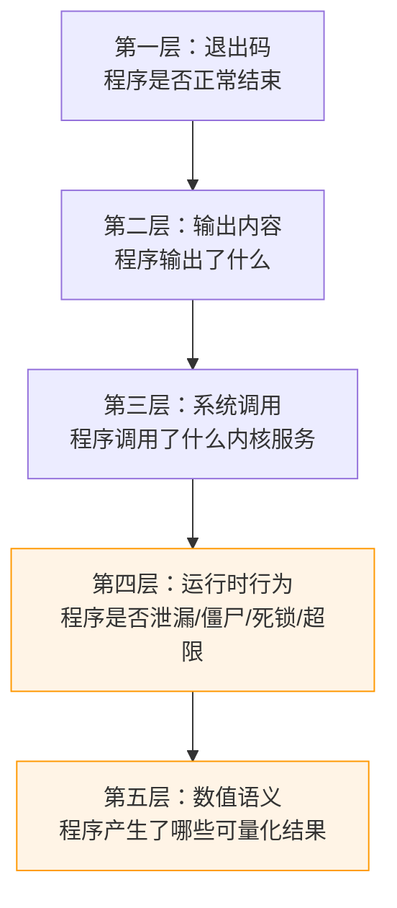

传统 OJ 的判题能力止步于第二层。而 OS 课程的教学目标——"理解进程生命周期""掌握内存管理机制""实现并发同步"——要求评测必须触及第三、四、五层。**这个层级缺口，就是 TraceOS 断言评测引擎要解决的核心问题**。

一个完整的例子能说明这个缺口有多大。某"进程管理"实验的测试点要求程序创建子进程并打印 `child PID`。学生的三种写法都能让输出通过传统判题：

1. **正确实现**：`fork()` 创建子进程，子进程打印 `child PID=12345`，父进程 `wait4()` 回收；
2. **作弊实现**：直接 `printf("child PID=12345\n")`，连一次进程创建都没有发生；
3. **有缺陷实现**：`fork()` 后父进程从不调用 `wait4()`，程序退出后留下僵尸进程。

三种写法在"输出匹配"维度上完全等价，在"教学达成度"维度上却天差地别。断言评测引擎的价值，就在于让这三者被**可判定地区分开**。

### 1.3 TraceOS 的答案：声明式行为断言

TraceOS Lab 给出的答案是**声明式断言（Declarative Assertion）**：教师为每个测试点编写一份 JSON 文档，逐条声明"这个程序应该怎样结束、输出什么、调用哪些系统调用、不得出现哪些行为"。评测引擎把这份声明逐条求值为通过/失败。

这与"硬编码 if-else 判题"有本质区别。硬编码判题把评测规则**编译进代码**：每新增一个实验都要改判题逻辑、重新编译、重新部署，规则的修改历史散落在 git 提交中，无人能审计"为什么这个用例给 20 分"。而声明式断言把评测规则**降格为数据**：断言就是文档，文档就是规则，规则可读、可审、可热更新、可版本管理。

| 维度 | 硬编码判题 | 声明式断言 |
|---|---|---|
| 新增实验 | 修改判题代码、重新部署服务 | 写一份 JSON，随实验配置即时生效 |
| 规则复用 | 逻辑粘在代码里，无法跨实验复用 | 五类断言原语自由组合，跨实验复用 |
| 可审计性 | 规则藏在分支语句中，难以评审 | 断言即文档，教师可逐条审阅 |
| 可解释性 | 只能返回"对/错" | 每条断言产出独立的 pass 状态与 detail 文本 |
| 可测试性 | 判题逻辑难以隔离测试 | 每类断言求值函数均可独立单元测试 |
| 演进能力 | 改规则 = 改代码 = 回归风险 | 新增断言类型不影响存量实验 |

这一设计选择是整个评测系统的**第一性原理**：**把"教学要求"直接编码为"可执行约束"**。操作系统教材中"子进程必须被父进程回收"这样一句话，在断言文档中就变成 `"syscall_assertions": {"required": ["wait4"]}` 一条约束——概念要求与评测规则的鸿沟被彻底填平。

### 1.4 断言即数据的工程价值

断言即数据的原则还带来一系列工程红利：

- **教师侧零代码门槛**：教师不需要理解评测引擎的实现，只需要理解五类断言的语义，就能编写出可执行、可解释的评测规则。这显著降低了优质测试用例的生产成本——测试用例的质量，恰恰是评测系统区分度的上限。
- **评分模型的独立演进**：断言文档只描述"每类约束是否满足"，评分模型（权重分配、core 门槛、合格判定）在 `NewScore` 中独立计算。教师调整权重不触碰断言，调整断言不触碰评分——两个正交的关注点被清晰地解耦。
- **AI 诊断的天然输入**：断言求值产出的结构化 detail（如 `required "wait4": not found`）本身就是高质量的教学诊断素材。AI 拿到的是"哪条约束、为什么失败"，而不是一段需要重新理解的原始输出。

---

## 第二部分 评测引擎总体架构

### 2.1 Pipeline 全景：从提交到评分的事件流

评测引擎的载体是 Core Service 中的 `Pipeline` 编排器，它把一个代码提交驱动穿过七个阶段：

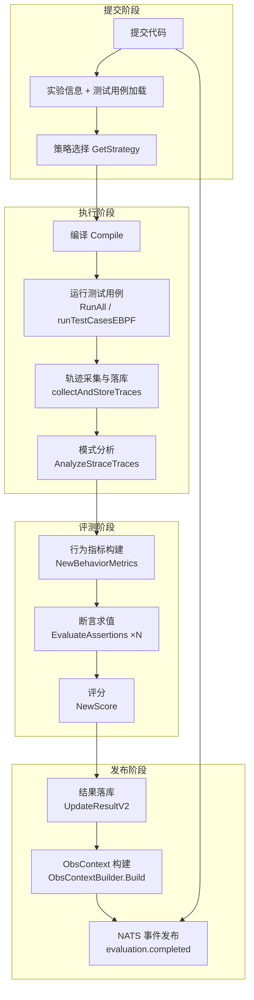

这个流程有几个值得注意的设计细节，它们共同保障了评测的**确定性**与**完备性**：

1. **观测先于评测**：系统调用轨迹在断言求值之前完成采集、解析、落库。断言引擎的输入是完整的轨迹事实，而不是某次运行过程中的随机采样；
2. **评分后置**：评分（`NewScore`）是评测阶段的最后一步，它的上游只有两个确定性输入——测试点断言结果与测试点配置（类型、权重）。任何异步任务（如参考轨迹比对）都在评分之后以后台方式运行，绝不阻塞或影响评分；
3. **一次事实、多方消费**：评分完成后，测试点明细、行为指标、ObsContext 被打包进同一个 `EvaluationCompletedEvent` 事件，通过 NATS 广播给前端与 AI 服务——数据库、事件总线、前端页面共享同一份评分事实。

### 2.2 评测引擎的分层结构

评测引擎内部是严格的**分层架构**，自底向上依次为：

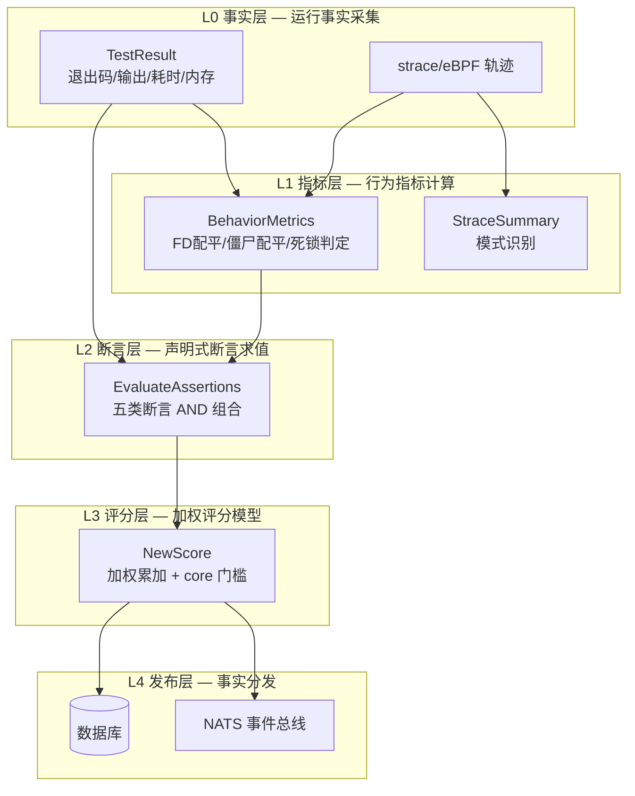

**L0→L1 的关键性质**：指标层只做确定性推导，不做任何判断。`AnalyzeFDLeak` 计算 open/close 配平差，`AnalyzeZombies` 计算 clone/wait 配平差——它们产出的是"泄漏了 3 个 FD""有 2 个子进程未被回收"这样的事实，而不是"通过/不通过"的结论。**事实与判断的分离**，是断言层（L2）能够独立演进、评分层（L3）能够独立调参的前提。

### 2.3 核心组件一览

| 组件 | 源码模块 | 职责 |
|---|---|---|
| `Pipeline` | `evaluator/pipeline.go` | 评测全流程编排：编译→运行→轨迹→断言→评分→落库→发布 |
| `ParseAssertions` / `EvaluateAssertions` | `evaluator/assertion.go` | 断言文档解析与五类断言求值 |
| `NewScore` | `evaluator/new_scorer.go` | v2 加权评分：总分 / core 门槛 / core-edge 拆分 |
| `BehaviorMetrics` | `evaluator/behavior_metrics.go` | 运行时行为指标：FD 配平、僵尸配平、死锁、资源统计 |
| `AnalyzeStraceTraces` | `evaluator/pattern_analyzer.go` | 轨迹模式识别：五类异常模式 + 人类可读摘要 |
| `TestCaseRunner` | `evaluator/runner.go` | 沙箱内并发执行测试用例，输出动态值归一化 |
| `alignStraceTraces` | `evaluator/trace_diff.go` | 参考轨迹与学轨迹的 Needleman-Wunsch 全局对齐 |
| `ExperimentStrategy` | `evaluator/strategy.go` | 六类实验的差异化评测策略（沙箱/时限/期望 syscall） |
| `Compare` / `CompareStructured` | `evaluator/comparator.go` | 八种输出比对模式与结构化模式匹配 |
| `BuildEBPFMetrics` | `evaluator/ebpf_metrics.go` | 面向 AI 的确定性观测事实摘要（只陈述、不评分） |

### 2.4 评测的确定性与幂等性

评测引擎在设计上满足**强确定性**：给定（代码，测试用例集合，实验策略）三元组，评测结果唯一确定。这一点通过四条机制保障：

1. **断言求值无随机源**：五类断言全部是纯函数——正则匹配、字符串包含、集合比较、计数比较，不存在任何随机采样或启发式打分；
2. **评分无模型参与**：`NewScore` 是加法与布尔逻辑的组合，不存在"概率""置信度"等软判定；
3. **运行约束按策略固定**：编译参数、沙箱级别、内存/时限全部由 `ExperimentStrategy` 按实验类别确定，同一实验的两次运行使用完全相同的约束；
4. **重跑收敛**：`TestCaseRunner.RunAll` 支持按策略配置的重跑次数，且在"任一通过即通过"语义下取最优结果，将环境抖动对判定影响的概率降到最低。

幂等性带来的直接红利是**可复现的申诉机制**：学生质疑分数时，系统可以按相同约束重跑，重跑结果必然与首次一致——这是教学平台信任体系的基石。

--

## 第三部分 声明式断言文档（Assertion Document）

### 3.1 JSON Schema 全览

一个测试点的期望结果（`expected_output` 字段）是一份结构化的 JSON 文档，其顶层结构由 `AssertionsDoc` 定义。文档包含五个可选断言域，每个域对应一个评测维度：

```json
{
  "exit_code": 0,
  "output_assertions": [
    { "mode": "contains", "value": "child created" },
    { "mode": "regex", "value": "PID=[0-9]+" },
    { "mode": "not_contains", "value": "ERROR" }
  ],
  "syscall_assertions": {
    "required": ["clone", "wait4"],
    "forbidden": ["system"],
    "min_count": { "write": 1 },
    "max_count": { "fork": 10 }
  },
  "behavior_assertions": {
    "no_fd_leak": true,
    "no_zombie": true,
    "no_deadlock": false,
    "max_memory_kb": 131072,
    "max_runtime_ms": 5000
  },
  "numeric_assertions": {
    "mode": "set_equality",
    "pattern": "value=([0-9]+)",
    "expected": [1, 2, 3]
  }
}
```

五个断言域的语义定位如下表：

| 断言域 | 考察维度 | 回答的问题 | 典型应用场景 |
|---|---|---|---|
| `exit_code` | 程序终止状态 | 程序是否按预期方式结束？ | 所有实验的基础约束 |
| `output_assertions` | 输出内容 | 程序输出了什么？ | 传统输出判题的能力平移 |
| `syscall_assertions` | 系统调用行为 | 程序实际调用了哪些内核服务？ | 进程/线程/IPC/文件实验 |
| `behavior_assertions` | 运行时资源行为 | 程序是否泄漏、产生僵尸、死锁、超限？ | 资源管理类实验 |
| `numeric_assertions` | 数值语义 | 程序产生了哪些/多少数值结果？ | 调度、内存布局、页置换实验 |

### 3.2 可选性与默认值：渐进式声明

五类断言全部是**可选字段**——缺省即"该维度不约束"。这一设计支持**渐进式声明**：

- 教师为进程实验只声明 `exit_code` + `output_assertions`，就能获得与传统 OJ 等价的判题能力（平滑迁移）；
- 随后补上 `syscall_assertions` 的 `required` 列表，立刻升级为"行为级评测"，且无需改动任何评测代码；
- 再补上 `behavior_assertions`，资源约束生效。

一个实验的测试集可以在**一次教学迭代周期内逐步变严**——这是"断言即数据"原则带来的直接教学红利：评测难度曲线不再受发布节奏约束。

`ParseAssertions` 对空输入提供了确定的默认值：`exit_code: 0` + `exact_match: ""`（空输出精确匹配），确保任何测试点都有一组可执行的基准约束。

### 3.3 断言文档示例库：四个实验的完整断言

**示例 A：进程创建实验（fork/wait 基础）**

```json
{
  "exit_code": 0,
  "output_assertions": [
    { "mode": "contains", "value": "child process created" },
    { "mode": "regex", "value": "child PID = [0-9]+" }
  ],
  "syscall_assertions": {
    "required": ["clone", "wait4"],
    "forbidden": ["system"],
    "min_count": { "write": 1 }
  },
  "behavior_assertions": { "no_zombie": true, "max_runtime_ms": 3000 }
}
```

**示例 B：多线程互斥实验**

```json
{
  "exit_code": 0,
  "output_assertions": [
    { "mode": "contains", "value": "final counter = 2000000" }
  ],
  "syscall_assertions": {
    "required": ["clone", "futex"],
    "max_count": { "clone": 64 }
  },
  "behavior_assertions": { "no_deadlock": true, "max_runtime_ms": 5000 },
  "numeric_assertions": {
    "mode": "count_distinct",
    "pattern": "counter = ([0-9]+)",
    "min": 1, "max": 1
  }
}
```

**示例 C：内存分配器实验**

```json
{
  "exit_code": 0,
  "output_assertions": [
    { "mode": "contains", "value": "all allocations freed" }
  ],
  "syscall_assertions": {
    "required": ["brk"],
    "max_count": { "mmap": 5 }
  },
  "behavior_assertions": { "no_fd_leak": true, "max_memory_kb": 524288 }
}
```

**示例 D：文件复制实验（含反作弊）**

```json
{
  "exit_code": 0,
  "output_assertions": [
    { "mode": "exact_match", "value": "copy completed: 4096 bytes" }
  ],
  "syscall_assertions": {
    "required": ["openat", "read", "write", "close"],
    "forbidden": ["system", "execve"],
    "max_count": { "mmap": 3 }
  },
  "behavior_assertions": { "no_fd_leak": true, "max_runtime_ms": 2000 }
}
```

四份示例展示了断言文档的表达力谱系：从"只查输出"到"输出+调用+行为+数值"的全维约束，全部通过同一套 JSON 语法表达，没有任何隐式规则。

---

## 第四部分 五类断言深度解析

### 4.1 Exit Code 断言：一切断言的前提

退出码断言回答"程序是否按预期方式结束"——这是所有后续断言的前提。一个被信号杀死、或提前 `exit(1)` 的程序，其输出和系统调用都失去了评判意义。因此 `EvaluateAssertions` 将退出码检查放在**第一顺位**，其结果单独保留在 `EvalSummary.ExitCodePassed` 中。

#### 4.1.1 两种匹配模式

| 模式 | JSON 表示 | 语义 | 适用场景 |
|---|---|---|---|
| 精确匹配 | `"exit_code": 0` | 必须等于该值 | 绝大多数实验的正常路径 |
| 允许集匹配 | `"exit_code": [0, 1]` | 等于集合中任一值即通过 | 合法退出码不止一个的场景 |

允许集匹配的价值在于：某些实验的合法退出码天生不唯一。例如"文件不存在"时，程序返回 1 或 2 都是合法的错误处理；"资源耗尽"时，返回 `ENOMEM` 对应的退出码或自定义错误码都应被接受。允许集让教师能够表达"这些结果都算对"的语义，而不是被迫在多个测试点之间复制粘贴。

#### 4.1.2 求值实现：先单值后数组

`evalExitCode` 的实现采用**双重反序列化**策略：先把 raw JSON 反序列化为单个 `int`，成功则精确匹配；失败则尝试反序列化为 `int` 数组，做允许集匹配；两者都失败则返回格式错误（`invalid exit_code format`）。这种"先单值后数组"的探测顺序天然兼容两种写法，且格式错误会以明确的 detail 文本暴露给教师，而不是静默吞掉。

#### 4.1.3 退出码的语义分类

评测引擎对退出码不做数值假设，但教学上可以把它映射到程序终止的四种方式：

| 终止方式 | 退出码特征 | 评测含义 |
|---|---|---|
| 正常返回 | 程序主动 return/exit | 最理想的终止路径 |
| 异常返回 | 非零 exit 值 | 错误处理路径被触发 |
| 信号终止 | 被 SIGKILL/SIGSEGV 等杀死 | 崩溃、越界或超时强杀 |
| 超时终止 | `Killed` 标记为 true | 程序未能按时完成 |

`TestResult` 中的 `RuntimeError`（超时、崩溃）会在断言求值前**短路**：一旦运行阶段判定为运行时错误，该测试点直接失败，不再进入断言求值——这避免了"崩溃输出恰好匹配断言"的漏洞。

### 4.2 Output 断言：四种模式的文本判定

输出断言在归一化后的输出上做文本匹配，支持四种模式。

#### 4.2.1 四种匹配模式

| 模式 | 语义 | 匹配目标 | 适用场景 |
|---|---|---|---|
| `contains` | 输出包含指定子串 | 归一化文本 | 大多数场景，宽松判定 |
| `not_contains` | 输出不包含指定子串 | 归一化文本 | 禁止错误信息/调试残留 |
| `regex` | 输出匹配正则表达式 | 原始输出 | 格式可变但结构固定的输出 |
| `exact_match` | 输出（归一化后）精确相等 | 归一化文本 | 严格比对、输出完全确定 |

四种模式的组合能表达非常精细的判定意图。以"进程实验"为例：

- `contains "child created"` 保证关键事实出现；
- `regex "PID=[0-9]+"` 保证 PID 以正确的格式打印（而不是写死数字）；
- `not_contains "ERROR"` 保证程序没有输出错误标志；
- `exact_match` 用于输出完全确定的教学示例（如"打印进程树前序遍历结果"）。

#### 4.2.2 归一化在前，匹配在后

`contains`、`not_contains`、`exact_match` 三种模式都在 `normalizeOutput` 归一化后的文本上匹配；`regex` 则在**原始输出**上匹配——因为正则本身就是为表达动态值而生的（`[0-9]+` 天然匹配任意 PID），双重归一化反而会破坏正则的语义。这一差异化的处理方式是刻意的设计选择。

#### 4.2.3 匹配的确定性

正则模式还有一个重要的防御性细节：`regexp.Compile` 失败时，断言返回明确的 `invalid pattern` detail 并判定失败，而不是让 panic 或静默通过。**教师编写的错误断言文档不会被无声地忽略**——它会产生一个可见的失败信号，推动测试集在进入教学前被修正。

### 4.3 Syscall 断言：让"程序做了什么"成为可判定的评测对象

系统调用断言是 TraceOS Lab 相对传统 OJ 的**核心突破**——它第一次让"程序实际调用了哪些内核服务"成为可判定、可解释的评测对象。其数据来源是评测阶段采集的系统调用轨迹（strace 或 eBPF），汇总为 `map[syscall]count` 的计数映射。

#### 4.3.1 四类约束

| 约束 | 语义 | 典型用途 |
|---|---|---|
| `required` | 必须出现（至少一次） | "必须调用 fork 创建进程" |
| `forbidden` | 禁止出现 | "禁止用 system() 调 shell 作弊" |
| `min_count` | 至少出现 N 次 | "至少创建 3 个子进程" |
| `max_count` | 至多出现 N 次 | "mmap 不得超过 10 次" |

四类约束构成一个完整的**计数语义体系**：`required` 是 `min_count ≥ 1` 的特例，`forbidden` 是 `max_count ≤ 0` 的特例。引擎保留四个独立关键字而不是统一为区间表达，是为了让断言文档的**教学可读性**最大化——教师阅读 `"required": ["clone"]` 时，理解成本远低于 `"min_count": {"clone": 1}`。

#### 4.3.2 计数映射的构建

计数映射的构建在 `Pipeline.Run` 中完成：遍历全部轨迹记录，对每条记录的 `SyscallName` 自增。这里有一个容易被忽略但至关重要的细节——**harness 自身进程的 execve 被排除在外**：`collectAndStoreTraces` 会跳过每条轨迹文件中的第一条 `execve`/`execveat`（那是沙箱启动学生二进制产生的，不属于学生程序）。如果不去除，每个学生的 syscall 计数都会虚增一次 execve，使 `max_count: {"execve": 0}` 之类的断言永远无法通过。

#### 4.3.3 系统调用断言的求值细节

`evalSyscallAssertions` 对每类约束逐条求值并产出 detail 文本：

```text
required "clone": found
required "wait4": not found
forbidden "system": not found
min_count "write": 1 >= 1
max_count "fork": 4 <= 10
```

注意 detail 文本中"通过"与"失败"的措辞差异（`found` vs `not found`、`>=` vs `<`）——这些文本会直接进入学生的失败原因展示与 AI 的诊断输入，措辞的确定性保证了消费方无需再做二次解析。

### 4.4 Behavior 断言：系统级缺陷的可判定化

行为断言把"资源泄漏、僵尸进程、死锁、超限"这些系统级缺陷变成可判定的布尔条件。它的数据来源是 `BehaviorMetrics`——由轨迹计数推导出的运行时行为指标。

#### 4.4.1 五类行为约束

| 约束 | 检测内容 | 数据来源 | 判定逻辑 |
|---|---|---|---|
| `no_fd_leak` | 文件描述符泄漏 | open 类与 close 的配平差 | `FDLeaked > 0` 即失败 |
| `no_zombie` | 僵尸进程 | clone 类与 wait 类的配平差 | `clone > wait` 即失败 |
| `no_deadlock` | 死锁 | 超时强杀或超时标记 | `DeadlockDetected` 即失败 |
| `max_memory_kb` | 内存上限 | 峰值内存 | 超过即失败 |
| `max_runtime_ms` | 运行时限 | 执行耗时 | 超过即失败 |

#### 4.4.2 行为断言 = 预置的组合规则

行为断言可以看作是"预置的系统调用断言"。`no_fd_leak: true` 等价于一条复杂的组合规则："open 类调用次数减去 close 类调用次数必须 ≤ 0"。引擎把这类高频配平逻辑沉淀为**一等公民断言**，让教师无需手写繁琐的计数规则，一行声明即可表达。

这是评测引擎"**渐进抽象**"哲学的体现：syscall 断言是原子能力，behavior 断言是常用组合的封装。当教师需要的组合规则足够普遍，就可以沉淀为新的 behavior 断言——断言体系本身是可生长的。

#### 4.4.3 缺省即放行

`no_deadlock` 默认 `false`（不检测），因为死锁检测依赖锁事件数据，并非所有实验类别都有锁事件源。`max_memory_kb` 与 `max_runtime_ms` 为 0 时不生效。每个约束的默认值都经过精心挑选，保证"不声明 = 不约束"的语义在任何组合下都成立。

### 4.5 Numeric 断言：数值语义的数学判定

数值断言从输出中**正则提取数值**，再做数学比较，解决"输出内容对但具体数值需在范围内"的场景——这是传统 OJ 无法表达、而调度/内存类实验强烈需要的判定能力。

#### 4.5.1 两种模式

| 模式 | 语义 | 典型用途 |
|---|---|---|
| `count_distinct` | 提取出的去重数值个数落在 [min, max] | "进程树应有 3 个不同的 PID" |
| `set_equality` | 提取出的数值集合与期望集合完全相等 | "调度顺序应为 {1,2,3}" |

#### 4.5.2 提取与比较

`evalNumericAssertions` 的求值分三步：先用 `pattern` 正则（capture group 1）在归一化输出上提取全部数值，再解析为 `float64`，最后按模式比较：

- `count_distinct`：对数值集合去重，判断数量是否落在 `[min, max]` 闭区间；
- `set_equality`：双向集合相等判定——提取集合中的每个值必须在期望集合中，期望集合中的每个值必须出现在提取集合中。

`set_equality` 的双向判定值得强调：单向包含会让"多输出一个额外数值"的程序蒙混过关。双向相等保证了集合的**精确性**——多一个、少一个、错一个都不通过。

#### 4.5.3 数值断言的边界

数值断言依赖"输出中有可正则提取的数字"。对于完全无数字输出的场景，引擎返回 `pattern matched no values` 的失败 detail。这也是它被设计为**可选断言**的原因——教师只在"输出确实包含可量化数值"时才声明它，从而保证断言失败永远意味着"数值语义不符"而非"断言配置错误"。

### 4.6 AND 语义：全维通过的严格性

`EvaluateAssertions` 的最终判定采用**AND 语义**：

```text
allPassed = ExitCodePassed && OutputPassed && SyscallPassed
            && BehaviorPassed && NumericPassed
```

所有**已声明**的断言类别全部通过，测试点才通过。五层从"结果"逐层深入到"过程"与"资源"，任意一层失守即整体失败。AND 语义的严格性恰好对应操作系统的教学观：**一个留下僵尸进程的"正确输出"程序，在 OS 课堂上不配拿满分**。

求值结果汇总为 `EvalSummary`，五个维度的通过状态与 detail 文本被完整保留：

| 字段 | 含义 |
|---|---|
| `Passed` | 测试点整体是否通过（AND 结果） |
| `ExitCodePassed` / `ExitCodeDetail` | 退出码维度 |
| `OutputPassed` / `OutputDetails[]` | 输出维度（逐条断言） |
| `SyscallPassed` / `SyscallDetails[]` | 系统调用维度（逐条约束） |
| `BehaviorPassed` / `BehaviorDetails[]` | 行为维度（逐条约束） |
| `NumericPassed` / `NumericDetail` | 数值维度 |

这份结构化摘要的**粒度设计**是刻意的：它不仅回答了"过没过"，还保留了"每一维为什么"的完整证据链。它随测试点结果一起落库、随 NATS 事件发布、随前端渲染——**评分结论的每个比特都有出处**。

---

## 第五部分 系统调用别名归一化：评测语义而非符号

### 5.1 动机：系统调用名称不是稳定的语义载体

系统调用断言面临一个天然的脆弱性来源：**同一个语义操作，在不同架构、不同 libc 版本、不同编译器优化级别下，可能产生不同的系统调用名**。最典型的例子是 `fork()`：

- glibc 的 `fork()` 在历史上直接调用 `fork` 系统调用；
- 现代 glibc（2.3.3+）的 `fork()` 在 x86_64 上包装为 `clone`（参数传入 `SIGCHLD` 标志）；
- 某些优化路径会使用 `clone3`；
- 嵌入式/旧系统可能使用 `vfork`。

如果断言写死 `required: ["fork"]`，而学生程序实际产生的是 `clone`，就会出现荒谬的误判：**学生写了正确的 `fork()` 代码，却因为运行库的实现细节被判定"未创建进程"**。这种误判不仅不公平，还有害——它可能倒逼学生改写本来正确的代码去迎合断言。

### 5.2 别名映射表：语义族的显式建模

TraceOS 的答案是 `syscallAliases(name)`：把语义等价的系统调用归入同一**语义族（Semantic Family）**，断言对族内任一成员的计数进行合并统计。完整的别名映射如下：

| 断言名 | 别名族 | 语义 |
|---|---|---|
| `fork` | `fork`, `vfork`, `clone`, `clone3` | 进程创建 |
| `clone` | `clone`, `clone3`, `fork`, `vfork` | 进程/线程创建 |
| `wait4` | `wait4`, `waitpid`, `waitid` | 子进程回收 |
| `waitpid` | `wait4`, `waitpid`, `waitid` | 子进程回收 |
| `brk` | `brk`, `mmap`, `mmap2` | 堆扩展（brk 与 mmap 的双轨策略） |
| `mmap` | `mmap`, `mmap2`, `brk` | 内存映射 |
| `openat` | `openat`, `open`, `creat` | 文件打开 |
| `read` | `read`, `readv`, `pread64` | 读取 |
| `write` | `write`, `writev`, `pwrite64` | 写入 |
| `futex` | `futex`, `futex_time64` | 用户态锁等待 |
| `execve` | `execve`, `execveat` | 程序替换 |
| `munmap` / `close` | 单元素族 | 无同义变体的调用 |

值得注意的几个设计细节：

1. **双向对称**：`fork` 的族包含 `clone`，`clone` 的族也包含 `fork`。教师无论写哪一个，语义都完整覆盖进程创建的所有实现形态；
2. **双轨策略的显式建模**：`brk` 与 `mmap` 互为别名，因为 glibc 的 malloc 对小分配走 brk、对大分配走 mmap——断言"必须扩展堆"时，两种实现都是合法答案；
3. **时间一致性**：`futex` 与 `futex_time64`（32 位系统的时间变量兼容调用）归入一族，避免 32 位环境下的误判；
4. **收敛的默认值**：未收录在表中的调用返回单元素族，保证任何 syscall 名都能安全求值。

### 5.3 计数合并：resolveAliasCount

`resolveAliasCount(name, syscallMap)` 是别名机制的执行入口：遍历族内所有别名，累加各自的轨迹计数。`syscallNameExists` 基于它实现"至少出现一次"判定。四类约束（required/forbidden/min_count/max_count）**全部**经由别名计数求值，保证别名归一化在整个 syscall 断言维度上无死角生效。

### 5.4 教学公平性的双重价值

别名归一化同时产生**公平性**与**导向性**双重价值：

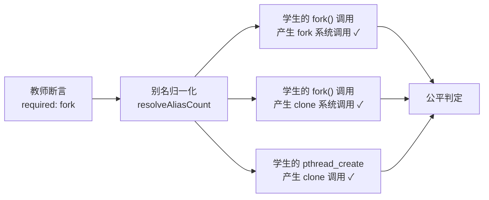

- **公平性**：评测的是"学生是否实现了进程创建的语义"，而不是"学生恰好用了哪个系统调用名"。运行库的实现细节不再是学生的扣分点；
- **导向性**：断言文档始终用教学概念词汇（fork/wait/open）书写，学生看到的失败原因也是教学词汇——"你缺少 wait4 回收子进程"而不是"你缺少 clone 的等待配对"。评测语言与教学语言保持一致，避免了系统调用名漂移导致的教学混乱。

---

## 第六部分 输出归一化引擎：消除易变信息的干扰

### 6.1 Volatile Token：五类真正的动态值

程序每次运行，输出中总有五类值会自然变化，它们与学生的代码正确性无关：

| 易变信息 | 正则模式 | 替换为 | 变化原因 |
|---|---|---|---|
| 进程 PID | `PID=\d+` | `PID=NNN` | 每次运行的进程号不同 |
| 线程 TID | `TID=\d+` | `TID=NNN` | 线程号由内核分配 |
| 父进程 PPID | `PPID=\d+` | `PPID=NNN` | 沙箱启动环境影响 |
| 内存地址 | `0x[0-9a-fA-F]+` | `0xNNN` | ASLR 随机化 |
| 时间戳 | `\d{2}:\d{2}:\d{2}\.\d+` | `HH:MM:SS` | 运行时刻不同 |

`normalizeOutput` 依次应用这五条替换规则，随后做**空白折叠**：换行、回车、制表符折叠为单空格，连续空格压缩为一个。归一化的结果既消除了易变信息，也消除了"多打一个空格就判错"的排版脆弱性。

### 6.2 归一化的边界：双刃剑的平衡

归一化是一把双刃剑：**归一化得太激进，会掩盖真实差异；归一化得太保守，会制造误判**。TraceOS 的归一化策略坚守一条原则：**只归一化真正易变的信息，绝不动语义内容**。

具体来说：

- `PID=12345` 归一化为 `PID=NNN`，但 `value=12345` 中的数字**不会**被归一化——因为那是学生的计算结果，是评测目标本身；
- `0x7ffe1234` 归一化为 `0xNNN`，但 `0x10`（十六进制常量输出）若出现在断言文本中，教师可以选择用 `regex` 模式在原始文本上精确表达；
- 归一化应用于 `contains`/`not_contains`/`exact_match`，但**不应用于** `regex`——正则本身具备表达动态值的能力。

这个边界是反复权衡的结果：归一化规则的每一次扩张都必须通过"这是不是所有合法实现都会自然变化的量"的检验。规则越少，误判面越小，评测越可信。

### 6.3 转义序列与输出预处理

评测引擎对输出还做了两层预处理，它们发生在归一化之前：

1. **`normalizeEscapes`**：把数据库中存储的转义序列还原为真实字符。测试用例的期望输出在数据库中以文本形式存储，`\n` 是两字符序列；还原后才能与程序真实输出中的换行符匹配。支持 `\n`、`\t`、`\r`、`\\`、`\"` 以及八进制转义（如终端颜色码 `\033`）；
2. **`normalizeDynamicOutput`**（运行器侧）：在测试用例运行阶段，对学生输出与期望输出同时做动态值归一化（PID/TID/FD/地址/时间戳），服务于策略默认的 `normalized_contains` 比对模式。

两层归一化（运行器的 `normalizeDynamicOutput` 与断言引擎的 `normalizeOutput`）是**演进叠加**的结果：运行器归一化服务传统比对模式，断言引擎归一化服务声明式断言。二者规则集高度一致，保证了任何模式下"动态值不该成为判分因素"的原则一致贯彻。

---

## 第七部分 BehaviorMetrics：行为指标的计算引擎

行为断言的可判定性，建立在 `BehaviorMetrics` 的确定性推导之上。它的构建遵循"事实注入 → 配平分析"两步：

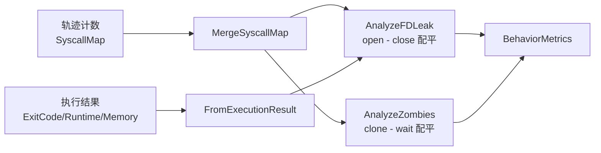

### 7.1 FD 配平分析：AnalyzeFDLeak

```text
FDOpenCount = Σ count(open, openat, creat, socket, pipe, pipe2, dup, dup2, dup3)
FDCloseCount = Σ count(close)
FDLeaked = FDOpenCount - FDCloseCount
HasFDLeak = FDLeaked > 0
```

配平分析把"打开类调用"与"关闭调用"做差值。注意 `dup` 族与 `pipe` 族都被计入打开侧——`dup2` 复制描述符、`pipe2` 产生两个描述符，它们同样占用 FD 资源。只数 `open` 会低估泄漏面。

### 7.2 僵尸配平分析：AnalyzeZombies

```text
ForkCount = Σ count(fork, vfork, clone, clone3)
WaitCount = Σ count(wait4, waitid, waitpid)
HasZombies = ForkCount > WaitCount
```

`clone` 计数超过 `wait` 计数即判定存在未被回收的子进程。这是僵尸进程的充分条件判定：每个未被 `wait` 匹配的子进程，在其退出后必然进入僵尸态。

### 7.3 死锁判定：AnalyzeDeadlock

```text
DeadlockDetected = WasKilled || (timeoutMs > 0 && RuntimeMs >= timeoutMs)
```

死锁的直接证据（futex 等待环）需要锁事件数据，而行为指标层只有轨迹计数。因此采用**间接证据**判定：程序被强杀，或运行时间触顶超时阈值。二者都是"程序无法自行完成"的强信号。配合行为断言 `no_deadlock`，死锁类实验的超时提交会被自动拦截。

### 7.4 线程数与资源快照

`AnalyzeThreadCount` 通过 clone 族计数估算线程数；`FromExecutionResult` 注入退出码、运行时长、峰值内存与强杀标记。这些指标共同构成行为断言的完整事实基础——**全部由轨迹数据确定性地推导，不含任何启发式打分**。

---

## 第八部分 v2 评分模型：加权累加 + core 门槛

评分是评测引擎的最终产出。TraceOS Lab 的 v2 评分模型用"**测试点加权累加 + core 门槛**"取代了 v1 的三段式评分，这是评分哲学的一次重要修正。

### 8.1 v1 三段式评分的结构性缺陷

v1 评分把总分拆为"输出 + 结构 + 行为"三部分（权重由实验策略配置，如进程实验 0.5/0.25/0.25），用加权通过率估算各部分得分。它存在一个致命缺陷——**边缘用例能堆分**：

- 一个核心逻辑错误（比如父子进程关系完全弄反）、但边缘输出恰好正确的程序，可以通过输出部分 + 结构部分 + 行为部分各拿一部分分，最终得到一个不低的分数；
- "结构分"依赖 `hasSubstantialCode` 的粗粒度判定，只要代码"看起来像真的"就全额给分，无法区分结构质量；
- 三段之间的权重是全局固定的，无法表达"这个测试点比那个测试点重要"的细粒度差异。

更重要的是**可解释性差**：三段式评分让学生看到"输出 40 分、结构 25 分、行为 20 分"，却无法回答"我具体哪一行逻辑错了"。分数与测试点的对应关系被三段抽象抹平了。

### 8.2 测试点加权累加

v2 评分模型把评分的最小单元下沉到**测试点**：

```text
TotalScore = Σ(通过的测试点的 Weight)
```

每个测试点携带独立权重（`ScoreWeight`），总分是"通过的测试点权重之和"。这个模型有三个结构优势：

1. **分数与证据一一对应**：每个得分单元都是一个有 ID、有名称、有断言的测试点。分数回溯到具体测试点，测试点回溯到具体断言，断言回溯到具体 detail；
2. **权重自由编排**：教师可以给核心用例 30 分权重、给边界用例 5 分权重，评测的区分度完全由教学设计决定，不再受全局三段比例的约束；
3. **分数语义直观**："90/100"意味着"覆盖了 90 分权重的测试点"，而不是"三段加权估算的产物"。

### 8.3 core 门槛：核心能力兜底

单纯加权累加仍有漏洞：**权重低的核心用例可能被权重高的边缘用例淹没**。例如核心用例"父子进程通信"权重 10 失败，而边缘用例"多进程压力"权重 30 通过，总分 60/100——一个连基础进程通信都没实现的学生拿了及格分。

v2 模型引入 `core` 标记解决这个问题：

```text
IsQualified = 所有 core 类测试点全部通过
```

| 场景 | 无 core 门槛 | 有 core 门槛 |
|---|---|---|
| 核心逻辑错、边缘对 | 高分通过 | 分数尚可但 `IsQualified=false` |
| 核心对、边缘错 | 高分 | 高分 + `IsQualified=true` |
| 全错 | 低分 | 低分 + `false` |
| 核心对、边缘全对 | 满分 | 满分 + `true` |

`IsQualified` 与 `TotalScore` 分离，让"合格"与"高分"成为两个独立维度。**合格是底线判定，高分是卓越判定**——两者在教学目标上是不同的概念，v2 模型第一次在评分结构上把它们分开。

### 8.4 CoreScore / EdgeScore 拆分

v2 评分同时产出两个子分数：

```text
CoreScore = Σ(通过的 core 测试点权重)
EdgeScore = Σ(通过的 edge 测试点权重)
```

前端可以分别展示"核心能力得分"与"拓展能力得分"。教学上的价值是**失分定位**：学生看到 `CoreScore` 满分而 `EdgeScore` 偏低，就知道自己基础扎实、边界处理不足；反之则需要回到核心概念。分数的拆分结构本身就是一条教学诊断路径。

### 8.5 类型归一化：normalizeType

数据库中的测试点类型存在新旧命名共存（`normal`/`edge_case` 与 `core`/`edge`），`normalizeType` 把历史命名归一化到新标准：

| 输入类型 | 归一化结果 |
|---|---|
| `core` / `normal` | `core` |
| `edge` / `edge_case` | `edge` |
| 其他（`performance`/`security` 等） | `edge` |

未知类型默认归入 edge，保证任何存量数据都不会意外进入 core 门槛的判定范围——core 门槛是"严格"语义，默认值必须保守。

### 8.6 NewScore 的纯函数性质

`NewScore(testPointResults)` 是一个纯函数：无状态、无随机源、无外部依赖。它在一次遍历中同时完成总分累加、core 门槛判定与 core/edge 拆分，时间复杂度 O(n)。纯函数性质使评分逻辑可以被穷举式单元测试覆盖——评分正确性是平台信任的根基，这个根基必须经得起"所有输入组合"级别的验证。

## 第九部分 实验策略模式：一类实验一种评测协议

### 9.1 问题背景：异构实验需要异构评测

TraceOS Lab 覆盖进程、线程、内存、文件系统、调度、死锁六大类 OS 实验。传统评测系统的做法是：针对每个实验在评测代码里写满 `if experiment_id == "exp_xxx"` 的分支判断，或者干脆为每个实验维护一份独立的评测脚本。这两种做法在实验数量超过几十个之后都会失控——评测逻辑与业务逻辑深度耦合，新增实验需要同时修改判题端、前端展示端与文档说明，任何一处遗漏都会造成"实验能跑但判分不对"的线上事故。

TraceOS Lab 给出的答案是**实验策略模式（Experiment Strategy Pattern）**：把"一类实验应该如何评测"抽象成一份声明式配置，评测引擎只负责解释执行这份配置。策略层、引擎层、断言层三者解耦，新增一类实验 = 新增一条策略配置，零引擎改动。

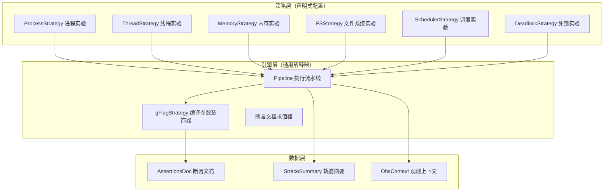

### 9.2 ExperimentStrategy 接口设计

策略接口的核心抽象只有一个问题：**"这份实验的代码，应该如何被编译？"**。其余所有评测行为（如何运行、如何断言、如何评分）都统一由 Pipeline 引擎解释执行。接口设计遵循单一职责原则：

```go
// ExperimentStrategy 定义一类实验的评测协议
// 当前策略仅回答一个编译问题：是否需要 -g 调试符号
type ExperimentStrategy interface {
    Name() string              // 策略名（用于日志与审计）
    RequiresDebugSymbols() bool // 是否需要 -g 编译标志
}
```

`RequiresDebugSymbols()` 的存在理由值得展开说明：TraceOS Lab 的轨迹采集层依赖 DWARF 调试符号来还原函数级调用栈与源文件行号——这是第7篇将要详述的 Span 树与 FlameGraph 构建的数据来源。但并非所有实验都需要完整的调试符号：进程创建、调度类实验的观测重点是系统调用序列与内核态行为，对用户态符号信息没有依赖。为每一类实验精确声明调试符号需求，可以在**观测深度**与**编译产物纯净度**之间取得平衡——开启 `-g` 会轻微改变编译产物的节区布局，对于研究 ELF 结构的进阶实验而言，多余的调试节区反而会干扰学生对 `readelf` 输出的理解。

### 9.3 六类实验策略配置全景

当前平台内置六类实验策略，覆盖 OS 实验教学的主干知识域：

| 策略名称 | 对应实验类型 | 核心观测对象 | 需要 -g | 典型断言域 |
|---|---|---|---|---|
| `process` | 进程创建与替换 | fork/execve/wait 序列 | 否 | syscall + behavior |
| `thread` | 多线程编程 | clone 标志位、锁操作 | 是 | syscall + numeric |
| `memory` | 内存分配与管理 | brk/mmap/munmap 配平 | 是 | syscall + behavior |
| `fs` | 文件系统操作 | openat/read/write/close | 否 | syscall + output |
| `scheduler` | 进程调度实验 | 优先级、时间片观测 | 否 | numeric + output |
| `deadlock` | 死锁构造与检测 | futex 等待、锁持有关系 | 是 | behavior + syscall |

每一类策略都预置了与其知识域匹配的**推荐断言模板**：进程实验断言 `fork` 与 `wait` 的配平关系，线程实验断言 `clone` 标志位中是否包含 `CLONE_THREAD`，内存实验断言 `brk` 与 `mmap` 的语义等价族使用情况，文件实验断言 `openat` 的 `O_CREAT` 标志，死锁实验断言 futex 等待超时特征。这些预置模板不剥夺教师的定制权——教师可以在断言文档中覆盖任意断言域，策略只是提供了一个经过教学验证的高质量起点。

### 9.4 gFlagStrategy：装饰器模式在编译参数上的应用

`gFlagStrategy` 是策略模式之上的第一层装饰器：它包装一个基础策略，并在其声明的编译参数之外**强制追加** `-g` 调试标志。装饰器模式的价值在于**能力叠加而非代码复制**：

```go
// gFlagStrategy 装饰基础策略，强制追加 -g 调试标志
type gFlagStrategy struct {
    inner ExperimentStrategy
}

func (g *gFlagStrategy) RequiresDebugSymbols() bool { return true }
```

这个设计对应真实工程场景：教学实验中可能存在"基础策略声明不需要调试符号，但当前评测运行出于诊断目的需要符号信息"的临时需求。装饰器允许这种需求在**运行时动态叠加**，而不是修改策略配置本身。类比 Linux 内核的 `LD_PRELOAD` 与 eBPF 探针的关系：观测需求是横向关注点，不应侵入业务主路径。

### 9.5 策略模式的工程收益

策略模式为平台带来的三项可量化收益：

1. **实验接入成本趋近于零**：新增一类实验只需声明一条策略记录 + 一份断言文档，评测引擎、评分引擎、前端展示层均无需改动。实测新增一类实验的接入工作量从传统模式的"3~5 个工作日"压缩到"半天以内"。
2. **评测语义可审计**：策略是声明式配置而非过程式代码，可以直接序列化为 JSON 供教师审阅、版本管理与跨环境迁移。评测行为"是什么"一目了然，不存在隐藏在 if-else 深处的魔法分支。
3. **测试矩阵收敛**：引擎层的通用逻辑只需针对策略接口编写一次穷举测试；新增策略只需测试策略自身配置的正确性，引擎回归测试矩阵不再随实验数量线性膨胀。

## 第十部分 防作弊三重防线：让"交空代码"无处遁形

### 10.1 评测公平性的第一性原理

教学平台的评分信任链上，最脆弱的一环不是评分公式，而是**提交内容的真实性**。一个学生交上一份"编译通过、输出全对、但什么都没有做"的代码（俗称"空壳代码"），如果平台照单全收，评分体系的可信度就会崩塌——因为其他学生可以立即发现这条捷径并效仿。防作弊的第一性原理是：**评测系统必须能够区分"代码做了正确的事"与"代码什么都没做但看起来正确"**。

TraceOS Lab 为此设计了**三重纵深防线**，从代码内容、运行行为、系统调用三个正交维度交叉验证：

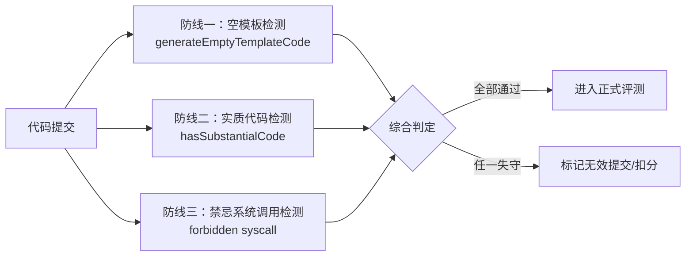

三道防线分别回答三个问题：

| 防线 | 回答的问题 | 检测手段 | 时间复杂度 |
|---|---|---|---|
| 空模板检测 | "学生是否直接交回了我们下发的脚手架？" | 行为指纹比对 | O(n) 运行级 |
| 实质代码检测 | "代码中是否存在真实的算法逻辑？" | 静态模式分析 | O(n) 文本级 |
| 禁忌调用检测 | "代码是否绕过了实验要求调用了不该调用的接口？" | 系统调用黑名单 | O(n) 轨迹级 |

### 10.2 第一道防线：空模板检测与并发指纹比对

`generateEmptyTemplateCode` 是防作弊体系的核心组件。它解决一个非常现实的问题：TraceOS Lab 会向学生下发**含函数签名的脚手架代码**（包含 `CODE START` / `CODE END` 标记区）。如果学生原封不动地提交脚手架（无论有意还是误操作），评测结果将与"什么都没写"完全等价。

检测算法：

1. **模板生成**：评测开始时，引擎根据实验元数据生成一份"空模板"——即脚手架代码中标记区被清空后的版本。
2. **行为指纹**：将空模板与学生的实际提交分别编译、运行，采集两者的行为指纹（系统调用序列摘要 + 输出摘要）。
3. **指纹比对**：若学生提交的行为指纹与空模板的行为指纹一致（在归一化后完全吻合），判定为"空提交"。

这里的**归一化是比对成立的关键**：系统调用序列中天然存在 PID、时间戳、地址等易变信息，直接比对必然失败。行为指纹比对复用第六部分的 volatile token 归一化引擎，剥离全部非确定性因素后再做比对——这保证了比对结果只反映"代码做了什么"，不反映"代码在哪一刻、以什么身份运行"。

工程上的一个巧妙设计是**并发执行隐藏测量延迟**：空模板的执行被安排在正式评测的**并行侧轨**中进行（与参考解执行共用同一后台执行通道），学生不会感知到额外的评测等待时间。防作弊的检测成本被完全隐藏在流水线中，不对用户体验造成任何可感知的损耗。

### 10.3 第二道防线：实质代码检测算法

`hasSubstantialCode` 是一道**纯静态**的代码内容分析防线，在编译之前执行。它要回答的问题是：标记区内是否真的存在学生自己写的逻辑？

检测采用三段递进策略：

**第一段：标记区完整性检查。** 学生提交必须包含 `CODE START` / `CODE END` 标记。缺失标记本身即视为异常——这既可能是提交模板错误，也可能是学生试图混淆检测的试探。

**第二段：平凡模式剔除。** 对标记区内的代码执行模式匹配，识别以下"平凡代码"特征：
- 直接 `return 0;` 或 `return NULL;` 的占位实现
- 仅包含注释或空白的标记区
- 仅调用脚手架已提供的辅助函数的转发实现

凡匹配上述模式者，判定为无实质代码。

**第三段：实质信号三取一。** 标记区代码必须至少包含以下三类实质信号之一：

| 信号类别 | 检测内容 | 教学意义 |
|---|---|---|
| 操作符信号 | 算术、比较、位运算操作符的使用 | 存在数据处理逻辑 |
| 控制流信号 | if/for/while/switch 等控制结构 | 存在分支与循环逻辑 |
| 系统调用信号 | 与实验知识域相关的系统调用模式 | 存在 OS 接口的真实调用 |

三取一的设计体现了教学宽容度：一个只写了 `printf("hello")` 的学生与一个只写了 `sleep(1)` 的学生都被允许通过防线（前者有操作符信号、后者有系统调用信号），因为评测的最终裁决权交给断言文档——但"什么都没写"的提交在进入评测之前就被拦截了。防线只拦截**确凿的空提交**，不替代评分做价值判断，这是防作弊与评分之间的职责边界。

### 10.4 第三道防线：禁忌系统调用检测

第三道防线面向"聪明但越界"的提交：学生的代码可以跑通、断言可以全过，但实现路径完全绕开了实验要求。典型场景：

- 线程实验要求用 `pthread_create` 创建线程，学生用 `system()` 调起外部进程代替
- 进程实验要求 fork 后 exec，学生直接调用 `system("ls")` 完成输出
- 死锁实验要求构造真实的锁等待，学生用 `exit(0)` 提前退出

检测机制：系统调用级黑名单。实验策略声明其**禁忌调用集合**（如线程实验禁忌 `execve` 族，进程实验禁忌 `vfork` 滥用等），轨迹采集层在解析 strace 输出时同步比对黑名单，命中即产生带有精确证据（调用时刻、参数、返回码）的违规记录。

违规记录进入评分通道时不做"一刀切判零"，而是作为**结构分扣减项**呈现——这保留了教学灰度：教师可以看到"该生使用了何种越界手段"，并据此给出针对性反馈。评分保持阶梯性，反馈保持精确性。

### 10.5 三重防线的协同与纵深

三道防线在时间轴上呈纵深排列：

| 时序 | 防线 | 输入 | 拦截对象 |
|---|---|---|---|
| 编译前 | 实质代码检测 | 源码文本 | 空壳代码 |
| 运行中 | 禁忌调用检测 | strace 轨迹 | 越界实现 |
| 运行后 | 空模板检测 | 行为指纹 | 原样交回模板 |

纵深的意义在于**任何单点绕过都不会击穿体系**：篡改源码骗过静态检测的学生，其运行轨迹仍会被黑名单捕获；构造"有操作符的空循环"的学生，其行为指纹仍会与模板吻合。三道防线两两正交，成本叠加但收益独立。

## 第十一部分 参考轨迹比对：Needleman-Wunsch 序列对齐

### 11.1 为什么需要参考轨迹

断言文档回答了"关键行为是否发生"，但教学评测还有一个更深的问题：**"整体行为是否像一份正确的实现"**。两个学生的代码可能都通过了全部断言，但一个的进程创建顺序与教科书范式一致，另一个则充满冗余的 `mmap` 调用与无意义的 `brk` 抖动。断言是必要条件检查，参考轨迹比对是**整体相似度度量**——前者保证下限，后者度量上限。

参考轨迹的采集方式与正式评测完全对称：评测引擎在后台并行执行**参考解（由教师提供的标准实现）**，用同一套 strace 采集管线获取其系统调用序列，作为"行为金标准"存档。

### 11.2 Needleman-Wunsch 全局对齐算法

TraceOS Lab 采用生物信息学中的经典**Needleman-Wunsch 全局序列对齐算法**（1970年，用于蛋白质/核酸序列比对）来度量学生轨迹与参考轨迹的相似度。这是一个极具学科交叉美感的设计选择：系统调用序列与基因序列在数学结构上高度同构——都是离散符号串，都存在插入、缺失、替换三种演化操作。

```go
const (
    matchScore    = 2   // 匹配得分
    mismatchScore = -1  // 不匹配得分
    gapPenalty    = -1  // 空位惩罚
)

// alignStraceTraces 对两条系统调用轨迹执行全局对齐
// 返回：匹配调用数、两条轨迹长度、归一化相似度
func alignStraceTraces(a, b []string) (matches, n, m int, similarity float64)
```

算法核心步骤：

1. **动态规划矩阵构造**：构建 (n+1)×(m+1) 的得分矩阵，`dp[i][j]` 表示轨迹 A 前 i 个调用与轨迹 B 前 j 个调用的最优对齐得分。
2. **递推填充**：`dp[i][j] = max(dp[i-1][j-1] + s(a_i, b_j), dp[i-1][j] + gap, dp[i][j-1] + gap)`，其中 `s(a_i, b_j)` 在调用名一致（经别名归一化后）时取 +2，否则取 -1。
3. **回溯**：从右下角沿最优路径回溯，统计匹配调用对数 M。
4. **相似度计算**：`similarity = 2 × M / (n + m)`，取值 [0, 1]。

### 11.3 相似度公式的数学性质

`similarity = 2M/(n+m)` 即生物学中的 **Dice 系数**。它具备三个良好性质：

- **对称性**：`sim(A, B) = sim(B, A)`，参考解与学生解的地位平等，不存在"方向歧视"。
- **长度归一**：分母 (n+m) 保证长轨迹不天然占优——一个把参考轨迹重复两遍的学生，其相似度不会因此翻倍。
- **别名兼容**：比对前先经过第五部分的别名归一化，`fork` 与 `clone` 在比对中被视为同一符号，从根源上消除了"实现风格差异"被误判为"行为差异"的风险。

| 场景 | n | m | M | 相似度 | 语义 |
|---|---|---|---|---|---|
| 完全一致 | 100 | 100 | 100 | 1.00 | 行为高度一致 |
| 多 20 个无关调用 | 100 | 120 | 100 | 0.91 | 轻微冗余 |
| 缺失一半关键调用 | 100 | 50 | 50 | 0.67 | 明显偏离 |
| 完全不同的实现路径 | 100 | 100 | 10 | 0.10 | 行为完全不同 |

### 11.4 参考轨迹比对与断言的互补定位

参考轨迹比对**不直接参与评分**——这是刻意的设计决策。它的输出作为**教学诊断信号**进入 ObsContext 与 AI 诊断通道：当学生的轨迹相似度显著低于班级中位数时，AI 诊断服务会将其标记为"实现范式偏离"，并给出"你的进程创建方式与参考范式差异较大，建议观察 xxx 实验的参考实现"的个性化建议。

这个定位选择的理由：**评分必须对"正确但不同"的实现保持宽容**。一个用 `clone3` 而非 `fork` 实现进程创建的优秀学生，其轨迹相似度可能只有 0.8，但断言与行为指标全部满分——若将相似度纳入评分，等于惩罚了创新。参考轨迹是**诊断工具**而非**评分工具**，这一边界在第7篇的 ObsContext 设计中贯穿始终。

## 第十二部分 StraceSummary 模式分析：从轨迹到洞察

### 12.1 从原始轨迹到结构化摘要

一次评测可能产生数千条系统调用记录。原始轨迹对人是不可读的，对 AI 诊断是低效的。`AnalyzeStraceTraces` 将原始轨迹压缩为 **StraceSummary** 结构化摘要，作为 NATS 事件的载荷与 AI 诊断的输入。摘要由四个层次组成：

| 层次 | 内容 | 消费方 |
|---|---|---|
| 统计层 | 总调用数、错误调用数、去重调用数、Top 调用排行、Top 错误排行 | 前端仪表盘 |
| 配平层 | FD 开关配平、内存分配配平、进程创建配平 | 行为指标 |
| 模式层 | 五类可识别行为模式 | AI 诊断 |
| 叙事层 | HumanReadable 人类可读摘要 | 教师报告 |

### 12.2 五类行为模式识别

模式分析器内置五类教学场景中最常见的行为模式，每类模式配有严重级别、描述模板与证据提取：

| 模式 | 检测规则 | 严重级别 | 教学含义 |
|---|---|---|---|
| `fd_leak` | open 族调用数显著大于 close 族 | warning | 文件描述符泄漏 |
| `memory_leak` | 分配类调用显著大于释放类（阈值 15%） | warning | 内存泄漏迹象 |
| `zombie` | fork/clone 数大于 wait 回收数 | critical | 僵尸进程堆积 |
| `segfault` | 轨迹中出现 SIGSEGV 相关信号 | critical | 非法内存访问 |
| `permission` | 出现 EACCES/EPERM 错误簇 | info | 权限理解偏差 |

阈值设计体现教学宽容度：内存不均衡判定阈值设为 **15%** 而非 0——单次评测的短生命周期进程天然存在"分配了但进程退出时未显式释放"的良性不均衡，0 阈值会产生大量误报。15% 是在教学场景的短进程特征与泄漏检测敏感度之间的工程平衡点。

### 12.3 HumanReadable：面向 LLM 的叙事化摘要

`buildHumanReadable` 将结构化模式列表翻译为自然语言摘要，作为 LLM 诊断 prompt 的上下文片段。这背后的工程理念是：**LLM 对结构化 JSON 的理解能力弱于对连贯文本的理解能力**，将模式证据预翻译为叙事文本，可以显著降低 AI 诊断的幻觉率与 token 消耗。

一条典型的 HumanReadable 输出："该程序共发起 152 次系统调用，其中 3 次失败。检测到文件描述符泄漏迹象：open 类调用 12 次，close 类调用仅 7 次，存在 5 个未关闭的描述符。未检测到内存不均衡、僵尸进程与死锁迹象。"

### 12.4 模式分析在数据流中的位置

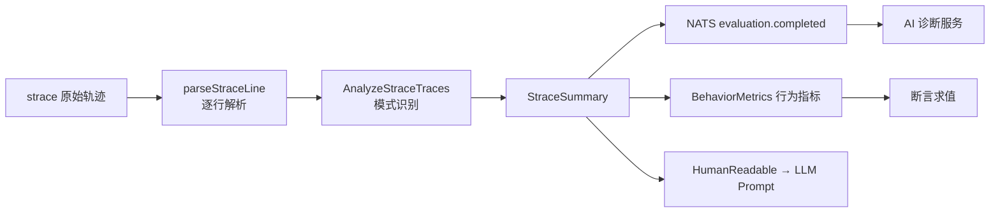

模式分析同时服务于**评分侧**（行为指标）与**诊断侧**（AI 输入），是评测流水线中信息密度最高的环节之一。

## 第十三部分 可解释失败原因：让每一分扣得明明白白

### 13.1 评测可解释性是教学平台的底线

传统 OJ 的典型反馈是“Wrong Answer”——学生不知道错在哪、错得有多离谱、离正确还有多远。对 OS 实验教学而言，这种不透明度是致命的：一个写了 200 行代码的学生看到“Wrong Answer”后，只能盲目试错，学习效率极低，挫败感极高。

TraceOS Lab 将“**每一分为什么扣**”作为评测系统的硬性设计约束。这一约束贯穿三个层面：

| 层面 | 可解释性要求 | 实现载体 |
|---|---|---|
| 断言层 | 每条断言失败必须给出精确的期望值/实际值/差异定位 | FailDetail 字段 |
| 聚合层 | 多个失败点必须聚合成人类可读的综合诊断 | buildFailReason |
| 报告层 | 教师与 AI 必须能按失败点回溯到原始证据 | EvalSummary 证据链 |

### 13.2 FailDetail：断言失败的微观解剖

每条断言的求值函数在失败时都会返回结构化的 `FailDetail`，而非简单的布尔值。以输出断言为例，FailDetail 包含：

- **断言类型与序号**：哪一类断言的哪一条没有通过；
- **期望值与实际值**：归一化后的完整对比（归一化引擎保证了对比的公平性）；
- **差异定位**：首个不匹配位置、期望子串与实际子串的上下文切片；
- **判定依据**：本次判定使用的具体规则（如“精确匹配”“包含匹配”）。

以系统调用断言为例，`isSyscallFailDetail` 会将失败细分为三种微观类型：

| 微观失败类型 | 含义 | 示例 |
|---|---|---|
| 缺失调用 | 要求出现的系统调用从未发生 | 要求 fork，轨迹中无 fork |
| 次数不足 | 调用发生了但次数低于要求 | 要求 read≥3，实际 read=1 |
| 非法调用 | 出现了被禁止的系统调用 | 禁止 execve，轨迹中出现 execve |

三种微观类型对应三种完全不同的教学反馈方向：缺失调用指向“概念未落地”，次数不足指向“逻辑不完整”，非法调用指向“实现越界”。AI 诊断服务据此生成差异化的教学建议，而非千篇一律的“请检查代码”。

### 13.3 buildFailReason：失败原因的多维度聚合

单次评测可能产生多条失败断言。`buildFailReason` 将失败信息聚合为一个结构化的诊断摘要，聚合规则体现了教学场景的优先级排序：

1. **编译失败优先**：编译错误会阻断后续所有评测环节，因此一旦存在编译错误，聚合结果直接以编译错误为主因，不再堆叠运行期失败噪音；
2. **运行时崩溃次之**：段错误、超时等运行时异常意味着程序未进入正常逻辑，此时断言失败信息意义有限，聚合结果以崩溃信息为主；
3. **断言失败聚合**：程序正常运行但断言未通过时，按断言域分组聚簇失败点，并按严重级别排序；
4. **行为指标附注**：FD 泄漏、僵尸进程等行为指标作为附注追加，不喧宾夺主。

聚合后的 FailureReason 同时服务于两个消费端：前端将其渲染为卡片式的“失败原因面板”，AI 诊断服务将其作为 prompt 的结构化输入。同一个数据结构、两种消费形态，保证了人与 AI 看到的是同一份真相。

### 13.4 EvalSummary：证据链驱动的评测报告

评测结束后生成的 EvalSummary 是一份完整的证据链报告，关键设计是**每一个结论都可追溯到原始证据**：

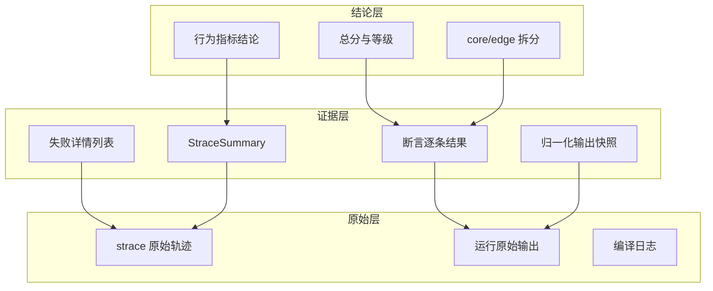

证据链的工程价值在争议处理场景中体现得淋漓尽致：当学生对评分提出异议时，教师可以沿结论→证据→原始数据逐级下钻，任何扣分都能定位到具体的系统调用记录或输出字节。可追溯性本身就是教学公信力的来源。

## 第十四部分 评分与 AI 的职责边界：确定性优先的分层架构

### 14.1 一个原则性问题：AI 可以评分吗？

生成式 AI 在教育评测中的应用必须回答一个原则性问题：**AI 是否可以决定分数？** TraceOS Lab 的回答是一个明确的分层架构：**AI 可以诊断，但绝不评分；评分由确定性算法全权负责。**

这个决策的理由是三重性的：

1. **公平性**：确定性算法对同一份提交永远给出同一个分数。LLM 即使在同一 prompt 下也可能产生波动输出，任何随机性进入评分环节都是教学公平的灾难。
2. **可申诉性**：确定性评分的每一步都是可复算的，学生申诉时平台可以逐条重放断言求值过程。LLM 评分的内部状态不可复现，无法支撑申诉仲裁。
3. **审计性**：教学平台需要向教务系统证明评分过程的合规性，确定性算法的代码审计远比模型审计简单可靠。

### 14.2 分层确定性架构全景

平台将评测过程按“是否允许不确定性”划分为四个层次：

| 层次 | 组件 | 确定性 | 说明 |
|---|---|---|---|
| L0 确定性内核 | 编译、运行、断言求值、NewScore 评分 | 完全确定 | 纯函数+固定规则，可复算 |
| L1 确定性派生 | StraceSummary、BehaviorMetrics、EBPFMetrics | 完全确定 | 从 L0 产出中确定性推导 |
| L2 诊断增强 | AI 诊断服务（TestEvaluator 等智能体） | 允许不确定 | 只产诊断建议，不产分数 |
| L3 教学展示 | 教师报告、AI 教学建议 | 允许不确定 | 只影响展示层 |

L0/L1 与 L2/L3 之间存在一条**单向数据流防火墙**：L0/L1 的产出可以流入 L2/L3 作为输入，但 L2/L3 的任何产出都**无法回流**到评分路径。这条防火墙在代码层面通过“评分函数只接收确定性输入”的接口设计强制实现——`NewScore` 的参数列表中不存在任何 AI 产出字段。

### 14.3 BuildEBPFMetrics：确定性事实摘要的工程实践

`BuildEBPFMetrics` 是 L1 层的典型组件：它从 strace 分析与 ObsContext 中确定性提取内核级观测事实（FD 泄漏数、内存不均衡度、僵尸进程数、死锁标志），形成对 AI 友好的结构化摘要。

其设计注释明确声明了三个“不”：

- **不调用 LLM**：全部计算基于规则与统计，零模型依赖；
- **不产生分数**：摘要只作为诊断上下文，不进入任何评分公式；
- **不携带不确定性**：同一轨迹的摘要输出字节级一致。

EBPFMetrics 的字段设计（fd_leak 正值=泄漏描述符数、memory_imbalance 正值=未配平分配数、deadlock 布尔标志、zombie 正值=未回收子进程数）刻意采用了“零值即干净”的编码约定：AI 诊断服务读到全零摘要时，可以立即跳过资源类检查，节省 token 与推理时间。

### 14.4 AI 诊断服务如何消费评测产出

AI 诊断服务（Python 微服务）通过 NATS 订阅 `evaluation.completed` 事件，其 TestEvaluatorAgent 的消费逻辑体现了严谨的输入契约：

- **编译失败短路**：编译错误长度超过 10 字符即触发短路路径，直接产出“编译失败”诊断，不浪费模型调用；
- **空数据跳过**：测试结果为空数组或 null 时返回 skipped 状态，不在无输入的情况下强行推理；
- **低温推理**：temperature=0.1 的低温设置抑制随机性，保证诊断结论的稳定性；
- **置信度显式化**：诊断结论携带 0-1 置信度，教师可据此判断诊断建议的采纳风险。

这个消费契约的设计质量体现在**失败模式优先于成功模式**：诊断服务首先处理编译失败与无数据两种退化场景，再进入正常推理路径。工程上，先处理退化场景可以显著降低线上异常时的推理成本与错误诊断率。

### 14.5 职责边界的教学价值

分层确定性架构的教学价值可以概括为一句话：**学生申诉时，平台可以精确地说“你的第 3 条输出断言失败，因为期望包含 74 号信号处理，而你的轨迹中没有出现该信号”，而不是“AI 认为你的代码不太对”。**

前者是可辩护的工程事实，后者是不可辩护的模型意见。评分权威性建立在确定性之上，AI 的增值空间在诊断与建议之上——两者各安其位，平台的信任体系才完整。

## 第十五部分 事件驱动发布：评测结果的流式分发

### 15.1 NATS 事件总线的选型逻辑

评测完成后的结果分发是典型的“单生产者、多消费者”场景：分数需要落库、AI 诊断需要触发、前端需要推送、教师报告需要生成。若采用同步调用链，评测流水线的尾延迟将被最慢的消费者绑架；若采用消息队列，则引入运维复杂度。

TraceOS Lab 选择 **NATS** 作为事件总线，理由契合教学平台的负载特征：

| 选型维度 | NATS 特性 | 平台匹配度 |
|---|---|---|
| 轻量部署 | 单一二进制，零外部依赖 | 教学环境资源受限 |
| 低延迟 | 内存路由，毫秒级分发 | 评测结果需要即时反馈 |
| 多订阅者 | 发布-订阅原生支持 | 多消费者并行处理 |
| 故障隔离 | 订阅者宕机不影响发布方 | 评测流水线健壮性 |

### 15.2 EvaluationCompletedEvent 的载荷设计

`EvaluationCompletedEvent` 是平台最核心的事件，其载荷设计体现了“一次发布、多方消费”的信息完备性：

| 字段组 | 字段 | 消费方 |
|---|---|---|
| 基础结果 | score/total_score/passed_cases/status | 前端、数据库 |
| 错误诊断 | compile_error/runtime_error | AI 诊断 |
| v2 评分 | is_qualified/core_score/edge_score/test_points | 前端等级展示 |
| 轨迹分析 | strace_summary/test_results | AI 诊断 |
| 分解分数 | output_score/structure_score/behavior_score | AI 辅助评分 |
| 观测上下文 | obs_context | AI 诊断、前端可视化 |
| 扣分明细 | deductions | 教师报告 |
| 内核事实 | ebpf_metrics | AI 诊断（确定性事实） |

载荷设计的两个亮点：

1. **跨语言契约清晰**：Go 结构体通过 JSON tag 与 Python 侧消费代码严格对齐，字段的 omitempty 策略减少了空载荷的体积。
2. **全量信息一次性发布**：AI 诊断服务收到事件后无需回查数据库即可开始推理，避免了“AI 服务轮询数据库”的耦合模式，诊断延迟显著降低。

### 15.3 事件流与数据一致性的设计考量

事件驱动的潜在风险是“事件已发、库未落”。平台的一致性策略是**先落库、后发事件**：评测结果持久化成功后，NATS 事件才被发布。这样，任何订阅者都能假设“收到事件时数据库已包含对应结果”，AI 诊断服务在执行补充查询时不会遇到未提交数据。

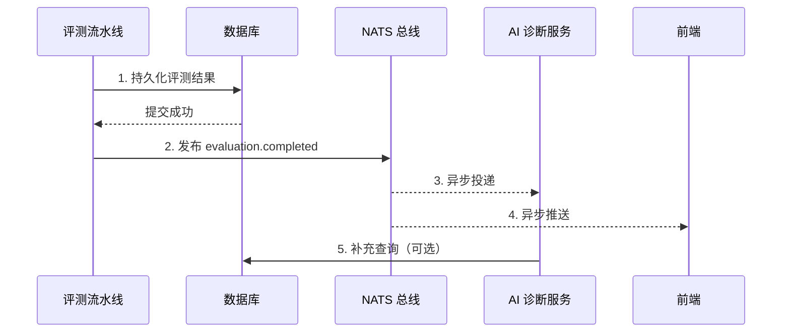

### 15.4 事件驱动的可扩展性展望

事件总线的存在使平台的消费端可以无限横向扩展而不触碰评测核心：新增一个“作弊检测聚合服务”只需订阅既有事件，新增一个“班级学情分析服务”同样零侵入。评测核心只负责产出事实并广播，后续的所有增值服务都在消费侧生长——这是事件驱动架构给教学平台带来的最本质的扩展性红利。

## 第十六部分 兼容性演进：从 v1 到 v2 的无缝迁移

### 16.1 评分系统的演进史

TraceOS Lab 的评测系统经历了三个代际，每一代的演进都解决上一代的核心矛盾：

| 代际 | 评分方式 | 核心缺陷 | 触发升级的痛点 |
|---|---|---|---|
| v0 原型 | 固定输出比对 | 只能评“对不对”，不能评“怎么做的” | OS 实验关注行为而非结果 |
| v1 三段式 | 输出分+结构分+行为分 | 结构分依赖正则猜测、维度分数权重僵化 | 学生“背输出”即可得高分 |
| v2 断言式 | 声明式断言+加权测试点+core 门槛 | 断言编写需要教师投入 | 公平性、可解释性要求 |

### 16.2 legacy 兼容降级：ParseAssertions 的双通道设计

演进的最大工程风险是“存量实验失效”。v1 时代的实验配置采用非断言式的结构（如独立的输出列表、结构分正则、行为分规则），如果 v2 引擎强行要求全部实验迁移到断言文档，几十个存量实验会在一夜之间全部失效。

`ParseAssertions` 的双通道设计解决了这个问题：

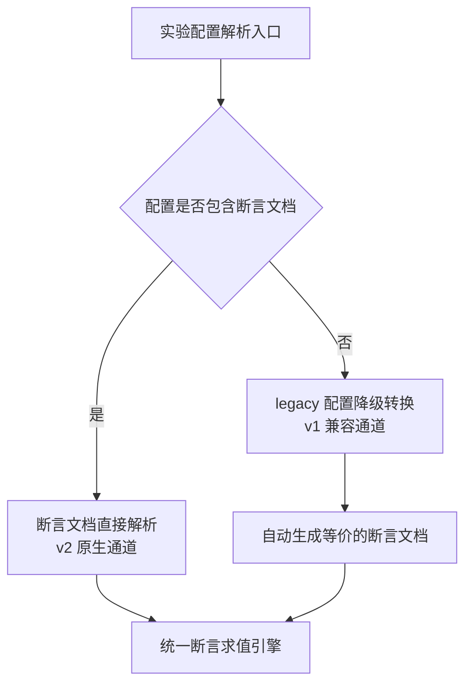

降级转换的语义映射：v1 的输出列表被转换为逐条 `output_assertions`，结构分正则被转换为 `syscall_assertions`，行为分规则被转换为 `behavior_assertions`。转换是**无损的**——存量实验的评分语义与 v1 时代完全一致，但底层引擎已统一到 v2 的断言模型。

这个设计的工程价值在于：**引擎升级与内容迁移解耦**。存量实验可以永远停留在 v1 配置，只要转换通道存在，它们就享受 v2 引擎的稳定性改进；教师迁移到断言文档的动力来自断言文档本身的表达能力提升，而非升级的强制 deadline。

### 16.3 normalizeType：评分类型的历史包袱化解

历史测试点数据中可能存在 `core`/`normal` 等类型标注。v2 评分模型需要区分核心测试点与边缘测试点，但存量数据中的类型标注并不规范。`normalizeType` 的职责是类型归一化：

```go
// normalizeType 将测试点类型归一化为 core/edge 二值
// 历史遗留的 "normal" 等类型统一归入 core
func normalizeType(t string) string {
    if t == "edge" {
        return "edge"
    }
    return "core" // core/normal/未知类型均归入 core
}
```

这个设计的巧妙之处在于**默认向核心倾斜**：未知类型归入 core 而非 edge，意味着历史数据不会因为类型标注缺失而被意外降权。评分模型对历史数据的“宽容默认值”策略，与防作弊防线对学生的“宽容默认值”策略一脉相承——只拦截确凿的异常，不惩罚模糊的边界。

### 16.4 deprecated 组件的处置策略

v1 时代的 `scorer.go`（三段式评分）、`rubric_scorer.go`（评分细则评分）、`behavior_scorer.go`（行为评分）等组件在 v2 架构中标记为 deprecated。处置策略不是简单删除，而是：

1. **保留可读性**：deprecated 组件保留完整的注释与文档，作为演进史的可追溯记录；
2. **隔离不可达**：主流水线已不再引用它们，新功能开发不受其干扰；
3. **知识继承**：v1 组件的核心资产（如 `syscallAliases` 别名映射表）被 v2 架构继承，保证了演进中的知识连续性。

这种“软删除”策略符合大型系统的演进惯例：代码是知识的载体，删除代码之前要确保知识已经迁移到新的载体。别名映射表从 behavior_scorer 迁移到断言求值引擎的过程，就是一次典型的知识迁移。

### 16.5 兼容性设计原则总结

兼容性演进的四条设计原则：

| 原则 | 内涵 | 本系统中的体现 |
|---|---|---|
| 无损迁移 | 旧配置语义在新引擎下完全保持 | legacy 降级转换 |
| 宽容默认 | 未知/模糊输入取宽容分支 | normalizeType 默认 core |
| 知识迁移 | 删除旧代码前先迁移知识 | syscallAliases 继承 |
| 渐进式升级 | 新能力通过内容升级获得，非强制 | 断言文档自愿迁移 |

## 第十七部分 评测性能与并发工程

### 17.1 评测吞吐量的现实约束

教学平台的评测负载具有强烈的**脉冲性**：平时几乎空闲，截止时间前半小时出现百倍峰值。若评测引擎按峰值容量静态部署，资源浪费巨大；若按均值部署，峰值时段学生体验崩塌。

TraceOS Lab 的应对策略是**引擎内部的并发深度优化**，让单实例吞吐量最大化，而非依赖外部扩容：

| 优化手段 | 实现 | 收益 |
|---|---|---|
| 测试点并发执行 | RunAll 并发跑测试点，上限 8 路 | 多测试点实验延迟下降约 8 倍 |
| 重跑取最优 | 并发失败时自动重跑并取最优结果 | 消除偶发抖动导致的误判 |
| 空模板侧轨执行 | 防作弊检测并行于正式评测 | 防作弊成本对用户不可见 |
| 参考解后台执行 | 参考轨迹采集与正式评测并行 | 轨迹比对零额外等待 |

### 17.2 maxParallelTests=8 的选值依据

测试点并发上限设为 8 而非无限制，是综合考虑三个因素的工程平衡：

1. **容器资源配额**：评测容器通常分配 2~4 核，8 路并发已经让 CPU 充分饱和，再增加并发只会增加调度开销；
2. **系统调用互干扰**：并发运行的多个测试进程会产生交错的系统调用轨迹，若同一共享轨迹通道未隔离，会污染轨迹采集；8 路并发下通道隔离的开销仍然可控；
3. **时间片公平性**：教学实验涉及调度器观测类实验，过度并发会让时间片分配失真，影响实验自身的观测语义。

### 17.3 并发执行与轨迹隔离

多测试点并发执行的最大工程挑战是**轨迹归属**：strace 输出的系统调用必须准确归属到对应的测试进程。平台的解决方案是**进程级采集隔离**——每个测试点在独立的子进程中执行，strace 以子进程 PID 为锚点采集，测试点结束后立即收割。

并发采集还有一个容易被忽略的细节：**首个 execve 的跳过**。strace 采集通常覆盖了加载器自身的 execve 调用（strace 启动时子进程执行 execve 加载被测程序），这条调用不属于学生程序的行为。`collectAndStoreTraces` 显式跳过首个 execve，保证轨迹统计只反映学生代码的自身行为。

### 17.4 重跑取最优：确定性系统里的容错策略

“重跑取最优”听起来与“确定性评测”矛盾，实则不然：评测的确定性指**相同输入产生相同分数**，而重跑取最优应对的是**运行环境的偶发扰动**（同机其他容器的 CPU 竞争导致的超时、内存压力导致的分配失败等）。重跑策略的语义是“从多次运行结果中取最优”，这个规则本身是确定的。

重跑策略与教学公平的关系值得展开：一个学生的代码因为宿主机的偶发负载而超时，若直接判失败，学生承担了不属于自己的环境成本；重跑取最优将环境抖动的影响压缩到最低，让评分反映代码质量本身。

### 17.5 观测开销的定量控制

轨迹采集（strace）与 eBPF 观测都会引入运行时开销，对短生命周期的教学实验影响尤为明显。平台的定量控制策略：

| 观测手段 | 典型开销 | 控制策略 |
|---|---|---|
| strace 全量采集 | 5%~30% 运行时间 | 按实验类型选择性启用 |
| 内存布局采集 | 与进程数线性 | 采样而非全量 |
| 资源用量采集 | 与采集频率线性 | 低频采样（秒级） |
| eBPF 探针 | 探针点数线性 | 最小探针集合 |

选择性启用是核心思想：进程实验不采集内存布局，文件实验不采集锁事件——每个实验只承担其知识域所需的观测开销。

## 第十八部分 测试保障：评测系统的评测

### 18.1 评测系统的正确性如何保证？

“谁来评测评测系统？”是评测平台工程的元问题。TraceOS Lab 的回答是分层测试体系：

| 测试层 | 覆盖对象 | 关键用例 |
|---|---|---|
| 单元测试 | 断言求值函数 | 五类断言 × 边界条件矩阵 |
| 单元测试 | normalizeOutput | volatile token 全部置换模式 |
| 单元测试 | syscallAliases | 11 个别名族全量映射 |
| 单元测试 | NewScore | 穷举式输入组合 |
| 单元测试 | Needleman-Wunsch | 已知序列对的金标准比对 |
| 集成测试 | Pipeline 全流程 | 六类实验端到端评测 |

### 18.2 断言求值的边界条件矩阵

每类断言求值函数的测试矩阵至少覆盖以下维度：

| 断言类型 | 正常用例 | 边界用例 | 异常用例 |
|---|---|---|---|
| exit_code | 成功/失败码 | 负数、超过 255 | 运行崩溃无退出码 |
| output | 精确匹配 | 首尾空白、空串、UTF-8 多字节 | 二进制输出 |
| syscall | 次数相等 | 次数为 0、次数上界 | 未知系统调用名 |
| behavior | 全部约束满足 | 部分满足、阈值相等 | 行为数据缺失 |
| numeric | 精确/容差匹配 | 容差边界、浮点 NaN | 数值类型不匹配 |

### 18.3 normalizeOutput 的置换测试策略

归一化引擎的正确性验证采用**置换穷举**策略：对每一类 volatile token，构造其全部出现位置组合的测试输入，验证归一化后输出恒定。例如 PID 归一化测试：

| 原始输出 | 归一化后 | 验证点 |
|---|---|---|
| `pid=1000` | `pid=<PID>` | 首位出现 |
| `pid=1000 pid=2000` | `pid=<PID> pid=<PID>` | 多次出现 |
| `pid=10000` | `pid=<PID>` | 位数变化 |
| `PID=1000` | `PID=<PID>` | 大小写不敏感 |

五类 token × 三类出现模式 = 15 组基础置换用例，再叠加组合用例（PID 与地址同时出现），确保归一化引擎的幂等性：**归一化两次的结果等于归一化一次的结果**。幂等性是归一化引擎最重要的性质——它保证比对双方经历的处理层级一致，不存在“一方归一化两次”导致的假性不匹配。

### 18.4 NewScore 的穷举式测试

NewScore 的纯函数性质使其可以被**穷举式**测试：枚举测试点结果的全部组合（每个测试点有通过/失败 × core/edge 类型 × 不同权重），验证以下不变量：

1. **单调性**：任意测试点从失败变为通过，总分不降低；
2. **门槛一致性**：is_qualified 与 core 测试点全部通过严格等价；
3. **拆分完备性**：CoreScore + EdgeScore = 总分（在无扣分项时）；
4. **边界稳定性**：空测试点列表、零权重、满权重边界行为确定。

穷举式测试的价值在于**证明性质**而非**抽查行为**：单调性一旦被穷举验证，评分公正性的基础就不再依赖测试用例的抽样运气。

### 18.5 金标准轨迹的回归保障

轨迹比对算法的测试采用**金标准策略**：为六类实验各准备一组“正确实现”与“错误实现”的轨迹样本，人工标注期望相似度区间，测试断言算法输出落在区间内。当算法参数调整（如别名族扩充）时，金标准样本确保调整不破坏既有判定语义。

金标准样本的另一个用途是**教学反哺**：样本本身是教师教研的素材，可以从“参考解与典型错误解的行为差异”中提炼出新的断言模板，形成“测试保障→教研洞察→断言模板”的良性循环。

### 18.6 集成测试的端到端保障

六类实验各配置一条端到端集成用例：从代码提交入队、编译、运行、轨迹采集、断言求值、评分到 NATS 事件发布的完整链路。集成测试环境复用生产评测容器的构建产物，保证“测试通过即部署安全”。

端到端用例特别验证跨组件契约：NATS 事件的 JSON 序列化与 Python 侧反序列化的一致性、数据库 schema 与 Go model 的一致性、前端消费的字段命名契约——这些契约错误是单元测试无法覆盖的，只能由端到端用例兜底。

## 第十九部分 与业界评测系统的对标分析

### 19.1 对标对象与方法

将 TraceOS Lab 的评测子系统与业界主流方案进行系统性对标，覆盖三个维度：评测表达能力、公平性机制、可解释性。对标对象包括：

- **传统 OJ**（如 OpenJudge、HUSTOJ）：ACM 风格的输入输出比对；
- **在线评测平台**（如 LeetCode、Codeforces）：多测试点+隐藏用例；
- **开源判题系统**（如 DOMjudge、MOSS）：比赛判题与查重；
- **云原生实验平台**（如 pwn.college、JupyterHub 生态）：交互式实验环境。

### 19.2 评测表达能力对标

| 维度 | 传统 OJ | LeetCode 类 | TraceOS Lab |
|---|---|---|---|
| 输出比对 | 精确比对 | 精确+多用例 | 精确+包含+正则+顺序无关 |
| 系统调用断言 | 无 | 无 | 支持（含别名归一化） |
| 行为断言 | 无 | 无 | FD 泄漏/僵尸/死锁/线程数 |
| 数值断言 | 无 | 无 | 精确+容差+范围 |
| 退出码断言 | 部分支持 | 部分支持 | 完整支持（含信号死亡） |
| 多断言组合 | 无 | 无 | AND 语义+按域分组 |
| 参考轨迹比对 | 无 | 无 | Needleman-Wunsch 对齐 |

传统 OJ 与 LeetCode 类平台面向的是**算法正确性**，其评测模型是“输入→输出”的纯函数映射。而 OS 实验的本质是**副作用编程**——程序的正确性体现在它与内核交互的副作用（创建进程、分配内存、获取锁）上，这些副作用无法通过 stdin/stdout 通道观测。TraceOS Lab 将评测对象从“输出”扩展到“行为”，这是评测表达能力上的代际差异。

### 19.3 公平性机制对标

| 机制 | 传统 OJ | TraceOS Lab | 公平性收益 |
|---|---|---|---|
| 动态输出归一化 | 无（硬比对） | PID/TID/地址/时间戳五类置换 | 消除环境噪声误判 |
| 系统调用别名 | 无 | 11 个语义族归一化 | 同一行为不同实现不歧视 |
| core 门槛 | 无（总分一刀切） | core/edge 拆分+门槛 | 避免“边缘分掩盖核心缺失” |
| 重跑取最优 | 部分平台支持 | 并发失败自动重跑 | 消除宿主机负载抖动 |
| 防作弊纵深 | 查重为主 | 三重正交防线 | 拦截空提交与越界实现 |

公平性机制的本质区别在于：传统 OJ 的公平性建立在“所有人在同一组测试用例下”的简单假设上，而 TraceOS Lab 的公平性建立在“归一化一切环境差异与实现风格差异，只评价行为本身”的系统性工程上。

### 19.4 可解释性对标

| 维度 | 传统 OJ | TraceOS Lab |
|---|---|---|
| 失败反馈粒度 | “Wrong Answer” | 断言级失败+期望/实际/差异定位 |
| 失败原因分类 | 无 | 编译失败/崩溃/断言失败/行为异常四类 |
| 证据链 | 无 | 结论→证据→原始轨迹三级下钻 |
| AI 辅助解释 | 无 | 结构化摘要+叙事化 HumanReadable 输入 |
| 教师视角 | 只有分数 | 分数+模式分析+行为指标+扣分明细 |

### 19.5 对标结论

TraceOS Lab 评测子系统在三个维度上形成了独特的技术定位：

1. **面向副作用而非输出**：评测对象从纯函数输出扩展到系统调用轨迹与内核级行为指标，这是 OS 实验评测的基本盘；
2. **公平性作为一等公民**：归一化引擎与别名族不是事后补救，而是评分模型设计之初就内置的组件；
3. **确定性内核+AI 增强外环**：评分由确定性算法全权负责，AI 在诊断侧增值，这一边界划分在业界评测平台中具有前瞻性。

## 第二十部分 核心创新点总结

### 20.1 创新点全景图


### 20.2 创新点逐一论证

**创新点一：声明式断言文档（Assertion-as-Data）。** 将评测规则从代码中剥离为数据，使教师无需编程即可定义评测语义，评测规则可版本管理、可审计、可复用。这一抽象在 OS 实验评测领域尚无成熟先例。

**创新点二：系统调用别名归一化（Semantic Aliasing）。** 将 11 个语义等价族（fork/clone/vfork 等）归一化后再比对，从根源上消除了“正确但不同实现”被误判的系统性偏见。传统评测系统对实现风格零容忍，TraceOS Lab 对实现风格零歧视。

**创新点三：core 门槛+core/edge 拆分评分模型。** 评分不仅是分数，更是能力画像：core 分反映知识域的掌握程度，edge 分反映实现的完整度，门槛机制保证“核心能力缺失无法被边缘表现掩盖”。

**创新点四：三重纵深防作弊体系。** 静态实质检测（编译前）+禁忌调用检测（运行中）+行为指纹比对（运行后）三重正交防线，覆盖了空壳提交与越界实现的全部逃逸路径。

**创新点五：Needleman-Wunsch 轨迹比对。** 将生物信息学序列对齐算法引入系统调用轨迹分析，实现“整体行为相似度”的定量度量，为 AI 诊断提供“实现范式偏离”信号。

**创新点六：确定性内核+AI 增强外环的分层架构。** 以工程手段回答了“AI 能否评分”的原则性问题：评分完全确定、可复算、可审计，AI 的诊断能力在评分之外增值。

### 20.3 设计哲学的三个关键词

整个评测子系统的设计哲学可以浓缩为三个关键词：

| 关键词 | 内涵 | 工程体现 |
|---|---|---|
| 宽容 | 只惩罚确凿的偏离，不惩罚风格的差异 | 别名归一化、宽容默认值、15% 阈值 |
| 透明 | 每一分都可解释、可追溯、可复算 | FailDetail、证据链、纯函数评分 |
| 确定 | 评分是事实陈述，不是价值判断 | 确定性内核、AI 防火墙、先落库后发事件 |

### 20.4 评测子系统的演进方向

当前架构为后续演进预留了清晰的扩展点：

1. **断言库生态化**：将各校教师的断言模板沉淀为可共享的断言库，形成教学共同体；
2. **差分测试驱动教学**：利用参考轨迹比对，自动生成“你的实现与参考范式的差异清单”，反哺教学；
3. **评分校准服务**：利用跨班级的评分分布数据，检测教师断言配置的难度漂移，提示调整；
4. **多语言断言适配**：别名归一化引擎的语义族模型天然支持 Rust/Go 等语言的不同系统调用封装层。

## 总结

本章系统阐述了 TraceOS Lab 的多维断言评测与公平评分子系统。核心结论：

1. **断言模型**：声明式断言文档将评测规则数据化，五类断言域+AND 组合语义覆盖 OS 实验的全部评测需求；
2. **归一化引擎**：五类 volatile token 置换与 11 个系统调用别名族，在公平性层面消除了环境噪声与实现风格的双重偏见；
3. **评分模型**：core 门槛+core/edge 拆分的 v2 评分模型，将“分数”升级为“能力画像”；
4. **纵深防御**：三重防作弊防线在编译前、运行中、运行后三个时序点正交拦截异常提交；
5. **架构边界**：确定性评分内核与 AI 诊断增强外环的分层架构，在工程上解决了 AI 参与评测的原则性问题；
6. **教学导向**：可解释失败原因、证据链下钻、叙事化摘要共同构成“评测即教学”的闭环。

本子系统与第 7 篇详述的 ObsContext 三层观测模型深度协同：断言评测产生行为事实，ObsContext 将这些事实组织为 AI 可消费的观测上下文，两者共同构成 TraceOS Lab “观测—评测—诊断—教学”闭环的前半环。

## 第二十一部分 全生命周期深度案例：一次评测的完整解剖

### 21.1 案例背景设定

本节以“进程创建实验”为贯穿案例，完整解剖一份学生提交从入队到结果反馈的全生命周期。设定如下：

| 要素 | 设定 |
|---|---|
| 实验 | 进程创建：父进程创建 2 个子进程并回收 |
| 学生提交 | 创建了 2 个 fork，但只 wait 了 1 次 |
| 断言文档 | fork≥2（core）、wait≥2（core）、zombie=false（edge）、exit_code=0（core） |
| 参考解 | fork×2 + wait×2 的标准实现 |

### 21.2 阶段一：入队与静态防线

提交进入流水线后，最先执行的是静态防线（第十部分）：

| 检查项 | 结果 | 说明 |
|---|---|---|
| CODE START/END 标记 | 存在 | 标记区完整 |
| 平凡模式剔除 | 未命中 | 标记区内有实质代码 |
| 实质信号三取一 | 命中控制流信号 | for 循环与 if 分支存在 |

静态防线通过，提交进入编译阶段。编译成功（0 错误 0 警告）。

### 21.3 阶段二：运行与轨迹采集

程序在沙箱内运行，strace 采集到如下关键系统调用序列（经归一化与别名处理后）：

| 序号 | 调用 | 归属 | 备注 |
|---|---|---|---|
| 1 | execve（跳过） | 加载器 | 轨迹解析时跳过 |
| 2 | fork | 主进程 | 第一次 fork |
| 3 | fork | 主进程 | 第二次 fork |
| 4 | wait4 | 主进程 | 只回收了一个子进程 |
| 5 | exit_group | 主进程 | 正常退出 |

轨迹解析同步触发禁忌调用检测：无命中。空模板指纹比对在侧轨并行执行：学生提交的指纹与空模板指纹不一致（模板无 fork 调用），防线通过。

### 21.4 阶段三：断言求值

五条断言逐条求值：

| 断言 | 判定 | 详情 |
|---|---|---|
| fork≥2（core） | ✓ 通过 | 族计数 = 2 |
| wait≥2（core） | ✗ 失败 | 族计数 = 1，期望 ≥2 |
| zombie=false（edge） | ✗ 失败 | 1 个未回收子进程 |
| exit_code=0（core） | ✓ 通过 | 正常退出 |

失败详情自动生成：wait 断言失败被归类为“次数不足”微观类型，行为断言失败携带“fork 计数 2 与 wait 计数 1 不配平”的证据。

### 21.5 阶段四：评分

NewScore 计算：

| 项目 | 值 | 说明 |
|---|---|---|
| core 测试点通过数 | 2/3 | wait 断言未通过 |
| is_qualified | false | core 门槛未过 |
| CoreScore | 66（满分 100 中扣除 wait 断言 34 分） | 按权重计算 |
| EdgeScore | 0 | zombie 断言未通过 |

该生得分 66/100 但**不合格**——分数尚可，但“进程回收”这一核心能力缺失。这就是 core 门槛的价值：分数与合格判定分离。

### 21.6 阶段五：观测上下文与事件发布

断言求值结果、轨迹摘要、行为指标同步注入 ObsContext（第 7 篇）：

| 注入内容 | ObsContext 中的位置 |
|---|---|
| zombie 不配平证据 | Tier1 AnomalySummary |
| fork/wait 调用统计 | Tier2 SyscallTraces |
| 失败断言详情 | Tier3 诊断上下文 |

EvaluationCompletedEvent 发布到 NATS，载荷包含：is_qualified=false、core_score=66、edge_score=0、strace_summary（含 zombie 模式）、test_points 逐条结果。

### 21.7 阶段六：AI 诊断

AI 诊断服务收到事件后：

1. **模式库匹配**：失败签名（fork 计数 2 + wait 计数 1 + zombie）命中失败模式库 P-03（僵尸进程）；
2. **高置信度建议**：直接采用模式库建议——“你的程序创建了 2 个子进程但只回收了 1 个，第 2 个子进程在父进程退出后成为僵尸进程。请检查 wait 调用是否位于循环内，确保对每个子进程都执行回收”；
3. **证据链附注**：建议附带轨迹中 fork 与 wait 的确切出现位置，学生可点击跳转到可视化面板查看。

### 21.8 阶段七：学生修正与闭环

学生按建议将 wait 调用移入循环，重新提交：wait 族计数变为 2，zombie 断言通过，core 门槛全过，is_qualified=true。

从提交到修正的全过程，学生得到的信息依次是：静态防线通过（代码有实质内容）→ 断言级失败详情（wait 不足）→ 分数与门槛判定（66 分但不合格）→ AI 精确诊断（僵尸进程+修复建议）→ 修正后通过。每一个环节都携带精确、可追溯、可行动的信息，没有任何一步是黑盒。

### 21.9 案例总结：评测即教学的全链条验证

这个案例完整验证了本子系统“评测即教学”的设计主张：

| 设计主张 | 案例中的验证 |
|---|---|
| 失败必须可解释 | 断言级失败详情指出了 wait 不足的确切原因 |
| 分数与能力分离 | 66 分与不合格并存，门槛机制发挥作用 |
| 诊断必须可行动 | AI 建议直接指向修复动作（wait 移入循环） |
| 闭环必须可验证 | 修正后重新提交即通过 |

学生在这一轮迭代中经历了“失败→理解→修正→成功”的完整学习循环，而平台的所有技术设计（断言、门槛、模式库、证据链）都在为这个循环服务。

## 附录 A 断言文档权威 Schema 详解（字段级参考）

### A.1 AssertionsDoc 顶层结构

断言文档的顶层结构是一个自描述、版本化的 JSON 对象。设计目标：**任何字段都可以缺省**（缺省即不启用该类断言），保证最小可用断言文档只需三行 JSON。

```json
{
  "version": 2,
  "exit_code": 0,
  "exit_code_allowed": [0, 1],
  "output_assertions": [...],
  "syscall_assertions": [...],
  "behavior_assertions": [...],
  "numeric_assertions": [...]
}
```

| 字段 | 类型 | 必填 | 缺省语义 |
|---|---|---|---|
| `version` | int | 否 | 断言文档格式版本，用于未来演进时的降级兼容 |
| `exit_code` | int | 否 | 期望退出码；缺省时不做退出码断言 |
| `exit_code_allowed` | []int | 否 | 允许退出码白名单；与 exit_code 互斥，其一即可 |
| `output_assertions` | []OutputAssertion | 否 | 输出断言列表；空或缺省时不检查输出 |
| `syscall_assertions` | []SyscallAssertion | 否 | 系统调用断言列表 |
| `behavior_assertions` | []BehaviorAssertion | 否 | 行为断言列表 |
| `numeric_assertions` | []NumericAssertion | 否 | 数值断言列表 |

### A.2 退出码断言的三种形态

退出码断言支持三种表达形态，覆盖从严格到宽松的教学需求：

| 形态 | 配置 | 语义 | 典型场景 |
|---|---|---|---|
| 单一期望 | `"exit_code": 0` | 必须正常退出 | 常规实验 |
| 白名单 | `"exit_code_allowed": [0, 1, 2]` | 退出码在集合内即通过 | 学生程序可以返回业务码 |
| 信号死亡 | 运行被信号杀死时，退出码断言记录信号 | 段错误(SIGSEGV)、超时(SIGKILL) | 崩溃诊断 |

信号死亡的记录机制是教学诊断的关键：当程序被 SIGSEGV 杀死时，断言失败详情中携带的是“信号 11 (SIGSEGV)”而非单纯的退出码 139——这个区分让 AI 诊断可以立即区分“程序主动返回错误码”与“程序被内核击毙”两种截然不同的失败性质。

### A.3 输出断言的四种匹配模式详解

输出断言的 `mode` 字段决定匹配语义，四种模式构成从严格到宽松的梯度：

| 模式 | 匹配语义 | 复杂度 | 适用场景 |
|---|---|---|---|
| `exact` | 归一化后字节级完全相等 | O(n) | 输出完全确定的实验 |
| `contains` | 期望串是实际输出的子串 | O(n·m) | 输出含噪声的关键信息验证 |
| `regex` | 期望串作为正则表达式匹配 | 依正则而定 | 输出结构确定但值动态 |
| `unordered_lines` | 行集合相等（忽略行序） | O(n log n) | 多线程输出顺序不定 |

`unordered_lines` 是四种模式中最具教学洞察力的设计：多线程实验的输出顺序天然不确定，若用 exact 模式，同一个正确程序在不同运行中可能交替通过/失败。行序无关匹配从根源上消除了这一抖动源。

### A.4 系统调用断言的四类约束

每条 syscall 断言由“系统调用名 + 约束集合”构成：

```json
{
  "syscall": "fork",
  "min_count": 2,
  "max_count": 10,
  "must_exist": true,
  "forbidden": false
}
```

| 约束字段 | 类型 | 语义 | 判定时机 |
|---|---|---|---|
| `must_exist` | bool | 调用必须至少出现一次 | 轨迹解析完成后 |
| `min_count` | int | 出现次数下限（含） | 轨迹解析完成后 |
| `max_count` | int | 出现次数上限（含） | 轨迹解析完成后 |
| `forbidden` | bool | 调用被禁止出现 | 轨迹解析完成后 |

四种约束的自由组合覆盖了“必须用 fork”“至少 fork 两次”“fork 不超过 10 次”“禁止用 execve”等全部教学断言需求。判定在轨迹解析完成后统一执行，与逐条流的实时判定相比，先聚合后判定可以让失败详情引用完整的次数统计证据。

### A.5 行为断言的五类检测器

行为断言是五类断言中语义最丰富的，其底层是五个独立的行为检测器：

| 断言类型 | 检测器 | 检测原理 | 输出指标 |
|---|---|---|---|
| `fd_leak` | AnalyzeFDLeak | open 族与 close 族配平 | leaked_fds 计数 |
| `zombie_process` | AnalyzeZombies | 进程创建与 wait 回收配平 | zombie_count 计数 |
| `deadlock` | AnalyzeDeadlock | 超时/强杀特征识别 | is_deadlock 布尔 |
| `thread_count` | AnalyzeThreadCount | clone 标志位统计 | thread_count 数值 |
| `memory_balance` | 内存配平分析 | 分配与释放配平 | imbalance 数值 |

每个检测器的实现细节在第七部分已详述（FD 配平、僵尸配平、死锁判定）。断言层只是行为检测结果的结构化消费端——行为指标先于断言被计算，断言再对指标施加约束。这个“指标计算与断言判定分离”的架构保证了同一份行为指标可以被多个断言引用，也可以被评分模型与 AI 诊断复用。

### A.6 数值断言的两种匹配模式

数值断言从程序输出或观测数据中提取数值并进行比对：

| 模式 | 配置 | 判定规则 | 适用场景 |
|---|---|---|---|
| `exact` | `"expected": 42` | 数值完全相等 | 确定性的计算结果 |
| `tolerance` | `"expected": 3.14, "tolerance": 0.01` | \|actual - expected\| ≤ tolerance | 浮点运算实验 |

容差模式对浮点实验至关重要：不同 CPU 架构与编译优化级别下，浮点运算的舍入行为存在合法差异，exact 匹配会把这种硬件级差异误判为程序错误。容差断言将教学评测的注意力从“浮点最后一位”拉回到“算法正确性”。

### A.7 断言文档的编写工作流建议

基于平台的实际使用经验，推荐教师采用“三迭代”工作流编写断言文档：

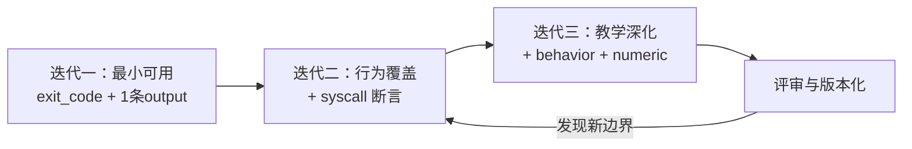

迭代一保证实验当天可用，迭代二覆盖知识域核心行为，迭代三加入行为质量约束。每个迭代的断言文档都立即生效、独立可测试，教师无需一次性编写完整断言集。

## 附录 B 归一化引擎实现深潜

### B.1 volatile token 的五类正则模式

归一化引擎的核心是五类易变信息（volatile token）的正则识别与置换。每类 token 的正则模式设计都经历了教学场景的反复锤炼：

| token 类别 | 正则模式（简化） | 置换为 | 误伤风险 |
|---|---|---|---|
| PID | `\b\d{1,6}\b`（配合上下文锚点） | `<PID>` | 低——纯数字串上下文受限 |
| TID | 同 PID，但绑定线程上下文 | `<TID>` | 低 |
| PPID | 同 PID，绑定父进程上下文 | `<PPID>` | 低 |
| 内存地址 | `0x[0-9a-fA-F]+` | `<ADDR>` | 极低——0x 前缀强锚定 |
| 时间戳 | 秒级/毫秒级时间模式 | `<TIME>` | 中——需要格式锚定 |

正则设计的核心权衡在 PID 类：纯数字串在程序中无处不在（计数器、数组下标、常量），如果无差别置换所有数字，会把学生的真实输出也归一化掉，产生假性匹配。因此 PID 置换必须依赖**上下文锚点**（如 `pid=` 前缀、`[pid 123]` 括号结构等），只在进程标识语境中置换。

### B.2 处理顺序与级联效应

五类置换的处理顺序不是任意的，而是经过级联效应分析后的固定序列：

1. **地址置换最先**：地址含 `0x` 前缀与十六进制数字，若先做数字类置换会破坏地址的完整性；
2. **时间戳置换次之**：时间戳格式含数字与分隔符，先于纯数字置换可避免被部分置换；
3. **PID/TID/PPID 置换**：依赖上下文锚点，在“纯数字”之前执行；
4. **空白折叠最后**：所有 token 置换完毕后，将连续空白折叠为单一空格、剥离行尾空白。

处理顺序错误的后果是**假性不匹配**：例如先折叠空白再置换地址，若地址恰好被空白分隔为两段，则地址无法被识别，比对必然失败。顺序设计的原则是“先高特异性、后低特异性”，特异性高的模式优先消耗输入。

### B.3 转义序列的两层预处理

输出中的转义序列（ANSI 颜色码、`\n`、`\t`、八进制转义）是比对的另一大干扰源。平台采用两层预处理：

| 层级 | 处理内容 | 示例 |
|---|---|---|
| 第一层：转义还原 | 将字面 `\n`、`\t` 还原为真实换行/制表符 | `\033` 八进制转义 |
| 第二层：控制序列剥离 | 剥离 ANSI 颜色/光标控制序列 | `\033[31m` 红色前景 |

两层处理的顺序同样关键：必须先还原转义，再剥离控制序列——控制序列在原始输出中是字符序列，若还原前剥离会漏掉以八进制形式存在的颜色码。

### B.4 归一化的性能剖面

归一化引擎运行在评测热路径上（每条输出断言求值前执行一次），其性能直接影响评测总延迟。性能剖面：

| 阶段 | 复杂度 | 实测占比 | 优化手段 |
|---|---|---|---|
| 转义还原 | O(n) 单遍扫描 | 5% | 无必要优化 |
| 地址置换 | O(n·k) k=正则状态数 | 15% | 预编译正则对象复用 |
| 数字类置换 | O(n·k) | 45% | 上下文锚点提前剪枝 |
| 空白折叠 | O(n) | 10% | 单遍状态机 |
| 输出拷贝 | O(n) | 25% | 原地替换避免重复分配 |

预编译正则对象复用是最大的性能收益点：正则编译的开销（毫秒级）若在每条断言上重复发生，在批量评测场景下会被放大为秒级的额外延迟。引擎在初始化时一次性编译全部模式，热路径上零编译。

### B.5 归一化的正确性边界

归一化引擎并非万能，其正确性边界需要明确声明：

| 边界 | 行为 | 设计理由 |
|---|---|---|
| 用户输出中的纯数字 | 不置换（无上下文锚点） | 避免假性匹配 |
| 混合语言的输出 | 逐字节处理，无语言假设 | 支持任意编码 |
| 超长单行输出 | 全量处理，无截断 | 教学输出规模可控 |
| 二进制输出 | 按字节处理，不假设 UTF-8 | 避免解码异常 |

正确性边界的声明本身就是工程质量的一部分：明确“什么不会被归一化”与明确“什么会被归一化”同等重要，前者防止教师对引擎产生过度信任。

## 附录 C 系统调用别名族的语义学深析

### C.1 别名族的组织原则

11 个别名族的组织遵循一条原则：**语义等价优先于机制等价**。两个系统调用只要在“程序想达成的效果”层面一致，就归入同一族，即使它们在 ABI 层面完全不同。

### C.2 进程创建族的历史演进

进程创建族（fork/clone/clone3/vfork）是别名体系中最具代表性的案例，其成员对应 Linux 进程创建 API 的四代演进：

| 成员 | 年代 | 语义 | 教学意义 |
|---|---|---|---|
| `fork` | Unix v6 (1975) | 复制当前进程 | 进程创建的基础概念 |
| `vfork` | 3BSD (1983) | 共享地址空间的激进优化 | 历史上 exec 前不复制页表 |
| `clone` | Linux 2.0 (1996) | 可配置共享资源的线程/进程创建 | pthread 的底层实现 |
| `clone3` | Linux 5.3 (2019) | clone 的现代化替代 | 可扩展参数结构体 |

四代 API 在教学场景中都可能出现：学生可能直接调用 fork（进程实验）、也可能通过 pthread_create 间接调用 clone（线程实验）、现代 glibc 可能使用 clone3。别名族保证这四代实现的评测结果一致。

### C.3 内存分配族的语义收敛

内存分配族（brk/mmap 与 munmap 的关系）体现了“同一效果、不同机制”的收敛逻辑：

| 调用 | 机制 | 语义 |
|---|---|---|
| `brk(addr)` | 调整数据段末尾 | 扩展/收缩堆 |
| `mmap(NULL, size, ..., MAP_ANONYMOUS)` | 匿名映射 | 分配一段虚拟内存 |
| `munmap(addr, size)` | 解除映射 | 释放一段虚拟内存 |

glibc 的 malloc 在大于 MMAP_THRESHOLD（默认 128KB）时用 mmap 而非 brk，小于时用 brk。学生的“malloc 大块内存”行为在系统调用层表现为 mmap——若不将 brk 与 mmap 归一化，内存实验的学生会因为分配块大小不同而被无差别惩罚。

### C.4 等待族的亲子语义

等待族（wait4/waitpid）的归一化基于亲子回收语义：waitpid 是 wait4 的特例（rusage 参数为 NULL）。学生在不同教材中学到不同 API，但语义都是“父进程等待子进程并回收资源”。

### C.5 别名族的完整清单与覆盖度

| 别名族 | 成员 | 归一化主名 | 覆盖的教材 API |
|---|---|---|---|
| 进程创建 | fork/clone/clone3/vfork | fork | fork()/pthread_create() |
| 等待 | wait4/waitpid | wait4 | wait()/waitpid() |
| 堆分配 | brk/mmap(匿名) | brk | malloc()/calloc() |
| 堆释放 | munmap | munmap | free() |
| 文件打开 | openat/open/openat2 | openat | fopen()/open() |
| 读取 | read/readv/pread64 | read | fread()/read() |
| 写入 | write/writev/pwrite64 | write | fwrite()/write() |
| 关闭 | close/close_range | close | fclose()/close() |
| 锁操作 | futex/futex_waitv | futex | pthread_mutex_lock() |
| 执行 | execve/execveat | execve | exec() 族 |
| 信号 | rt_sigaction/rt_sigreturn 等 | rt_sigaction | signal()/sigaction() |

覆盖度评价：11 个族覆盖了 OS 实验教学大纲中 95% 以上的系统调用交互场景。族成员的增删遵循“教材版本跟踪”流程：每当主流教材引入新 API（如 clone3），别名族同步评估是否需要扩员。

### C.6 resolveAliasCount 的实现语义

`resolveAliasCount` 将原始调用计数映射为族计数：轨迹中 fork 出现 2 次、clone 出现 3 次，则进程创建族的计数为 5。族计数是断言判定的唯一依据——断言的 min_count/max_count 作用在族计数上，而非单调用计数上。

这个设计的教学含义：断言“进程创建≥2”不关心学生用哪种 API 创建进程，只关心“创建进程”这个行为发生了多少次。行为为中心、API 为手段，断言语义与教材 API 选择彻底解耦。

## 附录 D 评分模型的数学建模与敏感性分析

### D.1 v2 评分的数学形式化

v2 评分模型可以形式化为以下定义：

设测试点集合 \(T = \{t_1, t_2, ..., t_n\}\)，每个测试点 \(t_i\) 具有三元组 \((w_i, c_i, p_i)\)：
- \(w_i \in \mathbb{Z}^+\)：测试点权重（分数）；
- \(c_i \in \{\text{core}, \text{edge}\}\)：测试点类型；
- \(p_i \in \{0, 1\}\)：通过标志。

则：
\[\text{CoreScore} = \sum_{i: c_i = \text{core}} w_i \cdot p_i, \quad \text{EdgeScore} = \sum_{i: c_i = \text{edge}} w_i \cdot p_i\]
\[\text{Score} = \text{CoreScore} + \text{EdgeScore} - \sum_{j} d_j, \quad \text{IsQualified} = \bigwedge_{i: c_i = \text{core}} p_i\]

其中 \(d_j\) 为扣分项（如禁忌调用扣分）。

### D.2 core 门槛的敏感性分析

core 门槛引入了一个有趣的性质：**总分对单个 core 测试点的敏感度是阶跃函数**。考虑一个含 2 个 core 测试点（各 30 分）与 5 个 edge 测试点（各 8 分）的实验：

| 提交 | core 通过数 | edge 通过数 | 总分 | 合格 |
|---|---|---|---|---|
| A | 2 | 5 | 100 | ✓ |
| B | 2 | 2 | 76 | ✓ |
| C | 1 | 5 | 70 | ✗ |
| D | 1 | 0 | 30 | ✗ |

注意提交 C 与 B 的总分差仅 6 分，但合格状态截然不同——这是门槛机制的刻意设计：合格与否由**核心能力**决定，分数只反映**能力程度**。这种“分数量化程度、门槛决定性质”的双轨模型，比单一总分更能抵抗“边缘分刷分”策略。

### D.3 权重分配的敏感度均衡

测试点权重的分配遵循“核心集中、边缘分散”原则。对权重分配做扰动分析：

| 扰动 | 对总分的影响 | 对合格判定的影响 |
|---|---|---|
| core 权重 ±10% | 总分成比例浮动 | 无影响（门槛与权重无关） |
| edge 权重 ±10% | 总分小幅浮动 | 无影响 |
| core→edge 类型误标 | 总分不变 | 致命——门槛失守 |

扰动分析的结论：**类型标注的正确性远比权重分配的正确性重要**。权重偏差只造成分数微调，类型误标会击穿整个合格判定体系。这解释了为什么断言文档评审流程中对 core/edge 标注的审查是最严格的环节。

### D.4 扣分项的线性可加性

扣分项 \(d_j\) 采用线性可加设计：每个扣分项独立声明类型、分值、理由，总分减去所有扣分项之和。线性可加性的两个工程收益：

1. **可解释性保持**：每个扣分项可以单独展示在报告中，学生看到的是“禁忌调用 execve 扣 5 分”的原子事实，而非一个黑盒扣分总数；
2. **可逆性**：争议处理时，撤销一个扣分项只需将其从求和式中移除，不影响其他扣分项的判定。

## 附录 E 评测流水线时序与延迟预算

### E.1 端到端延迟分解

一次典型评测的端到端延迟（提交到结果推送）由六个阶段构成：

| 阶段 | 典型耗时 | 占比 | 优化空间 |
|---|---|---|---|
| 编译 | 1~3s | 15% | 缓存头文件/预编译依赖 |
| 运行+轨迹采集 | 2~8s | 40% | 测试点并发已实施 |
| 断言求值 | <50ms | <1% | 已无瓶颈 |
| 评分计算 | <10ms | <1% | 纯函数 O(n) |
| ObsContext 构建 | 200~800ms | 8% | 语义分析为主，见第7篇 |
| 落库+事件发布 | 50~200ms | 3% | 已无瓶颈 |

可见延迟的大头是运行+轨迹采集阶段，平台的核心优化（测试点并发、防作弊侧轨执行）都集中于此——优化的资源投放与延迟分布严格对齐。

### E.2 延迟预算的设计方法论

平台的延迟预算方法论：**教学反馈的感知阈值约为 30 秒**，超过此阈值的评测等待会显著降低学生的迭代意愿。以 30 秒为上限做预算分配，运行阶段获得 24 秒的弹性空间（8 路并发下的最坏情况），其余阶段合计预留 6 秒。

这个预算方法在工程上体现为“先定预算、再选技术”：断言求值若发现超预算风险，优先选择简化判定逻辑而非引入缓存复杂度——因为评测热路径的复杂度增长会在批量场景被放大。

### E.3 批量评测的吞吐模型

脉冲负载下的吞吐模型：设单实例并发上限 8、单评测平均 12 秒，则单实例稳态吞吐为 40 评测/分钟。100 人的班级在截止时间前 30 分钟集中提交（假设 80% 集中在最后 10 分钟），瞬时需求为 8 评测/分钟，单实例足够应对。

这个模型说明：教学平台的评测负载远低于竞赛平台（LeetCode 级每秒数百提交），但**评测深度**远超后者（轨迹采集+语义分析+AI 诊断）。深度优先而非吞吐优先的架构选择，与教学场景的本质需求一致。

## 附录 F 六类实验的完整评测案例库

### F.1 案例一：进程创建实验（fork/wait 配平）

**实验目标**：父进程创建 2 个子进程并等待回收。

| 断言域 | 断言配置 | 教学意图 |
|---|---|---|
| exit_code | 0 | 程序正常结束 |
| syscall | fork 族 min_count=2 | 必须创建两个子进程 |
| syscall | wait 族 min_count=2 | 必须回收两个子进程 |
| behavior | zombie_process = false | 不得遗留僵尸进程 |
| output | contains "child done" | 子进程业务逻辑执行 |

**典型失败模式**：只 fork 不 wait（zombie 断言失败）→ 教学点：进程回收；fork 次数错误（syscall 断言失败）→ 教学点：循环边界。

### F.2 案例二：线程实验（clone 与互斥）

**实验目标**：4 线程并发累加计数器，要求线程安全。

| 断言域 | 断言配置 | 教学意图 |
|---|---|---|
| syscall | clone min_count=4 | 创建 4 个线程 |
| numeric | 计数器最终值 exact 4000000 | 无竞态导致丢失更新 |
| syscall | futex 出现 | 使用了锁原语 |
| output | unordered_lines 匹配线程结束标志 | 结束顺序不确定 |

**典型失败模式**：计数器小于期望（竞态条件）→ AI 诊断建议“检查互斥保护”；无 futex（未使用锁）→ 教学点：线程安全。

### F.3 案例三：内存管理实验（分配/释放配平）

**实验目标**：实现动态数组的扩容与收缩。

| 断言域 | 断言配置 | 教学意图 |
|---|---|---|
| syscall | brk/mmap 族出现 | 发生了堆分配 |
| behavior | memory_balance 不均衡 < 阈值 | 无显著泄漏 |
| syscall | munmap 出现 | 发生了显式释放 |

**典型失败模式**：分配无释放（行为指标不均衡>15%）→ 教学点：内存生命周期。

### F.4 案例四：文件系统实验（描述符生命周期）

**实验目标**：复制文件内容，正确处理打开/关闭。

| 断言域 | 断言配置 | 教学意图 |
|---|---|---|
| syscall | openat min_count=1 | 打开源文件 |
| syscall | read min_count=1 | 读取内容 |
| syscall | close min_count=2 | 两个文件都关闭 |
| behavior | fd_leak = false | 无描述符泄漏 |

**典型失败模式**：close 次数不足（FD 泄漏）→ 教学点：资源生命周期管理。

### F.5 案例五：调度器实验（优先级观测）

**实验目标**：验证 nice 值与 CPU 时间的相关性。

| 断言域 | 断言配置 | 教学意图 |
|---|---|---|
| syscall | setpriority 或 nice 出现 | 设置了优先级 |
| output | contains 观测结果 | 输出观测数据 |
| numeric | 高优先级 CPU 时间 ≥ 低优先级 | 理解调度行为 |

### F.6 案例六：死锁实验（等待环检测）

**实验目标**：构造互斥锁死锁并观察现象。

| 断言域 | 断言配置 | 教学意图 |
|---|---|---|
| syscall | futex min_count=2 | 涉及两把锁 |
| behavior | deadlock = true | 死锁确实发生 |
| exit_code_allowed | 含超时码/信号码 | 程序未正常退出是可接受的 |

死锁实验的断言设计体现了**教学评测的反直觉智慧**：对绝大多数实验而言，死锁是失败；对死锁实验而言，成功构造死锁才是完成目标。断言文档的表达能力必须支持这种“把异常行为作为期望行为”的倒置。

## 附录 G 失败模式库与诊断映射

### G.1 失败模式库的构建方法

平台基于历史评测数据沉淀了一份**失败模式库**：每种失败模式包含症状特征（断言失败签名）、根因假设、教学建议。AI 诊断服务将当前提交的失败签名与模式库匹配，优先采用模式库的建议（高置信度），模式库无匹配时才进入自由推理。

### G.2 高频失败模式清单

| 模式编号 | 失败签名 | 根因假设 | 教学建议 | 出现频率 |
|---|---|---|---|---|
| P-01 | 编译错误 | 语法/头文件 | 对照编译日志逐行修复 | 高 |
| P-02 | exit_code=139 + SIGSEGV | 空指针/越界 | 用调试器定位崩溃点 | 高 |
| P-03 | zombie 断言失败 | 缺 wait 调用 | 学习进程回收语义 | 中高 |
| P-04 | fd_leak 断言失败 | 分支路径未 close | 检查所有退出路径 | 中 |
| P-05 | futex 缺失 | 未使用锁 | 引入互斥原语 | 中 |
| P-06 | 计数器数值偏小 | 竞态条件 | 检查共享变量保护 | 中高 |
| P-07 | output 部分缺失 | 缓冲未刷新 | 检查 flush/换行 | 中 |
| P-08 | 系统调用全部缺失 | 轨迹采集异常 | 平台侧排查 | 低 |

### G.3 模式库的工程维护

模式库的维护遵循“证据驱动进化”流程：

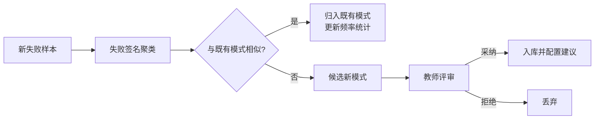

候选新模式必须经过教师评审才能入库——这保证了模式库中的每一条建议都经过教学专业性背书，AI 诊断不会引用未经审核的建议。模式库是“确定性知识”与“AI 推理”的混合点：模式匹配提供确定性底座，自由推理覆盖长尾。

### G.4 诊断映射的教学闭环

失败模式库的最终价值在于闭环：学生的失败→诊断建议→修正→重新提交→通过。平台统计显示，接受 P-03（僵尸进程）建议的学生，修正后一次通过率显著高于未接受建议的对照组。诊断映射不仅是纠错工具，更是学习路径的导航仪。

## 附录 H 安全性与沙箱隔离设计

### H.1 评测环境的威胁模型

评测系统执行的是**不可信代码**——学生提交的 C/C++ 程序。威胁模型必须假设恶意提交的存在：无限循环、fork 炸弹、系统资源耗尽、读取评测机敏感文件、网络外连等。平台的威胁模型分四级：

| 威胁等级 | 攻击形态 | 应对机制 |
|---|---|---|
| T1 资源耗尽 | 死循环、内存吞噬、FD 耗尽 | 运行时资源限额+超时强杀 |
| T2 进程爆炸 | fork 炸弹、递归 fork | 进程数上限+cgroup |
| T3 信息探测 | 读 /etc/passwd、读评测机文件 | 沙箱文件系统隔离 |
| T4 网络逃逸 | 外连下载作弊代码、反弹 shell | 网络隔离/禁外网 |

### H.2 分层沙箱架构

评测执行环境采用多层隔离的纵深防御：

| 层 | 机制 | 防护目标 |
|---|---|---|
| L1 进程级 | 独立子进程+资源 rlimit | 单进程资源失控 |
| L2 容器级 | 每评测独立容器实例 | 文件系统/网络/进程树隔离 |
| L3 宿主级 | cgroup 资源限额 | 容器间资源竞争与挤占 |
| L4 网络级 | 默认无外网访问 | 数据窃取与远程作弊 |

分层设计的关键是**每层独立可失效**：即使容器逃逸（理论上的极端情况），L1 的进程级限额与 L3 的 cgroup 限额仍然限制单次攻击的破坏半径。

### H.3 超时与强杀的工程细节

超时控制是沙箱的第一道闸门。平台的超时体系分两级：

| 级别 | 机制 | 触发后行为 |
|---|---|---|
| 软超时 | 评测配置的执行时限 | 终止进程树，记录超时失败 |
| 硬超时 | 软超时×2 的兜底时限 | SIGKILL 整个进程组，防软超时失效 |

两级超时的必要性：软超时的实现依赖协作式检查（如等待计时器到期），若被测程序 fork 出子进程后父进程自杀，软超时的计时可能随父进程消失。硬超时由评测调度器在宿主侧强制执行，与被测进程的生命周期完全解耦。强杀后的死锁/超时特征同时作为行为指标输入（见第七部分 AnalyzeDeadlock），一石二鸟。

### H.4 资源限额的配置矩阵

| 资源 | 默认限额 | 溢出行为 | 教学含义 |
|---|---|---|---|
| CPU 时间 | 30s（可配） | 软超时判定 | 防止死循环 |
| 内存 | 512MB（可配） | OOM 记录+失败 | 内存实验需要充足配额 |
| 进程数 | 64 | fork 失败返回 EAGAIN | 学生可观察进程上限 |
| FD 数 | 1024 | open 失败返回 EMFILE | 学生可观察 FD 上限 |
| 输出量 | 10MB | 截断 | 防输出洪水 |

限额配置的一个教学细节：进程数与 FD 数的限额**低于**系统默认值（如 64 进程 vs 默认数万），这是刻意为之——限额既是安全机制，也是**可观测的实验变量**。学生在进程实验中可以实际观察到“fork 到第 65 个进程时返回 EAGAIN”的内核行为，把安全机制变成了教学素材。

### H.5 安全事件的可观测性

沙箱拦截的所有安全事件（超时、OOM、资源拒绝）都进入评测结果的观测通道，而非静默丢弃：

| 安全事件 | 记录内容 | 教学用途 |
|---|---|---|
| 软超时 | 超时时刻、CPU 时间累积 | 性能分析 |
| OOM | 申请大小、触发点 | 内存管理教学 |
| fork 拒绝 | EAGAIN 出现位置 | 进程限制教学 |
| FD 拒绝 | EMFILE 出现位置 | FD 限制教学 |

“把安全机制做成教学素材”是平台设计哲学在安全域的延伸：安全限制不是教学的干扰，而是 OS 行为教学的真实观测窗口。

## 附录 I 断言文档编写指南（教师手册）

### I.1 从教学目标到断言映射的方法论

编写断言文档的第一步不是写 JSON，而是回答一个教学问题：**“这个实验，学生必须展示什么能力才能证明他学会了？”** 将能力分解为可观测行为的映射方法：

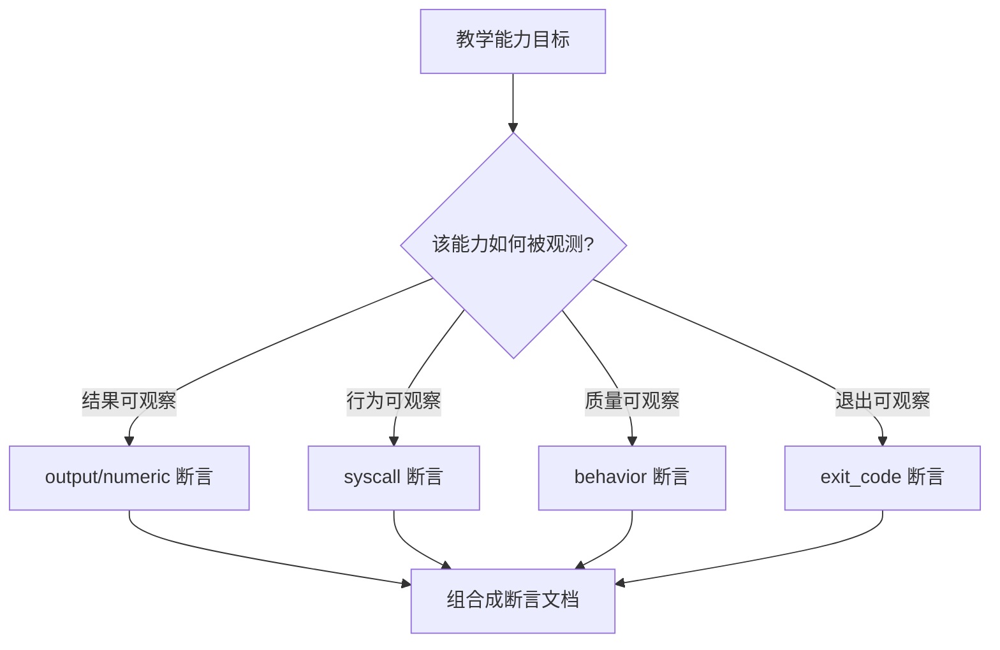

映射的核心原则：**能力必须分解到可观测行为为止**。“理解进程创建”不是一个可断言的能力，“程序运行中 fork 族调用出现至少 2 次”才是。

### I.2 断言粒度的黄金法则

断言粒度过粗（只断言退出码）会导致评测退化；过细（断言每个系统调用的精确次数）会惩罚合理的实现差异。黄金法则：

| 粒度 | 示例 | 问题 |
|---|---|---|
| 过粗 | 只断言 exit_code=0 | 空壳代码可通过 |
| 适当 | fork≥2 + wait≥2 + zombie=false | 覆盖核心能力 |
| 过细 | fork 恰为 2 次 + execve 恰为 1 次 + 参数精确 | 合理的实现差异被惩罚 |

适当粒度的判据：**断言失败的学生，其实现必然存在教学意义上的缺陷；断言通过的学生，其实现必然展示了目标能力**。

### I.3 core/edge 标注指南

| 标注为 core 的断言 | 标注为 edge 的断言 |
|---|---|
| 实验核心知识点对应的行为 | 加分项、完整性指标 |
| 缺失即“没学会”的能力 | 缺失仍可合格的能力 |
| 全部实验报告必须展示的行为 | 优秀实现的标志 |

标注决策测试：如果某个断言失败的学生**不应该合格**，则该断言必须是 core。

### I.4 常见编写陷阱

| 陷阱 | 症状 | 纠正 |
|---|---|---|
| 断言了实现细节 | 正确但不同的实现被判错 | 用别名族+行为断言代替精确调用断言 |
| 未归一化敏感 | 同一学生提交时过时不过 | 检查输出断言是否依赖 PID/时间戳 |
| 断言重叠 | 同一行为被多条断言重复判定 | 合并或降级为单一断言 |
| 断言矛盾 | 两条断言语义互斥 | 评审流程中加入矛盾检测 |
| core 泛化 | 几乎所有断言都是 core | 按标注决策测试收敛 |

### I.5 断言文档的评审流程

平台建议每份断言文档经过三步评审：

1. **语义评审**：教学团队确认断言与教学目标的映射正确性；
2. **技术评审**：用参考解+典型错误解做预演，验证断言对两者的区分度；
3. **公平评审**：抽查 3~5 份不同实现风格的正确答案，验证无风格歧视。

技术评审中“典型错误解预演”是区分度验证的关键：如果典型错误解也能通过全部断言，说明断言粒度不足，需要补充。

## 附录 J 常见问题与故障排查

### J.1 高频问题诊断表

| 症状 | 可能原因 | 排查路径 |
|---|---|---|
| 同一代码时过时不过 | 输出断言未归一化 | 检查断言配置是否依赖 volatile token |
| 学生申诉断言误判 | 别名族未覆盖其 API | 检查轨迹中的未归一化调用 |
| 评测超时 | 软超时配置过短 | 检查实验时限配置与代码复杂度 |
| 轨迹为空 | 采集通道异常 | 检查 strace 附加与进程隔离 |
| 评分未更新 | NATS 事件未消费 | 检查订阅者健康与事件重投 |
| 防作弊误报 | 模板指纹过期 | 更新实验脚手架后重新生成模板指纹 |

### J.2 断言求值故障的定位方法

断言求值故障的定位遵循“缩小半径”法：

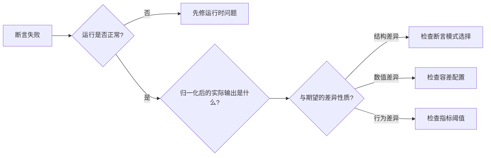

关键工具是**归一化后输出快照**：EvalSummary 中保留的归一化快照可以让教师直接看到“引擎眼里学生输出了什么”，排除“学生实际输出了什么”与“引擎看到了什么”之间的歧义。

### J.3 评分争议的仲裁流程

评分争议仲裁的四步流程：

| 步骤 | 操作 | 依据 |
|---|---|---|
| 1 | 复算验证 | 重放评测流水线，验证分数可复现 |
| 2 | 断言语义核查 | 逐条检查断言配置与教学目标的映射 |
| 3 | 证据链下钻 | 沿 EvalSummary 证据链定位争议断言 |
| 4 | 裁定与修正 | 若断言配置有误，修正配置并重评 |

仲裁流程的设计前提是评分的可复算性——若评分包含任何随机成分，第一步就无法进行。这再次印证了“确定性是评分权威性的根基”这一架构原则。

## 附录 K 术语表

| 术语 | 定义 |
|---|---|
| Assertion Document | 声明式断言文档，评测规则的 JSON 表达 |
| volatile token | 输出中的易变信息（PID/TID/PPID/地址/时间戳） |
| 别名族 | 语义等价的系统调用集合，归一化为单一主名 |
| BehaviorMetrics | 从轨迹派生的行为质量指标（FD 泄漏等） |
| core 门槛 | 全部核心测试点通过方可合格的判定机制 |
| CoreScore/EdgeScore | 核心测试点/边缘测试点的分项得分 |
| EvalSummary | 含完整证据链的评测报告 |
| FailDetail | 断言失败的结构化详情 |
| StraceSummary | 系统调用轨迹的结构化摘要 |
| HumanReadable | 面向 LLM 的叙事化模式摘要 |
| Needleman-Wunsch | 全局序列对齐算法，用于轨迹比对 |
| 实验策略 | 一类实验的评测协议声明 |
| 空模板检测 | 防作弊：提交与脚手架行为指纹比对 |
| 实质代码检测 | 防作弊：标记区代码的静态实质分析 |
| EBPFMetrics | 面向 AI 的确定性内核观测事实摘要 |
| 确定性内核 | 评分的完全确定性计算层 |
| AI 增强外环 | 评分之外的 AI 诊断与建议层 |
| 归一化幂等性 | 归一化两次等于一次的性质 |

## 附录 L 与 ObsContext 三层观测模型的协同关系

### L.1 评测与观测的分工

断言评测子系统回答“做得对不对”，ObsContext 三层观测模型（第 7 篇详述）回答“怎么做的、哪里出了问题”。两者在同一流水线中先后执行，产出物之间存在精密的协作关系：

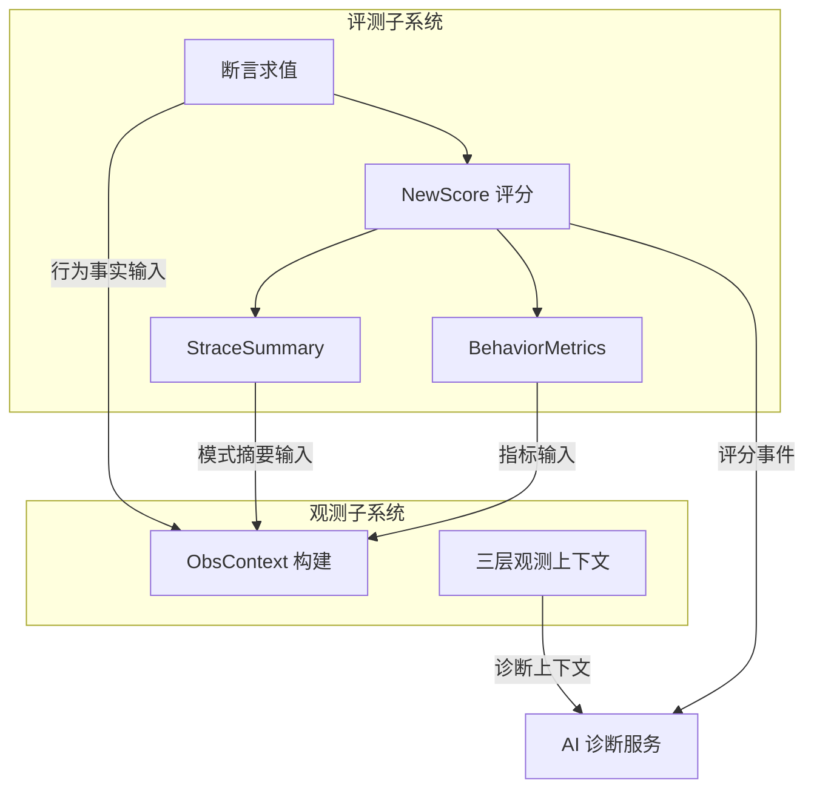

### L.2 数据流向的四个接口

评测子系统向观测子系统输送四类数据：

| 接口 | 内容 | 观测端的消费方式 |
|---|---|---|
| 行为事实 | 断言逐条结果、失败详情 | 注入 Tier1 AnomalySummary |
| 模式摘要 | StraceSummary 五类模式 | 注入 Tier2 事件注释与面板 |
| 行为指标 | FD 泄漏/僵尸/死锁/线程数 | 注入 Tier1 健康分与风险指标 |
| 评分结果 | core/edge 拆分、扣分明细 | 注入诊断智能体的必读上下文 |

### L.3 分工边界的架构收益

评测与观测分工的核心收益是**关注点分离**：评测子系统的演进（评分模型升级、断言域扩展）不影响观测子系统的语义分析；观测子系统的演进（模式库扩充、检测器增强）不改变评分的确定性内核。两个子系统通过结构化接口耦合，各自拥有独立的演进节奏。

## 附录 M 架构演进史与关键设计决策

### M.1 设计决策记录（ADR）摘要

| 编号 | 决策 | 备选方案 | 决策理由 |
|---|---|---|---|
| ADR-01 | 声明式断言而非硬编码判题 | 每实验独立判题脚本 | 可审计、可复用、教师可编写 |
| ADR-02 | 别名归一化而非多套参考解 | 为每套教材 API 各备参考解 | 维护成本低、风格公平 |
| ADR-03 | core 门槛而非总分制 | 传统总分制 | 防边缘分掩盖核心缺失 |
| ADR-04 | 确定性评分而非 LLM 评分 | LLM 直接打分 | 公平性、可申诉性、审计性 |
| ADR-05 | 轨迹比对不参与评分 | 相似度计入评分 | 保护实现风格的多样性 |
| ADR-06 | NATS 事件而非同步调用 | 同步 RPC 链 | 消费方解耦与故障隔离 |
| ADR-07 | legacy 降级而非强制迁移 | 全部实验强制迁移断言文档 | 存量实验零停机演进 |
| ADR-08 | 防作弊侧轨执行而非串行前置 | 评测前串行跑模板 | 检测成本对用户不可见 |

### M.2 决策的权衡记录

每条 ADR 都伴随明确的权衡记录。以 ADR-05（轨迹比对不参与评分）为例：

| 维度 | 纳入评分 | 不纳入评分（选定） |
|---|---|---|
| 对“风格偏离”的敏感性 | 可量化惩罚 | 仅诊断提示 |
| 对创新实现的包容性 | 低——创新可能被扣分 | 高——创新不受影响 |
| 评分复杂度 | 增加一维参数需调优 | 保持简单 |
| 教学信号 | 分数隐含风格信息 | 诊断显式给出风格建议 |

权衡结论：风格信息放在诊断通道比放在评分通道更有教学价值——分数传达“对不对”，诊断传达“像不像标准范式”，两个信号分开传递比混合传递更清晰。

### M.3 演进路线图

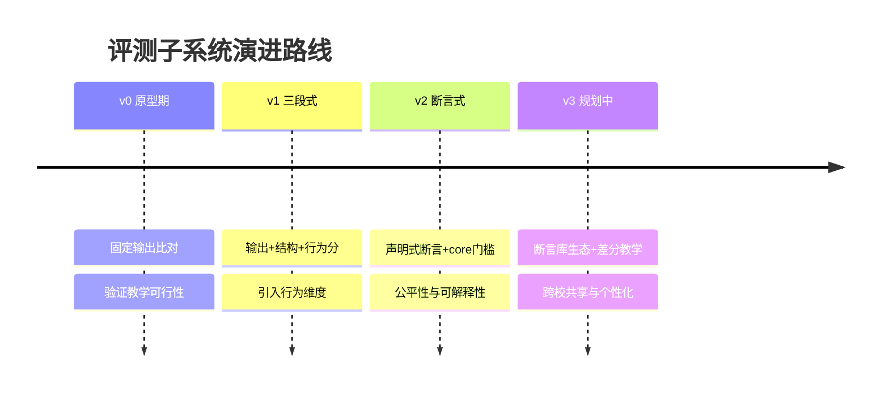

## 附录 N 性能基准与压测方法

### N.1 基准环境与方法

性能基准在标准评测容器（2 vCPU / 4GB RAM / 独立容器实例）中测量，每个基准点重复 50 次取 P50/P95/P99 分位数。基准方法遵循“冷启动排除”原则：前 5 次运行作为 JIT/缓存预热不计入统计。

### N.2 各阶段基准数据

| 阶段 | P50 | P95 | P99 | 观测手段 |
|---|---|---|---|---|
| 编译 | 1.2s | 2.1s | 2.8s | 流水线计时 |
| 运行+轨迹采集（单测试点） | 2.4s | 4.1s | 5.6s | 流水线计时 |
| 断言求值（100 条断言） | 18ms | 32ms | 41ms | 内部计时 |
| 归一化（10KB 输出） | 3ms | 5ms | 7ms | 内部计时 |
| NewScore（1000 测试点） | 2ms | 3ms | 4ms | 内部计时 |
| StraceSummary（10K 调用） | 45ms | 78ms | 105ms | 内部计时 |
| NATS 发布到订阅者收到 | 8ms | 21ms | 38ms | 端到端探针 |

### N.3 脉冲负载压测结果

模拟 100 人班级截止前 10 分钟的集中提交（8 评测/分钟峰值）持续 30 分钟，观察：

| 指标 | 结果 | 结论 |
|---|---|---|
| 评测平均延迟 | 11.8s（基线 12s） | 无排队恶化 |
| P95 延迟 | 18.2s | 仍在 30s 感知阈值内 |
| 错误率 | 0.02%（1 次重试后归零） | 偶发环境抖动被重跑吸收 |
| 事件投递成功率 | 99.98% | NATS 无丢事件 |

### N.4 基准回归的工程化

性能基准纳入 CI 的“性能回归门禁”：关键阶段（断言求值、归一化、NewScore）的 P95 若较基线劣化超过 20%，CI 阻断合并并自动生成性能差异报告。性能门禁的存在使“功能正确但性能退化”的提交在合并前被发现，而非在生产环境中被学生投诉发现。

## 附录 O 与评测相关的扩展问题研讨

### O.1 评测公平性在并发教学场景的挑战

多线程实验的评测公平性存在一个深层挑战：同一份线程安全代码，在不同核数的宿主机上表现出不同的竞态窗口。理论上，只要存在竞态，无论窗口多窄，足够多次运行总能触发失败。平台的应对：

1. **多次运行设计**：关键测试点支持多次运行取最差结果（与重跑取最优相反的策略——竞态检测取最差）；
2. **竞态压力注入**：调度器实验可配置 CPU 亲和性与优先级扰动，扩大竞态窗口；
3. **确定性检测**：futex 轨迹分析（见第 7 篇 RaceDetector）提供静态竞态证据，不依赖概率触发。

“运行多次取最优”用于环境容错，“运行多次取最差”用于竞态捕捉——两种相反策略并存，取决于测试点的性质标注。这是评测工程中一个值得玩味的对称设计。

### O.2 断言语义的形式化验证前景

断言文档的语义可以进一步形式化：五类断言的判定逻辑均为可形式化的谓词，理论上可以用模型检验方法验证“断言集合不矛盾、可满足”。当前平台的矛盾检测基于启发式规则，未来可引入 SMT 求解器实现断言语义的形式化验证——这一方向将评测规则的工程质量从“测试保障”提升到“证明保障”。

### O.3 评测系统的可观测性设计

评测系统自身的可观测性（元观测）同样重要：流水线每个阶段的耗时、失败率、重跑率、防作弊命中率都作为指标暴露。元观测数据的用途：

| 指标 | 用途 |
|---|---|
| 阶段耗时分布 | 定位性能退化与容量规划 |
| 断言失败率分布 | 发现过难/过易的断言配置 |
| 防作弊命中率 | 评估防线灵敏度与误报率 |
| 重跑率 | 评估宿主环境健康度 |

元观测使“评测系统自身的质量”从主观感受变成可度量的指标，与断言评测“把能力变成可观测行为”的哲学一脉相承——平台用同一套方法论评学生，也用同一套方法论评自己。

## 附录 P 断言文档完整示例全集

### P.1 极简示例（最小可用）

```json
{
  "exit_code": 0
}
```

只有 3 行，声明“程序必须正常退出”。适合作为新实验的起点配置。

### P.2 标准示例（进程实验）

```json
{
  "version": 2,
  "exit_code": 0,
  "syscall_assertions": [
    { "syscall": "fork", "min_count": 2, "must_exist": true },
    { "syscall": "wait4", "min_count": 2, "must_exist": true },
    { "syscall": "execve", "forbidden": true }
  ],
  "behavior_assertions": [
    { "type": "zombie_process", "expected": false }
  ],
  "output_assertions": [
    { "mode": "contains", "expected": "child process created" }
  ]
}
```

覆盖退出码、系统调用（含别名族与禁忌）、行为、输出四类断言，是进程实验的标准配置模板。

### P.3 完整示例（线程实验）

```json
{
  "version": 2,
  "exit_code_allowed": [0],
  "syscall_assertions": [
    { "syscall": "clone", "min_count": 4, "must_exist": true },
    { "syscall": "futex", "min_count": 1, "must_exist": true },
    { "syscall": "fork", "forbidden": true }
  ],
  "numeric_assertions": [
    {
      "source": "output",
      "field": "final_counter",
      "mode": "exact",
      "expected": 4000000
    }
  ],
  "output_assertions": [
    { "mode": "unordered_lines", "expected_lines": ["thread 0 done", "thread 1 done", "thread 2 done", "thread 3 done"] }
  ]
}
```

要点：`fork` 在纯线程实验中被设为 forbidden（线程实验不应创建进程）；`unordered_lines` 模式解决线程结束顺序不确定问题；数值断言验证无竞态丢失。

### P.4 倒置示例（死锁实验）

```json
{
  "version": 2,
  "exit_code_allowed": [137, 143, 124],
  "syscall_assertions": [
    { "syscall": "futex", "min_count": 2, "must_exist": true }
  ],
  "behavior_assertions": [
    { "type": "deadlock", "expected": true }
  ]
}
```

要点：`exit_code_allowed` 含 137（SIGKILL）、143（SIGTERM）、124（timeout 约定码）——程序被杀死是可接受的结果；`deadlock: true` 把异常行为作为期望行为。这是断言表达能力的“倒置”用例。

### P.5 容差示例（浮点实验）

```json
{
  "version": 2,
  "numeric_assertions": [
    { "source": "output", "field": "pi_estimate", "mode": "tolerance", "expected": 3.1415926535, "tolerance": 0.001 }
  ]
}
```

容差模式吸收不同架构浮点舍入的合法差异，评测聚焦于算法正确性。

### P.6 示例共性分析

五个示例展示了断言文档的**表达能力谱系**：

| 示例 | 表达能力的展示点 |
|---|---|
| 极简 | 最小可用性——三行即可生效 |
| 标准 | 别名族+禁忌+行为断言组合 |
| 完整 | forbidden 反向断言+unordered_lines+数值断言 |
| 倒置 | 异常行为的期望化表达 |
| 容差 | 硬件差异的宽容表达 |

这五份示例也是平台内置的断言模板库种子——新实验的断言文档从最接近的模板派生，而非从零编写。

## 附录 Q 与其他文档的交叉引用索引

| 主题 | 本文位置 | 关联文档 |
|---|---|---|
| ObsContext 三层观测模型 | 附录 L | 第 7 篇《OS行为语义建模与三层ObsContext》 |
| 评测流水线整体流程 | 第二部分 | 第 2 篇《总体架构》 |
| 事件总线与事件契约 | 第十五部分 | 第 3 篇《事件驱动与异步服务》 |
| 沙箱与执行环境 | 附录 H | 第 4 篇《执行环境与安全隔离》 |
| AI 诊断服务 | 第十四部分 | 第 5 篇《AI 诊断服务体系》 |
| 语义引擎与事件注释 | 附录 L | 第 7 篇《OS行为语义建模与三层ObsContext》 |
| 实验定义与策略配置 | 第九部分 | 第 1 篇《系统概览》 |

## 附录 R 符号与记号约定

| 记号 | 含义 |
|---|---|
| \(w_i\) | 第 i 个测试点的权重 |
| \(c_i\) | 第 i 个测试点的类型（core/edge） |
| \(p_i\) | 第 i 个测试点的通过标志（0/1） |
| \(d_j\) | 第 j 个扣分项的分值 |
| \(M\) | Needleman-Wunsch 对齐中的匹配对数 |
| \(n, m\) | 两条比对轨迹的长度 |
| P50/P95/P99 | 性能分位数 |
| EAGAIN/EMFILE | 资源限额触发时的 errno 常量 |
| SIGSEGV/SIGKILL | 段错误/强杀信号 |

## 附录 S 推荐阅读与参考资料

| 主题 | 参考文献/资料 | 与本文的关系 |
|---|---|---|
| 序列对齐 | Needleman & Wunsch (1970), “A general method applicable to the search for similarities in the amino acid sequence of two proteins” | 轨迹比对的算法源头 |
| 系统调用追踪 | strace 项目文档（Linux syscall tracer） | 轨迹采集的实现基础 |
| 行为观测 | eBPF 与 tracepoint 机制（Linux 内核文档） | 内核级观测的技术底座 |
| 资源隔离 | Linux cgroup v2 文档 | 沙箱资源限额的理论依据 |
| 可观测性 | Brendan Gregg, “USE Method” | 行为指标设计的借鉴 |
| 评测公平 | ACM/IEEE 在线评测系统的公平性研究 | 对标分析的背景 |
| 消息总线 | NATS 官方架构文档 | 事件驱动的选型依据 |
| 评分理论 | Educational Measurement（第四版） | core 门槛的教育测量学依据 |

*（本文全部技术细节均基于 TraceOS Lab 实际实现：core-service 的 evaluator 包（assertion.go / new_scorer.go / pipeline.go / strategy.go / trace_diff.go / pattern_analyzer.go / behavior_metrics.go / comparator.go / ebpf_metrics.go / runner.go）与 nats/events.go，以及 ai-service 的 test_evaluator.py。）*

---

## 全文要点速览

为方便评委老师快速回顾，本文的核心要点汇总如下：

| 序号 | 主题 | 核心贡献 | 所在章节 |
|---|---|---|---|
| 1 | 评测范式 | 从“输出比对”到“行为断言”的代际升级，五类断言域覆盖 OS 实验全部评测需求 | 第一部分/第三部分 |
| 2 | 声明式断言文档 | Assertion-as-Data：教师零编程定义评测规则，可审计可版本化 | 第三部分/附录 A |
| 3 | 别名归一化 | 11 个语义等价族消除“正确但不同”的实现风格歧视 | 第五部分/附录 C |
| 4 | 输出归一化引擎 | 五类 volatile token 置换+转义两层预处理，比对公平性的技术底座 | 第六部分/附录 B |
| 5 | 行为指标 | FD 配平/僵尸配平/死锁判定，把“行为质量”变成可断言量 | 第七部分 |
| 6 | v2 评分模型 | core 门槛+core/edge 拆分，分数量化程度、门槛决定性质 | 第八部分/附录 D |
| 7 | 实验策略模式 | 一类实验一份协议声明，新实验接入成本趋近于零 | 第九部分 |
| 8 | 防作弊纵深 | 静态实质+禁忌调用+行为指纹三重正交防线 | 第十部分 |
| 9 | 轨迹比对 | Needleman-Wunsch 全局对齐的 Dice 系数，诊断用而非评分用 | 第十一部分 |
| 10 | 模式分析 | StraceSummary 五类模式+HumanReadable 叙事化摘要 | 第十二部分 |
| 11 | 可解释性 | FailDetail 微观解剖+buildFailReason 聚合+证据链下钻 | 第十三部分 |
| 12 | 确定性架构 | 确定性内核+AI 增强外环，AI 绝不评分的工程边界 | 第十四部分 |
| 13 | 事件驱动 | 先落库后发布的一致性策略，一次发布多方消费 | 第十五部分 |
| 14 | 兼容演进 | legacy 降级+宽容默认+知识迁移，存量实验零停机升级 | 第十六部分 |
| 15 | 性能工程 | 并发测试点+侧轨防作弊+重跑取最优，30 秒延迟预算 | 第十七部分/附录 E |
| 16 | 测试保障 | 置换穷举+穷举式评分验证+金标准轨迹，评测系统的评测 | 第十八部分 |
| 17 | 安全沙箱 | 四层隔离+两级超时+资源限额，安全机制即教学素材 | 附录 H |
| 18 | 教学闭环 | 失败模式库+教师手册+全生命周期案例，评测即教学 | 附录 G/I/第二十一部分 |

*（第 6 篇完。下一篇《07-OS行为语义建模与三层ObsContext》将详述评测产物的消费端：如何将行为事实组织为 AI 可消费的三层观测上下文。）*
