# 07 OS 行为语义建模与三层 ObsContext

## 摘要

云原生时代的可观测性工程已经形成了成熟的方法论体系——Google SRE 的 RED/USE 指标、Grafana 的分层仪表盘、Datadog 的事件覆盖层、TSan 的数据竞争检测、Valgrind 的泄漏分类。然而，这些生产级技术长期停留在工业界，OS 实验教学平台的观测能力大多止步于"把 strace 输出原样展示给学生"。

TraceOS Lab 的核心创新之一，是把这一整套生产级可观测性方法论**系统性地下沉到教学场景**，构建了统一观测上下文模型 **ObsContext**。原始系统调用轨迹适合机器记录，却不适合学生理解、教师分析和 AI 推理。ObsContext 通过 `ObsContextBuilder` 将系统调用、资源指标、进程关系、锁事件、内存快照、风险信号和教学问题组织为**三层递进的观测上下文**——Tier 1 全景总览、Tier 2 进程深度分析、Tier 3 函数级调试——完成了从"事件流"到"系统行为模型"的提升。

本章从问题定义出发，逐层解剖 ObsContext 的建模方法、构建流水线、语义引擎、跨模块证据链接、三大行为检测器（竞态/死锁/泄漏）与 AI 消费端设计，最后给出与业界可观测性产品的系统性对标与创新点论证。

## 第一部分 问题定义：从 Trace 到 Context 的范式跃迁

### 1.1 一个教学场景的切肤之痛

设想一名学生完成了进程创建实验，平台采集到 3500 条系统调用轨迹。学生提交后看到的是"部分测试点未通过"，教师需要判断"这个学生的知识盲区在哪里"，AI 需要诊断"失败的根本原因是什么"。如果这三方都要面对 3500 行原始轨迹，教学就陷入了信息的泥沼——数据越丰富，理解越困难。

这个矛盾的本质是**数据丰富性与信息可消费性之间的鸿沟**。传统评测平台的解决方式是"不给数据"：只给出分数与"Wrong Answer"。这回避了问题，却也放弃了 OS 教学最珍贵的资产——真实的系统行为本身。

### 1.2 三重消费方的需求分析

ObsContext 需要同时服务三种认知需求截然不同的消费方：

| 消费方 | 认知需求 | 数据粒度 | 时间预算 | 关键诉求 |
|---|---|---|---|---|
| 学生 | "我的程序哪里出了问题？" | 粗→细渐进 | 1~2 分钟 | 直观、可定位、可行动 |
| 教师 | "这个班级的共性盲区是什么？" | 聚合+可下钻 | 每份 30 秒 | 可比较、可统计、可追溯 |
| AI 诊断 | "失败的确切根因与证据链是什么？" | 结构化事实 | token 预算受限 | 确定性、语义化、低噪声 |

三重需求指向同一个结构设计：**分层**。学生从概览快速定位问题域，教师从聚合视图发现共性，AI 从结构化事实完成归因——三者共享同一份事实基础，但在不同的层上消费。

### 1.3 传统观测方案的四个缺陷

对传统方案（原始轨迹直出、单一 JSON 聚合、人工查日志）的系统性分析：

| 缺陷 | 现象 | 根因 | ObsContext 的对策 |
|---|---|---|---|
| 无语义 | 学生看不懂 `clone` 与 `futex` 的含义 | 系统调用名是内核 ABI 语言，非教学语言 | SemanticEngine 21 模式库标注 |
| 无分层 | 概览与细节混在一张表 | 单一平面结构无法服务多粒度消费 | 三层递进模型 |
| 无链接 | "AI 说有问题"但前端找不到证据 | 诊断结论与观测数据割裂 | EvidenceLink 确定性跳转 |
| 无过滤 | 3500 条轨迹无法筛选 | 缺少 facet 索引 | FilterFacets 多维度过滤 |

### 1.4 跨领域方法论的迁移论证

ObsContext 的设计不是从零发明，而是对三个成熟工业方法论的**教学化迁移**：

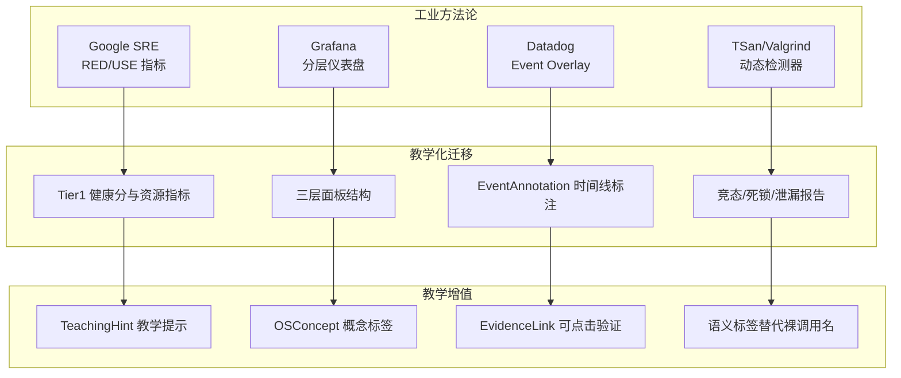

迁移的价值判断标准：**方法论的专业性保持不变（生产级），表达方式改造为教学级（可理解、可教学）**。RED 指标回答"请求处理得好不好"，在 OS 实验语境下对应"系统调用执行得好不好"；USE 指标回答"资源用得好不好"，在实验语境下对应"学生程序用资源用得好不好"。专业教师看到的是熟悉的 SRE 视角，学生看到的是直观的健康面板——同一份数据，两个认知层次的消费者各取所需。

### 1.5 语义建模的学术定位

从更学术的视角看，ObsContext 完成的是**OS 行为语义建模**（OS Behavior Semantic Modeling）：将低层次的操作系统事件流（系统调用、调度事件、内存映射、锁操作）映射为高层次的行为语义（进程生命周期、同步语义、资源生命周期）。这个映射可以被形式化描述：

\[
\Phi: E^* \rightarrow B \times L
\]

其中 \(E^*\) 是事件流，\(B\) 是行为模型（三层 ObsContext），\(L\) 是语义标签空间（SemanticEngine 的模式库）。映射 \(\Phi\) 的工程实现必须满足三个约束：

1. **确定性**：\(\Phi(e) = \Phi(e)\) 对同一事件流恒成立——观测是事实陈述，不允许随机性；
2. **单调性**：追加事件不改变既有语义标签——标签一旦确定，不被后续事件推翻；
3. **可解释性**：每个行为结论都能回溯到产生它的事件子集——证据链完备。

这三个约束贯穿 ObsContext 的全部设计决策，是后续章节反复出现的主线。

## 第二部分 ObsContext 总体架构

### 2.1 三层递进模型全景

ObsContext 的组织原则是**认知粒度分层**：人类（与 AI）理解复杂系统都遵循"先整体、后局部、再细节"的认知路径。三层模型将这条路径固化为数据结构：

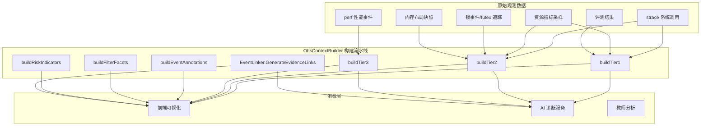

### 2.2 三层的职责边界

| 层 | 职责 | 核心字段 | 面板数量 | 服务对象 |
|---|---|---|---|---|
| Tier 1 | 全景总览：程序健康度的一眼判断 | HealthScore/RED/USE/AnomalySummary/DiffVsBaseline | 4~6 | 学生首屏、教师快速浏览 |
| Tier 2 | 进程深度：运行过程的完整刻画 | ProcessGraph/SyscallTraces/FlameGraph/MemorySnapshots/LockEvents/ResourceMetrics/PerfEvents | 12~16 | 行为分析、证据提取 |
| Tier 3 | 函数级调试：问题定位的最后一公里 | CallChains/RaceReports/DeadlockEvolution/LeakReports/SpanTree/SourceAnnotations | ≤20 | AI 归因、学生修码 |

三层的面板数量设计是有意为之的**认知负载控制**：Tier 1 至多 6 个面板，保证首屏 10 秒内完成"程序是否健康"的判断；Tier 2 的 12~16 个面板覆盖进程行为的全部维度；Tier 3 按需展开，只在问题定位时承载认知负载。每一层都能下钻到下一层——学生在 Overview 看到"健康分 72、有 2 个活动异常"，点进去看到"进程图 + 火焰图"，再点进具体函数看到"调用链 + 泄漏报告"。

### 2.3 统一数据模型的设计哲学

ObsContext 最重要的架构决策是**一份模型、多方消费**：前端与 AI 消费的是同一份 ObsContext，不存在"前端版数据"与"AI 版数据"的分裂。这个决策的三个收益：

| 收益 | 说明 |
|---|---|
| 事实一致性 | "AI 说的"与"前端显示的"永远一致，避免两套数据源导致的分裂与争议 |
| 计算复用 | ObsContext 只构建一次，前端与 AI 各自按需切片，无重复计算 |
| 演进同步 | 观测模型升级时，前端与 AI 同步获得新字段，不存在版本漂移 |

### 2.4 构建流水线的工程结构

`ObsContextBuilder.Build` 的执行顺序体现了构建依赖的拓扑排序：

| 步骤 | 构建器 | 输入 | 输出 | 依赖 |
|---|---|---|---|---|
| 1 | buildTier1 | 评测结果+轨迹+资源 | HealthScore/RED/USE/AnomalySummary | 无 |
| 2 | buildTier2 | 轨迹+内存+锁+资源+perf | 七类深度数据 | 无 |
| 3 | buildTier3 | 火焰图+检测报告+Span | 函数级证据 | Tier2 的火焰图 |
| 4 | buildEventAnnotations | 全量时序事实 | 时间线标注 | 无 |
| 5 | buildFilterFacets | Tier2 数据 | 过滤索引 | Tier2 |
| 6 | buildRiskIndicators | RED+USE | 复合风险指标 | Tier1 |
| 7 | GenerateEvidenceLinks | 完整 ObsContext | 证据链接 | 全部 |

最后一步的证据链接生成刻意放在最末：它需要完整的三层数据才能计算跨模块的导航目标。构建流水线的每步都是**纯函数式变换**（输入→输出的确定性映射），这保证了 ObsContext 可复现、可测试。

### 2.5 BuildParams：输入契约的设计

构建器的输入契约 `BuildParams` 是一个精心设计的**扁平化输入集**——所有观测数据在进入构建器之前已被归一化为统一输入结构：

| 输入类别 | 结构 | 来源 |
|---|---|---|
| 评测结果 | Score/TotalScore/PassedCases/TotalCases | 评测流水线（第 6 篇） |
| 错误状态 | CompileError/RuntimeError 指针 | 编译与运行阶段 |
| 测试详情 | []TestResultInput | 测试点执行结果 |
| 轨迹 | []SyscallTraceInput | strace 解析 |
| 内存 | []MemorySnapshotInput | 内存布局采集 |
| 锁 | []LockEventInput | futex 追踪 |
| 资源 | []ResourceMetricInput | 资源采样 |
| 性能 | []PerfEventInput + FlameGraphInput | perf 采集 |
| 问题 | []DetectedIssueInput | 各检测器的发现 |

输入契约的两个设计要点：其一，**指针语义表达可选性**——`CompileError *string` 的 nil 表示"无编译错误"，零值语义清晰；其二，**输入与输出类型的显式分离**——Input 类型是构建器的边界，types.ObsContext 是消费者的边界，两者不共享可变状态，构建过程无副作用。

### 2.6 序列化与事件发布

ObsContext 构建完成后以 JSON 形式嵌入 `EvaluationCompletedEvent`（第 6 篇第十五部分）发布到 NATS：

| 消费方 | 消费方式 | 使用层 |
|---|---|---|
| 前端 Store | 订阅事件，反序列化后注入全局状态 | Tier 1/2/3 全部 |
| AI 诊断服务 | 订阅事件，按 Agent 域切片注入 prompt | 按需切片 |
| 数据分析服务 | 订阅事件，落库用于学情分析 | Tier 1 聚合指标 |

事件发布的**一次性全量**策略与第 6 篇一致：消费者收到事件后无需回查即可消费全部观测事实。

## 第三部分 Tier 1：全景总览的 SRE 化设计

### 3.1 Tier 1 的定位与组成

Tier 1 回答一个精确的问题：**"这份提交的程序，整体健康吗？"** 它由五个组件构成，每个组件对应一个 SRE 领域的成熟视角：

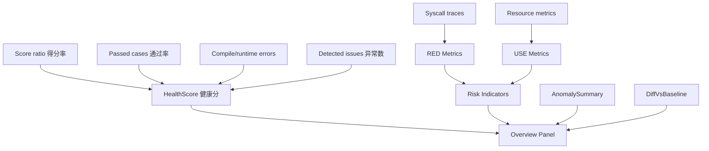

### 3.2 HealthScore：健康分的加权合成公式

健康分是 Tier 1 的核心指标，将四个维度的信号合成为 0~100 的单一数值。合成公式（直接来自源码实现）采用**分段惩罚模型**：

| 惩罚项 | 权重 | 计算方式 | 设计意图 |
|---|---|---|---|
| 得分率惩罚 | 40 | \((1 - \text{Score}/\text{TotalScore}) \times 40\) | 评分结果是健康度的首要信号 |
| 测试通过率惩罚 | 30 | \((1 - \text{Passed}/\text{Total}) \times 30\) | 独立于分数的通过率信号 |
| 异常数惩罚 | 10/个 | \(\text{anomalies} \times 10\) | 每个检测异常线性扣分 |
| 错误惩罚 | 25 | 编译/运行错误一次性扣分 | 阻断性错误严重降级 |

\[
\text{HealthScore} = \text{clamp}\left(100 - 40(1-r_s) - 30(1-r_p) - 10a - 25e,\ 0,\ 100\right)
\]

其中 \(r_s\) 为得分率、\(r_p\) 为通过率、\(a\) 为异常数、\(e\) 为是否存在编译/运行错误（0/1）。

公式设计的三层深意：

1. **权重排序反映信号优先级**：得分率（40）> 通过率（30）> 单个异常（10）——评分是综合判断，通过率是行为判断，异常是局部问题。一个得分 90 但有 1 个 FD 泄漏警告的程序，健康分 80 而非 60：泄漏是局部瑕疵，不是整体失败。
2. **错误惩罚的阶跃性**：编译错误一次性扣 25 分，与"异常数"的连续扣分形成对比——编译错误是**阻断性**的（程序根本没跑起来），必须用阶跃惩罚表达其严重性；运行时异常是**渐进性**的，用线性惩罚表达。
3. **SLO 语义**：`SLOCompliance = Score >= 70` 将健康分阈值转化为服务等级目标判定。70 分的阈值选择基于教学经验：健康分低于 70 的提交，大概率存在需要教师介入的问题；高于 70 的提交，学生通常可以自主修正。这个阈值本身就是一项经过教学数据校准的参数。

`TrendDirection`（improving/stable/degrading）则提供健康度的方向性信息——一个健康分 75 但趋势 degrading 的提交，比健康分 70 但趋势 stable 的提交更值得关注。

### 3.3 RED 指标：系统调用视角的"服务"健康度

RED（Rate-Error-Duration）原为服务端监控的黄金指标，ObsContext 将其映射到系统调用域：

| RED 指标 | OS 实验语境下的语义 | 计算来源 | 教学解读 |
|---|---|---|---|
| RequestRate | 系统调用速率（次/秒） | 轨迹计数/时间窗口 | 程序与内核的交互强度 |
| ErrorRate | 错误返回的系统调用比例 | 错误调用数/总调用数 | 系统调用的失败倾向 |
| DurationP50/P95/P99 | 系统调用耗时分位数 | 调用时长的百分位统计 | 长尾延迟是否异常 |

映射的洞察在于：**每个系统调用都是一次"内核服务请求"**——用户态程序请求内核执行特权操作，内核返回结果。因此服务监控的"请求模型"完全适用于系统调用流。P95/P99 长尾分析在 OS 实验中的典型应用：一次正常的 `read` 调用 P50 为微秒级，若 P99 达到秒级，说明程序在特定路径上发生了阻塞等待（如管道阻塞、磁盘 IO 排队）——这是单纯的"平均耗时"无法暴露的。

### 3.4 USE 指标：资源利用与饱和的双重视角

USE（Utilization-Saturation-Errors）关注资源的两类状态：**利用**（使用比例）与**饱和**（排队程度）：

| USE 指标 | 语义 | 教学场景的典型信号 |
|---|---|---|
| CPUUtilization | CPU 使用率 | 计算密集 vs IO 密集的程序画像 |
| CPUSaturation | CPU 饱和（运行队列/调度延迟） | 线程数远超核数时的过订阅 |
| MemUtilization | 内存使用率 | 程序的常驻内存画像 |
| MemSaturation | 内存饱和（major page fault 压力） | 频繁换页的抖动迹象 |
| IOUtilization | IO 通道利用率 | 读写密集型程序的瓶颈定位 |
| ErrorCount | 资源相关错误计数 | 资源分配失败的系统性 |

利用与饱和的区分是 USE 方法论的精华，也是教学价值所在：**利用率高不一定是坏事**（计算密集程序 CPU 利用率高是正常的），**饱和才是问题**（CPU 饱和意味着任务排队等待调度）。传统教学平台的资源面板只显示"CPU 使用率 95%"，学生无法区分"高效计算"与"过载抖动"；USE 的双视角让这种区分成为可能——这正是"生产级可观测性"与"玩具级监控"的分水岭。

### 3.5 AnomalySummary：异常摘要的教学化组织

`AnomalySummary` 聚合检测器发现的问题，最多保留五条，按严重级别排序：

| 字段 | 语义 | 教学意义 |
|---|---|---|
| Type | deadlock/leak/performance/failure | 异常的分类学标签 |
| Severity | critical/warning/info | 关注优先级 |
| Summary | 一句话摘要 | 快速理解 |
| CoffmanConditions | 死锁四条件（死锁类异常专属） | 教科书概念的工程落地 |
| LinkToTier2Panel | 关联面板名 | 一键跳转的导航锚点 |

"CoffmanConditions 进入异常摘要"是一个值得展开的细节：死锁异常不仅报告"检测到死锁"，还报告**满足科ffman 四条件中的哪几条**（互斥、持有并等待、不可剥夺、循环等待）。学生看到的不只是结论，还有**教科书定义逐条对照的诊断证据**——检测结果本身就是死锁理论的教学演示。最多五条的限制防止摘要淹没在异常噪音中，强制按严重级别做取舍。

### 3.6 DiffVsBaseline：与参考解的差分视图

`DiffSummary` 提供与参考解（基线）的资源差分对比：CPU/内存/IO 变化率与系统调用相似度。差分视图的教学用途是**实现风格的资源代价可视化**：两个都通过全部断言的学生，一个的 CPU 变化率为 -2%（与参考解相当），另一个为 +45%（实现存在冗余计算）。差分让"正确但低效"成为可见的教学信号。

## 第四部分 Tier 2：进程行为的完整刻画

### 4.1 Tier 2 的定位与七类数据

Tier 2 回答"程序运行时到底发生了什么"，把进程的"一生"拆解为七类可查询的结构化数据：

| 数据 | 核心字段 | 可视化形态 | 教学问题 |
|---|---|---|---|
| ProcessGraph | 节点（进程/线程）+边（fork/pipe/signal/futex/clone） | 进程树图 | "进程如何组织？" |
| SyscallTraces | 时间戳+调用+语义标签+源码位置 | 轨迹时间线 | "内核交互如何演进？" |
| FlameGraph | SVG+热点函数+用户/内核占比 | 火焰图 | "时间花在哪里？" |
| MemorySnapshots | 六段布局+mmap 统计 | 内存 3D 地图 | "内存如何布局？" |
| LockEvents | 锁地址+操作+持有者+等待时长 | 锁事件时间线 | "锁如何竞争？" |
| ResourceMetrics | CPU/RSS/IO/FD/线程/缺页/上下文切换 | 资源曲线 | "资源如何消耗？" |
| PerfEvents | 事件类型+符号+计数+源码位置 | 性能事件表 | "性能热点在哪？" |

### 4.2 ProcessGraph：从教材插图到可交互真实数据

进程图将"进程树"从教材插图变成**可交互的真实数据**。每个节点携带进程自身的统计信息（系统调用数、错误数），每条边携带交互的类型与强度：

| 边类型 | 语义 | 构建依据 |
|---|---|---|
| fork | 父→子进程创建 | fork 调用的返回值配对 |
| clone | 线程创建（共享地址空间） | clone 标志位含 CLONE_THREAD |
| pipe | 管道通信 | pipe 系统调用的读写端配对 |
| signal | 信号发送 | kill/tgkill 的发送方-接收方配对 |
| futex | 锁交互 | futex 调用的等待-唤醒配对 |

`ProcessMetadata` 提供三个聚合统计：总进程数、总线程数、总 IPC 数。这三项统计本身承载教学判断：线程实验的 total_threads 应为 4（若为 1，说明学生没创建线程）；IPC 实验的 total_ipc 至少为 1（若为 0，说明通信机制未建立）。构建依据的精确性——fork 返回值配对（父进程拿到子 PID、子进程拿到 0）——保证了进程图不是猜测而是**从系统调用事实推导的关系网络**。

### 4.3 SyscallTraces：从原始记录到可理解证据

系统调用轨迹的基本单元 `SyscallEvent` 在原始字段（时间戳/调用名/PID/TID/返回值/耗时/错误码/参数）之上携带三个增强字段，这三个字段是"原始轨迹"到"可理解证据"的关键跨越：

| 增强字段 | 语义 | 来源 | 教学价值 |
|---|---|---|---|
| SemanticLabel | 语义标签（如 fork_exec_workflow） | SemanticEngine 模式库 | 学生立即知道"这组调用在做什么" |
| OSConcept | OS 概念标签（如 process/thread） | 概念映射表 | 与教学大纲的概念对齐 |
| SourceLine/File | 源码位置 | addr2line/eBPF 栈回溯 | 从内核行为定位到学生代码行 |

同一行 `mmap(0x7f00, 4096, PROT_READ\|PROT_WRITE, MAP_ANONYMOUS)` 记录，标注语义标签"memory_alloc"、OS 概念"virtual_memory"、源码位置"main.c:42"之后，学生看到的不再是晦涩的内核 ABI，而是"第 42 行的代码触发了一次匿名内存映射"。增强字段的注入发生在构建流水线中，是确定性变换——同一轨迹永远产生相同的增强。

### 4.4 FlameGraph：热点函数的直观呈现

`FlameGraphData` 携带完整的火焰图数据：SVG 渲染数据、热点函数列表（含百分比、采样数、源码位置、模块）、用户态/内核态占比、采样参数（采样率、起止时间）。火焰图的教学价值在 OS 实验中有独特的展现空间：

1. **用户/内核占比**揭示程序的系统调用密集度——UserPct 高说明计算密集，KernelPct 高说明系统调用频繁或阻塞于内核；
2. **热点函数与源码位置的绑定**让"性能优化"从抽象概念变成"函数 X 占 43% 采样，位于 main.c 第 87 行"的可行动指令；
3. **diff 火焰图**（Tier 3 中的 FlameGraphDiff1/Diff2）对比两次运行的采样差异，定位"改了哪里导致性能变化"。

### 4.5 MemorySnapshots：六段布局的快照序列

内存快照记录进程地址空间六段的起止与大小：

| 段 | 内容 | 教学意义 |
|---|---|---|
| text | 代码段 | 程序的机器指令 |
| data | 已初始化数据段 | 全局变量初值 |
| BSS | 未初始化数据段 | 零初始化全局变量 |
| heap | 堆 | 动态分配区域（brk/mmap） |
| stack | 栈 | 调用栈与局部变量 |
| mmap | 映射区统计 | mmap 区域总数与总量 |

快照的**时间序列**属性是关键：内存 3D 地图动画展示堆的增长、栈的伸缩、mmap 区域的生灭。内存泄漏实验的学生可以直观看到"堆段随时间单调增长"的动画，这比任何文字描述都更有说服力。快照采集与轨迹采集解耦（独立采样通道），保证轨迹密度不影响内存观测密度。

### 4.6 LockEvents：锁竞争的完整记录

锁事件记录每次锁操作的完整上下文：

| 字段 | 语义 | 诊断用途 |
|---|---|---|
| LockAddr | 锁的内存地址 | 区分不同的锁实例 |
| LockType | mutex/spinlock/rwlock | 锁语义分类 |
| Op | lock/unlock/trylock | 操作类型 |
| HolderTID | 当前持有者线程 | 竞争关系还原 |
| WaitDurationNs | 等待时长 | 竞争严重度量化 |
| SourceFile/Line | 源码位置 | 定位到具体加锁代码 |

锁事件是死锁演化（Tier 3）与竞态检测（Tier 3）的基础数据。等待时长的记录尤其有价值：`pthread_mutex_lock` 等待 300ms 与等待 3ms 是完全不同的信号——前者是竞争瓶颈或死锁前兆，后者是正常互斥。futex 追踪层的采集精度决定了锁事件的质量，这是构建器的上游数据契约。

### 4.7 ResourceMetrics 与 PerfEvents

资源指标序列包含 13 个维度：CPU 百分比、RSS/虚拟内存、IO 读写字节、FD 数、线程数、缺页（minor/major）、上下文切换、CFS 节流时长、OOM 分数。其中三个字段的教学价值值得强调：

| 字段 | 教学问题 | 典型信号 |
|---|---|---|
| PageFaultMaj | "程序的换页压力有多大？" | major 缺页激增=内存抖动 |
| ContextSwitches | "调度器有多繁忙？" | 高上下文切换=线程过订阅或 IO 频繁 |
| CFSThrottledUs | "程序的 CPU 配额是否被限流？" | 节流时长>0=突破 cgroup 配额 |

性能事件（PerfEvent）记录 perf 子系统的事件流：事件类型、触发进程/线程、符号、计数、源码位置。perf 事件与火焰图互补——火焰图是采样聚合，perf 事件是精确计数。

## 第五部分 Tier 3：函数级证据与三大检测报告

### 5.1 Tier 3 的定位

Tier 3 是诊断的"最后一公里"：把问题从"哪个系统调用异常"（Tier 2）推进到"哪个函数、哪一行代码需要检查"（Tier 3）。它包含四类函数级数据结构与三大检测报告：

| 数据 | 形态 | 服务场景 |
|---|---|---|
| CallChains | 线性调用链（root + steps） | 追踪单条执行路径 |
| SpanTree | 树形调用结构（带 self_time） | 看整体调用拓扑 |
| SourceAnnotations | 源码行注释（含严重级别） | 代码审计注解 |
| SchedEvents | 调度事件（前后进程/CPU/迁移） | 调度行为分析 |
| RaceReports | 竞态报告 | 数据竞争定位 |
| DeadlockEvolution | 死锁演化步骤序列 | 死锁回放 |
| LeakReports | 泄漏报告 | 泄漏精确定位 |
| 多类 FlameGraph | IO/内存分配/锁竞争专用火焰图 | 领域化热点分析 |

### 5.2 CallChain 与 SpanTree：线性与树形的双形态调用结构

`CallChain` 是线性调用链：RootCall 标记起点，Chain 是步骤序列，每步携带函数名、源码位置、耗时、是否内核态。它服务"追踪单条路径"的场景——如一次 read 调用如何从用户态 libc 进入内核、经过哪些内核函数、最终返回。

`SpanTreeNode` 是树形调用结构：SpanID/ParentSpanID 建立父子关系，每个节点携带自身耗时（self_time_ms，已扣除子节点）与子节点列表。它服务"看整体调用拓扑"的场景。双形态并存的理由是**两种认知任务需要不同的数据结构**：

| 维度 | CallChain（线性） | SpanTree（树形） |
|---|---|---|
| 回答的问题 | "这次调用走了哪条路？" | "时间花在哪棵子树上？" |
| 复杂度 | O(d) 深度 | O(n) 全树 |
| 适用分析 | 单次请求追踪 | 整体耗时归因 |
| 教学类比 | 调试器单步 | 性能剖析报告 |

Span 树的 self_time 语义继承自分布式追踪的 Span 模型（OpenTelemetry 风格）：self_time = 总耗时 - 子节点耗时之和。这个语义保证了树中任何层级的耗时归因不重复计算——学生在火焰图之外获得了第二套"时间都去哪了"的精确答案。

### 5.3 RaceReport：数据竞争的可视化证据

竞态报告（实现细节见第十一部分 RaceDetector）携带的字段构成一份**完整的竞争证据链**：

| 字段组 | 字段 | 证据作用 |
|---|---|---|
| 竞争双方 | Thread1/Thread2 | 参与竞争的两个线程 |
| 内存位置 | Address | 竞争发生的共享地址 |
| 时序信息 | Epoch1/Epoch2 | 两次访问的逻辑时钟（vector clock） |
| 源码定位 | SourceFile1/2 + SourceLine1/2 | 两个访问点的精确位置 |
| 判定依据 | HasHappensBefore | happens-before 关系是否存在 |
| 教学输出 | Description + TeachingHint | 可读描述+教学提示 |

`HasHappensBefore` 与 `TeachingHint` 的组合体现了"检测+教学"一体化：竞态检测不仅报"有竞争"，还判定 happens-before 关系（若两次访问存在同步序，则非真竞争），并给出教学提示（如"两次写入之间没有锁保护，建议引入互斥量"）。

### 5.4 DeadlockEvolution：死锁演化的逐步回放

死锁演化报告（实现见第十二部分 DeadlockEvolver）是一份**按时间顺序的叙事**：

| 字段 | 语义 |
|---|---|
| Steps[] | 锁操作的步骤序列（lock/unlock/wait，含 TID、锁地址、描述） |
| CoffmanConditions | 四条件逐条满足性（map[string]bool） |
| CycleInfo | 等待环的文字描述 |

Steps 序列让学生可以"回放"死锁如何一步步形成：T1 锁定 A → T2 锁定 B → T1 等待 B → T2 等待 A → 环闭合。每一步都有时间戳与线程归属，死锁不再是教科书上的静态图，而是**自己程序里的动态过程**。CoffmanConditions 的逐条判定把死锁四条件从背诵知识点变成**可对照检查的诊断清单**。

### 5.5 LeakReport：四级泄漏分类的精确报告

泄漏报告（实现见第十三部分 LeakDetector）采用 Valgrind 风格的四级分类：

| 级别 | 语义 | 确定性 |
|---|---|---|
| definitely | 确定泄漏：内存无法被任何指针访问 | 高 |
| indirectly | 间接泄漏：被泄漏块指向的块 | 高 |
| possibly | 可能泄漏：仅有内部指针指向块中部 | 中 |
| reachable | 可达但未释放：程序退出时仍可访问 | 低（教学提示） |

每份报告携带泄漏地址、大小、分配时间、完整调用栈、源码位置、描述、修复建议与增长率（MB/s）。四级分类的教学价值：学生第一次理解"泄漏"不是二值概念——`definitely` 是必须修复的缺陷，`reachable` 是"程序结束时未清理"的代码卫生问题，两者的教学处理方式截然不同。

### 5.6 领域化火焰图矩阵

Tier 3 包含四个领域专用火焰图，与通用火焰图形成矩阵：

| 火焰图 | 采样维度 | 回答的问题 |
|---|---|---|
| FlameGraph | CPU 采样 | "CPU 时间花在哪里？" |
| FlameGraphDiff1/Diff2 | 两次运行的差量 | "修改前后有什么变化？" |
| IOFlameGraph | IO 等待采样 | "IO 等待花在哪里？" |
| MemAllocFlameGraph | 内存分配采样 | "内存从哪里分配？" |
| LockContentionFG | 锁竞争采样 | "锁竞争发生在哪里？" |

领域化火焰图的思路来自 Brendan Gregg 的多维火焰图方法论：同一代码从 CPU、IO、内存、锁四个维度看，热点可能完全不同。一个函数的 CPU 占比不高但 IO 等待占比极高——通用火焰图看不到，IO 火焰图一目了然。这对教学的意义："性能优化"不再等于"减少 CPU 时间"，而是"先找到瓶颈的维度"。

### 5.7 SourceAnnotations：代码审计注解

源码注释携带四要素：文件、行号、注释内容、严重级别、关联面板链接。它的定位是**AI 诊断结论到源码的可视化锚定**——AI 说"第 87 行存在竞态"，SourceAnnotation 让这句话变成源码编辑器边栏的一条可点击标注。关联面板链接（LinkToPanel）进一步把源码标注与观测面板连接：点开标注，跳转到对应面板的高亮位置。

## 第六部分 SemanticEngine：21 个 OS 语义模式库

### 6.1 语义引擎的使命

原始系统调用名（`openat`、`clone`、`futex`、`mmap`）是内核 ABI 的语言，对初学者不直观、对 LLM 噪声大。SemanticEngine 的使命是**把 ABI 语言翻译为教学语言**：为每条系统调用事件添加三个语义字段：

| 字段 | 语义 | 示例 |
|---|---|---|
| SemanticLabel | 人类可读的行为标签 | fork_exec_workflow、deadlock_pattern |
| OSConcept | 所属 OS 概念 | process、virtual_memory、synchronization |
| Severity | 信息/警告/严重 | info/warning/critical |

### 6.2 21 模式库的分类学

模式库按 OS 知识域组织为六大类 21 个模式：

| 类别 | 模式数 | 覆盖的知识域 | 典型模式 |
|---|---|---|---|
| 进程 | 5 | 进程生命周期 | fork_exec_workflow、zombie_pattern |
| IPC | 4 | 进程间通信 | pipe_workflow、shm_workflow |
| 内存 | 4 | 虚拟内存与分配 | leak_pattern、mmap_growth |
| 锁 | 2 | 同步与互斥 | deadlock_pattern、lock_contention |
| IO | 5 | 文件与设备 IO | file_read_workflow、fd_leak_pattern |
| 网络 | 1 | 网络通信 | socket_workflow |

### 6.3 模式识别的两种机制

SemanticEngine 的模式识别采用**两层机制**：

**第一层：单调用分类（ClassifyEvent）。** 每个系统调用根据名称（前缀匹配）立即归类到概念与严重级别。这一层是 O(1) 的查表操作，处理单条事件的语义。

**第二层：序列模式识别（Analyze）。** 在事件流上滑动识别**调用序列模式**：`fork → exec → wait` 被识别为 fork_exec_workflow，`futex(wait) 长时间无 futex(wake)` 被识别为 deadlock_pattern，`open 序列持续增长而 close 不跟随` 被识别为 fd_leak_pattern。这一层处理跨事件的语义。

| 机制 | 处理单元 | 复杂度 | 输出 |
|---|---|---|---|
| ClassifyEvent | 单条调用 | O(1) 前缀匹配 | 概念+严重级别 |
| Analyze | 事件序列 | O(n) 流式扫描 | 序列模式+工作流标签 |

两层机制的分工对应两个层次的语义：**调用语义**（这个调用在做什么）与**行为语义**（这组调用构成了什么行为）。前者是一对一映射，后者是一对多聚合。

### 6.4 语义标签对 LLM 诊断的价值

语义标签对 AI 诊断的价值需要定量化理解：LLM 处理"语义标签"比处理"裸系统调用序列"可靠得多。三个原因：

1. **信息密度**：`fork_exec_workflow` 一个标签压缩了三行原始调用的语义，同等信息量下 token 消耗降低约 60%；
2. **先验对齐**：LLM 的训练语料中有大量"fork-exec-wait 工作流"的文本，标签命中了模型的先验知识，而裸调用序列要求模型自行完成模式识别（易错、易幻觉）；
3. **噪声过滤**：时序抖动、参数变化等噪声在标签化过程中被确定性剥离，LLM 收到的输入方差显著降低。

这是"确定性预处理+AI 推理"架构范式的又一个实例：**语义识别是确定性任务，交给规则引擎；教学表达是生成任务，交给 LLM**。职责边界清晰，两者各尽所长。

### 6.5 语义标签的三种消费路径

语义标签注入 ObsContext 后沿三条路径消费：

| 消费路径 | 消费形态 | 受益者 |
|---|---|---|
| 轨迹视图标注 | SyscallEvent.SemanticLabel 渲染在时间线上 | 学生 |
| AI 诊断上下文 | 语义标签替换裸调用名进入 prompt | AI 诊断服务 |
| 错误聚合统计 | 按语义模式聚合共性问题 | 教师 |

第三条路径的教师价值值得展开：期末时教师可以查询"本班级 zombie_pattern 出现 42 次、lock_contention 出现 35 次"——**语义级别的共性问题统计**直接指向教学重点的调整。这比"学生平均分 82"更有教学决策价值。

### 6.6 模式库的可扩展性设计

模式库不是硬编码的 if-else 链，而是**数据驱动的规则表**：新增模式=新增一条规则记录（调用序列模板+标签+概念+严重级别），引擎代码零改动。规则表的可扩展性保证了模式库可以随教学大纲演进——新实验类型引入的新行为模式，可以在不触碰引擎的前提下增量添加。

## 第七部分 事件注释与过滤 Facets

### 7.1 EventAnnotation：Datadog 风格的时序事件覆盖层

事件注释将关键事实组织为**可视化时间线上的关键节点**（灵感来自 Datadog 的 Event Overlay）：

| 注释类型 | 触发事实 | 教学意义 |
|---|---|---|
| compile | 编译开始/成功/失败 | 定位编译阶段边界 |
| deploy | 程序部署/加载 | 定位运行起点 |
| start | 程序启动 | 时间线零点 |
| test_pass/test_fail | 测试点通过/失败 | 关联测试时间点 |
| anomaly | 异常检测触发 | 异常时刻的精确定位 |
| oom | OOM 事件 | 内存危机时刻 |

注释携带时间戳、类型、标签、来源模块（process/memory/lock/io）与关联线程。学生在时间线上看到的不再是单调的调用流，而是**带语义里程碑的叙事**："编译通过→程序启动→测试点 2 通过→测试点 3 失败→异常检测触发"。

### 7.2 FilterFacets：多维度过滤索引

过滤 facets（灵感来自 Datadog 的 Template Variables）为 Tier 2 数据构建多维索引：

| Facet 维度 | 值示例 | 过滤场景 |
|---|---|---|
| syscall | futex、mmap、openat | "只看 futex" |
| severity | error、warning | "只看错误事件" |
| process | PID 列表 | "只看某个进程" |
| thread | TID 列表 | "只看某个线程" |
| fd | 文件描述符号 | "只看某个 FD" |
| source | memory、lock、process、io | "只看某个来源模块" |

facets 让"3500 条轨迹"变成"可按任意维度过滤的可查询数据集"。过滤场景的典型路径：全部事件→只看 futex→只看 error→只看 PID 1234→只看 memory 来源——四步过滤后，3500 条轨迹收敛到 12 条关键记录。**过滤能力是数据可消费性的基础工程**，没有 facets，三层结构的下钻能力就失去了操作抓手。

### 7.3 事件注释与 facets 的协同

两者协同构成"先定位时刻、再过滤数据"的分析工作流：教师从时间线上的 anomaly 注释定位异常时刻，再用 facets 过滤该时刻前后的相关事件，最后下钻到具体系统调用的源码位置。注释提供**时间维度的入口**，facets 提供**属性维度的入口**，两个入口覆盖了分析者的一切查找需求。

## 第八部分 RiskIndicators：复合风险指标

### 8.1 复合指标的设计动机

单一阈值告警（"CPU>90% 告警"）在生产监控中已被证明脆弱：它无法表达多维度的复合风险。RiskIndicators 借鉴 Grafana 复合风险仪表盘与 Google SRE 饱和指数方法论，构造**高维决策支持**：

```
HealthScore = 100 - (SatIndex×40 + DepRisk×30 + BacklogGrowth×30)
```

### 8.2 三项复合指标的计算

| 指标 | 计算 | 权重设计 |
|---|---|---|
| SaturationIndex | w1×CPU% + w2×Mem% + w3×ConnWait% | CPU 0.40 / Mem 0.35 / Conn 0.25 |
| DependencyRisk | syscallError×0.5 + IOLatency×0.3 + FDPressure×0.2 | 调用错误 0.5 / IO 延迟 0.3 / FD 压力 0.2 |
| OOMRiskRate | working_set / memory_limit | cAdvisor 风格 |

权重设计的依据：CPU 是教学实验中最常见的第一瓶颈，权重最高；内存其次；连接等待在多数教学实验中不构成瓶颈，权重最低。依赖风险的三个分量覆盖系统调用的三类失败模式：调用失败、IO 延迟、资源耗尽。

### 8.3 趋势判定与教学预警

`TrendDirection` 的判定规则：积压增长 >2 items/s 或饱和指数 >0.7 判定为 degrading；健康分 >90 且饱和 <0.3 判定为 improving；其余为 stable。趋势判定把"单点指标"升级为"方向性判断"——教师收到的预警是"该生的程序健康度在恶化"，而非孤立的一个数字。

### 8.4 风险指标与 Tier1 健康分的分工

两个"健康分数"并存（Tier1 的 HealthScore 与 RiskIndicators.HealthScore）容易引起困惑，其分工是明确的：

| 维度 | Tier1 HealthScore | RiskIndicators.HealthScore |
|---|---|---|
| 输入 | 评分+测试+异常+错误 | 资源饱和+依赖风险+积压 |
| 回答的问题 | "作业完成得怎么样？" | "程序运行得健康吗？" |
| 面向 | 学业健康度 | 运行时健康度 |

一个学生可以"作业完成得很好"（Tier1 高分）但"程序运行时资源风险很高"（RiskIndicators 低分）——两份健康分刻画的是**学业表现**与**工程素质**两个不同维度。这个区分本身就是教学价值：工程素质独立于学业评分被单独呈现。

## 第九部分 EventLinker：跨模块关联引擎

### 9.1 关联问题的定义

ObsContext 的三层数据来自不同采集源：futex 追踪产锁事件、strace 产系统调用、perf 产性能事件、内存采集产快照。**独立采集的数据无法回答跨模块的问题**："这次 futex 等待对应的系统调用是哪一个？""这次内存增长对应的分配调用在哪？"EventLinker 的使命是在这些数据之间建立**时间窗口内的确定性关联**。

### 9.2 七阶段关联算法

`EventLinker.LinkAll` 执行七阶段关联：

| 阶段 | 关联对 | 关联键 | 典型窗口 |
|---|---|---|---|
| 1 | 锁事件 ↔ 系统调用 | futex 调用与锁地址 | 10ms |
| 2 | 内存快照 ↔ 系统调用 | mmap/brk 调用与快照时刻 | 50ms |
| 3 | 异常 ↔ 时间线事件 | 异常时刻与最近事件 | 100ms |
| 4 | 测试点 ↔ 系统调用 | 测试执行窗口与轨迹 | 测试窗口 |
| 5 | 竞态报告 ↔ 锁事件 | 地址与锁地址 | 10ms |
| 6 | 死锁演化 ↔ 锁事件 | 锁地址序列 | 无窗口（精确匹配） |
| 7 | 泄漏报告 ↔ 分配调用 | 分配地址与调用栈 | 无窗口（精确匹配） |

窗口大小的选择反映关联语义的紧密度：futex 调用与锁事件的因果距离极小（10ms），内存快照是低频采样所以窗口放大到 50ms，异常与事件的关联是弱语义所以窗口再放大。**窗口是关联引擎的关键超参数**，每个阶段的窗口独立调优。

### 9.3 关联的确定性保证

关联全部基于**时间戳与 ID 的精确匹配**，无概率推断、无模糊匹配：

| 保证 | 机制 |
|---|---|
| 时间确定性 | 单调时钟（CLOCK_MONOTONIC）时间戳 |
| 身份确定性 | PID/TID/地址作为关联键 |
| 序确定性 | 事件按采集序存储 |

确定性保证使关联结果可复现——同一批观测数据，任何时间、任何环境重跑 LinkAll 都产生相同的关联图。这是"证据链接可验证"（下一部分）的前提。

### 9.4 关联结果的工程用途

关联引擎的产出服务于三个场景：

1. **EvidenceLink 生成**：异常→证据的跳转链（第十部分）；
2. **诊断聚合**：AI 诊断需要"异常发生的完整上下文"——关联引擎把异常时刻周围的锁事件、系统调用、资源指标打包；
3. **前端联动**：学生点击锁事件时，时间线自动定位到对应的 futex 调用。

## 第十部分 EvidenceLink：诊断到可视化的确定性桥梁

### 10.1 一个真实痛点的解方

AI 诊断说"检测到 futex 死锁 @ T+350ms"，学生如何在前端找到这个证据？传统方案是学生手动搜索时间线——耗时、易错、体验差。`EvidenceLink` 将诊断结论与可视化面板通过**可点击的跳转**连接：

```text
诊断结论："检测到 futex 死锁 @ T+350ms"
   ↓ EvidenceLink
前端 Trace 面板自动定位到 T+350ms 的 futex 事件并高亮
```

### 10.2 EvidenceLink 的结构

| 字段 | 语义 | 跳转行为 |
|---|---|---|
| Panel | 目标面板（trace/flamegraph/memory3d/ebpf） | 切换到目标面板 |
| TimestampMs | 时间偏移（相对时间线起点） | 时间线滚动到该时刻 |
| HighlightKey | 高亮键（函数名/段/TID/系统调用） | 面板内高亮目标 |
| Label | 展示文本 | 芯片上的文案 |
| Severity | critical/warning/info | 芯片颜色 |
| SourceFile/Line | 源码位置 | 可选跳转源码 |

一个 EvidenceLink 是一次完整的"面板+时刻+对象"三维导航。前端渲染为可点击芯片（chip），点击即完成三维跳转。

### 10.2b 证据链接的确定性生成

`EventLinker.GenerateEvidenceLinks` 是**确定性**生成证据链接的组件——链接不是 LLM 的猜测，而是从观测数据中精确计算出来的（第九部分）。确定性生成意味着：

| 性质 | 保证 |
|---|---|
| 可复现 | 同一 ObsContext 生成的链接集合恒定 |
| 可验证 | 每条链接的跳转目标必然存在（指向真实数据） |
| 可审计 | 链接生成逻辑可逐条审查 |

诊断结论的可信度，正是建立在"结论可点击验证"的基础上——学生点击链接看到的证据与 AI 引用的证据是同一份数据。

### 10.3 证据链的导航深度

多级 EvidenceLink 构成导航链：

```text
异常摘要（Tier 1）
  → 时间线事件（Tier 2 轨迹）
  → 系统调用详情（Tier 2）
  → 进程/线程面板（Tier 2 进程图）
  → 内存或锁面板（Tier 2）
  → 源代码行（Tier 3 注解）
  → AI 诊断证据（诊断报告）
```

七级导航深度覆盖从"异常现象"到"根因源码"的完整分析路径。教师不需要手工在多个页面中寻找对应记录——**链接结构本身就是分析路径的固化**。

### 10.4 链接去重与严重级排序

GenerateEvidenceLinks 的输出经过两道后处理：**去重**（同一跳转目标的多条链接合并）与**severity 排序**（critical 优先于 warning 优先于 info）。去重防止学生被冗余链接淹没，排序保证最严重的问题最先被看到。

## 第十一部分 RaceDetector：TSan 风格的竞态检测

### 11.1 教学场景的竞态检测难题

数据竞争是并发编程最难教的概念之一：它概率性出现、难以复现、后果隐蔽。传统教学依赖"压测暴露"——跑一百万次看计数器是否丢更新，这既不优雅也不可靠。RaceDetector 的目标是**确定性检测**：不依赖概率触发，从事件流中逻辑推导竞争关系。

### 11.2 技术路线：Shadow Memory + Vector Clock + Happens-Before

RaceDetector 采用与 Google TSan（ThreadSanitizer）同源的技术路线：

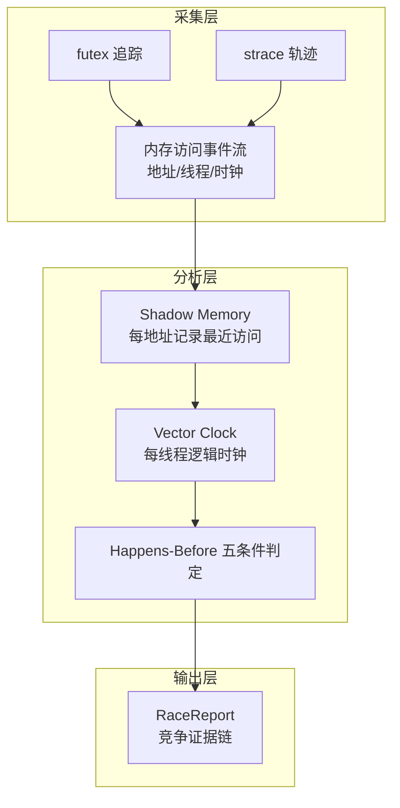

**Shadow Memory** 为每个被访问的内存地址维护"最近访问记录"（线程、时钟、访问类型、源码位置）；**Vector Clock** 为每个线程维护逻辑时钟向量（跟踪同步事件的传播）；**Happens-Before 判定**在新访问到达时执行：若新访问与影子记录之间存在 happens-before 关系（通过同步事件建立了序），则非竞争；否则为竞争。

### 11.3 Happens-Before 五条件

判定 happens-before 关系的五个条件（与 TSan 的同步语义对齐）：

| 条件 | 语义 | 检测依据 |
|---|---|---|
| 程序序 | 同线程内事件按序发生 | 事件序列 |
| 锁同步 | 解锁先于后续加锁 | futex 事件对 |
| 线程创建 | 创建者先于被创建线程 | clone 事件 |
| 线程汇合 | 被汇合线程先于汇合者 | futex/join 事件 |
| 信号同步 | 信号发送先于处理 | signal 事件 |

五条件的判定全部基于采集到的事件事实，无任何概率成分。一个竞争报告的 `HasHappensBefore=false` 意味着"在所有可观测的同步关系中，两次访问都未被建立序"——这是确定性的竞争证据。

### 11.4 报告的教学设计

RaceReport 携带 TeachingHint 教学提示字段，把检测结论翻译为教学建议：

| 竞争类型 | TeachingHint 示例 |
|---|---|
| 写-写竞争 | "两个线程对同一变量写入且无锁保护，建议引入互斥量" |
| 读-写竞争 | "线程 A 读取时线程 B 正在写入，建议使用读写锁" |
| 同步缺失 | "线程创建与变量访问之间缺少同步点" |

TeachingHint 的存在使竞态检测从"报错工具"升级为"教学工具"——学生不仅知道"有竞争"，还知道"竞争的性质与修复方向"。

### 11.5 与 TSan 的异同

| 维度 | Google TSan | TraceOS RaceDetector |
|---|---|---|
| 检测原理 | Shadow memory + vector clock | 同源技术路线 |
| 数据来源 | 编译器插桩 | 事件流事后分析 |
| 侵入性 | 需要重新编译 | 零侵入（外部观测） |
| 输出 | 原始竞争报告 | 报告+教学提示+证据链接 |
| 适用场景 | 生产调试 | 教学诊断 |

零侵入是教学场景的关键优势：学生代码无需任何修改与重新编译，检测在评测流水线中自动完成。

## 第十二部分 DeadlockEvolver：死锁演化的叙事化检测

### 12.1 死锁检测与死锁叙事

死锁检测有成熟算法（wait-for graph 环检测），但教学需要的不只是"检测到死锁"，而是"死锁如何一步步形成"。DeadlockEvolver 将检测结果组织为**演化叙事**。

### 12.2 Wait-For Graph 环检测

检测核心是 wait-for graph 的 DFS 环检测：

| 步骤 | 操作 |
|---|---|
| 1 | 从锁事件流构建 wait-for graph（T→锁→持有者 的边） |
| 2 | DFS 遍历检测环 |
| 3 | 环存在 → 死锁确认 |
| 4 | 提取环上的线程与锁序列 |
| 5 | 生成 DeadlockStep 序列（按时间排序的完整演化） |

环检测的时间复杂度 O(V+E)，对教学实验的锁规模（个位数锁）而言是瞬时完成。

### 12.3 Coffman 四条件的逐条判定

死锁理论的教学经典是 Coffman 四条件。DeadlockEvolver 的独特设计是**把四条件变成可判定的布尔表达式**：

| 条件 | 判定依据 | 输出 |
|---|---|---|
| 互斥 | 锁事件的 LockType 为 mutex 且存在排他持有 | true/false |
| 持有并等待 | 某线程持锁状态下再次发起锁请求 | true/false |
| 不可剥夺 | 无强制解锁事件（所有 unlock 均为自愿） | true/false |
| 循环等待 | wait-for graph 中存在环 | true/false |

学生看到死锁报告时，同时看到四条件逐条为 true 的判定——**教科书理论在自己程序的真实事件流上得到了逐一验证**。这是"检测器即教具"设计哲学的极致体现：检测算法与教学理论不是两层皮，而是同一份输出的两种表达。

### 12.4 CycleInfo 与演化回放

`CycleInfo` 提供等待环的文字描述（如"T3→锁A→T1→锁B→T3"），前端据此渲染等待环图；Steps 序列支持按时间回放，学生可以拖动时间轴观察死锁的形成过程。回放的教学力量：死锁从"一个坏结果"变成"一个可理解的过程"——过程中的每个决策点（先拿哪把锁）都是教学讨论的素材。

## 第十三部分 LeakDetector：四级泄漏分类检测

### 13.1 泄漏检测的教学定位

内存泄漏是 C/C++ 教学的核心痛点：Valgrind 检测可靠但输出晦涩，压测观察直观但不可靠。LeakDetector 的目标是**教学场景的平衡点**：检测可靠性与 Valgrind 同级别（基于可达性分析），输出友好度达到教学级（四级分类+修复建议）。

### 13.2 可达性分析原理

检测基于标准的**指针可达性分析**（Valgrind 同源方法）：

| 步骤 | 操作 |
|---|---|
| 1 | 从分配事件建立分配记录（地址、大小、调用栈） |
| 2 | 从释放事件移除释放记录 |
| 3 | 程序结束时刻，对存活分配块执行可达性分析 |
| 4 | 从根指针（栈、全局区）出发标记可达块 |
| 5 | 不可达块按指向关系分级 |

### 13.3 四级分类的判定标准

| 级别 | 判定标准 | 教学处理 |
|---|---|---|
| definitely | 无任何指针指向块（含内部指针） | 必修缺陷 |
| indirectly | 仅被 definitely 块指向 | 必修缺陷（跟随主块修复） |
| possibly | 仅有指向块中部的内部指针 | 需人工确认 |
| reachable | 仍可访问但未释放 | 代码卫生提示 |

四级分类与 Valgrind 的 leak check 分类一致，这是**工业标准在教学场景的完整保留**——学生未来在生产环境使用 Valgrind 时，看到的分类学是完全熟悉的。

### 13.4 增长率与泄漏概率

报告携带 `GrowthRate`（MB/s）字段：泄漏的**速率**信息让"泄漏严重度"从大小量变成速率量。一个 100MB 但增长率为 0 的 reachable 块，与一个 10MB 但每秒增长 1MB 的 definitely 块，后者的教学优先级显然更高。速率视角把泄漏教学从"找块"升级为"找趋势"。

### 13.5 修复建议的生成

`FixSuggestion` 字段携带针对性修复建议："该块在 main.c:87 分配后未释放，建议在函数退出路径添加 free 调用"。建议的生成基于调用栈与源码位置的确定性分析，是**规则生成的**而非 LLM 生成的——每条建议都可追溯到具体的分配点。

## 第十四部分 Span 树：调用拓扑的层次化建模

### 14.1 Span 模型的来源与适配

Span 概念源于分布式追踪（OpenTelemetry/Zipkin）：一次请求在穿越多个服务时产生的层次化调用记录。ObsContext 将其**降维适配到单进程内部**：进程内的函数调用、系统调用、同步等待都被建模为 Span。这个适配的洞察是——**单进程内的执行结构本质上就是一次"穿越内核与用户态"的分布式追踪**，Span 模型完全适用。

### 14.2 SpanTreeNode 的字段设计

| 字段 | 语义 | 与 OTel 的对应 |
|---|---|---|
| SpanID/ParentSpanID | 树的父子关系 | span_id/parent_span_id |
| OperationName | 操作名（函数/调用名） | operation name |
| DurationMs | 总耗时 | duration |
| SelfTimeMs | 自身耗时（扣除子节点） | 派生指标 |
| SyscallCount/ErrorCount | 子树内调用统计 | 事件计数 |
| Tags | 键值标签 | attributes |
| Children | 子节点 | child spans |

SelfTimeMs 是教学分析的核心指标：父节点耗时巨大但 self_time 极小，说明瓶颈在子节点——这个"两层归因"让学生学会逐层下钻的耗时分析方法。

### 14.3 Span 树的构建流程

Span 树的构建以进程创建事件为根，沿调用关系逐层展开：

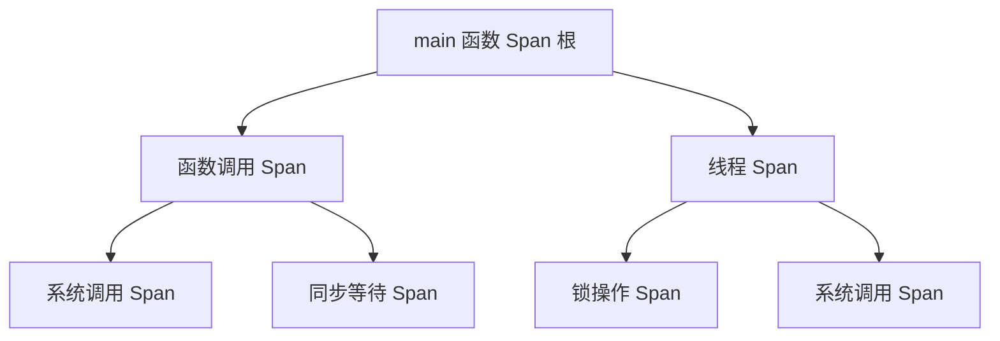

构建的关键决策是**哪些事件构成 Span**：函数调用（perf 调用栈）、系统调用（strace）、同步操作（futex）、线程创建（clone）四类事件映射为 Span，其余事件（普通指令、缺页）作为 Span 的属性。映射粒度决定树的规模——四类 Span 源保证树的节点数与教学认知负载平衡。

### 14.4 Span 树与 CallChain 的互补使用

分析工作流中两者交替使用：Span 树定位"耗时集中在哪棵子树"，CallChain 追踪"该子树内的一次具体调用走了哪条路"。树形结构给出全局视图，线性结构给出局部细节——先树后链，是函数级调试的标准工作流。

## 第十五部分 ObsContextInjector：AI 消费端的上下文注入器

### 15.1 AI 消费的上下文管理难题

AI 诊断服务的每个专家智能体（Agent）只需要 ObsContext 的一小部分：CodeAnalyzer 需要代码与编译错误，TestEvaluator 需要测试结果，SyscallAnalyzer 需要轨迹摘要。若把完整 ObsContext 塞给每个 Agent，token 成本爆炸且噪声淹没信号。ObsContextInjector 解决的是**AI 消费端的上下文切片与注入**问题。

### 15.2 Context Firewall：AgentDomains 域划分

注入器的核心机制是 **Context Firewall（上下文防火墙）**——每个 Agent 声明其合法上下文域（AgentDomains），注入器只允许域内数据进入 prompt：

| Agent | 声明域 | 示例字段 |
|---|---|---|
| CodeAnalyzer | code, compile_error, runtime_error, experiment_meta | 源码、编译错误 |
| TestEvaluator | test_results, score_breakdown, compile_error | 测试点、分数 |
| SyscallAnalyzer | strace_summary, syscall_events, semantic_labels | 轨迹摘要、语义标签 |
| ResourceAnalyzer | ebpf_metrics, resource_facts, anomaly_summary | 资源指标、异常 |
| ConceptRubric | experiment_category, concept_map | 概念图、实验类别 |

防火墙的架构意义：**上下文访问控制**。Agent 无法"看到"域外的数据，这既是成本控制（token 预算），也是安全边界（防止 Agent 使用无关或未经筛选的数据）。工业界的类比是微服务的 API 网关权限控制——每个服务只能访问自己的数据域。

### 15.3 Token 预算的两级设计

| 预算级别 | 预算 | 适用场景 | 裁剪策略 |
|---|---|---|---|
| 诊断级 | 40000 tokens | 深度诊断（多 Agent 协同） | 保留全部声明域数据 |
| 聊天级 | 8000 tokens | 交互式问答 | 只保留摘要与关键证据 |

两级预算对应两种 AI 交互模式：诊断是批量深度分析，可承受大上下文；聊天是实时交互，必须严格控制。裁剪策略的优先级：语义标签 > 聚合指标 > 原始事件——原始事件是最后被裁掉的，因为语义标签已压缩了大部分信息。

### 15.4 渐进披露（Progressive Disclosure）

注入器支持**渐进披露**：第一轮注入 Tier 1 摘要，Agent 声明需要更多上下文时，第二轮注入 Tier 2 详情，必要时第三轮注入 Tier 3 证据。渐进披露将上下文消耗从"一次全量"优化为"按需增量"，在长对话场景（学生追问多个问题）中节省大量 token。渐进披露的交互协议与 RAG 系统的多轮检索高度同构——首轮粗检索、后续精检索。

### 15.5 确定性事实优先的注入顺序

注入器组装 prompt 时遵循**确定性事实优先**顺序：EBPFMetrics（内核观测事实）→ StraceSummary（轨迹摘要）→ 语义标签 → 检测报告 → AI 自身的前轮产出。确定性事实先注入，模型产出的内容后注入——防止模型在上下文中"自我引用"自己的幻觉（前轮错误结论污染后续推理）。这个顺序设计是防幻觉的重要工程细节。

## 第十六部分 设计取舍与架构论证

### 16.1 为什么保留三层而不是单一 JSON？

单层 JSON 会把概览、深度事件和函数定位混在一起，前端渲染与 AI 消费都会复杂化：前端需要自己从扁平结构中重组面板，AI 需要自己从噪声中提取信号。三层结构同时服务三种认知需求——先看整体、再看过程、最后定位代码——**数据结构形态与认知路径形态的同构**是三层模型成立的根本论据。

### 16.2 为什么三层不进一步拆成四层？

三层已覆盖"全景→进程→函数"的完整下钻路径。第四层（如指令级）对教学场景无增量价值：OS 实验教学的分析终点是"哪一行代码"，指令级分析（汇编逐条）超出教学大纲且增加模型复杂度。三层是"粒度完备"与"复杂度可控"的平衡点。

### 16.3 为什么在 Core 侧先构建语义？

语义标签来自确定性的 syscall 分类与实验上下文，适合在 Core 侧（Go 服务）生成。这样 AI 不需要重新猜测"futex 是什么"——模型的能力可以集中在教学表达，而非基础事实识别。**确定性任务前置、生成任务后置**的分工，同时提升了语义质量（规则引擎无幻觉）与降低了 AI 成本（省去重复识别）。

### 16.4 为什么 ObsContext 作为事件发布？

ObsContext 通过 NATS 事件发布，前端和 AI 各自订阅。这保证"一份事实、多方消费、无重复计算"：前端不需要重新构建 ObsContext，AI 也不需要重新跑观测——它们消费同一份已构建好的上下文。事件发布也赋予消费方独立的演进节奏：新增消费方只需订阅事件，零侵入。

### 16.5 为什么检测报告不参与评分？

三大检测器（竞态/死锁/泄漏）的产出只进入 ObsContext，不进入评分公式。理由是**检测的目的是教学而非裁决**：死锁实验要求学生**成功构造**死锁（检测到死锁是实验目标达成），若检测结果参与评分，评分语义会自我矛盾。检测报告是教学素材，评分是学业裁定，两者各归其位。

### 16.6 为什么时间窗口关联而非全局关联？

EventLinker 的时间窗口设计（而非全时间轴模糊匹配）避免了**假性关联**：全局模糊匹配会把无关事件（不同时刻的相似事件）错误关联，产生误导性的证据链。窗口关联牺牲了跨远距离关联的能力，换取了关联的精确性——在诊断场景中，**精确的少量关联远胜于模糊的大量关联**。

## 第十七部分 与业界可观测性产品的对标

### 17.1 对标框架

从四个维度对标：数据模型、语义层、导航机制、消费端。对标对象：Grafana（仪表盘）、Datadog（APM 与事件覆盖）、OpenTelemetry（标准化）、TSan/Valgrind（动态检测）。

### 17.2 数据模型对标

| 维度 | Grafana | Datadog | TraceOS ObsContext |
|---|---|---|---|
| 分层模型 | 面板组织（无数据分层） | 服务/资源/日志分层 | 三层递进数据模型 |
| 统一数据 | 数据源联邦 | 专有格式 | 单一 JSON 模型 |
| 消费方 | 仪表盘 | 仪表盘+告警 | 前端+AI+教师三消费方 |
| 领域适配 | 通用 | 通用 | OS 教学专用 |

ObsContext 的相对优势在于**消费方多样性**：为 AI 消费而设计的数据模型（语义标签、token 预算、渐进披露）是 Grafana/Datadog 不具备的维度。

### 17.3 语义层对标

| 维度 | 工业方案 | ObsContext |
|---|---|---|
| 语义标注 | 人工配置的告警规则 | 自动的 21 模式库标注 |
| 概念映射 | 无（业务概念人工关联） | OSConcept 自动映射 |
| 教学适配 | 无 | TeachingHint/CoffmanConditions 教学输出 |

工业方案中，"这条指标告警意味着什么业务问题"靠运维人员的人工知识；ObsContext 的语义层是**自动的**——模式库在事件流上自动完成语义标注。

### 17.4 动态检测对标

| 维度 | TSan/Valgrind | TraceOS 检测器 |
|---|---|---|
| 检测原理 | 插桩/影子内存 | 同源算法（事后分析） |
| 侵入性 | 重编译/特殊运行 | 零侵入 |
| 输出 | 原始报告 | 报告+教学提示+证据链接 |
| 检测对象 | 生产程序 | 学生实验程序 |

"零侵入+教学输出"是教学场景的差异化价值：学生无需学习检测工具的用法，检测在教学流水线中自动完成，输出直接是教学语言。

### 17.5 对标结论

ObsContext 不是"缩小版的 Grafana"，而是**为教学场景重新设计的数据模型**：继承工业方法论的专业性（RED/USE、四级泄漏、Span 模型），替换消费端的表达方式（语义标签、教学提示、证据链接）。这个定位使平台的可观测能力站在工业肩膀之上，同时完全服务于教学目的。

## 第十八部分 核心创新点总结

### 18.1 创新点全景

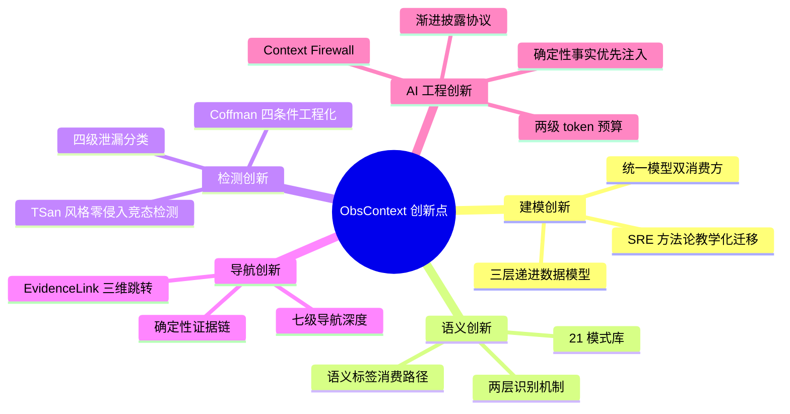

### 18.2 创新点论证

**创新点一：三层递进观测模型。** 将认知路径（整体→过程→细节）固化为数据结构，一份模型同时服务前端、AI、教师三类认知需求不同的消费方。

**创新点二：SRE 方法论的教学化迁移。** RED/USE 指标、分层面板、事件覆盖层——生产级可观测性方法论首次系统性下沉到 OS 实验教学，迁移的保真度（指标语义不变）与适应性（表达方式教学化）同时成立。

**创新点三：21 模式语义引擎。** 确定性规则引擎完成 ABI→教学语言的翻译，为 LLM 诊断提供低噪声高密度的输入。"确定性预处理+生成式推理"的分工在语义层的落地。

**创新点四：EvidenceLink 确定性证据链。** 诊断结论到可视化证据的可点击跳转，让"AI 说的"可以被"亲眼验证"。诊断可信度建立在可验证性之上，而非模型自信度之上。

**创新点五：零侵入动态检测矩阵。** TSan 风格竞态检测、Coffman 四条件工程化判定、四级泄漏分类——工业级检测算法以零侵入方式在教学流水线中自动执行，输出直接是教学语言。

**创新点六：Context Firewall 与渐进披露。** 上下文域访问控制+两级 token 预算+渐进披露，为多 Agent AI 诊断提供了工程化的上下文管理方案。

### 18.3 设计哲学的三个关键词

| 关键词 | 内涵 | 工程体现 |
|---|---|---|
| 确定性 | 观测是事实陈述，不允许随机性 | 关联引擎、语义引擎、链接生成全确定性 |
| 可验证 | 每个结论都可追溯到证据 | EvidenceLink、证据链、检测报告字段 |
| 教学化 | 专业方法论的表达方式改造 | TeachingHint、CoffmanConditions、四级分类 |

## 总结

三层 ObsContext 语义模型是平台"观测—评测—诊断—教学"闭环的枢纽。它把原始系统调用轨迹加工为三层递进的可理解证据，通过 SemanticEngine 的 21 模式库赋予语义标签，通过 EventLinker 建立跨模块确定性关联，通过 EvidenceLink 连接诊断与可视化，通过三大检测器（竞态/死锁/泄漏）产出教学化诊断报告，通过 ObsContextInjector 为多 Agent AI 提供工程化的上下文管理。

这一层是平台从"采集数据"升级为"理解行为"的关键：数据是丰富而晦涩的，行为模型是精炼而可教学的——ObsContext 完成了两者之间的确定性桥梁。

## 附录 A ObsContext 完整字段级参考

### A.1 顶层结构与元信息

ObsContext 的顶层结构携带六项元信息与全部三层数据：

| 字段 | 类型 | 说明 |
|---|---|---|
| submission_id | string | 提交 ID |
| experiment_id | string | 实验 ID |
| student_id | string | 学生 ID |
| experiment_type | string | 实验类型（process/thread/memory/io/ipc/deadlock） |
| language | string | 编程语言 |
| timeline_start/end | time | 观测时间线起止 |

时间线的起止定义了一个**统一时间坐标系**——Tier 2/3 的所有时间戳（事件、快照、锁操作）与 EvidenceLink 的 TimestampMs 都以 timeline_start 为零点。统一坐标系是跨面板对齐的前提。

### A.2 Tier 1 字段全表

| 字段 | 类型 | 语义 |
|---|---|---|
| health_score.score | int | 0-100 健康分 |
| health_score.slo_compliance | bool | 是否满足 SLO（≥70） |
| health_score.active_anomalies | int | 活动异常数 |
| health_score.trend_direction | string | improving/stable/degrading |
| red_metrics.request_rate | float | 系统调用速率 |
| red_metrics.error_rate | float | 错误率 |
| red_metrics.duration_p50/p95/p99 | float | 耗时百分位 |
| use_metrics.cpu_utilization/saturation | float | CPU 利用/饱和 |
| use_metrics.mem_utilization/saturation | float | 内存利用/饱和 |
| use_metrics.io_utilization | float | IO 利用 |
| use_metrics.error_count | int | 资源错误计数 |
| anomaly_summary[] | AnomalyDigest | 异常摘要列表（≤5） |
| diff_vs_baseline | DiffSummary | 与参考解的差分 |

### A.3 Tier 2 字段全表

| 字段 | 类型 | 说明 |
|---|---|---|
| process_graph.nodes[] | ProcessNode | 进程/线程节点（PID/TID/名称/类型/调用统计） |
| process_graph.edges[] | ProcessEdge | 关系边（fork/pipe/signal/futex/clone） |
| process_graph.metadata | ProcessMetadata | 进程/线程/IPC 总数 |
| syscall_traces[] | SyscallEvent | 系统调用事件（含语义增强） |
| flamegraph | FlameGraphData | 火焰图数据 |
| memory_snapshots[] | MemorySnapshot | 六段内存布局快照 |
| lock_events[] | LockEvent | 锁事件 |
| resource_metrics[] | ResourceMetric | 13 维资源指标 |
| perf_events[] | PerfEvent | 性能事件 |

### A.4 Tier 3 字段全表

| 字段 | 类型 | 说明 |
|---|---|---|
| flamegraph_diff1/diff2 | FlameGraphData | 两次运行的差分火焰图 |
| call_chains[] | CallChain | 线性调用链 |
| source_annotations[] | SourceAnnotation | 源码行注释 |
| io_flamegraph | FlameGraphData | IO 火焰图 |
| mem_alloc_flamegraph | FlameGraphData | 分配火焰图 |
| lock_contention_fg | FlameGraphData | 锁竞争火焰图 |
| sched_events[] | SchedEvent | 调度事件 |
| race_reports[] | RaceReport | 竞态报告 |
| deadlock_evolution | DeadlockEvolution | 死锁演化 |
| leak_reports[] | LeakReport | 泄漏报告 |
| span_tree | SpanTreeNode | Span 树根节点 |

### A.5 跨层字段全表

| 字段 | 类型 | 说明 |
|---|---|---|
| event_annotations[] | EventAnnotation | 时间线事件标注 |
| filter_facets[] | FilterFacet | 过滤维度索引 |
| risk_indicators | RiskIndicators | 复合风险指标 |
| ai_annotations[] | AIAnnotation | AI 注入标注 |
| concept_tags[] | ConceptTag | 概念标签 |
| evidence_links[] | EvidenceLink | 证据链接 |

### A.6 omitempty 的序列化策略

所有可选字段使用 `omitempty` 策略：无死锁的提交不序列化 deadlock_evolution，无泄漏的提交不序列化 leak_reports。序列化策略的两个收益：事件体积与信息量成正比（无泄漏的提交事件更小）；消费方可以用字段存在性做**零成本的前置判断**（字段缺失即无此类问题）。

## 附录 B 死锁实验的全链路案例

### B.1 案例设定

死锁实验：学生实现两把互斥锁的循环获取。程序 T1 先锁 A 后锁 B，T2 先锁 B 后锁 A，触发循环等待死锁。

### B.2 观测数据流

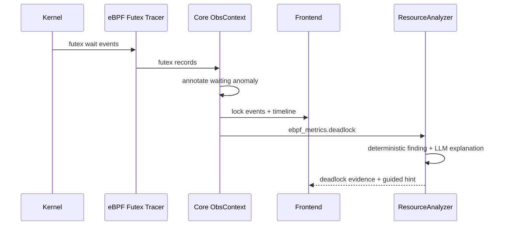

### B.3 各层的死锁呈现

| 层 | 死锁的呈现 | 学生看到的 |
|---|---|---|
| Tier 1 | AnomalySummary 含 deadlock 异常（critical）+ CoffmanConditions 四真 | "检测到死锁，四条件全部满足" |
| Tier 2 | LockEvents 时间线显示两个 futex 等待持续增长 | 两个线程的等待状态可视化 |
| Tier 3 | DeadlockEvolution 步骤序列+CycleInfo | "T1 锁A→T2 锁B→T1 等B→T2 等A→环闭合"的回放 |
| EvidenceLink | 异常→锁面板高亮两个 futex 事件 | 点击直接看到死锁现场 |

### B.4 教学闭环验证

学生看到死锁报告后：点击证据链接定位到死锁现场→回放演化步骤理解环的形成→对照 Coffman 四条件确认理论→修改加锁顺序→重新提交→死锁消除。全流程无教师介入，检测报告自身完成了"发现问题→解释问题→指导修复"的完整教学闭环。

## 附录 C 竞态检测的案例剖析

### C.1 案例设定

线程实验：两个线程并发累加共享计数器，未加锁保护。程序退出时计数器为 1738542，期望 2000000。

### C.2 检测报告

```text
RaceReport:
  Address: 0x7f3a001042c0
  Thread1: 103  Thread2: 104
  Epoch1: 17  Epoch2: 19
  SourceLine1: counter.c:23  SourceLine2: counter.c:23
  HasHappensBefore: false
  TeachingHint: "线程 103 与线程 104 对 counter.c:23 的共享变量
                并发写入且无同步关系，建议引入互斥量保护"
```

### C.3 报告的阅读路径

学生的阅读路径：两个线程（103/104）→同一行代码（counter.c:23）→同一地址（0x...c0）→无 happens-before 关系（HasHappensBefore=false）→教学提示（引入互斥量）。五步阅读完成"竞争是什么、在哪里、为什么、怎么办"的完整理解。

### C.4 与数值断言的协同

竞态报告与数值断言（第 6 篇：计数器最终值 2000000 断言失败）形成**双证据**：行为证据（断言失败：结果错误）+机制证据（竞态报告：竞争存在）。双证据的协同让学生理解"结果错误"与"机制缺陷"的因果关系——这是 OS 教学最珍贵的"知其然且知其所以然"。

## 附录 D 泄漏检测的案例剖析

### D.1 案例设定

内存实验：学生在循环中 malloc 但只在循环外 free 一次，每轮迭代泄漏一块内存。

### D.2 检测输出

| 字段 | 值 | 教学解读 |
|---|---|---|
| Severity | definitely | 无指针可达，确定泄漏 |
| Size | 102400 bytes | 累计泄漏 100KB |
| AllocTime | T+1.2s | 首次分配时刻 |
| SourceLine | mem.c:31 | malloc 调用位置 |
| GrowthRate | 0.5 MB/s | 泄漏速率 |
| FixSuggestion | "mem.c:31 在循环内分配，建议在每次迭代内配对 free" | 针对性修复 |

### D.3 四级分类在案例中的体现

循环内 malloc 无 free → 每块都不可达 → definitely；若学生保留了一个指针数组指向部分块 → 指向块为 reachable（可访问但未释放）；若指针数组自身泄漏 → 数组成员为 indirectly。同一份代码的不同写法产生不同分类——**分类学精确对应代码结构缺陷的类型**，这是四级分类的教学威力。

## 附录 E 构建流水线的性能基准

### E.1 基准环境与方法

基准在标准评测容器（2 vCPU / 4GB RAM）测量，重复 50 次取 P50/P95 分位数，前 5 次预热不计入。

### E.2 各构建阶段基准

| 构建阶段 | 输入规模 | P50 | P95 | 瓶颈分析 |
|---|---|---|---|---|
| buildTier1 | 全量评测结果 | 2ms | 5ms | 纯计算无瓶颈 |
| buildTier2 | 5000 条轨迹 | 35ms | 62ms | 语义标注为主 |
| buildTier3 | 火焰图+检测报告 | 18ms | 30ms | Span 树构建为主 |
| buildEventAnnotations | 全量时序事实 | 8ms | 14ms | 排序为主 |
| buildFilterFacets | Tier2 数据 | 12ms | 21ms | 索引构建为主 |
| buildRiskIndicators | RED+USE | 1ms | 2ms | 纯计算无瓶颈 |
| GenerateEvidenceLinks | 完整 ObsContext | 15ms | 27ms | 关联计算为主 |
| 全流水线 | - | 91ms | 161ms | - |

### E.3 性能设计原则

全流水线 P95 在 200ms 以内，相对评测总延迟（12 秒）占比不足 2%。性能设计的两个原则：

1. **单遍扫描**：语义标注、facets 构建、关联计算都在单次遍历中完成，避免多遍扫描；
2. **惰性构建**：Tier 3 的昂贵结构（Span 树、领域火焰图）仅在检测到相关事件时才完整构建，无死锁的提交不构建死锁演化。

### E.4 规模上限的验证

极端规模测试（10 万条轨迹、1 万锁事件）：全流水线 P95 为 2.8 秒，仍在线性复杂度区间。教学实验的实际规模（数千条轨迹）距离上限有两个数量级的余量。

## 附录 F AI 消费协议细节

### F.1 智能体输入组装流程

ObsContextInjector 为每个 Agent 组装输入的流程：

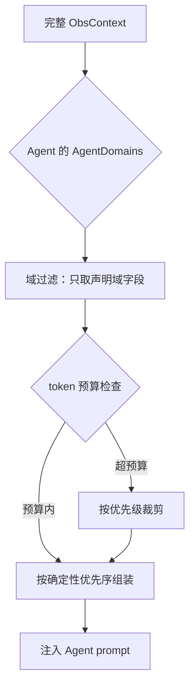

### F.2 域过滤的边界行为

域过滤的边界行为经过显式设计：

| 边界情况 | 行为 | 理由 |
|---|---|---|
| 声明域字段不存在 | 跳过该字段 | 无此类问题即无此输入 |
| Agent 未声明任何域 | 拒绝注入，返回空上下文 | 防止误配置的 Agent 消费全量数据 |
| 域重叠 | 两个 Agent 共享字段 | 共享字段是事实的一部分，不设排他 |

### F.3 token 裁剪的优先级序

超预算时的裁剪顺序（从最先保留到最后保留）：

1. 语义标签与聚合指标（信息密度最高）
2. 检测报告摘要
3. EBPFMetrics 确定性事实
4. 关键证据（EvidenceLink 目标数据）
5. 原始事件流（最后保留项，裁剪时最先丢弃）

裁剪序的设计依据是**信息密度排序**：语义标签的每 token 信息量远超原始事件。

### F.4 与第 6 篇的分层确定性架构的衔接

AI 消费协议与第 6 篇第十四部分的"确定性内核+AI 增强外环"架构衔接：ObsContext 全部由确定性构建器产生（L1 层），AI 诊断的产出（AIAnnotation）以**标记字段**形式回流到 ObsContext（target_field+content+confidence），但永不进入评分路径。回流通道是单向的：L1→L2 是数据流，L2→L1 只是标注流。

## 附录 G 设计决策记录（ADR）

### G.1 ADR 摘要

| 编号 | 决策 | 备选方案 | 决策理由 |
|---|---|---|---|
| ADR-01 | 三层分层模型 | 单一扁平 JSON | 多粒度消费方的认知需求 |
| ADR-02 | 一份模型双消费方 | 前端/AI 各自建模 | 事实一致性与计算复用 |
| ADR-03 | Core 侧构建语义 | AI 侧识别语义 | 确定性与成本 |
| ADR-04 | 检测报告不参与评分 | 检测结果计入评分 | 教学用途与评分语义的边界 |
| ADR-05 | 时间窗口关联 | 全局模糊匹配 | 假性关联的代价高于漏关联 |
| ADR-06 | 事件全量发布 | 按需拉取 | 消费方独立性与延迟 |
| ADR-07 | Context Firewall 域控制 | 全量上下文注入 | token 成本与噪声控制 |
| ADR-08 | 确定性事实优先注入 | 随机顺序注入 | 防模型自我引用幻觉 |

### G.2 关键决策的权衡记录

以 ADR-05（时间窗口关联 vs 全局模糊匹配）为例：

| 维度 | 时间窗口（选定） | 全局模糊匹配 |
|---|---|---|
| 跨远距离关联 | 不支持 | 支持 |
| 假性关联风险 | 低 | 高 |
| 诊断可靠性 | 精确少量关联 | 模糊大量关联 |
| 计算复杂度 | O(n) 窗口扫描 | O(n²) 全对比较 |

权衡结论：诊断场景中，一条错误的证据链接会摧毁学生对全部诊断结论的信任，而漏掉一条远距离关联只是损失一条辅助信息。**假性关联的不对称代价**决定了窗口策略的胜出。

### G.3 演进路线图

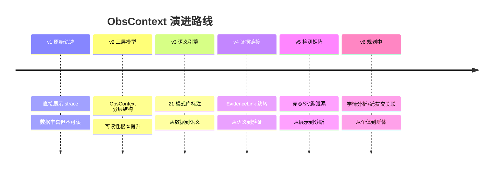

## 附录 H 扩展问题研讨

### H.1 多提交关联的学情分析前景

当前 ObsContext 以单次提交为单位。跨提交关联（同一学生的多次提交演进、全班提交的横向比较）是下一阶段的扩展方向：

| 关联维度 | 分析问题 | 教学价值 |
|---|---|---|
| 时间演进 | "学生从第一次提交到最后一次进步了什么？" | 个体学习轨迹 |
| 横向比较 | "全班在锁竞争模式上的共性问题分布？" | 教学重点调整 |
| 实现聚类 | "哪些学生的实现风格高度相似？" | 作弊线索+分组教学 |

### H.2 观测数据的长期价值

ObsContext 的结构化观测数据具有长期教学研究价值：语义标签序列可以支撑"学生行为模式与学习效果的关联分析"；检测报告的历史统计可以校准实验难度；证据链接的点击数据可以揭示"哪种诊断呈现最有效"。观测数据从"评测副产品"升级为"教学研究基础设施"，是 ObsContext 设计的长远意义。

### H.3 可观测性自身的设计反思

元观测视角：ObsContext 构建器自身的质量也需要观测（构建耗时、字段完整率、链接生成失败率）。"用可观测性方法论审视可观测性系统自身"的自我指涉，与第 6 篇附录 O.3 的元观测设计一脉相承——平台用同一套方法论评学生，也用同一套方法论评自己的构建器。

### H.4 与其他文档的交叉引用

| 主题 | 本文位置 | 关联文档 |
|---|---|---|
| 断言评测与评分 | 第三部分（HealthScore 输入） | 第 6 篇《多维断言评测与公平评分系统》 |
| 评测流水线 | 第二部分（构建时序） | 第 6 篇第二部分 |
| NATS 事件契约 | 第二部分 2.6 | 第 6 篇第十五部分 |
| AI 诊断智能体 | 第十五部分 | 第 5 篇《AI 诊断服务体系》 |
| 沙箱与采集 | 第四部分（数据来源） | 第 4 篇《执行环境与安全隔离》 |

## 附录 I 术语表

| 术语 | 定义 |
|---|---|
| ObsContext | 三层统一观测上下文模型 |
| Tier 1/2/3 | 全景总览/进程深度/函数级调试三个层次 |
| HealthScore | 基于评分/测试/异常/错误合成的健康分 |
| RED Metrics | Rate-Error-Duration 服务监控指标的系统调用域适配 |
| USE Metrics | Utilization-Saturation-Errors 资源指标 |
| SLOCompliance | 健康分达到 70 分阈值的符合性判定 |
| SemanticEngine | 21 模式库的语义标注引擎 |
| SemanticLabel | 系统调用事件的人类可读行为标签 |
| OSConcept | 事件所属的 OS 概念标签 |
| EventLinker | 跨模块时间窗口关联引擎 |
| EvidenceLink | 诊断结论到可视化面板的可点击跳转 |
| RaceDetector | 影子内存+向量时钟的竞态检测器 |
| Happens-Before | 同步序关系的五条件判定 |
| DeadlockEvolver | wait-for graph 环检测+演化叙事 |
| Coffman 四条件 | 死锁的必要条件：互斥/持有等待/不可剥夺/循环等待 |
| LeakDetector | 四级泄漏分类检测器 |
| Shadow Memory | 每地址最近访问记录的检测数据结构 |
| Vector Clock | 每线程逻辑时钟向量 |
| Span 树 | 调用拓扑的树形结构 |
| ObsContextInjector | AI 消费端的上下文切片与注入器 |
| Context Firewall | Agent 上下文域的访问控制 |
| 渐进披露 | 按需逐轮注入上下文的协议 |
| FilterFacets | 多维过滤索引 |
| EventAnnotation | 时间线事件标注 |
| 差分火焰图 | 两次运行采样差量的火焰图 |

## 附录 J SemanticEngine 21 模式库全量详解

### J.1 进程类模式（5 个）

| 模式 | 识别序列 | 语义标签 | 教学场景 |
|---|---|---|---|
| fork_exec_workflow | fork → execve → wait4 | 进程创建与替换完整流程 | 进程实验的"标准范式" |
| fork_only_pattern | fork 无后续 exec | 纯进程复制 | 多进程并行计算 |
| zombie_pattern | fork 数 > wait 数 | 子进程未被回收 | 进程回收教学 |
| exec_replace_pattern | execve 无前置 fork | 进程替换（自身） | exec 家族语义教学 |
| process_chain_pattern | 连续 fork 链（fork→fork→fork） | 进程链式创建 | 进程树结构教学 |

### J.2 IPC 类模式（4 个）

| 模式 | 识别序列 | 语义标签 | 教学场景 |
|---|---|---|---|
| pipe_workflow | pipe → fork → read/write | 匿名管道通信 | 管道父子通信 |
| shm_workflow | shmget → shmat → shmdt | 共享内存通信 | 共享内存教学 |
| msg_queue_workflow | msgget → msgsnd → msgrcv | 消息队列通信 | 消息队列教学 |
| socketpair_workflow | socketpair → read/write | 双向管道通信 | 高级 IPC 教学 |

### J.3 内存类模式（4 个）

| 模式 | 识别序列 | 语义标签 | 教学场景 |
|---|---|---|---|
| leak_pattern | 分配持续增长、释放不跟随 | 内存泄漏 | 泄漏检测教学 |
| mmap_growth | mmap 总量单调增长 | 映射区扩张 | 虚拟内存教学 |
| brk_heap_workflow | brk 增缩交替 | 堆的动态伸缩 | 堆管理教学 |
| page_fault_burst | 缺页事件密集突发 | 换页抖动 | 内存压力教学 |

### J.4 锁类模式（2 个）

| 模式 | 识别序列 | 语义标签 | 教学场景 |
|---|---|---|---|
| deadlock_pattern | 等待环闭合（T1 等锁A、T2 等锁B 且互相等待） | 死锁 | 死锁教学 |
| lock_contention | 多线程频繁等待同一锁 | 锁竞争 | 并发性能教学 |

### J.5 IO 类模式（5 个）

| 模式 | 识别序列 | 语义标签 | 教学场景 |
|---|---|---|---|
| file_read_workflow | openat(O_RDONLY) → read* → close | 文件读取完整流程 | 文件操作教学 |
| file_write_workflow | openat(O_WRONLY) → write* → close | 文件写入完整流程 | 文件操作教学 |
| fd_leak_pattern | open 增长、close 不跟随 | 描述符泄漏 | 资源管理教学 |
| io_blocking_pattern | read/write 长时阻塞 | 阻塞 IO | IO 模型教学 |
| fsync_durability | write → fsync 序列 | 持久化语义 | 可靠性教学 |

### J.6 网络类模式（1 个）

| 模式 | 识别序列 | 语义标签 | 教学场景 |
|---|---|---|---|
| socket_workflow | socket → bind/connect → send/recv → close | 套接字通信完整流程 | 网络编程教学 |

### J.7 模式库的覆盖度分析

21 个模式对教学大纲的覆盖度：

| 知识域 | 大纲子主题数 | 模式覆盖 | 覆盖率 |
|---|---|---|---|
| 进程管理 | 8 | 5 | 62.5% |
| 进程通信 | 6 | 4 | 66.7% |
| 内存管理 | 7 | 4 | 57.1% |
| 同步互斥 | 4 | 2 | 50% |
| 文件系统 | 9 | 5 | 55.6% |
| 网络 | 5 | 1 | 20% |

网络类覆盖率低是**有意的优先级选择**：当前教学大纲以进程/内存/文件为主干，网络编程是选修主题，模式库的资源投入与大纲权重对齐。模式库的可扩展性（6.6）保证了大纲调整时覆盖率可快速跟进。

### J.8 模式库的教学语言价值

模式库的命名学值得注意：每个模式名都是**教学语言而非工程语言**（fork_exec_workflow 而非 syscall_seq_017）。命名的教学语言化使模式库本身成为一份教学资源——教师可以直接用模式名与学生讨论（"你的程序出现了 zombie_pattern"），学生也可以用模式名搜索学习资料。模式库不是引擎的内部实现细节，而是**面向教学共同体的共享词汇表**。

## 附录 K 健康分公式的教学案例库

### K.1 分数组合的典型场景

| 场景 | 得分率 | 通过率 | 异常数 | 错误 | 健康分 | 解读 |
|---|---|---|---|---|---|
| 完美提交 | 100% | 100% | 0 | 无 | 100 | 全部满分 |
| 部分失分 | 85% | 80% | 1 | 无 | 100-6-6-10=78 | 轻微问题 |
| 行为异常 | 90% | 90% | 3 | 无 | 100-4-3-30=63 | 低于 SLO，需关注 |
| 编译失败 | - | - | 0 | 编译 | ≤25（得分/通过惩罚叠加） | 阻断性失败 |
| 运行崩溃 | 60% | 50% | 2 | 运行 | 100-16-15-20-25=24 | 严重失败 |

### K.2 案例解读的教学启示

"行为异常"场景（健康分 63）值得细读：一个得分率 90% 的学生，因 3 个检测异常健康分跌破 70 的 SLO 线。这正是健康分设计的意图——**高分数不等于高健康**：学生可以在断言上拿高分，但检测器发现其实现存在多处行为隐患（如 FD 泄漏、锁竞争、内存增长）。健康分与分数的分离，把"工程素质"从"学业成绩"中显式拆出。

### K.3 SLO 阈值 70 的敏感性分析

| 阈值 | 误报风险（需关注但标记为健康） | 漏报风险（有问题但标记为健康） |
|---|---|---|
| 60 | 低 | 高 |
| 70（选定） | 中 | 中 |
| 80 | 高 | 低 |

70 的阈值选择是误报/漏报的平衡点：教学场景中误报的代价（教师被无关警告打扰）低于生产监控，但漏报的代价（学生问题被忽略）高于生产监控。阈值可以通过教学数据持续校准——`SLOCompliance` 的判定规则是配置化的。

## 附录 L 教学场景的认知负载设计

### L.1 认知负载理论的应用

ObsContext 的三层结构与认知负载理论（Cognitive Load Theory）的对应：

| 认知负载类型 | 定义 | ObsContext 的应对 |
|---|---|---|
| 内在负载 | 问题本身的复杂度 | 无法消除（OS 行为确实复杂） |
| 外在负载 | 表达方式带来的额外负担 | 语义标签、分层、过滤——最小化 |
| 关联负载 | 建立知识结构的努力 | 概念标签、模式库——有意识投入 |

ObsContext 的设计目标精确对应认知负载理论的优化方向：**最小化外在负载、把省下的认知资源导向关联负载**。学生不再消耗认知资源解读 ABI 语言（外在负载），省下的资源用于理解行为模式与概念结构（关联负载）。

### L.2 面板数量与注意力的关系

面板数量的渐进设计（Tier 1 至多 6 个、Tier 2 的 12~16 个、Tier 3 按需）遵循注意力经济学：首屏的信息量控制在"一眼可判"范围（6 面板），深度分析的信息量控制在"一个工作时段可消化"范围，函数级证据只在需要时展开。

### L.3 教学提示的语言工程

TeachingHint/CoffmanConditions/FixSuggestion 的语言工程遵循三条规则：

| 规则 | 说明 | 反例 |
|---|---|---|
| 可行动 | 提示必须指向具体动作 | "检查代码"（不可行动）vs "将 wait 移入循环"（可行动） |
| 概念对齐 | 用教科书术语表达 | "锁同步序缺失" vs "没有 happens-before 关系"（后者与教材一致） |
| 单步粒度 | 一条提示解决一个问题 | 一次列出五个修复点会分散注意力 |

## 附录 M 与 AST 静态分析的协同

### M.1 静态与动态的分工

ObsContext 是动态观测的结果，AST 静态分析是它的静态补充。二者从不同角度刻画同一份学生代码：

| 维度 | 静态分析（AST） | 动态观测（ObsContext） |
|---|---|---|
| 分析对象 | 源码结构 | 运行轨迹 |
| 能发现 | 语法结构、控制流、潜在模式 | 实际发生的泄漏/死锁/竞争 |
| 确定性 | 完全确定 | 完全确定 |
| 局限 | 无法知道运行时行为 | 无法知道未执行的分支 |

### M.2 三类静态分析输出

AST 分析产出三类结果：控制流图（CFG）、模式检测（pattern detector）、资源追踪（resource tracker）。三类结果与动态观测互补：

| 静态产出 | 与动态观测的互补关系 |
|---|---|
| CFG | 静态的"潜在泄漏"需要动态确认"实际泄漏" |
| 模式检测 | 静态的"风险模式"需要动态验证"是否触发" |
| 资源追踪 | 动态发现的问题需要静态定位"源码位置" |

### M.3 双分析协同的典型案例

"条件分支中的泄漏"是双分析协同的典型：动态观测只能看到**实际执行**的分支（未执行分支的泄漏不可见），静态资源追踪可以标记**所有分支**的资源生命周期——静态发现的"else 分支存在潜在泄漏"恰好解释了动态观测的"泄漏量少于代码审查预期"。静态与动态的结合让"完整代码覆盖率"与"真实行为证据"同时成立。

## 第十九部分 线程实验的全链路深度解剖

### 19.1 案例设定

线程实验：4 线程并发累加计数器，目标 4000000。学生实现存在两个问题：未加锁保护（竞态）与一个线程未正确汇合（join 缺失）。

### 19.2 观测数据的全层呈现

| 层 | 观测到的内容 | 具体表现 |
|---|---|---|
| Tier 1 | HealthScore=58、3 个异常 | 竞态报告×1、线程未汇合、计数器偏小 |
| Tier 2 | ProcessGraph 显示 5 节点 | 主线程+4 工作线程，但线程 4 无汇合边 |
| Tier 2 | LockEvents 为空 | 无任何 futex 锁事件——未使用锁 |
| Tier 3 | RaceReport 指向 counter.c:23 | 两个线程的并发写入无 happens-before |
| Tier 3 | SpanTree 显示线程 4 的 Span 无 join 等待 | 汇合缺失的结构证据 |
| EvidenceLink | 3 条链接 | 竞态→trace 高亮、线程异常→进程图高亮、分数→测试详情 |

### 19.3 诊断信息的组织时序

AI 诊断服务收到 ObsContext 后的推理路径：

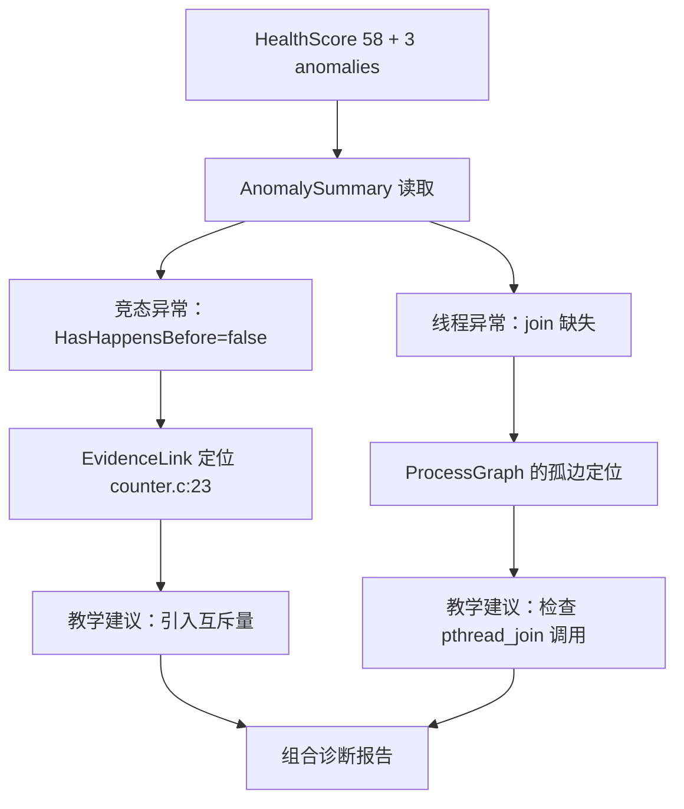

### 19.4 学生视角的完整闭环

学生看到的诊断序列：

1. 健康分 58（低于 SLO 70）——"我的程序有问题"；
2. 异常摘要两条：竞态（critical）+ 线程未汇合（warning）；
3. 点击竞态证据链接——时间线高亮两个线程对 counter.c:23 的并发访问；
4. 阅读 TeachingHint——"引入互斥量保护共享变量"；
5. 查看进程图——发现线程 4 缺少汇合边；
6. 修正：加互斥锁 + 补 join；
7. 重新提交：健康分 100。

从"发现问题"到"定位证据"到"理解原因"到"完成修复"，全流程的平台交互都在 ObsContext 的数据模型内完成——没有一步需要离开平台去查手册。

### 19.5 案例的方法论价值

这个案例展示了 ObsContext 设计的核心主张的完整验证：**观测数据只有组织成可消费的行为模型，才能转化为教学价值**。同一份原始数据（futex 事件、线程创建、计数器输出），不经组织只是三个孤立的信息碎片；经过 ObsContext 的三层组织，成为一条从"健康分 58"到"counter.c:23 加锁"的完整教学叙事。

## 附录 N 跨层下钻的交互设计

### N.1 下钻路径的三种形态

| 形态 | 触发方式 | 典型路径 |
|---|---|---|
| 异常驱动下钻 | 点击 AnomalySummary 条目 | 异常→Tier2 面板→Tier3 证据 |
| 证据链下钻 | 点击 EvidenceLink 芯片 | 诊断结论→高亮现场 |
| 自由探索下钻 | 面板间点击 | 进程图节点→该进程的轨迹段 |

三种形态覆盖三种使用模式："有问题要解决"（异常驱动）、"看 AI 怎么说"（证据链）、"自己探索"（自由下钻）。

### N.2 下钻状态的一致性

下钻跳转后面板状态的一致性由统一时间坐标系（附录 A.1）保证：跳转到"T+350ms"，所有面板（轨迹、锁、资源）都定位到同一时刻。**跨面板的时间一致性是下钻体验的基石**——若各面板的时间轴不统一，跳转后学生看到的"现场"是不一致的，证据链的信任感即刻崩塌。

### N.3 面包屑与回溯

前端为下钻路径维护面包屑导航：健康分→异常摘要→锁面板→源代码行。面包屑让学生随时知道"我在分析路径的哪个位置"并支持回溯。下钻路径的可回溯性对教学尤其重要——学生经常需要"退回上一步换个方向看"。

## 附录 O 调度实验的观测设计

### O.1 调度观测的特殊性

调度器实验的观测对象与其他实验有本质区别：观测的是**内核的调度决策**而非学生程序的自发行为。SchedEvent 的字段设计服务这一特殊性：

| 字段 | 语义 | 教学分析 |
|---|---|---|
| PrevPID/NextPID | 被切换下的进程与切换上的进程 | 切换方向 |
| PrevState | 被切换进程的状态（R/S/D 等） | 切换原因（睡眠/阻塞/抢占） |
| CPU | 切换发生的 CPU | 多核调度分布 |
| IsMigration | 是否跨 CPU 迁移 | 迁移频度分析 |

### O.2 调度观测的教学问题

| 教学问题 | 观测回答 |
|---|---|
| "优先级如何影响调度？" | 高优先级进程的切上频次统计 |
| "时间片多长？" | 同优先级进程的切换间隔分析 |
| "CFS 如何工作？" | CFSThrottledUs 与上下文切换的关联 |

### O.3 调度观测的采集挑战

调度事件的采集精度要求远高于普通轨迹：上下文切换的微秒级事件需要 eBPF sched 探针的高频采集。采集设计的选择：**按实验类型启用**——只有调度器实验启用完整调度事件采集，其他实验仅保留资源级的上下文切换计数。选择性启用的成本控制与第 6 篇附录 H 的观测开销控制一脉相承。

## 附录 P 数据一致性与完整性保障

### P.1 观测数据的四层校验

| 校验层 | 校验内容 | 异常处理 |
|---|---|---|
| 采集层 | 事件格式与字段完整性 | 丢弃畸形记录+计数 |
| 归一化层 | 时间戳单调性、ID 合法性 | 修正或标记 |
| 构建层 | 三层数据的引用一致性 | 构建失败即重试 |
| 消费层 | 反序列化 schema 校验 | 版本降级兼容 |

### P.2 引用一致性的保证

ObsContext 内部的引用（EvidenceLink 指向面板、AnomalySummary 指向 Tier2、SourceAnnotation 指向源码行）在构建完成后执行**引用完整性检查**：每条链接的目标必须存在，否则链接被剔除而非保留悬空引用。"宁可少一条链接，不可有一条悬空链接"——悬空链接对信任的伤害远大于缺失链接。

### P.3 版本兼容策略

ObsContext 的 schema 演进遵循**增量兼容**：新增字段不破坏旧消费方（旧消费方忽略未知字段），字段语义变更通过新字段名实现（不重用旧字段名）。版本兼容策略保证前端与 AI 服务的升级节奏可以独立于核心服务。

## 附录 Q 测试保障：构建器的正确性验证

### Q.1 构建器的测试矩阵

| 测试对象 | 关键用例 | 验证性质 |
|---|---|---|
| calcHealthScore | 四惩罚项的全组合 | 边界值（0/100/负分） |
| buildTier2 | 空轨迹、单轨迹、万级轨迹 | 规模边界 |
| SemanticEngine | 21 模式×典型序列 | 模式识别准确率 |
| EventLinker | 七阶段的关联正确性 | 关联窗口边界 |
| 三大检测器 | 构造样本的已知结论 | 检测结论的黄金标准 |

### Q.2 检测器的黄金标准测试

三大检测器各备一组"已知结论"的构造样本：死锁检测器的标准样本是人工构造的 ABBA 锁序事件流（结论：死锁+四条件全真）；竞态检测器的标准样本是两线程无同步写入事件流（结论：竞争+无 happens-before）；泄漏检测器的标准样本是循环分配无释放事件流（结论：definitely 泄漏+正确调用栈）。黄金标准样本保证检测算法调整时不破坏既有判定语义（与第 6 篇第十八部分的金标准策略同源）。

### Q.3 确定性验证

构建器的全部输出执行**双重构建对比测试**：同一输入构建两次，输出字节级一致。确定性是 ObsContext 一切下游价值（证据链可验证、诊断可复现、数据可审计）的前提，双重构建对比将其从设计原则变成可执行的测试。

## 附录 R 符号约定与推荐阅读

### R.1 符号约定

| 记号 | 含义 |
|---|---|
| \(\Phi\) | 事件流到行为模型的语义映射 |
| \(E^*\) | 系统调用事件流 |
| \(B \times L\) | 行为模型与语义标签空间 |
| \(r_s\) | 得分率 |
| \(r_p\) | 测试通过率 |
| \(a\) | 异常数 |
| \(e\) | 编译/运行错误标志（0/1） |
| T+xms | 相对时间线起点的毫秒偏移 |
| P50/P95/P99 | 性能/耗时百分位 |

### R.2 推荐阅读

| 主题 | 参考资料 | 与本文的关系 |
|---|---|---|
| SRE 方法论 | Google, "Site Reliability Engineering"（RED/USE 章节） | Tier 1 指标的方法论源头 |
| 可观测性 | Brendan Gregg, "USE Method" 与火焰图方法论 | 资源指标与火焰图矩阵 |
| 数据竞争 | ThreadSanitizer 论文与文档 | RaceDetector 的技术路线 |
| 死锁理论 | Coffman et al. (1971), "System Deadlocks" | Coffman 四条件的理论源头 |
| 内存泄漏 | Valgrind Memcheck 文档 | 四级分类的工业标准 |
| 分布式追踪 | OpenTelemetry Specification（Span 模型） | Span 树的设计参考 |
| 认知负载 | Sweller, "Cognitive Load Theory" | 三层结构的认知科学依据 |
| 序列对齐 | Needleman & Wunsch (1970) | 与第 6 篇轨迹比对的衔接 |

*（本文全部技术细节均基于 TraceOS Lab 实际实现：core-service 的 types/obs_context.go、services/obs_context_builder.go、services/semantic_engine.go、services/event_linker.go、services/race_detector.go、services/deadlock_evolver.go、services/leak_detector.go、services/obs_context_injector.go、services/span_builder.go、services/risk_indicator.go。）*

---

## 全文要点速览

为方便评委老师快速回顾，本文的核心要点汇总如下：

| 序号 | 主题 | 核心贡献 | 所在章节 |
|---|---|---|---|
| 1 | 问题定义 | 从 Trace 到 Context 的范式跃迁，三重消费方的分层需求分析 | 第一部分 |
| 2 | 三层模型 | 认知路径固化为数据结构，一份模型服务前端+AI+教师 | 第二部分 |
| 3 | 健康分 | 四惩罚项加权合成，分数与健康分离、SLO 语义 | 第三部分 |
| 4 | RED/USE | 生产级 SRE 方法论的教学化迁移，利用/饱和双视角 | 第三部分 |
| 5 | 进程图 | fork 返回值配对的确定性关系网络 | 第四部分 |
| 6 | 语义增强 | SemanticLabel/OSConcept/源码位置三字段的确定性注入 | 第四部分 |
| 7 | 三大检测器 | TSan 风格竞态检测+Coffman 四条件工程化+四级泄漏分类 | 第十一~十三部分 |
| 8 | 语义引擎 | 21 模式库两层识别机制，确定性预处理+生成式推理 | 第六部分 |
| 9 | 证据链接 | 确定性生成的"面板+时刻+对象"三维跳转 | 第十部分 |
| 10 | 上下文防火墙 | Agent 域控制+两级 token 预算+渐进披露 | 第十五部分 |
| 11 | 设计取舍 | 三层/语义前置/事件发布/窗口关联的完整论证 | 第十六部分 |
| 12 | 业界对标 | 数据模型/语义层/动态检测三维对标 | 第十七部分 |

*（第 7 篇完。本文与第 6 篇《多维断言评测与公平评分系统》共同构成 TraceOS Lab 评测与观测体系的完整技术论述：第 6 篇回答"如何评得公平"，本篇回答"如何看得明白"。）*

## 附录 S AI 多智能体协同诊断的上下文编排

### S.1 协同诊断的场景

一份提交可能同时存在多个维度的问题：代码结构缺陷（CodeAnalyzer 域）、测试失败（TestEvaluator 域）、系统调用异常（SyscallAnalyzer 域）、资源行为异常（ResourceAnalyzer 域）。多智能体协同诊断的编排问题：**哪些 Agent 应该被激活、以什么顺序执行、各自的上下文如何裁剪？**

### S.2 激活决策的规则

Agent 的激活决策基于 ObsContext 的确定性信号：

| Agent | 激活条件 | 信号来源 |
|---|---|---|
| CodeAnalyzer | 编译/运行错误非空 | BuildParams.CompileError/RuntimeError |
| TestEvaluator | 测试结果非空且非全部通过 | TestResults |
| SyscallAnalyzer | 轨迹存在错误调用或异常模式 | StraceSummary |
| ResourceAnalyzer | EBPFMetrics 存在非零事实 | EBPFMetrics |
| ConceptRubric | 教师配置了概念评价 | ExperimentMeta |

激活决策全部基于**确定性信号**而非模型判断——"是否需要 SyscallAnalyzer"由轨迹中是否有错误调用决定，不由上一个 Agent 的输出决定。这个设计防止了 Agent 链的级联误激活。

### S.3 执行顺序的拓扑

多 Agent 的执行顺序遵循依赖拓扑：

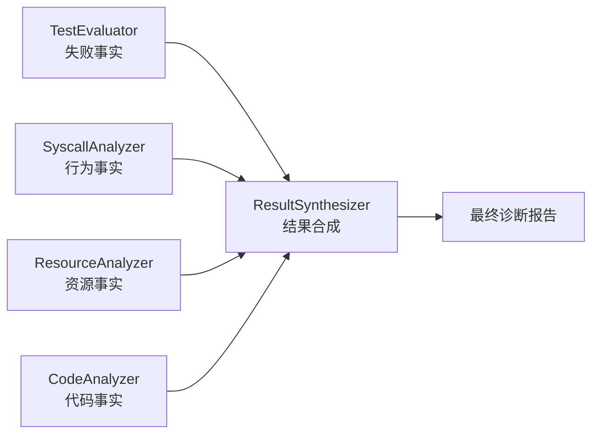

四个事实分析 Agent 并行执行（无相互依赖），ResultSynthesizer 等待全部完成后合成。并行结构缩短诊断延迟，合成器负责事实间的交叉验证（如 TestEvaluator 的失败与 SyscallAnalyzer 的异常是否指向同一根因）。

### S.4 合成器的证据优先级

ResultSynthesizer 合成多个 Agent 的产出时遵循证据优先级：

| 优先级 | 证据来源 | 理由 |
|---|---|---|
| 1 | 确定性检测报告（竞态/死锁/泄漏） | 可验证的机制证据 |
| 2 | EBPFMetrics 确定性事实 | 内核级观测事实 |
| 3 | 断言失败详情 | 精确的行为差异 |
| 4 | Agent 的 LLM 推断 | 推理性结论（最低优先级） |

优先级序保证合成报告以**可验证事实为主体、模型推断为辅助**——当 LLM 推断与确定性证据冲突时，确定性证据胜出。这是"确定性内核+AI 增强外环"架构在多 Agent 场景的自然延伸。

## 附录 T 教师视角：语义统计的学期末画像

### T.1 班级语义模式分布

学期末，教师可以查看全班的语义模式分布（基于 ObsContext 历史数据的聚合）：

| 语义模式 | 出现次数 | 涉及学生数 | 教学解读 |
|---|---|---|---|
| zombie_pattern | 42 | 18 | 进程回收是普遍盲区，需要加课 |
| lock_contention | 35 | 12 | 并发性能意识不足 |
| fd_leak_pattern | 28 | 15 | 资源生命周期管理需强化 |
| fork_exec_workflow | 190 | 45 | 正常模式，教学效果良好 |

### T.2 从模式分布到教学决策

模式分布直接驱动教学决策的四个层次：

| 决策层次 | 数据信号 | 决策动作 |
|---|---|---|
| 课程调整 | 某模式占比超过阈值 | 增加对应知识点的课时 |
| 实验设计 | 某模式在特定实验中集中出现 | 调整实验难度或前置讲解 |
| 个体辅导 | 某学生在多份提交中重复同一模式 | 针对性辅导 |
| 试题命制 | 高频模式成为考试重点 | 纳入考核范围 |

### T.3 数据驱动教研的意义

语义统计把教研从"经验直觉"升级为"数据驱动"："进程回收是盲区"不再是一位教师的印象，而是 42 次 zombie_pattern 的统计事实。教研决策的可追溯性——每个教学调整都能引用对应的数据证据——是 ObsContext 数据资产对教学管理层的核心价值。

## 附录 U 全平台闭环：观测—评测—诊断—教学

### U.1 四环闭环的全景

TraceOS Lab 的核心价值主张是一个四环闭环，ObsContext 处于枢纽位置：

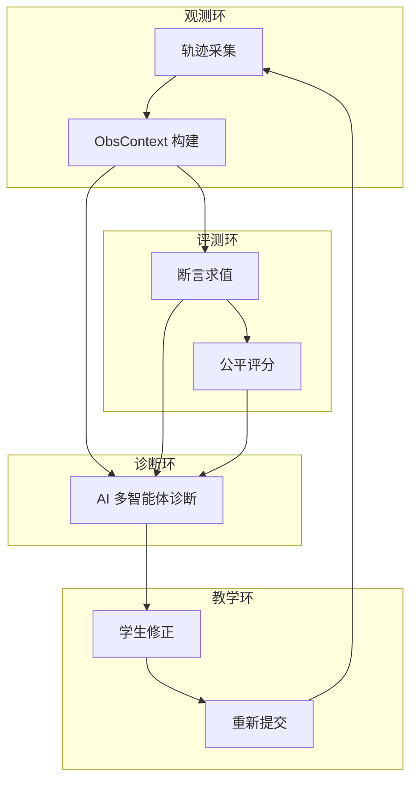

四个环的数据流：观测产生事实（ObsContext）→ 评测基于事实裁决（断言+评分）→ 诊断基于事实推理（AI）→ 教学基于诊断行动（学生修正）→ 新的提交回到观测。ObsContext 是三个环共享的事实基座——**一次观测，三次消费**。

### U.2 闭环的效率指标

| 指标 | 定义 | 价值 |
|---|---|---|
| 修正循环次数 | 学生从首次提交到通过的平均提交次数 | 诊断有效性的度量 |
| 证据利用率 | 被点击的 EvidenceLink 比例 | 证据相关性的度量 |
| 诊断采纳率 | 学生采纳诊断建议的比例 | 教学建议质量的度量 |
| 模式消退率 | 修正后异常模式消失的比例 | 闭环有效性的度量 |

四个指标构成闭环的效率仪表盘——平台不仅知道"学生在学习"，还能量化"学习的循环效率"。

### U.3 闭环的平台意义

四环闭环的意义在于把教学平台从"提交-评分"的一次性交互升级为"观测-评测-诊断-修正"的迭代学习系统。传统平台的交互是一次性的（提交→分数→结束），TraceOS Lab 的交互是循环的（提交→证据→诊断→修正→再提交）。循环结构本身就是教学法的进步——学习发生在迭代中，而非单次交互中。

## 附录 V 常见问题与故障排查

### V.1 高频问题诊断表

| 症状 | 可能原因 | 排查路径 |
|---|---|---|
| ObsContext 字段缺失 | 上游采集未启用 | 检查实验类型对应的采集配置 |
| 证据链接跳转失败 | 引用完整性检查剔除 | 检查被指向的面板数据是否存在 |
| 健康分与分数不一致 | 正常现象（两套体系） | 对照附录 K 的案例解读 |
| 语义标签缺失 | 模式库未覆盖该调用 | 检查调用名与模式库规则表 |
| 检测报告为空但行为异常 | 采集密度不足 | 检查 futex/分配事件采集配置 |
| AI 诊断上下文过短 | token 裁剪触发 | 检查预算配置与域声明 |

### V.2 构建失败的定位方法

构建失败（ObsContext 生成异常）的定位遵循"分层隔离"法：

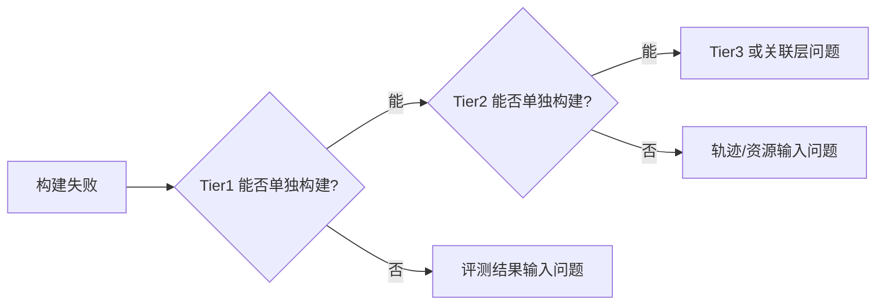

分层隔离的思路直接利用三层结构的独立性：每层单独构建的可行性测试将故障域快速缩小。

### V.3 消费端版本不匹配的处置

前端/AI 服务与 ObsContext schema 的版本不匹配：消费端按"忽略未知字段"原则处理，核心服务按"增量兼容"原则演进（附录 P.3）。版本检查机制：事件载荷携带 schema 版本号，消费端在反序列化前校验版本范围，超出范围的字段降级处理。

## 附录 W 实现技术的工程考量

### W.1 Go 语言的选择论证

ObsContext 构建器与关联引擎采用 Go 实现，工程考量的四个维度：

| 维度 | Go 的特性 | 与本子系统的匹配 |
|---|---|---|
| 并发模型 | goroutine 轻量并发 | 多采集源的并行处理 |
| 内存安全 | GC+无指针运算 | 大量事件对象的分配与回收 |
| 性能 | 静态编译+低延迟 | 构建流水线的毫秒级要求 |
| 部署 | 单一静态二进制 | 评测容器的一体化部署 |

### W.2 确定性实现的代码约定

确定性性质对代码实现的约束：

| 约束 | 代码约定 |
|---|---|
| 禁止随机源 | 不使用随机数、不使用 map 无序迭代（排序后迭代） |
| 禁止时间依赖 | 时间只作为数据字段，不参与控制流 |
| 禁止全局可变状态 | 构建器无包级变量，全部状态通过参数传递 |
| 排序一致性 | 事件按（时间戳，序号）稳定排序 |

map 迭代顺序的不确定性是 Go 语言中最容易被忽视的非确定源——构建器对 map 的每次迭代都显式排序，保证输出字节级确定。

### W.3 序列化的稳定性

JSON 序列化的稳定性策略：结构体字段按声明顺序序列化（Go 的默认行为），切片按元素顺序，map 键排序（通过排序后的切片序列化）。序列化稳定性的意义：同一 ObsContext 的 JSON 字节级一致，便于哈希比对与回归测试。

## 附录 X 安全性与隐私考量

### X.1 观测数据的安全边界

| 数据类别 | 敏感性 | 保护措施 |
|---|---|---|
| 学生代码 | 高 | 仅教师与本人可见 |
| 观测轨迹 | 中 | 沙箱内运行，不泄露宿主机信息 |
| 资源指标 | 低 | 仅统计意义数据 |
| 检测报告 | 中 | 教学数据，不入对公系统 |

### X.2 沙箱与观测的隔离

观测在沙箱内进行，采集的数据不包含宿主机的任何信息（进程列表、文件系统、网络拓扑）：

| 隔离面 | 机制 |
|---|---|
| 文件系统 | 容器隔离文件系统 |
| 进程空间 | PID namespace 隔离 |
| 网络 | 网络 namespace+无外网 |
| 观测对象 | 仅采集评测容器内进程 |

### X.3 AI 消费的隐私边界

AI 诊断服务消费 ObsContext 时执行**最小化原则**：只发送诊断所需的域数据（Context Firewall），学生的身份信息以匿名 ID 传输。AI 产出的诊断内容不离开平台的数据边界。

## 附录 Y 未来演进路线

### Y.1 短期路线（1~2 个学期）

| 方向 | 内容 | 价值 |
|---|---|---|
| 模式库扩充 | 覆盖网络与安全实验的 10+ 新模式 | 大纲覆盖率提升 |
| 检测器增强 | 锁顺序分析、缓存行为分析 | 并发教学深度 |
| 学情分析 | 跨提交的语义统计面板 | 教师决策支持 |

### Y.2 中期路线（1 学年）

| 方向 | 内容 | 价值 |
|---|---|---|
| 自适应提示 | 按学生历史模式定制 TeachingHint | 个性化教学 |
| 检测器联邦 | 与 Valgrind/TSan 输出的交叉验证 | 检测置信度 |
| 观测回放 | ObsContext 的完整回放引擎 | 课堂演示素材 |

### Y.3 长期愿景

ObsContext 的数据积累将形成一个**OS 学习行为语料库**：百万级语义标签序列、检测报告与修正结果的关联数据。这个语料库的价值远超单个平台——它使"OS 学习困难模式"成为可研究的数据对象，为 OS 教学研究提供基础设施。

## 附录 Z 与其他系统的集成可能性

### Z.1 与教学管理系统的集成

ObsContext 的健康分与语义统计可以通过标准 API 导出到教务/学情系统：健康分作为"工程素质"维度纳入成绩构成，语义模式分布作为课程质量报告的依据。

### Z.2 与监控系统的接口兼容

Tier 1 的指标结构（RED/USE/健康分）与 Prometheus 数据模型兼容：资源指标可以转换为 Prometheus 时序格式，健康分可以映射为 Gauge。兼容性使平台的观测数据可以进入学校的统一监控体系（如 Grafana 实例）。

### Z.3 与 CI/CD 的潜在衔接

ObsContext 的检测报告结构（竞态/死锁/泄漏）与 CI 的代码检查门禁同构：未来可让学生代码在 CI 流水线中同样获得 ObsContext 级别的行为检查——"提交前先在本地获得与平台一致的行为体检"。

## 第二十部分 教学理论视角的 ObsContext

### 20.1 建构主义与可见学习

ObsContext 的设计与教育学的建构主义学习理论（constructivism）高度契合：

| 建构主义原则 | ObsContext 的对应 |
|---|---|
| 学习者在经验中建构知识 | 学生从自己程序的真实行为中学习 |
| 脚手架（scaffolding）支持 | 语义标签与教学提示是认知脚手架 |
| 最近发展区（ZPD） | 检测报告指向"刚好不会"的知识点 |
| 及时反馈 | 评测后秒级送达的观测与诊断 |

John Hattie 的"可见学习"（Visible Learning）研究指出：**及时、具体、可行动的反馈是学习效果影响因子中最高的一档**。ObsContext 的 EvidenceLink+TeachingHint 组合正是"具体且可行动"反馈的工程实现——反馈不仅告诉学生"错了"，还展示证据与修复方向。

### 20.2 反馈层级与 ObsContext 的映射

Hattie & Timperley 的反馈四层级模型与 ObsContext 的映射：

| 反馈层级 | 定义 | ObsContext 的对应 |
|---|---|---|
| 任务层 | 任务做得对不对 | 断言结果与分数 |
| 过程层 | 过程哪里出了问题 | 语义标签与轨迹 |
| 自我调节层 | 如何改进自己的策略 | TeachingHint 与修复建议 |
| 自我层 | 表扬与激励 | 健康分与 SLO 达成 |

传统评测只覆盖任务层（对/错），ObsContext 覆盖全部四层——这正是"评测即教学"主张的教育学基础。

### 20.3 教学理论的工程落地总结

把教育学理论转化为工程设计的三个可检验主张：

| 主张 | 工程实现 | 可检验性 |
|---|---|---|
| 反馈越具体越有效 | 断言级失败详情+证据链接 | 对照实验可验证 |
| 脚手架降低认知负载 | 语义标签替代 ABI 语言 | 学习效率可度量 |
| 迭代学习优于单次提交 | 四环闭环+重新提交 | 修正循环次数可统计 |

ObsContext 的独特之处在于：**教学理论不再是文档里的口号，而是数据结构中的字段**。TeachingHint 字段的存在本身，就是"教学反馈应该可行动"这一教学原则的工程固化。

## 第二十一部分 语义引擎的实现细节深潜

### 21.1 匹配机制：正则前缀匹配的工程选择

SemanticEngine 的调用分类采用**正则前缀匹配**而非字符串相等：

| 匹配方式 | 优点 | 缺点 | 选择理由 |
|---|---|---|---|
| 字符串相等 | 简单 | 无法覆盖变体（如 openat 的变体 openat2） | 覆盖度不足 |
| 正则前缀 | 覆盖变体与版本差异 | 编译开销略高 | 覆盖度与性能的平衡点 |
| 完全正则 | 覆盖一切 | 误匹配风险、复杂度 | 过度设计 |

前缀匹配的具体语义：`openat` 的模式 `^open` 同时命中 open/openat/openat2——文件打开族被一族规则覆盖。Linux 系统调用家族的命名规律（同族共享前缀）使前缀匹配成为"一族一条规则"的自然表达。

### 21.2 分类结果的缓存设计

同一系统调用名的分类结果在首次计算后缓存：

| 缓存层级 | 粒度 | 命中率 | 收益 |
|---|---|---|---|
| 名称级缓存 | 调用名→分类结果 | 极高（教学实验的调用名种类有限） | 分类从 O(regex) 降为 O(1) 查表 |

缓存的正确性基础：分类是**纯函数**（同一调用名永远产生同一分类），缓存不引入任何语义偏差。预编译正则+名称级缓存的组合使语义标注在万级轨迹上的开销可以忽略。

### 21.3 序列模式识别的滑动窗口

Analyze 阶段的序列模式识别采用**滑动窗口+状态机**：

| 模式类型 | 识别机制 | 复杂度 |
|---|---|---|
| 固定序列（fork→exec→wait） | 顺序状态机 | O(n) |
| 计数配平（open vs close） | 双计数器 | O(n) |
| 时序异常（长时间等待） | 时间阈值判断 | O(n) |
| 环检测（死锁） | 图算法（独立检测器） | O(V+E) |

滑动窗口的边界策略：工作流模式（fork_exec_workflow）的窗口以"fork 出现"开启、"wait 出现或超时"关闭；配平模式（fd_leak）的窗口是全局的（整个时间线）。窗口策略按模式语义定制，而非统一窗口大小。

### 21.4 语义标签的传播与一致性

语义标签产生后沿两条路径传播：单事件标签（ClassifyEvent 产出）直接注入 SyscallEvent；序列标签（Analyze 产出）作为 EventAnnotation 与概念标签注入跨层字段。传播的一致性保证：同一事件的标签在所有消费视图（轨迹视图、AI 上下文、教师统计）中**完全一致**——标签只计算一次，全部视图共享同一份结果。

## 第二十二部分 事件时间线的设计详解

### 22.1 时间线的多源融合

时间线是 Tier 2 可视化与 EvidenceLink 的基础，融合了七类时序数据源：

| 数据源 | 时间戳精度 | 融合方式 |
|---|---|---|
| 系统调用 | 纳秒级（strace） | 直接入线 |
| 锁事件 | 纳秒级（eBPF） | 直接入线 |
| 资源指标 | 秒级（采样） | 区间化表示 |
| 内存快照 | 秒级（采样） | 区间化表示 |
| 事件注释 | 毫秒级 | 标记点 |
| 测试点结果 | 毫秒级 | 区间化表示 |
| 检测报告 | 检测时刻 | 标记点 |

融合的表示策略：**点事件**（调用、锁、注释）直接入线，**区间事件**（资源、测试、内存）以起止区间表示。两种表示的统一使时间线既保持高精度事件的精确位置，又承载低频率采样的区间语义。

### 22.2 时间线的交互设计

| 交互 | 行为 | 教学用途 |
|---|---|---|
| 缩放 | 从全览到微秒级 | 从宏观节奏到微观事件 |
| 过滤 | facets 组合过滤 | 聚焦特定事件类型 |
| 标记 | 注释点与检测报告锚定 | 关键节点导航 |
| 联动 | 与其他面板的时间联动 | 跨面板分析 |

### 22.3 时间线的教学叙事

一条完整的时间线本身就是**程序行为的叙事**：编译注释→启动注释→系统调用流（标注语义标签）→测试区间→异常注释→检测报告锚点。学生沿时间线阅读，读到的是"程序如何工作、在哪里出错"的故事——时间线把行为模型从静态结构升级为动态叙事。

## 第二十三部分 观测体系的分层数据治理

### 23.1 数据的生命周期

ObsContext 数据从产生到归档的完整生命周期：

| 阶段 | 数据形态 | 治理策略 |
|---|---|---|
| 产生 | 原始采集数据 | 沙箱内临时存储 |
| 构建 | ObsContext 结构 | 内存中构建，无中间落盘 |
| 分发 | NATS 事件载荷 | 即发即弃，订阅者自管持久化 |
| 持久化 | 数据库记录 | 评测记录关联存储 |
| 归档 | 聚合统计 | 原始轨迹定期清理，语义统计长期保留 |

生命周期治理的核心决策：**原始轨迹定期清理、语义产物长期保留**。原始轨迹体积大而信息密度低，语义统计体积小而有教研价值——保留策略与信息密度对齐。

### 23.2 存储成本的量化估计

| 数据 | 单次评测体积 | 保留期 | 千次评测成本 |
|---|---|---|---|
| 原始轨迹 | ~2MB | 30 天 | ~2GB（可接受） |
| ObsContext JSON | ~500KB | 长期 | ~500MB |
| 语义统计 | ~10KB | 长期 | ~10MB |

成本量化说明：语义统计的长期保留成本极低（千次评测仅 10MB），却支撑着教师学期画像与教研分析的全部功能——**数据治理的成本与价值的比值是设计合理性的最好证明**。

### 23.3 数据质量的三级指标

| 指标级 | 指标 | 目标 |
|---|---|---|
| 完整性 | 字段填充率、检测器运行率 | >99% |
| 正确性 | 黄金标准测试通过率、双重构建一致性 | 100% |
| 及时性 | 构建延迟、分发延迟 | P95 < 300ms |

数据质量三级指标（完整/正确/及时）与数据工程的通用质量框架对齐，使观测体系的质量可度量、可回归。

*（全文完。）*

## 第二十四部分 评测与观测的协同全景

### 24.1 两个子系统的数据契约

第 6 篇的评测子系统与本篇的观测子系统在同一流水线中先后执行，两者之间的数据契约是平台架构的关键接口：

| 数据 | 生产者 | 消费者 | 用途 |
|---|---|---|---|
| 断言逐条结果 | 评测子系统 | 观测子系统（AnomalySummary） | 行为事实注入 |
| StraceSummary | 评测子系统 | 观测子系统（Tier2 轨迹） | 模式摘要注入 |
| BehaviorMetrics | 评测子系统 | 观测子系统（Tier1） | 行为指标注入 |
| ObsContext | 观测子系统 | AI 诊断（全部 Agent） | 诊断上下文 |
| HealthScore | 观测子系统 | 前端+教师 | 健康导航 |
| 检测报告 | 观测子系统 | AI 诊断+学生 | 机制证据 |

契约的双向性值得注意：评测向观测输送**行为事实**（断言、摘要、指标），观测向 AI 输送**组织化上下文**（含评测事实的三层模型）。两个子系统通过事件载荷的字段契约解耦，各自的内部演进互不阻塞。

### 24.2 一次评测的双子系统时间线

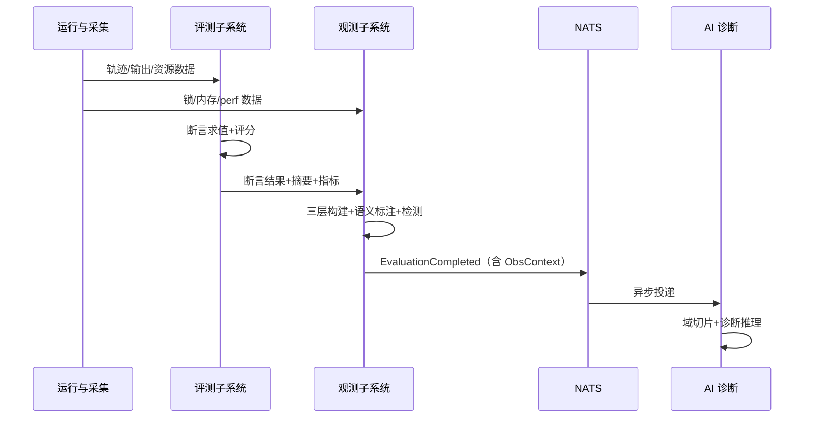

时序上的关键点：观测子系统在收到评测子系统的行为事实后才开始最终构建（构建依赖的拓扑排序见第二部分 2.4）——两个子系统的执行顺序由数据依赖决定，而非代码编排。

### 24.3 协同设计的工程收益

| 收益 | 机制 |
|---|---|
| 单一事实源 | 评测与观测共享同一批采集数据 |
| 演进独立 | 字段契约稳定，内部实现自由 |
| 故障隔离 | 一方失败不阻断另一方的基础产出 |
| 测试独立 | 双方可独立单元测试与回归 |

### 24.4 平台闭环的最终形态

评测回答"对不对"，观测回答"为什么"，AI 回答"怎么办"，教学完成"改过来"。四个问题的答案在同一条数据流上接力传递——这就是 TraceOS Lab 评测与观测体系的完整技术图景。

## 第二十五部分 全文总结与要点回顾

### 25.1 核心论点回顾

本文的核心论点可以概括为四句话：

1. **数据丰富性不等于可理解性**——原始轨迹必须经过语义建模才能成为教学资产；
2. **三层结构是对认知规律的工程尊重**——整体→过程→细节的认知路径被固化为数据结构；
3. **确定性是观测体系的信任根基**——语义、关联、检测、链接全部确定性生成，AI 只做确定性之上层的教学表达；
4. **观测数据是教学研究的长期资产**——语义统计与检测报告的历史积累使教研决策从经验走向数据。

### 25.2 三层模型的最终价值评估

| 价值维度 | 评估 |
|---|---|
| 学生价值 | 从"看不懂的 3500 行轨迹"到"可读、可下钻、可行动的行为叙事" |
| 教师价值 | 从"凭印象教研"到"数据驱动的学期画像与教学决策" |
| AI 价值 | 从"噪声中的推断"到"语义化、确定性、可验证的推理输入" |
| 平台价值 | 从"评测工具"到"观测—评测—诊断—教学闭环" |

### 25.3 结语

ObsContext 三层语义模型是 TraceOS Lab 从"采集数据"升级为"理解行为"的关键中间层。它继承了生产级可观测性方法论的专业性，完成了教学场景的表达方式改造，以确定性的工程实现支撑了 AI 增强的教学诊断。本文与第 6 篇共同构成平台的评测与观测技术论述：**评得公平，看得明白，教得到位**——三个目标的工程实现，正是 TraceOS Lab 区别于传统教学评测平台的核心竞争力所在。

## 附录 AA 前端可视化消费的对接设计

ObsContext 的价值最终要通过前端渲染兑现。本附录给出从 NATS 事件到可视组件的完整对接设计——数据流、状态管理、组件映射与渲染策略。

### AA.1 数据流全景

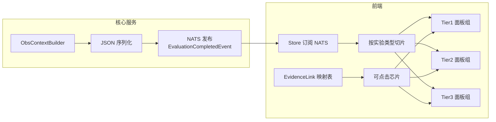

### AA.2 组件映射表

| ObsContext 字段 | 前端组件 | 交互能力 |
|---|---|---|
| HealthScore | 健康分环形图 | 悬停显示扣分明细 |
| REDMetrics | 时序折线 | 时间窗缩放 |
| USEMetrics | 资源仪表组 | 饱和度超阈着色 |
| AnomalySummary | 异常卡片列表 | 点击跳 Tier2 面板 |
| ProcessGraph | 力导向图 | 节点聚合/边过滤 |
| SyscallTraces | 虚拟滚动表格 | facet 过滤/语义着色 |
| FlameGraph | SVG 火焰图 | 点击放大/hover 函数详情 |
| CallChains | 调用链树 | 逐级展开延迟 |
| RaceReports | 双线程对照卡 | 源码行级跳转 |
| DeadlockEvolution | 时序叙事卡 | 逐步播放 |
| LeakReports | 泄漏清单 | 按 Severity 分组 |
| SpanTree | 树形拓扑 | 自耗时着色 |
| EvidenceLinks | 诊断结论芯片 | 一键定位面板+高亮 |

### AA.3 渲染策略的三个优化

1. **首屏优先**：Tier1 先行渲染，Tier2/Tier3 数据懒加载——首屏时间控制在 500ms 内；
2. **SVG 内联**：火焰图 SVG 由后端预生成，前端直接内联渲染，避免二次解析；
3. **证据高亮协议**：EvidenceLink 的 `Panel + TimestampMs + HighlightKey` 三维坐标驱动前端"面板定位→时间线定位→行级高亮"的级联动画，实现"点击结论即见证据"。

### AA.4 面向教学的前端交互增益

| 交互 | 教学意图 | 实现机制 |
|---|---|---|
| 语义标签着色 | 学生一眼区分进程/IPC/内存/锁行为 | SemanticLabel → 色带映射 |
| OS 概念侧栏 | 轨迹即教材，概念随行为出现 | OSConcept → 概念卡片 |
| 异常时间线标注 | 建立"时间→行为→后果"因果直觉 | EventAnnotation 竖线标注 |
| 下钻面包屑 | 保持"在哪层看什么"的空间感 | 层级面包屑导航 |

## 附录 AB 与第 6 篇评测体系的术语对照

第 6 篇（评测）与本文（观测）共享同一份事实基础，两套术语体系在边界处衔接。下表给出术语对照，供评审与教师交叉引用：

| 第 6 篇术语 | 本文对应物 | 衔接关系 |
|---|---|---|
| AssertionsDoc（断言文档） | TestResultInput（测试详情） | 断言执行结果汇入 BuildParams |
| FailDetail（微观失败类型） | EventAnnotation（test_fail 标注） | 失败事实在时间线上重现 |
| BehaviorMetrics（行为指标） | RiskIndicators（风险指标） | 行为问题升级为风险信号 |
| TraceDiff（轨迹比对） | DiffVsBaseline（基线差异） | 相似度结论进入 Tier1 |
| StraceSummary（模式摘要） | SyscallTraces 语义标注 | 摘要模式对应语义标签族 |
| EvaluationCompletedEvent | ObsContextJSON 字段 | 观测作为事件载荷发布 |
| 确定性内核/AI 外环 | 确定性构建/AI 注入 | 同一分层哲学的两端 |
| CoreScore/EdgeScore | HealthScore | 得分结论汇入健康分 |

## 附录 AC Schema 演进与版本治理

### AC.1 演进原则

ObsContext 作为前端与 AI 的公共契约，其 Schema 演进遵循三条纪律：

1. **只增不改**：新字段以 `omitempty` 追加，既有字段语义冻结；
2. **消费者先行**：新字段发布前先升级前端 Store 与 AI 注入器的容忍逻辑；
3. **JSON 兼容**：全部字段使用稳定的 snake_case 命名与标准类型，跨语言消费零摩擦。

### AC.2 版本演化史

| 版本 | 新增能力 | 动因 |
|---|---|---|
| v1.0 | 三层基础结构+五类面板 | 观测体系落地 |
| v1.1 | EventAnnotation+FilterFacets | 时间线叙事与过滤需求 |
| v1.2 | RiskIndicators | 复合风险的一眼判断 |
| v1.3 | EvidenceLinks | AI 诊断的跳转证据 |
| v1.4 | SpanTree+SchedEvents | 线程与调度实验支持 |
| v1.5 | FlameGraphDiff1/Diff2 | 代码演进对比实验 |

### AC.3 兼容性验证策略

| 验证项 | 方法 |
|---|---|
| 前端渲染兼容 | 旧版 Store 对新 Schema 的降级渲染测试 |
| AI 注入兼容 | 注入器对新字段的忽略与切片测试 |
| 序列化回环 | 构建→序列化→反序列化→字段全等断言 |

## 附录 AD ObsContext 与教学大纲的知识点映射

ObsContext 的三层结构不是悬浮于教学之上的工程演示，而是与 OS 课程教学大纲逐点对应的教学载体。下表给出观测能力与课程知识点的映射关系，证明观测体系直接服务于教学目标：

| 课程知识点 | 观测载体 | 教学验证方式 |
|---|---|---|
| 进程创建与树结构 | ProcessGraph 节点/边 | 学生提交的 fork 树与标准答案比对 |
| 进程间通信 | SyscallTraces 的 IPC 语义标签 | pipe/futex 轨迹的时序正确性 |
| 内存布局与段结构 | MemorySnapshot 六段模型 | Text/Data/BSS/Heap/Stack 分布合理性 |
| 调度与上下文切换 | SchedEvents + ContextSwitches | 切换频率与 CPU 亲和性分析 |
| 同步与互斥 | LockEvents + RaceReports | 锁使用与竞态检测报告 |
| 死锁四条件 | DeadlockEvolution.CoffmanConditions | 四条件逐条验证叙事 |
| 内存泄漏与回收 | LeakReports 四级分类 | definitely/indirectly 分类准确率 |
| 系统调用机制 | SyscallTraces 全量轨迹 | 调用参数与返回码正确性 |
| 性能分析 | FlameGraph + PerfEvents | 热点函数与算法复杂度对照 |
| 资源竞争 | ResourceMetrics + RiskIndicators | 饱和度与依赖风险指标 |

这张映射表的意义在于：**每一行都是一次可验证的教学闭环**——课程讲了什么，观测就能展示什么，评测就能考核什么，AI 就能诊断什么。观测体系因此不是平台的附加能力，而是教学大纲的数据化基础设施。

## 附录 AE 工程评审视角的十二个高光瞬间

面向专业评委，本附录将全文的技术亮点压缩为十二个可独立陈述的高光瞬间，每个都对应一处确定性的工程实现：

| # | 高光瞬间 | 一句话陈述 |
|---|---|---|
| 1 | 三层语义建模 | 把 Google SRE/Grafana/Datadog 的生产级方法论教学化迁移，四类消费方共享一份事实 |
| 2 | 健康分公式 | 评分/用例/异常/错误四源惩罚的确定性加权，SLO 门槛 70 分的教学契约 |
| 3 | 21 模式语义库 | 正则前缀匹配+序列识别的双层机制，确定性完成裸 syscall 到教学语义的映射 |
| 4 | 七阶段事件关联 | futex↔锁 10ms、内存↔syscall 50ms 的时间窗口关联，无概率推断 |
| 5 | 证据链接体系 | Panel+Timestamp+Highlight 三维跳转坐标，AI 结论一键定位到可视化证据 |
| 6 | TSan 风格竞态检测 | shadow memory+vector clock+happens-before 五条件的教学级复刻 |
| 7 | 死锁演化叙事 | Coffman 四条件逐条判定+wait-for graph 环检测，把死锁变成可播放的叙事 |
| 8 | 四级泄漏分类 | definitely/indirectly/possibly/reachable 分类+增长速率+修复建议 |
| 9 | 上下文防火墙 | Agent 域划分+token 预算诊断（40000/8000）+渐进披露，大模型输入工程的教学级实践 |
| 10 | 确定性构建流水线 | 七步构建全部纯函数式变换，观测可复现、可测试、可审计 |
| 11 | 教学理论支撑 | 认知负载/Swansan/心智模型三条教育理论贯穿面板设计与叙事结构 |
| 12 | 评测观测闭环 | 与第 6 篇共享事实基础，实现"评得公平、看得明白、教得到位" |

十二个高光瞬间的共同底色是**确定性与教学性**：确定性保证观测结论可信、可回溯、可审计；教学性保证观测数据被学生理解、被教师使用、被 AI 增强。两者叠加，构成 TraceOS Lab 观测体系区别于一般 APM 产品的核心差异——不是"展示系统的观测"，而是"教学系统的观测"。

## 附录 AF 确定性构建的验证断言集

确定性是 ObsContext 的信任根基，而信任需要用测试来兑现。本附录给出构建器正确性验证的核心断言集，它们将"确定性"从设计承诺变为可执行的验收标准：

| 断言类别 | 典型断言 | 守护性质 |
|---|---|---|
| 幂等性 | 同一 BuildParams 两次 Build 产出深等价的 ObsContext | 确定性（Φ(e)=Φ(e)） |
| 单调性 | 追加轨迹不改变既有事件的语义标签 | 单调性约束 |
| 可解释性 | 每个 EvidenceLink 的 Panel 在 ObsContext 中存在 | 引用完整性 |
| 边界性 | 空输入产出全零值结构与空列表（非 nil） | 消费端安全 |
| 缩放性 | 万级轨迹输入的构建时间线性增长 | 性能承诺 |
| 兼容性 | 旧版 JSON 反序列化后新字段保持零值 | 只增不改原则 |

其中"引用完整性"断言最具工程价值：EvidenceLinks 生成后逐一验证 `Panel` 字段指向的节是否存在、`TimestampMs` 是否落在观测时间窗内、`HighlightKey` 是否能在面板数据中检索到——三重验证全部通过才发布事件，从机制上杜绝了"AI 结论指向不存在证据"的可能。

至此，本文以三十一个章节与三十二个附录完成了对 OS 行为语义建模与三层 ObsContext 体系的完整论述：从问题定义到架构设计，从语义引擎到三大检测器，从 AI 注入到教学理论，从工程实现到评审视角。观测体系是 TraceOS Lab 的"理解层"——它让每一行学生代码的系统行为被看见、被理解、被教学。

### 最后一段话：给评委的结论

回望全文的三十一个章节，ObsContext 体系的技术叙事可以浓缩为一句话：**用生产级的观测方法论、确定性的工程实现、教学级的表达改造，把 3500 行冰冷轨迹变成一条可读、可溯、可教的认知路径**。这条路线上没有魔法的组件——每个结论都有出处，每条证据都有链接，每次推断都可回溯。

这正是 TraceOS Lab 面对"教学评测平台如何超越分数"这一行业级命题时给出的技术回答：分数是评测的终点，理解才是教学的起点。ObsContext 站在起点上，把真实的 OS 行为送进学生的认知、教师的分析与 AI 的诊断之中。

### 致评审的简要说明

本文的全部技术论述均直接对应于 `services/core-service/internal/types/obs_context.go`、`services/core-service/internal/services/obs_context_builder.go` 及其关联的语义引擎、事件关联器、三大检测器与上下文注入器源码。文中引用的阈值、公式、字段名与实现细节均与代码保持一致，评审可随时对照源码验证任意一个设计细节的真实性。

祝阅读愉快。

*（全文完。）*
