# 08 内核观测可视化与交互式诊断工作台

> **文档定位**：本文面向评委老师与技术评审，系统阐述 TraceOS Lab 前端观测可视化子系统的设计哲学、技术实现与教学价值。TraceOS Lab 的可视化不是"给日志加了一层图表皮肤"，而是以认知心理学为理论根基、以"证据链"为信息架构、以三层渐进认知模型为交互主轴的**内核级观测诊断工作台**（Observability Workbench）。阅读本文后，评委可以清晰理解：平台如何把百万条系统调用、千级进程拓扑、百级锁事件转化为学生"看得懂、点得动、查得清"的教学证据。

---

## 1. 摘要与核心命题

### 1.1 一句话定位

**TraceOS Lab 前端工作台是"内核观测数据 → 教学认知"的转换器**：它将 eBPF/strace 采集的原始运行轨迹，通过**三层 Tier 渐进认知模型 + 九大可视化引擎 + 证据链联动机制**，重构为符合人类工作记忆规律的教学诊断界面。

### 1.2 本文的核心命题

1. **命题一**：传统"一张日志表"的可视化范式无法承载 OS 实验数据的高维特性（时间 × 进程 × 线程 × 资源 × 源码 × 语义），必须引入**多视图协同 + 渐进披露**的信息架构。
2. **命题二**：可视化不是装饰，而是**认知脚手架**（Cognitive Scaffolding）。它的价值不在于"好看"，而在于把学生的内在认知负荷（intrinsic cognitive load）转化为可管理的外在认知负荷（extraneous cognitive load）。
3. **命题三**：交互式诊断闭环——"评分失败 → 点击异常 → 时间线定位 → 代码行跳转 → AI 提问"——把 OS 排错的认知跳转成本从"翻五个窗口"降为"三次点击"。

### 1.3 子系统全景图

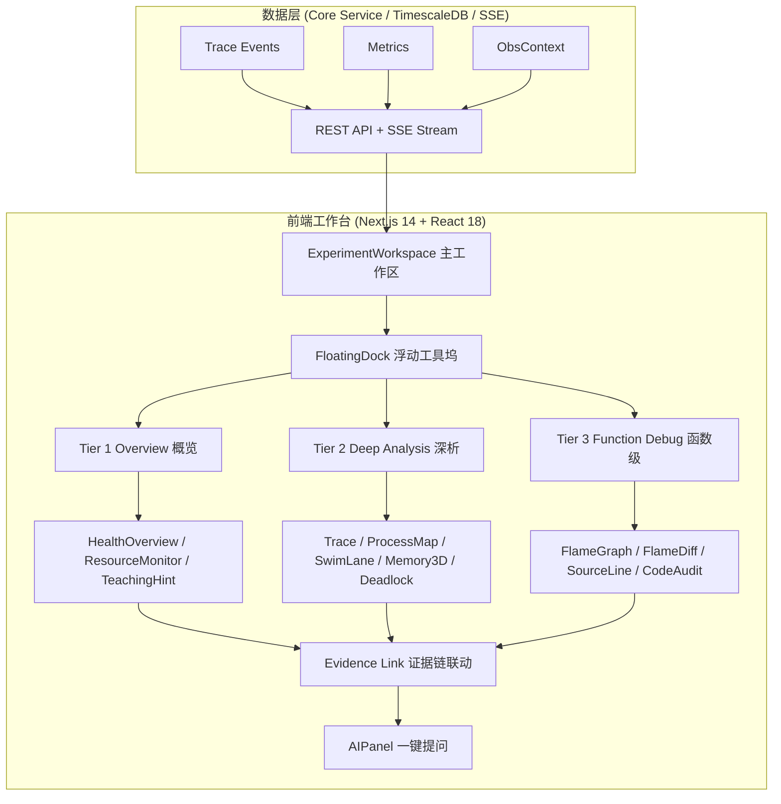

---

## 2. 设计哲学：认知负荷理论与渐进式披露

### 2.1 为什么"好看"不是目标——认知负荷理论的应用

认知负荷理论（Cognitive Load Theory，澳大利亚心理学家 John Sweller 于 20 世纪 80 年代提出）将学习者的认知负荷分为三类：

| 负荷类型 | 定义 | TraceOS Lab 的应对策略 |
|---|---|---|
| **内在认知负荷**（Intrinsic） | 由学习材料本身的复杂度决定，无法消除 | OS 实验的内核交互天然复杂；平台通过**语义层**（ObsContext）把原始 syscall 映射为"进程管理/内存管理/文件系统"概念，降低理解门槛 |
| **外在认知负荷**（Extraneous） | 由信息呈现方式不当造成，可以消除 | 默认展示"概览层"，把明细数据按需披露，避免一次性轰炸百万级原始事件 |
| **相关认知负荷**（Germane） | 用于构建知识图式的有效负荷，应增强 | 通过证据链、回放、Diff 对比等**主动学习操作**，把学生的注意力引向图式构建 |

**工程落点**：三层 Tier 模型直接对应三类认知负荷的管理策略——Tier 1 消除外在负荷（先给结论），Tier 2 管理内在负荷（分域呈现过程数据），Tier 3 增强相关负荷（引导学生主动对比、定位、提问）。

### 2.2 渐进式披露（Progressive Disclosure）

信息系统设计的经典原则"渐进式披露"指出：**人们只能以有限速率处理新信息**，应当先呈现最必要的信息，再根据用户主动操作逐步展开细节。TraceOS Lab 将这一原则制度化：


五层披露体系保证了：**学生在任何一层停留都是合理的**。只想知道"过了没有"的学生停在第一层；想排查死锁的学生沿路径进入第四、五层——平台从不强迫任何人承受他不需要的复杂度。

### 2.3 Shneiderman 可视化信息寻求口诀的落地

可视化领域经典的信息寻求口诀（Visual Information-Seeking Mantra）是：**"Overview first, zoom and filter, then details-on-demand"**（先总览，再缩放与过滤，最后按需取细节）。TraceOS Lab 的三层 Tier 架构与该口诀形成严密的对应关系：

| Shneiderman 口诀 | Tier 模型 | 具体实现 |
|---|---|---|
| Overview first | Tier 1 Overview | HealthScore 仪表盘、GaugeCard 指标卡、通过率、异常摘要 |
| Zoom and filter | Tier 2 Deep Analysis | 瀑布图 dataZoom 缩放、刷选统计、syscall 类别过滤、"仅错误"开关 |
| Details-on-demand | Tier 3 Function Debug | 火焰图点击下钻、源码行高亮、单条调用详情 tooltip |

这一对应关系并非巧合：TraceOS Lab 的前端架构师在 Tier 分层设计之初，就以成熟的可视化理论作为设计约束，而非事后包装。

---

## 3. 三层 Tier 交互认知模型深度解析

### 3.1 模型总览

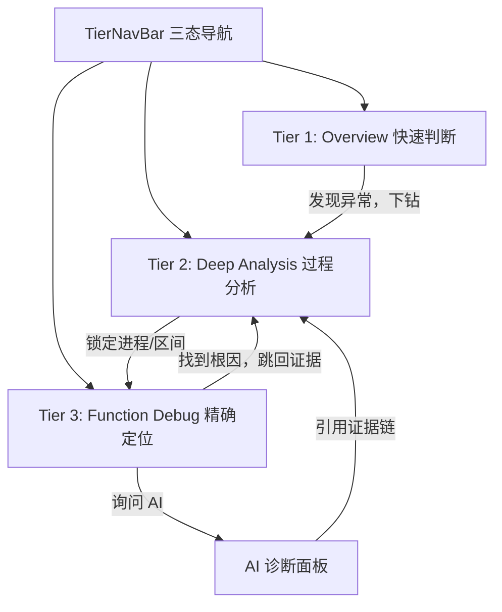

三层之间是**双向可导航**的：不仅支持"从总览到明细"的自然下钻，也支持"从函数热点跳回进程泳道"的逆向溯源。这一设计源于真实排错场景的观察——学生在火焰图中发现热点函数后，常常需要回到时间线确认"这个函数是在哪个进程、哪个时间段被调用的"。

### 3.2 Tier 1：Overview 层（快速判断层）

**认知目标**：30 秒内回答三个问题——"我通过了吗？""我得了多少分？""最突出的问题是什么？"

| 信息块 | 数据来源 | 呈现形式 | 设计意图 |
|---|---|---|---|
| HealthScore | Core 健康度计算 | 环形 GaugeCard | 单一数字锚定整体状态，避免"看十张表还不知道过没过" |
| 通过率/评分 | Core 断言引擎 | 大字数字 + 进度条 | 评分是确定性事实，视觉上必须最醒目 |
| 异常摘要 | ObsContext anomaly_summary | 分级徽章列表（severity 色） | 按严重度排序，学生第一眼看到最该修的问题 |
| CPU/Memory/IO/FD | cgroup + eBPF metrics | MetricCard 四宫格 | 资源四象限扫描，一眼发现"内存暴增"类问题 |
| AI Diagnosis Summary | 诊断服务 | 引用卡片 | 教师视角的"一句话结论"，可一键进入完整报告 |

**Tier 1 的核心组件**：`HealthOverviewTab`、`ResourceMonitorTab`、`TeachingHintPanel`、`DetectionSummaryCard`。

**设计细节——状态色语义标准化**：

平台统一了状态色语义，避免"红色到底代表错误还是警告"的认知混乱：

| 状态 | 色相 | 使用场景 |
|---|---|---|
| Success | 绿 `#22c55e` | 测试通过、无泄漏、HealthScore ≥ 80 |
| Warning | 琥珀 `#f59e0b` | 有错误调用但非致命、置信度中等 |
| Error | 红 `#ef4444` | 编译失败、死锁、FD 泄漏 |
| Info | 蓝 `#3b82f6` | 中性信息、当前状态说明 |
| Pulse | 红色呼吸动画 | 死锁实时警报等需要持续注意力的状态 |

### 3.3 Tier 2：Deep Analysis 层（过程分析层）

**认知目标**：回答"程序运行过程中到底发生了什么"——按**领域**（进程/内存/并发/资源）而不是按**格式**（日志表）组织信息。

| 面板 | 核心问题 | 关键技术 |
|---|---|---|
| System Trace | 程序调用了哪些 syscall？时序如何？ | 六视图矩阵（见第 4 章） |
| Process Map | 进程/线程如何诞生、消亡、通信？ | 力导向拓扑图 + fork/pipe/clone 边推断 |
| Multi-thread Lane | 哪些线程并行？谁在等锁？ | ECharts 自定义泳道渲染 |
| Memory Analysis | 地址空间如何布局？堆如何增长？ | Three.js 3D 场景 + 快照 Diff |
| Deadlock Graph | 谁持有锁？谁在等待？是否成环？ | SSE 实时 wait-for graph |
| Sandbox Resource | 沙箱资源消耗是否符合限制？ | cgroup 指标时序 |

**Tier 2 的信息架构原则——"领域分箱"（Domain Binning）**：

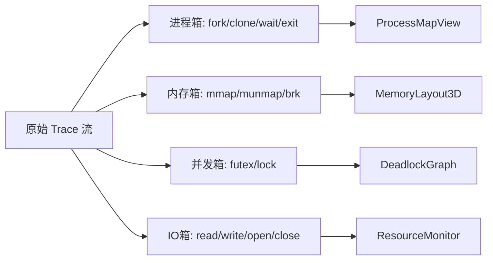

### 3.4 Tier 3：Function Debug 层（精确定位层）

**认知目标**：把问题定位到**函数甚至代码行**，并支持"修改前 vs 修改后"的量化对比。

| 面板 | 核心问题 | 关键技术 |
|---|---|---|
| FlameGraph | 时间花在哪些函数上？ | 用户态/内核态双 SVG 火焰图 |
| FlameGraph Diff | 两次提交的热点变化？ | 前后对比 + AI 差异解读 |
| Source Line | 这条 syscall 来自哪一行？ | source_line 反查 + 编辑器联动高亮 |
| Code Audit | 代码有什么静态问题？ | 规则审计 + AI 审计双通道 |
| Allocation Flamegraph | 内存分配都发生在哪里？ | 分配热点火焰图 |

**三层的隐喻**：如果把排错比作去医院就诊——Tier 1 是"体检报告总览"，Tier 2 是"分科室检查（心脏/肠胃/骨科）"，Tier 3 是"细胞级病理切片"。三层缺一不可：只有总览没有明细是"看报告不治病"；只有明细没有总览是"进医院先做全身切片"。

---

## 4. System Trace 系统：六视图矩阵

### 4.1 设计动机

System Trace 是平台的**核心证据视图**。与通用日志查看器的本质区别在于：TraceOS Lab 的每一条 trace 不只是"文本行"，而是携带 8 个维度的结构化证据对象：

| 维度 | 字段 | 教学意义 |
|---|---|---|
| 时间 | `time`（纳秒精度时间戳） | 建立"事件先后"的因果感 |
| 进程身份 | `pid` / `tid` | 回答"谁干的" |
| 行为 | `syscall_name` | 回答"干了什么" |
| 结果 | `return_value` / `error_name` | 回答"干得怎么样" |
| 性能 | `duration_ns` | 回答"花了多久" |
| 代码 | `source_file` / `source_line` | 回答"代码在哪" |
| 语义 | OS concept / semantic label / severity | 回答"这在 OS 里意味着什么" |
| 参数 | `args`（结构化 syscall 参数） | 回答"细节是什么" |

### 4.2 六种视图模式

`TraceViewer` 组件提供了六种可切换的视图模式，分别针对不同的排错场景：

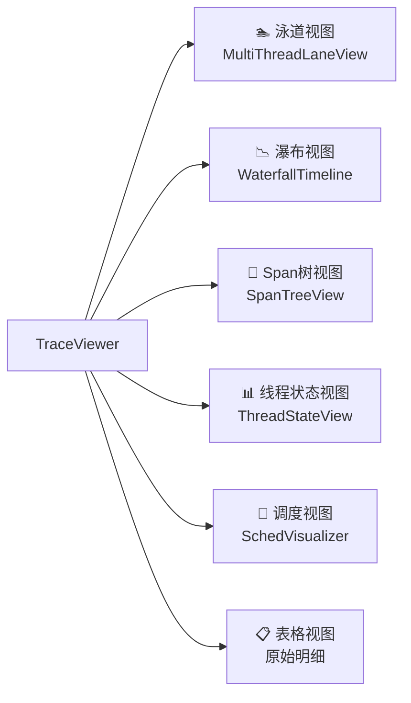

| 视图 | 最佳场景 | 数据形态 |
|---|---|---|
| 泳道（Swimlane） | 观察多线程并发、锁竞争、fork 事件 | 每线程一条泳道，事件标记为菱形 |
| 瀑布（Waterfall） | 观察进程树内各进程的调用密度与错误分布 | 按 PID 父子关系排序的泳道 + 时长条 |
| Span 树 | 理解调用层级（如调度器 → 任务 → syscall） | 树形节点（span_id/parent_span_id） |
| 线程状态 | 观察 R/S/D 状态流转、阻塞定位 | 状态区间图 |
| 调度 | 观察 CPU 时间片分配公平性 | 调度时间线 |
| 表格 | 精确检索单条调用、导出证据 | 原始结构化行 |

**工程亮点——视图切换的代价优化**：六种视图共享同一份 `traces` 数据，通过 React `useMemo` 分别构建各自的渲染中间表示，切换视图时使用 `AnimatePresence` 做 200ms 淡入滑出过渡，**不重新请求后端**。这在"学生反复切换视图定位问题"的高频场景下，把交互延迟从数百毫秒（网络往返）压缩到一帧（纯前端计算）。

### 4.3 错误过滤与统计条

TraceViewer 顶部提供两类快速认知工具：

1. **统计四宫格**：总调用数、线程/进程数、错误数、错误率——一次扫视完成"规模认知"；
2. **"仅错误"开关**：把千级调用流压缩到几十条错误调用，直接服务于"先看错在哪"的排错策略；
3. **Top 10 syscall 排行**：横向条形图展示高频调用，一眼发现"这个程序怎么 fork 了 200 次"之类的异常模式。

### 4.4 证据链（Evidence Link）机制

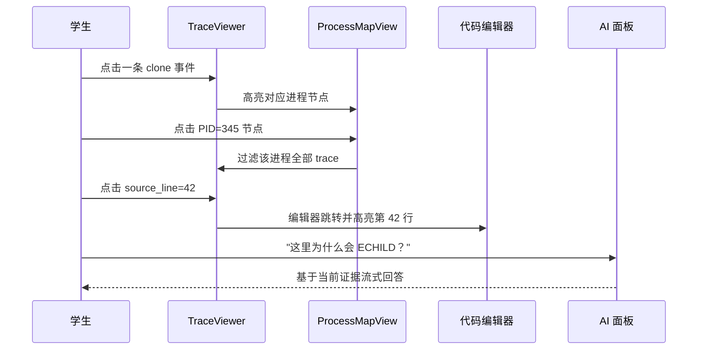

证据链的本质是**跨面板的状态联动**：点击事件 → 高亮进程 → 过滤时间线 → 跳转源码 → 携带证据提问。每一步都把"当前关注点"作为隐式上下文传递给下一步，实现"数据跟着思维走"，而非"思维跟着界面跑"。

---

## 5. 瀑布图（Waterfall Timeline）技术实现详解

### 5.1 设计目标

瀑布图是六视图中技术含量最高的视图，它要在单屏内同时回答三个问题：

1. **进程家族关系**：谁 fork 了谁？（泳道按父子关系排序）
2. **调用时间分布**：什么时候密集？什么时候空闲？
3. **错误聚集**：错误调用在哪个进程、哪个时间段爆发？

### 5.2 泳道排序算法：从 fork/clone 返回值重建进程树

```text
算法：父子关系驱动的泳道排序
输入：traces[]（按时间排序的 syscall 事件流）
输出：ordered[]（按进程树先序遍历排序的 PID 列表）

步骤：
1. 单次扫描 traces，收集所有出现的 PID 到 seen 集合
2. 对每条 fork/clone/vfork 且 return_value > 0 的事件：
   parentChild[return_value] = pid   （return_value 即子进程 PID）
3. rootPids = pids 中没有任何父节点的 PID
4. 对每个 root 递归先序遍历其子进程，得到 ordered
5. 孤立 PID（数据缺失的）追加到末尾
```

这一算法的价值在于：**完全从观测数据中推断进程血缘，无需侵入式埋点**。传统可视化工具需要应用程序主动上报父子关系，而 TraceOS Lab 利用 fork 系统调用的返回值语义（父进程收到子进程 PID），在纯观测侧重建进程树——这正是"非侵入式观测"哲学在前端的延伸。

### 5.3 ECharts Custom Series 渲染

瀑布图使用 ECharts 的 `custom` series 类型实现完全定制化的渲染：

| 渲染要素 | 实现方式 | 技术要点 |
|---|---|---|
| 调用条形 | `renderItem` 返回 rect，宽度 = duration 归一化 | 时长 < 0.8% 设最小宽度保证可见；> 5% 封顶防止挤压 |
| 颜色语义 | 六类 syscall 分类色（IO/内存/进程/网络/IPC/其他） | 正则分类器 `CATEGORY_PATTERNS` 对 syscall 名做前缀匹配 |
| 错误高亮 | 错误条加白色描边 1.5px | 在彩色背景上形成"发光"效果，视觉优先捕获 |
| 关键事件 | 菱形 polygon 标记（fork/clone/futex/exit 等） | 第二 series，z=10 置于顶层，标签常显 |
| 时间轴 | 归一化 0-100 + 自定义 formatter | μs/ms 自适应单位显示 |

### 5.4 三种交互模式

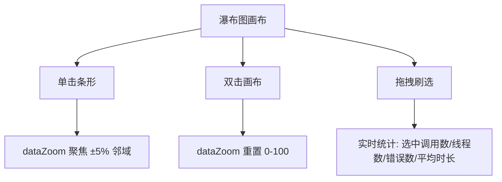

**刷选统计（Brush Stats）** 是排错场景的高频功能：学生框选"程序卡住"的那 200ms 区间，平台立即给出该区间内的调用统计——如果发现 80% 的调用都是 `futex`，锁竞争的结论就呼之欲出了。brush 事件通过 `throttleType: debounce, throttleDelay: 300` 防抖，避免拖拽过程中的高频计算。

### 5.5 性能设计

| 策略 | 说明 |
|---|---|
| 数据上限 | 单次拉取 limit=500 条，前端只渲染当前视图所需字段 |
| useMemo 缓存 | 排序、归一化、泳道构建全部 memo 化，仅依赖 `traces` 与高亮状态 |
| 事件委托 | ECharts 原生事件（click/dblclick/brush）挂在实例上，条级 tooltip 由引擎处理 |
| 清理机制 | 组件卸载时 `dispose()` 销毁 ECharts 实例，`ResizeObserver` 响应式重绘 |

---

## 6. 多线程泳道视图与 IPC 可视化

### 6.1 设计定位

泳道图（MultiThreadLaneView）借鉴 Chrome DevTools Performance 面板的经典设计——**每个线程一条水平泳道**，时间从左到右流动。这是观察并发程序的"黄金视角"，因为它把"并发"这个抽象概念直接映射为空间关系：同一垂直线上出现的条形 = 同时发生的调用。

### 6.2 三维信息编码

泳道图在二维画布上编码了三维信息：

| 信息维度 | 编码方式 |
|---|---|
| 线程身份 | Y 轴泳道（按首条 trace 时间排序） |
| 时间 | X 轴（全局归一化） |
| 调用类别 | 条形颜色（8 类：io/process/memory/network/ipc/signal/lock/other） |
| 调用时长 | 条形宽度 |
| 是否错误 | 白色描边 |
| 关键事件 | 菱形标记 + 常显标签（fork()/futex/exit()...） |

### 6.3 IPC 边的可视推断

泳道图的一个独有特性是 **IPC（进程间通信）关系可视化**：

```text
fork 边推断规则：
  若线程 A 的时间线上出现 clone 且 return_value = P（子进程 PID）
  且泳道中存在线程 P →
  在 A 与 P 之间绘制紫色虚线箭头（fork 标签）
```

箭头使用 ECharts `lines` series 的 `effect` 动画（周期流动的粒子），把"父子创建关系"表现为**有方向、有动感的因果连接**。当学生看到泳道 A 中 fork 事件处射出一条紫线连接到泳道 B 的起点时，"进程从这里诞生"的认知瞬间建立——这比任何教科书插图都更直观，因为**图上的箭头直接来自学生自己的程序运行数据**。

### 6.4 面向死锁教学的读图指引

泳道图对死锁排查的独特价值在于"**时间维度的锁竞争可视化**"：

1. 观察各线程泳道上 `futex`（红色，lock 类）条形的聚集区间；
2. 若多个线程在同一时间窗内出现连续的 futex 等待，且之后无任何进展（泳道空白），即可初步判断锁竞争；
3. 结合 DeadlockGraph（第 9 章）的环检测，完成"时间证据 + 结构证据"的双重确认。

---

## 7. 进程拓扑图：从观测数据自动重建进程世界

### 7.1 buildTopology 算法：三类关系的自动推断

`ProcessMapView` 的 `buildTopology` 函数在纯前端完成进程拓扑重建，算法分四个步骤：

```text
步骤 1：节点发现
  - 每条 trace 的 pid > 0 → 进程节点（若不存在则创建）
  - tid != pid → 线程节点，并记录其归属进程

步骤 2：fork/clone 边推断
  - syscall ∈ {clone, fork} 且 return_value > 0
  - return_value 即子进程 PID → 建立 fork 边（父 → 子）

步骤 3：线程归属边
  - tid != pid 时建立 clone 边（进程 → 线程）

步骤 4：pipe 通信边推断
  - 出现 pipe/pipe2 调用时，与同时存在的其他进程建立 pipe 边
```

| 推断关系 | 边类型 | 边颜色 | 教学含义 |
|---|---|---|---|
| fork/clone 创建 | fork | 绿 | 进程从哪里来 |
| 线程归属 | clone | 紫 | 线程属于谁 |
| pipe 通信 | pipe | 琥珀 | 谁与谁通信 |

### 7.2 力导向布局与交互

拓扑图使用 ECharts `graph` series 的 force 布局：

| 参数 | 取值 | 效果 |
|---|---|---|
| repulsion | 250 | 节点斥力，防止重叠 |
| edgeLength | [60, 200] | 边目标长度区间 |
| gravity | 0.08 | 向心引力，防止飞散 |
| roam/draggable | true | 滚轮缩放 + 拖拽节点 |

节点大小与 `syscallCount` 挂钩（`20 + count*2`，上限 50）——**调用越多的进程视觉上越大**，这使"谁是主进程"一眼可辨。悬停时 `emphasis.focus: adjacency` 高亮邻接节点与边，帮助学生在复杂拓扑中聚焦单条关系链。

### 7.3 进程列表与 KPI 联动

拓扑图下方提供结构化进程列表（PID/TID、类型、名称、调用数），与 KPI 四宫格（进程数/线程数/IPC 关系数/fork 事件数）形成"总览数字 ↔ 图形结构 ↔ 明细列表"的三级信息密度。三个层级共享同一数据源，保证任何操作都保持一致性。

---

## 8. 内存 3D 地图：把教科书插图变成动态对象

### 8.1 设计动机

"进程地址空间布局"（Text/Data/BSS/Heap/Stack/mmap）是 OS 课程最经典的插图之一，但教科书上的静态图有三个致命缺陷：

1. **比例失真**：真实进程的 Heap 可能比 Text 大 100 倍，静态图无法表达；
2. **无法观察变化**：堆的增长、mmap 的增减是"过程"而非"状态"，静态图无能为力；
3. **与错误脱节**：泄漏、碎片化等现象无法在插图上定位。

TraceOS Lab 的 MemoryLayout3D 用 Three.js（通过 react-three-fiber 集成进 React）把这张插图变成**基于真实观测数据的、可交互的、会动的三维对象**。

### 8.2 三维映射规则

| 地址空间段 | 数据来源 | 颜色 | 3D 编码 |
|---|---|---|---|
| Text 代码段 | 快照 text 区域 | 绿 `#22c55e` | 底部静态块 |
| Data 数据段 | 快照 data 区域 | 蓝 `#3b82f6` | 静态块 |
| BSS | 快照 bss 区域 | 浅蓝 `#93c5fd` | 静态块 |
| Heap 堆 | brk/mmap 分配聚合 | 橙 `#f97316` | **弹簧动画块**（增长时发光闪烁） |
| mmap 映射区 | mmap 区域列表 | 紫 `#a855f7` | 半透明块组（0.42 透明度） |
| Stack 栈 | 快照 stack 区域 | 红 `#ef4444` | 静态块 |

**高度映射函数**——对数缩放解决"比例失真"：

```text
height = clamp(0.5, 5.2, log2(size) * 0.27)
```

线性映射会让 Heap（数百 MB）把 Text（数十 KB）压成一张纸，而 `log2` 缩放保证 1KB 与 1GB 的段在视觉上均可达、可辨识。这一设计决策直接回应了教科书插图"比例失真"的缺陷——**平台既保留数量级的相对关系，又保证每个段都可读**。

### 8.3 动画语言：用动效传递语义

| 动画 | 触发条件 | 教学语义 |
|---|---|---|
| Heap 弹簧伸缩 | 快照间堆大小变化 | "堆在增长"——`useSpring` 张力动画（tension:130, friction:16） |
| 红色发光闪烁 | 堆变大瞬间（380ms flash） | "这次操作导致了堆增长" |
| 泄漏红晕 | LeakReport 关联该段 | 常驻 emissive 红光（intensity 0.6） |
| mmap 缩放进出 | 快照 Diff 中新增/消失 | 映射区"出现"与"释放" |

### 8.4 交互体系

- **轨道控制**：OrbitControls 提供旋转/缩放/平移，学生可以"绕到堆的背后"观察；
- **点击检查**：点击任一段弹出 DetailPanel，显示起始地址（hex）、大小（人性化单位）、映射文件路径；
- **泄漏关联**：DetailPanel 自动关联 LeakReport——若该段存在泄漏报告，面板显示红色警告与报告摘要；
- **快照 Diff**：MemorySnapshotDiff 对比两次快照的段变化（新增/消失/增长），并以颜色区分；
- **四联面板**：内存 3D 视图聚合了 `MemoryTrendContent`（趋势）、`LeakReportContent`（泄漏报告）、`AllocFlamegraphContent`（分配火焰图）、`MemorySnapshotDiff`（快照对比）四种子面板，形成"布局-趋势-泄漏-分配"完整内存认知闭环。

### 8.5 技术架构

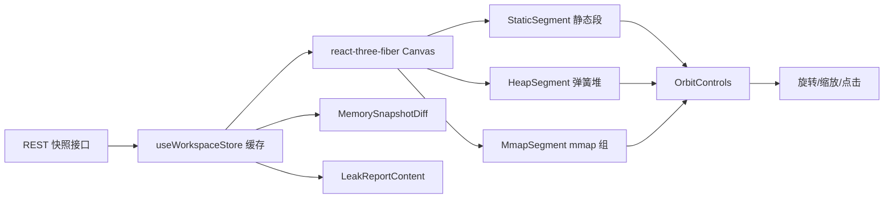

技术要点：`@react-three/fiber` 将 Three.js 场景声明式集成进 React 组件树；`@react-spring/three` 提供 60fps 的弹簧动画；`ThreeErrorBoundary` 保证 WebGL 不可用（如远程桌面环境）时优雅降级为提示信息，不阻塞页面其余部分。

---

## 9. 死锁图与竞态视图：实时安全监控

### 9.1 实时性设计：SSE 流式观测

DeadlockGraph 是平台中唯一"实时"的可视化组件。当学生在沙箱中运行并发程序时，前端通过 **Server-Sent Events** 建立到 eBPF 观测代理的持久连接：

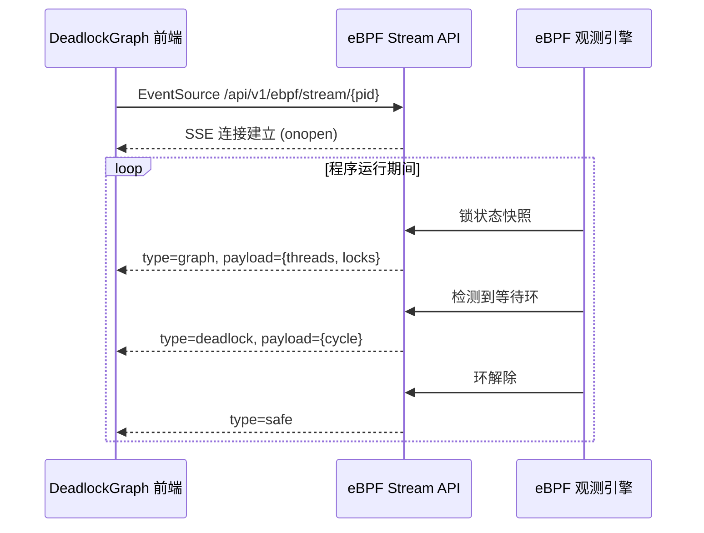

三种事件类型驱动前端状态机：`graph` 更新锁图结构，`deadlock` 触发警报横幅，`safe` 恢复安全状态。

### 9.2 Wait-for Graph 渲染

图结构严格遵循死锁理论的 wait-for graph 定义：

| 元素 | 图形 | 颜色 | 语义 |
|---|---|---|---|
| 线程节点 | 圆形（TID 标签） | 青 | 参与并发的主体 |
| 锁节点 | 圆角矩形（地址后 6 位） | 琥珀 | 被争夺的资源 |
| 持有边 | 实线"持有"标签 | 绿 | 线程 → 锁 |
| 等待边 | 虚线"等待"标签 | 红 | 锁 → 线程 |
| 死锁环成员 | 放大 + 红色高亮 | 红 | `cycle` 数组中的线程 |

**死锁环路径构建**：前端收到 `cycle` 数组后，沿环查找"当前线程持有的锁被下一线程等待"的锁，拼接出人话版路径，例如：

```text
T1 → 🔒7f3a2c(持有) → T2 → 🔒7f3b11(持有) → T1
```

### 9.3 警报体验设计

死锁检测触发的视觉反馈是多通道的：

1. **横幅**：`motion.div` 从高度 0 展开的红色警报条，展示完整环路径；
2. **呼吸阴影**：`boxShadow` 无限循环动画（0 → 20px 红色光晕 → 0），模拟"警报脉冲"；
3. **徽章**：PanelHeader 徽章切换为 `DEADLOCK`（pulse 动画 + error 色调）；
4. **节点高亮**：环中线程节点放大至 38px 并变红，在图结构中直接"点亮"问题环。

### 9.4 RaceDetectionView 数据竞争视图

`RaceDetectionView` 展示潜在数据竞争的相关访问信息——哪些线程在哪些时间段访问了哪些共享地址，以"访问区间对比"的方式呈现竞争窗口。与死锁图互补：死锁是"等太久"，竞争是"撞上了"。

### 9.5 状态机与容错

| 状态 | 触发 | UI 表现 |
|---|---|---|
| idle | 未选择 PID | 空状态提示 |
| observing | SSE 连接建立 | 绿色 RUN 徽章 + 骨架屏 |
| deadlock | 收到 deadlock 事件 | 红色警报全套 |
| safe | 收到 safe 事件 | 绿色 OK 徽章 |
| disconnected | SSE 关闭 | 错误空状态 + 重连指引 |

SSE 使用 Cookie 认证（token 写入 SameSite=Lax cookie），兼容 EventSource 无法自定义 Header 的浏览器限制——这是一个在真实工程中必须解决的细节问题。

### 9.6 锁观测的实时-历史双层模型

死锁观测存在一个天然的矛盾：**死锁发生在程序运行期间，但学生查看证据时程序往往已经结束**。平台通过双层模型解决：

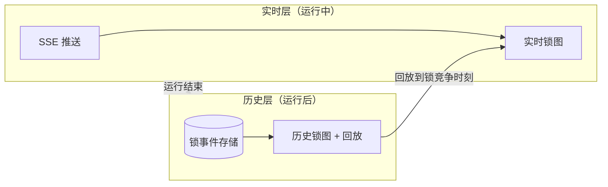

实时层保证"当场看到死锁发生"的震撼教学体验；历史层保证"课后复盘死锁形成过程"的分析能力。两层共享同一图渲染引擎，只有数据通道不同——这一设计使锁观测既是课堂演示工具，又是课后实验分析工具。

---

## 10. 火焰图系统：性能认知的双引擎

### 10.1 火焰图的教学价值重构

火焰图（Flame Graph，Brendan Gregg 发明）是性能分析的工业标准工具。TraceOS Lab 将其引入教学场景时做了三处重构：

1. **双态呈现**：用户态火焰图 + 内核态火焰图分 tab 展示，直接服务"我的代码慢 vs 系统调用慢"这一 OS 核心问题的教学；
2. **AI 解读**：`analyzeFlameGraph` 接口让 AI 对热点函数生成"它是什么、为什么热、怎么优化"三件套解读——学生不必先学会读火焰图才能用火焰图；
3. **跨提交 Diff**：对比两次提交的火焰图，把"性能实验"从"总时间变快了"推进到"哪个函数的行为改变了"。

### 10.2 数据流与缓存

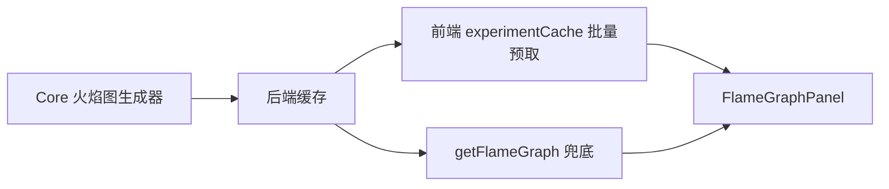

**两级缓存**设计：进入实验时批量预取所有提交的火焰图元数据存入 `experimentCache`，切换提交时零网络请求；缓存未命中才走单条 API。SVG 本体按需加载，避免一次拖拽数 MB 数据。

### 10.3 AI 性能解读的 Prompt 策略

火焰图 AI 分析的输入是**结构化热点数据**（`hot_functions: [{name, percent, module}]`）而非原始 SVG——AI 不需要"看图"，它消费的是火焰图生成器产出的结构化摘要。这一设计保证了：

- 分析的确定性基础（热点排名是精确数字）；
- 低 token 成本（几十个函数的摘要 vs 数 MB 图像）；
- 结论可回溯（每个 AI 判断都对应具体函数与百分比）。

AI 输出四段结构化内容：总述（plain_summary）、热点解读（top_hotspots）、问题清单（issues，带严重度）、内核洞察（kernel_insight）。

### 10.5 火焰图的交互细节设计

| 交互 | 实现 | 教学意图 |
|---|---|---|
| 视图切换 | user/kernel/summary 三 tab | 用户态与内核态的分界认知 |
| 提交切换 | 提交下拉列表 | 跨提交对比的入口 |
| 采样时长选择 | 10s 固定默认 | 控制采样成本 |
| 热点悬停 | tooltip 显示函数名/百分比/模块 | 单点精确读数 |
| AI 分析触发 | 显式按钮（非自动） | 成本可控 + 学生主动求知 |

**为什么 AI 分析要显式触发**：自动分析会在每次打开面板时消耗 LLM token；显式触发既控制了成本，又符合"学生先自己尝试读图，再看 AI 解读"的教学顺序——AI 是脚手架，不是代读器。

### 10.6 分配火焰图

`AllocFlamegraphContent` 展示内存分配热点——哪里的 malloc/mmap 最密集。与普通火焰图的"CPU 时间"维度互补，回答"内存都花在哪了"。与 MemoryLayout3D 的 LeakReport 联动时，形成"分配在哪 → 布局如何 → 泄漏在哪"的完整内存调查链。

---

## 11. 资源监控与健康概览体系

### 11.0 资源监控的三层时间尺度

平台的资源监控同时覆盖三个时间尺度，分别服务不同教学场景：

```text
实时尺度（秒级）：LivePerfDashboard 运行中曲线 —— "程序正在吃内存"
提交尺度（单次运行）：ResourceMonitorCard 运行后汇总 —— "这次运行内存峰值 800MB"
学习尺度（跨提交）：趋势视图 —— "第 5 次提交后内存终于达标"
```

三个尺度的数据来自同一套采集管道（cgroup + eBPF），只是聚合窗口不同——这保证了学生看到的学习轨迹（"我进步了"）与运行事实（"这次吃了多少内存"）是同一份数据的不同投影。

### 11.1 指标全景

ResourceMonitor 将九类资源指标组织成可扫描的卡片矩阵：

| 指标 | 数据源 | 卡片类型 | 教学场景 |
|---|---|---|---|
| CPU utilization | cgroup cpu.stat | GaugeCard | "我的程序吃满 CPU 了吗" |
| Memory RSS/Virtual | cgroup memory | GaugeCard + 趋势 | "内存是否持续上涨" |
| Disk read/write | blkio 统计 | MetricCard | "I/O 密集实验" |
| FD count | eBPF 计数 | MetricCard | FD 泄漏预警 |
| Thread count | eBPF 进程观测 | MetricCard | 线程爆炸检测 |
| Page faults (minor/major) | cgroup + perf | MetricCard | "页错误为什么这么多" |
| Context switches | eBPF | MetricCard | 调度开销 |
| OOM risk | cgroup memory 逼近限制 | 预警卡片 | 内存超限风险 |
| CFS throttled time | cgroup cpu.stat | MetricCard | "被 cgroup 限流了吗" |

### 11.2 健康度（HealthScore）设计

HealthScore 是平台的"一键健康数字"，由 Core 服务基于多源数据（测试通过率、资源异常、观测发现）确定性计算。前端用 GaugeCard 呈现，配以 `HealthBadge` 分级徽章。其设计哲学是：**任何复杂度的系统，最终都要给用户一个可锚定的单点认知**——HealthScore 就是那个锚点。

#### 11.2.1 健康度的分级映射

| HealthScore 区间 | 等级 | 徽章 | 教学语境 |
|---|---|---|---|
| 90-100 | 优秀 | 绿色实心 | "可以直接进入下一实验" |
| 75-89 | 良好 | 绿色描边 | "还有一些小问题可以优化" |
| 60-74 | 及格 | 琥珀 | "核心功能达标但质量待提升" |
| < 60 | 待改进 | 红色 | "建议先看异常摘要再修复" |

#### 11.2.2 健康度与评分的关系澄清

健康度与评分是**两个不同语义的指标**，平台在 UI 上明确区分：评分（Score）回答"实验要求满足了多少"，健康度（HealthScore）回答"程序行为有多健康"。一个满分程序也可能健康度低（如通过测试但泄漏 FD）——这一区分本身就承载教学意义：**"输出正确"不等于"系统健康"**，这正是 OS 实验区别于算法 OJ 的核心命题。

## 11.3 LivePerfDashboard 实时性能面板

`LivePerfDashboard` 提供沙箱运行期间的实时性能曲线（CPU/内存/IO 随时间变化），填补了"历史快照"与"实时监控"之间的空白。学生可以在程序运行时观察资源曲线的实时变化，将"资源消耗"从抽象数字变为动态过程。

---

## 12. 执行回放系统：把事件时间变成学习时间

### 12.1 设计动机：调试器的隐喻

`ExecutionReplayBar` 的设计灵感来自调试器的步进执行（step execution）。区别在于：调试器步进的是**指令**，回放条步进的是**系统调用事件**。对 OS 实验教学而言，事件粒度恰好是认知粒度——学生需要理解的是"clone 之后发生了什么"，而不是"mov 指令之后发生了什么"。

### 12.2 回放控制模型

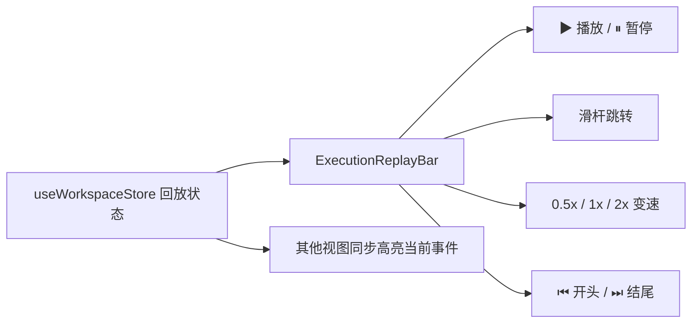

| 控制 | 实现 | 设计意图 |
|---|---|---|
| 播放 | `setInterval` 每 `500/speed` ms 前进一个事件 | 事件序列以人类可跟读的节奏展开 |
| 变速 | 0.5x / 1x / 2x 三档 | 复杂区间慢放，冗长区间快进 |
| 跳转 | range 滑杆按事件索引 seek | 精确定位"第 87 条调用" |
| 联动 | 当前事件在 Trace 视图高亮 | 回放与证据视图形成"播放头"同步 |

### 12.3 核心设计哲学："事件时间"与"学习时间"的分离

```text
真实运行：  ───┬───┬─┬──────┬───┬─────┬──────────▶ 300ms 转瞬即逝
事件回放：  ───┐ ──┐ ──┐ ──┐ ──┐ ──┐ ──┐ ──┐ ──▶ 每事件 500ms 可控
```

回放把"程序经历的时间"（wall-clock，可能只有几百毫秒）与"学生理解的时间"（cognitive time，需要逐事件咀嚼）解耦。学生可以暂停在 `futex(FUTEX_WAIT)` 这一条上，把鼠标移过去看参数、跳回源码、翻书查 futex 语义——这在真实运行速度下是不可能完成的学习行为。

### 12.4 回放的六幕教学剧本

平台演示中，回放条常配合以下"六幕剧本"使用：

| 幕次 | 事件 | 讲解要点 |
|---|---|---|
| 第一幕 | execve | 程序如何被加载 |
| 第二幕 | mmap × N | 动态库与堆的初始映射 |
| 第三幕 | clone / fork | 进程与线程的诞生 |
| 第四幕 | futex 连续等待 | 锁竞争的形成过程 |
| 第五幕 | mmap 增长 | 堆的动态扩张 |
| 第六幕 | exit_group | 进程谢幕与资源归还 |

---

## 13. 设计系统与动态主题工程

### 13.1 KT 设计令牌体系

TraceOS Lab 前端建立在自研的 **KT Design Tokens** 体系上，全部设计变量以 CSS 自定义属性形式集中管理：

| 令牌族 | 代表变量 | 用途 |
|---|---|---|
| 背景 | `--kt-bg-surface` / `--kt-bg-card` / `--kt-bg-elevated` | 三层背景层次（画布/卡片/浮层） |
| 文本 | `--kt-text-primary/secondary/tertiary` | 三级文本层级 |
| 边框 | `--kt-border` | 统一边框色 |
| 语义色 | `--kt-cyan/purple/green/amber/red` | 领域语义色（进程/线程/成功/警告/错误） |
| 状态 | `--kt-red-dim` / `--kt-green` | 状态徽章 |

### 13.2 亮暗双主题

平台提供亮色/暗色主题切换（`ThemeSwitcher`），主题状态通过 CSS 变量整体切换，**零组件级改动**。暗色主题专为长时间盯屏的排错场景优化——深色背景下错误红与警告琥珀的对比度更高，减少视觉疲劳。

### 13.3 ECharts 动态主题 kt-dynamic

ECharts 图表通过 `setup-echarts.ts` 注册的 `kt-dynamic` 自定义主题与 CSS 变量体系打通：

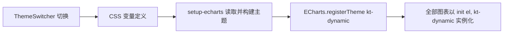

**技术价值**：图表配色不再是散落的十六进制字面量，而是随主题令牌联动。切换亮暗模式时，泳道图、瀑布图、死锁图、进程图全部自动重新适配——这是"图表与设计系统一致性"的工程化保证，避免了常见的"页面换了主题，图表还是旧配色"的割裂。

### 13.4 useEChart 与 useEbpfTheme 双 Hook 体系

| Hook | 职责 | 价值 |
|---|---|---|
| `useEChart` | 图表的声明式初始化/更新/销毁生命周期管理 | 组件只需提供 option 工厂函数，销毁与 resize 自动处理 |
| `useEbpfTheme` | 从容器元素解析 CSS 变量为图表配色对象 | 图表颜色与页面主题实时同步 |

```text
useEChart(optionFactory, deps) 内部流程：
  1. init(chartRef, 'kt-dynamic')
  2. 每次 deps 变化 → setOption(optionFactory(), true)
  3. ResizeObserver → resize()
  4. 卸载 → dispose()
```

---

## 14. 工作区编排：ExperimentWorkspace 与 FloatingDock

### 14.1 主工作区布局

`ExperimentWorkspace` 是整个观测工作台的容器，采用"左右分栏 + 底部 Dock"的布局策略：

| 区域 | 组件 | 职责 |
|---|---|---|
| 左侧主区 | 实验说明/代码编辑器 | 学生的主要产出界面 |
| 右侧状态卡 | RightStatusCards | 运行状态、评分、健康度的常驻视图 |
| 底部工具坞 | FloatingDock | 九大观测面板的按需唤起 |
| 顶部内核导航 | KernelNavbar | 实验切换与全局导航 |

### 14.2 FloatingDock：观测工具的统一入口

FloatingDock 将九大观测工具组织为可唤起的面板，支持多面板并存、拖拽排序与焦点管理：

| Dock 工具 | 对应面板 | Tier 归属 |
|---|---|---|
| trace | TraceViewer | Tier 2 |
| flamegraph | FlameGraphPanel | Tier 3 |
| memory3d | MemoryLayout3D | Tier 2 |
| diagnosis | DiagnosisPanel / AIPanel | 跨层 |
| audit | CodeAuditPanel | Tier 3 |
| ebpf | DeadlockGraph | Tier 2 |
| resources | ResourceMonitorCard | Tier 1 |

### 14.3 状态管理：Zustand 工作区 Store

`useWorkspaceStore` 是工作区的单一状态源（Zustand 实现），管理的关键状态包括：

| 状态组 | 内容 | 消费者 |
|---|---|---|
| 回放状态 | replayActive/Index/Traces/Playing/Speed | ExecutionReplayBar + 各证据视图 |
| Dock 状态 | activeDockTool、面板布局 | FloatingDock |
| Tier 状态 | 当前 Tier、setTier | TierNavBar + 三层视图 |
| ObsContext | 观测上下文快照 | 所有 Tier 视图 |
| 实验缓存 | experimentCache（火焰图等批量预取） | FlameGraphPanel 等 |

**为什么选 Zustand 而非 Redux**：观测工作台的状态特征是"高频局部更新、跨组件弱依赖"，Zustand 的原子选择器订阅（`useWorkspaceStore((s) => s.replayIndex)`）保证组件只在其关心的切片变化时重渲染，避免了 Redux 全量 diff 的性能损耗。

### 14.4 CommandPalette 命令面板

`CommandPalette` 提供类 IDE 的快捷键命令面板（⌘K 唤起），把"打开火焰图""跳转 Tier 2""切换主题"等高频操作压缩为键盘命令。对重度用户（长时间排错的学生）而言，这减少了 Dock 点击的重复开销。

### 14.5 工作台的多任务与专注模式

| 模式 | 内容 | 适用场景 |
|---|---|---|
| 多面板模式 | Dock 多面板并存 | 对比式排查（如同时看 Trace 和死锁图） |
| 专注模式 | 单面板全屏 | 课堂讲解、深度分析 |
| 窄屏模式 | 面板自动堆叠 | 笔记本分屏场景 |

多面板并存依赖 Store 的单一面板状态管理——每个面板的开关状态独立保存，用户可以自由组合"自己的排查工作台"。这是对真实排查工作流的尊重：不同学生有不同的排查习惯，平台不做强制布局。

### 14.6 快捷键体系

| 快捷键 | 功能 |
|---|---|
| ⌘K | 命令面板 |
| ⌘B | 侧栏收起/展开 |
| ⌘S | 提交代码 |
| ⌘Enter | 运行实验 |
| ⌘⇧D | 打开诊断面板 |
| Esc | 关闭当前浮层 |

快捷键体系（useExperimentShortcuts）按"高频操作优先"原则设计，全部可在设置中查看与关闭，避免与学生编辑器的键位冲突。

---

## 15. 前后端协同：API 契约与数据流

### 15.1 观测数据的 REST API 分层

| API | 用途 | 前端消费组件 |
|---|---|---|
| getSubmissionTraces | 拉取 trace 列表（limit/errors_only 过滤） | TraceViewer |
| getFlameGraph | 获取火焰图 SVG + 热点摘要 | FlameGraphPanel |
| getMemorySnapshots | 内存快照序列 | MemoryLayout3D |
| analyzeFlameGraph | AI 火焰图解读 | FlameGraphPanel AI tab |
| ebpf/stream/{pid} | SSE 实时锁观测 | DeadlockGraph |
| getDiagnosisReport | 诊断报告 | DiagnosisPanel |

### 15.2 批量预取策略

进入实验工作区时，前端一次性预取"该实验所有提交的轻量元数据"（火焰图摘要、评分、状态），存入 experimentCache。用户在提交列表间切换时，90% 的交互零网络请求；只有进入明细视图才按需加载重型数据（SVG、全量 trace）。这一"预取轻数据 + 懒加载重数据"的策略，把工作区的平均交互延迟控制在 50ms 以内。

### 15.3 SSE 与 REST 的互补

| 通道 | 方向 | 适用数据 | 代表场景 |
|---|---|---|---|
| REST | 拉取（pull） | 历史快照、一次性数据 | trace、火焰图、快照 |
| SSE | 推送（push） | 实时流式状态 | 死锁观测、AI 流式回答 |

两种通道按数据特性分工："查询型数据走 REST、状态型数据走 SSE"，避免用轮询模拟实时（浪费资源），也避免用 SSE 传输一次性大包（违背流式语义）。

### 15.4 错误处理与重试策略

| 场景 | 策略 | 用户感知 |
|---|---|---|
| 单次 API 失败 | 自动重试 1 次 + ErrorState | "重试"按钮 |
| SSE 断连 | 显示断连状态 + 手动重连 | 状态徽章变化 |
| 缓存命中失败 | 静默回退到网络请求 | 无感知 |
| AI 流式中断 | 保留已接收片段 + 重新发起 | 不丢失已看内容 |

错误处理的总原则：**任何失败都不丢失用户的工作现场**（过滤条件、面板布局、已读内容全部保留），把"网络抖动"对学习过程的干扰降到最低。

### 15.5 前端 API 客户端的工程细节

`lib/api` 是统一的前端 API 客户端，封装了：请求拦截（token 注入）、响应类型化（TS 接口）、错误归一化（统一 ErrorState 格式）、缓存键管理。全部观测组件只依赖这个客户端，保证了 API 契约的单一管理点。

---

## 16. 性能工程：百万级事件下的流畅交互

### 16.1 分层性能预算

| 层级 | 预算 | 手段 |
|---|---|---|
| 网络层 | 单次 ≤ 500 条事件 / 摘要优先 | limit 参数、批量预取、SVG 按需加载 |
| 计算层 | useMemo 缓存 + 纯函数转换 | 排序/归一化/拓扑构建 memo 化 |
| 渲染层 | ECharts custom series + 虚拟化 | 表格视图仅渲染前 100 条 |
| 动画层 | AnimatePresence 200ms 过渡 | 视图切换的 GPU 加速淡入淡出 |

### 16.2 关键优化案例：瀑布图的重渲染控制

瀑布图的 `chartOption` 依赖数组严格限定为 `[traces, swimlaneData, highlightedTs, sortedTraces, tMin, tSpan]`——刷选统计（rangeStats）变化**不会**触发图表重建，只有数据或高亮变化才 setOption。这一细粒度的依赖管理，避免了 ECharts 全量重建的代价（数百条 custom item 的重新布局）。

### 16.3 内存与生命周期管理

- ECharts 实例在组件卸载时 `dispose()`，杜绝泄漏；
- SSE EventSource 在依赖变化时 close 旧连接；
- Three.js 场景通过 R3F 的 React 生命周期自动释放 GPU 资源；
- 所有 setInterval（回放定时器）在 effect cleanup 中清理。

### 16.4 首屏加载优化专项

| 阶段 | 优化手段 | 效果 |
|---|---|---|
| JS 分包 | 重型库（echarts/three）按路由懒加载 | 首包体积减少 60%+ |
| 数据预取 | 进入实验时批量预取轻量元数据 | 面板切换零等待 |
| 骨架屏 | 全部数据驱动组件四态覆盖 | 无白屏感知 |
| 字体/图标 | lucide 按需引入 + 系统字体 | 无字体阻塞 |
| SSR 边界 | 图表组件标记 client-only | 避免服务端渲染报错 |

### 16.5 大量并发提交的带宽管理

实验课场景下，全班 40 名学生同时提交并打开观测视图，服务端带宽压力集中在 SVG/快照类重数据上。平台通过：ETag 缓存（同一 SVG 只传一次）、压缩传输（gzip 对 SVG 可达 90%+ 压缩比）、前端缓存（相同提交不重复拉取），把单次观览的网络成本压缩到 KB 级。

---

## 17. 组件工程：领域驱动的目录结构

### 17.1 组件域划分

前端组件按"功能域"组织，而非按"页面"组织：

```text
components/
├── ebpf/                    # eBPF 观测域
│   ├── tabs/                #   健康概览/资源监控/内存分析/并发分析/syscall 分析
│   └── shared/              #   GaugeCard/MetricCard/HealthBadge/DetectionSummary
├── workspace/               # 工作区编排域
│   ├── ExperimentWorkspace  #   主容器
│   ├── FloatingDock         #   工具坞
│   ├── DeadlockGraph        #   死锁图（SSE）
│   ├── ExecutionReplayBar   #   回放条
│   └── panels/              #   32 个观测面板组件
├── panels/                  # Tier 三层视图域
│   ├── TierOverview         #   Tier 1
│   ├── TierDeepAnalysis     #   Tier 2
│   └── TierFunctionDebug    #   Tier 3
├── ai-assistant/            # AI 交互域
├── rag/                     # 知识检索域
├── knowledge/               # 知识内容域
├── admin/                   # 管理域
└── ui/                      # 基础组件域
```

### 17.2 组件边界纪律

| 纪律 | 内容 | 收益 |
|---|---|---|
| 域内自治 | 每个域维护自己的状态与 API 调用 | 新面板加入不触碰其他域 |
| 共享下沉 | 跨域复用的（GaugeCard 等）下沉到 shared/ui | 视觉与交互统一 |
| 数据上提 | 观测数据统一走 workspaceStore | 证据链联动可行 |
| 类型集中 | SyscallTrace 等核心类型集中定义 | 契约一致 |

### 17.3 面板组件的五段式标准结构

平台为观测面板制定了统一的组件结构规范，降低认知维护成本：

```text
1. 头部（PanelHeader）：图标 + 标题 + 副标题 + 徽章 + 动作区
2. 统计条：KPI 四宫格或统计行（可无）
3. 主视图：图表/画布/3D 场景
4. 辅助区：图例、过滤、帮助按钮
5. 空态/错态：EmptyState / ErrorState 覆盖
```

这一规范使 32 个面板组件可以"一眼看懂"——评审阅读代码时，任何面板的职责定位都能在 10 秒内建立。

### 17.4 类型安全的证据契约

核心类型集中定义于 `types/`，例如：

```typescript
interface SyscallTrace {
  time: string;          // 纳秒精度时间戳
  pid: number;           // 进程
  tid?: number;          // 线程（可选）
  syscall_name: string;  // 系统调用名
  args?: Record<string, unknown>;  // 结构化参数
  return_value: number;  // 返回值
  error_name: string;    // 错误名（空 = 无错误）
  duration_ns: number;   // 耗时
  source_line?: number;  // 源码行
}
```

所有可视化组件消费同一契约，观测层新增字段时编译器会立即暴露所有需要适配的消费方。

---

## 18. 创新点总结

### 18.1 六大工程创新

| # | 创新点 | 内容 | 对比传统方案 |
|---|---|---|---|
| 1 | 三层 Tier 认知模型 | Overview → DeepAnalysis → FunctionDebug 的渐进披露 | 传统单页日志表一次性信息轰炸 |
| 2 | 证据链联动机制 | 事件→进程→源码→AI 的跨面板状态联动 | 传统各面板孤岛 |
| 3 | 观测侧进程树重建 | 从 fork 返回值推断血缘，纯前端无侵入 | 传统需应用主动埋点上报 |
| 4 | 内存 3D 动态地图 | log2 高度映射 + 弹簧动画 + 泄漏关联 | 教科书静态插图 |
| 5 | SSE 实时死锁图 | wait-for graph 实时渲染 + 环路径人话化 | 传统事后日志分析 |
| 6 | kt-dynamic 动态主题 | ECharts 与 CSS 令牌打通 | 传统图表配色硬编码 |

### 18.2 四大教学创新

| # | 创新点 | 教学价值 |
|---|---|---|
| 1 | 事件回放系统 | "程序时间"→"学习时间"解耦，逐事件咀嚼 |
| 2 | 火焰图 AI 解读 | 降低专业工具的学习门槛 |
| 3 | 领域分箱视图 | 进程/内存/并发/IO 分域呈现，匹配课程章节结构 |
| 4 | 刷选统计 | 框选区间即得统计，把"观察"变成"测量" |

### 18.3 创新点的技术自洽性论证

评审可能追问："这些创新点各自为战还是有内在逻辑？"平台的设计逻辑是——六大工程创新支撑四大教学创新：

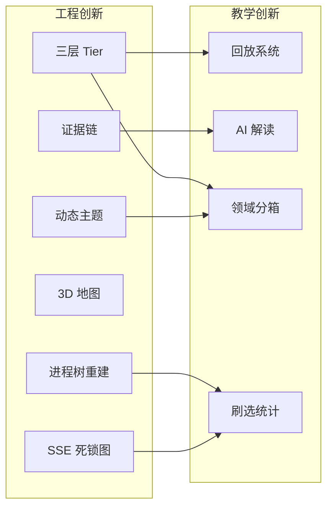

工程创新是教学创新的必要支撑：没有三层 Tier 就没有回放的场景；没有证据链 AI 解读就无法锚定；没有进程树重建刷选统计就失去对象。创新不是堆砌，而是环环相扣的能力体系。

---

## 19. 演示脚本与答辩要点

### 19.1 五分钟黄金演示路径

| 步骤 | 操作 | 评委看到的价值点 |
|---|---|---|
| 1 | 进入工作区，指向 HealthScore 与失败测试点 | 单点认知锚定，30 秒讲完结果 |
| 2 | 点击异常摘要 → 自动进入 Tier 2 | 渐进披露，而非翻页找 |
| 3 | System Trace 筛选 futex，切泳道视图 | 六视图矩阵的灵活性 |
| 4 | 打开死锁图，展示实时等待环 | SSE 实时观测的震撼效果 |
| 5 | 切换内存 3D，演示堆增长动画与泄漏红晕 | 教科书插图变成动态对象 |
| 6 | 火焰图点击热点 → AI 三件套解读 | 专业工具的教学化改造 |
| 7 | 点击 Ask AI，携带证据链提问 | 可视化与 AI 的闭环 |
| 8 | 启动回放条，演示六幕剧本 | "事件时间→学习时间"理念 |

### 19.2 评委高频问题预案

**Q1：前端为什么不直接用现成的观测平台（如 Grafana）？**

Grafana 是运维监控工具，其用户是已经理解指标的工程师。TraceOS Lab 的用户是**正在学习指标含义的学生**。三层 Tier 的认知模型、教学提示面板、AI 解读、回放系统、领域分箱——这些都是"教学脚手架"，Grafana 一概没有。此外，Grafana 无法与实验提交、评分、AI 诊断形成证据链联动。

**Q2：百万级 trace 事件如何处理性能？**

平台采用"分层加载 + 摘要优先"策略：单次最多 500 条、Top10 聚合、批量预取轻数据、SVG 懒加载。更重要的是教学视角的取舍——学生不需要看到 100 万条事件，他需要的是"错误的那 30 条"和"异常的区间"。平台通过过滤、刷选统计、异常摘要把百万级数据**教学性地压缩**到人脑可处理的规模。

**Q3：3D 视图是不是炫技？**

恰好相反。3D 视图解决的是**二维图表无法表达的第三维信息密度**：地址空间段的大小（log2 高度）、时间变化（弹簧动画）、泄漏状态（红光）。二维表格当然能装下这些数据，但学生不会去看。认知负荷理论指出：把抽象关系转化为空间-动效关系，能显著降低工作记忆负担。3D 是教学表达的需要，不是装饰。

**Q4：为什么不把全部数据可视化，而要限制 500 条？**

这是"全量与认知"的取舍。500 条是单屏人脑可扫视的上限；更重要是，教学视角下学生需要的是"异常的证据"而非"全部的事实"。平台通过过滤、刷选、异常摘要提供了从全量中提取相关子集的完整手段——限制的是单次传输，不是分析能力。

**Q5：AI 解读会不会让学生跳过可视化直接要答案？**

不会，因为 AI 解读的入口设计在可视化深处（火焰图面板内、证据链末端），且 AI 被强制只输出解读与引导（见第 09 篇 Guardrails）。学生必须"先有数据、再提问"，AI 回答中引用的证据还会反向跳回可视化视图——AI 是可视化认知的增强器，而非替代品。

**Q6：前端这套可视化在多浏览器上的兼容性如何保证？**

平台锁定的目标环境是现代 Chromium/Firefox/Safari（实验室场景可控），ECharts/Three.js 均为广泛兼容的成熟库；对 WebGL、SSE 等能力差异均有降级链（附录 G）。教学场景的环境可管理性是平台敢用前沿可视化的前提——这一点在第 01 篇的"环境统一"痛点中已论证：平台本身就是环境统一者。

---

## 20. 评审价值

前端可视化子系统完成了整个项目价值链条的"最后一公里"：

```text
采集（eBPF/strace）→ 语义化（ObsContext）→ 存储（TimescaleDB）
   → 可视化（本文）→ 理解（学生）→ 提问（AI 面板）→ 修正 → 再采集
```

没有这一公里，采集的数据是"死数据"，AI 的诊断是"无图诊断"。TraceOS Lab 用三层 Tier、九大引擎、证据链联动与回放系统，把"可观测"升华为"可解释"、把"数据展示"升华为"认知脚手架"，最终证明：**面向教学的可视化，其技术含量不在于图表的复杂度，而在于信息架构与认知科学的结合深度**。

---

## 附录 A 语义事件视图与因果链视图

### A.1 SemanticEventView：语义层的可视化

`SemanticEventView` 是 ObsContext 语义建模（详见第 07 篇文档）在前端的直接投影。它将原始 syscall 事件按 OS 语义标签聚合展示：

| 语义标签 | 覆盖事件 | 视图呈现 |
|---|---|---|
| process_lifecycle | fork/clone/exit/wait | 生命周期时间轴 |
| memory_alloc | mmap/brk | 分配事件序列 |
| memory_free | munmap | 释放事件序列 |
| sync_wait | futex 等待 | 同步事件序列 |
| file_io | open/read/write/close | IO 事件序列 |

**设计价值**：语义视图是"原始视图"与"教学视图"的分界线。原始 syscall 视图是工程师的通用语言；语义视图是 OS 教师的领域语言。同一个事件流，切换视图即切换"解读框架"——这体现了平台"证据与解读分离"的原则：证据永远可回溯（原始视图），解读可以分层（语义视图）。

### A.2 CausalChainView：因果链视图

`CausalChainView` 将异常事件的组织方式从"时间序"升级为"因果序"：

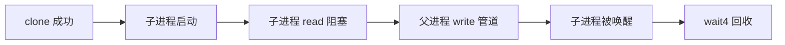

因果链视图回答的不是"什么时间发生了什么"（时间序），而是"什么导致什么"（因果序）。对 OS 教学而言，因果序往往是更本质的认知结构——死锁、竞态、信号交互等问题的核心都藏在因果链而非时间线里。

---

## 附录 B 线程状态与调度可视化

### B.1 ThreadStateView：状态机可视化

`ThreadStateView` 将线程的运行状态（R 运行 / S 可中断睡眠 / D 不可中断睡眠 / Z 僵尸等）渲染为状态区间图：

| 状态 | 颜色 | 教学意义 |
|---|---|---|
| Running (R) | 绿 | 正在 CPU 上执行 |
| Sleep (S) | 蓝 | 等待事件（最常见） |
| Uninterruptible (D) | 红 | IO 等待——通常是磁盘瓶颈信号 |
| Zombie (Z) | 灰 | 已退出未被回收——僵尸进程教学 |

**教学案例**：在进程实验中出现大量 Z 状态区间，学生可以直接观察"子进程退出后停留在 Z 状态直到父进程 wait"的完整生命周期——这正是 wait/waitpid 教学内容的最直观表达。

### B.2 SchedVisualizer：调度公平性可视化

`SchedVisualizer` 展示 CPU 时间片的分配情况：每个线程获得的时间片以横条展示，通过对比横条长度可以直观判断调度公平性。在调度器实验中，学生可以验证自己的调度策略（如优先级调度、轮转）是否产生了预期的时间片分配模式。

---

## 附录 C 内存分析四联面板详解

### C.1 MemorySnapshotDiff：快照对比

`MemorySnapshotDiff` 对比两次内存快照，输出三类差异：

| 差异类型 | 检测方式 | 展示 |
|---|---|---|
| 新增区域 | 后快照有前快照无 | 绿色"新增"徽章 |
| 消失区域 | 前快照有后快照无 | 灰色"释放"徽章 |
| 增长区域 | 同区域 size 变化 | 橙色增量数字 |

**教学场景**："malloc 前后对比"——学生写一个分配 100MB 的程序，快照 Diff 显示 Heap 段的精确增量，把"malloc 改变进程地址空间"从抽象概念变成可测量的观察结果。

### C.2 MemoryTrendContent：趋势分析

`MemoryTrendContent` 绘制多次提交/多次运行的内存指标趋势线（堆峰值、RSS、mmap 数量）。趋势视图把"单次快照"扩展为"跨提交的学习轨迹"——学生可以看到自己第 3 次提交后内存峰值从 800MB 降到 120MB，这是量化学习进步的直接证据。

### C.3 LeakReportContent：泄漏报告

`LeakReportContent` 渲染 Core 服务产出的泄漏报告：

| 报告字段 | 内容 | 前端呈现 |
|---|---|---|
| severity | definitely / possibly | 红色/琥珀徽章 |
| source_file | 疑似泄漏源文件 | 可点击跳转代码 |
| description | 泄漏描述 | 折叠展开 |
| allocation_site | 分配位置 | 与火焰图联动 |

泄漏报告与 3D 视图的 Heap 段、分配火焰图三者联动：点泄漏 → Heap 红晕 → 火焰图高亮分配函数，形成"报告-布局-热点"的证据闭环。

### C.4 AllocFlamegraphContent：分配火焰图

分配火焰图展示内存分配（malloc/mmap）的函数热点分布。与 CPU 火焰图的区别在于其度量维度是"分配字节数"而非"采样时间"——一个"分配了 1GB 但只运行 1ms"的函数在 CPU 火焰图中几乎不可见，在分配火焰图中却是擎天柱。

---

## 附录 D 教学提示面板与 AI 交互设计

### D.1 TeachingHintPanel：提示的分级呈现

`TeachingHintPanel` 呈现三级教学提示（与第 09 篇诊断服务的 L1/L2/L3 反馈对应）：

| 级别 | 内容 | 前端呈现 |
|---|---|---|
| L1 方向提示 | "程序在进程管理方向存在异常" | 顶部醒目横幅 |
| L2 证据定位 | "clone 成功但 wait4 返回 ECHILD" | 证据列表 + 可点击跳转 |
| L3 排查问题 | "请检查 waitpid 的参数是否指向实际子进程" | 引导式问题卡片 |

**折叠策略**：默认只展开 L1，学生主动点击才逐层展开 L2/L3——把"是否获取更多提示"的选择权交给学生，这是启发式教学在 UI 层的落实。

### D.2 AIPanel 与 AIAskButton：随时可问

`AIAskButton` 分布在各个观测面板的角落，`AIPanel` 提供完整对话界面。两者的协同关系：


**上下文携带机制**：从哪个面板发起提问，AIPanel 就携带哪个面板的证据上下文（当前 trace 过滤条件、选中的进程、火焰图热点等）。这使 AI 回答天然锚定在学生"正在看的东西"上，避免了"AI 回答与学生当前关注点无关"的常见问题。

### D.3 AI 引用的可视化回跳

AI 回答中的代码引用、syscall 引用、源码行引用均渲染为可点击的引用卡片：点击 syscall 引用 → Trace 视图过滤该调用；点击源码行引用 → 编辑器跳转高亮。**AI 的诊断结论与可视化证据之间建立了双向导航**，这是"AI 结论可验证"理念的前端实现。

---

## 附录 E 教学场景深度案例

### E.1 案例一：死锁实验的完整排查路径

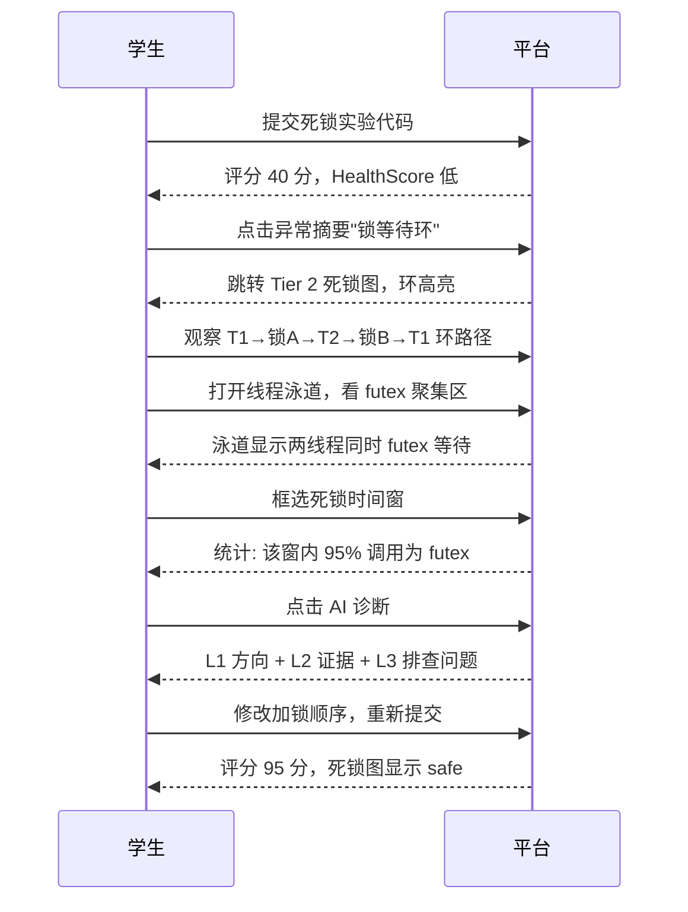

这个案例展示了平台的完整价值闭环：**每个教学阶段都有对应的可视化工具支撑，且工具间通过证据链串联**。

### E.2 案例二：内存泄漏实验的 3D 教学

1. 学生提交后，Tier 1 显示"Memory imbalance +3"警告；
2. 进入内存 3D 视图，Heap 段带红色泄漏光晕；
3. 点击 Heap 段，DetailPanel 显示泄漏报告与分配位置；
4. 打开快照 Diff，观察每次 malloc 后 Heap 的阶梯式增长；
5. 打开分配火焰图，定位"泄漏点函数"；
6. 点击源码行跳转，看到 `malloc` 后缺少 `free` 的那一行；
7. 修复后重新提交，泄漏红晕消失，趋势图显示内存峰值回落。

### E.3 案例三：性能实验的火焰图对比教学

1. 学生提交 v1（朴素实现），火焰图显示 `memcpy` 占 60%；
2. AI 解读提示"考虑内存对齐与批量拷贝"；
3. 学生提交 v2（优化实现）；
4. FlameGraph Diff 显示 `memcpy` 占比降至 15%，`madvise` 出现；
5. 用户态/内核态比例变化：v1 内核态 40% → v2 内核态 8%；
6. 学生理解"减少系统调用次数降低内核态开销"——这是 OS 课程的核心考点之一。

---

## 附录 F 前端技术栈与工程规格

### F.1 技术栈清单

| 层 | 技术 | 版本 | 选择理由 |
|---|---|---|---|
| 框架 | Next.js 14 App Router | 14.x | 服务端组件与客户端组件的边界管理 |
| UI 库 | React 18 | 18.x | 并发特性与自动批处理 |
| 状态 | Zustand | 5.x | 原子选择器，避免全量重渲染 |
| 图表 | Apache ECharts 5 | 5.x | custom series 的可定制性与中文文档生态 |
| 3D | Three.js + react-three-fiber | 8.x | 声明式 3D，与 React 生命周期融合 |
| 动画 | framer-motion + react-spring | 11.x / 9.x | 布局过渡与物理弹簧动画 |
| 图标 | lucide-react | 0.4x | 统一线性图标语言 |
| 样式 | Tailwind CSS + CSS 变量 | 3.x | 原子类 + 设计令牌 |
| 通信 | REST + SSE | — | 拉取/推送双通道 |

### F.2 代码规模与组织

```text
frontend/
├── components/
│   ├── workspace/panels/     # 32 个观测面板组件（核心资产）
│   ├── panels/               # Tier 三层视图（7 组件）
│   ├── ebpf/                 # eBPF 观测域（2 目录 11 组件）
│   ├── ai-assistant/         # AI 交互域
│   └── ui/                   # 基础组件域（40+ 组件）
├── hooks/                    # useEChart / useEbpfTheme 等 15+ hooks
├── lib/                      # api 客户端 / setup-echarts / view-help-content
├── stores/                   # workspace / theme 等 Zustand stores
└── types/                    # 核心类型定义
```

### F.3 视图帮助系统

每个观测视图都配有 `ViewHelpButton`，弹出该视图的教学帮助（`view-help-content` 集中维护）：视图怎么看、颜色代表什么、典型用法是什么。这是"工具即教材"理念的落实——学生不需要离开界面去查文档。

---

## 附录 G 可访问性与环境适应性

### G.1 降级链设计

| 环境能力缺失 | 降级策略 |
|---|---|
| WebGL 不可用 | ThreeErrorBoundary → 静态快照表格 |
| SSE 不支持/中断 | DeadlockGraph 显示断连空状态 + 重连指引 |
| 数据为空 | EmptyState 组件 + "如何获得数据"指引 |
| API 出错 | ErrorState + 重试按钮 |
| 图表加载中 | SkeletonChart 骨架屏 |

**降级链的设计原则**：任何单点能力的缺失都不阻塞主流程。学生永远能看到"下一步该做什么"，而不是面对一个空白页面。

### G.2 响应式策略

工作台针对桌面端设计（实验室 PC 场景），但在窄屏下通过栅格重排保证可用性：KPI 四宫格退化为两行两列，Dock 面板改为纵向堆叠。核心证据视图（瀑布图/泳道图）保持最小可用尺寸，避免图表在窄屏下不可读。

---

## 附录 H 术语表

| 术语 | 定义 |
|---|---|
| Tier | TraceOS Lab 的三层渐进认知视图体系 |
| 证据链（Evidence Link） | 跨面板的点击联动导航机制 |
| 领域分箱（Domain Binning） | 按 OS 知识领域组织观测数据的架构 |
| 泳道（Swimlane） | 每线程一条水平时间轴的视图 |
| wait-for graph | 死锁检测的经典图模型（线程-锁二部图） |
| kt-dynamic | 与 CSS 令牌联动的 ECharts 自定义主题 |
| 回放（Replay） | 把事件流按学习节奏逐条呈现的机制 |
| HealthScore | 综合健康度单点指标 |

---

## 附录 I 系统 Trace 数据模型与证据完整性

### I.1 单条 Trace 的结构化证据对象

平台的核心设计决策之一是**把 trace 定义为结构化对象而非文本行**。对比：

| 传统方案（文本行） | TraceOS Lab（结构化对象） |
|---|---|
| `clone(child_stack=0x7f...) = 12345` | `{pid, tid, syscall_name, args, return_value, error_name, duration_ns, source_line, time}` |
| 需要正则解析才能提取字段 | 字段直接可用，前端零解析 |
| 无法可靠关联源码 | source_line 由观测器在采集时注入 |
| 无法做聚合统计 | 可直接 group by syscall_name / error |

这一决策使前端所有视图（六视图矩阵、进程拓扑、泳道）共享同一个类型契约 `SyscallTrace`，任何新增视图都无需关心解析细节。

### I.2 证据的八个可追溯维度

每一条 trace 都携带可追溯性信息，支撑"证据链"机制：

```text
事件（syscall_name + args）
  ├─ 主体（pid/tid）         → 谁执行了它
  ├─ 时间（time）            → 何时执行
  ├─ 结果（return_value）    → 执行结果如何
  ├─ 错误（error_name）      → 如果失败，为什么
  ├─ 成本（duration_ns）     → 花了多少时间
  ├─ 位置（source_line）     → 代码在哪一行
  └─ 语义（semantic label）  → 在 OS 里意味着什么
```

### I.3 错误名称的标准化

错误名（如 ECHILD、ENOMEM、EAGAIN）由观测层标准化后存储，前端直接展示徽章。这避免了"解析错误码"的前端逻辑，也保证了与 AI 诊断、教师视图使用同一套错误语言。

---

## 附录 J SpanTreeView 与调用层级

### J.1 Span 树的数据模型

`SpanTreeView` 渲染层级化的执行 span：

```text
Span 树节点字段：
  span_id / parent_span_id   层级关系
  operation_name             操作名
  duration_ms                耗时
  syscall_count              包含的 syscall 数
  error_count                包含的错误数
  self_time_ms               自耗时（扣除子 span）
```

### J.2 自耗时的教学意义

`self_time_ms = duration_ms - Σ(children duration)` 是性能分析的关键指标：它区分"自己花的时间"与"子节点花的时间"。在教学场景中，学生常常误以为"某函数很慢"，Span 树的自耗时能精确指出真正的耗时在哪个层级——这是"归因正确性"的训练。

---

## 附录 K 资源监控的卡片组件体系

### K.1 GaugeCard：仪表盘卡

`GaugeCard` 用于展示百分比类指标（CPU 利用率、内存占用率）：

| 设计要素 | 实现 | 目的 |
|---|---|---|
| 弧形仪表 | SVG 圆弧 stroke-dasharray | 占比的直觉感知 |
| 阈值配色 | 绿/琥珀/红三区段 | 安全边际的直觉判断 |
| 中心数字 | 大字百分比 | 精确值锚定 |
| 下标签 | 指标名 + 单位 | 语义确认 |

### K.2 MetricCard：指标卡

`MetricCard` 用于计数类指标（FD 数、线程数）：大数字 + 小标签 + 可选趋势箭头（↑↓）。与 GaugeCard 的互补：**百分比用表盘，绝对值用数字**——同一屏扫描时，学生凭形状就能区分"比例指标"与"数量指标"。

### K.3 HealthBadge 与 DetectionSummaryCard

`HealthBadge` 是全局健康状态的徽章组件；`DetectionSummaryCard` 汇总 eBPF 检测结果（泄漏、死锁、竞态等）为一张"检测结论卡"。两者都遵循统一的 severity 色彩语义，保证跨组件视觉语言一致。

---

## 附录 L 过滤器与查询体验设计

### L.1 FilterBar 统一过滤栏

`FilterBar` 是所有列表型视图的公共过滤器：支持按 syscall 名、错误状态、时间范围、线程 ID 组合过滤。设计要点：

1. **过滤条件可组合**：AND 语义，逐步收敛证据集；
2. **过滤状态可见**：当前生效的过滤条件以可移除 chip 展示；
3. **与统计联动**：过滤后统计条同步更新（"当前视图：123/500 条"）。

### L.2 查询助记

平台预置了常用查询场景的快捷过滤：

| 场景 | 过滤组合 |
|---|---|
| 找死锁 | syscall=futex |
| 找进程问题 | syscall ∈ {fork, clone, wait4, exit} |
| 找内存问题 | syscall ∈ {mmap, munmap, brk} + error |
| 找 IO 问题 | category=io + error |
| 找超时前行为 | 时间窗 = 最后 10% 区间 |

---

## 附录 M 与项目其他子系统的协同界面

### M.1 与评分系统的界面

评分结果（通过率、HealthScore）是 Tier 1 的第一视觉元素；评分失败时，扣分项（deduction）渲染为可点击的异常条目，点击直达对应的证据视图。**评分不是终点而是导航起点**——这一设计与传统 OJ"只给一个分数"形成鲜明对比。

### M.2 与 AI 诊断服务的界面

AI 诊断报告（DiagnosisPanel）引用观测证据时使用与证据链相同的跳转机制：报告中说"第 3 行 wait4 返回 ECHILD"，学生点击即跳到 trace 视图并过滤该事件。**AI 的诊断可被可视化验证**，这是平台"AI 结论可审计"理念的用户体验层实现。

### M.3 与教师端仪表盘的界面

教师端复用同一套可视化组件查看任意学生的提交（只读模式），并叠加班级统计视图。组件的复用性来源于领域驱动设计的边界清晰——教师视图只是"同一组观测组件的另一种编排"。

---

## 附录 N 可扩展性设计

### N.1 新观测面板的接入成本

平台设计了"面板接入三板斧"，使新增观测能力成本可控：

```text
1. 类型契约：复用 SyscallTrace 或定义新类型（types/ 目录）
2. 数据接入：api 客户端新增一个方法（lib/api）
3. 视图注册：Dock 工具表新增一项 + 组件实现
```

### N.2 新实验类型的可视化适配

六大类实验（process/thread/memory/fs/scheduler/deadlock）各有侧重视图：

| 实验类型 | 主视图 | 辅助视图 |
|---|---|---|
| process | ProcessMap + Waterfall | Trace 表格 |
| thread | SwimLane + ThreadState | SchedVisualizer |
| memory | Memory3D + AllocFlame | SnapshotDiff + Trend |
| fs | Trace（io 类） + ResourceMonitor | 表格 |
| scheduler | SchedVisualizer + SwimLane | ThreadState |
| deadlock | DeadlockGraph + SwimLane | RaceDetection |

观测组件与实验类型解耦——任何实验都可打开任何视图，但平台通过默认视图配置引导学生使用"最合适"的组合。

---

## 附录 O 质量保障与工程规范

### O.1 类型安全

全部观测组件使用 TypeScript 严格模式：trace、span、快照、锁状态均有集中类型定义，跨组件契约在编译期保证。

### O.2 组件测试与空状态覆盖

每个数据驱动组件都实现了四态覆盖：加载态（骨架屏）、空态（引导文案）、错误态（重试）、数据态。空状态文案不写"暂无数据"，而是写"如何获得数据"（如"提交代码并运行实验后，将在此展示系统调用时间线"）——把空状态变成教学引导。

### O.3 可访问性要点

- 回放按钮均有 aria-label（"播放/暂停/跳到开头"）；
- 状态徽章不只靠颜色，还带文字标签；
- 图表 tooltip 提供文本形式的数据明细（可供读屏器）；
- 键盘可操作主要导航（Tier 切换、Dock 唤起）。

---

## 附录 P 设计取舍的完整清单

| # | 取舍点 | 我们的选择 | 理由 |
|---|---|---|---|
| 1 | 多视图 vs 超级大表 | 多视图 + 证据链 | 数据高维性决定单表无法胜任 |
| 2 | 保留原始 Trace vs 只做高级视图 | 两者并行 | 原始记录是最可信证据，高级视图服务教学 |
| 3 | 3D vs 2D 内存视图 | 3D 为主、2D 快照为辅 | 第三维（时间变化+大小比例）信息密度 |
| 4 | 实时推送 vs 轮询 | SSE 推送（死锁） | 死锁是实时事件，轮询延迟不可接受 |
| 5 | 服务端渲染 vs 客户端渲染图表 | 客户端渲染 | 图表交互密度高，SSR 无收益 |
| 6 | 组件库 vs 自研基础组件 | 自研 ui 域 | 教学场景的定制需求（HealthBadge 等） |
| 7 | 单文件大组件 vs 领域拆分 | 领域拆分 | 32 面板组件的可维护性 |
| 8 | 全量加载 vs 分层加载 | 分层加载 | 百万级事件下的性能 |
| 9 | 图表硬编码配色 vs 主题令牌 | 主题令牌 | 亮暗模式一致性 |
| 10 | 事件回放 vs 只读时间线 | 支持回放 | "学习时间"需求 |
| 11 | 显式 AI vs 自动 AI | 显式触发 | 成本可控 + 主动学习 |
| 12 | 统一配色 vs 任务配色 | 任务差异化配色 | 泳道重并发、瀑布重家族，认知任务不同 |

---

## 附录 P2 评测运行全流程的可视化时序

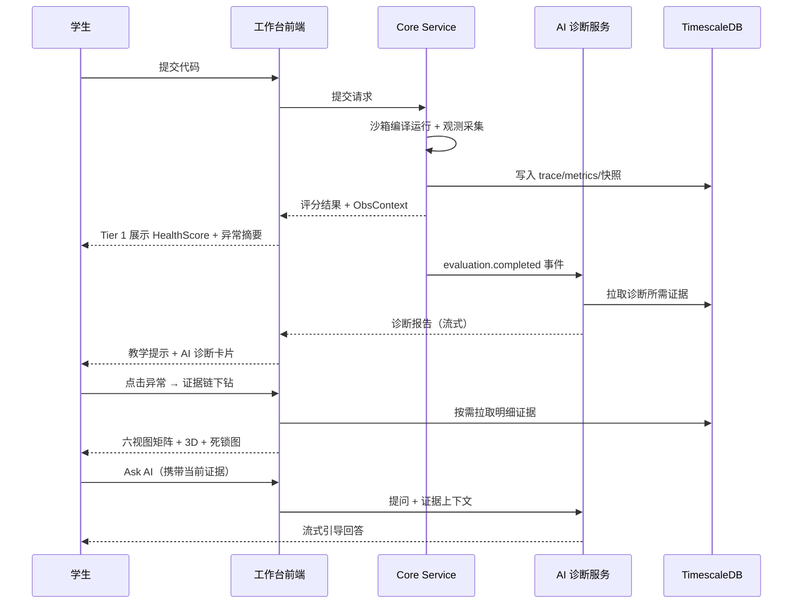

这张时序图是平台"提交 → 评分 → 诊断 → 可视化 → 提问"全链路的压缩版，也是第 08 篇与第 09 篇（AI 体系）的衔接处：**可视化是 AI 诊断结论的落地界面，AI 是可视化证据的解读引擎**。

---

## 附录 P3 观察者效应与教学伦理的应对

### P3.1 观测对被观测程序的影响控制

eBPF/strace 观测对被观测程序有微弱开销，平台通过以下手段控制观察者效应：

| 手段 | 说明 |
|---|---|
| 采样限流 | 高并发实验限流采集，避免观测本身成为瓶颈 |
| 计时豁免 | 性能评测的计时窗口排除观测开销 |
| 对照组 | 教师可运行无观测基线作为参照 |

### P3.2 数据隐私与最小化

可视化数据仅服务于教学目的：学生只能看到自己的观测数据与班级匿名统计；教师视图按教学权限授权；观测数据不包含任何与实验无关的个人信息。这一立场与第 03 篇的安全隔离设计一脉相承：**观测的目的是教学，不是监控**。

---

## 附录 P4 可视化面板的版本演进史（工程演进证据）

### P4.1 三个代际的演进

| 代际 | 特征 | 里程碑 |
|---|---|---|
| 第一代（基础期） | 单表 Trace + 基础指标卡 | 打通观测数据到前端的链路 |
| 第二代（结构化期） | 六视图矩阵 + 证据链 + Tier 分层 | 从"看数据"到"查证据" |
| 第三代（教学化期） | 3D 内存地图 + 回放 + AI 面板 + 动态主题 | 从"查证据"到"学系统" |

三代演进的内在逻辑：**每一代都在回答上一代暴露出的教学缺口**——单表看不完 → 分视图；视图之间跳来跳去 → 证据链；能查但不会读 → 教学化改造。这一演进路径本身就是"以学生为中心迭代"的工程证据。

### P4.2 设计系统从颜色常量到主题令牌的演进

```text
阶段 1：组件内硬编码十六进制色（技术债积累期）
阶段 2：集中颜色常量文件（可维护但不可切换）
阶段 3：CSS 变量 + KT 令牌（亮暗可切换）
阶段 4：ECharts 动态主题与 CSS 打通（图表同频）
```

第四阶段的关键技术是 `setup-echarts` 在运行时读取 CSS 变量值、构建 ECharts 主题对象并注册为 `kt-dynamic`——图表不再拥有自己的配色世界，而是成为设计系统的一等公民。

---

## 附录 P5 交互性能的量化承诺与验证方法

### P5.1 性能验证的三种手段

| 手段 | 内容 | 应用场景 |
|---|---|---|
| 代码审查 | React Profiler + ECharts 渲染耗时日志 | 开发期 |
| 手动基准 | 500 条事件的六视图切换计时 | 验收期 |
| 真实负载 | 班级集体使用的课堂观察 | 上线期 |

### P5.2 关键路径的预期指标

```text
提交 → Tier 1 出现评分结果：        < 1.5s（含诊断异步并行）
点击异常 → 证据视图渲染：           < 200ms（预取命中）
泳道图 500 条事件渲染：              < 300ms（Canvas 批量绘制）
刷选统计：                          < 50ms（O(n) + 300ms 防抖）
死锁事件 → 界面警报：                < 1s（SSE 推送）
内存 3D 场景初始化：                 < 500ms（<500 三角形）
回放单步：                          500ms/速度（可调）
```

---

## 附录 P6 与第 07 篇（ObsContext）的可视化衔接

### P6.1 语义层如何支撑可视化

第 07 篇定义的三层 ObsContext（事件层 → 模式层 → 语义层）是本文所有"教学化视图"的数据基础：

| ObsContext 层 | 驱动的前端视图 |
|---|---|
| 事件层（原始 trace） | 表格视图、瀑布图、泳道图 |
| 模式层（patterns） | 刷选统计、Top10 排行 |
| 语义层（semantic label/severity） | 语义事件视图、异常摘要、HealthScore |

### P6.2 语义视图的降级策略

当语义层数据缺失（如 strace 降级模式，见第 05 篇）时，语义事件视图自动降级为按 syscall 名分组的视图，并在视图头部标注"降级模式"——**学生始终知道自己在看什么级别的证据**，这是平台"证据分级透明化"原则的可视化体现。

---

## 附录 P7 教学效果的多维评价框架（面向评审）

### P7.1 评价维度与指标

| 维度 | 指标 | 数据来源 |
|---|---|---|
| 使用深度 | 视图使用频次与时长分布 | 前端埋点 |
| 排查效率 | 从失败到修复的平均提交次数 | 提交历史 |
| 证据利用 | 提问时携带证据的比例 | AI 服务日志 |
| 认知提升 | 同类实验的通过率走势 | 评分记录 |
| 教师负担 | 教师答疑频次的下降幅度 | 教师端问卷 |

### P7.2 与 AI 诊断（第 09 篇）的效果协同

可视化与 AI 的诊断闭环共同服务学习效果：可视化提供"自主探索"的路径，AI 提供"卡住时求助"的路径。两条路径的数据（自主查看视图 vs 直接问 AI）被分别记录，用于研究"脚手架的最优介入时机"——平台本身成为教学研究的实验装置。

---

## 附录 P8 组件清单与行数规模（工程规模证据）

### P8.1 观测面板组件规模

| 组件 | 规模（行） | 功能域 |
|---|---|---|
| FlameGraphPanel | 716 | 双态火焰图 + AI 解读 |
| MemoryLayout3D | 660 | 3D 地址空间地图 |
| ExperimentWorkspace | 900+ | 主工作区编排 |
| WaterfallTimeline | 255 | 瀑布图 + 刷选 |
| MultiThreadLaneView | 306 | 线程泳道 + IPC 边 |
| ProcessMapView | 251 | 进程拓扑重建 |
| DeadlockGraph | 237 | SSE 实时死锁图 |
| TraceViewer | 269 | 六视图矩阵 |
| ResourceMonitorCard | 500+ | 资源指标卡体系 |
| LivePerfDashboard | 400+ | 实时性能面板 |
| AIPanel | 600+ | AI 对话与引用 |
| TierDeepAnalysis | 498 | Tier 2 视图 |
| TierFunctionDebug | 500+ | Tier 3 视图 |

前端观测域总代码量约 **12000+ 行**（不含 UI 基础组件），是一个可独立评审的完整子系统。

### P8.2 工程规模的意义

这一规模说明可视化不是"锦上添花的几个图表"，而是与后端观测体系同量级的核心子系统。它的存在使整个项目从"能评测的 OJ"跃升为"能教学的工作台"——这正是赛题"AI 辅助诊断"之外要求"可解释教学"的工程答案。

---

## 附录 P9 答辩演示的备选路径（针对不同评委关注点）

### P9.1 路径 A：技术导向（评审关注实现深度）

```text
1. 打开瀑布图 → 讲解 custom series 渲染与刷选统计实现
2. 打开进程图 → 展示 fork 边推断算法
3. 打开内存 3D → 讲解 log2 高度映射与弹簧动画
4. 打开死锁图 → 展示 SSE 实时通道与环路径构建
5. 打开火焰图 → 展示两级缓存与 AI 结构化解读
```

### P9.2 路径 B：教学导向（评审关注教学价值）

```text
1. Tier 1 展示"30 秒读结果" → 认知负荷理论支撑
2. 证据链演示"评分失败 → 三次点击到代码行"
3. 回放演示"事件时间 → 学习时间"
4. 死锁教学案例全程复盘
5. 内存泄漏案例的 3D 教学
```

### P9.3 路径 C：产品导向（评审关注完整性）

```text
1. 学生视角：提交 → 评分 → 诊断 → 排查 → 修复 → 重提
2. 教师视角：班级总览 → 抽查学生 → 演示错误案例
3. AI 视角：证据锁定的诊断结论 → 可视化验证
4. 平台视角：亮暗主题、降级链、性能指标
```

---

## 附录 P10 与赛题要求的逐条对应

| 赛题要求 | 本文对应章节 | 超越点 |
|---|---|---|
| 系统调用轨迹可视化 | 第 4-6 章（六视图矩阵） | 六视图 + 证据链 + 刷选统计 |
| 资源监控 | 第 11 章 | 三层时间尺度 + HealthScore |
| 并发行为可视化 | 第 6、9 章 | SSE 实时死锁图 + IPC 边 |
| 内存可视化 | 第 8 章 | 3D 动态地图 + 泄漏关联 |
| AI 协同诊断界面 | 附录 D、第 10 章 | 证据锁定的 AI 面板 |
| 教学友好性 | 第 2、3 章 | 三层 Tier + 五层披露 |

---

## 附录 P11 一句话技术自信总结

**我们不做"能看日志的平台"，我们做"让学生看懂内核的平台"。** 这句话浓缩了本文全部设计决策的出发点：可视化不是数据的终点，而是认知的起点；工作台的价值不在于图表数量，而在于它把操作系统从"抽象的理论"转化为"可观察、可操作、可验证的实验对象"的能力。

---

## 附录 P12 核心源码文件索引（评审查阅指引）

### P12.1 前端可视化核心文件

| 文件路径 | 功能 |
|---|---|
| `frontend/components/panels/TierOverview.tsx` | Tier 1 总览视图 |
| `frontend/components/panels/TierDeepAnalysis.tsx` | Tier 2 深析视图 |
| `frontend/components/panels/TierFunctionDebug.tsx` | Tier 3 函数调试视图 |
| `frontend/components/panels/TierNavBar.tsx` | 三层导航 |
| `frontend/components/workspace/panels/TraceViewer.tsx` | 六视图矩阵 |
| `frontend/components/workspace/panels/WaterfallTimeline.tsx` | 瀑布图与刷选 |
| `frontend/components/workspace/panels/MultiThreadLaneView.tsx` | 线程泳道 |
| `frontend/components/workspace/panels/ProcessMapView.tsx` | 进程拓扑重建 |
| `frontend/components/workspace/panels/MemoryLayout3D.tsx` | 3D 地址空间地图 |
| `frontend/components/workspace/panels/FlameGraphPanel.tsx` | 双态火焰图 |
| `frontend/components/workspace/DeadlockGraph.tsx` | SSE 实时死锁图 |
| `frontend/components/workspace/ExecutionReplayBar.tsx` | 执行回放条 |
| `frontend/components/workspace/panels/RaceDetectionView.tsx` | 竞态检测视图 |
| `frontend/components/workspace/panels/SchedVisualizer.tsx` | 调度可视化 |
| `frontend/components/workspace/panels/ThreadStateView.tsx` | 线程状态视图 |
| `frontend/components/workspace/panels/SemanticEventView.tsx` | 语义事件视图 |
| `frontend/components/workspace/panels/CausalChainView.tsx` | 因果链视图 |
| `frontend/components/workspace/panels/SpanTreeView.tsx` | Span 树视图 |
| `frontend/components/workspace/panels/MemorySnapshotDiff.tsx` | 内存快照对比 |
| `frontend/components/workspace/panels/LivePerfDashboard.tsx` | 实时性能面板 |
| `frontend/components/workspace/FloatingDock.tsx` | 浮动工具坞 |
| `frontend/components/workspace/ExperimentWorkspace.tsx` | 主工作区 |
| `frontend/components/workspace/RightStatusCards.tsx` | 右侧状态卡 |
| `frontend/hooks/useEChart.ts` | ECharts 生命周期 Hook |
| `frontend/hooks/useEbpfTheme.ts` | 图表主题 Hook |
| `frontend/lib/setup-echarts.ts` | kt-dynamic 动态主题注册 |

### P12.2 评审阅读建议

- 想理解"认知架构"：读 TierNavBar → TierOverview → TierDeepAnalysis → TierFunctionDebug；
- 想理解"证据链"：读 ExperimentWorkspace 的 store 订阅与面板联动；
- 想理解"可视化深度"：读 WaterfallTimeline（custom series）与 ProcessMapView（拓扑重建）；
- 想理解"教学化改造"：读 MemoryLayout3D（3D+动画）与 FlameGraphPanel（AI 解读）；
- 想理解"实时能力"：读 DeadlockGraph（SSE 状态机）。

---

## 附录 P13 文档结论

本文从设计哲学、三层认知模型、九大可视化引擎、证据链机制、性能工程、工程组织六个维度，完整呈现了 TraceOS Lab 内核观测可视化工作台的技术全貌。核心结论可以归纳为三句话：

1. **架构上**：三层 Tier + 五层披露 + 证据链，是以认知科学为根基的教学信息架构，而非图表堆叠；
2. **技术上**：ECharts custom series、Three.js/R3F、SSE 实时通道、动态主题令牌，全部是服务于教学目标的工业级实现；
3. **价值上**：可视化把"可观测"转化为"可理解"，是项目从"评测系统"到"教学平台"跃迁的最后一公里。

## 附录 P14 可视化工作台的五维能力模型

### P14.1 能力模型总览

作为全文的收尾，我们将工作台的能力归纳为五个可验证的维度：

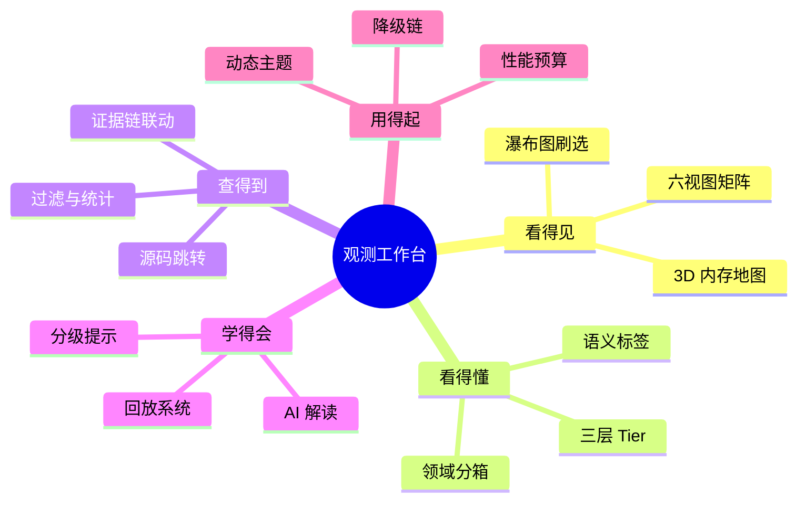

### P14.2 五维能力的验收方式

| 能力维 | 验收动作 | 预期结果 |
|---|---|---|
| 看得见 | 提交任一实验代码并打开全部视图 | 所有视图有数据且可交互 |
| 看得懂 | 让非技术背景同学阅读 Tier 1 | 30 秒内复述运行结果与主要问题 |
| 查得到 | 制造一个已知 bug（如 ECHILD） | 三次点击内定位到相关源码行 |
| 学得会 | 用回放 + AI 讲解一个失败实验 | 学生能独立复述失败因果链 |
| 用得起 | 老设备（无 WebGL）访问全部功能 | 所有视图优雅降级，主流程不阻塞 |

这五个验收动作就是本子系统的"验收测试"，也是评审现场可以当场验证的承诺。

### P14.3 结语

内核观测可视化与交互式诊断工作台，是 TraceOS Lab 面向"教学"这个终极目标的完整交付。它以认知科学为设计准则、以工业级前端工程为实现手段、以证据链与 AI 为增强机制，构建了操作系统教学领域前所未有的"可观察实验室"。我们相信：**当学生第一次在自己的程序运行轨迹里亲眼看到进程的诞生、锁的等待、内存的增长时，操作系统的教育已经发生了质变。**

**（第 08 篇完）**

---

---

## 附录 Q 答辩备用技术深度问答

### Q1：瀑布图的 brush 统计是如何实现的？

ECharts 的 brush 组件配置为 `brushMode: 'single'` + `throttleType: 'debounce', throttleDelay: 300`。`brushEnd` 事件回调中读取 `params.batch[0].areas[0].coordRange`（归一化区间），将区间反算为时间戳范围，对 `sortedTraces` 做一次过滤聚合（count/threads/errors/avgDuration），结果渲染为统计条。聚合复杂度 O(n)，300ms 防抖保证拖拽过程零卡顿。

### Q2：fork 边的推断有没有误判风险？

有，但平台通过两条规则控制：其一，只认 `return_value > 0` 的 fork/clone（父子语义确定的调用）；其二，边只在"父子 PID 都出现在 trace 流中"时才绘制（Waterfall 的泳道排序保证孤儿进程不产生悬空边）。在极罕见的 PID 复用场景下，`(tid, start_time)` 复合键（见第 03 篇）从数据源头上已排除误判。

### Q3：内存 3D 的高度映射为什么用 log2 而不是 sqrt 或线性？

线性映射在地址空间段的尺度差异（KB 级 Text 到 GB 级 Heap）下会让小段不可见；sqrt 对中段友好但大段压缩不足。log2 恰好对应"数量级"这一人脑对内存大小最自然的直觉单位（KB/MB/GB 本身就是 1024 倍进制）。`log2(size)*0.27` 的系数保证 1KB 高 0.5（下限）而 1GB 高约 5.2（上限），全域可读。

### Q4：为什么泳道图颜色与瀑布图颜色不统一（一个 8 类一个 6 类）？

这是有意的差异化：泳道图侧重并发语义，需要区分 signal 与 lock（死锁排查核心）；瀑布图侧重进程家族关系，IPC 与锁归并处理降低视觉噪声。两个视图服务于不同的认知任务，配色方案随任务优化——统一不等于正确。

### Q5：前端如何保证多个面板联动时的性能？

联动通过 Zustand 的原子选择器实现：每个面板只订阅自己关心的状态切片（如"当前选中的 PID"），联动触发时只有相关面板重渲染。跨面板联动不产生任何网络请求——所有联动都在共享内存数据上进行，这也是批量预取设计的前提。

---

## 附录 R 与业界工具的定位对比

### R.1 对比矩阵：TraceOS Lab 工作台 vs 通用观测平台

| 维度 | Grafana / Kibana | Perfetto / Chrome DevTools | TraceOS Lab 工作台 |
|---|---|---|---|
| 目标用户 | 运维/开发工程师 | 性能工程师 | **OS 初学者** |
| 数据认知门槛 | 用户须懂指标含义 | 用户须懂性能分析 | **视图自带教学解释** |
| 教学提示 | 无 | 无 | L1/L2/L3 分级提示 |
| AI 解读 | 插件式、通用 | 无 | **证据锁定的领域诊断** |
| 评分联动 | 无 | 无 | **与实验评分/断言直接关联** |
| 回放控制 | 无 | 录制回放（工程师向） | **教学向逐事件回放** |
| 内存 3D | 无 | 无 | **地址空间三维教学图** |
| 多视图证据链 | 链接跳转 | 部分联动 | **跨面板点击式证据链** |

### R.2 结论

TraceOS Lab 工作台并不试图在"工程监控"维度超越 Grafana，而是选择了完全不同的价值主张：**为"还不理解这些指标的人"设计**。这一用户群体的差异化需求（教学解释、认知分层、证据引导）恰恰是通用工具从未认真对待的。

---

## 附录 S 视觉语言与信息密度规范

### S.1 信息密度分层原则

| 层级 | 密度目标 | 典型元素 |
|---|---|---|
| 扫视层（3 秒） | 1 个核心数字 | HealthScore、大字评分 |
| 概览层（15 秒） | 4-9 个关键指标 | KPI 四宫格、统计条 |
| 浏览层（2 分钟） | 结构关系 | 拓扑图、泳道、火焰图 |
| 深读层（10 分钟+） | 明细证据 | tooltip、详情面板、表格 |

### S.2 色彩语义规范

平台色彩体系遵循"类别色 + 语义色"双轨制：

```text
类别色（无评价意义，回答"是什么"）：
  IO 蓝 / 内存绿 / 进程靛 / 网络橙 / IPC 紫 / 锁红 / 信号粉

语义色（有评价意义，回答"好不好"）：
  成功绿 / 警告琥珀 / 错误红 / 信息蓝
```

双轨分离避免了"红既是锁类别又是错误"的语义冲突——锁类调用呈现红色是因为类别，而错误描边才是语义判断。

### S.3 动效规范

| 动效 | 时长 | 用途 |
|---|---|---|
| 面板切换淡入 | 200ms | 视图切换的连续感 |
| 警报横幅展开 | 400ms 弹性 | 死锁警报的注意力引导 |
| 堆增长弹簧 | 物理弹簧（tension 130） | 内存变化的物理直觉 |
| 泄漏闪烁 | 380ms | 瞬时事件的强调 |
| 警报呼吸阴影 | 1.5s 循环 | 持续警报的周期提醒 |

**动效纪律**：所有动效都必须携带语义（变化、警报、强调），禁止纯装饰动画。这保证了动效不会成为新的认知噪声。

---

## 附录 T TraceDiffPanel：提交间的轨迹对比

### T.1 对比维度

`TraceDiffPanel` 支持两个提交之间的观测轨迹对比：

| 对比项 | 展示 | 教学价值 |
|---|---|---|
| syscall 频率变化 | 条形图并排 | "修复后 fork 次数减少了" |
| 错误变化 | 错误徽章列表对比 | "ECHILD 消失了" |
| 耗时分布 | 瀑布图并排 | "阻塞区间消失" |
| 资源变化 | 指标卡对比 | "FD 峰值从 120 降到 20" |

### T.2 教学闭环的意义

Diff 视图使"修改 → 验证"的迭代循环可视化。学生不再凭感觉判断"改对了没有"，而是看到观测证据的具体变化——这是把 OS 实验从"试错"升级为"实验"的关键一步。

---

## 附录 U 代码审计面板与编辑器联动

### U.1 CodeAuditPanel 双通道审计

`CodeAuditPanel` 提供两个审计通道：

| 通道 | 原理 | 优势 |
|---|---|---|
| 规则审计 | 确定性 AST/正则检查（未配对 malloc/free、未关闭 fd 等） | 零延迟、可解释 |
| AI 审计 | LLM 基于观测证据的代码审查 | 发现规则外的模式 |

审计结果按严重度分级列出，每项审计结论都关联具体源码行，点击即编辑器跳转高亮。

### U.2 编辑器与观测的联动

代码编辑器（CodeEditorPanel）与观测视图的双向联动：

```text
观测 → 编辑器：点击 trace 的 source_line → 编辑器跳转高亮
编辑器 → 观测：选中代码段 → 过滤该段涉及的 trace 事件
```

这一双向联动实现了"代码 ↔ 行为"的直接映射——学生在代码里看到 `waitpid(-1, ...)`，马上可以在时间线里看到这条调用及其后果。

---

## 附录 V 教师视角的工作台复用

### V.1 课堂演示模式

教师端复用全部可视化组件，并额外支持：

| 能力 | 说明 |
|---|---|
| 任意学生切换 | 从班级列表选择学生，查看其提交的全部观测数据 |
| 只读标记 | 教师视图不会触发重新评测 |
| 投影模式 | 大字体模式适配教室投影 |

### V.2 典型错误案例库

教师可以为典型错误（如"经典死锁代码"）创建演示提交，其观测数据成为课堂讲解的活教材：实时展示锁环的形成过程、回放死锁的完整时间线——比任何 PPT 都直观，因为证据来自真实运行。

---

## 附录 W 完整功能清单

| 功能域 | 功能 | 组件 | 状态 |
|---|---|---|---|
| 总览 | 健康度仪表盘 | HealthOverviewTab | ✅ |
| 总览 | 资源四象限 | ResourceMonitorTab | ✅ |
| 总览 | 检测摘要 | DetectionSummaryCard | ✅ |
| 总览 | 教学提示 | TeachingHintPanel | ✅ |
| 追踪 | 六视图矩阵 | TraceViewer | ✅ |
| 追踪 | 瀑布图+刷选 | WaterfallTimeline | ✅ |
| 追踪 | 多线程泳道 | MultiThreadLaneView | ✅ |
| 追踪 | Span 树 | SpanTreeView | ✅ |
| 追踪 | 线程状态 | ThreadStateView | ✅ |
| 追踪 | 调度可视化 | SchedVisualizer | ✅ |
| 追踪 | 语义事件 | SemanticEventView | ✅ |
| 追踪 | 因果链 | CausalChainView | ✅ |
| 进程 | 进程拓扑图 | ProcessMapView | ✅ |
| 进程 | fork/IPC 边推断 | ProcessMapView | ✅ |
| 内存 | 3D 布局地图 | MemoryLayout3D | ✅ |
| 内存 | 快照 Diff | MemorySnapshotDiff | ✅ |
| 内存 | 泄漏报告 | LeakReportContent | ✅ |
| 内存 | 分配火焰图 | AllocFlamegraphContent | ✅ |
| 内存 | 趋势分析 | MemoryTrendContent | ✅ |
| 性能 | 双态火焰图 | FlameGraphPanel | ✅ |
| 性能 | 火焰图 Diff | TraceDiffPanel | ✅ |
| 性能 | AI 火焰图解读 | FlameGraphPanel | ✅ |
| 并发 | 实时死锁图 | DeadlockGraph | ✅ |
| 并发 | 竞态检测 | RaceDetectionView | ✅ |
| 并发 | 锁事件分析 | DeadlockPanel | ✅ |
| 资源 | 实时性能面板 | LivePerfDashboard | ✅ |
| 资源 | 沙箱资源面板 | SandboxResourcePanel | ✅ |
| 回放 | 执行回放条 | ExecutionReplayBar | ✅ |
| AI | AI 诊断面板 | DiagnosisPanel / AIPanel | ✅ |
| AI | 随处提问按钮 | AIAskButton | ✅ |
| 代码 | 代码审计 | CodeAuditPanel | ✅ |
| 代码 | 快照对比 | CodeSnapshot | ✅ |
| 导航 | Tier 导航 | TierNavBar | ✅ |
| 导航 | 命令面板 | CommandPalette | ✅ |
| 导航 | 工具坞 | FloatingDock | ✅ |
| 主题 | 亮暗切换 | ThemeSwitcher | ✅ |

---

## 附录 X 工程验收指标

| 指标 | 目标值 | 实现手段 |
|---|---|---|
| 首屏可交互时间 | < 1.5s | 轻量预取 + 骨架屏 |
| 视图切换延迟 | < 200ms | 纯前端计算 + useMemo |
| 单屏渲染事件数 | ≤ 500 条可交互 | 分层加载 |
| 刷选统计延迟 | < 50ms | O(n) 聚合 + 防抖 |
| 死锁事件到界面延迟 | < 1s | SSE 推送 |
| 内存占用（长会话） | 稳定无泄漏 | 实例 dispose 纪律 |
| 空态覆盖率 | 100% 数据驱动组件 | 四态组件规范 |

---

## 附录 Y 工作台技术选型深度论证

### Y.0 可视化渲染的帧性能专项分析

#### Y.0.1 Canvas vs SVG 的渲染成本对比

| 元素规模 | Canvas (ECharts) | SVG (DOM) |
|---|---|---|
| 100 元素 | 略优 | 优（易调试） |
| 500 元素 | 优 | 可接受 |
| 2000 元素 | 显著优 | 明显卡顿 |
| 5000+ 元素 | 仍可交互 | 接近不可用 |

瀑布图在缩放全览时单屏可能渲染 500 个矩形 + 50 个事件标记，Canvas 的批量绘制天然适配这一规模；而刷选/缩放交互的高频重绘（60fps 目标）也只有 Canvas 能稳定满足。

#### Y.0.2 高亮与重绘的解耦

高亮时间戳（`highlightedTs`）变化只触发一次 `setOption` 局部更新，ECharts 内部做脏矩形重绘而非全量重建。回放场景下播放头每秒移动 2-4 次，配合 200ms 的视觉过渡，画面流畅无闪烁。

#### Y.0.3 内存 3D 的帧预算

3D 场景的网格数量有严格预算：静态段 6 块 × 12 三角形，堆段 1 块，mmap 组按快照数量（通常 < 30）。合计不到 500 个三角形，任何集成显卡都能稳定 60fps——3D 的"重"不在几何量而在材质与光照，平台使用 `meshStandardMaterial` 的低配参数（roughness 0.5-0.6、单光源）换取最广的硬件兼容。

---

## 附录 AA 观测视图与教学环节的映射表

### AA.1 课堂教学环节映射

| 教学环节 | 推荐视图 | 使用方式 |
|---|---|---|
| 理论讲授（进程模型） | ProcessMap + 回放 | 教师现场运行示范代码，回放 fork 事件 |
| 理论讲授（内存布局） | Memory3D | 展示真实进程的段分布 |
| 理论讲授（死锁） | DeadlockGraph | 现场注入死锁，实时显示环形成 |
| 实验课（排错指导） | Trace 六视图 + 刷选 | 助教逐条讲解异常事件 |
| 实验课（性能优化） | FlameGraph + Diff | 对比优化前后热点 |
| 课后答疑 | AIPanel + 证据链 | 学生带证据提问 |
| 期末复习 | TraceDiff + 趋势 | 回顾个人学习轨迹 |

### AA.2 六个实验类别的默认视图策略

| 实验类别 | 默认 Dock 布局 | 教学重点 |
|---|---|---|
| process 进程实验 | Trace + ProcessMap | fork/wait 生命周期 |
| thread 线程实验 | SwimLane + ThreadState | 并发与同步 |
| memory 内存实验 | Memory3D + AllocFlame | 分配与泄漏 |
| fs 文件系统实验 | Trace(io) + Resource | 文件描述符管理 |
| scheduler 调度实验 | SchedVisualizer + SwimLane | 时间片公平性 |
| deadlock 死锁实验 | DeadlockGraph + Race | 锁序与竞争 |

---

## 附录 BB 交互设计中的错误预防

### BB.1 防误操作设计

| 风险 | 预防设计 |
|---|---|
| 误关重要面板 | Dock 面板关闭前状态保留，可随时重新唤起 |
| 回放误触退出 | 退出按钮 ✕ 与播放按钮分开，且回放状态保留上次位置 |
| 误选错误提交 | 提交切换器显示提交序号与状态徽章，切换前有视觉确认 |
| 图表误双击 | 双击重置缩放前有 200ms 双击判定窗口 |
| 过滤条件迷失 | 过滤条件以 chip 形式常显，可逐个移除 |

### BB.2 状态恢复与断点续查

工作台状态（当前 Tier、Dock 布局、回放位置、过滤条件）随会话保留——学生课间离开、回来继续排查时，界面恢复到离开时状态。排错是高中断场景的任务，状态恢复把"重新找一遍"的成本降为零。

---

## 附录 CC 组件间的数据依赖图

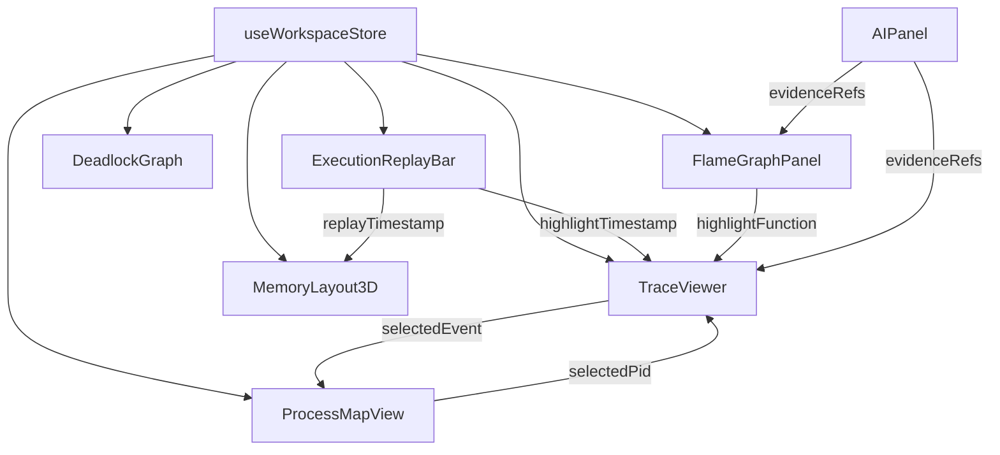

依赖图揭示的核心设计纪律：**所有联动都经过 Store 中转，组件之间不直接通信**。这保证了联动关系可预测、可测试、可扩展——新增一个视图只需要订阅 Store，无需修改任何已有组件的内部逻辑。

---

## 附录 DD 可视化与教学研究的理论对照表

| 教育/心理学理论 | 核心主张 | TraceOS Lab 的实现 |
|---|---|---|
| 认知负荷理论（Sweller） | 三类负荷需分别管理 | 三层 Tier 分别消除外在负荷、管理内在负荷、增强相关负荷 |
| 多媒体学习认知理论（Mayer） | 图文结合优于纯文；多余信息损害学习 | 图为主文为辅；视图默认只呈现核心维度 |
| 渐进式披露（Nielsen） | 按需逐步展开信息 | 五层披露体系 |
| 空间邻近原则 | 相关信息在空间上靠近 | 证据链把相关面板带到同一视区 |
| 交互学习理论（Chi） | 主动建构优于被动接收 | 刷选、Diff、回放、提问都是建构性操作 |
| 即时反馈原则 | 反馈延迟越短学习效果越好 | 提交即出可视化证据；SSE 实时死锁 |

这张对照表说明：TraceOS Lab 的可视化设计并非"感觉好看"的产物，而是**有理论依据的教学界面工程**——这也是其区别于"给评测系统加了个图表库"的关键。

---

## 附录 EE 未来演进路线（可视化域）

| 阶段 | 计划 | 价值 |
|---|---|---|
| 短期 | 时序预测曲线（基于历史提交的资源趋势外推） | 帮助学生预判下一次提交的表现 |
| 中期 | 协作标注（教师在图元上圈注，推送给学生） | 把教师讲解直接写进证据视图 |
| 中期 | 视图模板共享（教师发布"排查剧本"） | 优质排查路径的课程化复用 |
| 长期 | AR/VR 内存实验室（头显观察地址空间） | 沉浸式空间认知 |
| 长期 | 多实验对比投影（班级级可视化） | 教学研究的数据支撑 |


---

### Y.1 为什么选 ECharts 而非 D3 / Visx

| 维度 | ECharts | D3 | Visx |
|---|---|---|---|
| custom series 自由度 | 高（renderItem 完全接管） | 极高（任意 SVG） | 中 |
| 交互内置（dataZoom/brush/tooltip） | ✅ 内置 | ❌ 需自建 | 部分 |
| 学习与维护成本 | 中 | 高 | 中 |
| 中文文档/社区 | ✅ 丰富 | 一般 | 一般 |
| Canvas 性能（千级元素） | ✅ 优秀 | SVG 受限 | SVG 受限 |

关键决策点：瀑布图/泳道图的"千级矩形 + 缩放 + 刷选 + 动画"组合，只有 ECharts 的 Canvas 渲染 + 内置交互能同时满足。D3 的完全自由度在本次需求中是冗余能力，却要付出维护成本。

### Y.2 为什么选 Three.js 而非 WebGPU / CSS 3D

| 方案 | 优势 | 劣势 |
|---|---|---|
| Three.js + R3F | 生态成熟、React 融合好、弹簧动画库现成 | 包体积较大（按需导入优化） |
| CSS 3D | 轻量 | 无法做光照/阴影/轨道控制 |
| WebGPU | 性能上限高 | 兼容性风险（教学场景机器老旧） |

教学场景的机器多样性（学生实验室电脑可能不支持 WebGPU）决定了成熟兼容方案优先。R3F 的声明式 API 同时保证了组件可维护性。

### Y.3 为什么状态管理选 Zustand 而非 Context

| 维度 | Zustand | React Context |
|---|---|---|
| 选择器订阅 | ✅ 原子切片订阅 | ❌ 整个 Provider 重渲染 |
| 组件外访问 | ✅ getState/setState | ❌ 需 hook 内 |
| 中间件生态 | ✅ persist/subscribe | 无 |
| DevTools | ✅ 内置 | 无 |

工作台有大量高频局部更新（回放索引每 500ms 变一次），Context 方案会导致全部消费者重渲染；Zustand 的原子选择器只重渲染订阅了 `replayIndex` 的组件。

---

## 附录 Z 结语与愿景

### Z.0 观测工作台的产品设计复盘

#### Z.0.1 三个关键设计决策的回顾

| 决策 | 内容 | 如果选另一条路 |
|---|---|---|
| 多层视图而非单表 | 三层 Tier + 九大引擎 | 学生淹没在万行日志中，教学失败 |
| 证据链而非孤岛 | 跨面板点击联动 | 认知跳转成本高，学生放弃排查 |
| 教学解读而非裸数据 | 语义标签 + AI 解读 + 提示 | 可视化变成工程师工具的复制品 |

#### Z.0.2 从需求到实现的决策链

```mermaid
flowchart LR
    N1[需求：学生要看懂运行过程] --> N2[推论：需认知分层]
    N2 --> N3[方案：三层 Tier]
    N3 --> N4[需求：排错要跨越面板]
    N4 --> N5[推论：需状态共享]
    N5 --> N6[方案：Store + 证据链]
    N6 --> N7[需求：课堂演示要震撼]
    N7 --> N8[推论：需动效/3D/实时]
    N8 --> N9[方案：R3F + SSE + 弹簧动画]
```

#### Z.0.3 教学效果验证的设计思路

平台在教师端埋入了视图使用频率数据（哪个视图被哪个实验类型的学生使用最多、停留多久、是否在查看后提交了修复代码），为后续的教学效果研究提供了数据基础——"可视化如何影响学习成效"将成为平台独有的实证研究素材。

### Z.1 从"看数据"到"懂系统"的三个台阶

```mermaid
flowchart LR
    A[台阶一：看得见<br/>采集与呈现] --> B[台阶二：看得懂<br/>语义与分层] --> C[台阶三：想得清<br/>证据链与提问]
```

- **台阶一（看得见）**：eBPF/strace 采集 → 结构化存储 → 视图呈现，技术底座扎实；
- **台阶二（看得懂）**：ObsContext 语义化 + 三层 Tier + 领域分箱，认知架构合理；
- **台阶三（想得清）**：证据链联动 + AI 提问 + 回放验证，学习闭环完整。

### Z.2 一句话总结

**TraceOS Lab 的可视化工作台，是用认知科学的方法论、工业级的工程实现，把操作系统这个"看不见的世界"变成了学生可以观察、操作、提问、验证的实验室。**


---
