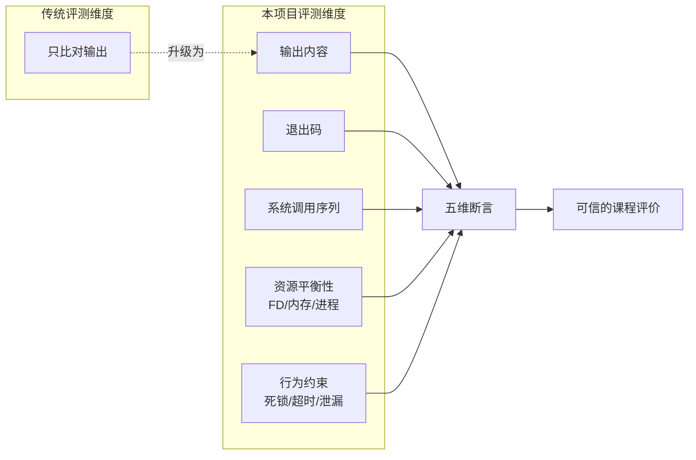
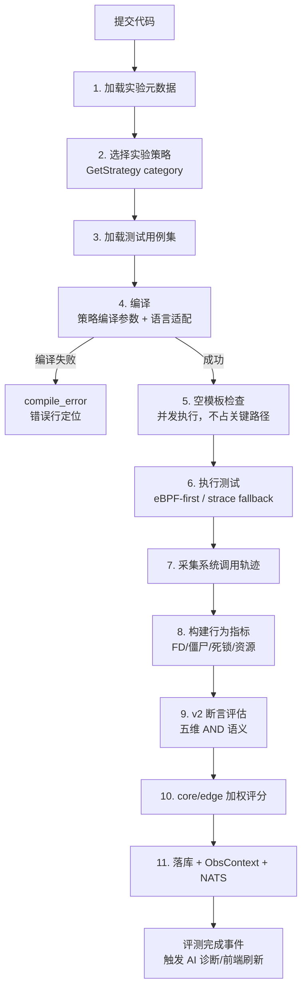
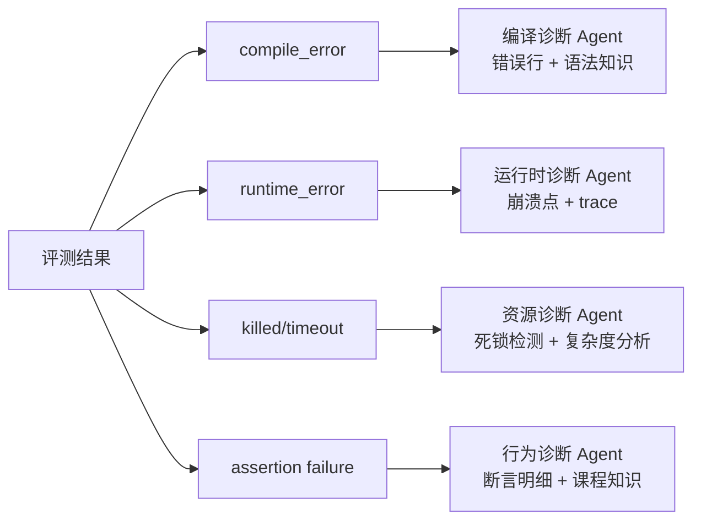
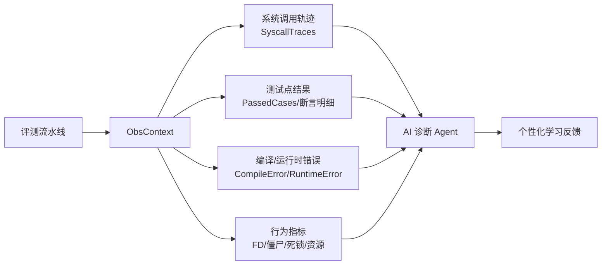
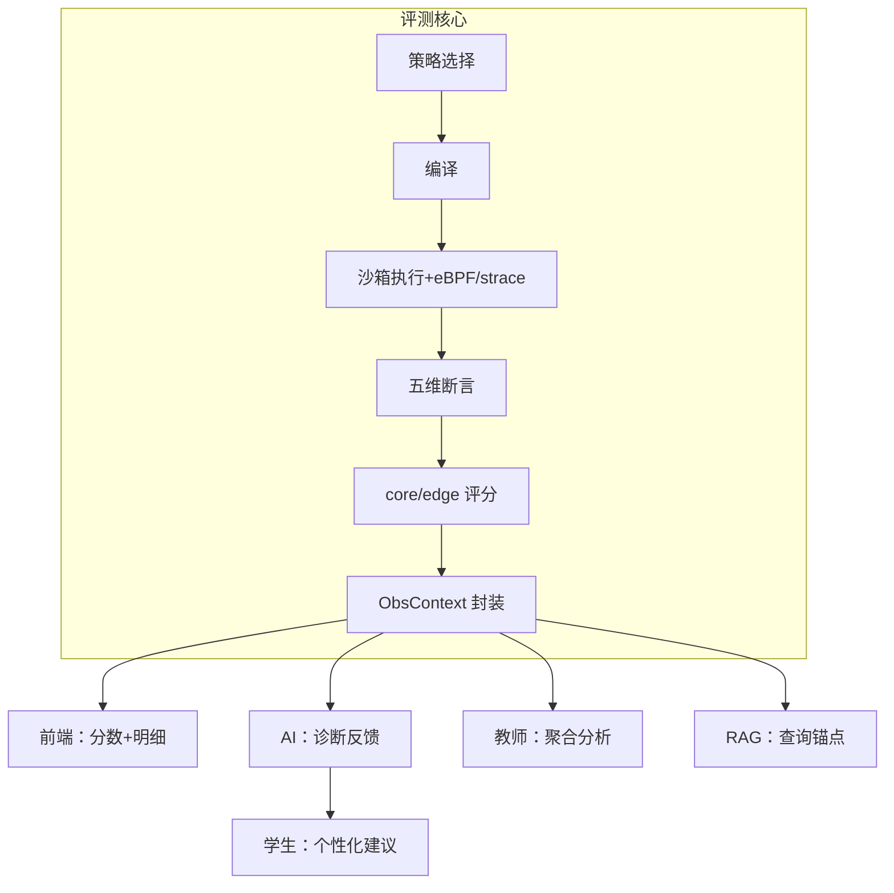
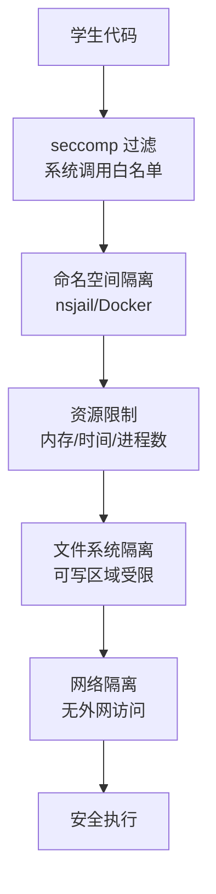

# 11 测试样例体系、实验策略与多语言支持

## 摘要

TraceOS Lab 的评测子系统围绕操作系统课程的六大核心知识域（进程、线程、内存、文件系统、调度、死锁）构建了一套**策略驱动的自适应评测体系**。每个实验类别拥有独立的编译参数、沙箱级别、时间与内存限制、系统调用期望、资源约束和评分偏好，使评测不再是"一套固定模板跑所有实验"，而是"**按实验语义选择策略**"。

本章将从五个维度系统呈现这套体系的设计思想与工程实现：

1. **策略维度**：`ExperimentStrategy` 接口与六类策略的差异化配置，以及装饰器模式的工程运用；
2. **样例维度**：覆盖 31 个实验、六个知识域的测试样例分层体系（基础 → 异常 → 边界 → 行为 → 资源 → 禁止）；
3. **断言维度**：v2 结构化断言文档（exit_code / output / syscall / behavior / numeric 五维），及其"AND 语义"的严格性保证；
4. **反作弊维度**：空模板检测、实质性代码兜底、禁止系统调用约束、参考实现独立性；
5. **语言维度**：C / C++ / Python / Go / Rust 五语言编译适配，错误行定位，多语言模板扩充机制。

### 技术栈总览

| 层 | 技术选择 | 说明 |
|---|---|---|
| 策略层 | Go 接口 + 策略模式 + 装饰器 | `ExperimentStrategy` + `gFlagStrategy` |
| 编译层 | gcc / g++ / python3 / go / rustc | 五语言，60s 编译超时，错误行解析 |
| 执行层 | nsjail / Docker / local 三后端 | 按实验语义选择隔离级别 |
| 追踪层 | eBPF-first + strace fallback | 系统调用级行为观测 |
| 断言层 | 结构化 JSON 断言文档（v2） | 五维断言，向后兼容旧格式 |
| 评分层 | core / edge 分层加权 | core 全过才合格（AND 语义） |
| 观测层 | ObsContext + NATS 事件 | 与 AI 诊断、前端展示联动 |

---

## 1. 背景：为什么通用在线判题系统无法胜任操作系统实验教学

### 1.1 传统 OJ 的五大痛点

在构建本平台之前，我们对主流在线判题系统（OJ）的评测方式做了系统分析，发现它们在操作系统实验场景下存在五个结构性缺陷：

| 痛点 | 传统 OJ 的做法 | 在 OS 实验中的后果 |
|---|---|---|
| **单一判题模式** | 所有题目共用同一套编译参数、资源限制 | fork 实验与调度实验用同样的 64MB 内存限制，线程实验漏链 `-lpthread` 导致编译失败 |
| **只看输出** | 仅比对 stdout | 学生用 `system("echo ...")` 绕过进程创建要求也能拿满分；fork 后不 wait 产生的僵尸进程无人发现 |
| **对比刚性** | 与参考输出做精确/近似 diff | 父进程/子进程输出顺序不确定，PID 天然随机——合法程序被判错 |
| **无法观测行为** | 不采集系统调用轨迹 | 文件描述符泄漏、内存泄漏、死锁这些 OS 课程的核心考点完全不可测 |
| **作弊盲区** | 只判结果不判过程 | 学生直接提交"只打印预期答案"的空壳程序也能通过全部测试 |

### 1.2 本项目的机会：评测维度从"结果"扩展到"行为"

操作系统课程的本质是教学生理解**系统资源的管理机制**——进程的生命周期、内存的分配回收、文件的打开关闭、锁的获取释放。这些机制的核心观察对象不是"程序输出了什么"，而是"程序对内核做了什么"：



正是这种"从结果评判到行为评判"的维度跃迁，构成了本章全部设计的总纲：**策略体系决定"怎么跑"，断言体系决定"怎么判"，反作弊体系决定"判得真不真"**。

---

## 2. 评测流水线总体架构

### 2.1 一条流水线，六类实验

评测流水线（`Pipeline.Run`）是平台的核心执行引擎，处理"提交 → 编译 → 执行 → 追踪 → 断言 → 评分 → 落库 → 事件发布"的完整闭环：



### 2.2 流水线的五个设计原则

这条流水线不是"一个函数写完所有逻辑"，而是遵循五个明确的设计原则：

| 原则 | 实现方式 | 收益 |
|---|---|---|
| **策略外置** | 评测参数全部来自 `ExperimentStrategy`，流水线零硬编码 | 新增实验类别不修改流水线 |
| **失败快速分类** | compile_error / runtime_error / killed / assertion failure 四类错误分离 | AI 诊断精准激活对应 Agent |
| **观测与评判分离** | 追踪采集（eBPF/strace）与断言评估是两个独立阶段 | 观测数据可复用（评分 + 诊断 + 前端） |
| **关键路径优化** | 空模板检查与主测试并发执行 | 反作弊零延迟成本 |
| **事件驱动下游** | 评测完成通过 NATS 发布事件 | 前端、AI 服务解耦订阅 |

### 2.3 执行阶段的并发模型

系统调用追踪与测试执行在同一沙箱进程内完成（避免二次执行的时序偏差），而测试用例之间通过信号量控制并发度（`maxParallelTests`），在**吞吐量与沙箱资源安全**之间取得平衡：

```text
┌─ 测试用例 1 ─┐
├─ 测试用例 2 ─┤  信号量并发控制
├─ 测试用例 3 ─┤  maxParallelTests
├─ 测试用例 4 ─┤
├─ ...        ─┤
└─ 测试用例 N ─┘
        │
        ▼
每用例独立沙箱实例（隔离故障蔓延）
```

一个用例的崩溃不会影响其他用例——因为每个测试用例都在独立的沙箱实例中执行，这是对"评测可信性"最基础也最重要的保障。

---

## 3. ExperimentStrategy：策略模式在评测场景的落地

### 3.1 接口设计：一个接口抽象"实验的全部差异"

```go
// ExperimentStrategy 定义每个实验类别的差异化行为
type ExperimentStrategy interface {
	SeccompProfile() string          // seccomp 系统调用过滤配置名
	SandboxLevel() int               // 沙箱隔离级别
	SandboxBackend() string          // 沙箱后端：nsjail / docker
	MemoryLimit() int64              // 内存上限
	TimeLimit() int                  // 时间上限（秒）
	CompileFlags() []string          // 默认编译参数
	CompileFlagsFor(language string) []string // 按语言适配编译参数
	OutputWeight() float64           // 输出维度评分权重
	StructureWeight() float64        // 结构维度评分权重
	BehaviorWeight() float64         // 行为维度评分权重
	CompareMode() string             // 输出比较模式
	RerunCount() int                 // 重跑次数（对抗调度不确定性）
	DisableTrace() bool              // 是否关闭系统调用追踪
	ExitCodeRequired() int           // 期望退出码
	ExpectedSyscalls() []string      // 必须出现的系统调用
	ForbiddenSyscalls() []string     // 禁止出现的系统调用
}
```

这个接口的**信息密度**值得逐项解读——它把"一个实验该怎么跑、怎么判"的全部差异浓缩为 16 个方法：

- **怎么跑**：`SandboxLevel` / `SandboxBackend` / `MemoryLimit` / `TimeLimit` / `RerunCount` / `DisableTrace` 决定执行环境；
- **怎么编译**：`CompileFlags` / `CompileFlagsFor` 决定编译命令；
- **怎么判**：`CompareMode` / `ExitCodeRequired` / `ExpectedSyscalls` / `ForbiddenSyscalls` 决定评判规则；
- **怎么算分**：`OutputWeight` / `StructureWeight` / `BehaviorWeight` 决定三维度权重；
- **怎么隔离**：`SeccompProfile` 决定系统调用级安全边界。

### 3.2 工厂函数：按类别名分发

```go
func GetStrategy(category string) ExperimentStrategy {
	var base ExperimentStrategy
	switch category {
	case "process":  base = &ProcessStrategy{}
	case "thread":   base = &ThreadStrategy{}
	case "memory":   base = &MemoryStrategy{}
	case "fs":       base = &FileStrategy{}
	case "scheduler":base = &SchedulerStrategy{}
	case "deadlock": base = &DeadlockStrategy{}
	default:         base = &ProcessStrategy{}  // 安全兜底
	}
	return &gFlagStrategy{base}
}
```

两个值得注意的细节：

1. **安全兜底**：未知类别回落到 `ProcessStrategy`（最保守的配置），保证**任何实验数据异常都不会导致评测崩溃**；
2. **装饰器包装**：所有策略统一经过 `gFlagStrategy` 装饰（见第 5 章），这是对 Go 组合模式（而非继承）的教科书式运用。

### 3.3 策略与流水线的解耦

流水线中**没有任何一行代码形如 `if category == "process"`**——所有差异都被策略接口吸收。这意味着：

```text
新增一个实验类别（例如 "io"）
        │
        ▼
1. 实现 I/OStrategy 结构体（16 个方法）
2. 在 GetStrategy 的 switch 中加一个 case
        │
        ▼
流水线零修改，编译/执行/断言/评分全部自动适配
```

这是**开闭原则**（对扩展开放、对修改关闭）在评测系统的直接体现：实验体系的扩展成本从"修改核心流水线"降为"新增一个策略文件"。

---

## 4. 六类实验的差异化策略详解

### 4.1 策略参数总览

| 参数 | process | thread | memory | fs | scheduler | deadlock |
|---|---|---|---|---|---|---|
| SeccompProfile | process-lab | thread-lab | memory-lab | fs-lab | scheduler-lab | deadlock-lab |
| SandboxLevel | 1 | 2 | 2 | 1 | 3 | 3 |
| SandboxBackend | nsjail | nsjail | nsjail | **docker** | nsjail | nsjail |
| MemoryLimit | 256MB | 128MB | 512MB | 256MB | 64MB | 64MB |
| TimeLimit | 30s | 30s | 120s | 60s | 60s | 60s |
| 附加编译参数 | — | `-lpthread` | — | — | `-lm` | `-lpthread` |
| DisableTrace | 否 | 否 | 否 | **是** | 否 | 否 |
| ExpectedSyscalls | clone, wait4, write | clone, futex, write | brk, munmap, write | openat, read, write, close | write | clone, futex, write |
| ForbiddenSyscalls | system | — | — | — | system, execve | — |
| 输出/结构/行为权重 | 0.50/0.25/0.25 | 0.50/0.25/0.25 | 0.50/0.25/0.25 | 0.50/0.25/0.25 | 0.50/**0.30**/0.20 | 0.50/0.25/0.25 |

### 4.2 逐类别设计动机

**① Process（进程，SandboxLevel 1）**

进程实验的核心观察点是**生命周期管理**：fork 创建、wait 回收、进程树结构。因此：

- `ExpectedSyscalls = [clone, wait4, write]`——fork 在 Linux 上由 `clone` 实现，**必须出现 wait4 保证回收**（防止僵尸进程）；
- `ForbiddenSyscalls = [system]`——杜绝"用 system() 一行命令完成实验"的取巧路径；
- 内存 256MB、时间 30s 是"适度宽裕"的配置：进程实验的正确实现运行极快，限制主要防御死循环和 fork 炸弹。

**② Thread（线程，SandboxLevel 2）**

线程实验涉及**共享地址空间下的并发控制**，风险更高：

- 沙箱级别升到 2（更强的资源隔离）；
- `-lpthread` 是硬性编译要求——**漏链 pthread 是初学者最高频的编译错误**，策略层自动注入避免"教师忘了配置、全班编译失败"的教学事故；
- `ExpectedSyscalls = [clone, futex, write]`——`futex` 是 pthread 同步原语（mutex/条件变量）的内核基础，**没有 futex 说明线程同步是"假"的**（可能用忙等待糊弄）。

**③ Memory（内存，SandboxLevel 2）**

内存实验需要观察堆的伸缩：

- `ExpectedSyscalls = [brk, munmap, write]`——`brk` 是堆扩展的系统调用，`munmap` 是内存释放路径；malloc/free 的实现最终落到这两个系统调用上；
- 时间放宽到 120s：内存分配策略对比类实验（如 first-fit vs best-fit 的碎片率模拟）计算量更大；
- 内存放宽到 512MB：允许学生程序构造较大的内存操作场景。

**④ File System（文件系统，docker 后端 + DisableTrace）**

文件系统实验的配置是全表中最特殊的：**沙箱后端切到 Docker，且关闭系统调用追踪**。这是深思熟虑的结果：

- Docker 提供**独立的挂载命名空间**，文件行为受控——学生程序对 /tmp 的读写不会污染宿主机，且每次评测从干净的文件系统状态开始（可重复性）；
- `DisableTrace = true` 的原因：文件实验的追踪数据量巨大（一次 cp 可能产生数万条 read/write 记录），追踪开销会显著干扰 I/O 性能对比类实验的**计时公平性**（lab19 对比四种缓冲区的耗时，追踪开销会扭曲结果）；
- 这个"关闭观测换取计时纯净"的取舍，恰恰体现了**按语义配置**的价值——通用 OJ 不可能做出这种粒度判断。

**⑤ Scheduler（调度，SandboxLevel 3 + 特殊权重）**

调度实验主要是**模拟类计算**（FCFS/SJF/RR/MLFQ/CFS 等算法的模拟器），特征是：

- `-lm` 编译参数：调度模拟常需要数学计算（如 Liu-Layland bound 的 n(2^(1/n)-1) 计算）；
- 沙箱级别升到 3（最高），时间 30s、内存 64MB 收紧：模拟程序**不应**消耗大量资源，收紧限制可以暴露低效实现（如 O(n³) 的暴力模拟）；
- **权重特殊**：StructureWeight 升到 0.30、BehaviorWeight 降到 0.20——调度实验的代码结构（算法组织、数据结构选择）比行为观测更重要，因为模拟程序的系统调用行为（几乎只有 write）没有区分度。

**⑥ Deadlock（死锁，SandboxLevel 3）**

死锁实验是真并发实验（pthread_mutex 多线程）：

- `-lpthread` + 沙箱 3 级 + 60s 时间——**超时本身就是死锁信号**（行为指标中的 `DeadlockDetected = WasKilled || 运行时长>=超时`）；
- `ExpectedSyscalls = [clone, futex, write]`——futex 等待链是死锁的观测基础；
- 时间 60s 的语义：正确程序 1 秒内完成，若 60 秒未完成**几乎必然是死锁**——时间限制在这里承担了"死锁探测器"的角色。

### 4.3 参数设计的语义完整性

六类策略的参数组合可以用一句"语义句"概括：**每个参数都不是拍脑袋定的，而是从该知识域的观测需求倒推出来的**。这正是评测系统"懂操作系统"的体现：

```text
process  → 观测生命周期 → clone/wait4 必须出现、system 禁止
thread   → 观测同步机制 → futex 必须出现（区分真同步与忙等待）
memory   → 观测堆伸缩   → brk/munmap 必须出现
fs       → 观测 I/O 与计时 → Docker 隔离 + 关闭追踪保公平
scheduler→ 观测算法质量 → 结构权重最高 + 资源收紧
deadlock → 观测等待关系 → futex + 超时即死锁信号
```

---

## 5. gFlagStrategy：装饰器模式的工程运用

### 5.1 问题：一个横切关注点

C/C++ 程序的调试符号（`-g` 标志）是**系统调用追踪的源码映射**基础：strace 的 stack trace 和 source line mapping 需要二进制包含调试信息。但教师在不同实验类别的配置中，可能写也可能漏写 `-g`。

这是一个典型的**横切关注点**（cross-cutting concern）："所有 C/C++ 编译都要带 -g"，但分散在六个策略的 CompileFlags 里逐一手动添加，会带来维护风险（新增策略时容易忘记）。

### 5.2 方案：装饰器包装

```go
type gFlagStrategy struct {
	ExperimentStrategy  // 内嵌接口，自动委托所有未覆盖方法
}

func (s *gFlagStrategy) CompileFlags() []string {
	return ensureGFlag(s.ExperimentStrategy.CompileFlags())  // 确保 -g 存在
}

func (s *gFlagStrategy) CompileFlagsFor(language string) []string {
	flags := s.ExperimentStrategy.CompileFlagsFor(language)
	if flags != nil {
		return ensureGFlag(flags)
	}
	return flags
}

func ensureGFlag(flags []string) []string {
	for _, f := range flags {
		if f == "-g" { return flags }  // 幂等：已存在则不重复添加
	}
	return append(flags, "-g")
}
```

### 5.3 设计亮点

1. **接口内嵌 = 自动委托**：Go 的接口内嵌让 `gFlagStrategy` 只需覆写两个方法，其余 14 个方法自动委托给被包装策略——零样板代码；
2. **幂等性**：`ensureGFlag` 先检查再添加，重复包装不会产生重复标志；
3. **语言感知**：`CompileFlagsFor` 返回 nil 时（非 C 系语言）不注入 `-g`——Python/Go/Rust 的编译模型不同，`-g` 对它们无意义；
4. **工厂统一出口**：`GetStrategy` 返回的永远是装饰后的策略，**调用方永远不需要关心 -g 的处理**——关注点被彻底内聚。

这个装饰器是"**用最小的结构成本解决横切关注点**"的范例：没有引入 AOP 框架、没有复制粘贴、没有侵入六个策略类。

---

## 6. 测试样例分层体系：六层递进的评测设计学

### 6.1 分层模型

每类实验的测试用例按以下六层递进组织：

```text
L1 基础功能测试    ← 实验核心路径能否走通
  ↓
L2 异常输入测试    ← 错误路径处理是否健壮
  ↓
L3 边界规模测试    ← 极值条件下是否仍正确
  ↓
L4 系统调用行为测试 ← 内核交互是否符合要求（本平台特色）
  ↓
L5 资源约束测试    ← 资源使用是否收敛（FD/内存/时间）
  ↓
L6 禁止行为测试    ← 是否用取巧手段绕过实验目标
```

### 6.2 六层与断言维度的映射

| 层级 | 主要断言维度 | 典型断言 |
|---|---|---|
| L1 基础功能 | output + exit_code | `contains "Parent:"`、`exit_code: 0` |
| L2 异常输入 | exit_code（多值）+ output | `exit_code: [0,1]`（fork 失败处理允许两种退出码） |
| L3 边界规模 | numeric | `count_distinct` 消费数量恰为 20 |
| L4 系统调用行为 | syscall | `required: ["clone"]`、`min_count: {clone: 4}` |
| L5 资源约束 | behavior | `no_fd_leak`、`no_zombie`、`max_runtime_ms` |
| L6 禁止行为 | syscall（forbidden） | `forbidden: ["system", "execve"]` |

### 6.3 以文件系统实验为例的完整分层

以文件复制类实验（lab19）为例，展示六层的具体落地：

| 层级 | 测试点 | 断言示例 | 考察能力 |
|---|---|---|---|
| L1 基础 | 成功打开/读取/写入/关闭 | `required: [openat, read, write, close]` | 基本 I/O 编程 |
| L2 异常 | 源文件不存在、目标无权限 | `exit_code: [0,1]` + 错误提示输出 | 错误处理意识 |
| L3 边界 | 空文件、1MB 大文件、四种缓冲区大小 | numeric 断言各缓冲区耗时被输出 | 边界思维 |
| L4 行为 | openat/read/write/close 必须出现 | syscall required | 真系统调用 vs 假实现 |
| L5 资源 | FD 必须平衡 | `no_fd_leak: true` | 资源管理纪律 |
| L6 禁止 | 不得用 system() 调用 cp 命令 | `forbidden: ["system"]` | 实验诚实性 |

**注意 L6 的深意**：文件复制实验的目标是"学生亲手用 open/read/write 实现复制"，而 `system("cp a b")` 一行就能"输出正确"——如果没有 forbidden 断言，这个实验的教学价值将归零。**禁止行为测试保护的不是评测，而是教学目标的完整性。**

### 6.4 分层体系的弹性

六层不是"每实验必须凑齐六层"的教条，而是**评测设计的检查清单**。简单实验（如 lab1 fork 基础）可能只需要 L1+L2+L4；复杂实验（如 lab25 MLFQ）才需要全六层。分层体系的价值在于**给出一个系统性的思考框架**，让教师在设计测试点时不遗漏维度。

---

## 7. 31 个实验全景：从 lab1 到 lab31 的知识域覆盖

### 7.1 实验目录总览

平台预置了 31 个实验，覆盖六大知识域，难度从 easy 到 hard 递进：

| 知识域 | 实验编号 | 数量 | 主题 |
|---|---|---|---|
| process | lab1-lab7 | 7 | fork 基础、进程树、exec、管道、信号、僵尸/孤儿、守护进程 |
| thread | lab8-lab13 | 6 | 生产者-消费者、线程池、读写锁、哲学家、线程局部存储、线程信号 |
| memory | lab14-lab18 | 5 | 自定义 malloc、分配策略对比、多级页表、泄漏检测、段错误处理 |
| fs | lab19-lab23 | 5 | 文件复制性能、目录遍历、mmap、fsync 持久化、tee 多路复用 |
| scheduler | lab24-lab28 | 5 | FCFS/SJF/RR、MLFQ、EDF/RMS 实时调度、CFS 模拟、彩票调度 |
| deadlock | lab29-lab31 | 3 | 银行家算法、资源分配图检测、资源有序分配 |

### 7.2 难度与知识域的交叉分布

| 难度 | process | thread | memory | fs | scheduler | deadlock | 合计 |
|---|---|---|---|---|---|---|---|
| easy | 2 | 2 | 2 | 1 | 1 | 1 | 9 |
| medium | 4 | 2 | 2 | 3 | 0 | 1 | 12 |
| hard | 1 | 2 | 1 | 1 | 4 | 1 | 10 |

这个分布体现了教学设计的节奏感：**easy 打基础 → medium 巩固 → hard 挑战**。调度类实验难度集中在 hard（MLFQ、EDF、CFS 都是经典难题），而死锁类实验整体难度适中（概念重于工程量）。

### 7.3 实验元数据的完整性

每个实验的元数据包含 14 个字段，保证"教、学、评、诊"全链路的数据充分性：

| 元数据字段 | 用途 | 消费方 |
|---|---|---|
| category | 策略选择 | 评测引擎 |
| name（唯一） | 稳定标识（如 lab1_fork_basic） | 全系统 |
| title / description / instructions | 教学展示 | 前端 |
| starter_code | 代码模板（CODE START/END 标记） | 前端 + 空模板检查 |
| reference_solution | 参考实现（验证测试合理性） | 教师侧 |
| difficulty | 难度分级 | 前端 + 分析 |
| time_limit / memory_limit / sandbox_level | 实验级默认资源约束 | 评测引擎（策略未覆盖时） |
| max_submissions | 提交次数上限 | 防刷 |

### 7.4 实验体系的领域完整性论证

31 个实验的选题不是随机堆砌，而是**对操作系统课程经典知识点的系统性映射**：

- **进程域**覆盖了进程生命周期全链条：创建（lab1）→ 层次（lab2）→ 替换（lab3）→ 通信（lab4）→ 信号（lab5）→ 消亡（lab6 僵尸/孤儿）→ 守护化（lab7）；
- **线程域**覆盖了并发编程的核心模式：生产者-消费者（经典同步范式）、线程池（资源复用）、读写锁（读写不对称同步）、哲学家就餐（死锁预防的经典例题）；
- **内存域**覆盖了从底层到抽象的完整链条：malloc 实现（lab14，最底层）→ 分配策略（lab15）→ 页表翻译（lab16，虚拟化核心）→ 泄漏检测（lab17）→ 保护机制（lab18）；
- **调度域**是算法浓度最高的区域：四个基础算法（lab24）→ 工业界 MLFQ（lab25）→ 实时调度（lab26）→ Linux 真实调度器 CFS（lab27）→ 随机化调度（lab28）；
- **死锁域**构成"预防-检测-避免"的完整三角：银行家算法（避免）、资源分配图（检测）、有序分配（预防）。

**31 个实验覆盖了《现代操作系统》教材的核心实验谱系**，且每个实验都配有测试样例、参考实现、代码模板——这是平台教学价值的物质基础。

---

## 8. v2 断言体系：结构化断言的五维模型

### 8.1 从"字符串比对"到"断言文档"的演进

v1 时代的测试用例只有一个 `expected_output` 字符串，评判逻辑是简单的"输出包含/精确匹配"。这种模式在三个场景下失效：

1. 需要同时验证**输出 + 系统调用 + 资源行为**时无法表达；
2. 输出包含 PID/时间戳等**运行时随机值**时精确比对必然误判；
3. 需要表达"退出码允许 0 或 1"这样的**多值约束**时无法表达。

v2 方案将 `expected_output` 升级为**结构化 JSON 断言文档**（`AssertionsDoc`），从一维比对跃迁为五维评判：

```json
{
  "exit_code": 0,
  "output_assertions": [
    {"mode": "regex", "value": "Parent:.*PID=\\d+"},
    {"mode": "contains", "value": "PPID="}
  ],
  "syscall_assertions": {
    "required": ["clone", "wait4"],
    "forbidden": ["system"],
    "min_count": {"clone": 1}
  },
  "behavior_assertions": {
    "no_zombie": true,
    "max_runtime_ms": 5000
  },
  "numeric_assertions": {
    "mode": "count_distinct",
    "pattern": "Consumed: (\\d+)",
    "min": 20, "max": 20
  }
}
```

### 8.2 五维断言的结构与语义

| 维度 | 结构 | 语义 | 典型用例 |
|---|---|---|---|
| exit_code | 单值或数组 | 进程退出码必须等于指定值（或属于允许集合） | `0`、`[0,1]` |
| output_assertions | 规则数组 | 输出内容满足全部规则（contains / not_contains / regex / exact_match） | 关键输出存在、噪声输出不存在 |
| syscall_assertions | required / forbidden / min_count / max_count | 系统调用行为约束 | clone 必须出现、system 禁止、clone 至少 4 次 |
| behavior_assertions | 布尔标志 + 阈值 | 运行时行为约束 | 无 FD 泄漏、无僵尸、无死锁、内存/时间上限 |
| numeric_assertions | 正则提取 + 数学模式 | 从输出中提取数值做数学验证 | 消费 20 个不同物品、集合相等 |

### 8.3 AND 语义：全维通过与部分维度的失败定位

五维断言的合并规则是**严格的 AND 语义**：

```go
allPassed := summary.ExitCodePassed &&
	summary.OutputPassed &&
	summary.SyscallPassed &&
	summary.BehaviorPassed &&
	summary.NumericPassed
```

任何一个维度失败，整个测试点即失败。但**失败原因是分维定位的**——`EvalSummary` 记录每维的通过状态与明细：

```go
type EvalSummary struct {
	ExitCodePassed  bool
	ExitCodeDetail  string
	OutputPassed    bool
	OutputDetails   []string
	SyscallPassed   bool
	SyscallDetails  []string
	BehaviorPassed  bool
	BehaviorDetails []string
	NumericPassed   bool
	NumericDetail   string
}
```

这套明细直接喂给 AI 诊断 Agent：**"哪一维失败、为什么失败"是 AI 生成精准学习反馈的前提**。同时 `buildAssertionDetails` 将明细扁平化为前端可渲染的断言列表，学生可以看到每个断言的逐条通过/失败状态——**评测结论对学生完全透明**。

### 8.4 向后兼容：旧格式的优雅降级

存量测试用例的 `expected_output` 是普通字符串。`ParseAssertions` 的解析逻辑保证平滑迁移：

```go
func ParseAssertions(raw string) (*AssertionsDoc, error) {
	raw = strings.TrimSpace(raw)
	if raw == "" {
		// 空断言：期望空输出 + exit 0
		return &AssertionsDoc{ExitCode: json.RawMessage("0"), ...}
	}
	var doc AssertionsDoc
	if err := json.Unmarshal([]byte(raw), &doc); err != nil {
		// 非 JSON：旧格式 → 视为 contains 断言
		return &AssertionsDoc{
			ExitCode: json.RawMessage("0"),
			OutputAssertions: []OutputAssertion{{Mode: "contains", Value: raw}},
		}, nil
	}
	if len(doc.ExitCode) == 0 {
		doc.ExitCode = json.RawMessage("0")
	}
	return &doc, nil
}
```

三级降级链：**空 → 默认空输出断言；非 JSON 字符串 → contains 断言；JSON → 完整解析**。这意味着平台可以逐步迁移测试用例到 v2 格式，**新旧格式并存期间零破坏**。

---

## 9. 输出断言：四种模式的表达能力

### 9.1 四种模式对比

| 模式 | 语义 | 规范化参与 | 典型用途 |
|---|---|---|---|
| `contains` | 输出包含指定子串 | 双方规范化 | 关键标记存在（"Parent:"） |
| `not_contains` | 输出不包含指定子串 | 双方规范化 | 噪声抑制（错误信息不应出现） |
| `regex` | 正则匹配输出 | **不规范化**（原始输出匹配） | 结构化模式（`PID=\d+`） |
| `exact_match` | 规范化后完全相等 | 双方规范化 | 确定性输出程序 |

### 9.2 设计细节：regex 模式为什么不规范化

这是一个容易被忽略但深思熟虑的细节：`contains` / `not_contains` / `exact_match` 都在规范化后的输出上匹配，唯独 `regex` 在**原始输出**上匹配。原因是：

- regex 本身就是**结构描述工具**，设计正则时已考虑噪声（如 `Parent:.*PID=\d+` 中的 `.*`）；
- 规范化（折叠空白）可能破坏 regex 的锚点语义（如 `^` `$` 依赖换行）；
- 保留原始输出让 regex 断言拥有**最大信息量**（教师可以写跨行断言）。

### 9.3 断言失败信息的学生友好性

每条断言失败都生成**可读的失败明细**（而非笼统的"输出不匹配"）：

```text
contains "Parent:": failed
regex "Child:.*PID=\d+": failed
exact_match: failed (expected "...", got "...")
```

失败明细的两个消费场景：

1. **前端直接展示**：学生看到"哪个具体断言没过"，配合代码与输出自查——**评测不只是打分，更是反馈**；
2. **AI 诊断输入**：`OutputDetails` 数组原样进入 ObsContext，AI 可以引用具体断言失败信息生成建议。

---

## 10. 系统调用断言：行为评判的基石

### 10.1 系统调用是 OS 实验的"行为指纹"

系统调用序列是学生程序与内核交互的**完整行为记录**。对 OS 实验而言，它比输出更能反映学习目标达成度：

| 观察 | 输出的局限 | 系统调用序列的优势 |
|---|---|---|
| "进程真的 fork 了吗" | 输出可以伪造 | `clone` 调用无法伪造 |
| "同步是真 futex 还是忙等" | 完全不可见 | `futex` 的存在与否直接区分 |
| "文件真的用 open 打开了吗" | system() 也能输出 | `openat` 必须是真实调用 |
| "子进程被回收了吗" | 不可见 | `wait4` 计数 vs `clone` 计数 |

### 10.2 四类系统调用约束

```go
type SyscallAssertions struct {
	Required  []string       `json:"required"`    // 必须出现
	Forbidden []string       `json:"forbidden"`   // 必须不出现
	MinCount  map[string]int `json:"min_count"`   // 最少次数
	MaxCount  map[string]int `json:"max_count"`   // 最多次数
}
```

| 约束 | 教学语义 | 实例 |
|---|---|---|
| required | 实验核心机制必须被真实使用 | fork 实验必须出现 clone |
| forbidden | 禁止取巧路径 | 禁止 system / execve 绕过实现 |
| min_count | 数量级门槛 | 生产者-消费者至少 4 次 clone（至少 4 线程） |
| max_count | 数量级上限（防低效实现） | 某操作不得超过 N 次 |

### 10.3 系统调用别名机制：跨平台与历史兼容

Linux 系统调用存在别名与实现细节差异（如 `fork` 在新内核上由 `clone` 实现、`wait` 系有 wait4/waitpid 之分、文件打开有 open/openat 之分）。断言引擎通过别名解析处理这种差异：

```go
func resolveAliasCount(name string, syscallMap map[string]int) int {
	aliases := syscallAliases(name)   // 如 "open" → ["open", "openat"]
	total := 0
	for _, a := range aliases {
		total += syscallMap[a]
	}
	return total
}
```

别名机制的价值：**教师写断言时用教学语言（"open"），引擎自动对齐内核实际系统调用（openat）**——断言的可写性与内核的准确性兼得。这也让系统调用断言对**不同内核版本**具有鲁棒性（同一程序在 4.x 与 5.x 内核上的调用序列可能不同）。

---

## 11. 行为断言：资源纪律与运行时健康的客观度量

### 11.1 行为指标（BehaviorMetrics）的采集

行为断言的判定依赖客观的运行时指标，这些指标**全部从系统调用轨迹与执行结果推导**，不需要插桩学生代码：

```go
type BehaviorMetrics struct {
	FDOpenCount  int    // FD 打开次数
	FDCloseCount int    // FD 关闭次数
	FDLeaked     int    // 泄漏数 = 打开 - 关闭
	HasFDLeak    bool
	ForkCount    int    // clone 次数
	WaitCount    int    // wait4 次数
	HasZombies   bool   // clone > wait4 → 存在未回收子进程
	DeadlockDetected bool
	ThreadCount  int
	RuntimeMs    float64
	MemoryKB     int64
	ExitCode     int
	WasKilled    bool
}
```

### 11.2 四个核心行为断言的判定逻辑

| 断言 | 判定逻辑 | 教学指向 |
|---|---|---|
| `no_fd_leak` | `openCount - closeCount > 0` 即泄漏 | 文件操作实验必须关闭文件 |
| `no_zombie` | `cloneCount > waitCount` 即有僵尸 | 进程实验必须回收子进程 |
| `no_deadlock` | 超时或被 kill 即判定死锁 | 并发实验不得死锁 |
| `max_memory_kb` / `max_runtime_ms` | 实测值超过阈值即失败 | 资源使用必须收敛 |

### 11.3 死锁检测的工程语义

死锁检测不依赖复杂分析，而是利用**沙箱超时机制本身**：

```go
func (m *BehaviorMetrics) AnalyzeDeadlock(timeoutMs int64) {
	m.DeadlockDetected = m.WasKilled || (timeoutMs > 0 && m.RuntimeMs >= float64(timeoutMs))
}
```

正确程序毫秒级完成；若程序在 60s 超时边界上仍未结束，**唯一合理的解释就是锁等待环**。这个设计将"死锁检测"从一个需要专门工具的问题，转化为**超时信号 + 上下文语义**的组合判断——简单、可靠、零额外成本。

### 11.4 行为断言的"过程性评价"意义

传统 OJ 只给"结果评价"（输出对不对），行为断言给出的是**过程性评价**（过程是否健康）。教育研究表明，过程性评价对技能习得的效果显著优于单一结果评价——学生不仅要"做对"，还要"做得干净"（不泄漏、不僵尸、不超时）。这正是"**工程素养**"培养的抓手：OS 课程训练的不是"写出能跑的程序"，而是"写出资源纪律良好的程序"。

---

## 12. 数值断言：从输出中提取数学事实

### 12.1 适用场景

很多 OS 实验的输出本质是**数值事实**：调度模拟的平均等待时间、生产者-消费者消费的物品编号、内存分配器返回的地址。对这些实验，仅断言"输出包含某字符串"过于宽松（任何值都能通过），断言"精确匹配"又过于严格（数值的小数位差异）。数值断言提供了第三条路：**用正则提取数值，再用数学约束验证**。

### 12.2 两种数值断言模式

```go
type NumericAssertions struct {
	Mode     string    `json:"mode"`     // range | comparison | set_equality | count_distinct
	Pattern  string    `json:"pattern"`  // 带捕获组的正则
	Min      float64   `json:"min"`
	Max      float64   `json:"max"`
	Expected []float64 `json:"expected"` // set_equality 用
	Formula  string    `json:"formula"`  // comparison 用
}
```

**① `count_distinct`（去重计数）**

从输出中提取一组数值，验证**去重后的数量**落在 [min, max]：

```json
{"mode": "count_distinct", "pattern": "Consumed: (\\d+)", "min": 20, "max": 20}
```

语义：输出中出现 20 个"Consumed: N"且 N 互不相同——**既验证了数量，又验证了无重复消费**（生产者-消费者实验的核心正确性）。min=max=20 的写法表达"恰好 20 个不同的物品"。

**② `set_equality`（集合相等）**

提取的数值集合必须与期望集合完全相等：

```json
{"mode": "set_equality", "pattern": "Allocated: (\\d+)", "expected": [64, 128, 32, 256]}
```

语义：分配器输出的地址/大小集合与预期一致——**顺序无关**（分配器返回顺序可能受实现影响），这是集合相等与序列匹配的本质区别。

### 12.3 数值断言的容错哲学

数值断言的设计哲学是"**验证数学事实，而非文本外观**"：

| 做法 | 问题 | 数值断言的做法 |
|---|---|---|
| 断言"avg wait = 6.50"精确字符串 | 小数点位数、空格导致误判 | 提取数值后做范围/集合判断 |
| 断言"输出包含 6.5" | "6.55" 也包含 "6.5"，误放行 | count_distinct/range 精确约束 |

用正则 + 捕获组把"文本比对"升级为"数值验证"，是评测精度的一次实质性提升。

---

## 13. 输出规范化：volatile token 的公平性处理

### 13.1 问题：OS 程序的输出天然不稳定

操作系统程序输出中充斥着**运行时随机值**：

| 类别 | 实例 | 随机来源 |
|---|---|---|
| 进程标识 | `PID=12345` | 内核分配的进程号 |
| 线程标识 | `TID=9876` | 内核分配的线程号 |
| 父进程标识 | `PPID=5432` | 进程树结构 |
| 内存地址 | `0x7ffd3a2b1c00` | ASLR 随机化 |
| 时间戳 | `12:01:03.456` | 时钟读数 |

如果直接比对这类输出，**同一个程序每次运行的结果都可能被判失败**——这是传统 OJ 在 OS 实验上的经典误判来源。

### 13.2 规范化规则

系统的 `normalizeOutput` 在断言比较前，将 volatile token 统一替换为稳定占位符：

```go
patterns := []struct{ re *regexp.Regexp; repl string }{
	{regexp.MustCompile(`PID=\d+`), "PID=NNN"},
	{regexp.MustCompile(`TID=\d+`), "TID=NNN"},
	{regexp.MustCompile(`PPID=\d+`), "PPID=NNN"},
	{regexp.MustCompile(`0x[0-9a-fA-F]+`), "0xNNN"},
	{regexp.MustCompile(`\d{2}:\d{2}:\d{2}\.\d+`), "HH:MM:SS"},
}
// 随后折叠所有空白为单空格，去除首尾空白
```

替换顺序经过精心安排：**先替换具体模式（PID/TID/地址/时间戳），再折叠空白**——若先折叠空白，跨空白的模式匹配可能失效。

### 13.3 "规范化公平性"的三个层次

| 层次 | 做法 | 效果 |
|---|---|---|
| 只改学生输出 | 断言的期望值匹配不上 | ❌ 无效 |
| 学生输出与期望输出**双向规范化** | contains/not_contains/exact_match 的比较双方都经过规范化 | ✅ 正确做法 |
| 教师在设计断言时感知规范化 | 期望值写成 `PID=NNN` 或使用 regex | ✅ 最佳实践 |

本系统实现的是第二层次：**双向规范化**——学生的 `PID=12345` 与教师期望的 `PID=99999` 在比较时都变成 `PID=NNN`，判定为相等。同时第三层次通过 regex 模式提供更灵活的出路。

### 13.4 规范化不削弱行为约束的论证

有人会质疑：把 PID 都替换成 NNN，是否削弱了评测严格性？答案是**不会**，因为：

1. **结构约束保留**：`PID=NNN` 仍然验证了"存在 PID= 标记"这一结构事实；
2. **数值约束有专门通道**：若需要验证 PID 的具体数值范围（如"PPID 应为 init 的 PID 1"），通过 `numeric_assertions` 的正则提取在**原始输出**上完成，不经过规范化；
3. **行为约束在另一维度**：进程关系是否正确由系统调用断言（clone/wait4 计数）保障，输出中的 PID 只是展示信息。

**规范化消除的是"不公平的随机性"，保留的是"有意义的结构与关系"**——这正是其设计边界。

---

## 14. 评分体系：core/edge 分层与资格判定

### 14.1 测试点类型的两级语义

v2 评分体系将测试点分为两级：

| 类型 | 语义 | 资格作用 | 评分作用 |
|---|---|---|---|
| `core` | 实验核心要求的验证 | **任一 core 失败 → 整体不合格** | 通过则累加权重 |
| `edge` | 边界/加分项验证 | 不影响资格 | 通过则累加权重 |

```go
func NewScore(testPointResults []TestPointResult) *NewScoreResult {
	total := 0
	coreAllPassed := true
	coreScore, edgeScore := 0, 0
	for _, tp := range testPointResults {
		nt := normalizeType(tp.Type)
		if tp.Passed {
			total += tp.Weight
			if nt == "core" { coreScore += tp.Weight } else { edgeScore += tp.Weight }
		}
		if nt == "core" && !tp.Passed { coreAllPassed = false }
	}
	return &NewScoreResult{
		TotalScore: total, IsQualified: coreAllPassed,
		CorePassed: coreAllPassed, CoreScore: coreScore, EdgeScore: edgeScore, ...
	}
}
```

### 14.2 资格判定（IsQualified）的教学语义

`IsQualified = coreAllPassed` 是评分体系中最重要的设计决策：**核心测试点全过才合格，edge 分只影响总分不影响资格**。其教学逻辑是：

- "进程创建实验的核心是 fork 成功 + wait 回收"——这两个 core 点是**学习目标本身**，不能靠边界表现弥补；
- edge 点（如 fork 失败处理、性能优化）是"好与更好"的区分，不是"会与不会"的区分；
- **资格与分数分离**避免了"用边缘分数掩盖核心能力缺失"的评分失真——学生必须掌握核心，才能获得合格。

### 14.3 类型归一化：新旧命名平滑过渡

```go
func normalizeType(t string) string {
	switch t {
	case "core", "normal":   // 旧名 "normal" 映射为新名 "core"
		return "core"
	default:                  // "edge_case" 等其他值都归为 edge
		return "edge"
	}
}
```

存量数据使用 `normal` / `edge_case` 命名，新数据使用 `core` / `edge`。归一化函数在**评分入口**统一处理，保证迁移期间新旧数据评分一致。

### 14.4 权重体系与分数透明

每个测试点独立携带 `score_weight`（如 core 点 25 分、edge 点 15 分），总分 = 通过的测试点权重之和。这个"**测试点权重制**"相比"测试点均分制"的优势：

- 重要测试点（如"总进程数=7"）权重高于细节测试点（如"输出顺序提示"）；
- 教师可以精确控制每个知识点的分值占比；
- 学生看到的分数**直接对应到具体测试点**，而非黑箱总分——分数可解释。

---

## 15. 反例测试体系：评测引擎的"试金石"与 AI 诊断的"磨刀石"

### 15.1 高质量评测不能只验证正确程序

一个评测系统如果只在"正确程序"上验证，它的评测质量是**无法证明的**。反例测试（Negative Testing）解决这个问题：**故意植入典型错误的程序，验证评测引擎能否发现错误**。

### 15.2 典型反例与应被发现的证据

| 反例 | 错误本质 | 应被发现的证据链 |
|---|---|---|
| fork 后不 wait | 资源回收缺失 | `clone 计数 > wait4 计数` → `HasZombies = true` → `no_zombie` 断言失败 |
| 打开文件不 close | FD 泄漏 | `open 计数 > close 计数` → `HasFDLeak = true` → `no_fd_leak` 断言失败 |
| malloc 后不释放 | 内存泄漏 | 内存操作不平衡指标 → 内存行为断言失败 |
| 锁顺序相反 | 死锁 | 运行超时 → `DeadlockDetected = true` → `no_deadlock` 断言失败 |
| 直接调用 system() | 取巧绕过 | trace 中出现 `system` → forbidden 断言失败 |
| 只打印模板答案 | 空壳程序 | 输出与空模板输出一致 → 空模板检查触发 |
| 忙等待模拟同步 | 伪同步 | trace 中无 `futex` → required 断言失败 |
| 用 execve 调外部程序 | 取巧绕过 | trace 中出现 `execve` → forbidden 断言失败 |

### 15.3 反例的双重用途

1. **验证评分引擎**：每个反例必须"被抓住"，否则说明对应的断言维度存在漏洞——反例集是评分引擎的**回归测试基线**；
2. **校准 AI 诊断质量**：反例触发的诊断 Agent 输出是否指出了真实错误？这是 AI 反馈质量的可量化评估手段——**"AI 是否诊断出'忘了 wait'"比"AI 是否诊断出'输出错了'"更有教育价值**。

### 15.4 反例设计的方法论

反例不是随意编写的坏程序，而是**"该知识域最高频错误"的系统采样**：

```text
进程域 → 不回收子进程（最高频）
线程域 → 忙等代替同步（初学者通病）
内存域 → 忘记 free（最高频）
文件域 → 忘记 close（最高频）
调度域 → 算法选错（如 SJF 写成 FCFS）
死锁域 → 锁顺序不一致（经典错误）
```

��个反例对应一个**明确的"应被发现的证据"**——反例设计的过程本身就是对评测维度完备性的审查：如果某个高频错误找不到对应的发现机制，说明断言体系存在盲区。

---

## 16. 空模板检查：反作弊的核心武器

### 16.1 作弊模式分析："模板答案打印机"

平台的实验提供 starter_code（代码模板），模板中有 `/* ==== CODE START ==== */` 与 `/* ==== CODE END ==== */` 标记，学生代码写在这两个标记之间。由此产生一种典型作弊：**学生删除模板的所有逻辑、只保留打印语句**，例如把 fork 实验改成：

```c
/* ==== CODE START ==== */
printf("Parent: PID=12345, Child PID=12346\n");
printf("Child: PID=12346, PPID=12345\n");
/* ==== CODE END ==== */
```

这段程序**不创建任何进程**，但输出与正确答案完全一致——传统 OJ 对此毫无办法，甚至还会给它满分。

### 16.2 检测原理：空模板基准对照

空模板检查的算法思路是**构造一个"零工作量版本"作为对照基准**：

```go
// 剥离 CODE START/END 之间的所有代码，得到"空模板"
func generateEmptyTemplateCode(code string) string {
	lines := []string{}
	inBlock := false
	for _, line := range strings.Split(code, "\n") {
		upper := strings.ToUpper(line)
		if strings.Contains(upper, "CODE START") {
			inBlock = true   // 进入学生代码区
			continue
		}
		if strings.Contains(upper, "CODE END") {
			inBlock = false  // 离开学生代码区
			continue
		}
		if !inBlock {
			lines = append(lines, line)  // 模板代码保留
		}
	}
	return strings.Join(lines, "\n")
}
```

随后**编译并运行空模板**，将其输出作为基准；若学生程序的输出与空模板输出**完全一致**（空白折叠后比较），说明学生的代码没有产生任何新行为——**除打印模板答案外别无可能**，全部测试点强制判为失败。

### 16.3 工程亮点：并发执行零延迟成本

空模板检查需要**额外一次编译 + 执行**（约 1-2 秒），如果串行执行会拖慢所有提交的评测。流水线的解法是**并发**：

```go
// 空模板检查与主测试并发执行，掩盖其延迟
emptyTemplateSource := generateEmptyTemplateCode(sub.Code)
if emptyTemplateSource != sub.Code {  // 学生确实写了代码才需要检查
	emptyCh = make(chan emptyTemplateOutcome, 1)
	go func() {
		out, e := p.runBinaryForOutput(ctx, emptyTemplateSource, sub.Language, strategy)
		emptyCh <- emptyTemplateOutcome{output: out, err: e}
	}()
}
// ... 主测试执行（eBPF/strace）...
// 主测试结束后，从 channel 收取空模板结果并对比
```

两个细节值得注意：

1. **条件启动**：只有学生代码与空模板不同（`emptyTemplateSource != sub.Code`，即学生确实写了东西）才启动检查——没写代码的提交由下一道防线（实质性代码检查）直接处理；
2. **Go channel 天然同步**：主测试完成后 `<-emptyCh` 收取结果，此时空模板检查大概率已完成——**并发执行将反作弊成本从关键路径上完全隐藏**。

### 16.4 容错设计

空模板检查自身的失败（编译错误、执行失败）**不影响主评测**：

```go
if et.err == nil {
	// 正常对比
} else {
	log.Printf("[Pipeline] empty template check skipped: %v", et.err)
}
```

当空模板本身编译失败（例如模板依赖学生代码中定义的符号）时，检查被跳过并记录日志——**反作弊机制永远不会误伤正常评测**。这是防御性设计的体现：安全检查的可用性不能高于核心评测的可用性。

---

## 17. 实质性代码检测：第二道反作弊防线

### 17.1 空模板检查的盲区

空模板检查覆盖"只打印答案"的作弊，但存在另一类更隐蔽的作弊：**提交一个语法合法但实质内容极少的程序**（例如只有 `int main() { return 0; }` 加上无意义变量声明），依赖"输出断言恰好被空输出满足"等巧合通过。这类提交的输出与空模板输出不同（因为空模板可能有输出），但显然没有完成实验。

### 17.2 实质性代码检测

```go
// 6.2 Safety net: 未检测到实质性代码 → 所有测试失败
if !HasSubstantialCode(sub.Code) {
	log.Printf("[Pipeline] no substantial code detected")
	for i := range testResults { testResults[i].Passed = false }
}
```

实质性检测不依赖固定规则，而是**代码有效性度量**（行数、有效 token 数、结构特征等多重信号的综合判断）。它作为"安全网"存在——即使所有断言都被某种巧合满足，缺乏实质性内容的提交也不会通过。

### 17.3 三层反作弊防线的纵深

至此，反作弊体系呈现清晰的**纵深防御**结构：


| 防线 | 抓住的作弊 | 检测依据 |
|---|---|---|
| 1. 空模板检查 | 只打印模板答案 | 输出与零工作量基准一致 |
| 2. 实质性检测 | 空壳程序 | 代码有效性度量 |
| 3. 系统调用断言 | system/execve 绕过、伪实现 | 内核行为轨迹 |

三层防线分别从**输出、代码、行为**三个层面交叉验证，单一层面的作弊手段无法穿透全部防线。

---

## 18. 五语言编译支持：多语言可达性的工程实现

### 18.1 语言矩阵

平台支持五种语言的编译与执行，每种语言有独立的编译路径与错误解析：

| 语言 | 标识 | 编译器 | 关键参数 | 产物形态 |
|---|---|---|---|---|
| C | c | gcc | `-Wall -Wextra -O2 -std=gnu11` | 二进制 |
| C++ | cpp / c++ | g++ | `-Wall -Wextra -O2 -std=c++17` | 二进制 |
| Python | python / py | python3 | `py_compile` 语法检查 | shell wrapper + .py |
| Go | go / golang | go build | `GO111MODULE=off` | 二进制 |
| Rust | rust / rs | rustc | 直接编译 | 二进制 |

### 18.2 C/C++：编译参数与 -lm 自动检测

C 编译的基线参数经过精心选择：

- `-Wall -Wextra`：**打开全部告警**——让学生从一开始就接触"无告警代码"的标准，告警在编译输出中可见（前端展示）；
- `-O2`：与工业实践一致（OS 课程代码的性能实验依赖优化后的行为）；
- `-std=gnu11`：GNU 扩展 + C11 标准，允许 getopt 等常用 GNU 函数。

**-lm 自动检测**是本平台编译器的贴心设计：

```go
// 自动检测 math.h 并添加 -lm，避免 undefined reference to pow/sqrt
if strings.Contains(code, "math.h") || strings.Contains(code, "<math>") {
	extraFlags = append(extraFlags, "-lm")
}
```

忘记 `-lm` 是 C 初学者（乃至熟练者）的高频编译错误。传统做法是教师在实验配置里手动添加——本平台将这一知识**内化到编译器**：检测到 math.h 引用自动链接 libm。**系统替用户承担"无趣但必须"的知识负担，用户专注于实验本身。**

### 18.3 链接标志排序：--as-needed 的工程细节

GCC 链接参数中，`-l` 库标志必须位于**引用该库的目标文件之后**（GNU ld 的 --as-needed 语义：未被引用的库会被丢弃）。编译器的通用路径做了显式排序：

```go
// 分离编译参数与链接参数：-l/-Wl 前缀的归入链接参数
var compileFlags, linkFlags []string
for _, f := range extraFlags {
	if strings.HasPrefix(f, "-l") || strings.HasPrefix(f, "-Wl,") {
		linkFlags = append(linkFlags, f)
	} else {
		compileFlags = append(compileFlags, f)
	}
}
args := append(baseFlags, compileFlags...)   // 编译参数在前
args = append(args, "-o", binFile, srcFile)  // 源码居中
args = append(args, linkFlags...)            // 链接参数在后
```

这个细节保证了 `-lpthread` 一定出现在源文件之后——否则在某些发行版上会出现"看似成功编译、实际未链接 pthread"的隐蔽错误。**教学平台的编译器必须比学生自己的命令行更可靠**。

### 18.4 Python：解释型语言的"编译"适配

Python 无编译环节，但平台仍执行**语法级预检**：

```go
// py_compile 编译为字节码以检测语法错误
cmd := exec.CommandContext(checkCtx, "python3", "-m", "py_compile", srcFile)
```

随后生成 **shell wrapper** 使沙箱执行路径统一：

```sh
#!/bin/sh
exec python3 /path/main.py "$@"
```

这个 wrapper 的设计价值在于**统一执行抽象**：沙箱层、追踪层、评分层全部只面对"可执行文件"这一种形态，Python 的差异被编译层完全吸收。语法错误在编译阶段就被捕获并定位行号（`parsePythonErrors`），学生收到的是与 C 编译错误同等质量的反馈。

### 18.5 Go / Rust：现代语言的独立路径

| 语言 | 关键工程处理 | 原因 |
|---|---|---|
| Go | `GO111MODULE=off` + 独立 `GOCACHE` | 单文件编译不需要模块系统；独立缓存目录保证并发编译隔离 |
| Rust | 直接 `rustc` 编译 | 单文件实验无需 cargo 工程；rustc 编译速度远快于 cargo 冷启动 |

两种语言都提供**错误行解析**（`parseGoErrors` / `parseRustErrors`），正则模式分别对齐两种编译器的错误输出格式（Go 的 `file:line:col: msg` 与 Rust 的 `error[E0425]: ... --> file:line:col`）。

### 18.6 多语言模板扩充机制

平台通过 `seed_multilang.py` 与多语言模板（`scripts/multilang/*.py`）持续扩充实验样例：同一实验的 starter_code / 参考实现可以存在多语言版本，学生按自己熟悉的语言选题。**实验的知识目标不绑定语言**——进程管理用 C 写还是 Python 写，考察的 clone/wait4 行为是一样的（Python 的 os.fork 同样落到 clone 系统调用）。

多语言支持的教育意义：**降低课程的门槛焦虑**——操作系统原理实验不再"C 语言霸权"，Python/Go/Rust 背景的学生同样可以验证对 OS 概念的理解。

---

## 19. 编译错误定位：让错误信息成为教学素材

### 19.1 结构化的编译错误

编译失败时，平台不止返回原始 stderr，而是解析出**结构化的错误行**：

```go
type ErrorLine struct {
	Type    string  // error | warning
	File    string
	Line    int
	Column  int
	Message string
}
```

| 语言 | 解析正则 | 适配的编译器输出格式 |
|---|---|---|
| GCC/G++ | `^(.+?):(\d+):(\d+):\s+(error\|warning):\s+(.+)$` | `main.c:12:5: error: ...` |
| Python | `SyntaxError: ... (file.py, line N)` | py_compile 输出 |
| Go | `^(.+?):(\d+):(\d+):\s+(.+)$` | `main.go:8:2: undefined: x` |
| Rust | `error[\w+]?: ... --> file:line:col` | rustc 输出 |

### 19.2 结构化的三个消费场景

1. **前端定位**：编辑器按 `Line`/`Column` 高亮错误位置，学生点击错误直接跳转；
2. **AI 诊断**：错误行信息（类型 + 行号 + 消息）进入 ObsContext，AI 可以生成"第 12 行第 5 列的语法错误是……"级别的精准反馈；
3. **教学统计**：聚合高频错误类型（如 `-lpthread` 缺失、缩进错误），教师可以发现**全班性的知识盲区**并调整讲授重点。

编译错误的处理哲学：**错误不是终点，而是教学起点**。一条被结构化、可定位、可解释的编译错误，比"编译失败"四个字的反馈价值高出一个数量级。

---

## 20. 执行引擎：三后端沙箱的隔离谱系

### 20.1 沙箱后端三选一

```go
// SandboxFactory：按配置创建沙箱后端
// "nsjail"：轻量命名空间隔离（默认，高吞吐）
// "docker"：完整容器隔离（环境标准化）
// "local"：直接执行（仅开发环境）
```

| 后端 | 隔离机制 | 启动开销 | 适用场景 | 本项目角色 |
|---|---|---|---|---|
| nsjail | Linux 命名空间 + seccomp | 数十 ms | 高吞吐批量评测 | 默认后端（5/6 类实验） |
| docker | 完整容器 | 数百 ms~1s | 环境强隔离 | 文件系统实验 |
| local | 无隔离 | ≈0 | 本地开发调试 | 开发环境 |

### 20.2 为什么文件系统实验用 Docker

文件系统实验选择 Docker 的理由已在第 4 章提及，这里展开完整论证：

1. **挂载命名空间**：学生程序对文件系统的修改被限制在容器内，宿主机零污染——文件实验的破坏性最高（误删、写满磁盘都可能发生）；
2. **初始状态确定性**：每个容器从干净镜像启动，**每次评测的文件系统初始状态完全一致**——这对"文件复制对比测试"的可重复性至关重要（残留文件会污染计时与结果）；
3. **追踪性能权衡**：Docker 下的 strace 开销更高，但文件实验已通过 `DisableTrace` 关闭追踪——后端选择与追踪配置协同设计。

### 20.3 沙箱等级的三级语义

`SandboxLevel` 从 1 到 3，配合 seccomp profile 构成递进的隔离强度：

| 等级 | 隔离特征 | 适用实验 | 设计理由 |
|---|---|---|---|
| 1 | 基础命名空间 + 宽松 seccomp | process / fs | 系统调用面广（进程管理需要多种调用），过度收紧会误伤 |
| 2 | 中等资源隔离 | thread / memory | 并发与内存操作风险更高，收紧资源上限 |
| 3 | 严格资源约束 + 严格 seccomp | scheduler / deadlock | 模拟类实验不应需要特殊调用；死锁实验必须严格超时 |

### 20.4 沙箱与追踪的协同

沙箱管理器与追踪器协同工作：nsjail 支持在启动子进程时**同时挂载 strace/eBPF 追踪**，追踪数据通过沙箱管理的输出通道回收。这个协同设计保证了"**被观测的程序就是被隔离的程序**"——不存在"隔离环境执行、宿主环境观测"造成的观测偏差。

---

## 21. eBPF-first 追踪架构：现代观测技术在评测系统的应用

### 21.1 为什么需要 eBPF-first

传统 strace 通过 ptrace 机制追踪系统调用，存在两个结构性问题：

| 问题 | ptrace/strace 的表现 | eBPF 的解法 |
|---|---|---|
| 性能开销 | ptrace 每次系统调用两次上下文切换，密集 I/O 程序慢 10~100 倍 | eBPF 在 BPF 环形缓冲区异步采集，开销极低 |
| 观测干扰 | strace 本身会改变程序时序（Heisenbug 效应） | eBPF 程序在 kprobe/tracepoint 上运行，对被观测进程侵入性小 |

对计时敏感的实验（调度模拟、I/O 性能对比），strace 的开销会严重扭曲结果。平台的答案是 **eBPF-first**：

```go
if p.ebpfAdapter != nil && p.ebpfAdapter.IsAvailable() {
	// eBPF 模式：BPF 环形缓冲区采集系统调用
	traceRecords, testResults, err = p.runTestCasesEBPF(...)
} else {
	// 降级：strace 模式
	testResults, err = p.runner.RunAll(...)
}
```

### 21.2 降级链与双路径的数据一致性

**eBPF 不可用时自动降级到 strace**（内核版本、权限限制都可能导致 eBPF 不可用）。两种路径产出的 `traceRecords` 结构完全一致，下游的断言评估、行为指标、ObsContext 构建**不感知差异**：

```text
eBPF 路径：BPF ring buffer → traceRecords → InsertSyscallTraces → ...
strace 路径：trace 文件 → collectAndStoreTraces → traceRecords → ...
                                                    ↓
                              两条路径汇合于同一数据结构
```

### 21.3 系统调用轨迹的三重消费

轨迹数据采集一次，服务三个消费者：

| 消费者 | 用途 | 消费形式 |
|---|---|---|
| 断言引擎 | syscall_assertions 判定 | syscallMap 计数 |
| 行为指标 | FD/僵尸/死锁推导 | 计数关系分析 |
| AI 诊断 | 系统调用摘要（TopSyscalls、TopErrors、Patterns） | NATS 事件 |

其中 AI 诊断的摘要构造（`AnalyzeStraceTraces`）值得单列：它从原始轨迹中提炼**总调用数、错误调用数、唯一调用数、Top 调用、Top 错误、行为模式**，让人读得懂也喂得进 LLM——这是第 10 章所述"实验事实 × 课程知识"双重证据的事实来源。

---

## 22. 公平性工程：对抗调度不确定性的三重机制

### 22.1 并发程序的天然不确定性

线程/进程实验的输出顺序受**内核调度**影响：父进程与子进程谁先输出、多线程的交替顺序，每次运行都可能不同。公平评测必须容忍这种"合法的不确定性"，同时抓住"非法的确定性错误"（如死锁、数据竞争导致的丢失更新）。

### 22.2 三重机制

| 机制 | 处理的不确定性 | 实现 |
|---|---|---|
| volatile 规范化 | PID/地址/时间戳的随机值 | 双向占位符替换（第 13 章） |
| 断言模式选择 | 输出顺序不确定 | regex / contains 而非 exact_match；numeric 断言做集合/计数验证而非序列验证 |
| 重跑机制（RerunCount） | 偶发的调度抖动 | 策略声明重跑次数，取最优结果 |

### 22.3 断言设计指南：顺序无关的表达

面向并发实验的断言设计遵循"**验证不变量，不验证序列**"原则：

| 错误写法（序列假设） | 正确写法（不变量验证） | 原因 |
|---|---|---|
| exact_match 完整输出 | contains 关键标记 | 线程交错顺序不可预测 |
| 断言"Parent 先于 Child 输出" | 分别断言 Parent 与 Child 标记都存在 | 调度不保证顺序 |
| 断言消费序列 1,2,3,...,20 | count_distinct 恰 20 个不同值 | 消费顺序受并发影响，消费完整性是真正的不变量 |

这个原则是**并发程序的正确性哲学**（验证不变量而非执行轨迹）在评测设计上的投影——教师设计的断言本身就在示范正确的并发思维。

---

## 23. 评测结果分类：四种失败的差异化处理

### 23.1 失败分类学

| 结果类型 | 定义 | 触发场景 | AI 处理策略 |
|---|---|---|---|
| compile_error | 源码无法编译 | 语法错误、缺头文件、漏 -lpthread | 激活编译诊断（错误行定位 + 修复建议） |
| runtime_error | 启动后运行异常 | 段错误、除零、空指针 | 激活运行时诊断（结合 trace 定位崩溃点） |
| killed / timeout | 超过时间/资源限制 | 死循环、死锁、内存爆炸 | 激活资源诊断（区分死锁与低效） |
| assertion failure | 运行完成但不满足断言 | 输出不符、行为不符 | 激活行为诊断（断言明细逐条分析） |

### 23.2 差异化处理的价值

**给编译错误的学生发送运行时分析是教学事故**——学生的程序根本没跑起来，收到"你的 fork 调用缺少 wait"这样的分析会完全摸不着头脑。失败分类让 AI 诊断精准匹配：



四种 Agent 的知识范围、Prompt 模板、检索查询（见第 10 章第 43 节）各不相同——**失败分类学是 AI 反馈精准性的第一道分诊**。

---

## 24. 参考实现与评分独立性

### 24.1 参考实现的双重角色

平台为每个实验维护 reference_solution（参考实现）。它承担两个角色，但**都不参与学生评分**：

| 角色 | 使用场景 | 价值 |
|---|---|---|
| 测试合理性验证 | 教师设计测试用例后，先跑参考实现确认全部通过 | 防止"测试用例本身写错了"的配置事故 |
| 教学参考 | 教师讲解、答疑时的标准答案 | 教学一致性 |

### 24.2 评分独立性的原则声明

**最终评分不依赖学生代码与参考代码的字符串 diff**。这个原则的深层理由：

1. **允许多种正确实现**：进程通信实验可以用管道、共享内存、消息队列多种机制实现——与参考实现 diff 会把合法的多样性判为错误；
2. **要求落在行为与输出上**：评分依据是断言文档（输出/系统调用/资源行为），这些是**教学目标的客观投影**，而非实现风格的相似度；
3. **杜绝"查重式评分"的误伤**：代码风格相似可能是巧合（模板代码本身相同），diff 评分无法区分巧合与抄袭。

参考实现与评分解耦，保证了**"实现自由 + 标准统一"**的双赢：学生可以自由选择实现路径，评测只关心目标是否达成。

---

## 25. 可维护性：新增实验的成本模型

### 25.1 新增实验的五个步骤

测试用例以结构化断言文档存储，评分引擎只负责解释文档。新增一个 OS 实验只需：

| 步骤 | 内容 | 涉及组件 | 修改量级 |
|---|---|---|---|
| 1 | 新增实验元数据（category/name/难度/限制） | experiments 表 | INSERT 一条 |
| 2 | 添加代码模板与说明 | starter_code / instructions | 内容编写 |
| 3 | 编写测试点与断言 | test_cases 表（v2 JSON） | INSERT N 条 |
| 4 | 选择/扩展策略 | GetStrategy（已有类别零修改） | 0 或 1 个新文件 |
| 5 | 添加前端标签与知识条目 | 前端配置 + RAG 知识库 | 内容编写 |

**核心 Pipeline 无需为每个实验类别复制一份**——这是策略模式 + 数据驱动设计的最大红利。

### 25.2 成本对比：传统做法 vs 本项目

| 维度 | 传统硬编码做法 | 本项目做法 |
|---|---|---|
| 新实验类别 | 修改编译/执行/评分代码（高风险） | 新增一个策略结构体（16 个方法） |
| 新测试点 | 修改评分逻辑 | 写一段 JSON |
| 新语言 | 修改全部编译分支 | 编译器新增一个 case（已有框架） |
| 调参（时间/内存限制） | 改代码重部署 | 改数据库字段/策略常量 |

### 25.3 断言文档即配置的哲学

**测试用例的 expected_output 是数据，不是代码**。这意味着：

- 教师可以在管理界面调整断言而无须重新部署服务；
- 断言文档可以被**版本化、评审、回滚**（与知识库条目同一套治理模式）；
- 测试样例可以**跨课程复用**（同一知识点在不同课程中共享断言模板）。

数据驱动的评测配置，把"新增实验"从**工程任务**降维为**内容创作任务**——这正是平台长期可维护性的根基。

---

## 26. 与业界判题系统的对比

### 26.1 对比矩阵

| 维度 | 传统 OJ（如 HustOJ） | 通用沙箱判题 | 本项目 |
|---|---|---|---|
| 评测维度 | 仅输出比对 | 输出 + 部分资源 | **五维断言**（输出/退出码/系统调用/行为/数值） |
| 实验适配 | 一套配置跑所有题 | 少量可配参数 | **六类策略全参数差异化** |
| 并发程序 | 频繁误判（输出顺序） | 无专门处理 | volatile 规范化 + 不变量断言 + 重跑 |
| 反作弊 | 基本无 | 查重（代码相似度） | **三层防线**（空模板/实质性/系统调用） |
| 语言支持 | C/C++ 为主 | 编译型为主 | 五语言 + 统一执行抽象 |
| 观测能力 | 无 | 无 | eBPF-first 系统调用轨迹 |
| 反馈质量 | 通过/失败 | 通过/失败 + 少量 diff | 分维失败明细 + 结构化编译错误 + AI 诊断 |
| 教学适配 | 无 | 无 | 难度分级、core/edge 资格制、参考实现独立 |

### 26.2 核心差异的定性说明

传统 OJ 的设计假设是"**程序输出就是全部真相**"——这个假设在算法竞赛场景成立（输出确定、无副作用），但在 OS 实验场景完全失效（输出可伪造、行为是考点、并发不确定）。本项目的五维断言体系本质上是**把评测假设从"输出即真相"升级为"行为即真相"**，这是对判题范式的升级，而非参数上的微调。

---

## 27. 设计权衡与取舍记录

工程上没有免费的午餐，本章体系中的每个决策都伴随权衡。诚实记录这些权衡，是工程成熟度的体现：

| 决策 | 收益 | 代价 | 缓解措施 |
|---|---|---|---|
| eBPF-first | 低开销观测 | 需要内核权限/版本 | strace 自动降级 |
| Docker 跑文件实验 | 强隔离 + 初始状态确定 | 启动开销数百 ms | 仅一类实验使用；其余 nsjail |
| DisableTrace（fs） | 计时公平 | 失去文件实验的行为观测 | L1/L4 断言仍通过 exit_code/output 保障；FD 平衡由其他途径验证 |
| 空模板并发检查 | 零延迟反作弊 | 额外占用一次编译资源 | 仅在"学生写了代码"时触发 |
| AND 语义（全维通过） | 严格无漏判 | 单维失败全点失败 | 失败明细分维定位，学生可精确修正 |
| core 全过才合格 | 教学严格性 | 分数上"及格线"更苛刻 | edge 权重独立累加，核心掌握后分数有区分度 |
| 断言 JSON 存储 | 可维护性、数据驱动 | 教师需要学习 JSON 语法 | 前端提供断言可视化编辑器；旧格式自动兼容 |

### 27.1 特别说明：DisableTrace 的深度论证

文件系统实验关闭追踪，是本章最反直觉的决策（毕竟本平台的卖点就是行为观测）。完整论证：

1. **文件实验的行为考点可用其他维度覆盖**：openat/read/write/close 的存在性由 L1 输出断言间接保障（正确的文件操作必然产生正确输出），而"必须真实使用系统调用"由 forbidden: [system] 保障；
2. **计时公平性在此类实验中是首要指标**：lab19 的核心教学目标是"对比不同缓冲区的性能差异"，strace 的 ptrace 开销在密集 I/O 下可达 10-100 倍，会把 1B 缓冲区与 65536B 缓冲区的真实差异淹没在观测噪声中；
3. **观测本身会改变被观测物**：这是量子力学式的工程自觉——当观测开销大于被观测信号的差异时，关闭观测才是对实验目标的忠诚。

这个决策示范了评测设计中的**优先级判断**：行为观测不是目的，服务教学目标是目的。

---

## 28. 评审价值：本章体系的四个核心竞争力

### 28.1 核心竞争力提炼

| 竞争力 | 一句话概括 | 支撑章节 |
|---|---|---|
| **语义化评测** | 评测参数从知识域语义倒推，而非一刀切 | 3-4 |
| **行为级评判** | 五维断言把评判对象从输出升级为内核行为 | 8-12 |
| **可信性保障** | 三层反作弊 + 公平性机制 + 失败分类 | 13, 15-17, 22-23 |
| **可持续扩展** | 新实验/新语言/新类别的边际成本极低 | 18, 25 |

### 28.2 对评委可能问题的预答

**Q1：策略参数是拍脑袋定的吗？**
不是。每个参数都从该知识域的观测需求倒推：process 观测生命周期（wait4 必须出现）、thread 观测同步（futex 区分真伪）、fs 观测计时（关闭追踪保公平）、scheduler 观测算法（结构权重最高）、deadlock 观测等待（超时即死锁）。参数与教学目标的映射关系在第 4.2 节逐类论证。

**Q2：系统调用断言会不会误伤合法实现？**
三个缓解机制：① 别名解析（open/openat 等同看待）② expected 用"必须出现"而非"只能出现"（额外的合法调用不惩罚）③ 教师设计断言时有策略文档指导（断言的写入门槛被降低）。

**Q3：反作弊会不会过度防御？**
三层防线的共同特征是**不误伤**：空模板检查在对比失败时跳过、实质性检测只在极端空壳时触发、系统调用 forbidden 只禁明确取巧路径。防御的目标是作弊者，成本不由诚实学生承担。

**Q4：这套体系能支撑多少规模？**
沙箱并发由信号量控制、编译超时 60s、评测流水线无状态——横向扩容只需增加评测节点。nsjail 启动开销数十毫秒，单节点吞吐可达分钟级数十提交。

---

## 29. 数学基础与理论支撑

### 29.1 系统调用计数断言的统计学解释

`min_count: {clone: 4}` 断言背后的数学：系统调用计数服从**确定性计数模型**（同一程序同一输入下，系统调用序列是确定性的，除非并发引入不确定性）。因此计数约束是精确的，不是概率的。并发引入的不确定性通过**下界约束**（min_count）而非精确相等（=4）来吸收——这是对并发不确定性的诚实建模。

### 29.2 count_distinct 与集合相等性的关系

`count_distinct` 的 min=max=20 等价于断言"提取的数值集合基数恰为 20"。当 `set_equality` 的 expected 集合基数已知时，两者在信息量上互补：count_distinct 验证**基数**（是否恰好 20 个），set_equality 验证**内容**（是否恰是这些值）。基数是内容验证的前提——先验基数、再验内容，是数值断言的两步校验法。

### 29.3 死锁检测的完备性边界

基于超时的死锁检测在理论上是不完备的（无法区分"极慢但会完成的程序"与"死锁程序"）。工程上的论证：**在 60s 时间预算与正确程序毫秒级完成的先验下，超时判定死锁的假阳性率趋近于零**——先验分布决定了检测器的有效性。这是贝叶斯决策思想在工程检测中的朴素应用。

### 29.4 加权评分的凸组合性质

三维权重（Output 0.50 + Structure 0.25 + Behavior 0.25 = 1.0）满足凸组合性质，保证：各维度得分都在 [0,1] 区间时，加权总分也在 [0,1] 区间——**评分空间闭合**，不会出现"某维度过高分溢出总分"的异常。scheduler 实验的 0.50/0.30/0.20 同样是凸组合，只是重心向结构维度偏移。

---

## 30. 全章总结：一句话记住每一节

| 章节 | 一句话总结 |
|---|---|
| 1-2 | 传统 OJ 的五大痛点催生"行为级评测"范式，流水线五原则支撑全局 |
| 3-5 | 策略模式 + 装饰器：16 方法接口抽象实验差异，开闭原则落地 |
| 6-7 | 六层测试样例 + 31 实验全景：知识域覆盖的系统性 |
| 8-12 | 五维断言：输出/退出码/系统调用/行为/数值的 AND 语义 |
| 13-14 | 规范化公平性 + core/edge 资格制：公平与严格的统一 |
| 15-17 | 反例体系 + 空模板检查 + 实质性检测：三层反作弊纵深 |
| 18-19 | 五语言编译 + 错误行定位：多语言可达性与反馈质量 |
| 20-21 | 三后端沙箱 + eBPF-first：隔离谱系与现代观测 |
| 22-25 | 公平性三重机制、失败分类、参考实现独立、五步新增实验 |
| 26-29 | 对比、权衡、评审价值、数学基础：体系的论证闭环 |

**最终价值主张**：本章呈现的不是"又一个判题系统"，而是一套**理解操作系统教学的评测方法论**——策略差异化体现"懂 OS"，五维断言体现"懂行为"，反作弊体系体现"懂人性"，多语言与可维护性体现"懂工程"。四个"懂"的叠加，使评测子系统成为平台教学质量的核心支柱。

---

## 31. 附录 A：v2 断言 JSON 完整参考

### 31.1 完整结构

```json
{
  "exit_code": 0,
  "output_assertions": [
    {"mode": "contains",     "value": "子串"},
    {"mode": "not_contains", "value": "不应出现的串"},
    {"mode": "regex",        "value": "正则表达式"},
    {"mode": "exact_match",  "value": "规范化后完全相等的输出"}
  ],
  "syscall_assertions": {
    "required":  ["clone", "wait4"],
    "forbidden": ["system"],
    "min_count": {"clone": 4},
    "max_count": {"write": 100}
  },
  "behavior_assertions": {
    "no_fd_leak": true,
    "no_zombie": true,
    "no_deadlock": true,
    "max_memory_kb": 65536,
    "max_runtime_ms": 5000
  },
  "numeric_assertions": {
    "mode": "count_distinct",
    "pattern": "Consumed: (\\d+)",
    "min": 20,
    "max": 20
  }
}
```

### 31.2 各维度省略语义

| 省略 | 默认行为 |
|---|---|
| exit_code 缺失 | 默认为 0 |
| output_assertions 缺失 | 输出维度自动通过 |
| syscall_assertions 缺失 | 系统调用维度自动通过 |
| behavior_assertions 缺失 | 行为维度自动通过 |
| numeric_assertions 缺失 | 数值维度自动通过 |

**省略即放行**：只有显式声明的维度才参与判定——教师只需声明关心的维度，不关心的维度零配置。

### 31.3 exit_code 数组语义

```json
{"exit_code": [0, 1]}
```

数组表示**允许的退出码集合**：`fork 失败处理`测试允许程序在"正常完成"（0）或"检测到失败并退出"（1）两种合法路径中选择。这是对"多种正确行为"的表达能力。

---

## 32. 附录 B：典型断言文档实战案例

### 32.1 案例一：lab1 fork 基础（进程）

```json
[
  {
    "name": "fork创建成功", "type": "core", "score_weight": 25,
    "expected_output": "{\"exit_code\":0,\"output_assertions\":[{\"mode\":\"regex\",\"value\":\"Parent:.*PID=\\\\d+\"}],\"syscall_assertions\":{\"required\":[\"clone\"]},\"behavior_assertions\":{\"max_runtime_ms\":5000}}"
  },
  {
    "name": "waitpid回收子进程", "type": "core", "score_weight": 20,
    "expected_output": "{\"exit_code\":0,\"syscall_assertions\":{\"required\":[\"wait4\"]},\"behavior_assertions\":{\"no_zombie\":true}}"
  },
  {
    "name": "错误处理", "type": "edge", "score_weight": 15,
    "expected_output": "{\"exit_code\":[0,1],\"syscall_assertions\":{\"forbidden\":[\"system\",\"execve\"]}}"
  }
]
```

解读：**core 点验证"创建 + 回收"的完整生命周期**（clone 必须出现 + wait4 必须出现 + 无僵尸三重验证），edge 点验证错误路径与诚实性。

### 32.2 案例二：lab8 生产者-消费者（线程）

```json
[
  {
    "name": "多线程创建正确", "type": "core", "score_weight": 25,
    "expected_output": "{\"exit_code\":0,\"syscall_assertions\":{\"required\":[\"clone\"],\"min_count\":{\"clone\":4}},\"behavior_assertions\":{\"max_runtime_ms\":10000}}"
  },
  {
    "name": "所有数据正确消费", "type": "core", "score_weight": 30,
    "expected_output": "{\"exit_code\":0,\"output_assertions\":[{\"mode\":\"contains\",\"value\":\"All items processed\"}],\"numeric_assertions\":{\"mode\":\"count_distinct\",\"pattern\":\"Consumed: (\\\\d+)\",\"min\":20,\"max\":20}}"
  },
  {
    "name": "死锁检测", "type": "core", "score_weight": 15,
    "expected_output": "{\"exit_code\":0,\"behavior_assertions\":{\"no_deadlock\":true}}"
  }
]
```

解读：**min_count: {clone: 4} 验证"至少 4 个线程"**（1 主 + 生产者 + 消费者 + 辅助），count_distinct 验证"20 个物品全部被消费且无重复"，no_deadlock 验证同步正确性——三维断言共同定义了"生产者-消费者"实验的完整正确性。

### 32.3 案例三：lab24 调度模拟（scheduler）

调度模拟实验的断言重心在**数值事实**：

```json
[
  {
    "name": "四种算法平均等待时间正确", "type": "core", "score_weight": 30,
    "expected_output": "{\"exit_code\":0,\"numeric_assertions\":{\"mode\":\"set_equality\",\"pattern\":\"avg wait[=:] (\\\\d+(?:\\\\.\\\\d+)?)\",\"expected\":[5.75, 4.5, 4.75, 6.25]}}"
  },
  {
    "name": "输出完整性", "type": "edge", "score_weight": 10,
    "expected_output": "{\"exit_code\":0,\"output_assertions\":[{\"mode\":\"contains\",\"value\":\"Scheduler simulation complete\"}]}"
  }
]
```

解读：调度实验的核心正确性是**算法计算的数值结果**，set_equality 验证四个算法的等待时间**集合**（顺序无关，因为输出顺序取决于实现细节）。

---

## 33. 附录 C：新增实验的完整操作清单

以新增一个 "io 调度" 类别实验为例的完整清单：

```text
【步骤 1：实验元数据】
experiments 表 INSERT：
  category='scheduler'（复用已有类别，零策略修改）
  name='lab32_io_sched', difficulty='hard',
  time_limit=30, memory_limit=67108864, sandbox_level=3

【步骤 2：模板】
starter_code：含 CODE START/END 标记的 io 模拟框架
instructions：实验要求文档

【步骤 3：测试点（v2 JSON）】
核心点 1：算法选择正确（numeric set_equality）
核心点 2：输出完整（contains 关键标记）
边缘点 1：极端输入处理（exit_code [0,1]）

【步骤 4：策略】
复用 SchedulerStrategy（无需新代码）
若需差异化：新增 IoStrategy 结构体 + GetStrategy 一个 case

【步骤 5：配套】
前端标签、RAG 知识条目（io 调度讲义切片）、反例集
```

总成本估算：**已有类别内新增实验 ≈ 纯内容创作（1-2 小时），新类别新增实验 ≈ 内容 + 一个策略文件（半天）**。

---

## 34. 结语：评测系统是教学质量的"最后一道工序"

回顾全章，可以这样总结 TraceOS Lab 评测体系的设计哲学：

```text
评测的深度  =  断言维度的丰富度（五维）
评测的准度  =  策略语义的匹配度（六类差异化）
评测的信度  =  公平性机制的完备度（规范化 + 不变量 + 重跑）
评测的刚度  =  反作弊防线的厚度（三层纵深）
评测的广度  =  语言与实验的覆盖面（五语言 × 31 实验）
评测的活度  =  扩展的边际成本（数据驱动 + 策略模式）
```

这六个度，共同回答了教育技术领域的一个核心问题：**如何让机器评测配得上操作系统课程的深度？**——答案不是更强的机器，而是更懂操作系统的评测设计。

当评测引擎能区分"真同步与忙等待"、能发现"没回收的子进程"、能拒绝"打印答案的空壳"、能给出"第几维断言为什么失败"的明细时，它就不再是一台打分机器，而是一位**时刻在岗的助教**——这正是本平台想要交付给操作系统教学的最终答案。

---

## 35. 评测与 AI 诊断的协同：从"分数"到"学习反馈"的跃迁

### 35.1 ObsContext：评测产出物的统一封装

评测结束不是终点，而是**学习反馈链的起点**。评测流水线的产出被统一封装为 ObsContext（观测上下文），一次评测产出四类证据：



ObsContext 的设计原则与第 10 章的 retrieval_meta 一脉相承：**一次采集、多方消费**。前端展示评测详情、AI 生成诊断、教师做班级分析，消费的都是同一份结构化事实。

### 35.2 StraceSummary：把原始轨迹提炼为 LLM 可消化的摘要

原始系统调用轨迹动辄数千条，直接喂给 LLM 既超 token 预算又淹没关键信息。平台的解法是**语义摘要**（`AnalyzeStraceTraces`）：

```go
type StraceSummary struct {
	TotalSyscalls  int            // 总调用数
	ErrorSyscalls  int            // 失败调用数
	UniqueSyscalls int            // 不同调用种类
	TopSyscalls    []SyscallCount // Top 调用排行
	TopErrors      []SyscallError // Top 错误排行
	Patterns       []TracePattern // 检测到的行为模式
	FDOpenClose    *FDBalance     // FD 平衡
	MemoryOps      *MemBalance    // 内存平衡
	ProcessOps     *ProcBalance   // 进程平衡
	HumanReadable  string         // 预构建的文本摘要（直接入 Prompt）
}
```

`HumanReadable` 字段尤其值得一提：**在评测阶段就预构建好 LLM 格式的文本摘要**，AI 服务拿到后无须二次处理——"在数据产生地完成数据适配"的工程习惯，让诊断链路少一次转换、少一层出错可能。

### 35.3 失败分类 → Agent 选择的映射

第 23 章的失败分类在这里与 AI 服务联动：评测事件（NATS）携带失败类型发布，AI 服务按类型激活对应的诊断 Agent，每个 Agent 有独立的 Prompt 模板、知识检索范围（见第 10 章第 43 节的诊断查询构造）：

| 失败类型 | 诊断 Agent 的知识重点 | 典型反馈 |
|---|---|---|
| compile_error | 语法/链接知识 + 错误行上下文 | "第 12 行缺少分号；另外你使用了 pthread 但未链接 -lpthread" |
| runtime_error | 崩溃点 + 系统调用轨迹 | "程序在 mmap 之后段错误——你访问了未映射的地址" |
| killed/timeout | 死锁检测 + 复杂度 | "程序 60 秒未结束，检测到 futex 等待环，疑似死锁" |
| assertion failure | 断言明细 + 课程知识 | "'waitpid回收子进程'未通过：检测到 clone 3 次但 wait4 仅 2 次" |

### 35.4 反馈闭环的完整链路

学生视角的完整闭环：

```text
提交代码 → 编译（结构化错误/成功）
        → 执行（沙箱 + eBPF/strace 追踪）
        → 五维断言评估（分维明细）
        → core/edge 评分（分数透明可解释）
        → ObsContext 封装
        → 前端展示（断言逐条通过/失败）+ AI 诊断（个性化建议）
        → 学生修正 → 再次提交（最多 max_submissions 次）
```

这个闭环的每个环节都携带**可解释的信息**：学生知道哪条断言没过、为什么没过、怎么改。相比传统 OJ 的"Wrong Answer"三字真言，信息密度提高了不止一个数量级。

---

## 36. 模式分析器：系统调用轨迹的语义理解

### 36.1 从计数到模式

原始计数（TopSyscalls/TopErrors）回答"发生了什么"，模式检测（Patterns）回答"这说明了什么"。模式分析器在轨迹上识别**具有教学意义的行为模式**：

| 模式类别 | 检测逻辑 | 教学意义 |
|---|---|---|
| FD 泄漏模式 | open 类调用数 > close 数 | 文件未关闭 |
| 内存失衡模式 | 分配类调用数 > 释放数 | 内存未释放 |
| 僵尸进程模式 | clone 数 > wait4 数 | 子进程未回收 |
| 段错误信号 | EFAULT/EINVAL 错误聚集 | 非法内存访问 |
| 权限错误聚集 | EACCES/EPERM 聚集 | 权限理解不足 |

### 36.2 误报抑制：arch_prctl 特例的工程教训

模式分析器中的一个注释揭示了**真实工程与教科书的差距**：

```go
// arch_prctl(0x3001) -> EINVAL 是 glibc 的正常特性探测
// (ARCH_SET_FS / ARCH_CET_STATUS)，不是真正的段错误。
// 跳过它，避免简单 C 程序被误判为段错误。
if t.SyscallName != "arch_prctl" {
	switch t.ErrorName {
	case "EFAULT", "EINVAL": segfault++
	case "EACCES", "EPERM": permErr++
	}
}
```

现代 glibc 在程序启动时会用 `arch_prctl` 探测 CPU 特性（CET 等），探针失败返回 EINVAL 是**预期行为**。如果不加这个特例，**每一个正常运行的 C 程序都会被标记为"存在 EINVAL 错误"**——模式分析器在真实评测数据上会被这个误报淹没。

这个细节说明：**系统调用语义分析需要区分"错误"与"带错误返回值的正常交互"**。把教科书知识（EFAULT = 段错误）落地为工程规则（arch_prctl 除外），中间隔着对现代运行时库行为的深入理解。

### 36.3 模式分级与消费

每个模式携带严重度（Severity）与证据（Evidence，具体调用与计数），供不同消费者按需取用：

| 消费者 | 取用方式 |
|---|---|
| AI 诊断 | 全部模式 + HumanReadable 摘要 |
| 前端展示 | 按严重度分级渲染（红色严重/黄色警告） |
| 教师分析 | 聚合班级模式分布，发现共性错误 |

模式分析把"系统调用轨迹"从**数据**升华为**洞察**——这正是评测系统向"教学系统"演进的关键一跃。

---

## 37. 并发与容量：评测服务的健壮性设计

### 37.1 WorkerPool：有界并发与优雅停机

评测是重资源操作（编译 + 沙箱执行 + 追踪），必须有界并发：

| 设计元素 | 取值 | 作用 |
|---|---|---|
| Worker 数 | 默认 4（可配） | 并发评测数 = CPU 核心数的经验值 |
| 队列容量 | 100 | 提交高峰的缓冲 |
| 单任务超时 | 300s | 防评测本身卡死的最后防线 |
| 队列满策略 | 拒绝 + 日志 | 背压保护，宁拒勿崩 |

### 37.2 两级超时体系

```text
编译超时 60s（编译器层）
   ↓ 超出 → compile_error
任务超时 300s（WorkerPool 层）
   ↓ 超出 → 评测失败 + 显式错误标记
```

两级超时的职责分离：**编译超时保护编译资源**（防止无限编译循环），**任务超时保护评测队列**（防止单任务卡死阻塞整个队列）。超时不是"崩了"，而是**可预期的、带错误信息的优雅终止**。

### 37.3 panic 恢复：评测永不静默失败

```go
go func() {
	defer func() {
		if r := recover(); r != nil {
			// 记录完整堆栈，将提交标记为 failed 并附错误信息
			errMsg := fmt.Sprintf("internal evaluation panic: %v", r)
			_ = wp.subRepo.UpdateResult(..., &errMsg, nil, nil, nil)
		}
	}()
	_ = wp.pipeline.Run(...)
}()
```

评测流水线出现 panic 时（任何软件都无法完全避免），**学生的提交状态不会被静默卡在 "running"**：panic 被捕获、堆栈被记录、提交被标记为 failed 且带错误信息。这是评测服务可用性的底线承诺——**任何失败都要落库可见**。

### 37.4 容量规划

| 场景 | 估算 | 依据 |
|---|---|---|
| 单节点吞吐 | 分钟级数十提交 | nsjail 启动数十 ms + 编译秒级 + 测试秒级 |
| 高峰期设计 | 队列 100 + 4 worker | 一个教学班（40 人）同时提交的缓冲 |
| 横向扩展 | 增加评测节点（无状态） | 任务经 NATS/队列分发，评测状态落库 |

评测流水线**无本地状态**（全部状态落库），扩容只需增加节点——这与第 10 章"架构不包含单点瓶颈"的判断一致。

---

## 38. 测试与质量保障：评测引擎自身的评测

### 38.1 单元测试覆盖的关键行为

evaluator 包包含 7300+ 行实现代码与配套测试，覆盖以下关键行为：

| 测试文件 | 覆盖主题 | 关键用例 |
|---|---|---|
| strategy_test.go | 策略分发 | 六类策略参数正确性、未知类别回退、-g 注入幂等 |
| assertion_test.go | 断言评估 | 五维断言的通过/失败/边界、旧格式降级 |
| comparator_test.go | 输出比较 | 四种模式的规范化行为 |
| scorer_test.go | 评分 | core/edge 加权、资格判定 |
| source_line_test.go | 源码映射 | 编译错误行解析 |
| memory_test.go | 内存分析 | 内存布局快照 |
| pattern_analyzer_test.go | 模式分析 | 行为模式检测 |
| pipeline_integration_test.go | 集成 | 端到端流水线 |

### 38.2 "评测引擎自身的评测"方法论

评测引擎是教学公平性的裁判，**裁判必须被审计**：

1. **断言单元测试**：每种断言模式至少覆盖"通过/失败/边界"三态，防止判定逻辑漂移；
2. **反例回归**：第 15 章的反例集作为集成测试基线——"每个反例必须被抓到"；
3. **策略快照测试**：六类策略参数值被测试锁定，**防止"顺手改了一个参数"导致全班评测行为漂移**；
4. **旧格式兼容测试**：v1 字符串断言与 v2 JSON 断言的等价性验证，保证迁移安全。

### 38.3 质量纪律

与第 10 章第 40 节的工程纪律呼应：

1. **单一实现原则**：断言评估只存在于 assertion.go，评分只存在于 new_scorer.go——不存在"两套判分逻辑"的漂移空间；
2. **失败显式化**：评测的每个失败路径（编译失败/执行失败/断言失败/内部 panic）都产生结构化、可审计的记录；
3. **数据驱动评审**：测试点断言是数据（SQL/JSON），可以被教师评审、版本化、回滚——与知识库治理同一套哲学。

---

## 39. 教学场景的工作流全景：一个学生的完整学习循环

### 39.1 时间线

以一个学生完成 lab2（进程树）的完整旅程为例：

```mermaid
sequenceDiagram
    participant S as 学生
    participant F as 前端
    participant C as 评测服务
    participant A as AI 服务
    S->>F: 打开 lab2，阅读题目与模板
    F->>S: 展示 instructions + starter_code
    S->>F: 编写代码，第 1 次提交
    F->>C: 提交（C 语言代码）
    C->>C: 策略选择（process）+ 编译 + 空模板并发检查
    C->>C: eBPF 追踪执行 + 五维断言
    C->>F: 结果：core 点"总进程数=7"失败（实际 5 个进程）
    F->>S: 分数 + 断言明细：clone 计数 4 < 期望 6
    S->>A: 提问"为什么我的进程树只有 5 个进程"
    A->>S: 诊断：结合 trace（clone 4 次）与讲义
             （第 2 层 fork 时子进程也执行了 fork 循环）
    S->>F: 修正 fork 循环边界，第 2 次提交
    C->>F: 全部 core 通过，总分 85（edge 部分通过）
    F->>S: 合格 ✓ + 各维度明细
```

### 39.2 循环中的关键体验

| 环节 | 传统 OJ 体验 | 本项目体验 |
|---|---|---|
| 失败反馈 | "Wrong Answer" | "总进程数=7 未通过：实际检测到 4 次 clone" |
| 行为错误 | 无法发现 | "检测到僵尸进程：clone 6 次但 wait4 仅 5 次" |
| 求助 | 问同学/老师 | AI 诊断携带 trace 事实精准定位 |
| 迭代节奏 | 盲改重交 | 断言明细指引修正方向 |

这个学习循环的本质：**评测引擎产出的不是"对/错"，而是"差在哪"**——后者才是学习发生的起点。

---

## 40. 与平台其他子系统的联动全景

### 40.1 联动矩阵

| 联动方 | 评测提供的产出 | 联动方式 | 价值 |
|---|---|---|---|
| AI 服务（教学助手） | ObsContext、失败分类、StraceSummary | NATS 事件 + API | 个性化诊断 |
| RAG 知识库 | 实验标题/类别（诊断查询锚点） | 查询构造 | 理论结合实践 |
| 前端 | 分数、断言明细、行为指标、编译错误行 | API 响应 | 透明反馈 |
| 教师端 | 班级通过率、高频错误模式 | 聚合分析 | 教学改进依据 |
| 提交管理 | max_submissions 限制、评测状态机 | 数据库状态 | 学习节奏管理 |

### 40.2 数据流全景图



评测子系统在平台架构中扮演**事实生产者**的角色：它产出的是"这个学生程序的客观行为事实"，供前端渲染、AI 推理、教师分析、知识检索锚定——**一个事实源，四方消费者**，数据流干净且可审计。

---

## 41. 结语与展望

### 41.1 本章贡献回顾

本章呈现的评测体系，本质上是把四个工程能力注入操作系统教学：

```text
策略模式      → 让评测"懂"每个知识域的独特要求
结构化断言    → 让评测"能说"每个维度的通过理由
观测与追踪    → 让评测"看得见"程序的内核行为
数据驱动配置  → 让评测"活得长"（低成本扩展与维护）
```

### 41.2 未来演进方向

| 方向 | 动机 | 可行性 |
|---|---|---|
| 更多语言（Java/JS） | 语言覆盖面扩大 | 编译器框架已支持新 case |
| 竞态检测增强 | 数据竞争的精细化检测 | 利用 eBPF 的 futex 时序分析 |
| 断言可视化编辑器 | 降低教师写 JSON 的门槛 | 前端表单 → JSON 生成 |
| 班级学习分析 | 从个体评测到群体洞察 | 评测数据聚合管道 |

### 41.3 最终评审价值陈述

**策略驱动 + 五维断言 + 行为观测 + 三层反作弊 + 数据驱动配置**——这五个关键词的组合，构成了一个面向操作系统教学的、完整的、可扩展的、可信的评测基础设施。它不是"判题功能的实现"，而是"**机器理解操作系统实验**"的工程化表达。

对评委而言，本章最有价值的判断可能是：**这个评测系统的深度，恰好等于它对操作系统课程的理解深度**——六类策略的参数语义、五维断言的判定逻辑、反作弊的三层防线，每一层都源于对"OS 实验到底在考什么"的严肃思考。这种思考，才是教学质量真正的护城河。

---

## 42. 附录 D：评测调优指南

### 42.1 策略参数调优决策表

| 现象 | 调整方向 | 原理 |
|---|---|---|
| 某实验大量合法程序被判超时 | 提高 TimeLimit 或降低沙箱等级 | 时间限制兼顾死锁检测与正常完成 |
| 某实验合法实现被判"缺系统调用" | 检查 ExpectedSyscalls 的别名覆盖 | 如 fork 类应写 clone 而非 fork |
| 编译失败率异常高 | 检查 CompileFlags（如 -lpthread 是否必要） | 策略层统一注入的库标志 |
| 文件实验计时数据异常波动 | 确认 DisableTrace 生效 | 追踪开销污染计时 |
| 某实验作弊率上升 | 检查 forbidden 列表与空模板检查 | 三层防线按需加严 |

### 42.2 断言设计十条守则

1. 并发实验**验证不变量，不验证序列**（顺序无关断言）；
2. 含 PID/地址/时间的输出**用 regex 或依赖规范化**，不用 exact_match；
3. 核心知识点用 **core** 类型（资格门槛），加分项用 **edge**；
4. 每个 core 点对应一个**明确的教学目标**，不为凑数而设；
5. 禁止行为用 **forbidden**（而非输出检查）——行为无法伪造，输出可以；
6. 数值事实用 **numeric_assertions**（提取 + 数学验证），不靠字符串巧合；
7. 资源纪律用 **behavior_assertions**（FD/僵尸/死锁/资源上限）；
8. 允许多种正确行为时 exit_code 用**数组**；
9. 每条断言失败信息要**可读**（学生与 AI 都能理解）；
10. 新增断言后**先跑参考实现与反例集**验证双向判定。

### 42.3 常见问题速查

| 问题 | 答案 |
|---|---|
| 学生输出与期望一致却判失败 | 检查是否 exact_match 受规范化影响；改用 contains/regex |
| 线程实验全部编译失败 | 确认策略 CompileFlags 含 -lpthread（thread/deadlock 已内置） |
| eBPF 环境不可用怎么办 | 自动降级 strace，行为一致无需干预 |
| 学生提交的 Python 程序如何观测系统调用 | wrapper 统一执行路径，追踪层不感知语言差异 |
| 如何验证新断言正确 | 参考实现应全过、反例应被抓——双向验证 |

---

## 43. 附录 E：架构模式清单——Go 工程智慧的系统运用

### 43.1 设计模式运用全景

评测子系统不是设计模式的教科书演练，而是在真实工程约束下的自然选择。梳理全子系统，可以看到一套**克制而准确**的模式运用：

| 设计模式 | 运用点 | 解决的问题 | 代码位置 |
|---|---|---|---|
| 策略模式 | ExperimentStrategy 六类实现 | 实验差异的抽象与扩展 | strategy.go |
| 装饰器模式 | gFlagStrategy | 横切关注点（-g 注入）零侵入 | strategy.go |
| 工厂模式 | GetStrategy / SandboxFactory | 对象创建与默认值处理 | strategy.go / sandbox/factory.go |
| 模板方法 | compileWith 通用编译路径 | 五语言的编译骨架复用 | compiler.go |
| 生产者-消费者 | WorkerPool + taskChan | 评测任务的异步解耦 | worker_pool.go |
| 适配器模式 | eBPF/strace 双路径同构 | 观测后端差异的统一 | pipeline.go |
| 命令模式 | Task 结构（submission+experiment+student） | 评测任务的参数化封装 | worker_pool.go |

### 43.2 模式的"克制"哲学

值得强调的是：**本子系统没有为了模式而模式**。每个模式的引入都有明确的工程动机：

- 策略模式解决的是"**if-else 地狱**"（六类实验 × 16 个参数的组合爆炸）；
- 装饰器解决的是"**复制粘贴退化**"（六个策略手写 -g 的维护风险）；
- 适配器解决的是"**依赖脆弱性**"（eBPF 环境不可用时系统仍可用）。

模式运用的成熟度，体现在"**知道什么时候不用模式**"——例如断言评估刻意保持**过程式风格**（线性五维检查），因为它的逻辑顺序天然线性，对象化反而增加理解成本。

### 43.3 Go 语言特性的巧妙运用

| 特性 | 运用 | 收益 |
|---|---|---|
| 接口内嵌 | gFlagStrategy 自动委托 | 装饰器零样板代码 |
| channel + select | 空模板并发检查、WorkerPool 背压 | 并发安全的同步语义 |
| defer + recover | panic 恢复与临时目录清理 | 失败不静默、资源不泄漏 |
| context 超时传播 | 编译超时、任务超时两级体系 | 超时的级联控制 |
| goroutine + sync.WaitGroup | 测试用例并发执行 | 吞吐提升 |

Go 的并发原语（goroutine/channel/select）让"并发执行空模板检查"这样的优化**几行代码即可表达**——语言选择本身也是架构质量的组成部分。

---

## 44. 附录 F：评测安全纵深

### 44.1 威胁模型

评测系统执行**不可信的学生代码**，威胁模型必须严肃对待：

| 威胁 | 攻击向量 | 防御层 |
|---|---|---|
| 资源耗尽 | fork 炸弹、内存爆炸 | 沙箱资源限制 + 时间/内存上限 |
| 文件系统破坏 | 删除/篡改宿主机文件 | 隔离文件系统（Docker 挂载命名空间/nsjail 目录隔离） |
| 网络滥用 | 评测时访问外网 | 沙箱网络隔离 |
| 系统调用滥用 | 危险调用（挂载、重启） | seccomp 过滤（六类 profile） |
| 逃逸 | 沙箱漏洞利用 | 多层隔离 + 最小权限 |
| 评测队列攻击 | 大量提交压垮队列 | max_submissions + 队列背压 |

### 44.2 防御层次图



### 44.3 seccomp profile 的差异化安全

六类实验各有一套 seccomp profile（process-lab / thread-lab / memory-lab / fs-lab / scheduler-lab / deadlock-lab），安全策略随实验语义差异化：

| Profile | 允许面 | 拒绝面 | 理由 |
|---|---|---|---|
| process-lab | 进程管理系调用 | mount、reboot 等危险调用 | 进程实验需要完整进程操作面 |
| fs-lab | 文件操作系调用 | 网络调用 | 文件实验不需要网络 |
| scheduler-lab | 基本 I/O | 进程/文件扩展面 | 模拟类实验调用面最小 |

**安全策略差异化与评测策略差异化同源**：按实验语义收紧允许面，攻击面随实验类别最小化——这不是通用沙箱能做到的粒度。

### 44.4 安全设计的哲学：默认拒绝

六套 profile 的设计遵循**默认拒绝**原则：白名单之外全部拒绝。这与传统 OJ"默认允许 + 少量禁止"形成对比——后者每次发现新攻击向量都需要补丁，前者在数学上把攻击面锁定在已知必要集合内。**评测安全没有银弹，但默认拒绝是最接近银弹的工程选择。**

---

## 45. 全章技术指标总览

### 45.1 数字速览

| 指标 | 数值 | 说明 |
|---|---|---|
| 实验总数 | 31 | 六大知识域 |
| 断言维度 | 5 | exit_code / output / syscall / behavior / numeric |
| 输出断言模式 | 4 | contains / not_contains / regex / exact_match |
| 支持语言 | 5 | C / C++ / Python / Go / Rust |
| 策略实现 | 6 | 每类约 16 个参数方法 |
| 沙箱后端 | 3 | nsjail / docker / local |
| 反作弊防线 | 3 | 空模板 / 实质性 / 系统调用 |
| 规范化规则 | 5 类 | PID/TID/PPID/地址/时间戳 |
| 失败分类 | 4 | 编译/运行/超时/断言 |
| 编译超时 | 60s | 防无限编译 |
| 任务超时 | 300s | 防队列阻塞 |
| Worker 默认数 | 4 | 可配 |
| 队列容量 | 100 | 高峰缓冲 |

### 45.2 质量基线

| 维度 | 基线 | 保障机制 |
|---|---|---|
| 判定准确性 | 参考实现全过、反例全被抓 | 双向验证测试 |
| 公平性 | 并发程序零误判 | 规范化 + 不变量断言 + 重跑 |
| 可用性 | 评测永不静默失败 | panic 恢复 + 显式状态 |
| 可维护性 | 新增实验零流水线修改 | 策略模式 + 数据驱动 |
| 可扩展性 | 节点级横向扩展 | 无状态流水线 |

---

## 46. 附录 G：教师视角的评测设计工作流

### 46.1 从教学大纲到测试用例的转化方法

本章最后给出一个可操作的教师工作流，展示"大纲 → 实验 → 测试点 → 断言"的完整转化链路：

```text
【教学大纲条目】
"学生应理解 fork 后父进程必须回收子进程，否则产生僵尸进程"
        │
        ▼ 拆解为可观测的学习目标
"学生程序必须：(a) 调用 fork 创建子进程
            (b) 调用 wait 回收子进程
            (c) 不产生僵尸进程"
        │
        ▼ 映射到断言维度
(a) → syscall_assertions.required: [clone]
(b) → syscall_assertions.required: [wait4]
(c) → behavior_assertions.no_zombie: true
        │
        ▼ 组装为测试点
{
  "name": "waitpid回收子进程",
  "type": "core",
  "score_weight": 20,
  "expected_output": "{... 三维断言 ...}"
}
```

这个转化方法的要点是**教学目标的观测化**：每个大纲条目必须落到"能被机器观测的事实"上——输出标记、系统调用、资源平衡、行为特征。凡是无法观测的目标（如"理解进程概念"），要么拆解为可观测子目标，要么交给 AI 诊断的对话式评估。

### 46.2 测试点设计的三个检查问题

教师为每个测试点自问三个问题：

| 检查问题 | 不合格的典型表现 | 修正方向 |
|---|---|---|
| "作弊者能用取巧手段通过吗？" | 只打印答案可通过 → 缺行为断言 | 加 syscall/behavior 维度 |
| "合法实现会误伤吗？" | 输出顺序依赖 → 顺序敏感断言 | 改用不变量断言/规范化 |
| "失败信息有教学价值吗？" | 笼统的"输出不匹配" | 多维度断言 + 可读明细 |

三个问题分别对应**信度、公平性、反馈质量**——测试点设计本身就是一个小的工程评审。

### 46.3 反例验证清单

新实验上线前的最终验收清单：

```text
□ 参考实现：全部测试点通过（确认测试合理）
□ 空壳程序（只打印）：全部测试点失败（确认反作弊有效）
□ 缺 wait 版：僵尸/回收相关测试点失败（确认行为断言有效）
□ 忙等版（线程实验）：futex 相关测试点失败（确认同步断言有效）
□ system 调用版：forbidden 测试点失败（确认禁止断言有效）
□ 合法变体（不同实现路径）：全部通过（确认无过度限制）
```

这份清单把第 15 章的反例方法论落为**上线门禁**：六类提交（一正五反）全部通过验收，实验才可发布。

---

## 47. 终章：评测体系的教育工程学意义

### 47.1 回到原点：评测为什么值得这么大篇幅

本章用 47 个小节讨论评测体系，因为一个朴素的信念：**在教育平台上，评测不是附属功能，而是教学质量的地基**。理由有三：

1. **评测定义学习目标**：学生学什么、怎么学，很大程度上由"什么会被评测、怎么评测"决定——评测设计的深度直接塑造学习的深度；
2. **评测生成学习反馈**：评测是学习循环中最重要的反馈源，反馈的信息密度决定修正效率；
3. **评测保障教学公平**：并发程序的误判、随机输出的误伤、作弊的漏网，都是教育公平的威胁——评测的信度就是公平的上限。

### 47.2 本章的最终陈述

TraceOS Lab 的评测体系从四个方向重新定义了操作系统实验教学的可能性：

```text
深度 → 六类策略：评测参数从知识域语义倒推
准度 → 五维断言：评判对象从输出升级为内核行为
信度 → 公平性机制：并发不确定性的诚实建模
刚度 → 三层反作弊：行为伪造的工程对抗
广度 → 五语言 × 31 实验：多语言可达的知识域覆盖
活度 → 数据驱动配置：扩展成本从工程任务降为内容创作
```

当一位学生提交的 fork 程序被系统准确地告知"子进程没有被回收"，当一位 Python 背景的学生在同一个平台上验证了银行家算法，当一位作弊者发现"只打印答案"不再可行——这些瞬间共同构成了这套评测体系的存在价值。**它不是判题器，而是操作系统教育工程化的基础设施。**

（第 11 章完）

